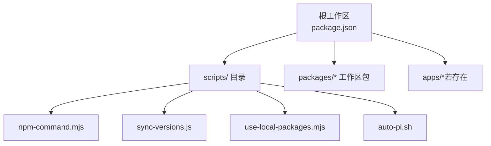
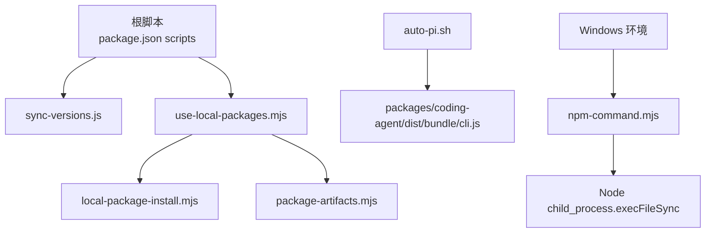
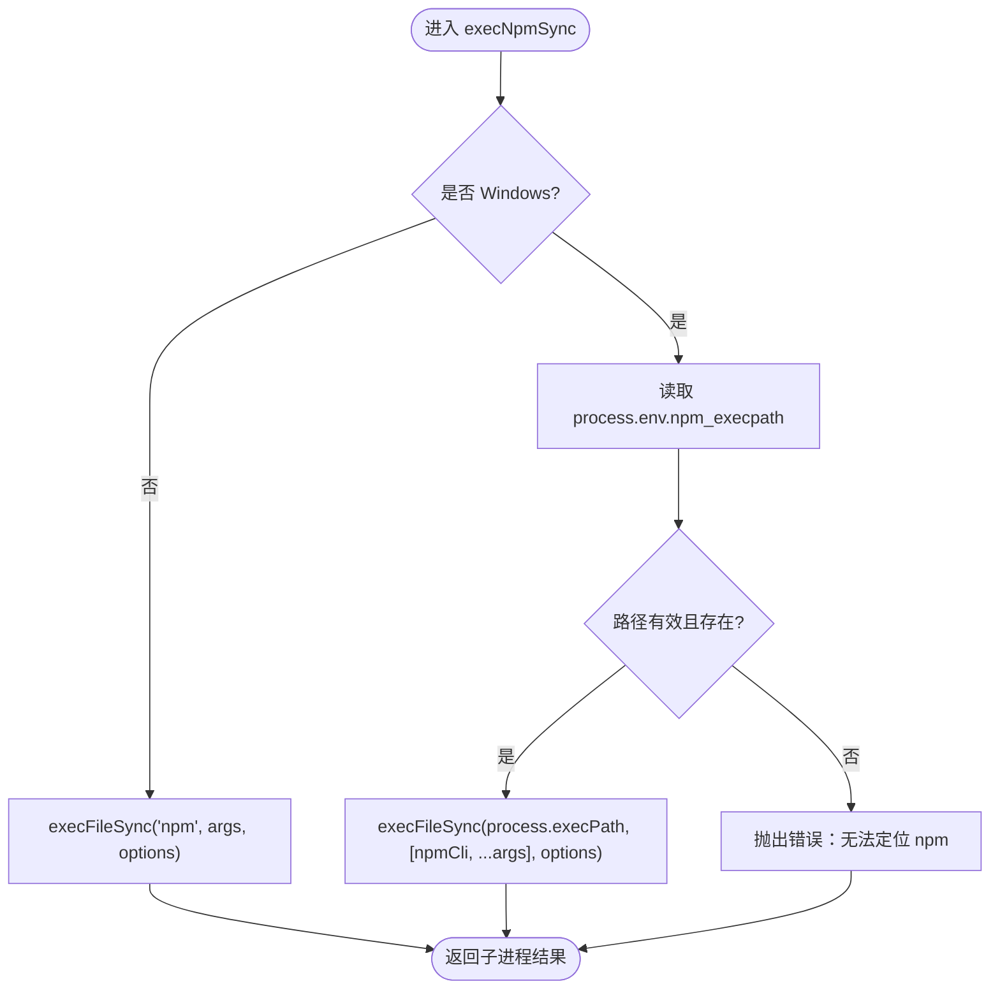
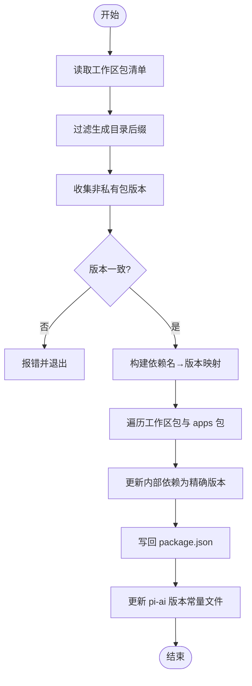
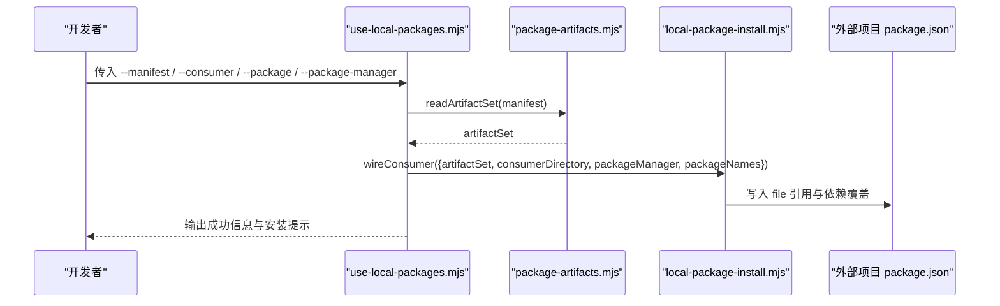
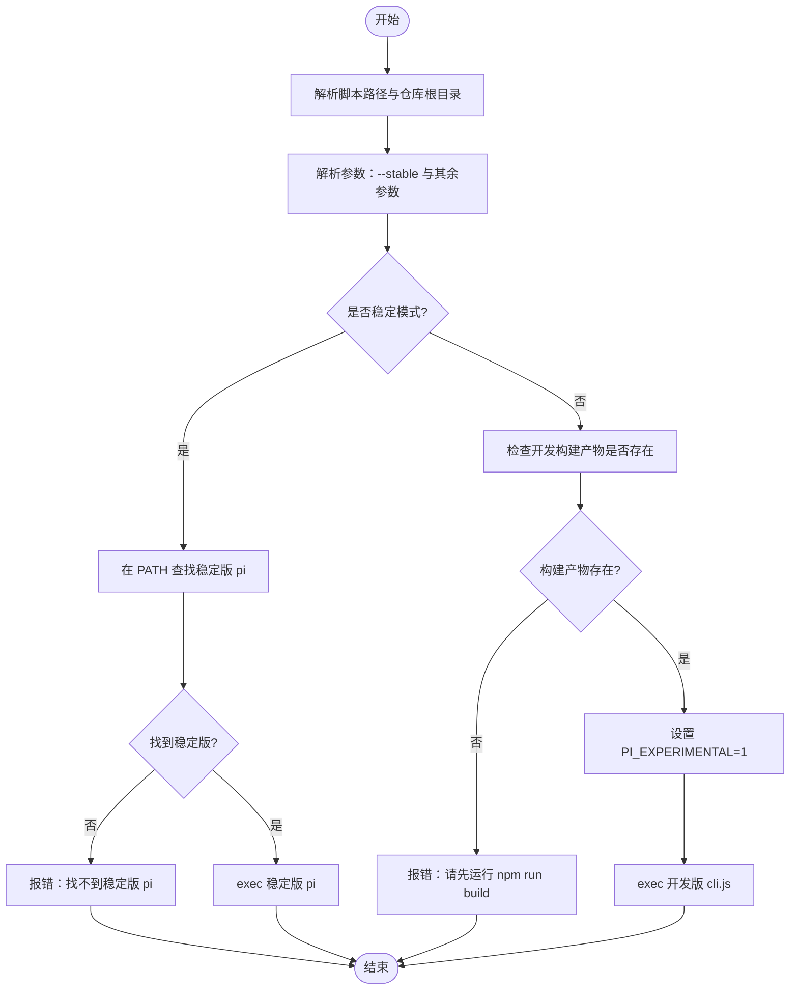
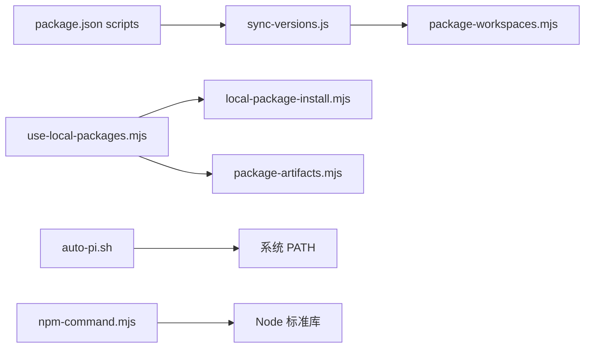

# 工具脚本

<cite>
**本文引用的文件**   
- [scripts/npm-command.mjs](file://scripts/npm-command.mjs)
- [scripts/sync-versions.js](file://scripts/sync-versions.js)
- [scripts/use-local-packages.mjs](file://scripts/use-local-packages.mjs)
- [scripts/auto-pi.sh](file://scripts/auto-pi.sh)
- [package.json](file://package.json)
- [README.md](file://README.md)
</cite>

## 目录
1. [简介](#简介)
2. [项目结构](#项目结构)
3. [核心工具脚本](#核心工具脚本)
4. [架构总览](#架构总览)
5. [详细组件分析](#详细组件分析)
6. [依赖关系分析](#依赖关系分析)
7. [性能与稳定性考虑](#性能与稳定性考虑)
8. [开发环境配置与使用指南](#开发环境配置与使用指南)
9. [常见任务自动化方案](#常见任务自动化方案)
10. [故障排除指南](#故障排除指南)
11. [结论](#结论)

## 简介
本文件聚焦仓库中的开发辅助工具与实用脚本，重点说明以下四个脚本的职责、调用方式与协作关系：
- npm-command.mjs：封装跨平台的 npm 子进程执行逻辑。
- sync-versions.js：校验并发布包版本一致性，并同步工作区内外部依赖的精确版本。
- use-local-packages.mjs：将外部项目切换到本地构建的 Pi 包制品集，支持 npm 与 pnpm。
- auto-pi.sh：在开发环境中自动启动 Pi CLI，或回退到 PATH 上的稳定版可执行文件。

这些脚本共同支撑了仓库的版本管理、依赖锁定、本地开发体验以及发布流程。

## 项目结构
仓库采用 monorepo 组织，根 package.json 定义了 workspaces 和大量 scripts；脚本集中在 scripts 目录下，按职责划分：
- 构建与打包：pack-packages.mjs、package-artifacts.mjs、package-workspaces.mjs 等。
- 质量检查：check-pinned-deps.mjs、check-runtime-deps.mjs、check-ts-relative-imports.mjs 等。
- 版本与发布：sync-versions.js、release.mjs、publish.mjs 等。
- 开发辅助：auto-pi.sh、use-local-packages.mjs、npm-command.mjs 等。

图表来源
- [package.json:1-75](file://package.json#L1-L75)

章节来源
- [package.json:1-75](file://package.json#L1-L75)

## 核心工具脚本
本节概述四个脚本的目标与输入输出：
- npm-command.mjs
  - 目标：统一通过 Node 子进程执行 npm，解决 Windows 下 npm 路径问题。
  - 输入：npm 参数数组、可选 execFileSync 选项。
  - 输出：直接转发子进程结果。
- sync-versions.js
  - 目标：确保所有非私有包版本一致（锁步版本），并将工作区和 apps 中内部依赖更新为精确版本。
  - 输入：可选参数指定 packages 根目录（默认 packages）。
  - 输出：打印当前版本、变更日志，写入更新的 package.json，必要时更新 pi-ai 源码中的版本常量。
- use-local-packages.mjs
  - 目标：将外部项目的 package.json 切换为指向本地制品集的 file 引用，并注入传递依赖覆盖。
  - 输入：--manifest、--consumer、--package（可多个）、--package-manager（npm|pnpm）。
  - 输出：修改 consumer 的 package.json，提示运行安装命令。
- auto-pi.sh
  - 目标：优先从当前仓库构建产物启动 Pi；若请求 stable 或 update，则回退到 PATH 上已安装的稳定版 pi。
  - 输入：任意 pi 参数，支持 --stable。
  - 输出：exec 到对应可执行文件，设置 PI_EXPERIMENTAL=1（开发模式）。

章节来源
- [scripts/npm-command.mjs:1-11](file://scripts/npm-command.mjs#L1-L11)
- [scripts/sync-versions.js:1-99](file://scripts/sync-versions.js#L1-L99)
- [scripts/use-local-packages.mjs:1-42](file://scripts/use-local-packages.mjs#L1-L42)
- [scripts/auto-pi.sh:1-76](file://scripts/auto-pi.sh#L1-L76)

## 架构总览
下图展示四个脚本之间的依赖与调用关系，以及与根脚本和包的交互。

图表来源
- [package.json:12-55](file://package.json#L12-L55)
- [scripts/sync-versions.js:1-99](file://scripts/sync-versions.js#L1-L99)
- [scripts/use-local-packages.mjs:1-42](file://scripts/use-local-packages.mjs#L1-L42)
- [scripts/auto-pi.sh:60-76](file://scripts/auto-pi.sh#L60-L76)
- [scripts/npm-command.mjs:1-11](file://scripts/npm-command.mjs#L1-L11)

## 详细组件分析

### npm-command.mjs：跨平台 npm 执行封装
- 设计要点
  - 在非 Windows 平台直接调用系统 npm。
  - 在 Windows 平台通过环境变量 npm_execpath 定位 npm CLI，并使用 node 执行该 CLI，避免 Windows 下 npm 不可执行的问题。
  - 当 npm_execpath 缺失或文件不存在时抛出错误，要求通过 npm 脚本调用。
- 复杂度
  - 时间复杂度 O(1)，空间复杂度 O(1)。
- 错误处理
  - 找不到 npm_execpath 或文件不存在时立即报错，便于快速定位环境问题。

图表来源
- [scripts/npm-command.mjs:4-10](file://scripts/npm-command.mjs#L4-L10)

章节来源
- [scripts/npm-command.mjs:1-11](file://scripts/npm-command.mjs#L1-L11)

### sync-versions.js：包版本同步与校验
- 功能概览
  - 扫描 packages 下的工作区包清单，过滤生成目录后缀。
  - 收集所有非私有包版本，校验是否一致；不一致则中止并提示使用 version:* 脚本。
  - 遍历工作区包与 apps 包，将所有内部依赖更新为精确版本号。
  - 对 @earendil-works/pi-ai 包，同步其源码中的版本常量文件。
- 关键流程
  - 读取清单 → 校验版本一致性 → 计算新版本映射 → 更新依赖 → 写回 package.json → 更新 pi-ai 版本常量。
- 复杂度
  - 主要开销在文件读写与 JSON 解析，整体接近线性于包数量与依赖条目数。
- 注意事项
  - 忽略 registry 别名形式的依赖（如 npm:@...@version），避免误改未发布的版本。
  - 仅更新 dependencies/devDependencies/optionalDependencies 三类。

图表来源
- [scripts/sync-versions.js:15-99](file://scripts/sync-versions.js#L15-L99)

章节来源
- [scripts/sync-versions.js:1-99](file://scripts/sync-versions.js#L1-L99)

### use-local-packages.mjs：切换外部项目到本地包制品
- 功能概览
  - 解析命令行参数：--manifest、--consumer、--package（可多值）、--package-manager。
  - 校验必填参数与支持的包管理器（npm/pnpm）。
  - 读取本地制品集 manifest，调用 wireConsumer 将 consumer 的 package.json 切换为本地 file 引用，并注入传递依赖覆盖。
  - 输出操作结果与后续安装命令提示。
- 使用示例
  - npm 消费者：node scripts/use-local-packages.mjs --manifest .artifacts/pi-packages/manifest.json --consumer ../my-project --package @earendil-works/pi-durable --package @earendil-works/pi-agent-core
  - pnpm 消费者：同上，但添加 --package-manager pnpm，并在 consumer 目录运行 pnpm install --ignore-scripts。
- 依赖关系
  - local-package-install.mjs：负责实际 wiring 逻辑。
  - package-artifacts.mjs：读取制品集 manifest。

图表来源
- [scripts/use-local-packages.mjs:16-41](file://scripts/use-local-packages.mjs#L16-L41)

章节来源
- [scripts/use-local-packages.mjs:1-42](file://scripts/use-local-packages.mjs#L1-L42)

### auto-pi.sh：开发环境自动启动 Pi
- 功能概览
  - 解析脚本自身路径以定位仓库根目录。
  - 支持 --stable 参数：若启用，则在 PATH 中寻找稳定版 pi 可执行文件并执行。
  - 若未启用 stable，则尝试从仓库构建产物 packages/coding-agent/dist/bundle/cli.js 启动开发版 Pi，并设置 PI_EXPERIMENTAL=1。
  - 若构建产物不存在，提示先执行 npm run build。
- 行为分支
  - 参数包含 update 或显式 --stable：走稳定版路径。
  - 否则：走开发构建路径。

图表来源
- [scripts/auto-pi.sh:15-76](file://scripts/auto-pi.sh#L15-L76)

章节来源
- [scripts/auto-pi.sh:1-76](file://scripts/auto-pi.sh#L1-L76)

## 依赖关系分析
- 脚本间依赖
  - use-local-packages.mjs 依赖 local-package-install.mjs 与 package-artifacts.mjs。
  - sync-versions.js 依赖 package-workspaces.mjs 以发现工作区包。
  - npm-command.mjs 不依赖其他脚本，仅依赖 Node 标准库。
- 与根脚本的关系
  - package.json 的 scripts 中集成了 version:* 与 check:* 等命令，其中 version:* 会调用 sync-versions.js。
- 外部集成点
  - auto-pi.sh 与系统 PATH 交互，寻找稳定版 pi。
  - use-local-packages.mjs 与外部项目的 package.json 交互，进行依赖重写。

图表来源
- [package.json:12-55](file://package.json#L12-L55)
- [scripts/use-local-packages.mjs:1-42](file://scripts/use-local-packages.mjs#L1-L42)
- [scripts/sync-versions.js:1-99](file://scripts/sync-versions.js#L1-L99)
- [scripts/auto-pi.sh:1-76](file://scripts/auto-pi.sh#L1-L76)
- [scripts/npm-command.mjs:1-11](file://scripts/npm-command.mjs#L1-L11)

章节来源
- [package.json:12-55](file://package.json#L12-L55)
- [scripts/use-local-packages.mjs:1-42](file://scripts/use-local-packages.mjs#L1-L42)
- [scripts/sync-versions.js:1-99](file://scripts/sync-versions.js#L1-L99)
- [scripts/auto-pi.sh:1-76](file://scripts/auto-pi.sh#L1-L76)
- [scripts/npm-command.mjs:1-11](file://scripts/npm-command.mjs#L1-L11)

## 性能与稳定性考虑
- npm-command.mjs
  - 避免重复解析 npm 路径，仅在 Windows 分支进行额外判断。
  - 建议始终通过 npm 脚本调用，以确保 npm_execpath 可用。
- sync-versions.js
  - 批量读取与写入 package.json，减少 IO 次数。
  - 仅在需要时更新 pi-ai 版本常量文件，避免不必要的磁盘写入。
- use-local-packages.mjs
  - 通过 manifest 一次性获取制品信息，减少多次网络或文件系统访问。
  - 明确支持 npm 与 pnpm，避免运行时动态选择包管理器带来的不确定性。
- auto-pi.sh
  - 通过 find_stable_pi 快速定位稳定版 pi，避免无谓的 PATH 遍历。
  - 在未找到构建产物时尽早失败，减少无效等待。

[本节为通用指导，不直接分析具体文件]

## 开发环境配置与使用指南
- 基础环境
  - Node.js 版本要求：>=22.19.0（见根 package.json engines）。
  - 安装依赖：npm install --ignore-scripts（跳过生命周期脚本，提高安装速度与安全）。
- 构建与检查
  - 构建全部包：npm run build。
  - 离线构建：npm run build:offline。
  - 代码检查：npm run check。
- 本地包制品与外部项目集成
  - 构建本地制品集：npm run pack:packages -- --out .artifacts/pi-packages。
  - 切换外部项目到本地制品：node scripts/use-local-packages.mjs --manifest .artifacts/pi-packages/manifest.json --consumer ../my-project --package <pkg-name> [--package-manager npm|pnpm]。
  - 在消费者目录执行安装：npm install --ignore-scripts 或 pnpm install --ignore-scripts。
- 开发启动 Pi
  - 推荐方式：ln -s "$PWD/scripts/auto-pi.sh" "$HOME/.local/bin/pi"，并确保 ~/.local/bin 在 PATH 前部。
  - 开发模式：直接运行 pi，会自动从仓库构建产物启动，并设置 PI_EXPERIMENTAL=1。
  - 稳定模式：pi --stable 或 pi update，自动回退到 PATH 上的稳定版 pi。

章节来源
- [package.json:67-75](file://package.json#L67-L75)
- [README.md:102-153](file://README.md#L102-L153)
- [scripts/auto-pi.sh:1-76](file://scripts/auto-pi.sh#L1-L76)
- [scripts/use-local-packages.mjs:1-42](file://scripts/use-local-packages.mjs#L1-L42)

## 常见任务自动化方案
- 版本升级与同步
  - 补丁版本：npm run version:patch
  - 次版本：npm run version:minor
  - 主版本：npm run version:major
  - 上述命令会调用 sync-versions.js 同步内部依赖版本，并生成只读 lockfile。
- 依赖检查
  - 固定依赖检查：npm run check:pinned-deps
  - 运行时依赖检查：npm run check:runtime-deps
  - TypeScript 相对导入检查：npm run check:ts-imports
  - 入口图检查：npm run check:entry-graphs
- 外部项目本地化依赖
  - 使用 use-local-packages.mjs 将外部项目切换到本地制品集，保证依赖一致性与可重现性。

章节来源
- [package.json:41-44](file://package.json#L41-L44)
- [package.json:21-26](file://package.json#L21-L26)
- [scripts/sync-versions.js:1-99](file://scripts/sync-versions.js#L1-L99)
- [scripts/use-local-packages.mjs:1-42](file://scripts/use-local-packages.mjs#L1-L42)

## 故障排除指南
- Windows 下 npm 执行失败
  - 现象：提示无法定位 npm。
  - 原因：未在 npm 脚本中调用，导致 npm_execpath 为空。
  - 解决：通过 npm run xxx 调用脚本，而非直接 node scripts/*.mjs。
  - 参考：[scripts/npm-command.mjs:4-10](file://scripts/npm-command.mjs#L4-L10)
- 版本不一致导致同步失败
  - 现象：sync-versions.js 报错“非私有包版本不一致”。
  - 原因：未使用 version:* 脚本统一提升版本。
  - 解决：运行 npm run version:patch/minor/major，再重新执行同步。
  - 参考：[scripts/sync-versions.js:39-47](file://scripts/sync-versions.js#L39-L47)
- 外部项目切换本地包后安装失败
  - 现象：npm install 或 pnpm install 失败。
  - 原因：制品目录不可用或 consumer 路径不正确。
  - 解决：确认 --manifest 指向有效的 manifest.json，--consumer 指向消费者根目录；保持制品目录可用。
  - 参考：[scripts/use-local-packages.mjs:29-38](file://scripts/use-local-packages.mjs#L29-L38)
- auto-pi.sh 找不到稳定版或构建产物
  - 现象：提示找不到稳定版 pi 或开发构建产物不存在。
  - 原因：PATH 配置不当或未执行 npm run build。
  - 解决：确保 ~/.local/bin 在 PATH 前部；先执行 npm run build；如需稳定版，使用 pi --stable 或 pi update。
  - 参考：[scripts/auto-pi.sh:60-76](file://scripts/auto-pi.sh#L60-L76)

章节来源
- [scripts/npm-command.mjs:4-10](file://scripts/npm-command.mjs#L4-L10)
- [scripts/sync-versions.js:39-47](file://scripts/sync-versions.js#L39-L47)
- [scripts/use-local-packages.mjs:29-38](file://scripts/use-local-packages.mjs#L29-L38)
- [scripts/auto-pi.sh:60-76](file://scripts/auto-pi.sh#L60-L76)

## 结论
这四个工具脚本构成了 Pi 仓库开发与发布流程的关键基础设施：
- npm-command.mjs 提供稳定的跨平台 npm 执行能力。
- sync-versions.js 保障发布包版本一致性与内部依赖精确化。
- use-local-packages.mjs 简化外部项目对本地制品集的集成。
- auto-pi.sh 提升本地开发效率，无缝切换开发版与稳定版。

结合根 package.json 的脚本与工作区机制，开发者可以高效完成构建、检查、版本管理与本地调试，同时保持依赖的可重现性与安全性。