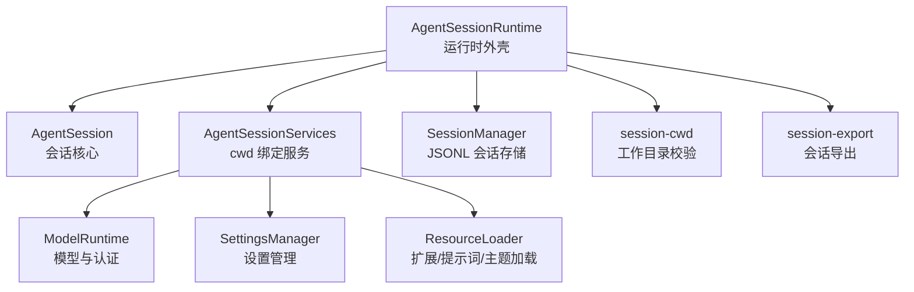
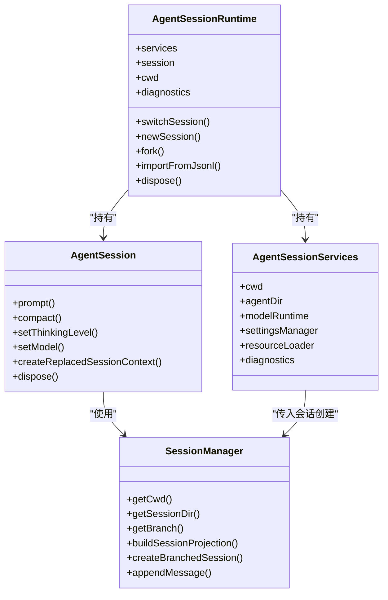
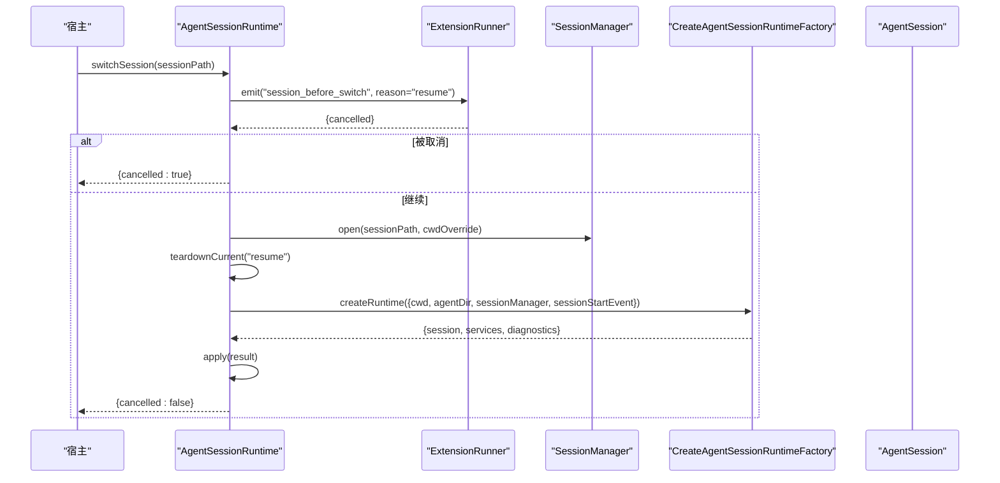
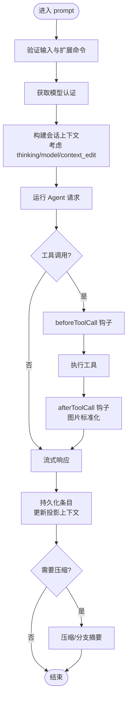
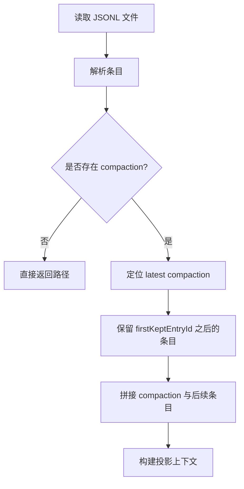
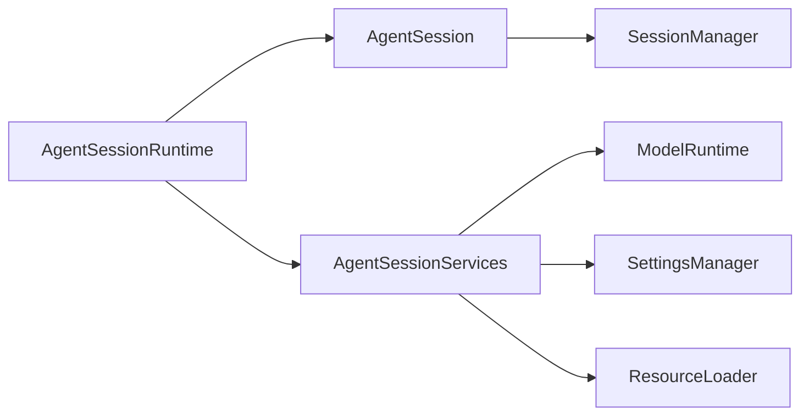

# 代理会话运行时

<cite>
**本文引用的文件**
- [agent-session-runtime.ts](file://packages/coding-agent/src/core/agent-session-runtime.ts)
- [agent-session-services.ts](file://packages/coding-agent/src/core/agent-session-services.ts)
- [agent-session.ts](file://packages/coding-agent/src/core/agent-session.ts)
- [session-manager.ts](file://packages/coding-agent/src/core/session-manager.ts)
- [session-cwd.ts](file://packages/coding-agent/src/core/session-cwd.ts)
- [session-export.ts](file://packages/coding-agent/src/core/session-export.ts)
</cite>

## 目录
1. [引言](#引言)
2. [项目结构](#项目结构)
3. [核心组件](#核心组件)
4. [架构总览](#架构总览)
5. [详细组件分析](#详细组件分析)
6. [依赖关系分析](#依赖关系分析)
7. [性能与可扩展性](#性能与可扩展性)
8. [故障排查指南](#故障排查指南)
9. [结论](#结论)

## 引言
本文面向开发者，系统性解析代理会话运行时的设计与实现，重点围绕 AgentSessionRuntime 类的设计模式、生命周期管理、会话状态管理、服务绑定机制、事件处理流程与错误处理策略。文档同时覆盖会话导入导出、权限检查、上下文管理等高级能力的使用要点，帮助读者从“运行时如何创建与会话切换”到“分叉、销毁、资源清理”的全链路理解。

## 项目结构
本主题涉及的核心代码集中在 coding-agent 包的 core 层：
- 运行时外壳：AgentSessionRuntime 负责当前工作目录绑定的服务与 AgentSession 的创建、替换与销毁。
- 会话抽象：AgentSession 封装 Agent 生命周期、消息流、工具执行、压缩、分支摘要等。
- 会话持久化：SessionManager 维护 JSONL 会话文件、树形结构与投影上下文。
- 工作目录校验：session-cwd 提供缺失 cwd 的错误诊断与断言。
- 会话导出：session-export 将当前分支序列化为 JSONL。
- 服务构建：agent-session-services 构建 cwd 绑定的 ModelRuntime、SettingsManager、ResourceLoader 等服务。

**图示来源**
- [agent-session-runtime.ts:74-418](file://packages/coding-agent/src/core/agent-session-runtime.ts#L74-L418)
- [agent-session.ts:409-559](file://packages/coding-agent/src/core/agent-session.ts#L409-L559)
- [session-manager.ts:43-227](file://packages/coding-agent/src/core/session-manager.ts#L43-L227)
- [session-cwd.ts:44-59](file://packages/coding-agent/src/core/session-cwd.ts#L44-L59)
- [session-export.ts:9-44](file://packages/coding-agent/src/core/session-export.ts#L9-L44)
- [agent-session-services.ts:73-204](file://packages/coding-agent/src/core/agent-session-services.ts#L73-L204)

**章节来源**
- [agent-session-runtime.ts:17-41](file://packages/coding-agent/src/core/agent-session-runtime.ts#L17-L41)
- [agent-session-services.ts:18-80](file://packages/coding-agent/src/core/agent-session-services.ts#L18-L80)

## 核心组件
- AgentSessionRuntime：运行时外壳，持有当前 AgentSession 与其 cwd 绑定的服务，负责 new、resume、fork、import、dispose 等生命周期操作，并通过工厂方法重建服务与会话。
- AgentSession：会话核心，封装 Agent 生命周期、事件订阅、模型与思维级别管理、工具调用、压缩与分支摘要、Bash 执行等。
- SessionManager：会话持久化与上下文投影，维护 JSONL 文件、条目树、上下文编辑、压缩边界与分支摘要。
- AgentSessionServices：cwd 绑定的基础设施服务集合，包含 ModelRuntime、SettingsManager、ResourceLoader 及诊断信息。
- session-cwd：工作目录存在性校验与缺失 cwd 的诊断与异常类型。
- session-export：将当前会话分支序列化为 JSONL 并写入文件。

**章节来源**
- [agent-session-runtime.ts:74-115](file://packages/coding-agent/src/core/agent-session-runtime.ts#L74-L115)
- [agent-session.ts:409-559](file://packages/coding-agent/src/core/agent-session.ts#L409-L559)
- [session-manager.ts:43-227](file://packages/coding-agent/src/core/session-manager.ts#L43-L227)
- [agent-session-services.ts:73-80](file://packages/coding-agent/src/core/agent-session-services.ts#L73-L80)
- [session-cwd.ts:44-59](file://packages/coding-agent/src/core/session-cwd.ts#L44-L59)
- [session-export.ts:9-44](file://packages/coding-agent/src/core/session-export.ts#L9-L44)

## 架构总览
AgentSessionRuntime 作为“运行时外壳”，通过 CreateAgentSessionRuntimeFactory 工厂方法在 cwd 变化时重建服务与会话；AgentSession 作为“会话核心”，负责与 Agent 交互、事件分发、工具执行、压缩与分支摘要；SessionManager 作为“数据层”，负责 JSONL 读写、树形结构与上下文投影；AgentSessionServices 作为“服务层”，提供 cwd 绑定的基础设施。

**图示来源**
- [agent-session-runtime.ts:74-418](file://packages/coding-agent/src/core/agent-session-runtime.ts#L74-L418)
- [agent-session.ts:409-559](file://packages/coding-agent/src/core/agent-session.ts#L409-L559)
- [session-manager.ts:43-227](file://packages/coding-agent/src/core/session-manager.ts#L43-L227)
- [agent-session-services.ts:73-204](file://packages/coding-agent/src/core/agent-session-services.ts#L73-L204)

## 详细组件分析

### AgentSessionRuntime：运行时外壳与生命周期
- 设计模式
  - 工厂模式：通过 CreateAgentSessionRuntimeFactory 在 cwd 变化时重建服务与会话，避免全局状态污染。
  - 替换模式：switchSession/newSession/fork/import 均先 teardownCurrent，再 createRuntime，最后 apply 新会话与服务。
  - 钩子模式：通过 extensionRunner 发射 session_before_switch、session_before_fork、session_shutdown 等事件，允许扩展拦截或执行副作用。
- 关键生命周期
  - 创建：createAgentSessionRuntime 校验 cwd，调用工厂创建会话与服务，返回运行时实例。
  - 切换：switchSession 打开目标会话管理器，校验 cwd，teardown 旧会话，应用新会话与服务。
  - 新建：newSession 根据是否持久化选择内存或磁盘 SessionManager，必要时设置 parentSession。
  - 分叉：fork 支持 before/at 两种位置，持久化与非持久化路径分别处理，必要时复制会话或创建分支。
  - 导入：importFromJsonl 拷贝或重命名目标 JSONL，打开 SessionManager，校验 cwd，切换会话。
  - 销毁：dispose 中止响应、触发 shutdown、清理 UI 钩子、释放会话与等待凭据写入完成。
- 错误处理
  - 导入文件不存在抛出 SessionImportFileNotFoundError。
  - 工作目录缺失抛出 MissingSessionCwdError（由 assertSessionCwdExists 触发）。
  - 无效 entryId 或会话未保存时报错，阻止非法分叉。
- 事件流程
  - session_before_switch：允许取消 resume/new。
  - session_before_fork：允许取消 fork。
  - session_shutdown：在切换或退出前通知扩展进行清理。

**图示来源**
- [agent-session-runtime.ts:133-178](file://packages/coding-agent/src/core/agent-session-runtime.ts#L133-L178)
- [agent-session-runtime.ts:196-224](file://packages/coding-agent/src/core/agent-session-runtime.ts#L196-L224)

**章节来源**
- [agent-session-runtime.ts:17-41](file://packages/coding-agent/src/core/agent-session-runtime.ts#L17-L41)
- [agent-session-runtime.ts:74-115](file://packages/coding-agent/src/core/agent-session-runtime.ts#L74-L115)
- [agent-session-runtime.ts:133-178](file://packages/coding-agent/src/core/agent-session-runtime.ts#L133-L178)
- [agent-session-runtime.ts:196-224](file://packages/coding-agent/src/core/agent-session-runtime.ts#L196-L224)
- [agent-session-runtime.ts:226-260](file://packages/coding-agent/src/core/agent-session-runtime.ts#L226-L260)
- [agent-session-runtime.ts:262-350](file://packages/coding-agent/src/core/agent-session-runtime.ts#L262-L350)
- [agent-session-runtime.ts:359-402](file://packages/coding-agent/src/core/agent-session-runtime.ts#L359-L402)
- [agent-session-runtime.ts:409-418](file://packages/coding-agent/src/core/agent-session-runtime.ts#L409-L418)
- [agent-session-runtime.ts:427-445](file://packages/coding-agent/src/core/agent-session-runtime.ts#L427-L445)

### AgentSession：会话核心与状态管理
- 职责
  - 管理 Agent 生命周期、事件订阅、自动持久化。
  - 模型与思维级别管理、工具注册与执行、压缩与分支摘要。
  - Bash 执行、上下文投影、重试与恢复。
- 状态管理
  - 模型选择：记录 model_change 条目，支持虚拟模型与物理模型映射。
  - 思维级别：thinking_level_change 条目影响上下文构建。
  - 上下文编辑：context_edit 条目可替换早期消息内容贡献。
  - 压缩：compaction 条目保留摘要与 firstKeptEntryId，裁剪历史。
  - 分支摘要：branch_summary 条目用于分支合并与导航。
- 事件系统
  - 内部事件：agent_end、agent_settled、compaction_start/end、entry_appended、auto_retry_* 等。
  - 扩展事件：tool_call/tool_result、turn_start、message_*、bash_execution_update 等。
- 错误处理
  - 认证失败：区分 OAuth 过期与 API Key 缺失，给出引导信息。
  - 上下文溢出：触发压缩或重试逻辑。
  - 工具执行：before/after 钩子包装，图片标准化与结构化内容传递。

**图示来源**
- [agent-session.ts:688-760](file://packages/coding-agent/src/core/agent-session.ts#L688-L760)
- [agent-session.ts:518-559](file://packages/coding-agent/src/core/agent-session.ts#L518-L559)

**章节来源**
- [agent-session.ts:1-14](file://packages/coding-agent/src/core/agent-session.ts#L1-L14)
- [agent-session.ts:210-254](file://packages/coding-agent/src/core/agent-session.ts#L210-L254)
- [agent-session.ts:409-559](file://packages/coding-agent/src/core/agent-session.ts#L409-L559)
- [agent-session.ts:565-645](file://packages/coding-agent/src/core/agent-session.ts#L565-L645)
- [agent-session.ts:688-760](file://packages/coding-agent/src/core/agent-session.ts#L688-L760)

### SessionManager：会话持久化与上下文投影
- 数据结构
  - SessionHeader：会话头，含 id、timestamp、cwd、parentSession。
  - SessionEntry：消息、thinking_level_change、model_change、usage、compaction、branch_summary、custom、custom_message、context_edit、label、session_info。
  - SessionProjection：投影后的消息列表、thinkingLevel、model。
- 核心算法
  - buildSessionPath：根据 leafId 回溯父链构建路径。
  - buildContextEntries：按 compaction 边界裁剪历史，保留摘要与后续条目。
  - projectContextEntry：应用 context_edit 替换内容贡献。
  - buildSessionProjection：组合 entries/messages/thinkingLevel/model。
  - buildSessionContext：最终上下文供 LLM 使用。
- 文件 I/O
  - loadEntriesFromFile：逐行解析 JSONL，跳过畸形行。
  - readSessionHeader：限制扫描大小，防止超大 header 导致阻塞。
  - findMostRecentSession：按 mtime 排序，匹配 cwd 最近会话。

**图示来源**
- [session-manager.ts:476-512](file://packages/coding-agent/src/core/session-manager.ts#L476-L512)
- [session-manager.ts:520-574](file://packages/coding-agent/src/core/session-manager.ts#L520-L574)
- [session-manager.ts:628-671](file://packages/coding-agent/src/core/session-manager.ts#L628-L671)
- [session-manager.ts:686-738](file://packages/coding-agent/src/core/session-manager.ts#L686-L738)
- [session-manager.ts:750-769](file://packages/coding-agent/src/core/session-manager.ts#L750-L769)

**章节来源**
- [session-manager.ts:43-227](file://packages/coding-agent/src/core/session-manager.ts#L43-L227)
- [session-manager.ts:476-574](file://packages/coding-agent/src/core/session-manager.ts#L476-L574)
- [session-manager.ts:628-769](file://packages/coding-agent/src/core/session-manager.ts#L628-L769)

### AgentSessionServices：cwd 绑定服务构建
- 职责
  - 创建 ModelRuntime（含 auth.json/models.json）、SettingsManager、ResourceLoader。
  - 注册扩展提供的 Provider/NativeProvider/VirtualModel。
  - 应用扩展标志值，收集诊断信息。
- 关键点
  - cwd 与 agentDir 解析为绝对路径，确保 cwd 切换后不再重新解释 CLI 参数。
  - resourceLoader.reload 加载扩展、技能、提示词、主题等资源。
  - pendingProviderRegistrations 等队列在刷新后被清空，避免重复注册。

**章节来源**
- [agent-session-services.ts:18-80](file://packages/coding-agent/src/core/agent-session-services.ts#L18-L80)
- [agent-session-services.ts:135-204](file://packages/coding-agent/src/core/agent-session-services.ts#L135-L204)
- [agent-session-services.ts:214-233](file://packages/coding-agent/src/core/agent-session-services.ts#L214-L233)

### 会话导入导出与工作目录校验
- 导入
  - importFromJsonl：校验文件存在，复制到会话目录（去重），打开 SessionManager，校验 cwd，切换会话。
  - 若 cwd 缺失，抛出 MissingSessionCwdError。
- 导出
  - serializeSessionBranch/exportSessionToJsonl：序列化当前分支为 JSONL，默认输出到 process.cwd 下带时间戳的文件名。
- 工作目录校验
  - getMissingSessionCwdIssue/formatMissingSessionCwdError/formatMissingSessionCwdPrompt：生成诊断与格式化错误/提示。
  - assertSessionCwdExists：当 sessionCwd 不存在且无 override 时抛出异常。

**章节来源**
- [agent-session-runtime.ts:359-402](file://packages/coding-agent/src/core/agent-session-runtime.ts#L359-L402)
- [session-export.ts:9-44](file://packages/coding-agent/src/core/session-export.ts#L9-L44)
- [session-cwd.ts:14-59](file://packages/coding-agent/src/core/session-cwd.ts#L14-L59)

## 依赖关系分析
- 耦合与内聚
  - AgentSessionRuntime 与 AgentSession 高内聚：运行时外壳仅负责生命周期与替换，不深入会话业务细节。
  - AgentSession 与 SessionManager 松耦合：通过接口访问条目与投影，便于测试与替换。
  - AgentSessionServices 独立于会话：cwd 绑定服务可复用，减少重复初始化成本。
- 外部依赖
  - ModelRuntime：模型注册、认证、OAuth 刷新、凭据写入。
  - ResourceLoader：扩展、技能、提示词、主题、上下文文件加载。
  - SettingsManager：用户设置与工具负载管理。
- 潜在循环依赖
  - 运行时与会话之间通过回调 rebindSession 解耦，避免直接循环引用。
  - 扩展系统通过 ExtensionRunner 统一事件通道，降低模块间耦合。

**图示来源**
- [agent-session-runtime.ts:74-418](file://packages/coding-agent/src/core/agent-session-runtime.ts#L74-L418)
- [agent-session.ts:409-559](file://packages/coding-agent/src/core/agent-session.ts#L409-L559)
- [agent-session-services.ts:73-204](file://packages/coding-agent/src/core/agent-session-services.ts#L73-L204)

**章节来源**
- [agent-session-runtime.ts:74-115](file://packages/coding-agent/src/core/agent-session-runtime.ts#L74-L115)
- [agent-session-services.ts:73-80](file://packages/coding-agent/src/core/agent-session-services.ts#L73-L80)

## 性能与可扩展性
- 性能特性
  - JSONL 流式读取：loadEntriesFromFile 使用固定缓冲区，避免大文件一次性加载。
  - Header 扫描限制：readSessionHeader 限制最大扫描字节数，防止超大 header 阻塞。
  - 最近会话发现：findMostRecentSession 按 mtime 排序，快速定位活跃会话。
- 可扩展点
  - 扩展钩子：tool_call/tool_result、session_before_switch/session_before_fork/session_shutdown 等。
  - 自定义工具：customTools 与 baseToolsOverride 支持注入或替换基础工具。
  - 虚拟模型：isVirtualModel 与 resolveModel 支持动态路由与上下文感知选择。
- 优化建议
  - 在 cwd 切换时复用已创建的 ModelRuntime，减少认证开销。
  - 对频繁读写的 SessionManager 操作进行批处理，减少文件 I/O。
  - 使用 cacheWarmer 预热提示缓存，降低冷启动延迟。

[本节为通用指导，不涉及具体文件分析]

## 故障排查指南
- 导入会话失败
  - 现象：抛出 SessionImportFileNotFoundError。
  - 原因：输入 JSONL 路径不存在。
  - 处理：确认路径正确，或使用绝对路径。
- 工作目录缺失
  - 现象：抛出 MissingSessionCwdError。
  - 原因：会话文件中记录的 cwd 不存在，且未提供 cwdOverride。
  - 处理：提供有效的 cwdOverride，或修复会话文件的 cwd 字段。
- 分叉失败
  - 现象：Invalid entry ID 或会话未保存。
  - 原因：entryId 无效或会话尚未持久化。
  - 处理：确保发送过消息以持久化会话，或选择有效的 message 条目。
- 认证失败
  - 现象：OAuth 过期或 API Key 缺失。
  - 原因：凭据失效或未配置。
  - 处理：执行 /login 重新认证，或配置 API Key。

**章节来源**
- [agent-session-runtime.ts:46-54](file://packages/coding-agent/src/core/agent-session-runtime.ts#L46-L54)
- [session-cwd.ts:44-59](file://packages/coding-agent/src/core/session-cwd.ts#L44-L59)
- [agent-session-runtime.ts:262-350](file://packages/coding-agent/src/core/agent-session-runtime.ts#L262-L350)
- [agent-session.ts:565-645](file://packages/coding-agent/src/core/agent-session.ts#L565-L645)

## 结论
AgentSessionRuntime 通过工厂与替换模式实现了稳健的会话生命周期管理，结合 AgentSession 的丰富事件系统与 SessionManager 的高效持久化，提供了完整的代理会话运行时能力。开发者可通过扩展钩子、自定义工具与虚拟模型进一步扩展功能；通过诊断与错误处理机制，提升系统的可观测性与健壮性。在实际使用中，应关注 cwd 校验、认证流程与 JSONL 文件大小，以确保性能与稳定性。