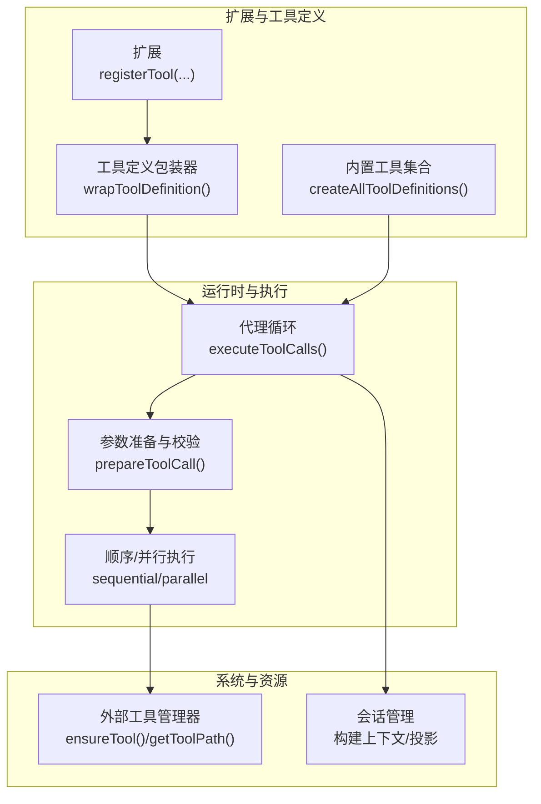
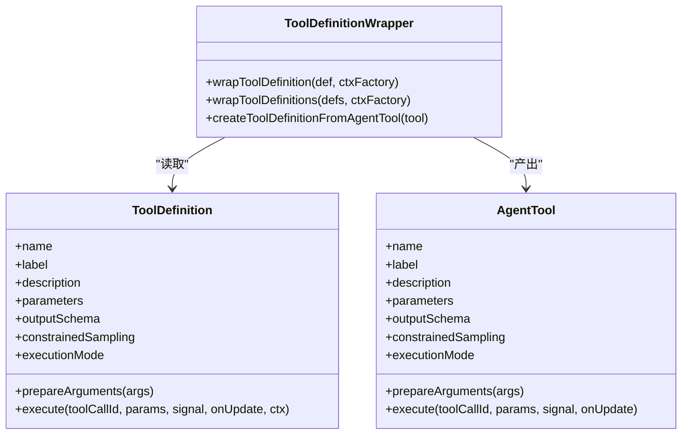
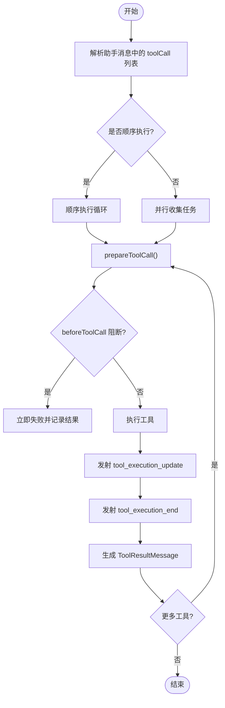
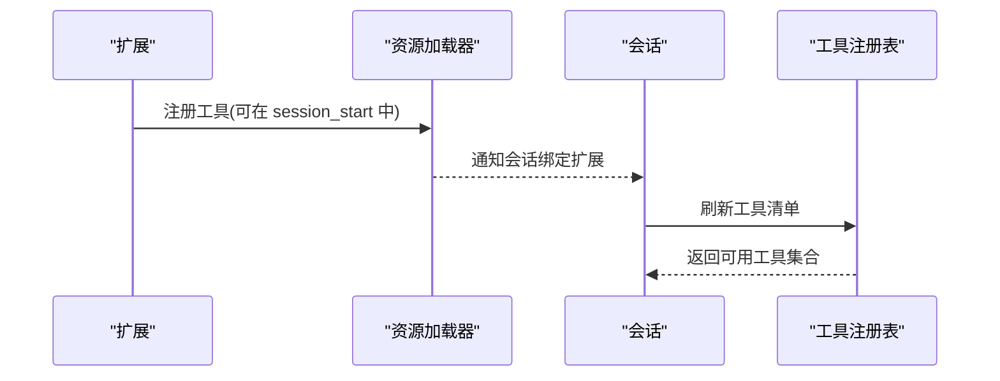
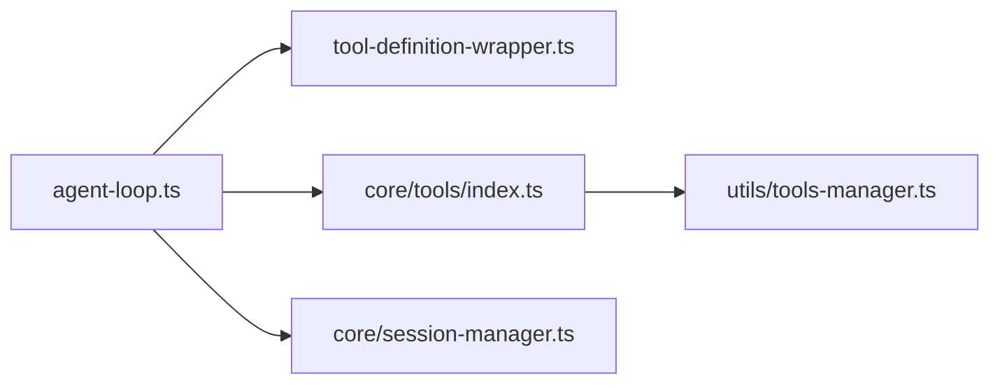

# 工具架构设计

<cite>
**本文引用的文件**
- [agent-loop.ts](file://packages/agent/src/agent-loop.ts)
- [tool-definition-wrapper.ts](file://packages/coding-agent/src/core/tools/tool-definition-wrapper.ts)
- [tools-manager.ts](file://packages/coding-agent/src/utils/tools-manager.ts)
- [index.ts（内置工具聚合）](file://packages/coding-agent/src/core/tools/index.ts)
- [session-manager.ts](file://packages/coding-agent/src/core/session-manager.ts)
- [agent-session-dynamic-tools.test.ts](file://packages/coding-agent/test/agent-session-dynamic-tools.test.ts)
- [9124-runtime-dispose-tool-settlement.test.ts](file://packages/coding-agent/test/suite/regressions/9124-runtime-dispose-tool-settlement.test.ts)
- [5109-exclude-tools.test.ts](file://packages/coding-agent/test/suite/regressions/5109-exclude-tools.test.ts)
- [default-tools-setting.test.ts](file://packages/coding-agent/test/default-tools-setting.test.ts)
</cite>

## 目录
1. [引言](#引言)
2. [项目结构](#项目结构)
3. [核心组件](#核心组件)
4. [架构总览](#架构总览)
5. [详细组件分析](#详细组件分析)
6. [依赖关系分析](#依赖关系分析)
7. [性能与并发特性](#性能与并发特性)
8. [故障排查指南](#故障排查指南)
9. [结论](#结论)

## 引言
本文件面向开发者，系统性梳理“工具系统”的架构设计与实现要点，重点覆盖：
- 工具的注册机制、生命周期管理与执行流程
- 工具定义包装器的工作原理
- 文件变更队列与并发控制机制
- 工具权限模型、安全沙箱与安全边界
- 错误处理策略与可观测性
- 组件交互关系与数据流向

该文档以仓库中实际代码为依据，结合测试用例验证行为，帮助读者建立从扩展侧到运行时执行的完整理解。

## 项目结构
围绕工具系统的核心代码分布在以下位置：
- 代理循环与工具执行编排：packages/agent/src/agent-loop.ts
- 工具定义与 AgentTool 适配层：packages/coding-agent/src/core/tools/tool-definition-wrapper.ts
- 内置工具集合与工厂：packages/coding-agent/src/core/tools/index.ts
- 外部二进制工具下载与安装：packages/coding-agent/src/utils/tools-manager.ts
- 会话上下文与消息投影：packages/coding-agent/src/core/session-manager.ts
- 动态工具注册与权限过滤等行为的测试：packages/coding-agent/test/*



图示来源
- [agent-loop.ts:518-670](file://packages/agent/src/agent-loop.ts#L518-L670)
- [tool-definition-wrapper.ts:27-57](file://packages/coding-agent/src/core/tools/tool-definition-wrapper.ts#L27-L57)
- [index.ts（内置工具聚合）:182-193](file://packages/coding-agent/src/core/tools/index.ts#L182-L193)
- [tools-manager.ts:337-397](file://packages/coding-agent/src/utils/tools-manager.ts#L337-L397)
- [session-manager.ts:543-584](file://packages/coding-agent/src/core/session-manager.ts#L543-L584)

章节来源
- [agent-loop.ts:172-330](file://packages/agent/src/agent-loop.ts#L172-L330)
- [tool-definition-wrapper.ts:1-78](file://packages/coding-agent/src/core/tools/tool-definition-wrapper.ts#L1-L78)
- [index.ts（内置工具聚合）:1-225](file://packages/coding-agent/src/core/tools/index.ts#L1-L225)
- [tools-manager.ts:1-398](file://packages/coding-agent/src/utils/tools-manager.ts#L1-L398)
- [session-manager.ts:435-584](file://packages/coding-agent/src/core/session-manager.ts#L435-L584)

## 核心组件
- 代理循环与工具执行编排
  - 负责解析助手消息中的工具调用，决定顺序或并行执行，统一发射工具执行事件，并生成工具结果消息回注入上下文。
- 工具定义包装器
  - 将扩展定义的 ToolDefinition 转换为运行时所需的 AgentTool；同时支持从 AgentTool 反推最小 ToolDefinition，保持内部“定义优先”的注册一致性。
- 内置工具聚合
  - 提供 read/bash/powershell/edit/write/grep/find/ls 等工具的定义与实例工厂，以及只读/编码模式等组合。
- 外部工具管理器
  - 负责 fd/ripgrep 等外部二进制工具的自动发现、下载、解压与权限设置，并提供离线模式与平台兼容性提示。
- 会话管理
  - 维护会话条目、压缩摘要、分支摘要与上下文编辑，构建模型可见的消息投影，为工具执行提供稳定的上下文环境。

章节来源
- [agent-loop.ts:518-670](file://packages/agent/src/agent-loop.ts#L518-L670)
- [tool-definition-wrapper.ts:27-77](file://packages/coding-agent/src/core/tools/tool-definition-wrapper.ts#L27-L77)
- [index.ts（内置工具聚合）:118-225](file://packages/coding-agent/src/core/tools/index.ts#L118-L225)
- [tools-manager.ts:337-397](file://packages/coding-agent/src/utils/tools-manager.ts#L337-L397)
- [session-manager.ts:543-584](file://packages/coding-agent/src/core/session-manager.ts#L543-L584)

## 架构总览
工具系统的关键路径如下：
- 扩展通过 registerTool 声明工具定义
- 包装器将定义适配为 AgentTool
- 代理循环在助手响应后提取 toolCall，进行参数准备、校验与钩子拦截
- 根据 executionMode 或配置选择顺序/并行执行
- 工具执行期间可触发外部工具下载、文件系统操作等
- 工具结果被序列化为 ToolResultMessage 回写上下文，驱动下一轮对话

```mermaid
sequenceDiagram
participant Ext as "扩展"
participant Wrap as "工具定义包装器"
participant Loop as "代理循环"
participant Prep as "参数准备/校验"
participant Exec as "顺序/并行执行器"
participant Sys as "外部工具/文件系统"
participant Sess as "会话上下文"
Ext->>Wrap : 注册 ToolDefinition
Wrap-->>Loop : 暴露 AgentTool
Loop->>Loop : 解析助手消息(toolCall)
Loop->>Prep : prepareToolCall()
Prep-->>Loop : 已准备/立即失败
alt 顺序执行
Loop->>Exec : executeToolCallsSequential()
else 并行执行
Loop->>Exec : executeToolCallsParallel()
end
Exec->>Sys : 调用工具(可能触发下载/IO)
Sys-->>Exec : 返回结果/更新
Exec-->>Loop : 工具结果
Loop->>Sess : 写入 ToolResultMessage
```

图示来源
- [agent-loop.ts:518-670](file://packages/agent/src/agent-loop.ts#L518-L670)
- [tool-definition-wrapper.ts:27-57](file://packages/coding-agent/src/core/tools/tool-definition-wrapper.ts#L27-L57)
- [tools-manager.ts:337-397](file://packages/coding-agent/src/utils/tools-manager.ts#L337-L397)

## 详细组件分析

### 工具定义包装器与类型桥接
- 作用
  - 将扩展侧的 ToolDefinition 转换为 AgentTool，确保名称、标签、描述、参数 schema、输出 schema、采样约束、参数预处理、执行模式与执行函数一致。
  - 支持从 AgentTool 反向构造最小 ToolDefinition，保证内部“定义优先”的注册体系不被破坏。
- 关键点
  - wrapToolDefinition 透传所有元数据，并在 execute 时注入 ExtensionToolContext（可由工厂创建）。
  - createToolDefinitionFromAgentTool 用于兼容直接传入 AgentTool 的场景。



图示来源
- [tool-definition-wrapper.ts:27-77](file://packages/coding-agent/src/core/tools/tool-definition-wrapper.ts#L27-L77)

章节来源
- [tool-definition-wrapper.ts:1-78](file://packages/coding-agent/src/core/tools/tool-definition-wrapper.ts#L1-L78)

### 内置工具聚合与扩展点
- 内置工具族
  - read、bash、powershell、edit、write、grep、find、ls
- 工厂方法
  - createToolDefinition/createTool：按名称创建定义或实例
  - createCodingToolDefinitions/createReadOnlyToolDefinitions：按场景组合
  - createAllToolDefinitions/createAllTools：全量导出
- 扩展集成
  - 扩展通过 pi.registerTool 注册自定义工具，最终由包装器统一转为 AgentTool 进入运行时代码路径。

章节来源
- [index.ts（内置工具聚合）:1-225](file://packages/coding-agent/src/core/tools/index.ts#L1-L225)

### 工具执行流程与并发控制
- 入口
  - agent-loop.ts 中 executeToolCalls 根据 executionMode 或全局配置选择顺序或并行执行。
- 参数准备与校验
  - prepareToolCall 完成工具查找、参数预处理、schema 校验、beforeToolCall 钩子拦截与中止信号检查。
- 顺序执行
  - 逐个工具调用，遇到终止标志或中止信号提前退出。
- 并行执行
  - 将所有待执行任务收集为 Promise，使用 Promise.all 等待全部完成，并按原序生成结果消息。
- 工具结果
  - 每个工具调用都会发射 tool_execution_start/update/end 事件，并将 ToolResultMessage 追加到上下文。



图示来源
- [agent-loop.ts:518-670](file://packages/agent/src/agent-loop.ts#L518-L670)

章节来源
- [agent-loop.ts:518-670](file://packages/agent/src/agent-loop.ts#L518-L670)

### 工具注册机制与生命周期
- 静态注册
  - 扩展在加载阶段通过 pi.registerTool 注册工具，随后由包装器统一转为 AgentTool。
- 动态注册
  - 可在 session_start 等时机动态注册工具；绑定扩展后，会话会刷新工具清单。
- 生命周期
  - 注册 -> 包装 -> 参与工具状态差异计算 -> 进入可执行集 -> 执行 -> 结果回写上下文。



图示来源
- [agent-session-dynamic-tools.test.ts:103-143](file://packages/coding-agent/test/agent-session-dynamic-tools.test.ts#L103-L143)

章节来源
- [agent-session-dynamic-tools.test.ts:1-143](file://packages/coding-agent/test/agent-session-dynamic-tools.test.ts#L1-L143)

### 文件变更队列与并发控制
- 背景
  - 多个工具可能并发修改文件系统，需要避免竞态与不一致。
- 方案
  - 通过 withFileMutationQueue 对文件写入类工具进行队列化改造，串行化文件变更，保证一致性。
- 适用工具
  - write、edit 等涉及文件写入的工具通常使用该队列封装。

章节来源
- [index.ts（内置工具聚合）:20-20](file://packages/coding-agent/src/core/tools/index.ts#L20-L20)

### 工具权限模型与安全沙箱
- 权限控制
  - 支持允许/排除名单与初始激活名单，支持通配符匹配；默认工具可通过 noTools/all 等选项控制。
  - 测试覆盖了排除工具、允许/排除模式匹配、无效选项报错等场景。
- 安全沙箱
  - 工具执行通过 beforeToolCall 钩子可实现拦截、阻断与终止；参数校验失败或工具不存在会立即失败。
  - 外部二进制工具下载具备超时、重试、离线模式与平台限制提示，降低安全风险。

章节来源
- [5109-exclude-tools.test.ts:1-99](file://packages/coding-agent/test/suite/regressions/5109-exclude-tools.test.ts#L1-L99)
- [default-tools-setting.test.ts:178-216](file://packages/coding-agent/test/default-tools-setting.test.ts#L178-L216)
- [agent-loop.ts:718-787](file://packages/agent/src/agent-loop.ts#L718-L787)
- [tools-manager.ts:337-397](file://packages/coding-agent/src/utils/tools-manager.ts#L337-L397)

### 错误处理策略
- 参数与校验错误
  - prepareToolCall 捕获异常并转化为立即失败的 ToolResultMessage。
- 截断消息保护
  - 当助手响应因 token 限制被截断时，批量失败其中的工具调用，避免执行不完整参数。
- 中止信号
  - 在执行前与执行中检查 AbortSignal，及时中断并上报中止错误。
- 外部工具下载失败
  - 捕获网络/解压/权限等异常，向上抛出结构化错误信息，便于诊断。

章节来源
- [agent-loop.ts:481-513](file://packages/agent/src/agent-loop.ts#L481-L513)
- [agent-loop.ts:718-787](file://packages/agent/src/agent-loop.ts#L718-L787)
- [tools-manager.ts:337-397](file://packages/coding-agent/src/utils/tools-manager.ts#L337-L397)

## 依赖关系分析
- 组件耦合
  - 代理循环依赖 AgentTool 抽象，不关心具体实现；工具定义包装器解耦扩展定义与运行时接口。
  - 内置工具聚合提供统一的创建入口，便于按场景组合。
  - 外部工具管理器独立于工具逻辑，仅在被调用时按需获取二进制。
- 潜在环依赖
  - 当前结构未见明显环依赖；工具定义与执行分离，扩展通过包装器接入。
- 外部依赖
  - 依赖 Node 文件系统、子进程、网络请求等能力；对外部二进制工具存在平台差异处理。



图示来源
- [agent-loop.ts:518-670](file://packages/agent/src/agent-loop.ts#L518-L670)
- [tool-definition-wrapper.ts:27-57](file://packages/coding-agent/src/core/tools/tool-definition-wrapper.ts#L27-L57)
- [index.ts（内置工具聚合）:182-225](file://packages/coding-agent/src/core/tools/index.ts#L182-L225)
- [tools-manager.ts:337-397](file://packages/coding-agent/src/utils/tools-manager.ts#L337-L397)
- [session-manager.ts:543-584](file://packages/coding-agent/src/core/session-manager.ts#L543-L584)

## 性能与并发特性
- 并行执行
  - 非顺序模式下，工具调用并行执行，提升吞吐；但需注意 I/O 竞争，建议对写操作使用文件变更队列。
- 流式响应
  - 代理循环对 LLM 响应进行流式处理，逐步更新上下文并发送中间事件，减少首字节延迟。
- 外部工具下载
  - 带网络与下载超时、重试与离线模式，避免阻塞主流程；解压过程使用临时目录避免并发冲突。

[本节为通用指导，不直接分析具体文件]

## 故障排查指南
- 工具未找到
  - 检查工具名是否正确、是否被允许名单排除；确认扩展已正确绑定且会话已刷新工具清单。
- 参数校验失败
  - 查看 beforeToolCall 钩子与参数 schema 定义；必要时在 prepareArguments 中进行预处理。
- 工具执行被阻断
  - 检查 beforeToolCall 的 block/terminate 配置；确认中止信号未被提前触发。
- 外部工具不可用
  - 检查 PI_OFFLINE 环境变量、平台/架构是否受支持；查看 ensureTool 的状态回调与错误链。
- 会话上下文异常
  - 检查会话压缩/分支摘要/上下文编辑是否影响模型可见消息；确认会话投影构建正常。

章节来源
- [agent-loop.ts:718-787](file://packages/agent/src/agent-loop.ts#L718-L787)
- [tools-manager.ts:337-397](file://packages/coding-agent/src/utils/tools-manager.ts#L337-L397)
- [session-manager.ts:543-584](file://packages/coding-agent/src/core/session-manager.ts#L543-L584)

## 结论
本工具系统通过“定义优先”的包装器与“执行编排”的代理循环实现了清晰的职责分离：扩展只需关注工具定义与业务逻辑，运行时负责参数校验、权限拦截、并发控制与结果回写。配合文件变更队列与外部工具管理器，系统在可扩展性与安全性之间取得平衡。开发者可基于此架构快速扩展新工具，并通过权限与沙箱机制保障执行安全。