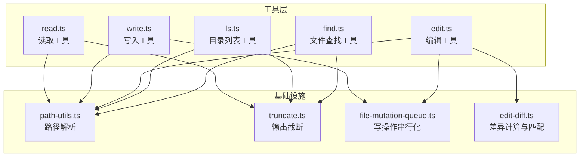
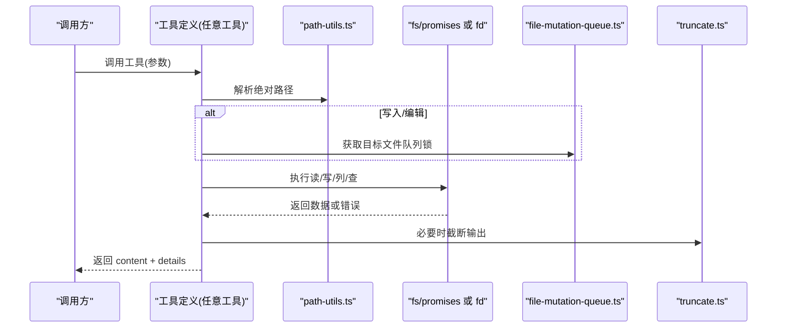
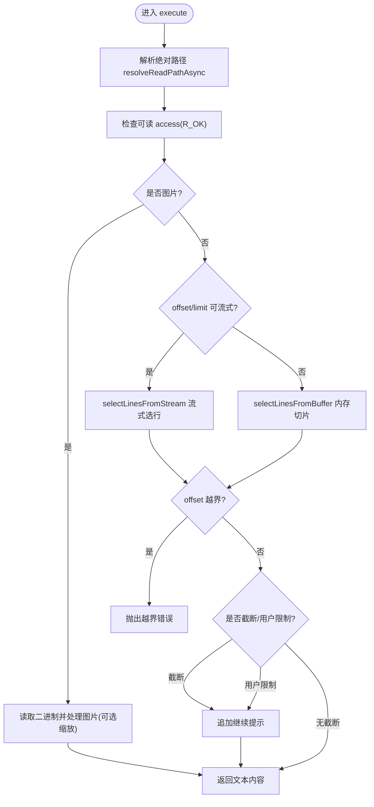
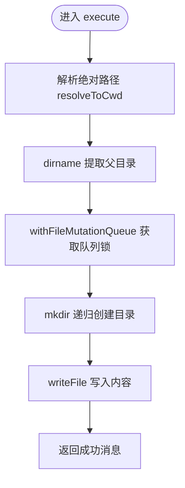
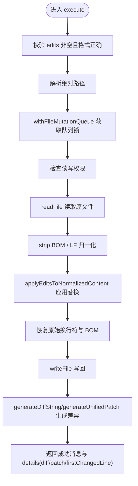
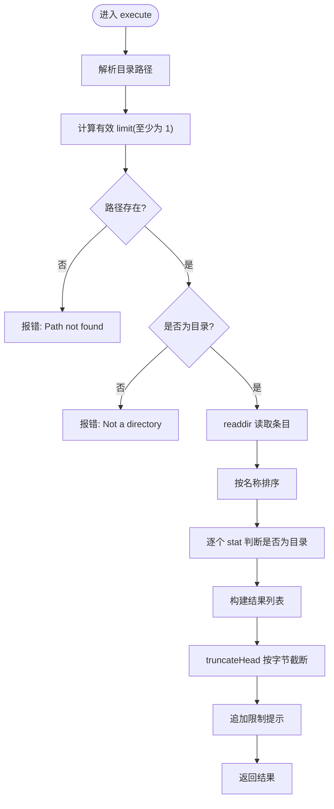
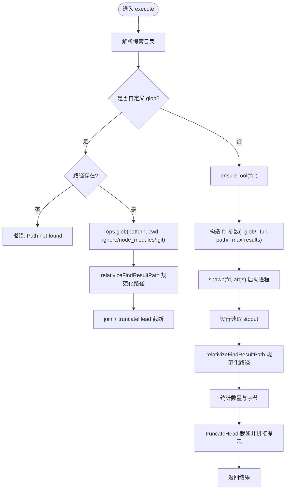
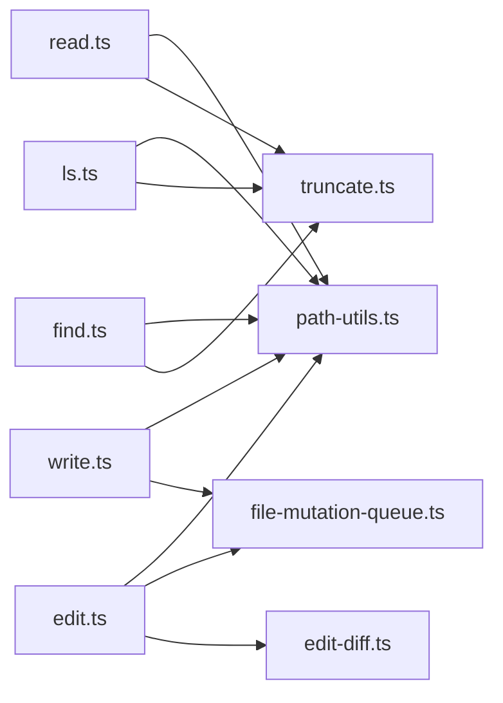

# 文件操作工具

<cite>
**本文引用的文件**
- [read.ts](file://packages/coding-agent/src/core/tools/read.ts)
- [write.ts](file://packages/coding-agent/src/core/tools/write.ts)
- [edit.ts](file://packages/coding-agent/src/core/tools/edit.ts)
- [ls.ts](file://packages/coding-agent/src/core/tools/ls.ts)
- [find.ts](file://packages/coding-agent/src/core/tools/find.ts)
- [path-utils.ts](file://packages/coding-agent/src/core/tools/path-utils.ts)
- [truncate.ts](file://packages/coding-agent/src/core/tools/truncate.ts)
- [file-mutation-queue.ts](file://packages/coding-agent/src/core/tools/file-mutation-queue.ts)
- [edit-diff.ts](file://packages/coding-agent/src/core/tools/edit-diff.ts)
</cite>

## 目录
1. [简介](#简介)
2. [项目结构](#项目结构)
3. [核心组件](#核心组件)
4. [架构总览](#架构总览)
5. [详细组件分析](#详细组件分析)
6. [依赖关系分析](#依赖关系分析)
7. [性能与限制](#性能与限制)
8. [故障排查指南](#故障排查指南)
9. [结论](#结论)

## 简介
本文件操作工具集为编码代理提供一组稳定、可插拔的文件能力，包括读取、写入、编辑、列表和查找。它们统一通过“工具定义”暴露给上层调用方，支持：
- 路径解析与跨平台兼容（含 macOS 文件名变体）
- UTF-8 文本处理与 BOM 保留
- 图片识别与可选自动缩放
- 流式读取大文件并安全截断
- 目录枚举与结果截断
- 基于外部 fd 的 glob 搜索与 .gitignore 行为
- 针对同一文件的并发写保护队列
- 可插拔的 I/O 抽象，便于替换为远程系统（如 SSH）

## 项目结构
这些工具位于编码代理包的核心工具目录中，每个工具一个文件，并通过统一的包装器注册为 Agent 工具。

**图表来源**
- [read.ts:1-363](file://packages/coding-agent/src/core/tools/read.ts#L1-L363)
- [write.ts:1-97](file://packages/coding-agent/src/core/tools/write.ts#L1-L97)
- [edit.ts:1-218](file://packages/coding-agent/src/core/tools/edit.ts#L1-L218)
- [ls.ts:1-176](file://packages/coding-agent/src/core/tools/ls.ts#L1-L176)
- [find.ts:1-332](file://packages/coding-agent/src/core/tools/find.ts#L1-L332)
- [path-utils.ts:1-119](file://packages/coding-agent/src/core/tools/path-utils.ts#L1-L119)
- [truncate.ts:1-303](file://packages/coding-agent/src/core/tools/truncate.ts#L1-L303)
- [file-mutation-queue.ts:1-62](file://packages/coding-agent/src/core/tools/file-mutation-queue.ts#L1-L62)
- [edit-diff.ts:1-557](file://packages/coding-agent/src/core/tools/edit-diff.ts#L1-L557)

**章节来源**
- [read.ts:1-363](file://packages/coding-agent/src/core/tools/read.ts#L1-L363)
- [write.ts:1-97](file://packages/coding-agent/src/core/tools/write.ts#L1-L97)
- [edit.ts:1-218](file://packages/coding-agent/src/core/tools/edit.ts#L1-L218)
- [ls.ts:1-176](file://packages/coding-agent/src/core/tools/ls.ts#L1-L176)
- [find.ts:1-332](file://packages/coding-agent/src/core/tools/find.ts#L1-L332)

## 核心组件
- 读取工具 read：支持文本与图片；支持 offset/limit 分页；支持流式读取与字节/行数双限截断；可自动缩放图片。
- 写入工具 write：创建或覆盖文件，自动创建父目录；对目标文件进行写串行化。
- 编辑工具 edit：精确文本替换，支持多段不重叠编辑；BOM 与换行符保留；生成 diff 与 patch。
- 列表工具 ls：列出目录内容，按字母排序，带目录后缀；条目数与字节上限截断。
- 查找工具 find：基于 glob 模式搜索文件，尊重 .gitignore；默认使用 fd；结果相对路径规范化；结果数与字节上限截断。

**章节来源**
- [read.ts:14-38](file://packages/coding-agent/src/core/tools/read.ts#L14-L38)
- [write.ts:10-20](file://packages/coding-agent/src/core/tools/write.ts#L10-L20)
- [edit.ts:20-40](file://packages/coding-agent/src/core/tools/edit.ts#L20-L40)
- [ls.ts:10-27](file://packages/coding-agent/src/core/tools/ls.ts#L10-L27)
- [find.ts:25-45](file://packages/coding-agent/src/core/tools/find.ts#L25-L45)

## 架构总览
所有工具遵循相同模式：
- 定义参数 schema 与输出 schema
- 提供可插拔 operations 接口（默认本地文件系统）
- 在 execute 中解析路径、校验权限、执行 I/O、返回结构化内容与 details
- 通过渲染器将结果以人类可读方式展示

**图表来源**
- [read.ts:228-357](file://packages/coding-agent/src/core/tools/read.ts#L228-L357)
- [write.ts:43-91](file://packages/coding-agent/src/core/tools/write.ts#L43-L91)
- [edit.ts:140-212](file://packages/coding-agent/src/core/tools/edit.ts#L140-L212)
- [ls.ts:53-170](file://packages/coding-agent/src/core/tools/ls.ts#L53-L170)
- [find.ts:69-326](file://packages/coding-agent/src/core/tools/find.ts#L69-L326)
- [path-utils.ts:44-118](file://packages/coding-agent/src/core/tools/path-utils.ts#L44-L118)
- [file-mutation-queue.ts:28-61](file://packages/coding-agent/src/core/tools/file-mutation-queue.ts#L28-L61)
- [truncate.ts:71-159](file://packages/coding-agent/src/core/tools/truncate.ts#L71-L159)

## 详细组件分析

### 读取工具 read
功能特性
- 输入参数：path、offset（从第几行开始，1 起始）、limit（最多读取多少行）。
- 输出：文本文件或图片附件；图片可自动缩放；非视觉模型会附加提示。
- 路径：resolveReadPathAsync 支持 macOS 截图名变体（AM/PM、NFD、弯引号）。
- 权限：access(R_OK) 检查可读性。
- 大文件：优先 createReadStream 流式选择行，避免全量加载；否则回退到内存缓冲。
- 截断：DEFAULT_MAX_LINES=2000 行或 DEFAULT_MAX_BYTES=50KB，先命中者生效；首行超长时给出 bash 替代建议。
- 可插拔：ReadOperations 允许替换为远程 I/O。

关键流程

**图表来源**
- [read.ts:228-357](file://packages/coding-agent/src/core/tools/read.ts#L228-L357)
- [path-utils.ts:86-118](file://packages/coding-agent/src/core/tools/path-utils.ts#L86-L118)
- [truncate.ts:71-159](file://packages/coding-agent/src/core/tools/truncate.ts#L71-L159)

参数与配置
- path：必填，相对或绝对路径。
- offset：可选，1 起始的行号。
- limit：可选，最大显示行数。
- options.autoResizeImages：可选，是否自动缩放图片（默认 true）。
- options.resizeOptions：可选，当上下文无模型元数据时的缩放策略。
- options.operations：可选，自定义 ReadOperations。

错误处理
- 中止信号：立即拒绝“Operation aborted”。
- 权限不足：抛出访问错误。
- offset 越界：明确提示总行数。
- 单行超长：提示使用 bash 命令截取。

最佳实践示例（描述）
- 读取大文件前 200 行：传入 offset=1, limit=200。
- 继续读取后续内容：根据返回的 nextOffset 继续调用。
- 读取图片：直接传入图片路径，若模型不支持图像，会返回说明文本。

**章节来源**
- [read.ts:14-38](file://packages/coding-agent/src/core/tools/read.ts#L14-L38)
- [read.ts:44-68](file://packages/coding-agent/src/core/tools/read.ts#L44-L68)
- [read.ts:109-135](file://packages/coding-agent/src/core/tools/read.ts#L109-L135)
- [read.ts:141-226](file://packages/coding-agent/src/core/tools/read.ts#L141-L226)
- [read.ts:228-357](file://packages/coding-agent/src/core/tools/read.ts#L228-L357)
- [path-utils.ts:86-118](file://packages/coding-agent/src/core/tools/path-utils.ts#L86-L118)
- [truncate.ts:11-13](file://packages/coding-agent/src/core/tools/truncate.ts#L11-L13)

### 写入工具 write
功能特性
- 创建或覆盖文件；自动创建父目录。
- 对目标文件进行写串行化，避免并发冲突。
- 支持 AbortSignal 中断。

关键流程

**图表来源**
- [write.ts:43-91](file://packages/coding-agent/src/core/tools/write.ts#L43-L91)
- [file-mutation-queue.ts:28-61](file://packages/coding-agent/src/core/tools/file-mutation-queue.ts#L28-L61)

参数与配置
- path：必填，相对或绝对路径。
- content：必填，要写入的字符串。
- options.operations：可选，自定义 WriteOperations（writeFile/mkdir）。

错误处理
- 中止信号：在每次 await 后检查并抛出“Operation aborted”。
- 目录创建失败：由底层 fs 抛出。
- 写入失败：由底层 fs 抛出。

最佳实践示例（描述）
- 新建多级目录中的文件：无需手动 mkdir，工具会自动创建。
- 批量更新多个文件：保持顺序调用，内部会对同文件串行化。

**章节来源**
- [write.ts:10-20](file://packages/coding-agent/src/core/tools/write.ts#L10-L20)
- [write.ts:22-41](file://packages/coding-agent/src/core/tools/write.ts#L22-L41)
- [write.ts:43-91](file://packages/coding-agent/src/core/tools/write.ts#L43-L91)
- [file-mutation-queue.ts:28-61](file://packages/coding-agent/src/core/tools/file-mutation-queue.ts#L28-L61)

### 编辑工具 edit
功能特性
- 精确文本替换，支持一次调用多个 edits[]。
- 每个 oldText 必须唯一且不重叠；相近改动应合并为一个 edit。
- 支持 BOM 与原始换行符（CRLF/LF）保留。
- 生成 diff 与 unified patch，便于编辑器导航。
- 支持模糊匹配容错（去除尾空格、智能标点归一化等），但要求匹配唯一。

关键流程

**图表来源**
- [edit.ts:140-212](file://packages/coding-agent/src/core/tools/edit.ts#L140-L212)
- [edit-diff.ts:300-362](file://packages/coding-agent/src/core/tools/edit-diff.ts#L300-L362)
- [edit-diff.ts:364-499](file://packages/coding-agent/src/core/tools/edit-diff.ts#L364-L499)

参数与配置
- path：必填，待编辑文件路径。
- edits：必填，数组，每项包含 oldText/newText。
- options.operations：可选，自定义 EditOperations（readFile/writeFile/access）。

错误处理
- 未找到文件或不可读写：抛出“Could not edit file”，附带错误码信息。
- oldText 为空：抛出明确错误。
- 重复匹配：提示增加上下文使其唯一。
- 重叠编辑：要求合并为单个 edit。
- 无变更：提示可能因特殊字符或文本不存在。

最佳实践示例（描述）
- 修改函数签名：将旧签名作为 oldText，新签名作为 newText，确保唯一。
- 多处相邻改动：合并为一个 edit，避免重叠。
- 需要预览变更：使用 computeEditsDiff 计算 diff 而不实际写入。

**章节来源**
- [edit.ts:20-40](file://packages/coding-agent/src/core/tools/edit.ts#L20-L40)
- [edit.ts:76-98](file://packages/coding-agent/src/core/tools/edit.ts#L76-L98)
- [edit.ts:100-138](file://packages/coding-agent/src/core/tools/edit.ts#L100-L138)
- [edit.ts:140-212](file://packages/coding-agent/src/core/tools/edit.ts#L140-L212)
- [edit-diff.ts:11-25](file://packages/coding-agent/src/core/tools/edit-diff.ts#L11-L25)
- [edit-diff.ts:34-55](file://packages/coding-agent/src/core/tools/edit-diff.ts#L34-L55)
- [edit-diff.ts:300-362](file://packages/coding-agent/src/core/tools/edit-diff.ts#L300-L362)
- [edit-diff.ts:364-499](file://packages/coding-agent/src/core/tools/edit-diff.ts#L364-L499)

### 列表工具 ls
功能特性
- 列出目录内容，按字母排序（忽略大小写），目录项末尾加“/”。
- 包含隐藏文件。
- 默认限制 500 个条目或 50KB 字节上限，先命中者生效。
- 可自定义 LsOperations 以对接远程系统。

关键流程

**图表来源**
- [ls.ts:53-170](file://packages/coding-agent/src/core/tools/ls.ts#L53-L170)
- [truncate.ts:71-159](file://packages/coding-agent/src/core/tools/truncate.ts#L71-L159)

参数与配置
- path：可选，目录路径（默认当前目录）。
- limit：可选，最大条目数（默认 500）。
- options.operations：可选，自定义 LsOperations（exists/stat/readdir）。

错误处理
- 路径不存在：抛出“Path not found”。
- 不是目录：抛出“Not a directory”。
- 无法读取目录：抛出“Cannot read directory”。

最佳实践示例（描述）
- 浏览大型目录：设置较小的 limit，逐步扩大。
- 过滤子目录：结合 find 工具进一步筛选。

**章节来源**
- [ls.ts:10-27](file://packages/coding-agent/src/core/tools/ls.ts#L10-L27)
- [ls.ts:29-51](file://packages/coding-agent/src/core/tools/ls.ts#L29-L51)
- [ls.ts:53-170](file://packages/coding-agent/src/core/tools/ls.ts#L53-L170)

### 查找工具 find
功能特性
- 基于 glob 模式搜索文件，默认尊重 .gitignore。
- 默认使用 fd 工具；可通过 FindOperations.glob 自定义实现。
- 结果路径相对于搜索根目录，并统一为正斜杠分隔。
- 默认限制 1000 条结果或 50KB 字节上限，先命中者生效。

关键流程

**图表来源**
- [find.ts:69-326](file://packages/coding-agent/src/core/tools/find.ts#L69-L326)
- [find.ts:12-23](file://packages/coding-agent/src/core/tools/find.ts#L12-L23)

参数与配置
- pattern：必填，glob 模式（如 *.ts、src/**/*.spec.ts）。
- path：可选，搜索目录（默认当前目录）。
- limit：可选，最大结果数（默认 1000）。
- options.operations：可选，自定义 FindOperations（exists/glob）。

错误处理
- fd 不可用：抛出“fd is not available and could not be downloaded”。
- fd 执行失败：返回 fd 的错误信息。
- 路径不存在：抛出“Path not found”。
- 无匹配：返回“没有匹配的文件”。

最佳实践示例（描述）
- 仅搜索 TypeScript 测试文件：pattern="**/*.test.ts"。
- 限定范围：指定 path 为 src 目录，减少扫描范围。
- 自定义搜索：提供 ops.glob 以对接远程文件系统或特定索引。

**章节来源**
- [find.ts:25-45](file://packages/coding-agent/src/core/tools/find.ts#L25-L45)
- [find.ts:47-67](file://packages/coding-agent/src/core/tools/find.ts#L47-L67)
- [find.ts:69-326](file://packages/coding-agent/src/core/tools/find.ts#L69-L326)

## 依赖关系分析
- 路径解析 path-utils：集中处理 ~ 展开、Unicode 空格、macOS 文件名变体（AM/PM、NFD、弯引号），并提供 pathExists。
- 截断 truncate：统一控制输出体积，避免超出上下文窗口。
- 写队列 file-mutation-queue：对同一真实路径的写操作串行化，避免竞态。
- 编辑差异 edit-diff：负责文本匹配、替换、diff 与 patch 生成，以及 BOM/换行符处理。

**图表来源**
- [read.ts:1-12](file://packages/coding-agent/src/core/tools/read.ts#L1-L12)
- [write.ts:1-8](file://packages/coding-agent/src/core/tools/write.ts#L1-L8)
- [edit.ts:1-18](file://packages/coding-agent/src/core/tools/edit.ts#L1-L18)
- [ls.ts:1-8](file://packages/coding-agent/src/core/tools/ls.ts#L1-L8)
- [find.ts:1-10](file://packages/coding-agent/src/core/tools/find.ts#L1-L10)

**章节来源**
- [path-utils.ts:1-119](file://packages/coding-agent/src/core/tools/path-utils.ts#L1-L119)
- [truncate.ts:1-303](file://packages/coding-agent/src/core/tools/truncate.ts#L1-L303)
- [file-mutation-queue.ts:1-62](file://packages/coding-agent/src/core/tools/file-mutation-queue.ts#L1-L62)
- [edit-diff.ts:1-557](file://packages/coding-agent/src/core/tools/edit-diff.ts#L1-L557)

## 性能与限制
- 读取大文件：优先流式读取，避免整文件入内存；单行超长时提示使用 bash 命令。
- 输出截断：默认 2000 行或 50KB，先命中者生效；ls 与 find 同样受此限制。
- 图片处理：可选自动缩放，避免超大图占用过多上下文。
- fd 搜索：通过 --max-results 提前终止，减少 IO 与内存。
- 写串行化：同一文件并发写被排队，保证一致性。

[本节为通用指导，不直接分析具体文件]

## 故障排查指南
常见问题与定位
- “Operation aborted”：检查调用方是否传递了 AbortSignal，并在异步边界处正确处理。
- “Path not found”：确认路径是否正确，是否存在 macOS 文件名变体问题（read 已自动尝试多种变体）。
- “Not a directory”：ls 的目标必须是目录。
- “Could not edit file”：检查文件是否存在且具备读写权限；查看错误码信息。
- “Found X occurrences... must be unique”：为 oldText 提供更多上下文，确保唯一匹配。
- “edits[...] overlap...”：合并重叠编辑为单个 edit。
- “No changes made...”：检查 oldText/newText 是否一致或特殊字符导致匹配失败。
- “fd is not available...”：安装 fd 或提供自定义 ops.glob。

相关实现参考
- 中止信号处理：read、write、ls、find 均在入口或关键 await 后检查 signal.aborted。
- 权限检查：read 使用 access(R_OK)，edit 使用 access(R_OK|W_OK)。
- 路径变体兼容：read 使用 resolveReadPathAsync 尝试 AM/PM、NFD、弯引号组合。
- 截断提示：read、ls、find 均会在超限时追加继续或扩大限制的提示。

**章节来源**
- [read.ts:244-357](file://packages/coding-agent/src/core/tools/read.ts#L244-L357)
- [write.ts:57-91](file://packages/coding-agent/src/core/tools/write.ts#L57-L91)
- [edit.ts:156-212](file://packages/coding-agent/src/core/tools/edit.ts#L156-L212)
- [ls.ts:64-170](file://packages/coding-agent/src/core/tools/ls.ts#L64-L170)
- [find.ts:80-326](file://packages/coding-agent/src/core/tools/find.ts#L80-L326)
- [path-utils.ts:7-20](file://packages/coding-agent/src/core/tools/path-utils.ts#L7-L20)
- [path-utils.ts:86-118](file://packages/coding-agent/src/core/tools/path-utils.ts#L86-L118)

## 结论
该文件操作工具集提供了稳健、可扩展且对大文件友好的基础能力。通过可插拔 operations、统一的路径解析与截断策略、以及对并发写的保护，能够在不同运行环境中保持一致的行为。建议在以下场景采用：
- 读取大文件时使用 offset/limit 分页，并结合流式优化。
- 写入与编辑时利用内置队列避免冲突。
- 编辑时尽量合并邻近改动，并确保 oldText 唯一。
- 列举与查找时合理设置 limit，避免输出过大。
- 在远程环境通过自定义 operations 适配 I/O 后端。

[本节为总结性内容，不直接分析具体文件]