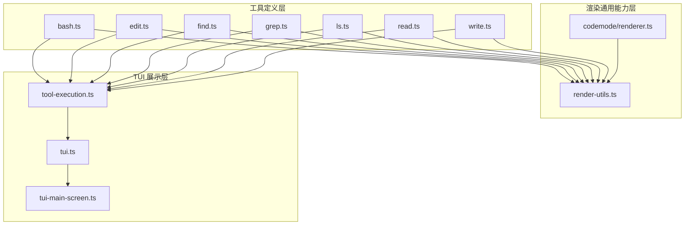
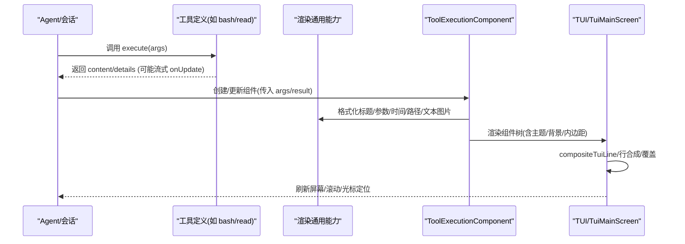
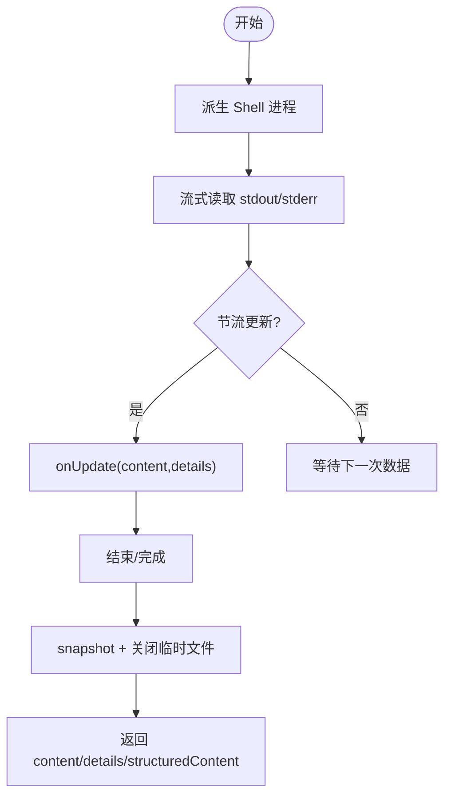
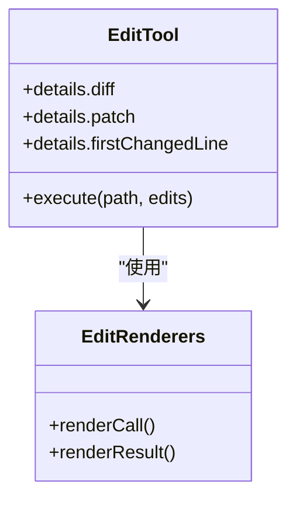
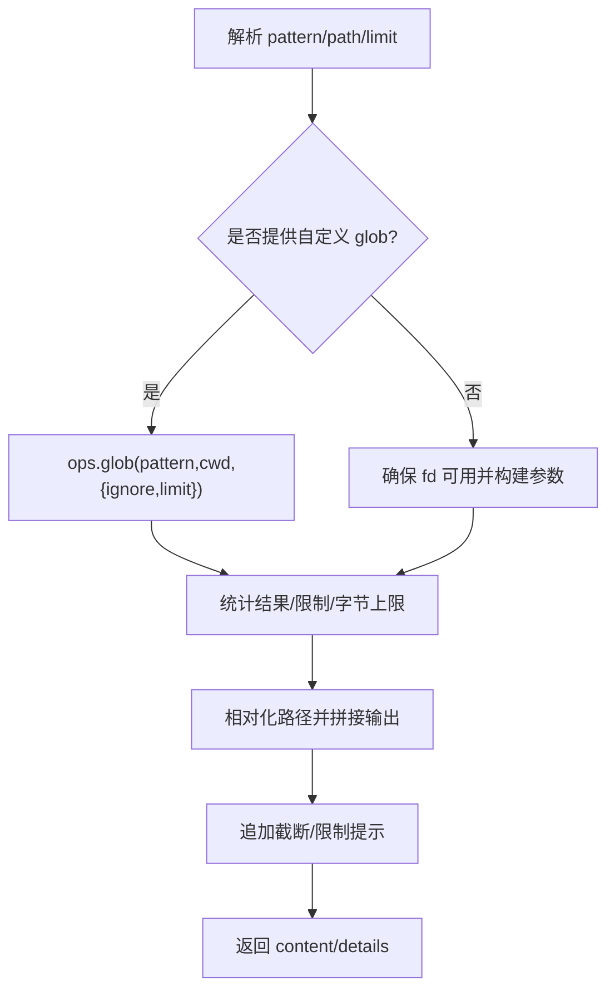
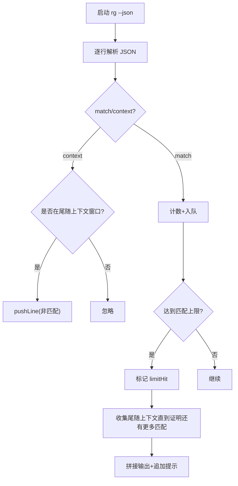
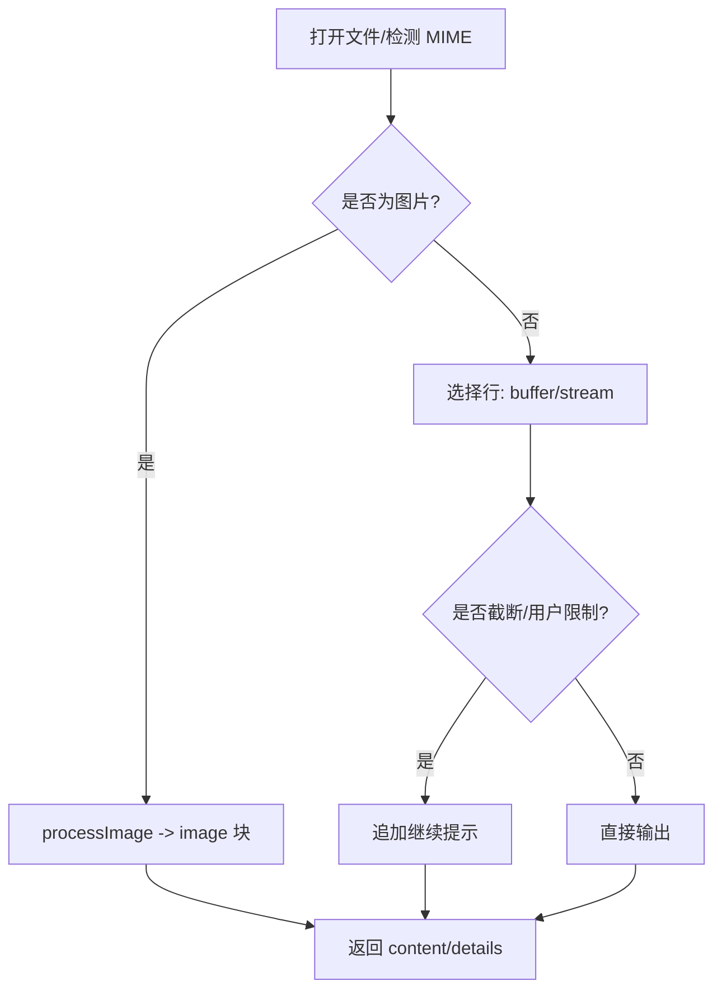
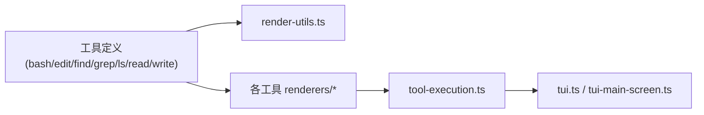

# 渲染系统

<cite>
**本文引用的文件**
- [packages/coding-agent/src/core/tools/render-utils.ts](file://packages/coding-agent/src/core/tools/render-utils.ts)
- [packages/coding-agent/src/extensions/codemode/renderer.ts](file://packages/coding-agent/src/extensions/codemode/renderer.ts)
- [packages/coding-agent/src/modes/interactive/components/tool-execution.ts](file://packages/coding-agent/src/modes/interactive/components/tool-execution.ts)
- [packages/tui/src/tui.ts](file://packages/tui/src/tui.ts)
- [packages/tui/src/tui-main-screen.ts](file://packages/tui/src/tui-main-screen.ts)
- [packages/coding-agent/src/core/tools/bash.ts](file://packages/coding-agent/src/core/tools/bash.ts)
- [packages/coding-agent/src/core/tools/edit.ts](file://packages/coding-agent/src/core/tools/edit.ts)
- [packages/coding-agent/src/core/tools/find.ts](file://packages/coding-agent/src/core/tools/find.ts)
- [packages/coding-agent/src/core/tools/grep.ts](file://packages/coding-agent/src/core/tools/grep.ts)
- [packages/coding-agent/src/core/tools/ls.ts](file://packages/coding-agent/src/core/tools/ls.ts)
- [packages/coding-agent/src/core/tools/read.ts](file://packages/coding-agent/src/core/tools/read.ts)
- [packages/coding-agent/src/core/tools/write.ts](file://packages/coding-agent/src/core/tools/write.ts)
</cite>

## 目录
1. [简介](#简介)
2. [项目结构](#项目结构)
3. [核心组件](#核心组件)
4. [架构总览](#架构总览)
5. [详细组件分析](#详细组件分析)
6. [依赖关系分析](#依赖关系分析)
7. [性能与可伸缩性](#性能与可伸缩性)
8. [故障排查指南](#故障排查指南)
9. [结论](#结论)
10. [附录：扩展自定义渲染器](#附录扩展自定义渲染器)

## 简介
本文件系统性梳理工具渲染系统，覆盖 Bash、Edit、Find、Grep、Ls、Read、Write 等工具的特定渲染逻辑；解释渲染管道的工作流程、样式定制选项和响应式输出处理；并为开发者提供扩展渲染功能的完整指南。文档同时给出架构图、类图、时序图和流程图，帮助读者从高层到代码级理解渲染机制。

## 项目结构
该渲染系统由三层组成：
- 工具定义层：每个工具（如 bash、read、write）定义参数、执行逻辑、结构化输出以及可选的 renderCall/renderResult 渲染函数。
- 渲染通用能力层：提供文本/图片输出格式化、路径链接、计时器、标题与参数折叠/展开等通用能力。
- TUI 展示层：终端 UI 负责将渲染结果绘制到主屏幕或全屏模式，支持图像、超链接、行高计算与增量更新。

**图示来源**
- [packages/coding-agent/src/core/tools/bash.ts:271-448](file://packages/coding-agent/src/core/tools/bash.ts#L271-L448)
- [packages/coding-agent/src/core/tools/edit.ts:140-212](file://packages/coding-agent/src/core/tools/edit.ts#L140-L212)
- [packages/coding-agent/src/core/tools/find.ts:69-326](file://packages/coding-agent/src/core/tools/find.ts#L69-L326)
- [packages/coding-agent/src/core/tools/grep.ts:73-316](file://packages/coding-agent/src/core/tools/grep.ts#L73-L316)
- [packages/coding-agent/src/core/tools/ls.ts:53-170](file://packages/coding-agent/src/core/tools/ls.ts#L53-L170)
- [packages/coding-agent/src/core/tools/read.ts:228-357](file://packages/coding-agent/src/core/tools/read.ts#L228-L357)
- [packages/coding-agent/src/core/tools/write.ts:43-91](file://packages/coding-agent/src/core/tools/write.ts#L43-L91)
- [packages/coding-agent/src/core/tools/render-utils.ts:1-181](file://packages/coding-agent/src/core/tools/render-utils.ts#L1-L181)
- [packages/coding-agent/src/extensions/codemode/renderer.ts:1-167](file://packages/coding-agent/src/extensions/codemode/renderer.ts#L1-L167)
- [packages/coding-agent/src/modes/interactive/components/tool-execution.ts:249-313](file://packages/coding-agent/src/modes/interactive/components/tool-execution.ts#L249-L313)
- [packages/tui/src/tui.ts:426-468](file://packages/tui/src/tui.ts#L426-L468)
- [packages/tui/src/tui-main-screen.ts:126-159](file://packages/tui/src/tui-main-screen.ts#L126-L159)

**章节来源**
- [packages/coding-agent/src/core/tools/bash.ts:271-448](file://packages/coding-agent/src/core/tools/bash.ts#L271-L448)
- [packages/coding-agent/src/core/tools/render-utils.ts:1-181](file://packages/coding-agent/src/core/tools/render-utils.ts#L1-L181)
- [packages/tui/src/tui.ts:426-468](file://packages/tui/src/tui.ts#L426-L468)

## 核心组件
- 渲染通用能力（render-utils.ts）
  - 文本/图片输出格式化：统一过滤 text/image 块，清理 ANSI、换行符，并在不支持图像时生成回退提示。
  - 工具调用头与参数格式化：支持折叠/展开显示，字符串原样显示，对象 JSON 缩进显示。
  - 路径链接与短路径：在支持超链接的终端中为路径生成可点击链接。
  - 计时器：启动/停止计时，区分“进行中”Elapsed 与“已完成”Took，并每秒刷新。
  - 工具路径渲染：空值/无效值处理，路径高亮与链接化。

- Codemode 渲染器（codemode/renderer.ts）
  - 脚本代码高亮预览与结果列表渲染，包含嵌套调用状态、耗时与成本汇总。
  - 输出区域按视觉行数截断，并提供“展开”提示。

- TUI 渲染管线（tui.ts, tui-main-screen.ts）
  - 行合成与覆盖：compositeTuiLine 将叠加内容精确拼接到固定列宽的行上，处理图像行跳过、ANSI 段重置与可见宽度裁剪。
  - 主屏渲染：维护历史行、光标位置、视口顶部、最大渲染行数等状态，支持恢复/捕获渲染状态。

- 工具执行组件（tool-execution.ts）
  - 根据主题与执行状态（部分/成功/失败）设置背景色与内边距。
  - 调用工具定义的 renderCall/renderResult，失败时回退到默认展示。
  - 鼠标交互：当使用 self 渲染容器时，转发鼠标事件到子容器。

**章节来源**
- [packages/coding-agent/src/core/tools/render-utils.ts:10-181](file://packages/coding-agent/src/core/tools/render-utils.ts#L10-L181)
- [packages/coding-agent/src/extensions/codemode/renderer.ts:18-167](file://packages/coding-agent/src/extensions/codemode/renderer.ts#L18-L167)
- [packages/tui/src/tui.ts:426-468](file://packages/tui/src/tui.ts#L426-L468)
- [packages/tui/src/tui-main-screen.ts:126-159](file://packages/tui/src/tui-main-screen.ts#L126-L159)
- [packages/coding-agent/src/modes/interactive/components/tool-execution.ts:249-313](file://packages/coding-agent/src/modes/interactive/components/tool-execution.ts#L249-L313)

## 架构总览
下图展示了从工具执行到最终终端绘制的端到端流程。

**图示来源**
- [packages/coding-agent/src/core/tools/bash.ts:289-447](file://packages/coding-agent/src/core/tools/bash.ts#L289-L447)
- [packages/coding-agent/src/core/tools/read.ts:244-357](file://packages/coding-agent/src/core/tools/read.ts#L244-L357)
- [packages/coding-agent/src/modes/interactive/components/tool-execution.ts:280-313](file://packages/coding-agent/src/modes/interactive/components/tool-execution.ts#L280-L313)
- [packages/tui/src/tui.ts:432-460](file://packages/tui/src/tui.ts#L432-L460)

## 详细组件分析

### Bash 工具渲染
- 执行与输出
  - 通过本地 shell 后端执行命令，流式收集 stdout/stderr，节流更新 UI。
  - 输出被截断策略：按最后 N 行或字节上限，必要时保存完整输出到临时文件，并在结果中附带提示。
  - 超时与中止：超时抛出带上下文的错误；中止会终止进程树。
- 渲染要点
  - 使用 createShellRenderers 提供的 renderCall/renderResult，结合 render-utils 的工具计时器与路径链接。
  - 结构化输出（structuredContent）供程序调用方（如 codemode）消费。

**图示来源**
- [packages/coding-agent/src/core/tools/bash.ts:110-193](file://packages/coding-agent/src/core/tools/bash.ts#L110-L193)
- [packages/coding-agent/src/core/tools/bash.ts:304-384](file://packages/coding-agent/src/core/tools/bash.ts#L304-L384)
- [packages/coding-agent/src/core/tools/bash.ts:389-447](file://packages/coding-agent/src/core/tools/bash.ts#L389-L447)

**章节来源**
- [packages/coding-agent/src/core/tools/bash.ts:110-193](file://packages/coding-agent/src/core/tools/bash.ts#L110-L193)
- [packages/coding-agent/src/core/tools/bash.ts:271-448](file://packages/coding-agent/src/core/tools/bash.ts#L271-L448)

### Edit 工具渲染
- 执行与变更
  - 对单文件进行精确文本替换，支持多个不重叠编辑块。
  - 生成 diff 与 unified patch，记录首次变更行号以便编辑器导航。
- 渲染要点
  - 使用 editRenderers 渲染差异与变更摘要，配合 render-utils 的路径链接与主题样式。

**图示来源**
- [packages/coding-agent/src/core/tools/edit.ts:140-212](file://packages/coding-agent/src/core/tools/edit.ts#L140-L212)

**章节来源**
- [packages/coding-agent/src/core/tools/edit.ts:140-212](file://packages/coding-agent/src/core/tools/edit.ts#L140-L212)

### Find 工具渲染
- 执行与结果
  - 优先使用 fd 进行 glob 搜索，尊重 .gitignore；也可通过自定义 operations.glob 实现远程查找。
  - 结果相对化、去重与截断：按条目数与字节上限截断，附加提示信息。
- 渲染要点
  - findRenderers 渲染匹配路径列表，支持展开更多结果。

**图示来源**
- [packages/coding-agent/src/core/tools/find.ts:108-171](file://packages/coding-agent/src/core/tools/find.ts#L108-L171)
- [packages/coding-agent/src/core/tools/find.ts:174-313](file://packages/coding-agent/src/core/tools/find.ts#L174-L313)

**章节来源**
- [packages/coding-agent/src/core/tools/find.ts:69-326](file://packages/coding-agent/src/core/tools/find.ts#L69-L326)

### Grep 工具渲染
- 执行与结果
  - 基于 ripgrep JSON 输出，解析 match/context 事件，按匹配数与字节上限截断。
  - 长行截断至固定长度，避免输出过宽；上下文窗口保留最后一个匹配的后续行。
- 渲染要点
  - grepRenderers 渲染文件:行号:内容 格式，支持展开与提示。

**图示来源**
- [packages/coding-agent/src/core/tools/grep.ts:120-313](file://packages/coding-agent/src/core/tools/grep.ts#L120-L313)

**章节来源**
- [packages/coding-agent/src/core/tools/grep.ts:73-316](file://packages/coding-agent/src/core/tools/grep.ts#L73-L316)

### Ls 工具渲染
- 执行与结果
  - 列出目录项，按字母排序，目录加斜杠后缀；支持条目数与字节上限截断。
- 渲染要点
  - lsRenderers 渲染简洁列表，附带截断/限制提示。

**章节来源**
- [packages/coding-agent/src/core/tools/ls.ts:53-170](file://packages/coding-agent/src/core/tools/ls.ts#L53-L170)

### Read 工具渲染
- 执行与结果
  - 支持文本与图片：图片检测 MIME 类型，按需缩放并作为 image 块返回；文本支持 offset/limit 分页。
  - 大文件流式读取：仅在内存中保留将要显示的行，避免 OOM；首行超长时给出替代方案提示。
- 渲染要点
  - readRenderers 渲染文本或图片附件，并显示行范围与继续提示。

**图示来源**
- [packages/coding-agent/src/core/tools/read.ts:228-357](file://packages/coding-agent/src/core/tools/read.ts#L228-L357)

**章节来源**
- [packages/coding-agent/src/core/tools/read.ts:228-357](file://packages/coding-agent/src/core/tools/read.ts#L228-L357)

### Write 工具渲染
- 执行与结果
  - 自动创建父目录，写入文件内容；通过 withFileMutationQueue 保证并发安全。
- 渲染要点
  - writeRenderers 渲染成功消息。

**章节来源**
- [packages/coding-agent/src/core/tools/write.ts:43-91](file://packages/coding-agent/src/core/tools/write.ts#L43-L91)

### Codemode 渲染器
- 脚本渲染
  - 代码高亮预览，支持折叠/展开；结果区列出嵌套调用状态、耗时与模型调用成本汇总。
- 输出渲染
  - 去除脚本完成头部，仅展示实际输出；按视觉行数限制显示，并提供“完整输出路径”。

**章节来源**
- [packages/coding-agent/src/extensions/codemode/renderer.ts:18-167](file://packages/coding-agent/src/extensions/codemode/renderer.ts#L18-L167)

### TUI 渲染管线
- 行合成与覆盖
  - compositeTuiLine 将 overlay 内容插入 baseLine 指定列，处理图像行、ANSI 段重置与可见宽度裁剪。
- 主屏渲染
  - 维护 previousLines、光标位置、视口顶部等状态，支持 capture/restore 渲染状态。

**章节来源**
- [packages/tui/src/tui.ts:426-468](file://packages/tui/src/tui.ts#L426-L468)
- [packages/tui/src/tui-main-screen.ts:126-159](file://packages/tui/src/tui-main-screen.ts#L126-L159)

## 依赖关系分析
- 工具定义与渲染器
  - 各工具通过 ...createXxxRenderers 注入 renderCall/renderResult，与通用渲染能力解耦。
- 通用渲染能力
  - getTextOutput、formatToolCallWithArgs、startToolTimer/toolTimerText、linkPath/shortenPath 等被多处复用。
- TUI 与组件
  - ToolExecutionComponent 负责主题、背景、内边距与鼠标交互；TUI/TuiMainScreen 负责底层绘制与状态管理。

**图示来源**
- [packages/coding-agent/src/core/tools/bash.ts:447-448](file://packages/coding-agent/src/core/tools/bash.ts#L447-L448)
- [packages/coding-agent/src/core/tools/edit.ts:211-212](file://packages/coding-agent/src/core/tools/edit.ts#L211-L212)
- [packages/coding-agent/src/core/tools/find.ts:325-326](file://packages/coding-agent/src/core/tools/find.ts#L325-L326)
- [packages/coding-agent/src/core/tools/grep.ts:315-316](file://packages/coding-agent/src/core/tools/grep.ts#L315-L316)
- [packages/coding-agent/src/core/tools/ls.ts:169-170](file://packages/coding-agent/src/core/tools/ls.ts#L169-L170)
- [packages/coding-agent/src/core/tools/read.ts:356-357](file://packages/coding-agent/src/core/tools/read.ts#L356-L357)
- [packages/coding-agent/src/core/tools/write.ts:90-91](file://packages/coding-agent/src/core/tools/write.ts#L90-L91)
- [packages/coding-agent/src/modes/interactive/components/tool-execution.ts:280-313](file://packages/coding-agent/src/modes/interactive/components/tool-execution.ts#L280-L313)

**章节来源**
- [packages/coding-agent/src/core/tools/render-utils.ts:10-181](file://packages/coding-agent/src/core/tools/render-utils.ts#L10-L181)
- [packages/coding-agent/src/modes/interactive/components/tool-execution.ts:249-313](file://packages/coding-agent/src/modes/interactive/components/tool-execution.ts#L249-L313)

## 性能与可伸缩性
- 流式与节流
  - Bash 工具通过 OutputAccumulator 与节流定时器减少 UI 抖动；Find/Grep 使用流式读取与早停策略控制内存与 CPU。
- 截断策略
  - 所有工具均按“行数/字节”双上限截断，避免超大输出阻塞渲染；Read 针对首行超长提供替代方案。
- 渲染优化
  - TUI 行合成避免重复计算，图像行快速跳过；主屏维护历史行与视口，减少全量重绘。
- 建议
  - 对高频更新场景优先使用流式 API；合理设置 limit/offset；避免在 renderResult 中进行昂贵计算。

[本节为通用指导，不直接分析具体文件]

## 故障排查指南
- Bash
  - 超时：检查 timeout 参数与后台进程持有 stdio 的情况；注意 shellExit 信息。
  - 中止：确认 AbortSignal 正确传递；进程树会被终止。
- Find/Grep
  - 外部工具不可用：fd/ripgrep 未安装或下载失败；检查 ensureTool 返回值。
  - 结果过多：调整 limit 或 refine pattern；留意“已达限制”的提示。
- Read
  - 偏移越界：offset 超出文件行数时报错；检查 totalFileLines。
  - 首行超长：根据提示改用 bash/sed 截取。
- Edit/Write
  - 权限/路径问题：access/exists 失败；检查 cwd 与绝对路径解析。
  - 并发写冲突：withFileMutationQueue 保证顺序，但需避免跨工具竞争同一文件。

**章节来源**
- [packages/coding-agent/src/core/tools/bash.ts:149-193](file://packages/coding-agent/src/core/tools/bash.ts#L149-L193)
- [packages/coding-agent/src/core/tools/find.ts:174-183](file://packages/coding-agent/src/core/tools/find.ts#L174-L183)
- [packages/coding-agent/src/core/tools/grep.ts:120-135](file://packages/coding-agent/src/core/tools/grep.ts#L120-L135)
- [packages/coding-agent/src/core/tools/read.ts:309-321](file://packages/coding-agent/src/core/tools/read.ts#L309-L321)
- [packages/coding-agent/src/core/tools/edit.ts:171-196](file://packages/coding-agent/src/core/tools/edit.ts#L171-L196)
- [packages/coding-agent/src/core/tools/write.ts:66-82](file://packages/coding-agent/src/core/tools/write.ts#L66-L82)

## 结论
该渲染系统将工具执行、通用渲染能力与 TUI 展示清晰分层，既保证了多工具的一致体验，又提供了灵活的扩展点。通过流式处理、智能截断与主题化渲染，系统在大规模输出与复杂交互下仍保持良好性能与可读性。开发者可基于现有 renderCall/renderResult 接口与 render-utils 能力，快速实现自定义工具渲染。

[本节为总结，不直接分析具体文件]

## 附录：扩展自定义渲染器
- 注册方式
  - 在工具定义中提供 renderCall/renderResult，或使用 pi.registerToolRenderer 注册全局解析器。
- 开发步骤
  - 确定输入/输出结构，使用 render-utils 的 formatToolCallWithArgs、getTextOutput、toolTimerText 等工具函数。
  - 在 renderCall 中初始化组件树（Container/Text/Spacer），在 renderResult 中填充结果区域。
  - 如需自绘，可在 tool-execution 的 self 渲染模式下接管鼠标与键盘事件。
- 样式定制
  - 使用 theme.fg/theme.bg 应用主题颜色；根据 isPartial/isError 切换背景与边框。
- 最佳实践
  - 避免在渲染函数中进行 I/O 或昂贵计算；将耗时逻辑移至 execute 或异步预处理。
  - 合理使用 VisualLinePreview 与截断提示，提升长输出的可读性。
  - 对图像输出，优先使用 getImageDimensions 与 imageFallback 以兼容不同终端能力。

**章节来源**
- [packages/coding-agent/src/extensions/codemode/renderer.ts:71-167](file://packages/coding-agent/src/extensions/codemode/renderer.ts#L71-L167)
- [packages/coding-agent/src/modes/interactive/components/tool-execution.ts:280-313](file://packages/coding-agent/src/modes/interactive/components/tool-execution.ts#L280-L313)
- [packages/coding-agent/src/core/tools/render-utils.ts:53-181](file://packages/coding-agent/src/core/tools/render-utils.ts#L53-L181)