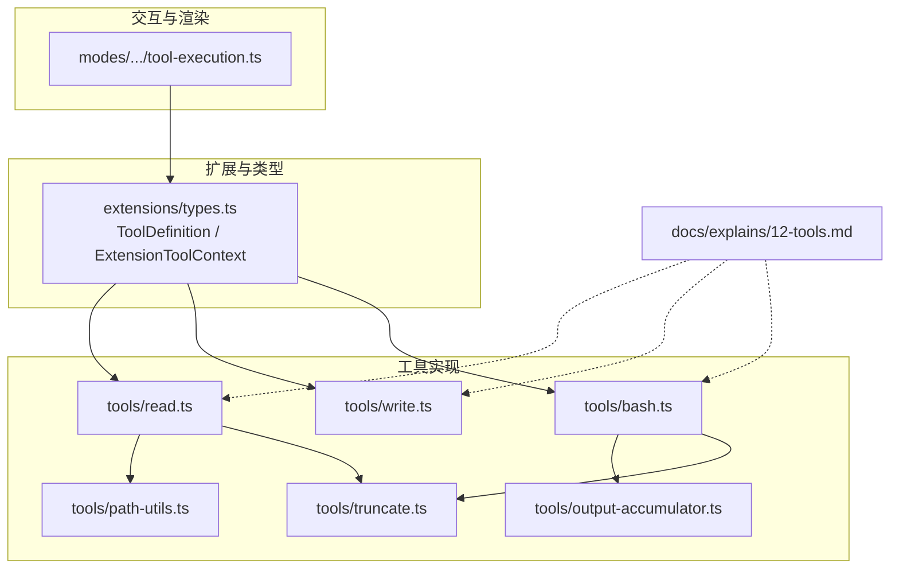
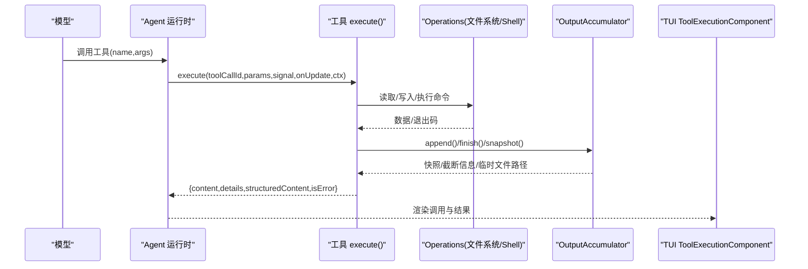
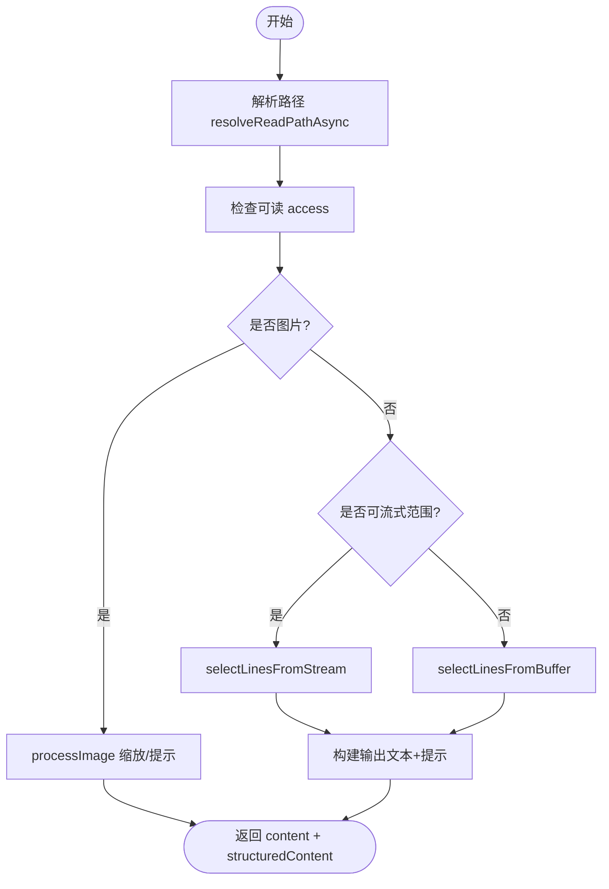
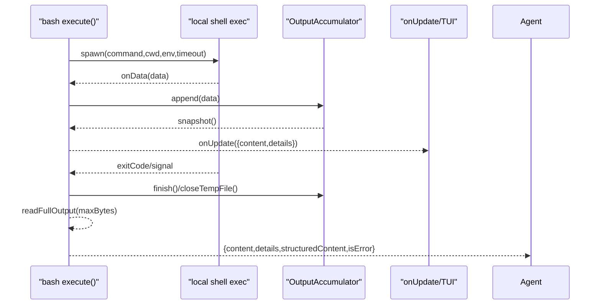
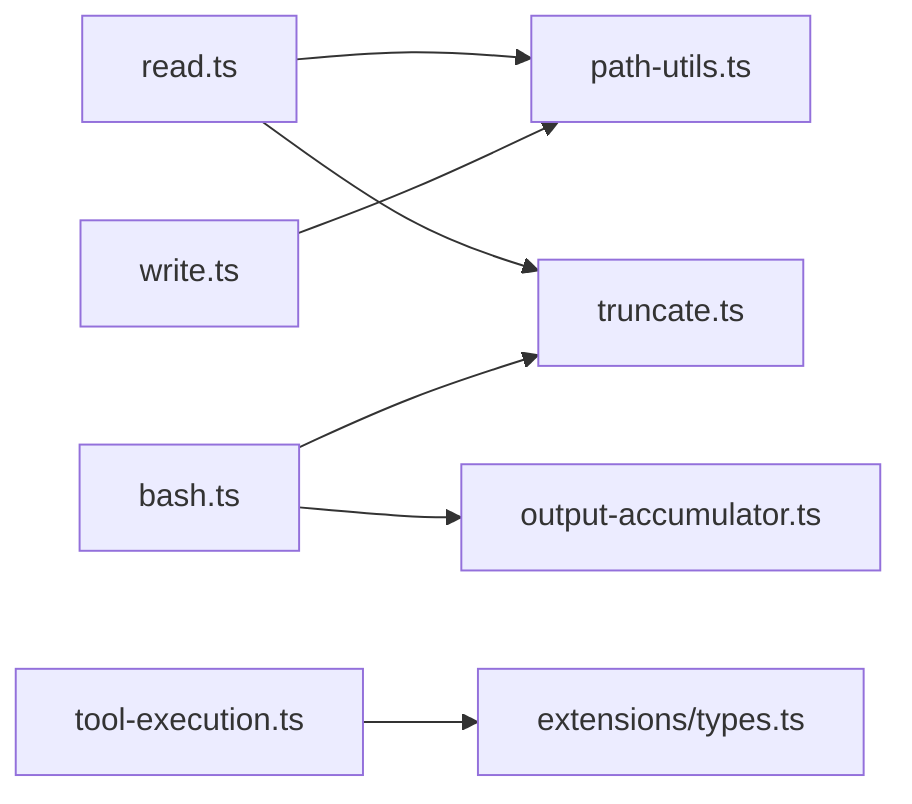

# 自定义工具开发

<cite>
**本文引用的文件**
- [packages/coding-agent/src/core/extensions/types.ts](file://packages/coding-agent/src/core/extensions/types.ts)
- [packages/coding-agent/src/core/tools/read.ts](file://packages/coding-agent/src/core/tools/read.ts)
- [packages/coding-agent/src/core/tools/write.ts](file://packages/coding-agent/src/core/tools/write.ts)
- [packages/coding-agent/src/core/tools/bash.ts](file://packages/coding-agent/src/core/tools/bash.ts)
- [packages/coding-agent/src/core/tools/path-utils.ts](file://packages/coding-agent/src/core/tools/path-utils.ts)
- [packages/coding-agent/src/core/tools/truncate.ts](file://packages/coding-agent/src/core/tools/truncate.ts)
- [packages/coding-agent/src/core/tools/output-accumulator.ts](file://packages/coding-agent/src/core/tools/output-accumulator.ts)
- [packages/coding-agent/src/modes/interactive/components/tool-execution.ts](file://packages/coding-agent/src/modes/interactive/components/tool-execution.ts)
- [docs/explains/12-tools.md](file://docs/explains/12-tools.md)
</cite>

## 目录
1. [引言](#引言)
2. [项目结构](#项目结构)
3. [核心组件](#核心组件)
4. [架构总览](#架构总览)
5. [详细组件分析](#详细组件分析)
6. [依赖关系分析](#依赖关系分析)
7. [性能与内存特性](#性能与内存特性)
8. [权限控制与安全边界](#权限控制与安全边界)
9. [错误处理与可观测性](#错误处理与可观测性)
10. [参数验证与输出截断](#参数验证与输出截断)
11. [路径工具与结果累积器](#路径工具与结果累积器)
12. [从简单到复杂的工具示例](#从简单到复杂的工具示例)
13. [测试、调试与优化建议](#测试调试与优化建议)
14. [结论](#结论)

## 引言
本指南面向希望为 Pi 编码代理扩展“工具”能力的开发者。内容覆盖：
- 工具接口规范与暴露方式
- 参数校验、结构化输出与受限采样
- 权限控制、沙箱与容器化实践
- 错误处理、中止信号与超时
- 路径解析、输出截断与流式结果累积
- 从最小工具到复杂命令执行工具的完整实现步骤
- 测试、调试与性能优化技巧

## 项目结构
Pi 的工具系统位于 `packages/coding-agent/src/core/tools/`，并通过扩展类型系统与 UI 渲染层解耦。关键位置：
- 扩展与工具类型定义：`core/extensions/types.ts`
- 内置工具实现：`core/tools/{read,write,bash,...}.ts`
- 路径工具：`core/tools/path-utils.ts`
- 输出截断：`core/tools/truncate.ts`
- 流式输出累积：`core/tools/output-accumulator.ts`
- TUI 工具执行展示：`modes/interactive/components/tool-execution.ts`
- 工具设计说明文档：`docs/explains/12-tools.md`

**图示来源**
- [packages/coding-agent/src/core/extensions/types.ts:599-688](file://packages/coding-agent/src/core/extensions/types.ts#L599-L688)
- [packages/coding-agent/src/core/tools/read.ts:228-358](file://packages/coding-agent/src/core/tools/read.ts#L228-L358)
- [packages/coding-agent/src/core/tools/write.ts:43-92](file://packages/coding-agent/src/core/tools/write.ts#L43-L92)
- [packages/coding-agent/src/core/tools/bash.ts:271-449](file://packages/coding-agent/src/core/tools/bash.ts#L271-L449)
- [packages/coding-agent/src/core/tools/path-utils.ts:40-84](file://packages/coding-agent/src/core/tools/path-utils.ts#L40-L84)
- [packages/coding-agent/src/core/tools/truncate.ts:11-45](file://packages/coding-agent/src/core/tools/truncate.ts#L11-L45)
- [packages/coding-agent/src/core/tools/output-accumulator.ts:35-62](file://packages/coding-agent/src/core/tools/output-accumulator.ts#L35-L62)
- [packages/coding-agent/src/modes/interactive/components/tool-execution.ts:31-108](file://packages/coding-agent/src/modes/interactive/components/tool-execution.ts#L31-L108)
- [docs/explains/12-tools.md:1-297](file://docs/explains/12-tools.md#L1-L297)

**章节来源**
- [docs/explains/12-tools.md:1-297](file://docs/explains/12-tools.md#L1-L297)

## 核心组件
- ToolDefinition：声明工具的名称、描述、参数 Schema、可选的 prepareArguments、outputSchema、constrainedSampling、exposure、namespace、annotations、executionMode、execute、renderCall/renderResult 等。
- ExtensionToolContext：在会话中传递给 execute() 的上下文，包含 cwd、signal、abort、tools、executeTool 等能力。
- 内置工具：read、write、bash（以及 grep/find/ls/edit 等），均通过工厂函数 + Operations 接口实现，便于替换远程后端。

关键点：
- 参数校验由 TypeBox Schema 驱动；prepareArguments 可在校验前做兼容转换。
- outputSchema 让 codemode 脚本直接消费结构化结果。
- constrainedSampling 可请求模型侧 JSON Schema 严格模式。
- exposure 控制工具是否对模型可见、是否可由其他工具调用。

**章节来源**
- [packages/coding-agent/src/core/extensions/types.ts:599-688](file://packages/coding-agent/src/core/extensions/types.ts#L599-L688)
- [packages/coding-agent/src/core/extensions/types.ts:387-415](file://packages/coding-agent/src/core/extensions/types.ts#L387-L415)
- [docs/explains/12-tools.md:1-33](file://docs/explains/12-tools.md#L1-L33)

## 架构总览
下图展示了“模型调用工具 → 工具执行 → 输出累积/截断 → 结构化结果返回 → UI 渲染”的主流程。

**图示来源**
- [packages/coding-agent/src/core/extensions/types.ts:669-677](file://packages/coding-agent/src/core/extensions/types.ts#L669-L677)
- [packages/coding-agent/src/core/tools/bash.ts:289-449](file://packages/coding-agent/src/core/tools/bash.ts#L289-L449)
- [packages/coding-agent/src/core/tools/output-accumulator.ts:64-119](file://packages/coding-agent/src/core/tools/output-accumulator.ts#L64-L119)
- [packages/coding-agent/src/modes/interactive/components/tool-execution.ts:31-108](file://packages/coding-agent/src/modes/interactive/components/tool-execution.ts#L31-L108)

## 详细组件分析

### 工具定义与上下文
- ToolDefinition 是注册与调用的统一契约，支持：
  - parameters：TypeBox 参数 Schema
  - prepareArguments：参数预处理
  - outputSchema：结构化输出 Schema
  - constrainedSampling：受限采样配置
  - executionMode：串行/并行
  - renderCall/renderResult：自定义 TUI 渲染
- ExtensionToolContext 提供：
  - cwd、signal、abort
  - tools、executeTool：在同一权限与校验管道内调用其他工具

最佳实践：
- 始终声明 parameters 与 outputSchema，便于 LLM 与脚本端使用。
- 需要跨工具编排时，使用 ctx.executeTool 而非直接调用内部函数。
- 对破坏性操作设置 annotations.destructiveHint=true。

**章节来源**
- [packages/coding-agent/src/core/extensions/types.ts:599-688](file://packages/coding-agent/src/core/extensions/types.ts#L599-L688)
- [packages/coding-agent/src/core/extensions/types.ts:387-415](file://packages/coding-agent/src/core/extensions/types.ts#L387-L415)

### read 工具
职责：
- 文本文件按 offset/limit 流式读取，图片自动检测并缩放。
- 输出包含结构化 content 与 details（含 truncation）。
- 当首行超长或整体超限时，给出下一步提示（offset 继续、sed 命令）。

关键点：
- 优先使用 createReadStream 流式选择行，避免大文件全量加载。
- 用户 limit 优先于默认截断。
- 非视觉模型会附加“图片将被省略”的提示。

**图示来源**
- [packages/coding-agent/src/core/tools/read.ts:228-358](file://packages/coding-agent/src/core/tools/read.ts#L228-L358)
- [packages/coding-agent/src/core/tools/path-utils.ts:52-84](file://packages/coding-agent/src/core/tools/path-utils.ts#L52-L84)

**章节来源**
- [packages/coding-agent/src/core/tools/read.ts:228-358](file://packages/coding-agent/src/core/tools/read.ts#L228-L358)

### write 工具
职责：
- 创建父目录、整文件覆盖写。
- 同一文件写操作串行化，避免并发冲突。
- 支持 AbortSignal 安全中断。

关键点：
- withFileMutationQueue 保证同路径写串行，不同路径可并行。
- 在每次 await 后检查 signal.aborted，避免提前释放队列锁。

**章节来源**
- [packages/coding-agent/src/core/tools/write.ts:43-92](file://packages/coding-agent/src/core/tools/write.ts#L43-L92)

### bash 工具
职责：
- 执行 shell 命令，流式收集 stdout/stderr。
- 支持超时、进程树清理、环境变量注入。
- 输出通过 OutputAccumulator 管理，支持临时文件保存完整输出。

关键点：
- 超时消息区分“命令本身超时”和“shell 已退出但后台进程仍在写”。
- 非零退出码标记 isError，并在结构化输出中提供 exit_code、wall_time_seconds。
- structuredContent.output 有最大字节限制，适合程序化消费。

**图示来源**
- [packages/coding-agent/src/core/tools/bash.ts:289-449](file://packages/coding-agent/src/core/tools/bash.ts#L289-L449)
- [packages/coding-agent/src/core/tools/output-accumulator.ts:64-119](file://packages/coding-agent/src/core/tools/output-accumulator.ts#L64-L119)

**章节来源**
- [packages/coding-agent/src/core/tools/bash.ts:271-449](file://packages/coding-agent/src/core/tools/bash.ts#L271-L449)

### 路径工具 path-utils
职责：
- expandPath/resolveToCwd：展开 ~、规范化 Unicode 空格、去除 @ 前缀、相对路径解析。
- resolveReadPath/resolveReadPathAsync：针对 macOS 文件名差异的多变体回退（AM/PM 窄空格、NFD、弯引号组合）。

注意：
- 这些函数只做解析与存在性探测，不限制路径必须在 cwd 内。权限控制需在上层实现。

**章节来源**
- [packages/coding-agent/src/core/tools/path-utils.ts:40-118](file://packages/coding-agent/src/core/tools/path-utils.ts#L40-L118)

### 输出截断 truncate
职责：
- truncateHead：保留开头，永不返回半行；若首行超长则返回空内容并标记 firstLineExceedsLimit。
- truncateTail：保留结尾，最后一行超长时可取尾部并标记 lastLinePartial。
- truncateLine：单行截断（grep 匹配行）。
- sliceHead/sliceTail：避免切断 surrogate pair。

默认限制：
- 行数上限：2000
- 字节上限：50KB

**章节来源**
- [packages/coding-agent/src/core/tools/truncate.ts:11-45](file://packages/coding-agent/src/core/tools/truncate.ts#L11-L45)
- [packages/coding-agent/src/core/tools/truncate.ts:78-159](file://packages/coding-agent/src/core/tools/truncate.ts#L78-L159)
- [packages/coding-agent/src/core/tools/truncate.ts:168-240](file://packages/coding-agent/src/core/tools/truncate.ts#L168-L240)
- [packages/coding-agent/src/core/tools/truncate.ts:268-302](file://packages/coding-agent/src/core/tools/truncate.ts#L268-L302)

### 结果累积器 OutputAccumulator
职责：
- 增量追加 Buffer，流式解码 UTF-8。
- 维护 tailText 滚动窗口，超过阈值时 trimTail 保持 UTF-8 边界。
- 超过限制时打开临时文件保存原始 chunk。
- snapshot 返回显示用截断文本与统计；readFullOutput 返回头尾拼接的完整输出摘要。

典型用法：
- bash 工具将 stdout/stderr 不断 append，定时 snapshot 推送 onUpdate。
- finish/closeTempFile 后，readFullOutput 用于结构化输出。

**章节来源**
- [packages/coding-agent/src/core/tools/output-accumulator.ts:35-62](file://packages/coding-agent/src/core/tools/output-accumulator.ts#L35-L62)
- [packages/coding-agent/src/core/tools/output-accumulator.ts:64-119](file://packages/coding-agent/src/core/tools/output-accumulator.ts#L64-L119)
- [packages/coding-agent/src/core/tools/output-accumulator.ts:149-176](file://packages/coding-agent/src/core/tools/output-accumulator.ts#L149-L176)

### TUI 工具执行组件
职责：
- 根据 ToolDefinition 的 renderCall/renderResult 渲染工具调用与结果。
- 支持 images、expanded、isPartial、durationMs、outputPad 等状态。
- 在无自定义渲染时使用通用文本回退。

**章节来源**
- [packages/coding-agent/src/modes/interactive/components/tool-execution.ts:31-108](file://packages/coding-agent/src/modes/interactive/components/tool-execution.ts#L31-L108)

## 依赖关系分析
- read 依赖 path-utils（路径解析）、truncate（行/字节截断）、image-process（图片处理）。
- write 依赖 file-mutation-queue（写串行）与 path-utils。
- bash 依赖 output-accumulator（流式累积）、truncate（尾部截断）、shell 工具链（spawn、killProcessTree）。
- tool-execution 依赖 extensions/types 中的 ToolRenderers 与 ToolDefinition。

**图示来源**
- [packages/coding-agent/src/core/tools/read.ts:228-358](file://packages/coding-agent/src/core/tools/read.ts#L228-L358)
- [packages/coding-agent/src/core/tools/write.ts:43-92](file://packages/coding-agent/src/core/tools/write.ts#L43-L92)
- [packages/coding-agent/src/core/tools/bash.ts:271-449](file://packages/coding-agent/src/core/tools/bash.ts#L271-L449)
- [packages/coding-agent/src/modes/interactive/components/tool-execution.ts:31-108](file://packages/coding-agent/src/modes/interactive/components/tool-execution.ts#L31-L108)

**章节来源**
- [packages/coding-agent/src/core/tools/read.ts:228-358](file://packages/coding-agent/src/core/tools/read.ts#L228-L358)
- [packages/coding-agent/src/core/tools/write.ts:43-92](file://packages/coding-agent/src/core/tools/write.ts#L43-L92)
- [packages/coding-agent/src/core/tools/bash.ts:271-449](file://packages/coding-agent/src/core/tools/bash.ts#L271-L449)

## 性能与内存特性
- read 流式选择行：仅在内存中保留将要显示的行，避免大文件全量加载。
- truncateHead/truncateTail：基于行与字节双重限制，避免超大输出进入上下文。
- OutputAccumulator：滚动 tailText + 临时文件，避免无限增长；readFullOutput 仅读头尾片段。
- bash 输出节流：onUpdate 节流推送，减少 UI 重绘压力。

优化建议：
- 尽量使用 createReadStream 与 offset/limit 控制内存占用。
- 对长输出使用 truncateTail 保留尾部错误与最终结果。
- 对高频更新场景启用节流与按需持久化临时文件。

**章节来源**
- [packages/coding-agent/src/core/tools/read.ts:141-226](file://packages/coding-agent/src/core/tools/read.ts#L141-L226)
- [packages/coding-agent/src/core/tools/output-accumulator.ts:182-256](file://packages/coding-agent/src/core/tools/output-accumulator.ts#L182-L256)
- [packages/coding-agent/src/core/tools/bash.ts:310-344](file://packages/coding-agent/src/core/tools/bash.ts#L310-L344)

## 权限控制与安全边界
- 当前路径解析不限制 cwd 边界，工具可直接访问任意绝对路径。
- 如需强隔离，应通过容器化或沙箱运行 Pi：
  - Gondolin 扩展：本地微 VM 路由内置工具与 ! 命令
  - Docker：整个 pi 进程在容器中
  - OpenShell：策略控制的沙箱
- 建议在扩展层增加权限钩子：
  - 基于 ToolAnnotations.readOnlyHint/destructiveHint/openWorldHint 进行确认或拒绝
  - 在 ctx.executeTool 之前加入白名单/黑名单策略
  - 对 bash 使用 spawnHook 改写 command/cwd/env，限制敏感变量与环境

**章节来源**
- [docs/explains/12-tools.md:34-45](file://docs/explains/12-tools.md#L34-L45)
- [README.md:72-80](file://README.md#L72-L80)
- [packages/coding-agent/src/core/extensions/types.ts:538-551](file://packages/coding-agent/src/core/extensions/types.ts#L538-L551)

## 错误处理与可观测性
- 统一使用 AbortSignal：
  - 在每次 await 后检查 signal.aborted，避免提前释放资源（如文件队列）。
  - bash 工具在 abort 时 kill 整个进程树。
- 超时与退出码：
  - bash 区分“命令超时”和“shell 已退出但后台进程仍写输出”。
  - 非零退出码标记 isError，并提供结构化 exit_code。
- 可观测性：
  - onUpdate 推送部分结果与 truncation/fullOutputPath。
  - durationMs、wall_time_seconds 辅助性能分析。

**章节来源**
- [packages/coding-agent/src/core/tools/write.ts:66-83](file://packages/coding-agent/src/core/tools/write.ts#L66-L83)
- [packages/coding-agent/src/core/tools/bash.ts:149-191](file://packages/coding-agent/src/core/tools/bash.ts#L149-L191)
- [packages/coding-agent/src/core/tools/bash.ts:399-443](file://packages/coding-agent/src/core/tools/bash.ts#L399-L443)

## 参数验证与输出截断
- 参数验证：
  - 使用 TypeBox Schema 声明 parameters；必要时提供 prepareArguments 做兼容转换。
  - 可通过 constrainedSampling 请求模型侧 JSON Schema 严格模式。
- 输出截断：
  - read：truncateHead，首行超长时给出 sed 命令提示。
  - bash：truncateTail，保留尾部错误与最终结果；超长时提供 full_output_path。
  - grep：单行 truncateLine 限制长度。

**章节来源**
- [packages/coding-agent/src/core/extensions/types.ts:610-624](file://packages/coding-agent/src/core/extensions/types.ts#L610-L624)
- [packages/coding-agent/src/core/tools/read.ts:317-341](file://packages/coding-agent/src/core/tools/read.ts#L317-L341)
- [packages/coding-agent/src/core/tools/bash.ts:366-383](file://packages/coding-agent/src/core/tools/bash.ts#L366-L383)
- [packages/coding-agent/src/core/tools/truncate.ts:268-276](file://packages/coding-agent/src/core/tools/truncate.ts#L268-L276)

## 路径工具与结果累积器
- 路径工具：
  - expandPath/resolveToCwd：~ 展开、Unicode 空格规范化、@ 前缀去除、cwd 相对解析。
  - resolveReadPath/resolveReadPathAsync：macOS 文件名变体回退。
- 结果累积器：
  - append/finish/snapshot/closeTempFile/readFullOutput
  - 滚动 tailText + 临时文件，UTF-8 安全裁剪
  - 与 truncateTail 配合，提供显示快照与完整输出路径

**章节来源**
- [packages/coding-agent/src/core/tools/path-utils.ts:40-118](file://packages/coding-agent/src/core/tools/path-utils.ts#L40-L118)
- [packages/coding-agent/src/core/tools/output-accumulator.ts:64-119](file://packages/coding-agent/src/core/tools/output-accumulator.ts#L64-L119)
- [packages/coding-agent/src/core/tools/output-accumulator.ts:149-176](file://packages/coding-agent/src/core/tools/output-accumulator.ts#L149-L176)

## 从简单到复杂的工具示例

### 示例一：最小只读工具
目标：提供一个只读查询工具，参数简单，返回结构化结果。
步骤：
1. 定义 ToolDefinition：
   - name/label/description
   - parameters：TypeBox Schema
   - outputSchema：结构化输出
   - execute：读取数据并返回 {content, details, structuredContent}
2. 注册工具：
   - 使用 wrapToolDefinition 包装
   - 设置 constrainedSampling 与 promptSnippet/promptGuidelines
3. 测试：
   - 单元测试 validate 参数与输出结构
   - 集成测试验证 structuredContent 被脚本正确消费

参考实现位置：
- [packages/coding-agent/src/core/extensions/types.ts:599-688](file://packages/coding-agent/src/core/extensions/types.ts#L599-L688)

### 示例二：带参数预处理与校验的工具
目标：兼容模型常见畸形输入，再做严格校验。
步骤：
1. 实现 prepareArguments(args) 将非标准输入转换为 Static<TParams>。
2. 在 execute 中使用 ctx.signal 检查中止。
3. 返回结构化 content 与 details，供上层分析与 UI 展示。

参考实现位置：
- [packages/coding-agent/src/core/extensions/types.ts:617-618](file://packages/coding-agent/src/core/extensions/types.ts#L617-L618)

### 示例三：文件写入工具（串行化）
目标：安全地写入文件，保证同文件写串行。
步骤：
1. 使用 withFileMutationQueue 包裹写逻辑。
2. 在每次 await 后检查 signal.aborted。
3. 创建父目录，写入内容，返回成功消息。

参考实现位置：
- [packages/coding-agent/src/core/tools/write.ts:43-92](file://packages/coding-agent/src/core/tools/write.ts#L43-L92)

### 示例四：命令执行工具（流式输出与截断）
目标：执行外部命令，流式输出，支持超时与截断。
步骤：
1. 使用 createLocalBashOperations 或自定义 BashOperations。
2. 使用 OutputAccumulator 累积输出，定时 snapshot 推送 onUpdate。
3. 处理超时、中止、非零退出码，构造结构化输出。
4. 使用 truncateTail 控制显示输出，必要时提供 full_output_path。

参考实现位置：
- [packages/coding-agent/src/core/tools/bash.ts:271-449](file://packages/coding-agent/src/core/tools/bash.ts#L271-L449)
- [packages/coding-agent/src/core/tools/output-accumulator.ts:64-119](file://packages/coding-agent/src/core/tools/output-accumulator.ts#L64-L119)

### 示例五：复杂编辑工具（模糊匹配与保留原始字节）
目标：精确/模糊匹配多段编辑，保留原始换行与 BOM。
步骤：
1. 标准化内容与匹配规则（NFKC、去空白、智能引号、破折号、特殊空格）。
2. 检测重复与重叠，从后往前应用替换。
3. 保留未变更行的原始字节，恢复换行与 BOM。
4. 输出 diff 与 unified patch，标注 firstChangedLine。

参考实现位置：
- [docs/explains/12-tools.md:116-164](file://docs/explains/12-tools.md#L116-L164)

## 测试、调试与优化建议

### 测试要点
- 参数校验：覆盖 prepareArguments 的兼容分支与非法输入。
- 路径解析：macOS 文件名变体、相对路径、~ 展开。
- 输出截断：head/tail/line 三种截断边界条件。
- 流式累积：append/finish/snapshot/closeTempFile/readFullOutput。
- 并发与串行：同文件写串行、不同文件并行。
- 中止与超时：AbortSignal 在各 await 后的行为。

参考测试文件：
- [packages/coding-agent/test/file-mutation-queue.test.ts:127-174](file://packages/coding-agent/test/file-mutation-queue.test.ts#L127-L174)
- [packages/coding-agent/test/builtin-tool-strict-mode.test.ts:34-47](file://packages/coding-agent/test/builtin-tool-strict-mode.test.ts#L34-L47)
- [packages/coding-agent/test/suite/agent-session-codemode.test.ts:190-224](file://packages/coding-agent/test/suite/agent-session-codemode.test.ts#L190-L224)

### 调试技巧
- 使用 onUpdate 观察流式输出与 truncation/fullOutputPath。
- 在 bash 工具中打印 wall_time_seconds 与 exit_code。
- 对 read 工具，关注 firstLineExceedsLimit 与 offset 提示。
- 对 write/edit，检查 withFileMutationQueue 的锁持有时间。

### 性能优化
- 优先使用流式读取与 offset/limit。
- 对高频输出使用节流与按需持久化临时文件。
- 避免在 execute 中同步阻塞 I/O；所有 I/O 均应异步。
- 合理使用 truncatedBy 与 lastLinePartial 减少不必要的全量输出。

**章节来源**
- [packages/coding-agent/test/file-mutation-queue.test.ts:127-174](file://packages/coding-agent/test/file-mutation-queue.test.ts#L127-L174)
- [packages/coding-agent/test/builtin-tool-strict-mode.test.ts:34-47](file://packages/coding-agent/test/builtin-tool-strict-mode.test.ts#L34-L47)
- [packages/coding-agent/test/suite/agent-session-codemode.test.ts:190-224](file://packages/coding-agent/test/suite/agent-session-codemode.test.ts#L190-L224)

## 结论
- 工具开发应以 ToolDefinition 为核心契约，结合 TypeBox Schema 与 outputSchema 提供强类型参数与结构化结果。
- 路径解析与输出截断是稳定性的关键：前者负责健壮的路径定位，后者确保上下文与 UI 不被超大输出拖垮。
- 权限控制需在上层补充：当前路径解析不限制 cwd，建议结合容器化与扩展层权限钩子。
- 流式累积与节流是高性能工具的必要手段，尤其在命令执行与大量输出场景。
- 通过完善的测试与调试实践，可显著提升工具的可靠性与可维护性。