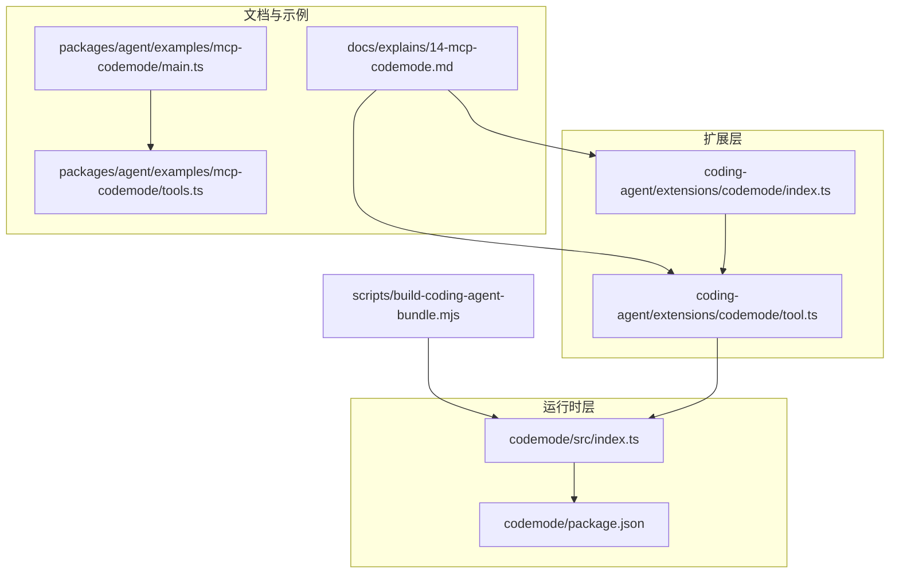
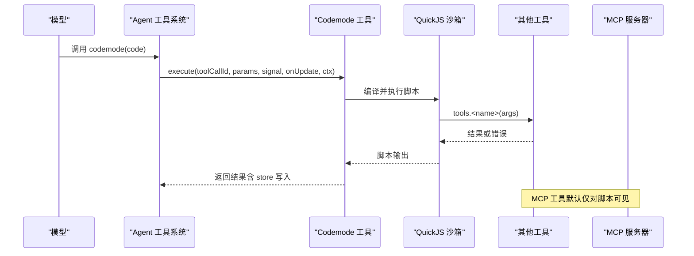
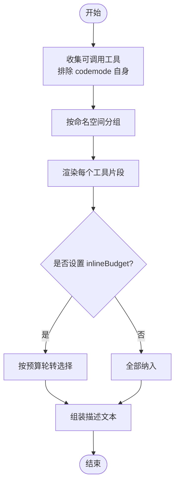
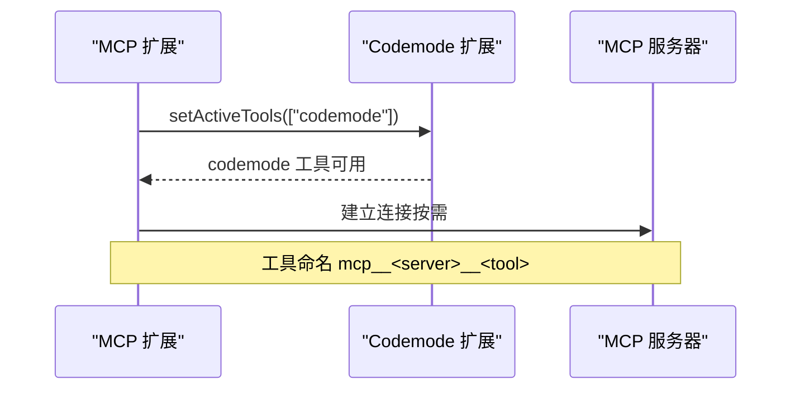
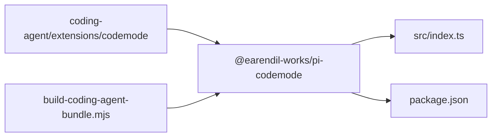

# Codemode 扩展

<cite>
**本文引用的文件**   
- [packages/coding-agent/src/extensions/codemode/index.ts](file://packages/coding-agent/src/extensions/codemode/index.ts)
- [packages/coding-agent/src/extensions/codemode/tool.ts](file://packages/coding-agent/src/extensions/codemode/tool.ts)
- [packages/coding-agent/src/core/settings-defaults.ts](file://packages/coding-agent/src/core/settings-defaults.ts)
- [docs/explains/14-mcp-codemode.md](file://docs/explains/14-mcp-codemode.md)
- [packages/codemode/src/index.ts](file://packages/codemode/src/index.ts)
- [packages/codemode/package.json](file://packages/codemode/package.json)
- [scripts/build-coding-agent-bundle.mjs](file://scripts/build-coding-agent-bundle.mjs)
- [packages/agent/examples/mcp-codemode/main.ts](file://packages/agent/examples/mcp-codemode/main.ts)
- [packages/agent/examples/mcp-codemode/tools.ts](file://packages/agent/examples/mcp-codemode/tools.ts)
</cite>

## 目录
1. [简介](#简介)
2. [项目结构](#项目结构)
3. [核心组件](#核心组件)
4. [架构总览](#架构总览)
5. [详细组件分析](#详细组件分析)
6. [依赖关系分析](#依赖关系分析)
7. [性能与预算控制](#性能与预算控制)
8. [故障排查指南](#故障排查指南)
9. [结论](#结论)
10. [附录：配置示例与最佳实践](#附录配置示例与最佳实践)

## 简介
Codemode 扩展为模型提供“代码模式”能力：模型可以编写 JavaScript 脚本，在沙箱中批量、链式地调用其他工具，并对输出进行过滤和预算控制。它默认不活跃，需要显式启用；当 MCP 工具仅通过脚本可访问时，MCP 扩展会激活它。该扩展支持以下关键特性：
- 代码模式切换：mode 参数支持 only 与 on（默认）两种展示策略。
- 内联预算控制：inlineBudget 控制描述中工具声明的 token 预算，避免上下文膨胀。
- 模型目录集成：可选暴露 models.* 分类器与图片生成能力给脚本使用。
- 与 MCP 扩展协作：MCP 工具默认以 codemode 方式暴露，由脚本按需发现与调用。

## 项目结构
Codemode 相关代码分布在两个主要位置：
- 运行时与类型定义位于 packages/codemode，提供沙箱、WASM、远程执行等基础能力。
- 扩展实现位于 packages/coding-agent/src/extensions/codemode，负责将 codemode 作为 Agent 工具注册、构建描述、处理嵌套调用与 store/load。

**图表来源**
- [packages/coding-agent/src/extensions/codemode/index.ts:1-50](file://packages/coding-agent/src/extensions/codemode/index.ts#L1-L50)
- [packages/coding-agent/src/extensions/codemode/tool.ts:1-435](file://packages/coding-agent/src/extensions/codemode/tool.ts#L1-L435)
- [packages/codemode/src/index.ts:1-66](file://packages/codemode/src/index.ts#L1-L66)
- [packages/codemode/package.json:1-76](file://packages/codemode/package.json#L1-L76)
- [docs/explains/14-mcp-codemode.md:1-240](file://docs/explains/14-mcp-codemode.md#L1-L240)
- [packages/agent/examples/mcp-codemode/main.ts:1-46](file://packages/agent/examples/mcp-codemode/main.ts#L1-L46)
- [packages/agent/examples/mcp-codemode/tools.ts:1-155](file://packages/agent/examples/mcp-codemode/tools.ts#L1-L155)
- [scripts/build-coding-agent-bundle.mjs:204-234](file://scripts/build-coding-agent-bundle.mjs#L204-L234)

**章节来源**
- [packages/coding-agent/src/extensions/codemode/index.ts:1-50](file://packages/coding-agent/src/extensions/codemode/index.ts#L1-L50)
- [packages/coding-agent/src/extensions/codemode/tool.ts:1-435](file://packages/coding-agent/src/extensions/codemode/tool.ts#L1-L435)
- [packages/codemode/src/index.ts:1-66](file://packages/codemode/src/index.ts#L1-L66)
- [packages/codemode/package.json:1-76](file://packages/codemode/package.json#L1-L76)
- [docs/explains/14-mcp-codemode.md:1-240](file://docs/explains/14-mcp-codemode.md#L1-L240)
- [packages/agent/examples/mcp-codemode/main.ts:1-46](file://packages/agent/examples/mcp-codemode/main.ts#L1-L46)
- [packages/agent/examples/mcp-codemode/tools.ts:1-155](file://packages/agent/examples/mcp-codemode/tools.ts#L1-L155)
- [scripts/build-coding-agent-bundle.mjs:204-234](file://scripts/build-coding-agent-bundle.mjs#L204-L234)

## 核心组件
- 扩展入口 createCodemodeExtension：注册 codemode 工具，默认 inactive，从设置读取 mode 与 inlineBudget，并可选择暴露 models。
- 工具定义 createCodemodeToolDefinition：构造 codemode 工具的声明、描述、reachesTools、prepareLoadout、execute 等。
- 描述生成 createCodemodeDescription：按命名空间分组、按预算选择工具片段，生成面向模型的说明。
- 加载负载 prepareCodemodeLoadout：根据 mode 决定 direct 工具是否隐藏，以及是否在 codemode 描述中列出所有可调用工具。
- 运行时与沙箱：通过 @earendil-works/pi-codemode 提供的 CodemodeSandbox、InlineCodemodeSandbox、RemoteCodemodeSandbox 等运行脚本。

**章节来源**
- [packages/coding-agent/src/extensions/codemode/index.ts:1-50](file://packages/coding-agent/src/extensions/codemode/index.ts#L1-L50)
- [packages/coding-agent/src/extensions/codemode/tool.ts:1-435](file://packages/coding-agent/src/extensions/codemode/tool.ts#L1-L435)
- [packages/codemode/src/index.ts:1-66](file://packages/codemode/src/index.ts#L1-L66)

## 架构总览
Codemode 扩展与 MCP 扩展协同工作：
- MCP 工具默认 exposure 为 codemode，不在模型侧直接声明，而是通过 codemode 脚本发现与调用。
- codemode 脚本在 QuickJS WASM 沙箱中运行，具备 tools、ALL_TOOLS、searchTools、describeTool、describeNamespace、models.* 等全局能力。
- 脚本嵌套调用走主工具管线，权限、校验、hook 一致，但只有脚本的输出到达模型。

**图表来源**
- [packages/coding-agent/src/extensions/codemode/tool.ts:394-416](file://packages/coding-agent/src/extensions/codemode/tool.ts#L394-L416)
- [docs/explains/14-mcp-codemode.md:130-215](file://docs/explains/14-mcp-codemode.md#L130-L215)

## 详细组件分析

### 扩展入口与配置选项
createCodemodeExtension 接收 options：
- mode：覆盖 codemode.mode 设置，支持 only 与 on。
- inlineBudget：覆盖 codemode.inlineBudget 设置，控制描述中工具声明的 token 预算。
- models：是否向脚本暴露 models.* 分类器与图片生成能力，默认 true。

读取逻辑：
- mode：若设置值为 only，则取 only，否则取默认值 on。
- inlineBudget：仅接受非负有限数字，否则回退到默认。

**章节来源**
- [packages/coding-agent/src/extensions/codemode/index.ts:14-45](file://packages/coding-agent/src/extensions/codemode/index.ts#L14-L45)
- [packages/coding-agent/src/core/settings-defaults.ts:57-60](file://packages/coding-agent/src/core/settings-defaults.ts#L57-L60)

### 工具定义与描述生成
createCodemodeToolDefinition 负责：
- 名称、标签、参数 schema、promptSnippet、promptGuidelines。
- exposure 设为 model-only，防止脚本再启动脚本。
- prepareLoadout：根据 mode 动态调整描述与隐藏 direct 工具。
- reachesTools：基于脚本源码中的 discovery globals 或词法匹配推断可达工具。
- constrainedSampling：使用 CODEMODE_SOURCE_GRAMMAR 让模型以原始文本形式写脚本。
- execute：懒加载执行器，首次调用才初始化沙箱。

描述生成 createCodemodeDescription：
- 按命名空间分组，先无命名空间，再按命名空间名排序。
- 使用 selectCatalog 按预算轮转分配，确保每个命名空间至少有一个代表工具。
- 支持 deferred 工具不列入描述，保持描述稳定。

**图表来源**
- [packages/coding-agent/src/extensions/codemode/tool.ts:145-270](file://packages/coding-agent/src/extensions/codemode/tool.ts#L145-L270)

**章节来源**
- [packages/coding-agent/src/extensions/codemode/tool.ts:145-270](file://packages/coding-agent/src/extensions/codemode/tool.ts#L145-L270)
- [packages/coding-agent/src/extensions/codemode/tool.ts:394-416](file://packages/coding-agent/src/extensions/codemode/tool.ts#L394-L416)

### 模式切换 with mode（only/normal/on）
- on（默认）：已声明工具的描述追加“脚本如何调用它”，codemode 描述只列出非 direct 的可调用工具。
- only：codemode 描述列出所有可调用工具，请求中隐藏 active direct 工具的声明。
- normal：通常指 on 行为，即正常混合模式。

prepareCodemodeLoadout 根据 mode 决定：
- descriptions：on 模式下为 callable 工具追加脚本调用说明。
- hiddenDeclarations：only 模式下隐藏 active direct 工具的声明。
- listed：only 模式列出所有 callable；on 模式排除 direct。

**章节来源**
- [packages/coding-agent/src/extensions/codemode/tool.ts:343-379](file://packages/coding-agent/src/extensions/codemode/tool.ts#L343-L379)

### 内联预算控制 with inlineBudget
- DEFAULT_CODEMODE_INLINE_BUDGET 来自 SETTINGS_DEFAULTS.codemode.inlineBudget，默认 3000。
- CHARS_PER_TOKEN=4，用于估算工具片段 token 成本。
- selectCatalog 在每个命名空间轮转放置最便宜的工具，直到预算耗尽。
- 可通过扩展 options.inlineBudget 或设置覆盖。

**章节来源**
- [packages/coding-agent/src/extensions/codemode/tool.ts:136-139](file://packages/coding-agent/src/extensions/codemode/tool.ts#L136-L139)
- [packages/coding-agent/src/extensions/codemode/tool.ts:197-220](file://packages/coding-agent/src/extensions/codemode/tool.ts#L197-L220)
- [packages/coding-agent/src/core/settings-defaults.ts:57-60](file://packages/coding-agent/src/core/settings-defaults.ts#L57-L60)

### 模型目录集成 with models
- 扩展 options.models 控制是否向脚本暴露 models.*。
- describeGlobals 在 models=true 时提示脚本可使用 models。
- 安全约束：脚本不能向 models.* 传入 baseUrl/headers，避免凭据泄露。

**章节来源**
- [packages/coding-agent/src/extensions/codemode/tool.ts:122-134](file://packages/coding-agent/src/extensions/codemode/tool.ts#L122-L134)
- [docs/explains/14-mcp-codemode.md:231](file://docs/explains/14-mcp-codemode.md#L231)

### 与 MCP 扩展的集成
- MCP 工具默认 exposure 为 codemode，保持模型工具声明精简。
- codemode 默认 defaultActive=false，MCP 在需要时通过 setActiveTools 激活。
- reachesTools 帮助 MCP 判断脚本可能触及哪些服务器，从而等待连接。
- 工具命名 mcp__<server>__<tool>，冲突时加哈希后缀。

**图表来源**
- [docs/explains/14-mcp-codemode.md:19-31](file://docs/explains/14-mcp-codemode.md#L19-L31)
- [docs/explains/14-mcp-codemode.md:68-84](file://docs/explains/14-mcp-codemode.md#L68-L84)
- [docs/explains/14-mcp-codemode.md:200-215](file://docs/explains/14-mcp-codemode.md#L200-L215)

**章节来源**
- [docs/explains/14-mcp-codemode.md:19-31](file://docs/explains/14-mcp-codemode.md#L19-L31)
- [docs/explains/14-mcp-codemode.md:68-84](file://docs/explains/14-mcp-codemode.md#L68-L84)
- [docs/explains/14-mcp-codemode.md:200-215](file://docs/explains/14-mcp-codemode.md#L200-L215)

### 启用/禁用扩展
- 内置扩展列表中 codemode 是可替换的。
- 默认 inactive，需要通过 --tools、defaultTools 设置或 setActiveTools 激活。
- MCP 扩展在 MCP 工具仅对脚本可达时激活 codemode。

**章节来源**
- [docs/explains/14-mcp-codemode.md:5-16](file://docs/explains/14-mcp-codemode.md#L5-L16)
- [packages/coding-agent/src/extensions/codemode/index.ts:1-7](file://packages/coding-agent/src/extensions/codemode/index.ts#L1-L7)

### 示例用法
示例展示了如何将 MCP 工具与 codemode 工具组合：
- main.ts 创建 agent，并将 MCP 工具与 codemode 工具注入 state.tools。
- tools.ts 封装 createCodemodeTool，将 MCP 工具适配为 codemode 可调用的工具列表。

**章节来源**
- [packages/agent/examples/mcp-codemode/main.ts:1-46](file://packages/agent/examples/mcp-codemode/main.ts#L1-L46)
- [packages/agent/examples/mcp-codemode/tools.ts:1-155](file://packages/agent/examples/mcp-codemode/tools.ts#L1-L155)

## 依赖关系分析
- coding-agent/extensions/codemode 依赖 @earendil-works/pi-codemode 提供沙箱与类型。
- codemode 包导出 index、declarations、source、portable、cloudflare、worker 等子模块。
- 构建脚本确保 codemode worker 仅导入 Node 内置模块，避免更新后失效。

**图表来源**
- [packages/coding-agent/src/extensions/codemode/tool.ts:24-37](file://packages/coding-agent/src/extensions/codemode/tool.ts#L24-L37)
- [packages/codemode/src/index.ts:1-66](file://packages/codemode/src/index.ts#L1-L66)
- [packages/codemode/package.json:1-76](file://packages/codemode/package.json#L1-L76)
- [scripts/build-coding-agent-bundle.mjs:204-234](file://scripts/build-coding-agent-bundle.mjs#L204-L234)

**章节来源**
- [packages/coding-agent/src/extensions/codemode/tool.ts:24-37](file://packages/coding-agent/src/extensions/codemode/tool.ts#L24-L37)
- [packages/codemode/src/index.ts:1-66](file://packages/codemode/src/index.ts#L1-L66)
- [packages/codemode/package.json:1-76](file://packages/codemode/package.json#L1-L76)
- [scripts/build-coding-agent-bundle.mjs:204-234](file://scripts/build-coding-agent-bundle.mjs#L204-L234)

## 性能与预算控制
- 沙箱限制：QuickJS WASM，默认最多 2 个 worker，堆上限 256MB，worker 等待上限 60 秒。
- 脚本超时：通过 // @options: { timeout_ms } 控制。
- 输出预算：默认 10,000 token，超限时保留头尾并写临时文件。
- 内联预算：inlineBudget 控制描述中工具声明的 token 预算，避免上下文膨胀。

**章节来源**
- [docs/explains/14-mcp-codemode.md:140-148](file://docs/explains/14-mcp-codemode.md#L140-L148)
- [docs/explains/14-mcp-codemode.md:192-198](file://docs/explains/14-mcp-codemode.md#L192-L198)
- [packages/coding-agent/src/extensions/codemode/tool.ts:136-139](file://packages/coding-agent/src/extensions/codemode/tool.ts#L136-L139)

## 故障排查指南
- codemode 未生效：确认已通过 --tools、defaultTools 或 setActiveTools 激活；检查 MCP 是否需要它。
- 描述过大：调小 inlineBudget，或减少命名空间数量；必要时使用 only 模式隐藏 direct 工具。
- 脚本失败：检查 // @options 超时设置；查看 console 输出与 store 写入；确认嵌套调用是否被阻止或参数非法。
- MCP 连接问题：关注 /mcp 管理器状态；HTTP 瞬态错误会重试，OAuth 需登录。

**章节来源**
- [docs/explains/14-mcp-codemode.md:43-66](file://docs/explains/14-mcp-codemode.md#L43-L66)
- [docs/explains/14-mcp-codemode.md:119-128](file://docs/explains/14-mcp-codemode.md#L119-L128)
- [packages/coding-agent/src/extensions/codemode/tool.ts:18-22](file://packages/coding-agent/src/extensions/codemode/tool.ts#L18-L22)

## 结论
Codemode 扩展通过代码模式为模型提供了强大的工具编排能力，结合 MCP 扩展可实现“最小工具声明 + 按需脚本发现”的高效生态。通过 mode、inlineBudget 与 models 三个关键配置，用户可以在功能完整性与上下文成本之间取得平衡。建议在生产环境中合理设置 inlineBudget，仅在必要时开启 only 模式，并确保 MCP 服务器的连接与认证流程顺畅。

## 附录：配置示例与最佳实践
- 启用 codemode：
  - CLI：--tools codemode
  - 设置：defaultTools 包含 codemode
  - SDK：setActiveTools(["codemode"])
- 配置 mode：
  - 设置为 only：隐藏 direct 工具声明，所有可调用工具在 codemode 描述中列出。
  - 设置为 on（默认）：在已声明工具描述中追加脚本调用说明。
- 配置 inlineBudget：
  - 默认 3000，可根据命名空间数量与工具复杂度调整。
- 配置 models：
  - 默认 true，如需禁用可在扩展选项中设置 models=false。
- 最佳实践：
  - 使用 only 模式减少模型上下文负担。
  - 合理设置 inlineBudget，避免描述过长。
  - 谨慎暴露 models.*，避免凭据泄露。
  - 利用 MCP 的 /mcp 管理器监控连接与认证状态。

**章节来源**
- [packages/coding-agent/src/extensions/codemode/index.ts:14-45](file://packages/coding-agent/src/extensions/codemode/index.ts#L14-L45)
- [packages/coding-agent/src/core/settings-defaults.ts:57-60](file://packages/coding-agent/src/core/settings-defaults.ts#L57-L60)
- [docs/explains/14-mcp-codemode.md:200-215](file://docs/explains/14-mcp-codemode.md#L200-L215)