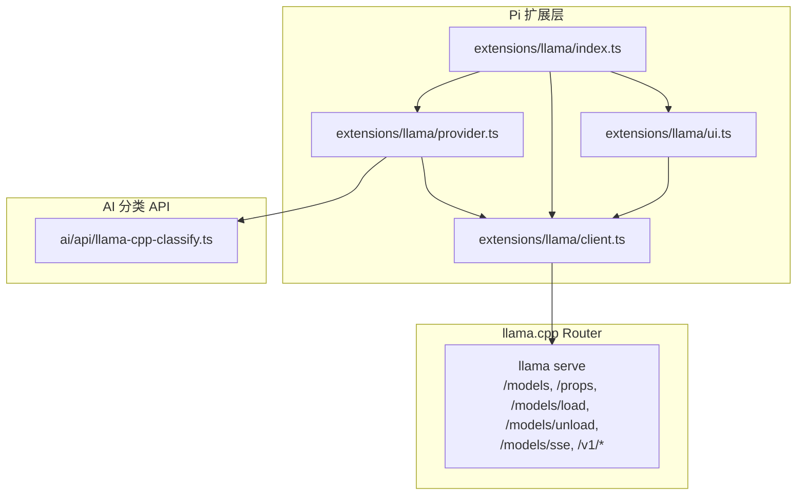
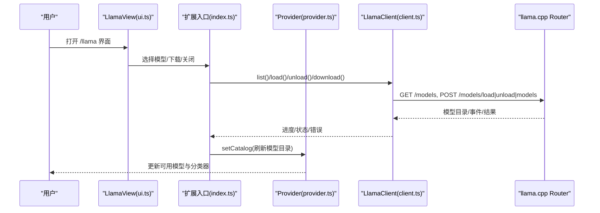
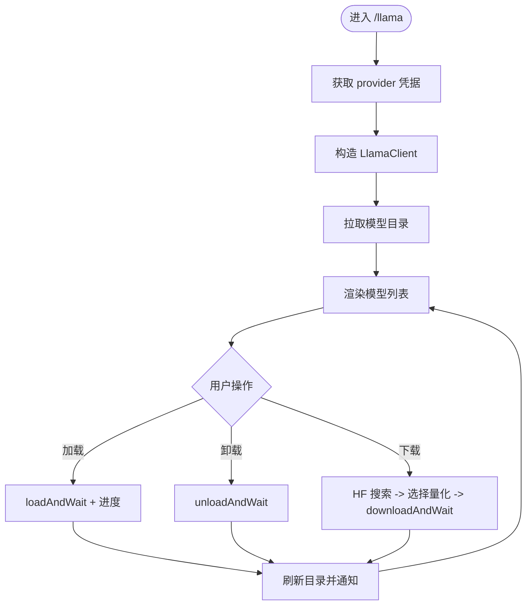
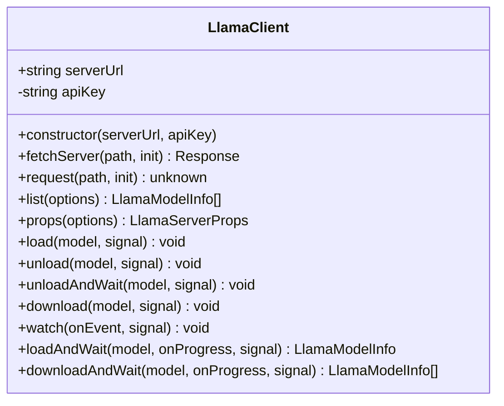
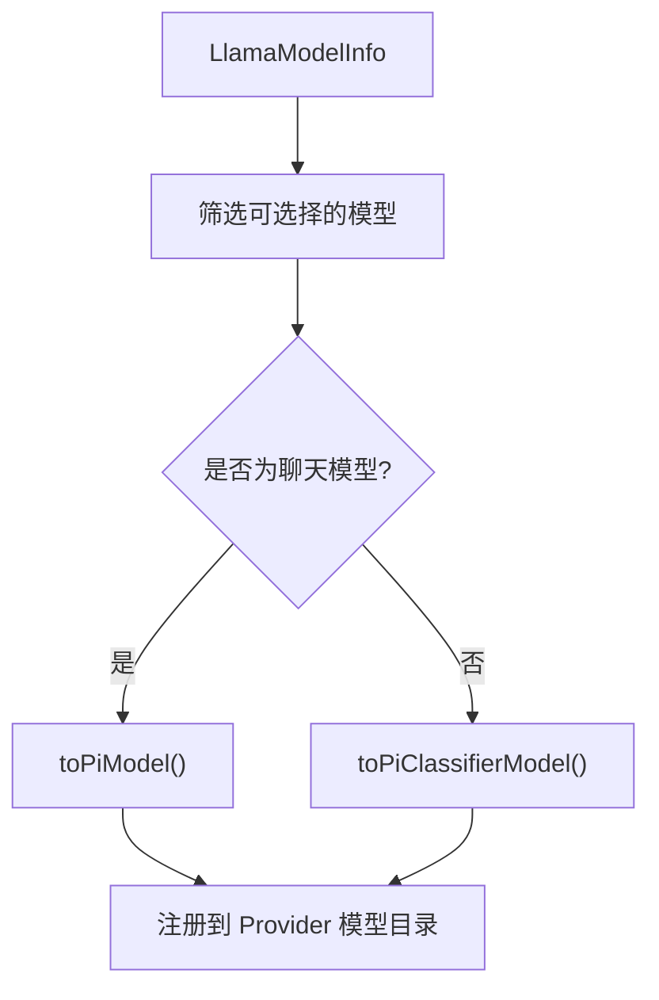
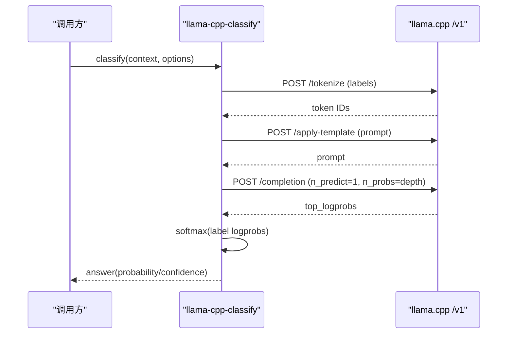
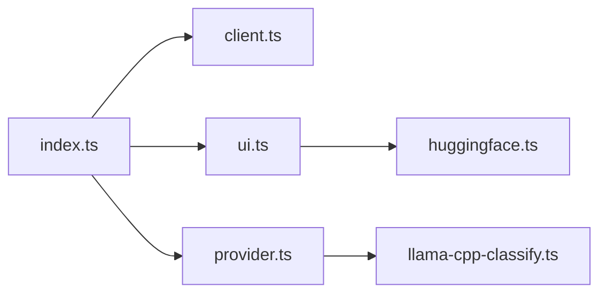

# Llama.cpp 扩展

<cite>
**本文引用的文件**   
- [llama-cpp.md](file://packages/coding-agent/docs/llama-cpp.md)
- [index.ts](file://packages/coding-agent/src/extensions/llama/index.ts)
- [client.ts](file://packages/coding-agent/src/extensions/llama/client.ts)
- [provider.ts](file://packages/coding-agent/src/extensions/llama/provider.ts)
- [ui.ts](file://packages/coding-agent/src/extensions/llama/ui.ts)
- [llama-cpp-classify.ts](file://packages/ai/src/api/llama-cpp-classify.ts)
- [llama-extension.test.ts](file://packages/coding-agent/test/llama-extension.test.ts)
</cite>

## 目录
1. [简介](#简介)
2. [项目结构](#项目结构)
3. [核心组件](#核心组件)
4. [架构总览](#架构总览)
5. [详细组件分析](#详细组件分析)
6. [依赖关系分析](#依赖关系分析)
7. [性能与内存优化](#性能与内存优化)
8. [模型文件格式与大小建议](#模型文件格式与大小建议)
9. [配置与使用指南](#配置与使用指南)
10. [故障排除](#故障排除)
11. [结论](#结论)

## 简介
本扩展为 Pi 提供本地 AI 模型运行能力，通过 llama.cpp 的 router 模式管理多个 GGUF 模型，支持按需加载、卸载、下载和推理。扩展将 llama.cpp 暴露为内置 provider，并提供 `/llama` 命令用于交互式管理模型；同时把 llama.cpp 模型注册到模型目录，既可作为聊天模型（OpenAI 兼容接口），也可作为分类器模型（决策模型或基于概率的分类 API）。

## 项目结构
Llama.cpp 扩展位于 `packages/coding-agent/src/extensions/llama`，主要包含以下模块：
- `index.ts`：扩展入口，注册 provider 与 `/llama` 命令，编排 UI 与客户端交互。
- `client.ts`：封装 llama.cpp router HTTP/SSE 接口，提供模型列表、加载/卸载、下载、SSE 事件监听等能力。
- `provider.ts`：将 llama.cpp 模型转换为 Pi 的 Provider、Model 与 Classifier 描述，处理认证、上下文窗口、推理 URL 等。
- `ui.ts`：TUI 界面，展示模型列表、下载搜索、进度条与连接错误提示。
- `huggingface.ts`：Hugging Face 模型搜索与详情获取（扩展文档中未直接引用实现细节，但被 UI 与下载流程使用）。

此外，`packages/ai/src/api/llama-cpp-classify.ts` 实现了“基于 llama.cpp 聊天模型的分类器”逻辑，通过读取下一个 token 的概率对标签进行 softmax 选择。

**图表来源**
- [index.ts:42-229](file://packages/coding-agent/src/extensions/llama/index.ts#L42-L229)
- [client.ts:168-367](file://packages/coding-agent/src/extensions/llama/client.ts#L168-L367)
- [provider.ts:166-299](file://packages/coding-agent/src/extensions/llama/provider.ts#L166-L299)
- [llama-cpp-classify.ts:426-461](file://packages/ai/src/api/llama-cpp-classify.ts#L426-L461)

**章节来源**
- [index.ts:1-231](file://packages/coding-agent/src/extensions/llama/index.ts#L1-L231)
- [client.ts:1-368](file://packages/coding-agent/src/extensions/llama/client.ts#L1-L368)
- [provider.ts:1-300](file://packages/coding-agent/src/extensions/llama/provider.ts#L1-L300)
- [ui.ts:1-574](file://packages/coding-agent/src/extensions/llama/ui.ts#L1-L574)

## 核心组件
- **扩展入口与命令**：注册 provider 与 `/llama` 命令，负责从模型注册表获取 provider 凭据、构造 `LlamaClient`、调用 UI 并协调加载/卸载/下载流程。
- **HTTP/SSE 客户端**：封装 llama.cpp router 的 REST 与 SSE 接口，统一错误信息、超时、重试、进度解析与状态轮询。
- **Provider 适配层**：将 llama.cpp 模型映射为 Pi 的 chat/classifier 模型，计算上下文窗口、推理 baseUrl、是否支持思考模板等。
- **分类器实现**：对决策模型使用 typesafe-system-one 接口；对普通聊天模型使用 `llama-cpp-classify`，通过 label token 概率进行分类。
- **TUI 界面**：提供模型列表、下载搜索、进度显示、连接错误重试等交互。

**章节来源**
- [index.ts:42-229](file://packages/coding-agent/src/extensions/llama/index.ts#L42-L229)
- [client.ts:168-367](file://packages/coding-agent/src/extensions/llama/client.ts#L168-L367)
- [provider.ts:166-299](file://packages/coding-agent/src/extensions/llama/provider.ts#L1-L299)
- [llama-cpp-classify.ts:17-36](file://packages/ai/src/api/llama-cpp-classify.ts#L17-L36)
- [ui.ts:307-509](file://packages/coding-agent/src/extensions/llama/ui.ts#L307-L509)

## 架构总览
下图展示了从用户操作到 llama.cpp router 的完整调用链：

**图表来源**
- [ui.ts:352-389](file://packages/coding-agent/src/extensions/llama/ui.ts#L352-L389)
- [index.ts:183-229](file://packages/coding-agent/src/extensions/llama/index.ts#L183-L229)
- [client.ts:206-246](file://packages/coding-agent/src/extensions/llama/client.ts#L206-L246)
- [provider.ts:172-180](file://packages/coding-agent/src/extensions/llama/provider.ts#L172-L180)

## 详细组件分析

### 扩展入口与命令（index.ts）
- 注册 provider 与 `/llama` 命令。
- 从模型注册表获取 provider 凭据，构造 `LlamaClient`。
- 同步模型目录并刷新 Pi 的模型注册表。
- 管理加载/卸载/下载流程，包括与其他已加载模型的冲突处理、恢复策略、取消与错误处理。
- 集成 Hugging Face 搜索与 gated 仓库访问提示。

**图表来源**
- [index.ts:29-40](file://packages/coding-agent/src/extensions/llama/index.ts#L29-L40)
- [index.ts:66-181](file://packages/coding-agent/src/extensions/llama/index.ts#L66-L181)
- [index.ts:183-229](file://packages/coding-agent/src/extensions/llama/index.ts#L183-L229)

**章节来源**
- [index.ts:1-231](file://packages/coding-agent/src/extensions/llama/index.ts#L1-L231)

### HTTP/SSE 客户端（client.ts）
- 标准化服务器 URL，统一添加 Authorization 头与超时信号。
- 提供 `list`、`props`、`load`、`unload`、`download` 等方法。
- 通过 `/models/sse` 订阅模型事件，解析加载/下载进度。
- `loadAndWait` 与 `downloadAndWait` 结合 SSE 与轮询，返回最终状态。

**图表来源**
- [client.ts:168-367](file://packages/coding-agent/src/extensions/llama/client.ts#L168-L367)

**章节来源**
- [client.ts:1-368](file://packages/coding-agent/src/extensions/llama/client.ts#L1-L368)

### Provider 适配层（provider.ts）
- 将 llama.cpp 模型转换为 Pi 的 chat/classifier 模型。
- 自动识别决策模型（`decisions` 输出模态）与普通聊天模型。
- 计算上下文窗口：优先运行时 `n_ctx`，其次命令行参数 `-c/--ctx-size`，最后回退训练上下文或默认值。
- 根据 chat template 判断是否支持思考（thinking）能力，并设置兼容字段。
- 提供认证流程：URL 与可选 API Key，默认 baseUrl 指向 `/v1` 推理端点。

**图表来源**
- [provider.ts:39-95](file://packages/coding-agent/src/extensions/llama/provider.ts#L39-L95)
- [provider.ts:127-159](file://packages/coding-agent/src/extensions/llama/provider.ts#L127-L159)
- [provider.ts:166-299](file://packages/coding-agent/src/extensions/llama/provider.ts#L166-L299)

**章节来源**
- [provider.ts:1-300](file://packages/coding-agent/src/extensions/llama/provider.ts#L1-L300)

### 分类器实现（llama-cpp-classify.ts）
- 对 llama.cpp 聊天模型，通过 `/tokenize`、`/apply-template`、`/completion` 接口，读取下一个 token 的概率，对标签进行 softmax 选择。
- 支持 choice、bool、score 三类问题，标签映射为单 token。
- 支持温度调节、重试深度、错误处理与超时。

**图表来源**
- [llama-cpp-classify.ts:284-393](file://packages/ai/src/api/llama-cpp-classify.ts#L284-L393)
- [llama-cpp-classify.ts:395-424](file://packages/ai/src/api/llama-cpp-classify.ts#L395-L424)
- [llama-cpp-classify.ts:426-461](file://packages/ai/src/api/llama-cpp-classify.ts#L426-L461)

**章节来源**
- [llama-cpp-classify.ts:1-462](file://packages/ai/src/api/llama-cpp-classify.ts#L1-L462)

### TUI 界面（ui.ts）
- 展示模型列表、当前状态、上下文窗口大小。
- 支持 Hugging Face 模糊搜索、缓存与分页显示。
- 显示加载/下载进度条，支持取消操作。
- 连接错误时提供重试或关闭选项。

**章节来源**
- [ui.ts:1-574](file://packages/coding-agent/src/extensions/llama/ui.ts#L1-L574)

## 依赖关系分析
- 扩展入口依赖 client、provider、ui 与 huggingface。
- provider 依赖 ai 包中的分类器 API（typesafe-system-one 与 llama-cpp-classify）。
- client 直接与 llama.cpp router 通信，使用 fetch 与 SSE。
- ui 依赖 TUI 组件库与 keybindings。

**图表来源**
- [index.ts:1-5](file://packages/coding-agent/src/extensions/llama/index.ts#L1-L5)
- [provider.ts:1-22](file://packages/coding-agent/src/extensions/llama/provider.ts#L1-L22)
- [ui.ts:1-22](file://packages/coding-agent/src/extensions/llama/ui.ts#L1-L22)

**章节来源**
- [index.ts:1-231](file://packages/coding-agent/src/extensions/llama/index.ts#L1-L231)
- [provider.ts:1-300](file://packages/coding-agent/src/extensions/llama/provider.ts#L1-L300)
- [ui.ts:1-574](file://packages/coding-agent/src/extensions/llama/ui.ts#L1-L574)

## 性能与内存优化
- GPU 加速：启动 router 时使用 `-ngl all` 可将所有层卸载到 GPU；省略该参数则启用自动 GPU 卸载。
- 上下文窗口：通过 `-c` 或 `--ctx-size` 控制上下文大小；共享槽位下上下文跨并行请求共享。
- 多模型内存：避免同时加载过多大模型；必要时先卸载其他模型再加载目标模型。
- 分类器性能：每个问题顺序执行，前缀相同部分可利用服务端 prompt 缓存；对于混合模型可启用 `--ctx-checkpoints` 与 `--checkpoint-min-step` 以改善重放效率。
- 网络与超时：客户端默认请求超时为 15 秒；SSE 与轮询结合确保长任务可观察进度。

**章节来源**
- [llama-cpp.md:21-37](file://packages/coding-agent/docs/llama-cpp.md#L21-L37)
- [llama-cpp.md:97-114](file://packages/coding-agent/docs/llama-cpp.md#L97-L114)
- [client.ts:189-204](file://packages/coding-agent/src/extensions/llama/client.ts#L189-L204)

## 模型文件格式与大小建议
- 单文件模型可直接放在模型目录；多分片或多模态模型需放入子目录。
- 推荐量化格式 Q4_K_M，兼顾体积与质量。
- 小模型（如 1B-4B）适合低内存设备；中等模型（7B-13B）需要较多显存；大模型（30B+）建议高显存或 CPU 推理配合较大上下文。
- 决策模型（如 Julia-1、Kev、lev、OpenJev）仅用于分类，不列出为聊天模型。

**章节来源**
- [llama-cpp.md:38-52](file://packages/coding-agent/docs/llama-cpp.md#L38-L52)
- [llama-cpp.md:97-104](file://packages/coding-agent/docs/llama-cpp.md#L97-L104)

## 配置与使用指南

### 安装与启动 llama.cpp
- 使用官方安装脚本安装 llama.cpp。
- 启动 router 模式：不要传入 `--model`、`-m` 或 `-hf`；推荐开启 `--no-models-autoload` 并通过 `/llama` 显式加载。
- 常用参数：
  - `-ngl all`：GPU 全量卸载。
  - `-c 32768`：上下文大小；设为 0 表示使用模型完整上下文窗口。
  - `--models-dir`：模型目录路径。
  - `--api-key`：若使用 API Key，请与服务端一致。
  - `--host 127.0.0.1`：仅本地访问。

**章节来源**
- [llama-cpp.md:5-37](file://packages/coding-agent/docs/llama-cpp.md#L5-L37)

### 在 Pi 中配置 llama.cpp
- 交互式登录：`/login llama.cpp`，输入 router URL 与可选 API Key。
- 环境变量：
  - `LLAMA_BASE_URL=http://127.0.0.1:9931`
  - `LLAMA_API_KEY=optional-secret`
- 若使用 `--no-models-autoload`，登录后需通过 `/llama` 加载模型，再用 `/model` 选择会话使用的模型。

**章节来源**
- [llama-cpp.md:54-74](file://packages/coding-agent/docs/llama-cpp.md#L54-L74)
- [provider.ts:186-227](file://packages/coding-agent/src/extensions/llama/provider.ts#L186-L227)

### 管理模型
- 运行 `/llama`：
  - 选择未加载模型以加载。
  - 选择已加载模型以卸载。
  - 选择“Download model…”搜索 Hugging Face，选择仓库与量化。
- 已加载与休眠模型出现在 `/model`；休眠模型选中后自动唤醒。
- 若 router 断开，界面提供“Retry”与“Close”。

**章节来源**
- [llama-cpp.md:76-96](file://packages/coding-agent/docs/llama-cpp.md#L76-L96)
- [index.ts:137-181](file://packages/coding-agent/src/extensions/llama/index.ts#L137-L181)

### 分类器使用
- 决策模型：通过 `/v1/systemone` 原生回答，仅作为分类器出现。
- 聊天模型：通过 `llama-cpp-classify` 读取下一个 token 概率进行分类。
- 温度参数：对标签 logits 进行缩放，提升分布平滑度但不改变答案。

**章节来源**
- [llama-cpp.md:97-114](file://packages/coding-agent/docs/llama-cpp.md#L97-L114)
- [llama-cpp-classify.ts:17-36](file://packages/ai/src/api/llama-cpp-classify.ts#L17-L36)

## 故障排除
- 检查 router 可达性：
  - `curl http://127.0.0.1:9931/health`
  - `curl http://127.0.0.1:9931/models`
- `/llama` 无模型：检查 `--models-dir`、目录布局并重启 router。
- 模型不在 `/model`（`--no-models-autoload`）：先用 `/llama` 加载。
- 加载失败或内存不足：降低 `-c` 或卸载其他模型。
- 非 router 模式：确保未传入 `--model`、`-m` 或 `-hf`。
- 连接错误：界面会提示“Could not connect to the server”，可选择重试或关闭。

**章节来源**
- [llama-cpp.md:115-129](file://packages/coding-agent/docs/llama-cpp.md#L115-L129)
- [client.ts:177-186](file://packages/coding-agent/src/extensions/llama/client.ts#L177-L186)
- [index.ts:11-20](file://packages/coding-agent/src/extensions/llama/index.ts#L11-L20)

## 结论
Llama.cpp 扩展将本地 GGUF 模型管理与推理整合进 Pi，提供直观的 TUI 与稳定的 HTTP/SSE 客户端。通过合理配置 GPU 卸载、上下文窗口与模型目录，可在不同硬件条件下稳定运行多种规模模型。分类器能力覆盖决策模型与聊天模型两种路径，满足结构化判断场景。遇到问题时，优先检查 router 模式、模型目录、API Key 与网络连通性。