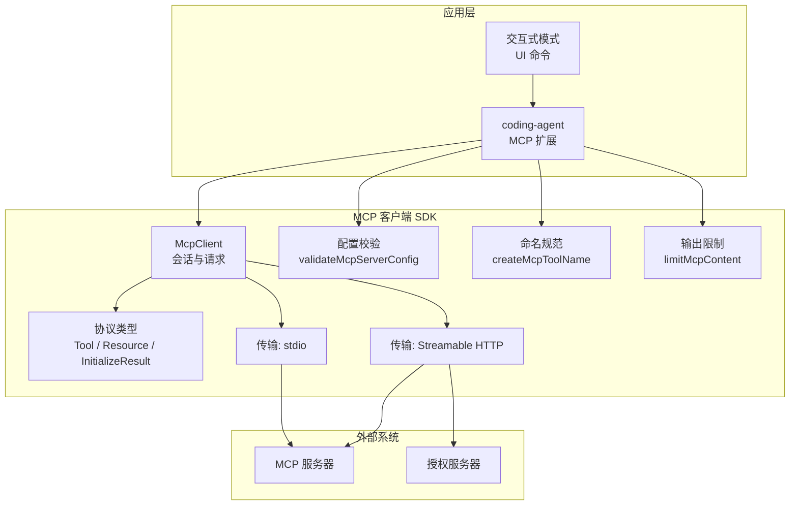
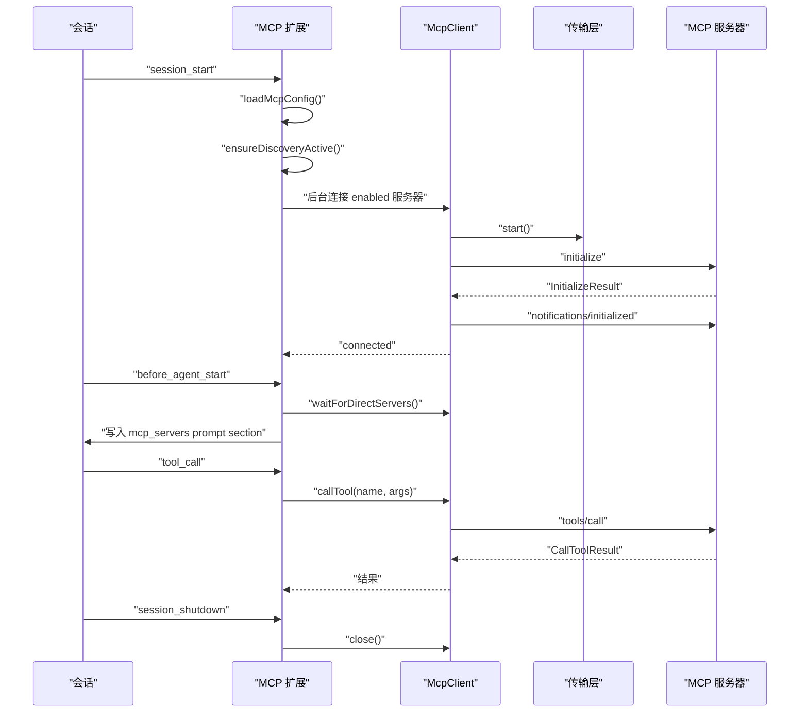
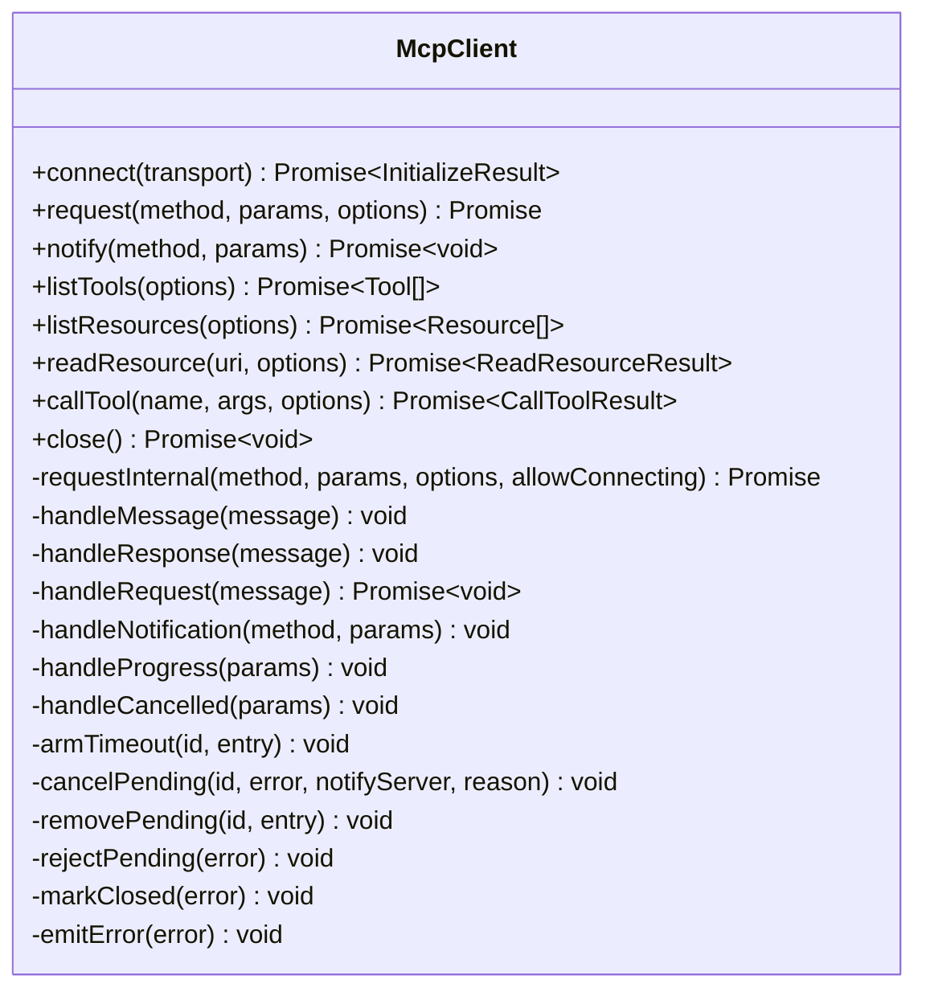
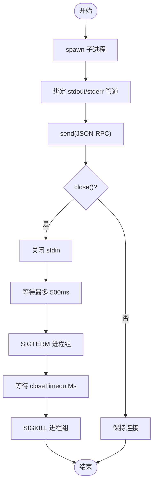
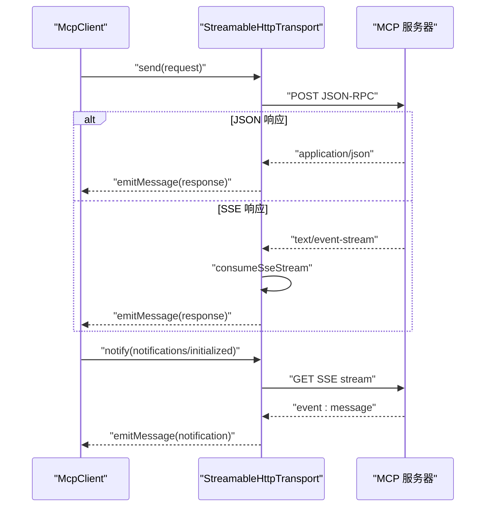
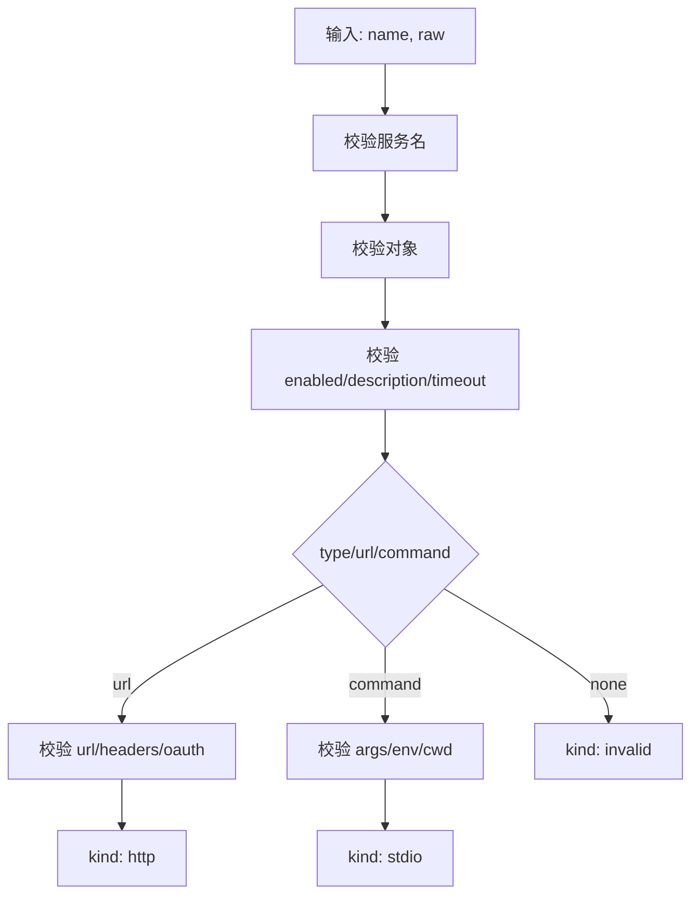
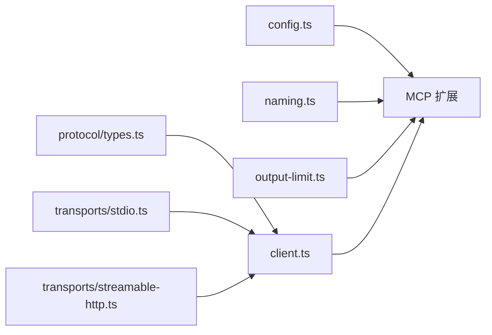
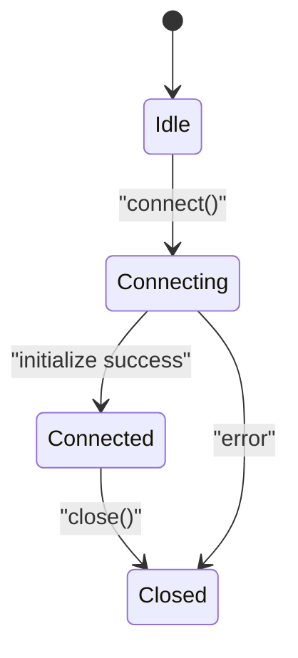
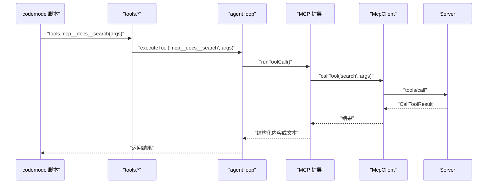

# MCP 扩展

<cite>
**本文引用的文件**   
- [14-mcp-codemode.md](file://docs/explains/14-mcp-codemode.md)
- [18-mcp-package.md](file://docs/explains/18-mcp-package.md)
- [client.ts](file://packages/mcp/src/client.ts)
- [config.ts](file://packages/mcp/src/config.ts)
- [naming.ts](file://packages/mcp/src/naming.ts)
- [output-limit.ts](file://packages/mcp/src/output-limit.ts)
- [types.ts](file://packages/mcp/src/protocol/types.ts)
- [stdio.ts](file://packages/mcp/src/transports/stdio.ts)
- [streamable-http.ts](file://packages/mcp/src/transports/streamable-http.ts)
- [mcp-extension.test.ts](file://packages/coding-agent/test/suite/agent-session-mcp.test.ts)
- [interactive-mode.ts](file://packages/coding-agent/src/modes/interactive/interactive-mode.ts)
</cite>

## 目录
1. [引言](#引言)
2. [项目结构](#项目结构)
3. [核心组件](#核心组件)
4. [架构总览](#架构总览)
5. [详细组件分析](#详细组件分析)
6. [依赖关系分析](#依赖关系分析)
7. [性能与资源限制](#性能与资源限制)
8. [配置与连接管理](#配置与连接管理)
9. [错误处理与调试](#错误处理与调试)
10. [与 codemode 的协作](#与-codemode-的协作)
11. [脚本环境中的 MCP 工具访问](#脚本环境中的-mcp-工具访问)
12. [故障排查指南](#故障排查指南)
13. [结论](#结论)

## 引言
本文件面向需要理解并集成 Model Context Protocol（MCP）扩展的开发者。文档从仓库中 MCP 包、编码代理扩展以及说明文档出发，解释 MCP 协议的实现原理、服务发现与工具注册机制、连接生命周期、OAuth 认证、输出截断策略，以及与 codemode 扩展的协作方式。同时给出配置示例、调试技巧和在脚本环境中调用 MCP 工具的最佳实践。

## 项目结构
仓库中与 MCP 相关的主要代码位于 `packages/mcp`，它是独立于应用的 MCP 客户端 SDK；而 `packages/coding-agent` 中的 MCP 扩展负责把 MCP 服务器暴露为模型工具或 codemode 可调用的工具。说明文档集中在 `docs/explains/14-mcp-codemode.md` 和 `18-mcp-package.md`。

**图表来源**
- [client.ts:155-250](file://packages/mcp/src/client.ts#L155-L250)
- [config.ts:113-139](file://packages/mcp/src/config.ts#L113-L139)
- [naming.ts:18-27](file://packages/mcp/src/naming.ts#L18-L27)
- [output-limit.ts:28-48](file://packages/mcp/src/output-limit.ts#L28-L48)
- [types.ts:4-10](file://packages/mcp/src/protocol/types.ts#L4-L10)
- [stdio.ts:96-145](file://packages/mcp/src/transports/stdio.ts#L96-L145)
- [streamable-http.ts:285-323](file://packages/mcp/src/transports/streamable-http.ts#L285-L323)

**章节来源**
- [18-mcp-package.md:1-16](file://docs/explains/18-mcp-package.md#L1-L16)
- [14-mcp-codemode.md:33-41](file://docs/explains/14-mcp-codemode.md#L33-L41)

## 核心组件
- **MCP 客户端**：封装 JSON-RPC 2.0 消息、初始化流程、能力协商、分页、进度通知、取消、超时、错误转换。
- **传输层**：提供 stdio 子进程通信和 Streamable HTTP + SSE 流式响应。
- **配置校验**：统一校验 `mcpServers` 条目，区分 stdio 与 http，拒绝旧版 SSE 类型，校验 OAuth 回调地址等。
- **命名规范**：生成 `mcp__server__tool` 名称，处理冲突哈希后缀和命名空间。
- **输出限制**：对模型可见文本做中间截断，保留头尾，必要时保存完整输出到临时文件。
- **协议类型**：定义支持的协议版本、工具、资源、模板、初始化结果等类型。

**章节来源**
- [client.ts:155-250](file://packages/mcp/src/client.ts#L155-L250)
- [client.ts:296-386](file://packages/mcp/src/client.ts#L296-L386)
- [config.ts:113-139](file://packages/mcp/src/config.ts#L113-L139)
- [naming.ts:18-35](file://packages/mcp/src/naming.ts#L18-L35)
- [output-limit.ts:28-48](file://packages/mcp/src/output-limit.ts#L28-L48)
- [types.ts:4-10](file://packages/mcp/src/protocol/types.ts#L4-L10)

## 架构总览
MCP 扩展在 coding-agent 中加载配置、建立连接、发现工具，并把 MCP 工具暴露给模型或 codemode 脚本。连接失败不会阻塞启动，状态通过 `/mcp` 管理器展示并可修复。

**图表来源**
- [14-mcp-codemode.md:43-66](file://docs/explains/14-mcp-codemode.md#L43-L66)
- [client.ts:204-250](file://packages/mcp/src/client.ts#L204-L250)

**章节来源**
- [14-mcp-codemode.md:43-66](file://docs/explains/14-mcp-codemode.md#L43-L66)

## 详细组件分析

### MCP 客户端
McpClient 维护连接状态机 idle → connecting → connected → closed，负责：
- 启动传输、发送 initialize、校验协议版本、保存 serverInfo/capabilities/instructions。
- 发送 request/notify，管理 pending 请求、progress token、超时、取消。
- 处理服务端请求（内置 ping、roots/list），未知方法返回 methodNotFound。
- 分页 listTools/listResources/listResourceTemplates，最多 1000 页，重复 cursor 报错。
- 运行时校验 initialize/tools/list/resources/read/tools/call 的结果。

**图表来源**
- [client.ts:155-250](file://packages/mcp/src/client.ts#L155-L250)
- [client.ts:296-386](file://packages/mcp/src/client.ts#L296-L386)
- [client.ts:396-444](file://packages/mcp/src/client.ts#L396-L444)
- [client.ts:465-522](file://packages/mcp/src/client.ts#L465-L522)
- [client.ts:524-583](file://packages/mcp/src/client.ts#L524-L583)

**章节来源**
- [client.ts:155-250](file://packages/mcp/src/client.ts#L155-L250)
- [client.ts:296-386](file://packages/mcp/src/client.ts#L296-L386)
- [client.ts:396-583](file://packages/mcp/src/client.ts#L396-L583)

### 传输层：stdio
StdioTransport 使用 cross-spawn 启动子进程，Unix 上 detached 建立进程组，关闭顺序为：
- 关闭 stdin → 等待最多 500ms → SIGTERM → 再等 closeTimeoutMs → SIGKILL。
- 杀死整个进程组，避免 npx/uvx 留下子进程。
- stderr 保留尾部用于诊断。

**图表来源**
- [stdio.ts:96-145](file://packages/mcp/src/transports/stdio.ts#L96-L145)
- [stdio.ts:156-185](file://packages/mcp/src/transports/stdio.ts#L156-L185)

**章节来源**
- [stdio.ts:96-145](file://packages/mcp/src/transports/stdio.ts#L96-L145)
- [stdio.ts:156-185](file://packages/mcp/src/transports/stdio.ts#L156-L185)

### 传输层：Streamable HTTP
StreamableHttpTransport 支持：
- POST JSON-RPC，Accept application/json, text/event-stream。
- 解析 JSON 响应或 SSE 事件流。
- 收到 notifications/initialized 后启动服务端到客户端的 GET SSE 流。
- 自动重连，带 Last-Event-ID 和指数退避。
- 401/403 insufficient_scope 触发授权；404 表示 session 过期；408/429/5xx 可重试。

**图表来源**
- [streamable-http.ts:285-323](file://packages/mcp/src/transports/streamable-http.ts#L285-L323)
- [streamable-http.ts:405-433](file://packages/mcp/src/transports/streamable-http.ts#L405-L433)
- [streamable-http.ts:480-512](file://packages/mcp/src/transports/streamable-http.ts#L480-L512)

**章节来源**
- [streamable-http.ts:285-323](file://packages/mcp/src/transports/streamable-http.ts#L285-L323)
- [streamable-http.ts:405-433](file://packages/mcp/src/transports/streamable-http.ts#L405-L433)
- [streamable-http.ts:480-512](file://packages/mcp/src/transports/streamable-http.ts#L480-L512)

### 配置校验
validateMcpServerConfig 校验单个 mcpServers 条目：
- 服务名必须匹配 `[A-Za-z0-9_-]+`。
- 拒绝 legacy SSE 类型，要求 streamable HTTP URL。
- 校验 url、headers、oauth 字段。
- 支持 override 条目（无 command/url/type）。

**图表来源**
- [config.ts:113-139](file://packages/mcp/src/config.ts#L113-L139)
- [config.ts:155-173](file://packages/mcp/src/config.ts#L155-L173)
- [config.ts:241-243](file://packages/mcp/src/config.ts#L241-L243)

**章节来源**
- [config.ts:113-139](file://packages/mcp/src/config.ts#L113-L139)
- [config.ts:155-173](file://packages/mcp/src/config.ts#L155-L173)
- [config.ts:241-243](file://packages/mcp/src/config.ts#L241-L243)

### 命名规范
createMcpToolName 生成 `mcp__server__tool`，非字母数字下划线替换为下划线，超过 64 字符时截断并追加 8 位 sha256 后缀，避免顺序依赖导致同名冲突。mcpNamespace 将 `-` 替换为 `_`，使不同写法共享命名空间。

**章节来源**
- [naming.ts:18-35](file://packages/mcp/src/naming.ts#L18-L35)

### 输出限制
limitMcpContent 对模型可见文本进行中间截断，保留头尾，必要时调用 saveOutput 写完整内容到临时文件，返回 fullOutputPath。图片块保留在文本之后。

**章节来源**
- [output-limit.ts:28-48](file://packages/mcp/src/output-limit.ts#L28-L48)

## 依赖关系分析
MCP 扩展依赖以下模块：
- protocol/types.ts：协议类型与版本。
- transports/stdio.ts 与 transports/streamable-http.ts：两种传输实现。
- client.ts：会话、请求、通知、分页、取消、超时。
- config.ts：配置校验。
- naming.ts：工具命名。
- output-limit.ts：输出截断。

**图表来源**
- [types.ts:4-10](file://packages/mcp/src/protocol/types.ts#L4-L10)
- [stdio.ts:96-145](file://packages/mcp/src/transports/stdio.ts#L96-L145)
- [streamable-http.ts:285-323](file://packages/mcp/src/transports/streamable-http.ts#L285-L323)
- [client.ts:155-250](file://packages/mcp/src/client.ts#L155-L250)
- [config.ts:113-139](file://packages/mcp/src/config.ts#L113-L139)
- [naming.ts:18-35](file://packages/mcp/src/naming.ts#L18-L35)
- [output-limit.ts:28-48](file://packages/mcp/src/output-limit.ts#L28-L48)

**章节来源**
- [18-mcp-package.md:1-16](file://docs/explains/18-mcp-package.md#L1-L16)

## 性能与资源限制
- 单条消息上限默认 16MB。
- 模型可见文本上限 20KB，超过则中间截断。
- stdio 关闭流程包含 graceful 等待与强制终止，防止僵尸进程。
- HTTP SSE 重连带指数退避，最大延迟与重试次数可配置。
- 分页最多 1000 页，重复 cursor 直接报错。

**章节来源**
- [18-mcp-package.md:55-69](file://docs/explains/18-mcp-package.md#L55-L69)
- [output-limit.ts:8-9](file://packages/mcp/src/output-limit.ts#L8-L9)
- [stdio.ts:156-185](file://packages/mcp/src/transports/stdio.ts#L156-L185)
- [streamable-http.ts:547-559](file://packages/mcp/src/transports/streamable-http.ts#L547-L559)
- [client.ts:356-376](file://packages/mcp/src/client.ts#L356-L376)

## 配置与连接管理
- 配置来源：全局 `~/.pi/agent/mcp.json`、受信任项目的 `.pi/mcp.json`、扩展通过 `pi.registerMcpServer()` 注册的服务器。
- 同名服务器优先：配置文件覆盖注册服务器。
- 连接生命周期：
  - session_start：加载配置、激活 discovery、后台连接 enabled 服务器。
  - before_agent_start：等待 direct 工具服务器，写入 mcp_servers prompt section。
  - tool_call：根据 reachesTools 决定等待哪些服务器。
  - session_shutdown：中止会话、关闭连接、等待后台动作。
- 连接失败不阻塞启动，状态通过 `/mcp` 管理器展示。

**图表来源**
- [client.ts:155-250](file://packages/mcp/src/client.ts#L155-L250)

**章节来源**
- [14-mcp-codemode.md:33-66](file://docs/explains/14-mcp-codemode.md#L33-L66)
- [client.ts:204-250](file://packages/mcp/src/client.ts#L204-L250)

## 错误处理与调试
- JSON-RPC 标准错误码：parse、invalidRequest、methodNotFound、invalidParams、internalError。
- 自定义错误：McpError、McpConnectionClosedError、McpTimeoutError、McpAbortError。
- HTTP 错误：McpAuthRequiredError、McpSessionExpiredError、McpHttpError。
- stdio stderr 保留尾部用于诊断。
- `/mcp` 管理器按“需要注意”排序：needs-auth → failed → disconnected → connecting → connected，支持登录、登出、重连、启用/禁用、修改 exposure、查看工具。

**章节来源**
- [18-mcp-package.md:18-39](file://docs/explains/18-mcp-package.md#L18-L39)
- [streamable-http.ts:159-186](file://packages/mcp/src/transports/streamable-http.ts#L159-L186)
- [stdio.ts:92-94](file://packages/mcp/src/transports/stdio.ts#L92-L94)
- [14-mcp-codemode.md:119-128](file://docs/explains/14-mcp-codemode.md#L119-L128)

## 与 codemode 的协作
- MCP 工具默认 exposure 为 codemode，目的是让工具声明保持很小。
- codemode 沙箱运行 QuickJS WASM worker，支持批量调用、链式调用、过滤大输出。
- 嵌套调用复用主工具管线，权限、校验、hook 一致。
- reachesTools 分析脚本源码，决定等待哪些 MCP 服务器连接。
- prepareLoadout 动态生成 codemode 描述，控制 inlineBudget。

**图表来源**
- [14-mcp-codemode.md:164-180](file://docs/explains/14-mcp-codemode.md#L164-L180)
- [client.ts:378-386](file://packages/mcp/src/client.ts#L378-L386)

**章节来源**
- [14-mcp-codemode.md:18-31](file://docs/explains/14-mcp-codemode.md#L18-L31)
- [14-mcp-codemode.md:130-215](file://docs/explains/14-mcp-codemode.md#L130-L215)

## 脚本环境中的 MCP 工具访问
- 在 codemode 脚本中通过 `tools.<name>(args)` 调用 MCP 工具。
- ALL_TOOLS 列出所有可调用工具，searchTools 支持 BM25 搜索。
- describeTool/describeNamespace 返回工具与命名空间描述。
- 成功脚本的 store/load 跨调用保存 JSON 值，每个分支只看到自己路径上的值。
- 输出预算默认 10,000 token，超预算时保留头尾，完整内容写临时文件。

**章节来源**
- [14-mcp-codemode.md:149-163](file://docs/explains/14-mcp-codemode.md#L149-L163)
- [14-mcp-codemode.md:182-199](file://docs/explains/14-mcp-codemode.md#L182-L199)

## 故障排查指南
- 检查 mcp.json 是否合并了全局与项目配置，并正确校验条目。
- 确认服务名合法，未使用 legacy SSE。
- 对于 HTTP 服务器，检查 OAuth 回调地址、端口、scope、clientRegistration。
- 使用 `/mcp` 管理器查看连接状态，执行 login/reconnect/enable/disable。
- 对于 stdio 服务器，查看 stderr 尾部输出。
- 对于 HTTP 服务器，检查 401/403/404/408/429/5xx 错误及重连日志。

**章节来源**
- [mcp-extension.test.ts:56-70](file://packages/coding-agent/test/suite/agent-session-mcp.test.ts#L56-L70)
- [14-mcp-codemode.md:119-128](file://docs/explains/14-mcp-codemode.md#L119-L128)
- [stdio.ts:92-94](file://packages/mcp/src/transports/stdio.ts#L92-L94)
- [streamable-http.ts:396-403](file://packages/mcp/src/transports/streamable-http.ts#L396-L403)

## 结论
MCP 扩展通过独立的客户端 SDK 与 coding-agent 扩展协作，实现了安全的工具发现、按需连接、严格的配置校验与丰富的错误处理。它与 codemode 的深度集成使得模型可以在不膨胀工具声明的前提下，通过脚本批量、链式调用外部工具。配合 `/mcp` 管理器与详细的日志输出，开发者可以高效地调试与运维 MCP 服务器连接。