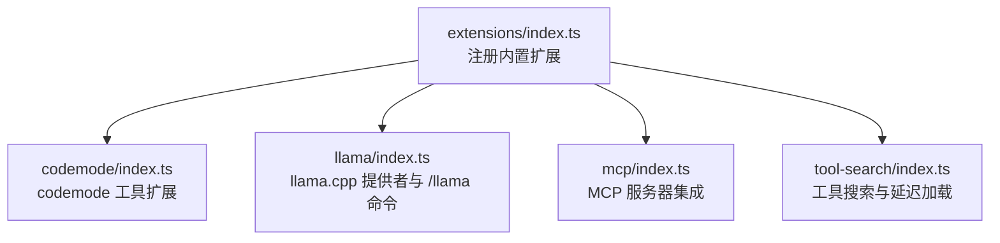
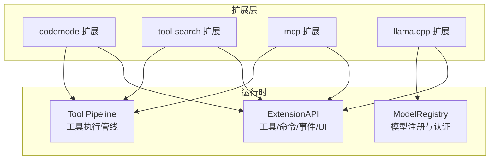
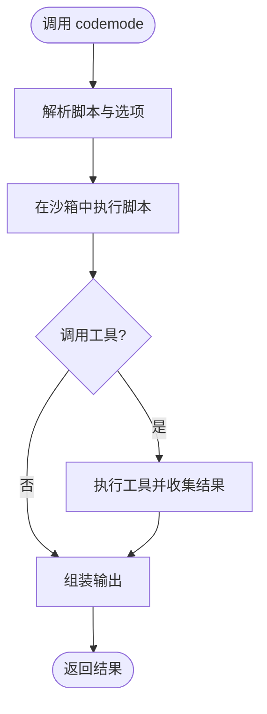
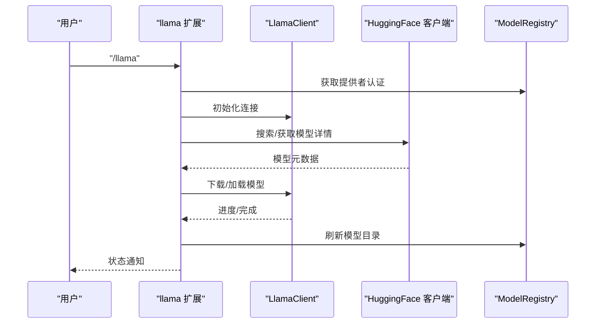
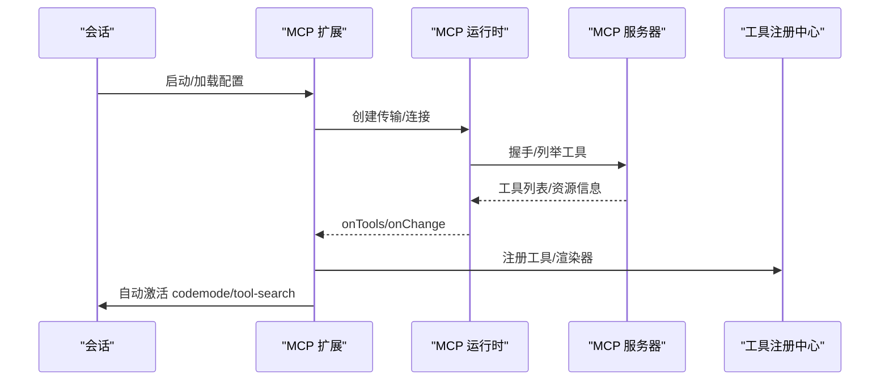
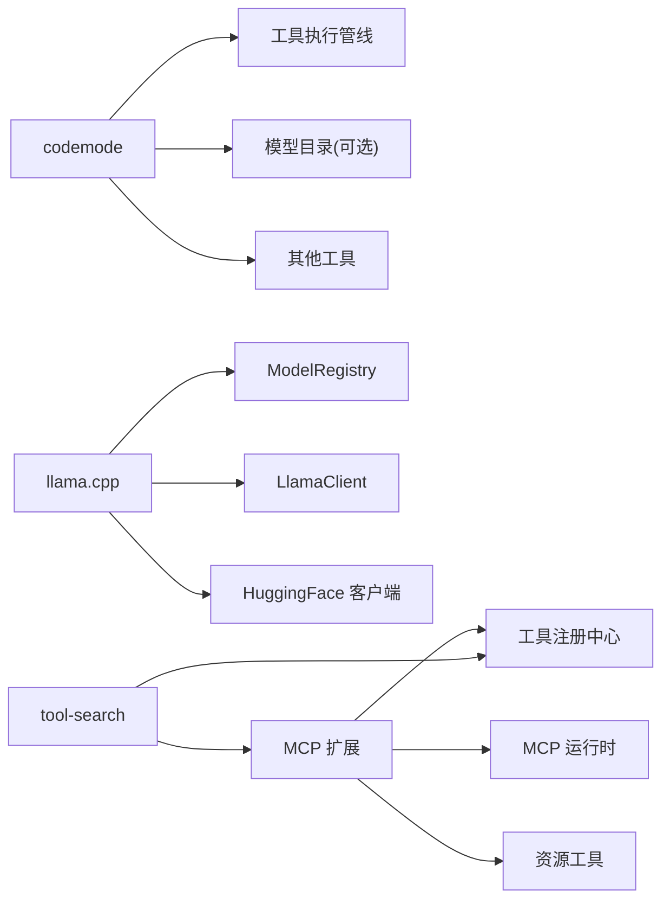

# 内置扩展

<cite>
**本文引用的文件**   
- [extensions/index.ts](file://packages/coding-agent/src/extensions/index.ts)
- [extensions/codemode/index.ts](file://packages/coding-agent/src/extensions/codemode/index.ts)
- [extensions/llama/index.ts](file://packages/coding-agent/src/extensions/llama/index.ts)
- [extensions/mcp/index.ts](file://packages/coding-agent/src/extensions/mcp/index.ts)
- [extensions/tool-search/index.ts](file://packages/coding-agent/src/extensions/tool-search/index.ts)
- [extensions.md](file://packages/coding-agent/docs/extensions.md)
- [codemode.md](file://packages/coding-agent/docs/codemode.md)
- [mcp.md](file://packages/coding-agent/docs/mcp.md)
- [resource-loader.test.ts](file://packages/coding-agent/test/resource-loader.test.ts)
</cite>

## 目录
1. [简介](#简介)
2. [项目结构](#项目结构)
3. [核心组件](#核心组件)
4. [架构总览](#架构总览)
5. [详细组件分析](#详细组件分析)
6. [依赖关系分析](#依赖关系分析)
7. [性能与调优](#性能与调优)
8. [故障排查](#故障排查)
9. [结论](#结论)
10. [附录：启用/禁用与替换规范](#附录启用禁用与替换规范)

## 简介
本文件系统性说明 Pi 的内置扩展体系，重点覆盖以下扩展：
- codemode：让模型编写 JavaScript 脚本调用工具与非 LLM 模型（分类、图像生成），并聚合输出。
- llama.cpp：通过本地或远程 llama.cpp 服务提供模型能力，并提供 /llama 管理命令。
- MCP：连接 Model Context Protocol 服务器，将工具与资源暴露给模型或脚本。
- tool-search：按需发现并声明“延迟”暴露的工具，减少系统提示开销。

文档包含各扩展的功能特性、配置项、使用方法、启用/禁用策略、参数调优、性能建议、依赖关系图、冲突解决策略，以及可替换机制与自定义扩展开发规范。

## 项目结构
Pi 的内置扩展集中在 `packages/coding-agent/src/extensions` 下，由统一的入口注册为“内置扩展”，并通过扩展框架以工具、命令、提供者等形式接入运行时。

**图表来源**
- [extensions/index.ts:1-15](file://packages/coding-agent/src/extensions/index.ts#L1-L15)

**章节来源**
- [extensions/index.ts:1-15](file://packages/coding-agent/src/extensions/index.ts#L1-L15)

## 核心组件
- 内置扩展注册表：集中声明内置扩展名称、工厂函数、是否可被第三方扩展替换。
- 扩展生命周期：通过 ExtensionAPI 注册工具、命令、事件监听、UI 交互等。
- 工具与命令：内置扩展通常以工具形式暴露（如 codemode、tool-search），或以命令形式暴露（如 /llama、/mcp）。
- 提供者：llama.cpp 扩展注册模型提供者，使模型选择与推理走统一通道。

关键要点
- 内置扩展默认加载，可通过设置或命令行显式启用/禁用。
- 部分内置扩展标记为“可替换”，当第三方扩展注册同名工具或命令时，会接管行为。

**章节来源**
- [extensions/index.ts:1-15](file://packages/coding-agent/src/extensions/index.ts#L1-L15)
- [extensions.md:1-80](file://packages/coding-agent/docs/extensions.md#L1-L80)

## 架构总览
下图展示内置扩展在运行时的角色与交互：

**图表来源**
- [extensions/codemode/index.ts:1-50](file://packages/coding-agent/src/extensions/codemode/index.ts#L1-L50)
- [extensions/mcp/index.ts:1-120](file://packages/coding-agent/src/extensions/mcp/index.ts#L1-L120)
- [extensions/llama/index.ts:1-60](file://packages/coding-agent/src/extensions/llama/index.ts#L1-L60)

## 详细组件分析

### codemode 扩展
功能概述
- 暴露 `codemode` 工具，允许模型编写 JavaScript 脚本，调用当前会话可用的所有工具，并调用非 LLM 模型（分类器、图像生成）。
- 支持脚本选项（最大输出 token、超时）、全局 API（tools、models、searchTools、describeTool、describeNamespace、store/load 等）。
- 根据 MCP 服务器的暴露策略自动激活自身，或在设置中控制模式（on/only）与内联预算。

关键实现要点
- 扩展工厂创建工具定义，注入 appendEntry、models、getToolNamespace、getToolGuidelines、mode、inlineBudget 等上下文。
- 默认不激活，需通过 CLI、settings.defaultTools 或 MCP 扩展自动激活。

常用配置
- settings.codemode.mode：on（默认）或 only；仅影响工具描述呈现方式。
- settings.codemode.inlineBudget：控制在 codemode 描述中内联工具声明的预算。
- createCodemodeExtension(options.models)：是否向脚本暴露 models 目录。

使用建议
- 对大结果先过滤再返回模型，避免超出输出限制。
- 合理使用 searchTools/describeNamespace 动态发现工具，降低系统提示体积。
- 对耗时任务设置 timeout_ms，避免长时间阻塞 worker。

**图表来源**
- [extensions/codemode/index.ts:1-50](file://packages/coding-agent/src/extensions/codemode/index.ts#L1-L50)
- [codemode.md:1-60](file://packages/coding-agent/docs/codemode.md#L1-L60)

**章节来源**
- [extensions/codemode/index.ts:1-50](file://packages/coding-agent/src/extensions/codemode/index.ts#L1-L50)
- [codemode.md:1-60](file://packages/coding-agent/docs/codemode.md#L1-L60)

### llama.cpp 扩展
功能概述
- 注册 llama.cpp 模型提供者，使 Pi 能连接到本地或远程 llama.cpp 服务。
- 提供 `/llama` 命令，用于列出、下载、加载、卸载模型，并与 Hugging Face 集成进行模型检索与下载。
- 刷新模型目录，同步到 ModelRegistry，供模型选择界面与推理流程使用。

关键实现要点
- 从 ModelRegistry 读取提供者认证与 baseUrl，构造 LlamaClient。
- 提供 UI 工作流：选择已加载模型、替换或保留、下载量化版本、取消操作回滚。
- 网络错误与连接错误有专门处理与用户提示。

常用配置
- 通过 /login 配置 llama.cpp 提供者（baseUrl、apiKey 等）。
- 环境变量 LLAMA_BASE_URL 可覆盖 baseUrl。

使用建议
- 合理选择量化版本以平衡速度与内存占用。
- 批量加载前确认可用内存，必要时先卸载旧模型。
- 在网络不稳定环境下重试 catalog 刷新。

**图表来源**
- [extensions/llama/index.ts:1-120](file://packages/coding-agent/src/extensions/llama/index.ts#L1-L120)
- [extensions/llama/index.ts:183-231](file://packages/coding-agent/src/extensions/llama/index.ts#L183-L231)

**章节来源**
- [extensions/llama/index.ts:1-231](file://packages/coding-agent/src/extensions/llama/index.ts#L1-L231)

### MCP 扩展
功能概述
- 连接 mcp.json 配置的 MCP 服务器，或将扩展注册的服务器纳入管理。
- 将服务器工具注册为 `mcp__<server>__<tool>`，并根据 exposure 策略决定如何暴露给模型或脚本。
- 提供 `/mcp` 管理器，支持登录、重连、启用/禁用、修改暴露策略、查看日志。
- 支持 OAuth 认证、资源工具（list/read/list templates）。

关键实现要点
- 启动时后台连接服务器；首次 prompt 仅等待 direct 工具就绪。
- 根据 exposure 自动激活 codemode 或 tool-search。
- 工具注册后维护名称唯一性、隐藏不可用工具、同步资源工具暴露。
- 变更 enabled/exposure 时持久化到 mcp.json 或会话级覆盖。

常用配置
- mcpServers.*.exposure：codemode（默认）、deferred、direct、hidden。
- mcpServers.*.toolExposure：按工具名或模式覆盖暴露策略。
- startupWaitMs：首次 prompt 等待 direct 工具的连接超时。

使用建议
- 大型服务器优先使用 deferred，配合 tool-search 按需加载。
- 敏感工具使用 hidden，再通过 toolExposure 精确开放。
- 对需要直接可见的小工具集使用 direct，减少间接调用开销。

**图表来源**
- [extensions/mcp/index.ts:1-120](file://packages/coding-agent/src/extensions/mcp/index.ts#L1-L120)
- [extensions/mcp/index.ts:388-494](file://packages/coding-agent/src/extensions/mcp/index.ts#L388-L494)

**章节来源**
- [extensions/mcp/index.ts:1-120](file://packages/coding-agent/src/extensions/mcp/index.ts#L1-L120)
- [mcp.md:1-120](file://packages/coding-agent/docs/mcp.md#L1-L120)

### tool-search 扩展
功能概述
- 提供 `tool_search` 工具，按语义匹配并加载“延迟”暴露的工具，随后将其声明给模型。
- 与 MCP 的 deferred 暴露策略配合，减少初始系统提示体积，提升首响应速度。

关键实现要点
- 作为可替换内置扩展，若第三方扩展注册同名工具且声明 reachesTools，则接管 MCP 工具发现。
- 与 MCP 扩展协作：当存在 deferred 工具时自动激活 tool-search。

使用建议
- 对工具数量较大的 MCP 服务器使用 deferred + tool-search。
- 结合 codemode 的 describeNamespace/searchTools 做二次筛选。

**章节来源**
- [extensions/index.ts:1-15](file://packages/coding-agent/src/extensions/index.ts#L1-L15)
- [mcp.md:191-233](file://packages/coding-agent/docs/mcp.md#L191-L233)

## 依赖关系分析
- codemode 依赖：工具执行管线、模型目录（可选）、其他工具（bash/read/edit 等）。
- llama.cpp 依赖：ModelRegistry（认证与模型目录）、LlamaClient（与服务端通信）、HuggingFace 客户端（模型检索/下载）。
- MCP 依赖：MCP 运行时（传输、OAuth、日志）、工具注册中心、资源工具。
- tool-search 依赖：工具注册中心、MCP 扩展（协同发现）。

**图表来源**
- [extensions/codemode/index.ts:1-50](file://packages/coding-agent/src/extensions/codemode/index.ts#L1-L50)
- [extensions/llama/index.ts:1-60](file://packages/coding-agent/src/extensions/llama/index.ts#L1-L60)
- [extensions/mcp/index.ts:1-120](file://packages/coding-agent/src/extensions/mcp/index.ts#L1-L120)

**章节来源**
- [extensions/codemode/index.ts:1-50](file://packages/coding-agent/src/extensions/codemode/index.ts#L1-L50)
- [extensions/llama/index.ts:1-60](file://packages/coding-agent/src/extensions/llama/index.ts#L1-L60)
- [extensions/mcp/index.ts:1-120](file://packages/coding-agent/src/extensions/mcp/index.ts#L1-L120)

## 性能与调优
- codemode
  - 调整 max_output_tokens 与 timeout_ms，避免长输出与长时间阻塞。
  - 使用 searchTools/describeNamespace 动态发现工具，减少内联声明预算。
  - 控制 workers 上限（PI_CODEMODE_MAX_WORKERS），避免并发过高导致排队。
- llama.cpp
  - 选择合适的量化版本，平衡速度与显存占用。
  - 批量加载前先卸载旧模型，避免内存碎片。
  - 网络不稳定时开启 catalog 刷新重试。
- MCP
  - 大型服务器使用 deferred + tool-search，减少初始声明开销。
  - 小工具集使用 direct，减少间接调用路径。
  - 合理设置 startupWaitMs，避免首 prompt 过长等待。
  - 对敏感工具使用 hidden，通过 toolExposure 精确开放。
- tool-search
  - 与 MCP 的 deferred 配合，按需加载工具，缩短首响应时间。
  - 避免重复加载，利用 transcript 记录已声明工具。

[本节为通用指导，无需具体文件引用]

## 故障排查
常见问题与建议
- codemode 脚本失败
  - 检查输出长度限制与 worker 配额；必要时将大数据写入文件。
  - 确保工具调用参数符合 schema，避免无效参数导致拒绝。
- llama.cpp 连接失败
  - 检查 /login 配置与 LLAMA_BASE_URL；确认服务端可达。
  - 区分连接错误与业务错误，优先恢复连接。
- MCP 服务器未连接或需要登录
  - 使用 /mcp 查看状态，执行 login/reconnect。
  - 检查 mcp.json 配置与 OAuth 设置；必要时更新 clientRegistration/authServerMetadataUrl。
- 工具不可见或无法调用
  - 检查 exposure 策略是否为 hidden；确认 codemode 或 tool-search 已激活。
  - 确认工具名命名规则与命名冲突后缀。

**章节来源**
- [mcp.md:94-120](file://packages/coding-agent/docs/mcp.md#L94-L120)
- [extensions/llama/index.ts:11-20](file://packages/coding-agent/src/extensions/llama/index.ts#L11-L20)

## 结论
内置扩展通过统一的扩展框架将 codemode、llama.cpp、MCP、tool-search 等能力无缝接入 Pi 运行时。它们分别承担脚本执行、本地模型推理、外部工具集成与工具发现职责。通过合理的 exposure 策略、参数调优与启停控制，可在保证安全性的同时获得最佳性能与用户体验。

[本节为总结性内容，无需具体文件引用]

## 附录：启用/禁用与替换规范
- 启用/禁用
  - 通过 settings.extensions 使用 `+builtin:<name>` 或 `-builtin:<name>` 控制内置扩展。
  - 命令行可使用 `-e builtin:<name>` 显式加载。
  - noExtensions=true 时仅加载显式指定的内置扩展。
- 替换机制
  - codemode、tool-search、mcp 标记为 replaceable：若第三方扩展注册同名工具或命令，将接管行为。
  - 替换后，原内置行为不再生效；移除第三方扩展即可恢复。
- 冲突解决
  - 若第三方扩展与内置扩展注册同名工具，内置扩展会被跳过并给出警告。
  - 建议同一时间只加载一个实现，避免行为不一致。

**章节来源**
- [extensions/index.ts:1-15](file://packages/coding-agent/src/extensions/index.ts#L1-L15)
- [resource-loader.test.ts:1164-1290](file://packages/coding-agent/test/resource-loader.test.ts#L1164-L1290)