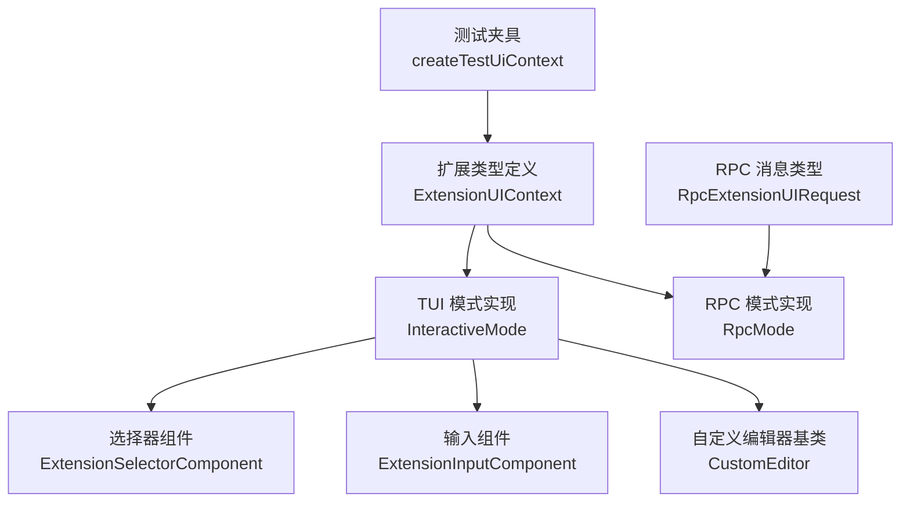
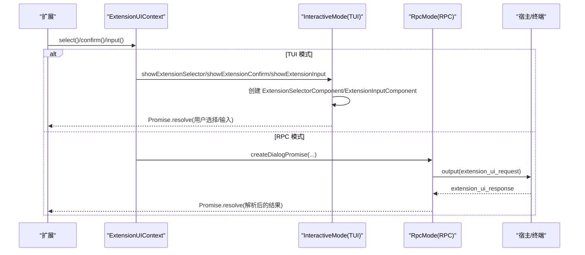
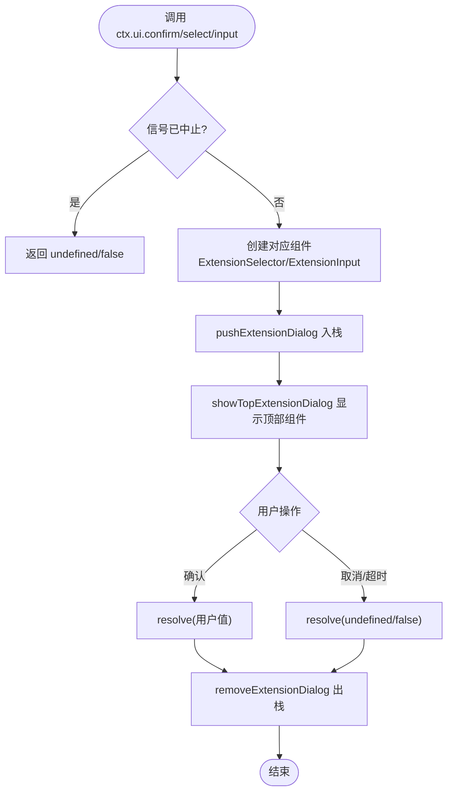
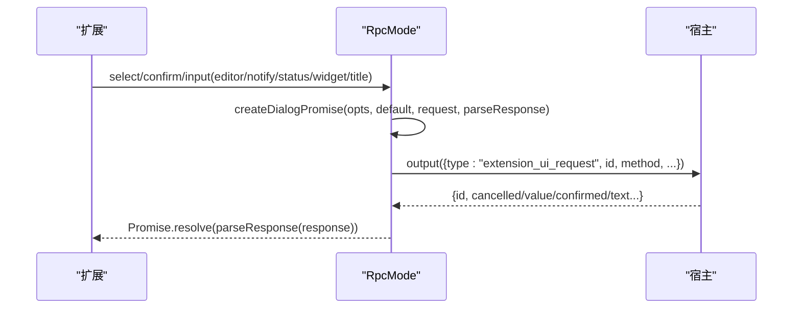
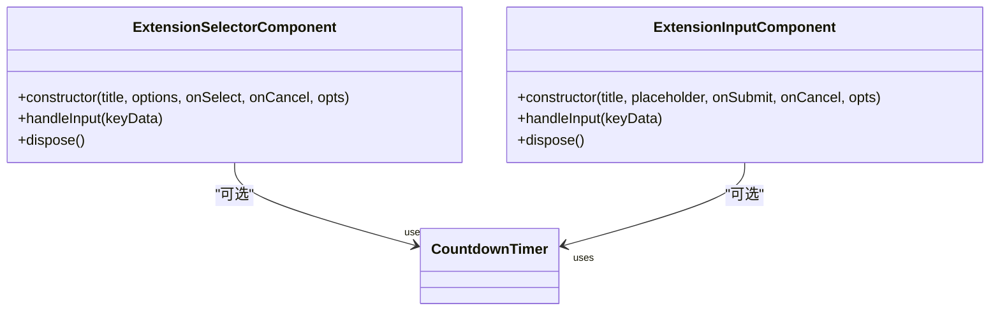
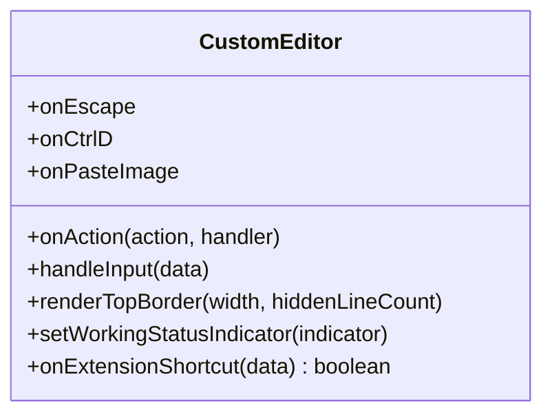
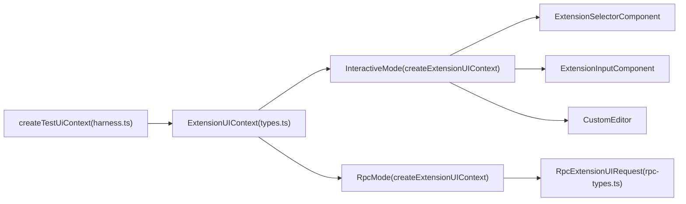

# UI 上下文 API

<cite>
**本文引用的文件**   
- [types.ts](file://packages/coding-agent/src/core/extensions/types.ts)
- [interactive-mode.ts](file://packages/coding-agent/src/modes/interactive/interactive-mode.ts)
- [rpc-mode.ts](file://packages/coding-agent/src/modes/rpc/rpc-mode.ts)
- [rpc-types.ts](file://packages/coding-agent/src/modes/rpc/rpc-types.ts)
- [extension-selector.ts](file://packages/coding-agent/src/modes/interactive/components/extension-selector.ts)
- [extension-input.ts](file://packages/coding-agent/src/modes/interactive/components/extension-input.ts)
- [custom-editor.ts](file://packages/coding-agent/src/modes/interactive/components/custom-editor.ts)
- [harness.ts](file://packages/coding-agent/test/suite/harness.ts)
</cite>

## 目录
1. [简介](#简介)
2. [项目结构](#项目结构)
3. [核心组件](#核心组件)
4. [架构总览](#架构总览)
5. [详细组件分析](#详细组件分析)
6. [依赖关系分析](#依赖关系分析)
7. [性能与可用性考虑](#性能与可用性考虑)
8. [故障排查指南](#故障排查指南)
9. [结论](#结论)
10. [附录：API 参考与最佳实践](#附录api-参考与最佳实践)

## 简介
本文件面向扩展开发者，系统化说明 UI 上下文 API（ExtensionUIContext）的完整能力与使用方式。内容涵盖对话框交互、用户输入、状态栏与标题设置、编辑器集成、自动补全、主题管理、工作指示器、组件布局等高级功能，并提供 RPC 模式下的行为差异说明与实现示例路径。

## 项目结构
UI 上下文接口定义位于扩展类型文件中；交互式 TUI 模式与 RPC 模式分别提供具体实现；对话框与输入由可复用组件承载；测试夹具提供最小化实现用于单元测试。

图示来源
- [types.ts:160-320](file://packages/coding-agent/src/core/extensions/types.ts#L160-L320)
- [interactive-mode.ts:2757-2809](file://packages/coding-agent/src/modes/interactive/interactive-mode.ts#L2757-L2809)
- [rpc-mode.ts:140-240](file://packages/coding-agent/src/modes/rpc/rpc-mode.ts#L140-L240)
- [rpc-types.ts:251-287](file://packages/coding-agent/src/modes/rpc/rpc-types.ts#L251-L287)
- [extension-selector.ts:19-132](file://packages/coding-agent/src/modes/interactive/components/extension-selector.ts#L19-L132)
- [extension-input.ts:18-95](file://packages/coding-agent/src/modes/interactive/components/extension-input.ts#L18-L95)
- [custom-editor.ts:13-159](file://packages/coding-agent/src/modes/interactive/components/custom-editor.ts#L13-L159)
- [harness.ts:74-109](file://packages/coding-agent/test/suite/harness.ts#L74-L109)

章节来源
- [types.ts:160-320](file://packages/coding-agent/src/core/extensions/types.ts#L160-L320)
- [interactive-mode.ts:2757-2809](file://packages/coding-agent/src/modes/interactive/interactive-mode.ts#L2757-L2809)
- [rpc-mode.ts:140-240](file://packages/coding-agent/src/modes/rpc/rpc-mode.ts#L140-L240)
- [rpc-types.ts:251-287](file://packages/coding-agent/src/modes/rpc/rpc-types.ts#L251-L287)

## 核心组件
- ExtensionUIContext：扩展可用的统一 UI 上下文接口，包含对话框、输入、通知、状态栏、编辑器、自动补全、主题、工具输出展开等能力。
- InteractiveMode.createExtensionUIContext：在 TUI 模式下提供完整实现，将方法映射到内部 UI 组件与状态管理。
- RpcMode.createExtensionUIContext：在 RPC 模式下通过协议请求宿主完成 UI 交互，部分能力为无操作或受限支持。
- ExtensionSelectorComponent / ExtensionInputComponent：可复用的选择与输入组件，支持超时倒计时与键盘导航。
- CustomEditor：扩展编辑器基类，处理应用级快捷键、粘贴图片、退出、中断等逻辑，并支持嵌入工作状态显示。

章节来源
- [types.ts:160-320](file://packages/coding-agent/src/core/extensions/types.ts#L160-L320)
- [interactive-mode.ts:2757-2809](file://packages/coding-agent/src/modes/interactive/interactive-mode.ts#L2757-L2809)
- [rpc-mode.ts:140-240](file://packages/coding-agent/src/modes/rpc/rpc-mode.ts#L140-L240)
- [extension-selector.ts:19-132](file://packages/coding-agent/src/modes/interactive/components/extension-selector.ts#L19-L132)
- [extension-input.ts:18-95](file://packages/coding-agent/src/modes/interactive/components/extension-input.ts#L18-L95)
- [custom-editor.ts:13-159](file://packages/coding-agent/src/modes/interactive/components/custom-editor.ts#L13-L159)

## 架构总览
下图展示扩展调用 UI 上下文后，在 TUI 与 RPC 两种模式下的不同执行路径。

图示来源
- [interactive-mode.ts:2844-2930](file://packages/coding-agent/src/modes/interactive/interactive-mode.ts#L2844-L2930)
- [rpc-mode.ts:94-154](file://packages/coding-agent/src/modes/rpc/rpc-mode.ts#L94-L154)
- [rpc-types.ts:251-287](file://packages/coding-agent/src/modes/rpc/rpc-types.ts#L251-L287)

## 详细组件分析

### ExtensionUIContext 接口与方法
- 对话框与输入
  - select(title, options, opts?): 弹出选项列表，返回选中项或 undefined（取消/超时/中止）。
  - confirm(title, message, opts?): 确认对话框，返回布尔值。
  - input(title, placeholder?, opts?): 文本输入框，返回字符串或 undefined。
  - editor(title, prefill?): 多行编辑器，返回编辑文本或 undefined。
  - custom(factory, options?): 显示自定义组件，支持覆盖层与阻塞状态标记。
- 通知与状态
  - notify(message, type?): 信息/警告/错误通知。
  - setStatus(key, text?): 设置底部状态栏扩展状态。
  - setTitle(title): 设置终端标题。
- 编辑器与自动补全
  - pasteToEditor(text): 触发编辑器粘贴流程。
  - setEditorText/getEditorText: 读写核心输入编辑器文本。
  - addAutocompleteProvider(factory): 叠加自动补全提供者。
  - setEditorComponent/getEditorComponent: 替换默认编辑器为自定义编辑器。
- 主题与工作指示器
  - theme/getAllThemes/getTheme/setTheme: 读取与切换主题。
  - setWorkingMessage/setWorkingVisible/setWorkingIndicator: 控制流式加载的工作提示。
  - setHiddenThinkingLabel: 隐藏思考区块标签。
- 其他
  - onTerminalInput(handler): 监听原始终端输入（仅 TUI）。
  - getToolsExpanded/setToolsExpanded: 工具输出展开状态。
  - setWidget/setFooter/setHeader: 扩展组件布局与页脚/页眉定制。

章节来源
- [types.ts:160-320](file://packages/coding-agent/src/core/extensions/types.ts#L160-L320)

### TUI 模式实现（InteractiveMode）
- 对话框栈：select/confirm/input/editor/custom 均通过 pushExtensionDialog/removeExtensionDialog/showTopExtensionDialog 管理可见性与焦点。
- 组件渲染：选择器与输入组件封装了边框、倒计时、键位提示与交互。
- 编辑器替换：setEditorComponent 会保存当前文本、复制外观与自动补全配置，并在需要时恢复默认编辑器。
- 主题切换：setTheme 支持传入名称或 Theme 实例，成功时持久化到设置管理器。
- 通知映射：error/warning/info 分别映射到错误/警告/状态显示。

图示来源
- [interactive-mode.ts:2817-2839](file://packages/coding-agent/src/modes/interactive/interactive-mode.ts#L2817-L2839)
- [interactive-mode.ts:2844-2930](file://packages/coding-agent/src/modes/interactive/interactive-mode.ts#L2844-L2930)

章节来源
- [interactive-mode.ts:2757-2809](file://packages/coding-agent/src/modes/interactive/interactive-mode.ts#L2757-L2809)
- [interactive-mode.ts:2817-2839](file://packages/coding-agent/src/modes/interactive/interactive-mode.ts#L2817-L2839)
- [interactive-mode.ts:2844-2930](file://packages/coding-agent/src/modes/interactive/interactive-mode.ts#L2844-L2930)
- [interactive-mode.ts:2956-3039](file://packages/coding-agent/src/modes/interactive/interactive-mode.ts#L2956-L3039)
- [interactive-mode.ts:3044-3052](file://packages/coding-agent/src/modes/interactive/interactive-mode.ts#L3044-L3052)

### RPC 模式实现（RpcMode）
- 通用对话框 Promise：createDialogPromise 统一管理超时、AbortSignal、待处理请求映射与响应解析。
- 协议消息：select/confirm/input/editor/notify/setStatus/setWidget/setTitle 等以 extension_ui_request 形式输出给宿主。
- 能力限制：
  - setWorkingMessage/setWorkingVisible/setWorkingIndicator/setHiddenThinkingLabel/setFooter/setHeader/addAutocompleteProvider/setEditorComponent 等为无操作或受限。
  - getEditorText 返回空串，getEditorComponent 返回 undefined。
  - custom 不支持（返回 never）。
  - pasteToEditor 退化为 setEditorText。

图示来源
- [rpc-mode.ts:94-154](file://packages/coding-agent/src/modes/rpc/rpc-mode.ts#L94-L154)
- [rpc-types.ts:251-287](file://packages/coding-agent/src/modes/rpc/rpc-types.ts#L251-L287)
- [rpc-mode.ts:195-240](file://packages/coding-agent/src/modes/rpc/rpc-mode.ts#L195-L240)

章节来源
- [rpc-mode.ts:140-240](file://packages/coding-agent/src/modes/rpc/rpc-mode.ts#L140-L240)
- [rpc-types.ts:251-287](file://packages/coding-agent/src/modes/rpc/rpc-types.ts#L251-L287)

### 选择器与输入组件
- ExtensionSelectorComponent
  - 键盘导航：上下键移动、回车确认、Esc 取消。
  - 可选倒计时：基于 CountdownTimer 更新标题并自动取消。
  - 支持切换工具输出展开。
- ExtensionInputComponent
  - 单行输入，支持初始值、描述文本、倒计时。
  - 提交/取消键位绑定。

图示来源
- [extension-selector.ts:19-132](file://packages/coding-agent/src/modes/interactive/components/extension-selector.ts#L19-L132)
- [extension-input.ts:18-95](file://packages/coding-agent/src/modes/interactive/components/extension-input.ts#L18-L95)

章节来源
- [extension-selector.ts:19-132](file://packages/coding-agent/src/modes/interactive/components/extension-selector.ts#L19-L132)
- [extension-input.ts:18-95](file://packages/coding-agent/src/modes/interactive/components/extension-input.ts#L18-L95)

### 自定义编辑器（CustomEditor）
- 应用级快捷键处理：中断、退出、历史、粘贴图片、扩展快捷键等。
- 可嵌入工作状态：在编辑器顶边框显示工作/压缩/重试状态。
- 与 InteractiveMode 协作：复制 actionHandlers、onEscape/onCtrlD/onPasteImage/onExtensionShortcut 等回调。

图示来源
- [custom-editor.ts:13-159](file://packages/coding-agent/src/modes/interactive/components/custom-editor.ts#L13-L159)
- [interactive-mode.ts:2956-3039](file://packages/coding-agent/src/modes/interactive/interactive-mode.ts#L2956-L3039)

章节来源
- [custom-editor.ts:13-159](file://packages/coding-agent/src/modes/interactive/components/custom-editor.ts#L13-L159)
- [interactive-mode.ts:2956-3039](file://packages/coding-agent/src/modes/interactive/interactive-mode.ts#L2956-L3039)

## 依赖关系分析
- ExtensionUIContext 被 TUI 与 RPC 两种模式实现，二者共享同一接口契约。
- TUI 实现依赖内部组件（选择器、输入、编辑器）与主题控制器、设置管理器、终端对象。
- RPC 实现依赖协议消息类型，将 UI 请求转发给宿主。
- 测试夹具提供最小实现，便于对扩展进行隔离测试。

图示来源
- [types.ts:160-320](file://packages/coding-agent/src/core/extensions/types.ts#L160-L320)
- [interactive-mode.ts:2757-2809](file://packages/coding-agent/src/modes/interactive/interactive-mode.ts#L2757-L2809)
- [rpc-mode.ts:140-240](file://packages/coding-agent/src/modes/rpc/rpc-mode.ts#L140-L240)
- [rpc-types.ts:251-287](file://packages/coding-agent/src/modes/rpc/rpc-types.ts#L251-L287)
- [extension-selector.ts:19-132](file://packages/coding-agent/src/modes/interactive/components/extension-selector.ts#L19-L132)
- [extension-input.ts:18-95](file://packages/coding-agent/src/modes/interactive/components/extension-input.ts#L18-L95)
- [custom-editor.ts:13-159](file://packages/coding-agent/src/modes/interactive/components/custom-editor.ts#L13-L159)
- [harness.ts:74-109](file://packages/coding-agent/test/suite/harness.ts#L74-L109)

章节来源
- [types.ts:160-320](file://packages/coding-agent/src/core/extensions/types.ts#L160-L320)
- [interactive-mode.ts:2757-2809](file://packages/coding-agent/src/modes/interactive/interactive-mode.ts#L2757-L2809)
- [rpc-mode.ts:140-240](file://packages/coding-agent/src/modes/rpc/rpc-mode.ts#L140-L240)
- [rpc-types.ts:251-287](file://packages/coding-agent/src/modes/rpc/rpc-types.ts#L251-L287)
- [harness.ts:74-109](file://packages/coding-agent/test/suite/harness.ts#L74-L109)

## 性能与可用性考虑
- 对话框栈与焦点管理：确保每次只渲染一个顶层对话框，避免重复渲染与内存泄漏；组件 dispose 及时清理定时器与事件监听。
- 超时与中止：所有对话框支持 AbortSignal 与 timeout，避免长时间挂起；RPC 模式通过 pending 请求映射保证响应与请求一一对应。
- 编辑器替换：切换自定义编辑器时保留文本与外观设置，减少用户操作丢失；仅在无打开对话框时替换根容器以减少重绘。
- 自动补全：addAutocompleteProvider 采用包装链式叠加，避免覆盖内置逻辑；必要时在重置 UI 时重建包装链。
- 主题切换：setTheme 成功后同步持久化设置，避免会话结束后主题丢失。

[本节为通用指导，不直接分析具体文件]

## 故障排查指南
- 对话框未关闭或 Promise 未解决
  - 检查是否在组件 dispose 中移除倒计时与事件监听。
  - 确认 removeExtensionDialog 在 resolve/reject 分支中被调用。
- 超时未生效
  - 确认传入 opts.timeout 且 tui 可用（TUI 模式）。
  - RPC 模式下确保宿主正确回传 extension_ui_response。
- 编辑器文本丢失
  - 切换自定义编辑器前保存文本，并在恢复默认编辑器时回填。
- 主题切换无效
  - 检查 setTheme 返回值 success；失败时不会持久化设置。
- RPC 模式能力缺失
  - 某些方法（如 custom、setFooter、setHeader、addAutocompleteProvider）在 RPC 下为无操作或受限，需做环境判断与降级策略。

章节来源
- [interactive-mode.ts:2817-2839](file://packages/coding-agent/src/modes/interactive/interactive-mode.ts#L2817-L2839)
- [interactive-mode.ts:2956-3039](file://packages/coding-agent/src/modes/interactive/interactive-mode.ts#L2956-L3039)
- [rpc-mode.ts:195-240](file://packages/coding-agent/src/modes/rpc/rpc-mode.ts#L195-L240)

## 结论
ExtensionUIContext 为扩展提供了统一的 UI 交互抽象，TUI 模式提供完整能力，RPC 模式通过协议桥接宿主实现基础交互。开发者应优先使用标准对话框与输入组件，结合主题与工作指示器提升用户体验；在 RPC 环境下注意能力限制并进行兼容处理。

[本节为总结性内容，不直接分析具体文件]

## 附录：API 参考与最佳实践

### 常用 API 速查
- 对话框与输入
  - select(title, options, opts?)
  - confirm(title, message, opts?)
  - input(title, placeholder?, opts?)
  - editor(title, prefill?)
  - custom(factory, options?)
- 通知与状态
  - notify(message, type?)
  - setStatus(key, text?)
  - setTitle(title)
- 编辑器与自动补全
  - pasteToEditor(text)
  - setEditorText(text)/getEditorText()
  - addAutocompleteProvider(factory)
  - setEditorComponent(factory)/getEditorComponent()
- 主题与工作指示器
  - theme/getAllThemes/getTheme/setTheme(theme|string|Theme)
  - setWorkingMessage(message?)
  - setWorkingVisible(visible)
  - setWorkingIndicator(options?)
  - setHiddenThinkingLabel(label?)
- 其他
  - onTerminalInput(handler)
  - getToolsExpanded()/setToolsExpanded(expanded)
  - setWidget(key, content, options?)
  - setFooter(factory?)
  - setHeader(factory?)

章节来源
- [types.ts:160-320](file://packages/coding-agent/src/core/extensions/types.ts#L160-L320)

### 使用模式与示例路径
- 选择与确认
  - 使用 select 展示选项列表，confirm 简化“是/否”场景。
  - 参考实现：[interactive-mode.ts:2844-2889](file://packages/coding-agent/src/modes/interactive/interactive-mode.ts#L2844-L2889)
- 文本输入
  - 使用 input 获取单行文本，支持占位符与倒计时。
  - 参考实现：[interactive-mode.ts:2902-2930](file://packages/coding-agent/src/modes/interactive/interactive-mode.ts#L2902-L2930)
- 多行编辑器
  - 使用 editor 打开多行编辑器，支持外部编辑器命令。
  - 参考实现：[interactive-mode.ts:2936-2953](file://packages/coding-agent/src/modes/interactive/interactive-mode.ts#L2936-L2953)
- 自定义组件
  - 使用 custom 显示自定义组件，支持 overlay 与 blocked 状态。
  - 参考实现：[interactive-mode.ts:3054-3100](file://packages/coding-agent/src/modes/interactive/interactive-mode.ts#L3054-L3100)
- 编辑器替换与自动补全
  - 使用 setEditorComponent 替换编辑器，addAutocompleteProvider 叠加补全逻辑。
  - 参考实现：[interactive-mode.ts:2956-3039](file://packages/coding-agent/src/modes/interactive/interactive-mode.ts#L2956-L3039), [interactive-mode.ts:2783-2788](file://packages/coding-agent/src/modes/interactive/interactive-mode.ts#L2783-L2788)
- 主题管理
  - 使用 getAllThemes/getTheme/setTheme 查询与切换主题。
  - 参考实现：[interactive-mode.ts:2789-2805](file://packages/coding-agent/src/modes/interactive/interactive-mode.ts#L2789-L2805)
- RPC 模式
  - 通过 rpc-types 中的 extension_ui_request 与宿主通信，注意能力限制。
  - 参考实现：[rpc-mode.ts:140-240](file://packages/coding-agent/src/modes/rpc/rpc-mode.ts#L140-L240), [rpc-types.ts:251-287](file://packages/coding-agent/src/modes/rpc/rpc-types.ts#L251-L287)

章节来源
- [interactive-mode.ts:2844-2953](file://packages/coding-agent/src/modes/interactive/interactive-mode.ts#L2844-L2953)
- [interactive-mode.ts:2956-3039](file://packages/coding-agent/src/modes/interactive/interactive-mode.ts#L2956-L3039)
- [interactive-mode.ts:2789-2805](file://packages/coding-agent/src/modes/interactive/interactive-mode.ts#L2789-L2805)
- [rpc-mode.ts:140-240](file://packages/coding-agent/src/modes/rpc/rpc-mode.ts#L140-L240)
- [rpc-types.ts:251-287](file://packages/coding-agent/src/modes/rpc/rpc-types.ts#L251-L287)

### 最佳实践
- 始终处理 AbortSignal 与 timeout，避免悬而未决的 Promise。
- 在 TUI 模式下优先使用现有组件（选择器、输入），保持交互一致性。
- 替换编辑器时保留文本与外观设置，必要时恢复默认编辑器。
- 在 RPC 模式下对不支持的能力做降级处理（例如用 setEditorText 替代 pasteToEditor）。
- 主题切换成功后持久化设置，避免会话重启后丢失。
- 使用 setStatus 提供清晰的扩展状态，配合 footer 数据提供器展示。

[本节为通用指导，不直接分析具体文件]