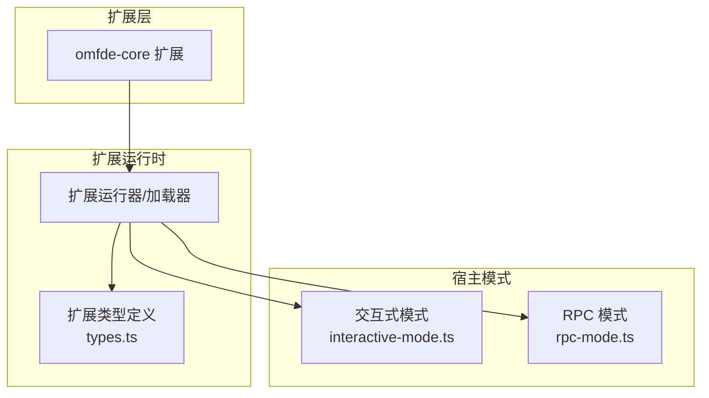
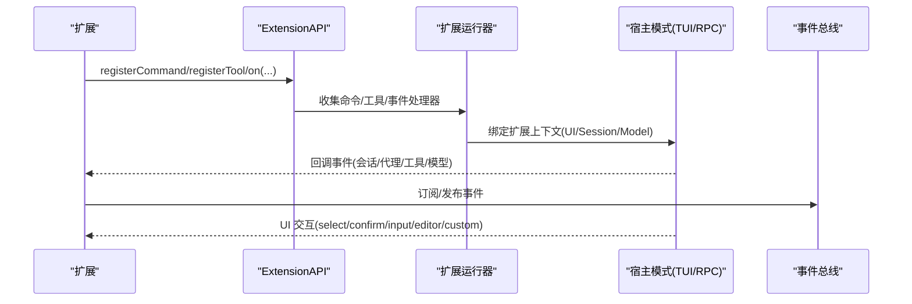
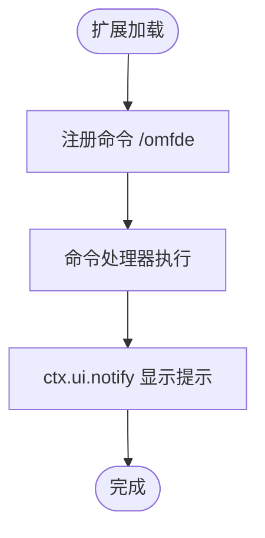
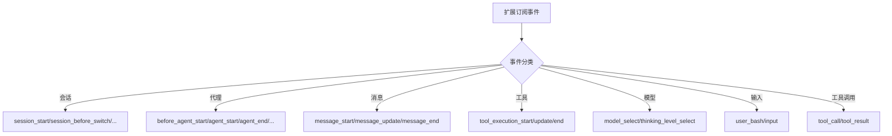
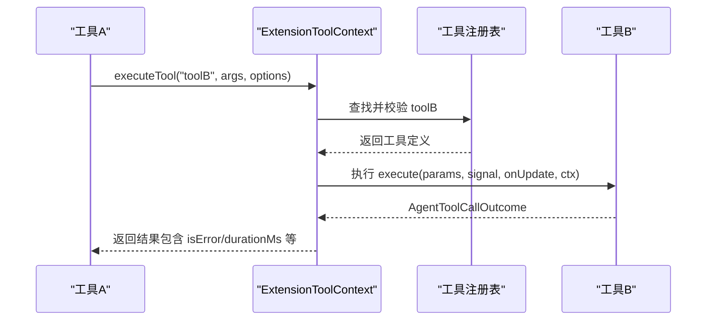
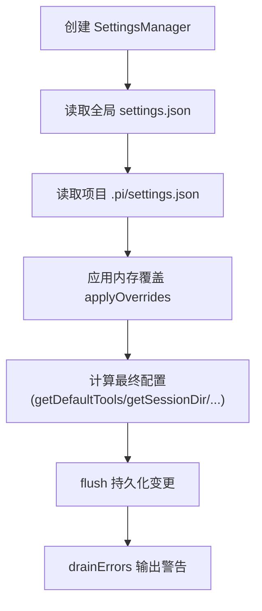
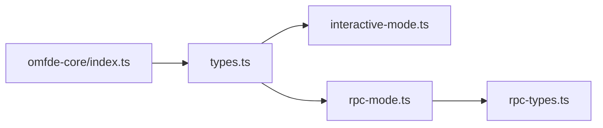

# 扩展 API

<cite>
**本文引用的文件**
- [extensions/omfde-core/src/index.ts](file://extensions/omfde-core/src/index.ts)
- [packages/coding-agent/src/core/extensions/types.ts](file://packages/coding-agent/src/core/extensions/types.ts)
- [packages/coding-agent/src/modes/interactive/interactive-mode.ts](file://packages/coding-agent/src/modes/interactive/interactive-mode.ts)
- [packages/coding-agent/src/modes/rpc/rpc-mode.ts](file://packages/coding-agent/src/modes/rpc/rpc-mode.ts)
- [packages/coding-agent/src/modes/rpc/rpc-types.ts](file://packages/coding-agent/src/modes/rpc/rpc-types.ts)
- [packages/coding-agent/test/settings-manager.test.ts](file://packages/coding-agent/test/settings-manager.test.ts)
- [packages/coding-agent/src/package-manager-cli.ts](file://packages/coding-agent/src/package-manager-cli.ts)
</cite>

## 目录
1. [简介](#简介)
2. [项目结构](#项目结构)
3. [核心组件](#核心组件)
4. [架构总览](#架构总览)
5. [详细组件分析](#详细组件分析)
6. [依赖关系分析](#依赖关系分析)
7. [性能考虑](#性能考虑)
8. [故障排查指南](#故障排查指南)
9. [结论](#结论)
10. [附录：API 参考](#附录api-参考)

## 简介
本文件面向扩展开发者，系统化说明扩展可访问的 API、服务注入点与上下文对象。重点覆盖：
- 扩展入口与命令注册
- UI 交互上下文（ExtensionUIContext）
- 事件系统（会话、代理、工具、模型等）
- 工具定义与执行（ToolDefinition、executeTool）
- 设置管理（SettingsManager）在扩展生态中的使用方式
- 异步操作、错误处理与性能注意事项

## 项目结构
仓库中与扩展能力直接相关的代码集中在 coding-agent 包中，扩展类型与运行时由 types.ts 统一描述；交互式模式与 RPC 模式分别提供 ExtensionUIContext 的具体实现；omfde-core 示例展示了如何注册一个基础命令作为平台探针。



**图示来源**
- [extensions/omfde-core/src/index.ts:12-19](file://extensions/omfde-core/src/index.ts#L12-L19)
- [packages/coding-agent/src/core/extensions/types.ts:1-10](file://packages/coding-agent/src/core/extensions/types.ts#L1-L10)
- [packages/coding-agent/src/modes/interactive/interactive-mode.ts:2757-2809](file://packages/coding-agent/src/modes/interactive/interactive-mode.ts#L2757-L2809)
- [packages/coding-agent/src/modes/rpc/rpc-mode.ts:195-288](file://packages/coding-agent/src/modes/rpc/rpc-mode.ts#L195-L288)

**章节来源**
- [extensions/omfde-core/src/index.ts:1-20](file://extensions/omfde-core/src/index.ts#L1-L20)
- [packages/coding-agent/src/core/extensions/types.ts:1-10](file://packages/coding-agent/src/core/extensions/types.ts#L1-L10)

## 核心组件
- 扩展 API 入口：扩展通过默认导出函数接收 ExtensionAPI，用于注册命令、工具、监听事件等。
- 扩展上下文：ExtensionContext 提供会话、模型、主题、工作目录、信号等运行时信息；ExtensionCommandContext 扩展了会话控制能力；ExtensionToolContext 暴露 executeTool 以调用其他工具。
- UI 上下文：ExtensionUIContext 提供选择、确认、输入、通知、终端输入监听、状态栏、工作指示器、组件/小部件、编辑器交互、主题切换等能力。
- 事件系统：涵盖启动资源发现、会话生命周期、代理活动、消息流、工具调用/结果、模型选择、用户 Bash 输入、输入预处理等。
- 工具系统：ToolDefinition 定义工具参数、执行逻辑、渲染、暴露策略、命名空间、执行模式等；支持动态注册与 loadout 调整。

**章节来源**
- [packages/coding-agent/src/core/extensions/types.ts:111-320](file://packages/coding-agent/src/core/extensions/types.ts#L111-L320)
- [packages/coding-agent/src/core/extensions/types.ts:322-472](file://packages/coding-agent/src/core/extensions/types.ts#L322-L472)
- [packages/coding-agent/src/core/extensions/types.ts:599-688](file://packages/coding-agent/src/core/extensions/types.ts#L599-L688)
- [packages/coding-agent/src/core/extensions/types.ts:717-1457](file://packages/coding-agent/src/core/extensions/types.ts#L717-L1457)

## 架构总览
扩展通过 ExtensionAPI 与宿主交互；宿主根据运行模式（TUI/RPC）提供不同的 UI 实现。事件总线贯穿会话、代理、工具、模型等阶段，扩展可在关键节点拦截或增强行为。



**图示来源**
- [packages/coding-agent/src/core/extensions/types.ts:717-1457](file://packages/coding-agent/src/core/extensions/types.ts#L717-L1457)
- [packages/coding-agent/src/modes/interactive/interactive-mode.ts:2757-2809](file://packages/coding-agent/src/modes/interactive/interactive-mode.ts#L2757-L2809)
- [packages/coding-agent/src/modes/rpc/rpc-mode.ts:195-288](file://packages/coding-agent/src/modes/rpc/rpc-mode.ts#L195-L288)

## 详细组件分析

### 扩展入口与命令注册
- omfde-core 扩展通过默认导出函数接收 ExtensionAPI，并注册了一个 /omfde 命令，用于展示平台状态。
- 该命令 handler 通过 ctx.ui.notify 显示一条信息，体现扩展对 UI 上下文的访问。



**图示来源**
- [extensions/omfde-core/src/index.ts:12-19](file://extensions/omfde-core/src/index.ts#L12-L19)

**章节来源**
- [extensions/omfde-core/src/index.ts:1-20](file://extensions/omfde-core/src/index.ts#L1-L20)

### UI 上下文（ExtensionUIContext）
- 交互模式（TUI）提供了完整的 UI 能力：选择、确认、输入、通知、终端输入监听、状态栏、工作指示器、自定义组件/小部件、编辑器粘贴/设置文本、自动补全扩展、主题管理等。
- RPC 模式仅支持部分能力：select/confirm/input/editor/notify/setStatus/setWidget/setTitle/setEditorText 等通过 RPC 协议桥接；不支持自定义组件、自动补全组合、编辑器组件替换等。

```mermaid
classDiagram
class ExtensionUIContext {
+select(title, options, opts) Promise~string|undefined~
+confirm(title, message, opts) Promise~boolean~
+input(title, placeholder, opts) Promise~string|undefined~
+notify(message, type) void
+onTerminalInput(handler) () => void
+setStatus(key, text) void
+setWorkingMessage(message) void
+setWorkingVisible(visible) void
+setWorkingIndicator(options) void
+setHiddenThinkingLabel(label) void
+setWidget(key, content, options) void
+setFooter(factory) void
+setHeader(factory) void
+setTitle(title) void
+custom(factory, options) Promise~any~
+pasteToEditor(text) void
+setEditorText(text) void
+getEditorText() string
+editor(title, prefill) Promise~string|undefined~
+addAutocompleteProvider(factory) void
+setEditorComponent(factory) void
+getEditorComponent() EditorFactory|undefined
+theme Theme
+getAllThemes() {name,path}[]
+getTheme(name) Theme|undefined
+setTheme(themeOrName) {success,error?}
+getToolsExpanded() boolean
+setToolsExpanded(expanded) void
}
```

**图示来源**
- [packages/coding-agent/src/core/extensions/types.ts:164-320](file://packages/coding-agent/src/core/extensions/types.ts#L164-L320)
- [packages/coding-agent/src/modes/interactive/interactive-mode.ts:2757-2809](file://packages/coding-agent/src/modes/interactive/interactive-mode.ts#L2757-L2809)
- [packages/coding-agent/src/modes/rpc/rpc-mode.ts:195-288](file://packages/coding-agent/src/modes/rpc/rpc-mode.ts#L195-L288)

**章节来源**
- [packages/coding-agent/src/core/extensions/types.ts:164-320](file://packages/coding-agent/src/core/extensions/types.ts#L164-L320)
- [packages/coding-agent/src/modes/interactive/interactive-mode.ts:2757-2809](file://packages/coding-agent/src/modes/interactive/interactive-mode.ts#L2757-L2809)
- [packages/coding-agent/src/modes/rpc/rpc-mode.ts:195-288](file://packages/coding-agent/src/modes/rpc/rpc-mode.ts#L195-L288)

### 事件系统（Event System）
扩展可通过 on(eventType, handler) 订阅多种事件，包括：
- 启动与资源发现：ProjectTrustEvent、ResourcesDiscoverEvent、McpServersChangeEvent
- 会话生命周期：SessionStartEvent、SessionInfoChangedEvent、SessionBeforeSwitchEvent、SessionBeforeForkEvent、SessionBeforeCompactEvent、SessionCompactEvent、SessionCompactFailedEvent、SessionShutdownEvent、SessionBeforeTreeEvent、SessionTreeEvent
- 代理活动：ContextEvent、ContextWithSystemEvent、BeforeAgentStartEvent、AgentStartEvent、AgentEndEvent、AgentBeforeSettleEvent、AgentSettledEvent、TurnStartEvent、TurnEndEvent
- 消息流：MessageStartEvent、MessageUpdateEvent、MessageEndEvent
- 工具执行：ToolExecutionStartEvent、ToolExecutionUpdateEvent、ToolExecutionEndEvent
- 模型与思考级别：ModelSelectEvent、ThinkingLevelSelectEvent
- 用户 Bash 与输入：UserBashEvent、InputEvent
- 工具调用与结果：ToolCallEvent、ToolResultEvent（含内置工具类型守卫）



**图示来源**
- [packages/coding-agent/src/core/extensions/types.ts:717-1457](file://packages/coding-agent/src/core/extensions/types.ts#L717-L1457)

**章节来源**
- [packages/coding-agent/src/core/extensions/types.ts:717-1457](file://packages/coding-agent/src/core/extensions/types.ts#L717-L1457)

### 工具系统与 executeTool
- ToolDefinition 定义了工具的元数据（名称、标签、描述、参数 Schema、输出 Schema）、执行逻辑、渲染、暴露策略（direct/model-only/codemode/deferred/hidden）、命名空间、执行模式（sequential/parallel）、loadout 调整等。
- ExtensionToolContext.executeTool 允许在工具执行中调用其他工具，返回 AgentToolCallOutcome，不会抛出异常，失败以 isError 形式返回。



**图示来源**
- [packages/coding-agent/src/core/extensions/types.ts:599-688](file://packages/coding-agent/src/core/extensions/types.ts#L599-L688)
- [packages/coding-agent/src/core/extensions/types.ts:387-415](file://packages/coding-agent/src/core/extensions/types.ts#L387-L415)

**章节来源**
- [packages/coding-agent/src/core/extensions/types.ts:599-688](file://packages/coding-agent/src/core/extensions/types.ts#L599-L688)
- [packages/coding-agent/src/core/extensions/types.ts:387-415](file://packages/coding-agent/src/core/extensions/types.ts#L387-L415)

### 设置管理（SettingsManager）
- SettingsManager 负责合并全局与项目级设置，并提供读取与写入方法。测试用例验证了：
  - 外部修改 settings.json 后，管理器能正确保留用户自定义字段（如 shellPath、extensions）。
  - 内存设置可覆盖文件设置。
  - defaultTools 支持 +name/-name 修饰符，并在项目级设置上叠加。
  - getSessionDir 可从全局设置读取。
- 在 CLI 层面，reportSettingsErrors 会消费 SettingsManager.drainErrors() 并输出警告。



**图示来源**
- [packages/coding-agent/test/settings-manager.test.ts:69-105](file://packages/coding-agent/test/settings-manager.test.ts#L69-L105)
- [packages/coding-agent/test/settings-manager.test.ts:634-691](file://packages/coding-agent/test/settings-manager.test.ts#L634-L691)
- [packages/coding-agent/test/settings-manager.test.ts:693-704](file://packages/coding-agent/test/settings-manager.test.ts#L693-L704)
- [packages/coding-agent/src/package-manager-cli.ts:282-290](file://packages/coding-agent/src/package-manager-cli.ts#L282-L290)

**章节来源**
- [packages/coding-agent/test/settings-manager.test.ts:69-105](file://packages/coding-agent/test/settings-manager.test.ts#L69-L105)
- [packages/coding-agent/test/settings-manager.test.ts:634-691](file://packages/coding-agent/test/settings-manager.test.ts#L634-L691)
- [packages/coding-agent/test/settings-manager.test.ts:693-704](file://packages/coding-agent/test/settings-manager.test.ts#L693-L704)
- [packages/coding-agent/src/package-manager-cli.ts:282-290](file://packages/coding-agent/src/package-manager-cli.ts#L282-L290)

## 依赖关系分析
- 扩展类型定义集中位于 types.ts，被扩展运行时与宿主模式引用。
- interactive-mode.ts 提供 ExtensionUIContext 的完整实现；rpc-mode.ts 提供受限实现并通过 rpc-types.ts 定义跨进程请求。
- omfde-core 扩展仅依赖 ExtensionAPI，不耦合内核，便于后续扩展接入平台能力。



**图示来源**
- [packages/coding-agent/src/core/extensions/types.ts:1-10](file://packages/coding-agent/src/core/extensions/types.ts#L1-L10)
- [packages/coding-agent/src/modes/interactive/interactive-mode.ts:2757-2809](file://packages/coding-agent/src/modes/interactive/interactive-mode.ts#L2757-L2809)
- [packages/coding-agent/src/modes/rpc/rpc-mode.ts:195-288](file://packages/coding-agent/src/modes/rpc/rpc-mode.ts#L195-L288)
- [packages/coding-agent/src/modes/rpc/rpc-types.ts:251-287](file://packages/coding-agent/src/modes/rpc/rpc-types.ts#L251-L287)
- [extensions/omfde-core/src/index.ts:1-20](file://extensions/omfde-core/src/index.ts#L1-L20)

**章节来源**
- [packages/coding-agent/src/core/extensions/types.ts:1-10](file://packages/coding-agent/src/core/extensions/types.ts#L1-L10)
- [packages/coding-agent/src/modes/interactive/interactive-mode.ts:2757-2809](file://packages/coding-agent/src/modes/interactive/interactive-mode.ts#L2757-L2809)
- [packages/coding-agent/src/modes/rpc/rpc-mode.ts:195-288](file://packages/coding-agent/src/modes/rpc/rpc-mode.ts#L195-L288)
- [packages/coding-agent/src/modes/rpc/rpc-types.ts:251-287](file://packages/coding-agent/src/modes/rpc/rpc-types.ts#L251-L287)
- [extensions/omfde-core/src/index.ts:1-20](file://extensions/omfde-core/src/index.ts#L1-L20)

## 性能考虑
- 工具执行模式：ToolDefinition.executionMode 支持 sequential/parallel，合理选择可减少阻塞与并发冲突。
- 工具渲染：renderShell="self" 时由工具自行绘制外壳，避免重复开销；注意输出 padding 与图片显示等上下文。
- UI 更新：ExtensionUIContext 的方法多为“fire-and-forget”或批量刷新，避免频繁 requestRender。
- 事件处理：在高频事件（provider_stream_event、message_update）中避免重型同步逻辑，必要时使用节流/去抖。
- 设置读写：SettingsManager.flush 会落盘，批量变更后一次性 flush，减少 IO 压力。

[本节为通用指导，无需具体文件引用]

## 故障排查指南
- 扩展错误显示：interactive-mode.ts 提供 showExtensionError，将扩展路径、错误信息与堆栈输出到聊天容器。
- 设置错误报告：package-manager-cli.ts 通过 reportSettingsErrors 消费 SettingsManager.drainErrors()，打印带作用域的错误信息。
- 常见 UI 限制：RPC 模式下不支持自定义组件、自动补全组合、编辑器组件替换等方法，应做环境判断或降级处理。

**章节来源**
- [packages/coding-agent/src/modes/interactive/interactive-mode.ts:3131-3147](file://packages/coding-agent/src/modes/interactive/interactive-mode.ts#L3131-L3147)
- [packages/coding-agent/src/package-manager-cli.ts:282-290](file://packages/coding-agent/src/package-manager-cli.ts#L282-L290)
- [packages/coding-agent/src/modes/rpc/rpc-mode.ts:277-288](file://packages/coding-agent/src/modes/rpc/rpc-mode.ts#L277-L288)

## 结论
扩展 API 围绕 ExtensionAPI、ExtensionContext/UI、事件系统与工具系统构建，提供从命令注册、UI 交互、事件拦截到工具编排的完整能力。通过合理的执行模式、渲染策略与事件处理优化，可在保证稳定性的同时获得良好性能。SettingsManager 为扩展提供一致的设置访问与持久化能力。

[本节为总结性内容，无需具体文件引用]

## 附录：API 参考

### ExtensionAPI（扩展入口）
- 用途：扩展默认导出的工厂函数接收此对象，用于注册命令、工具、事件监听等。
- 典型用法：
  - pi.registerCommand(name, descriptor)
  - pi.registerTool(definition)
  - pi.on(eventType, handler)

**章节来源**
- [extensions/omfde-core/src/index.ts:12-19](file://extensions/omfde-core/src/index.ts#L12-L19)
- [packages/coding-agent/src/core/extensions/types.ts:1637-1637](file://packages/coding-agent/src/core/extensions/types.ts#L1637-L1637)

### ExtensionContext（扩展上下文）
- 关键字段与方法：
  - ui: ExtensionUIContext
  - mode: "tui" | "rpc" | "json" | "print"
  - hasUI: boolean
  - cwd: string
  - sessionManager: ReadonlySessionManager
  - modelRegistry: ModelRegistry
  - model: Model<any> | undefined
  - scopedModels: readonly ScopedModel[]
  - thinkingLevel?: ThinkingLevel
  - isIdle(): boolean
  - isProjectTrusted(): boolean
  - signal: AbortSignal | undefined
  - abort(): void
  - hasPendingMessages(): boolean
  - shutdown(): void
  - getContextUsage(): ContextUsage | undefined
  - compact(options?): void
  - getSystemPrompt(): string

**章节来源**
- [packages/coding-agent/src/core/extensions/types.ts:322-385](file://packages/coding-agent/src/core/extensions/types.ts#L322-L385)

### ExtensionCommandContext（命令上下文）
- 新增能力：
  - getSystemPromptOptions(): BuildSystemPromptOptions
  - waitForIdle(): Promise<void>
  - newSession(options?): Promise<{cancelled: boolean}>
  - fork(entryId, options?): Promise<{cancelled: boolean}>
  - navigateTree(targetId, options?): Promise<{cancelled: boolean}>
  - switchSession(sessionPath, options?): Promise<{cancelled: boolean}>
  - reload(): Promise<void>

**章节来源**
- [packages/coding-agent/src/core/extensions/types.ts:417-455](file://packages/coding-agent/src/core/extensions/types.ts#L417-L455)

### ReplacedSessionContext（替换会话上下文）
- 新增能力：
  - sendMessage(message, options?): Promise<void>
  - sendUserMessage(content, options?): Promise<void>

**章节来源**
- [packages/coding-agent/src/core/extensions/types.ts:457-472](file://packages/coding-agent/src/core/extensions/types.ts#L457-L472)

### ExtensionToolContext（工具上下文）
- 新增能力：
  - tools: readonly AgentTool[]
  - executeTool(name, args, options?): Promise<AgentToolCallOutcome>

**章节来源**
- [packages/coding-agent/src/core/extensions/types.ts:387-415](file://packages/coding-agent/src/core/extensions/types.ts#L387-L415)

### ExtensionUIContext（UI 上下文）
- 交互方法：select/confirm/input/notify/onTerminalInput
- 状态与工作指示：setStatus/setWorkingMessage/setWorkingVisible/setWorkingIndicator
- 布局与组件：setWidget/setFooter/setHeader/custom/pasteToEditor/setEditorText/getEditorText/editor/addAutocompleteProvider/setEditorComponent/getEditorComponent
- 主题与工具展开：theme/getAllThemes/getTheme/setTheme/getToolsExpanded/setToolsExpanded

**章节来源**
- [packages/coding-agent/src/core/extensions/types.ts:164-320](file://packages/coding-agent/src/core/extensions/types.ts#L164-L320)
- [packages/coding-agent/src/modes/interactive/interactive-mode.ts:2757-2809](file://packages/coding-agent/src/modes/interactive/interactive-mode.ts#L2757-L2809)
- [packages/coding-agent/src/modes/rpc/rpc-mode.ts:195-288](file://packages/coding-agent/src/modes/rpc/rpc-mode.ts#L195-L288)

### ToolDefinition（工具定义）
- 元数据：name/label/description/promptSnippet/promptGuidelines/parameters/outputSchema
- 行为：prepareArguments/constrainedSampling/renderShell/exposure/namespace/reachesTools/annotations/defaultActive/prepareLoadout/executionMode
- 执行与渲染：execute/renderCall/renderResult

**章节来源**
- [packages/coding-agent/src/core/extensions/types.ts:599-688](file://packages/coding-agent/src/core/extensions/types.ts#L599-L688)

### 事件类型（节选）
- 会话：SessionStartEvent/SessionBeforeSwitchEvent/SessionBeforeForkEvent/SessionBeforeCompactEvent/SessionCompactEvent/SessionCompactFailedEvent/SessionShutdownEvent/SessionBeforeTreeEvent/SessionTreeEvent
- 代理：ContextEvent/ContextWithSystemEvent/BeforeAgentStartEvent/AgentStartEvent/AgentEndEvent/AgentBeforeSettleEvent/AgentSettledEvent/TurnStartEvent/TurnEndEvent
- 消息：MessageStartEvent/MessageUpdateEvent/MessageEndEvent
- 工具执行：ToolExecutionStartEvent/ToolExecutionUpdateEvent/ToolExecutionEndEvent
- 模型：ModelSelectEvent/ThinkingLevelSelectEvent
- 输入：UserBashEvent/InputEvent
- 工具调用/结果：ToolCallEvent/ToolResultEvent（含类型守卫）

**章节来源**
- [packages/coding-agent/src/core/extensions/types.ts:717-1457](file://packages/coding-agent/src/core/extensions/types.ts#L717-L1457)

### RPC UI 请求（RpcExtensionUIRequest）
- 支持的请求类型：select/confirm/input/editor/notify/setStatus/setWidget/setTitle/set_editor_text
- 不支持的能力：自定义组件、自动补全组合、编辑器组件替换等

**章节来源**
- [packages/coding-agent/src/modes/rpc/rpc-types.ts:251-287](file://packages/coding-agent/src/modes/rpc/rpc-types.ts#L251-L287)
- [packages/coding-agent/src/modes/rpc/rpc-mode.ts:195-288](file://packages/coding-agent/src/modes/rpc/rpc-mode.ts#L195-L288)