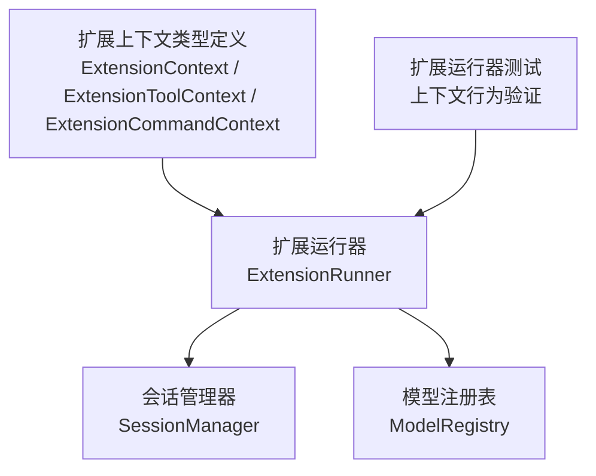
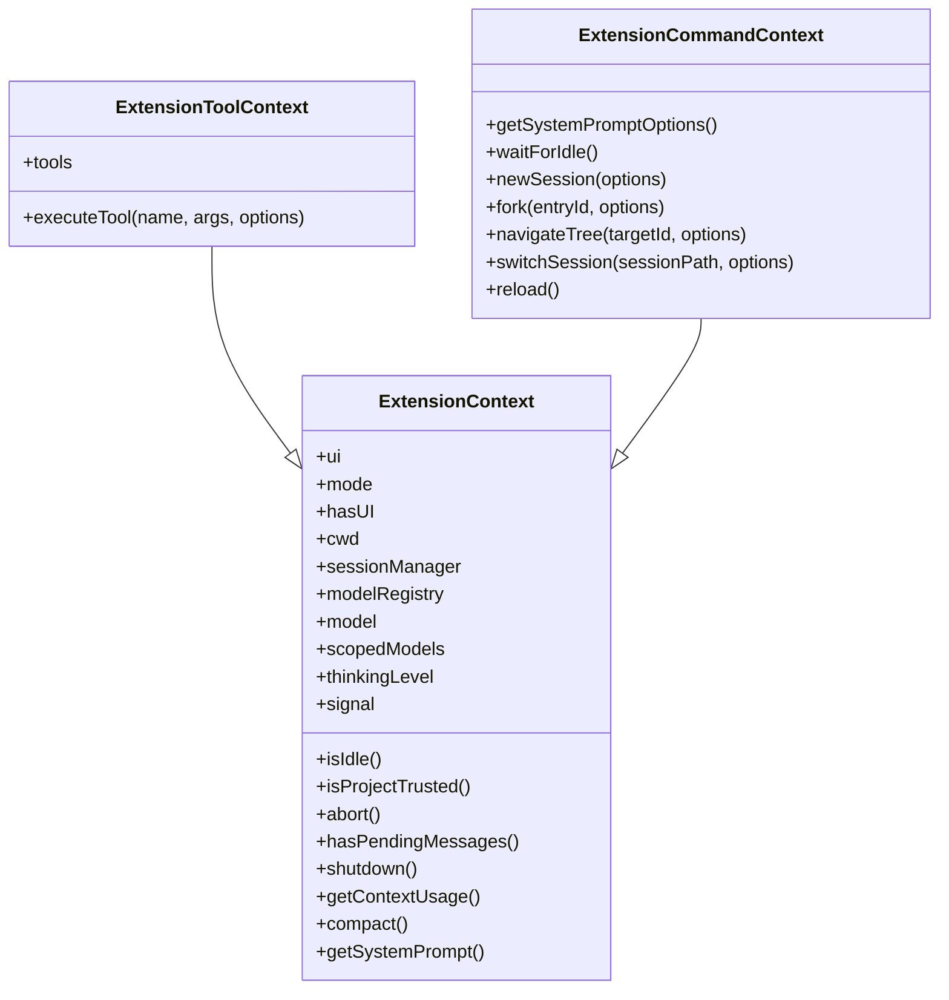
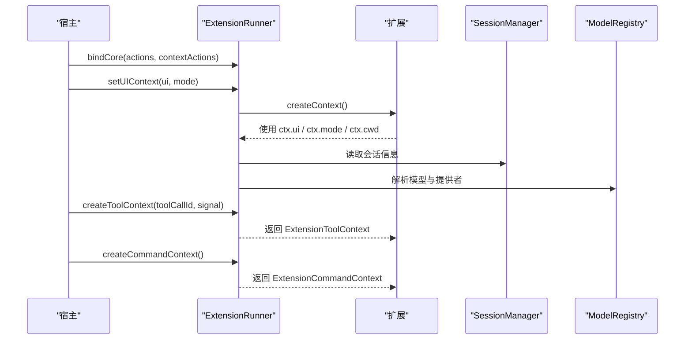
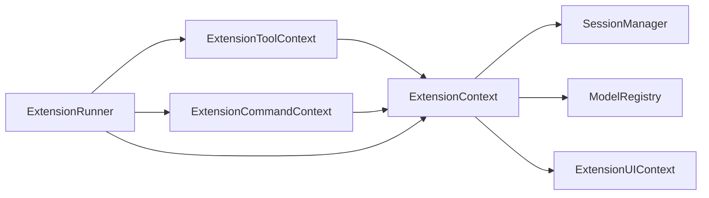

# 扩展上下文 API

<cite>
**本文引用的文件**
- [types.ts](file://packages/coding-agent/src/core/extensions/types.ts)
- [runner.ts](file://packages/coding-agent/src/core/extensions/runner.ts)
- [extensions-runner.test.ts](file://packages/coding-agent/test/extensions-runner.test.ts)
- [9221-reload-during-tool.test.ts](file://packages/coding-agent/test/suite/regressions/9221-reload-during-tool.test.ts)
</cite>

## 目录
1. [引言](#引言)
2. [项目结构定位](#项目结构定位)
3. [核心上下文对象总览](#核心上下文对象总览)
4. [架构与生命周期](#架构与生命周期)
5. [详细组件分析](#详细组件分析)
6. [依赖关系分析](#依赖关系分析)
7. [会话管理与模型注册表](#会话管理与模型注册表)
8. [工作目录、权限与状态管理](#工作目录权限与状态管理)
9. [性能与并发特性](#性能与并发特性)
10. [使用示例与最佳实践](#使用示例与最佳实践)
11. [故障排查指南](#故障排查指南)
12. [结论](#结论)

## 引言
本文件面向扩展开发者，系统化说明扩展上下文 API，包括 `ExtensionContext`、`ExtensionToolContext`、`ExtensionCommandContext` 等核心上下文对象的属性与方法。文档重点解释：
- 会话管理接口
- 模型注册表访问方式
- 工作目录与运行模式
- 上下文生命周期、失效保护与刷新机制
- 权限检查与信任状态
- 在不同上下文中调用工具、命令与会话控制的最佳实践

## 项目结构定位
扩展上下文类型定义集中在扩展系统的类型文件中；上下文实例由扩展运行器创建并注入到事件处理器、工具执行器和命令处理器中。测试文件验证了上下文暴露的运行时行为，例如模式、UI 能力、中止信号、项目信任状态以及命令上下文方法绑定。

**图表来源**
- [types.ts:345-455](file://packages/coding-agent/src/core/extensions/types.ts#L345-L455)
- [runner.ts:364-1041](file://packages/coding-agent/src/core/extensions/runner.ts#L364-L1041)

**章节来源**
- [types.ts:345-455](file://packages/coding-agent/src/core/extensions/types.ts#L345-L455)
- [runner.ts:364-1041](file://packages/coding-agent/src/core/extensions/runner.ts#L364-L1041)

## 核心上下文对象总览
扩展系统提供三类上下文：
- `ExtensionContext`：基础上下文，所有扩展回调共享。
- `ExtensionToolContext`：在工具执行时可用，支持嵌套调用其他工具。
- `ExtensionCommandContext`：在用户触发的命令中可用，支持会话切换、分叉、导航和重载。

**图表来源**
- [types.ts:345-455](file://packages/coding-agent/src/core/extensions/types.ts#L345-L455)

**章节来源**
- [types.ts:345-455](file://packages/coding-agent/src/core/extensions/types.ts#L345-L455)

## 架构与生命周期
扩展运行器负责：
- 绑定宿主提供的动作与上下文动作
- 设置 UI 上下文与运行模式
- 创建基础上下文、工具上下文和命令上下文
- 维护扩展实例活跃性，并在会话替换或重载后标记旧上下文为过期

**图表来源**
- [runner.ts:417-570](file://packages/coding-agent/src/core/extensions/runner.ts#L417-L570)
- [runner.ts:891-1041](file://packages/coding-agent/src/core/extensions/runner.ts#L891-L1041)

**章节来源**
- [runner.ts:417-570](file://packages/coding-agent/src/core/extensions/runner.ts#L417-L570)
- [runner.ts:891-1041](file://packages/coding-agent/src/core/extensions/runner.ts#L891-L1041)

## 详细组件分析

### ExtensionContext
`ExtensionContext` 是扩展回调的基础上下文，包含 UI、运行模式、工作目录、会话管理器、模型注册表、当前模型、受限模型集合、思考级别、空闲状态、项目信任状态、中止信号、消息队列状态、上下文用量、压缩、系统提示等能力。

关键要点：
- `mode` 表示运行模式（如 TUI、RPC、JSON、打印）。
- `hasUI` 表示是否具备对话框能力。
- `cwd` 是当前工作目录。
- `sessionManager` 是只读会话管理器。
- `modelRegistry` 用于模型与提供者解析。
- `model` 可能为空，取决于会话状态。
- `scopedModels` 是会话级受限模型快照。
- `thinkingLevel` 由会话运行时提供。
- `isIdle()` 判断代理是否空闲。
- `isProjectTrusted()` 判断项目本地信任是否启用。
- `signal` 是流式处理期间的中止信号。
- `abort()` 中止当前代理操作。
- `hasPendingMessages()` 判断是否有排队消息。
- `shutdown()` 优雅退出。
- `getContextUsage()` 获取当前模型的上下文用量。
- `compact()` 触发上下文压缩。
- `getSystemPrompt()` 获取当前有效系统提示。

**章节来源**
- [types.ts:345-385](file://packages/coding-agent/src/core/extensions/types.ts#L345-L385)
- [runner.ts:891-968](file://packages/coding-agent/src/core/extensions/runner.ts#L891-L968)

### ExtensionToolContext
`ExtensionToolContext` 继承 `ExtensionContext`，增加工具列表与嵌套工具调用能力：
- `tools`：可被 `executeTool` 调用的工具集合。
- `executeTool(name, args, options)`：以与模型发起调用相同的校验、钩子和权限检查来运行另一个工具。它不会因工具失败而拒绝，未知工具、校验错误、被阻止的调用和抛出的异常都会作为 `isError: true` 的结果返回。

典型用途：
- 编排多个工具。
- 在工具内部安全地调用其他工具。
- 通过 `parentToolCallId` 追踪嵌套调用链。

**章节来源**
- [types.ts:387-415](file://packages/coding-agent/src/core/extensions/types.ts#L387-L415)
- [runner.ts:975-1001](file://packages/coding-agent/src/core/extensions/runner.ts#L975-L1001)

### ExtensionCommandContext
`ExtensionCommandContext` 继承 `ExtensionContext`，增加仅对用户触发命令安全的会话控制方法：
- `getSystemPromptOptions()`：获取当前基础系统提示构建选项。
- `waitForIdle()`：等待代理完成流式处理。
- `newSession(options)`：启动新会话，可选初始化与替换会话回调。
- `fork(entryId, options)`：从指定条目分叉，创建新会话文件。
- `navigateTree(targetId, options)`：导航到会话树中的不同位置。
- `switchSession(sessionPath, options)`：切换到不同的会话文件。
- `reload()`：重载扩展、技能、提示、主题和上下文文件。

这些方法在命令上下文中才可用，避免在普通事件或工具回调中直接修改会话状态。

**章节来源**
- [types.ts:417-455](file://packages/coding-agent/src/core/extensions/types.ts#L417-L455)
- [runner.ts:1004-1041](file://packages/coding-agent/src/core/extensions/runner.ts#L1004-L1041)

## 依赖关系分析
扩展上下文依赖以下核心子系统：
- 会话管理器：提供会话条目、分支、摘要与导航能力。
- 模型注册表：提供模型与提供者注册、查找与路由。
- UI 上下文：提供交互对话框、终端输入、状态栏、工作指示器、编辑器与主题能力。
- 扩展运行器：封装上下文创建、活跃性检查、命令与工具上下文增强。

**图表来源**
- [types.ts:345-455](file://packages/coding-agent/src/core/extensions/types.ts#L345-L455)
- [runner.ts:364-1041](file://packages/coding-agent/src/core/extensions/runner.ts#L364-L1041)

**章节来源**
- [types.ts:345-455](file://packages/coding-agent/src/core/extensions/types.ts#L345-L455)
- [runner.ts:364-1041](file://packages/coding-agent/src/core/extensions/runner.ts#L364-L1041)

## 会话管理与模型注册表

### 会话管理
扩展上下文通过 `sessionManager` 暴露只读会话管理能力。命令上下文进一步提供会话生命周期控制：
- 新建会话
- 分叉会话
- 导航会话树
- 切换会话文件
- 重载扩展资源

这些操作会触发会话相关事件，例如会话开始、会话结束、会话树变更、上下文压缩等。

**章节来源**
- [types.ts:417-455](file://packages/coding-agent/src/core/extensions/types.ts#L417-L455)

### 模型注册表
扩展上下文通过 `modelRegistry` 暴露模型注册表，用于解析当前模型、受限模型与提供者配置。运行器在绑定核心动作后，会将扩展注册的提供者与虚拟模型立即生效，或通过外部提供者动作进行注册。

**章节来源**
- [types.ts:356-364](file://packages/coding-agent/src/core/extensions/types.ts#L356-L364)
- [runner.ts:417-551](file://packages/coding-agent/src/core/extensions/runner.ts#L417-L551)

## 工作目录、权限与状态管理

### 工作目录
`ctx.cwd` 提供当前工作目录。系统提示构建默认使用该目录。扩展应避免硬编码路径，优先使用上下文提供的工作目录。

**章节来源**
- [types.ts:352-353](file://packages/coding-agent/src/core/extensions/types.ts#L352-L353)
- [runner.ts:908-910](file://packages/coding-agent/src/core/extensions/runner.ts#L908-L910)

### 权限检查与项目信任
`ctx.isProjectTrusted()` 表示项目本地信任是否激活。扩展在执行敏感操作前应检查该状态，并结合 UI 提示用户确认。

**章节来源**
- [types.ts:369-370](file://packages/coding-agent/src/core/extensions/types.ts#L369-L370)
- [runner.ts:936-939](file://packages/coding-agent/src/core/extensions/runner.ts#L936-L939)

### 状态管理
- `ctx.mode`：运行模式，用于条件渲染与功能开关。
- `ctx.hasUI`：是否具备对话框能力。
- `ctx.signal`：流式处理的中止信号。
- `ctx.isIdle()`：代理是否空闲。
- `ctx.getContextUsage()`：上下文用量估算。
- `ctx.getSystemPrompt()`：当前系统提示。

**章节来源**
- [types.ts:348-385](file://packages/coding-agent/src/core/extensions/types.ts#L348-L385)
- [runner.ts:900-968](file://packages/coding-agent/src/core/extensions/runner.ts#L900-L968)

## 性能与并发特性
- 上下文属性采用延迟读取，避免在对象展开时冻结旧值。
- 工具嵌套调用通过 `executeTool` 统一走校验与权限检查，不抛出异常而是返回错误结果。
- 运行器在会话替换或重载后会标记旧上下文为过期，防止继续使用已失效的上下文。

**章节来源**
- [runner.ts:975-1001](file://packages/coding-agent/src/core/extensions/runner.ts#L975-L1001)
- [runner.ts:729-742](file://packages/coding-agent/src/core/extensions/runner.ts#L729-L742)

## 使用示例与最佳实践

### 在事件处理器中使用基础上下文
- 使用 `ctx.mode` 与 `ctx.hasUI` 判断 UI 能力。
- 使用 `ctx.cwd` 访问工作目录。
- 使用 `ctx.sessionManager` 读取会话信息。
- 使用 `ctx.modelRegistry` 解析模型。
- 使用 `ctx.signal` 响应中止。
- 使用 `ctx.isProjectTrusted()` 检查权限。
- 使用 `ctx.getContextUsage()` 监控上下文用量。
- 使用 `ctx.compact()` 触发上下文压缩。
- 使用 `ctx.getSystemPrompt()` 查看系统提示。

参考验证点：
- 打印模式下 `mode` 为打印且 `hasUI` 为假。
- RPC 模式下 `hasUI` 为真。
- 中止信号在控制器中止后变为已中止。
- 项目信任状态可通过上下文方法查询。

**章节来源**
- [extensions-runner.test.ts:540-600](file://packages/coding-agent/test/extensions-runner.test.ts#L540-L600)

### 在工具中嵌套调用其他工具
- 通过 `ctx.executeTool(name, args, options)` 调用其他工具。
- 捕获 `isError` 结果，而不是依赖 Promise 拒绝。
- 使用 `options.signal` 传递中止信号。
- 使用 `onUpdate` 接收部分结果与更新事件。

**章节来源**
- [types.ts:387-415](file://packages/coding-agent/src/core/extensions/types.ts#L387-L415)
- [runner.ts:975-1001](file://packages/coding-agent/src/core/extensions/runner.ts#L975-L1001)

### 在命令中控制会话
- 使用 `ctx.waitForIdle()` 等待流式处理完成。
- 使用 `ctx.newSession()` 启动新会话，并通过 `withSession` 回调在替换后的新会话上下文中执行逻辑。
- 使用 `ctx.fork()` 从指定条目分叉。
- 使用 `ctx.navigateTree()` 导航到会话树目标。
- 使用 `ctx.switchSession()` 切换到其他会话文件。
- 使用 `ctx.reload()` 重载扩展资源。

参考验证点：
- 命令上下文将 `fork` 参数透传到绑定的处理器。
- 会话重载后旧运行器会被替换，旧上下文不可用。

**章节来源**
- [extensions-runner.test.ts:1257-1279](file://packages/coding-agent/test/extensions-runner.test.ts#L1257-L1279)
- [9221-reload-during-tool.test.ts:161-186](file://packages/coding-agent/test/suite/regressions/9221-reload-during-tool.test.ts#L161-L186)

### 生命周期与失效保护最佳实践
- 不要在 `newSession`、`fork`、`switchSession` 或 `reload` 之后继续使用旧的上下文。
- 在 `withSession` 回调中使用传入的新上下文。
- 对 `reload()` 的异步调用完成后，不要继续使用旧上下文。
- 使用 `ctx.assertActive()` 的保护语义：运行器会在旧上下文上抛出“过期”错误。

**章节来源**
- [runner.ts:729-742](file://packages/coding-agent/src/core/extensions/runner.ts#L729-L742)
- [9221-reload-during-tool.test.ts:161-186](file://packages/coding-agent/test/suite/regressions/9221-reload-during-tool.test.ts#L161-L186)

## 故障排查指南
常见问题与定位建议：
- **上下文过期错误**：在会话替换或重载后继续使用旧上下文会抛出错误。应改用新上下文或在回调中使用新的 `ReplacedSessionContext`。
- **嵌套工具调用不可用**：如果未绑定 `executeTool`，工具嵌套调用会返回错误结果。确保运行器已绑定上下文动作。
- **UI 能力误判**：在非 TUI/RPC 模式下 `hasUI` 为假，不应调用需要对话框能力的 UI 方法。
- **项目信任缺失**：在未信任项目中执行敏感操作前应先检查 `isProjectTrusted()`。
- **模型解析失败**：检查 `modelRegistry` 是否正确注册提供者与模型，或是否使用了受限模型集合。

**章节来源**
- [runner.ts:729-742](file://packages/coding-agent/src/core/extensions/runner.ts#L729-L742)
- [runner.ts:986-999](file://packages/coding-agent/src/core/extensions/runner.ts#L986-L999)
- [extensions-runner.test.ts:540-600](file://packages/coding-agent/test/extensions-runner.test.ts#L540-L600)

## 结论
扩展上下文 API 围绕 `ExtensionContext` 构建，并通过 `ExtensionToolContext` 与 `ExtensionCommandContext` 分别增强工具调用与会话控制能力。开发时应遵循：
- 根据 `mode` 与 `hasUI` 选择合适的能力。
- 始终通过 `sessionManager` 与 `modelRegistry` 访问会话与模型。
- 使用 `isProjectTrusted()` 进行权限检查。
- 在命令上下文中进行会话控制，避免在工具或事件回调中直接修改会话。
- 注意上下文生命周期，避免在会话替换或重载后使用过期上下文。
- 使用 `executeTool` 安全地嵌套调用工具，并处理错误结果而非异常。