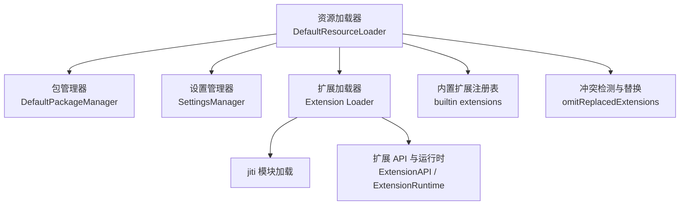
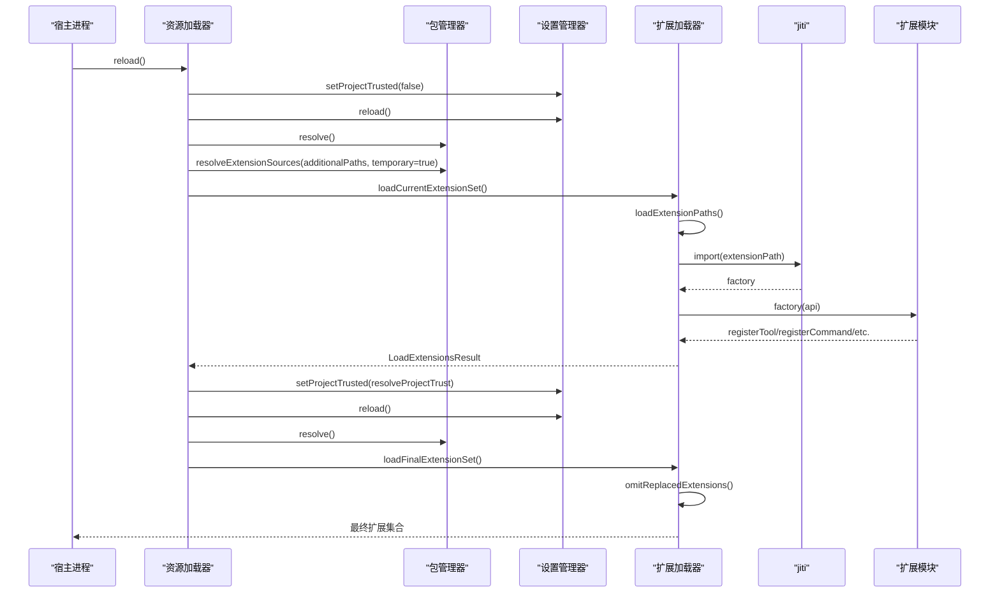
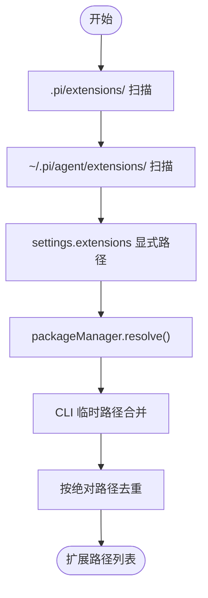
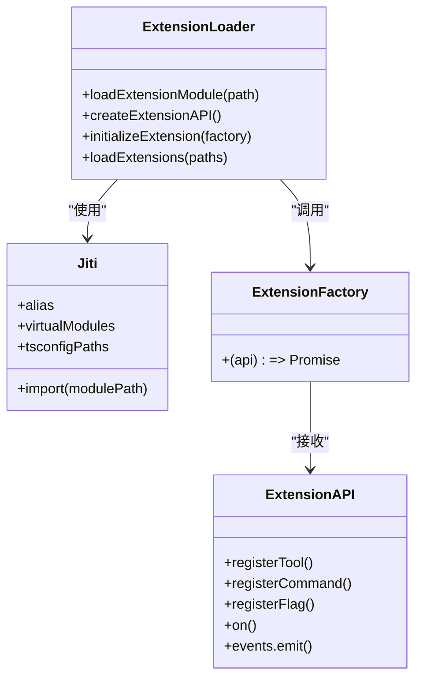
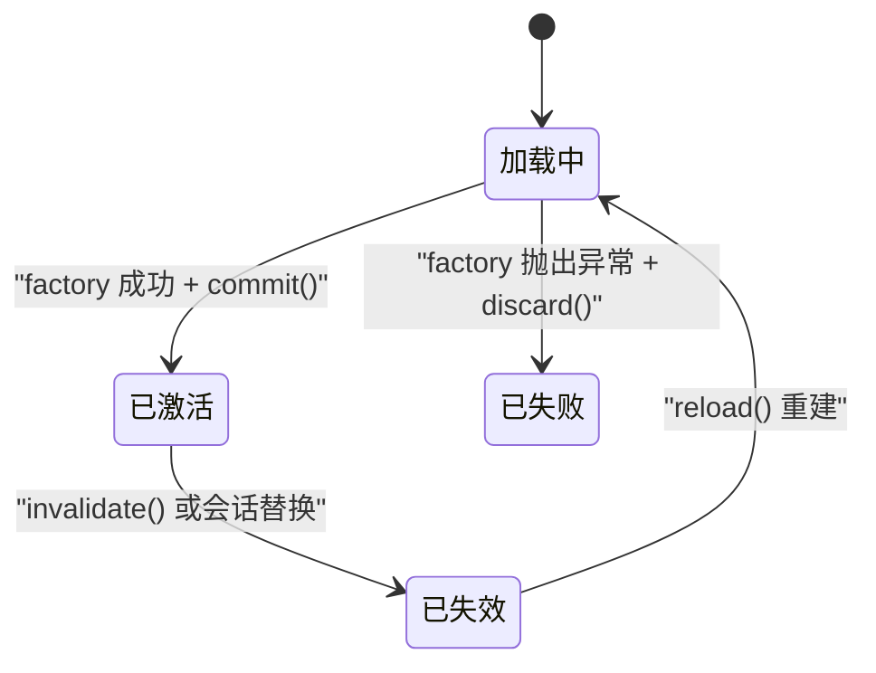
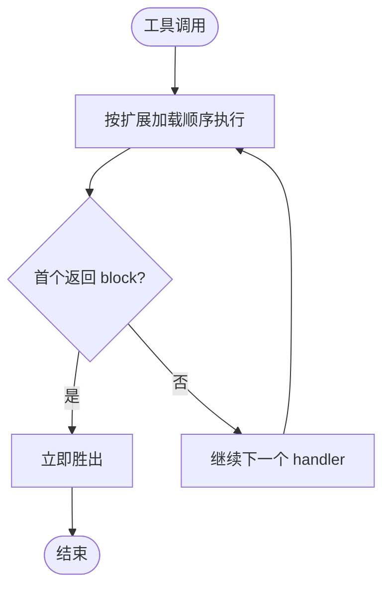
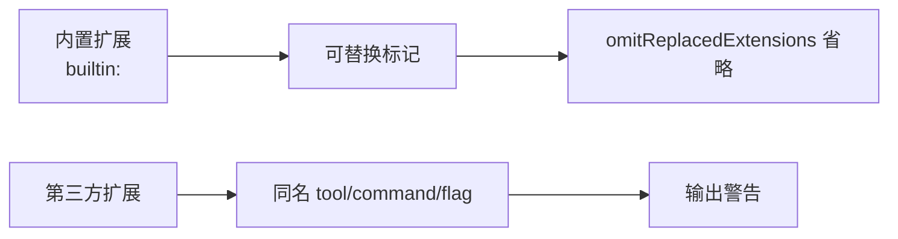
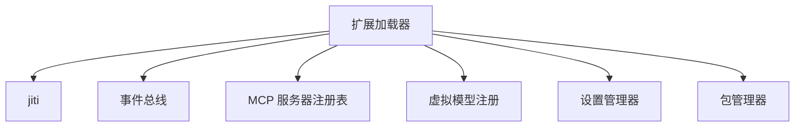
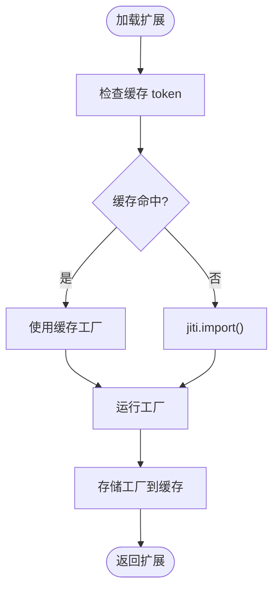
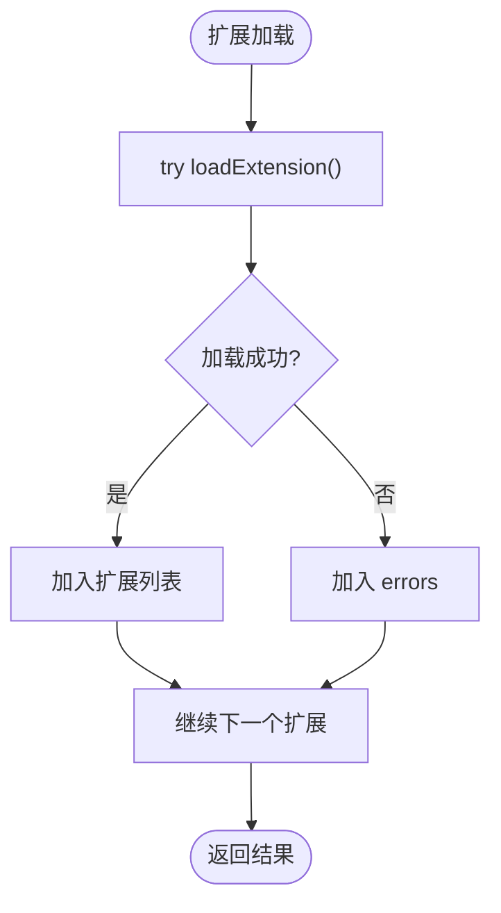

# 扩展加载器

<cite>
**本文引用的文件**   
- [06-extension-loading.md](file://docs/explains/06-extension-loading.md)
- [loader.ts](file://packages/coding-agent/src/core/extensions/loader.ts)
- [resource-loader.ts](file://packages/coding-agent/src/core/resource-loader.ts)
- [settings-schema.ts](file://packages/coding-agent/src/core/settings-schema.ts)
- [settings-manager.ts](file://packages/coding-agent/src/core/settings-manager.ts)
- [types.ts](file://packages/coding-agent/src/core/extensions/types.ts)
- [extension-factory-cache.test.ts](file://packages/coding-agent/test/suite/regressions/extension-factory-cache.test.ts)
- [8092-extension-realpath-jiti.test.ts](file://packages/coding-agent/test/suite/regressions/8092-extension-realpath-jiti.test.ts)
- [package-manager.test.ts](file://packages/coding-agent/test/package-manager.test.ts)
</cite>

## 目录
1. [引言](#引言)
2. [项目结构](#项目结构)
3. [核心组件](#核心组件)
4. [架构总览](#架构总览)
5. [详细组件分析](#详细组件分析)
6. [依赖关系分析](#依赖关系分析)
7. [性能与缓存](#性能与缓存)
8. [错误处理与诊断](#错误处理与诊断)
9. [内置扩展与第三方扩展差异](#内置扩展与第三方扩展差异)
10. [配置与启用控制](#配置与启用控制)
11. [调试与排错指南](#调试与排错指南)
12. [结论](#结论)

## 引言
本文面向扩展作者、插件维护者和系统集成者，系统性说明 Pi 的扩展加载器如何发现、解析、验证、初始化、运行和销毁扩展。文档覆盖以下关键主题：
- 动态加载机制：基于 jiti 的 TypeScript 直接执行、模块别名、虚拟模块注入。
- 生命周期管理：工厂函数调用、API 提交/丢弃、运行时失效与重建。
- 依赖解析：包管理器解析、CLI 临时路径合并、pnpm store 真实路径处理。
- 发现规则：项目级、全局级、显式配置路径以及包清单 `pi.extensions`。
- 替换机制：可替换扩展与内置扩展冲突时的行为。
- 信任模型：项目信任决定前的预加载阶段与正式加载阶段。
- 性能优化：模块缓存、工厂重跑、时序统计、资源去重。
- 调试技巧：测试用例、警告信息、冲突诊断、运行时上下文失效提示。

## 项目结构
扩展加载相关代码集中在 `packages/coding-agent/src/core` 下，并由文档说明文档补充语义约定：
- `core/extensions/loader.ts`：扩展发现、模块导入、工厂执行、API 构造、运行时对象。
- `core/resource-loader.ts`：资源编排、包来源合并、信任流程、内置扩展注入、冲突诊断。
- `core/settings-schema.ts`：设置 Schema，包含 `packages`、`extensions`、`defaultTools` 等字段。
- `core/settings-manager.ts`：全局与项目设置合并、信任状态、持久化。
- `core/extensions/types.ts`：扩展 API、上下文、事件、工具定义等类型契约。
- `docs/explains/06-extension-loading.md`：扩展加载的设计说明与建议。

**图表来源**
- [resource-loader.ts:343-455](file://packages/coding-agent/src/core/resource-loader.ts#L343-L455)
- [resource-loader.ts:533-539](file://packages/coding-agent/src/core/resource-loader.ts#L533-L539)
- [resource-loader.ts:758-833](file://packages/coding-agent/src/core/resource-loader.ts#L758-L833)
- [loader.ts:571-602](file://packages/coding-agent/src/core/extensions/loader.ts#L571-L602)
- [loader.ts:625-644](file://packages/coding-agent/src/core/extensions/loader.ts#L625-L644)
- [loader.ts:646-728](file://packages/coding-agent/src/core/extensions/loader.ts#L646-L728)

**章节来源**
- [06-extension-loading.md:1-10](file://docs/explains/06-extension-loading.md#L1-L10)
- [resource-loader.ts:343-455](file://packages/coding-agent/src/core/resource-loader.ts#L343-L455)
- [loader.ts:1-41](file://packages/coding-agent/src/core/extensions/loader.ts#L1-L41)

## 核心组件
- **扩展加载器（loader.ts）**
  - 负责通过 jiti 加载 `.ts`/`.js` 扩展模块。
  - 创建 `ExtensionRuntime` 与 `ExtensionAPI`，封装注册方法、动作方法和事件总线。
  - 提供 `loadExtensions`、`loadExtensionsCached`、`discoverAndLoadExtensions` 等入口。
- **资源加载器（resource-loader.ts）**
  - 协调包管理器、设置管理器、内置扩展、CLI 临时路径。
  - 实现项目信任预加载、最终扩展集加载、冲突诊断与替换。
  - 暴露 `reload()`、`loadProjectTrustExtensions()`、`extendResources()` 等能力。
- **设置 Schema（settings-schema.ts）**
  - 定义 `packages`、`extensions`、`defaultTools`、`disabledBuiltinExtensions` 等配置项。
- **设置管理器（settings-manager.ts）**
  - 合并全局与项目设置，支持 `deepMergeSettings`。
  - 管理 `projectTrusted`，并在未信任时忽略项目配置。
- **扩展类型（types.ts）**
  - 定义 `ExtensionAPI`、`ExtensionContext`、`ToolDefinition`、事件类型等。

**章节来源**
- [loader.ts:164-244](file://packages/coding-agent/src/core/extensions/loader.ts#L164-L244)
- [loader.ts:253-561](file://packages/coding-agent/src/core/extensions/loader.ts#L253-L561)
- [resource-loader.ts:343-455](file://packages/coding-agent/src/core/resource-loader.ts#L343-L455)
- [settings-schema.ts:206-466](file://packages/coding-agent/src/core/settings-schema.ts#L206-L466)
- [settings-manager.ts:272-356](file://packages/coding-agent/src/core/settings-manager.ts#L272-L356)
- [types.ts:345-415](file://packages/coding-agent/src/core/extensions/types.ts#L345-L415)

## 架构总览
扩展加载的整体流程分为三个阶段：
1. **发现阶段**：扫描项目级、全局级、显式配置路径；包管理器解析 npm/git/本地包。
2. **信任阶段**：以项目未信任模式预加载，用于决定项目是否可信。
3. **加载阶段**：合并 CLI 临时路径与已启用扩展路径，过滤内置扩展，执行工厂并构建扩展集合。

**图表来源**
- [resource-loader.ts:541-629](file://packages/coding-agent/src/core/resource-loader.ts#L541-L629)
- [resource-loader.ts:712-748](file://packages/coding-agent/src/core/resource-loader.ts#L712-L748)
- [resource-loader.ts:791-833](file://packages/coding-agent/src/core/resource-loader.ts#L791-L833)
- [loader.ts:688-746](file://packages/coding-agent/src/core/extensions/loader.ts#L688-L746)
- [loader.ts:840-888](file://packages/coding-agent/src/core/extensions/loader.ts#L840-L888)

## 详细组件分析

### 扩展发现与路径解析
- **标准位置顺序**：
  1. `<cwd>/.pi/extensions/`（项目级）
  2. `~/.pi/agent/extensions/`（全局）
  3. `settings.extensions` 中显式配置的路径
- **单层扫描规则**：
  - 直接 `.ts`/`.js` 文件作为扩展入口。
  - 子目录存在 `index.ts`/`index.js` 则加载该入口。
  - 子目录存在 `package.json` 且声明 `pi.extensions` 则按清单加载。
- **包管理器路径**：
  - `DefaultResourceLoader` 使用 `packageManager.resolve()` 将 `settings.packages`（npm/git/本地）解析为资源。
  - CLI 传入的临时路径通过 `resolveExtensionSources(..., {temporary: true})` 合并，CLI 资源排在前面。
- **去重策略**：
  - 按解析后的绝对路径去重，保留首次出现顺序。

**图表来源**
- [loader.ts:803-835](file://packages/coding-agent/src/core/extensions/loader.ts#L803-L835)
- [loader.ts:840-888](file://packages/coding-agent/src/core/extensions/loader.ts#L840-L888)
- [resource-loader.ts:557-619](file://packages/coding-agent/src/core/resource-loader.ts#L557-L619)

**章节来源**
- [06-extension-loading.md:11-31](file://docs/explains/06-extension-loading.md#L11-L31)
- [loader.ts:748-835](file://packages/coding-agent/src/core/extensions/loader.ts#L748-L835)
- [loader.ts:840-888](file://packages/coding-agent/src/core/extensions/loader.ts#L840-L888)
- [resource-loader.ts:557-619](file://packages/coding-agent/src/core/resource-loader.ts#L557-L619)
- [package-manager.test.ts:2461-2544](file://packages/coding-agent/test/package-manager.test.ts#L2461-L2544)

### 模块导入与依赖解析
- **jiti 直接执行 TypeScript**：
  - `moduleCache: false`，每次 reload 都是新模块实例。
  - 宿主包通过 alias 映射到 Pi 自己的副本，避免扩展安装第二份运行时。
  - 在嵌入模块或源码 TypeScript 运行时，注入虚拟模块与 tsconfig 路径。
- **依赖解析策略**：
  - 编译二进制与打包 Node 分发使用嵌入模块。
  - 源码 TypeScript 复用宿主模块与根 tsconfig 路径。
  - 非打包 Node 构建使用 dist alias，不需要 bundled virtual modules。
- **真实路径问题修复**：
  - 测试覆盖 pnpm store 中仅可通过 realpath 访问的依赖，确保扩展入口在 jiti 加载前被规范化。

**图表来源**
- [loader.ts:50-64](file://packages/coding-agent/src/core/extensions/loader.ts#L50-L64)
- [loader.ts:72-132](file://packages/coding-agent/src/core/extensions/loader.ts#L72-L132)
- [loader.ts:571-602](file://packages/coding-agent/src/core/extensions/loader.ts#L571-L602)
- [loader.ts:625-644](file://packages/coding-agent/src/core/extensions/loader.ts#L625-L644)

**章节来源**
- [06-extension-loading.md:33-43](file://docs/explains/06-extension-loading.md#L33-L43)
- [loader.ts:50-64](file://packages/coding-agent/src/core/extensions/loader.ts#L50-L64)
- [loader.ts:72-132](file://packages/coding-agent/src/core/extensions/loader.ts#L72-L132)
- [loader.ts:571-602](file://packages/coding-agent/src/core/extensions/loader.ts#L571-L602)
- [8092-extension-realpath-jiti.test.ts:45-47](file://packages/coding-agent/test/suite/regressions/8092-extension-realpath-jiti.test.ts#L45-L47)

### 扩展生命周期管理
- **工厂函数契约**：
  - 模块必须默认导出一个工厂函数：`export default function (pi: ExtensionAPI)`。
  - 工厂可以是异步，Pi 会 await 完成再继续启动。
- **API 提交与丢弃**：
  - 加载期间注册的方法写入 pending 状态，commit 后生效；discard 标记失败并清理订阅。
- **运行时失效**：
  - 会话替换、fork、switchSession、reload 后捕获的 ctx 会被 invalidate，禁止继续使用。
- **销毁与重建**：
  - reload 时清除扩展缓存，重新加载模块；旧 runtime 不再可用。

**图表来源**
- [loader.ts:253-561](file://packages/coding-agent/src/core/extensions/loader.ts#L253-L561)
- [loader.ts:625-644](file://packages/coding-agent/src/core/extensions/loader.ts#L625-L644)
- [resource-loader.ts:541-547](file://packages/coding-agent/src/core/resource-loader.ts#L541-L547)

**章节来源**
- [06-extension-loading.md:33-43](file://docs/explains/06-extension-loading.md#L33-L43)
- [loader.ts:253-561](file://packages/coding-agent/src/core/extensions/loader.ts#L253-L561)
- [loader.ts:625-644](file://packages/coding-agent/src/core/extensions/loader.ts#L625-L644)
- [resource-loader.ts:541-547](file://packages/coding-agent/src/core/resource-loader.ts#L541-L547)

### 依赖解析与 Handler 优先级
- **Handler 顺序**：
  - 没有显式 priority 字段，顺序为“扩展加载顺序 → 同一扩展内 handler 注册顺序”。
  - `emitToolCall` 按此顺序执行，第一个返回 `{ block: true }` 立即胜出。
- **项目优先于全局**：
  - 项目级扩展排在全局扩展之前，形成“项目策略覆盖全局策略”的副作用。
- **替换机制**：
  - 第三方扩展注册同名 tool/command/flag 时，内置扩展让位并产生 warning。

**图表来源**
- [06-extension-loading.md:44-55](file://docs/explains/06-extension-loading.md#L44-L55)
- [resource-loader.ts:148-179](file://packages/coding-agent/src/core/resource-loader.ts#L148-L179)

**章节来源**
- [06-extension-loading.md:44-65](file://docs/explains/06-extension-loading.md#L44-L65)
- [resource-loader.ts:148-179](file://packages/coding-agent/src/core/resource-loader.ts#L148-L179)

### 内置扩展与第三方扩展差异
- **内置扩展注入**：
  - 通过 `builtin:<name>` 路径加载，标记 `hidden` 与 `replaceable`。
  - 若第三方扩展注册同名 tool/command/flag，内置扩展被省略并输出 warning。
- **第三方扩展**：
  - 来自包管理器解析、CLI 临时路径、项目/全局目录。
  - 可替换内置扩展，但需避免同时加载两者。

**图表来源**
- [resource-loader.ts:138-141](file://packages/coding-agent/src/core/resource-loader.ts#L138-L141)
- [resource-loader.ts:148-179](file://packages/coding-agent/src/core/resource-loader.ts#L148-L179)
- [resource-loader.ts:758-789](file://packages/coding-agent/src/core/resource-loader.ts#L758-L789)

**章节来源**
- [resource-loader.ts:138-141](file://packages/coding-agent/src/core/resource-loader.ts#L138-L141)
- [resource-loader.ts:148-179](file://packages/coding-agent/src/core/resource-loader.ts#L148-L179)
- [resource-loader.ts:758-789](file://packages/coding-agent/src/core/resource-loader.ts#L758-L789)

## 依赖关系分析
扩展加载器依赖多个子系统：
- **jiti**：TypeScript 直接执行与模块导入。
- **事件总线**：扩展间通信与生命周期事件。
- **MCP 服务器注册表**：扩展注册 MCP 服务时的校验与冲突检测。
- **虚拟模型与 Provider**：扩展注册 Provider 与 VirtualModel 的延迟绑定。
- **设置管理器**：读取 settings 中的 packages、extensions、defaultTools 等。
- **包管理器**：解析 npm/git/本地包，生成 enabled 资源列表。

**图表来源**
- [loader.ts:16-23](file://packages/coding-agent/src/core/extensions/loader.ts#L16-L23)
- [loader.ts:19-23](file://packages/coding-agent/src/core/extensions/loader.ts#L19-L23)
- [loader.ts:468-526](file://packages/coding-agent/src/core/extensions/loader.ts#L468-L526)
- [resource-loader.ts:343-455](file://packages/coding-agent/src/core/resource-loader.ts#L343-L455)

**章节来源**
- [loader.ts:16-23](file://packages/coding-agent/src/core/extensions/loader.ts#L16-L23)
- [loader.ts:468-526](file://packages/coding-agent/src/core/extensions/loader.ts#L468-L526)
- [resource-loader.ts:343-455](file://packages/coding-agent/src/core/resource-loader.ts#L343-L455)

## 性能与缓存
- **模块缓存**：
  - `clearExtensionCache()` 清空缓存并按 cwd/generation 失效。
  - `loadExtensionsCached` 对相同 cwd 的模块导入进行缓存，但工厂仍会重跑。
- **工厂重跑**：
  - 测试验证：缓存模块导入但不缓存工厂执行结果，确保每次加载获得新扩展实例。
- **时序统计**：
  - 使用 `time()` 记录模块导入与工厂执行耗时，便于性能分析。
- **资源去重**：
  - 技能、提示词、主题等资源加载后进行去重，避免重复渲染。

**图表来源**
- [loader.ts:136-158](file://packages/coding-agent/src/core/extensions/loader.ts#L136-L158)
- [loader.ts:571-602](file://packages/coding-agent/src/core/extensions/loader.ts#L571-L602)
- [extension-factory-cache.test.ts:69-81](file://packages/coding-agent/test/suite/regressions/extension-factory-cache.test.ts#L69-L81)

**章节来源**
- [loader.ts:136-158](file://packages/coding-agent/src/core/extensions/loader.ts#L136-L158)
- [loader.ts:571-602](file://packages/coding-agent/src/core/extensions/loader.ts#L571-L602)
- [extension-factory-cache.test.ts:69-81](file://packages/coding-agent/test/suite/regressions/extension-factory-cache.test.ts#L69-L81)

## 错误处理与诊断
- **扩展加载失败**：
  - 单个扩展失败不会中断整个进程，错误进入 `errors`，其他扩展继续加载。
- **API 使用保护**：
  - 扩展 API 在加载期间或失效后调用会抛出明确错误。
- **冲突诊断**：
  - 检测不同扩展注册同名 tool/flag 的情况，输出错误信息。
- **包安装警告**：
  - 收集包安装失败与 host-provided 依赖警告，合并到扩展结果 warnings。

**图表来源**
- [loader.ts:646-669](file://packages/coding-agent/src/core/extensions/loader.ts#L646-L669)
- [resource-loader.ts:119-134](file://packages/coding-agent/src/core/resource-loader.ts#L119-L134)
- [resource-loader.ts:1282-1318](file://packages/coding-agent/src/core/resource-loader.ts#L1282-L1318)

**章节来源**
- [06-extension-loading.md:42-43](file://docs/explains/06-extension-loading.md#L42-L43)
- [loader.ts:646-669](file://packages/coding-agent/src/core/extensions/loader.ts#L646-L669)
- [resource-loader.ts:119-134](file://packages/coding-agent/src/core/resource-loader.ts#L119-L134)
- [resource-loader.ts:1282-1318](file://packages/coding-agent/src/core/resource-loader.ts#L1282-L1318)

## 内置扩展与第三方扩展差异
- **内置扩展**：
  - 通过 `builtin:<name>` 注入，标记 `hidden` 与 `replaceable`。
  - 若第三方扩展注册同名 tool/command/flag，内置扩展被省略并输出 warning。
- **第三方扩展**：
  - 来自包管理器、CLI 临时路径、项目/全局目录。
  - 可替换内置扩展，但建议避免同时加载两者。

**章节来源**
- [resource-loader.ts:138-141](file://packages/coding-agent/src/core/resource-loader.ts#L138-L141)
- [resource-loader.ts:148-179](file://packages/coding-agent/src/core/resource-loader.ts#L148-L179)
- [resource-loader.ts:758-789](file://packages/coding-agent/src/core/resource-loader.ts#L758-L789)

## 配置与启用控制
- **设置 Schema**：
  - `packages`：npm/git 包源，支持字符串或对象形式，含 `autoload`、`extensions`、`skills`、`prompts`、`themes`。
  - `extensions`：本地扩展路径数组。
  - `defaultTools`：初始工具选择，支持 `+name`/`-name` 修饰符。
  - `disabledBuiltinExtensions`：禁用内置扩展名称。
- **设置合并**：
  - 全局与项目设置通过 `deepMergeSettings` 合并，项目优先。
  - 未信任项目设置被完全忽略。
- **启用/禁用手段**：
  - `settings.packages` 对象形式 + `autoload: false`。
  - `settings.extensions` 指定本地扩展路径。
  - `noExtensions`/`noSkills`/`noPromptTemplates`/`noThemes`/`noContextFiles` 控制资源类别。
  - `defaultTools` 的 `+name`/`-name` 控制工具装载。
  - `pi.setActiveTools()` 运行期工具集。

**章节来源**
- [settings-schema.ts:171-189](file://packages/coding-agent/src/core/settings-schema.ts#L171-L189)
- [settings-schema.ts:314-350](file://packages/coding-agent/src/core/settings-schema.ts#L314-L350)
- [settings-manager.ts:142-147](file://packages/coding-agent/src/core/settings-manager.ts#L142-L147)
- [settings-manager.ts:366-394](file://packages/coding-agent/src/core/settings-manager.ts#L366-L394)
- [06-extension-loading.md:67-110](file://docs/explains/06-extension-loading.md#L67-L110)

## 调试与排错指南
- **扩展工厂缓存测试**：
  - 验证缓存模块导入但不缓存工厂执行，确保每次加载获得新实例。
- **pnpm store 真实路径测试**：
  - 确保扩展入口在 jiti 加载前被 realpath 规范化，避免依赖解析失败。
- **多文件扩展发现测试**：
  - 验证子目录仅加载 `index.ts`，不加载辅助模块。
- **常见错误**：
  - 扩展未导出有效工厂函数。
  - 工具参数 schema 不是对象。
  - 命令 handler 缺失。
  - MCP 服务器命名冲突。
  - 扩展 API 在失效后使用。

**章节来源**
- [extension-factory-cache.test.ts:69-81](file://packages/coding-agent/test/suite/regressions/extension-factory-cache.test.ts#L69-L81)
- [8092-extension-realpath-jiti.test.ts:45-47](file://packages/coding-agent/test/suite/regressions/8092-extension-realpath-jiti.test.ts#L45-L47)
- [package-manager.test.ts:2461-2544](file://packages/coding-agent/test/package-manager.test.ts#L2461-L2544)
- [loader.ts:298-358](file://packages/coding-agent/src/core/extensions/loader.ts#L298-L358)
- [loader.ts:483-505](file://packages/coding-agent/src/core/extensions/loader.ts#L483-L505)

## 结论
Pi 的扩展加载器通过 jiti 实现 TypeScript 动态加载，结合包管理器、设置管理器与内置扩展注册表，形成完整的扩展生态。其设计强调：
- **安全性**：项目信任预加载、host-provided 依赖警告、冲突诊断。
- **可维护性**：清晰的发现规则、替换机制、错误处理。
- **性能**：模块缓存、工厂重跑、时序统计、资源去重。
- **可扩展性**：丰富的 API 与上下文，支持工具、命令、Provider、虚拟模型等扩展点。

对于扩展作者，建议：
- 遵循工厂函数契约，避免在加载期间调用运行时动作。
- 使用 `pi.getSettings()` 与 `pi.setActiveTools()` 进行配置与工具控制。
- 避免与内置扩展或第三方扩展注册同名 tool/command/flag。
- 利用 `loadExtensionsCached` 与 `clearExtensionCache` 进行性能优化与调试。