# 扩展类型定义

<cite>
**本文引用的文件**
- [extensions/omfde-core/src/index.ts](file://extensions/omfde-core/src/index.ts)
- [packages/coding-agent/src/core/extensions/types.ts](file://packages/coding-agent/src/core/extensions/types.ts)
- [docs/explains/06-extension-loading.md](file://docs/explains/06-extension-loading.md)
</cite>

## 目录
1. [引言](#引言)
2. [项目结构](#项目结构)
3. [核心组件](#核心组件)
4. [架构总览](#架构总览)
5. [详细组件分析](#详细组件分析)
6. [依赖关系分析](#依赖关系分析)
7. [性能与行为特征](#性能与行为特征)
8. [排错指南](#排错指南)
9. [结论](#结论)
10. [附录：扩展开发最佳实践](#附录扩展开发最佳实践)

## 引言
本文面向扩展开发者，系统化说明扩展类型定义、接口规范、数据结构与类型约束。重点解释以下核心概念：
- InlineExtension：扩展的声明形式，支持直接工厂函数或带元数据的对象。
- ExtensionContext：事件处理器和工具执行时使用的运行时上下文。
- ExtensionAPI：扩展工厂接收的能力入口，用于注册工具、命令、事件、UI、模型等能力。
- 扩展元数据格式、配置选项、事件类型。
- TypeScript 类型安全的扩展开发指南与最佳实践。
- 扩展版本兼容性与向后兼容性策略。

## 项目结构
仓库中与扩展类型定义最相关的代码集中在 `packages/coding-agent/src/core/extensions/types.ts`；示例扩展位于 `extensions/omfde-core/src/index.ts`；扩展加载机制与行为约定在 `docs/explains/06-extension-loading.md` 中说明。

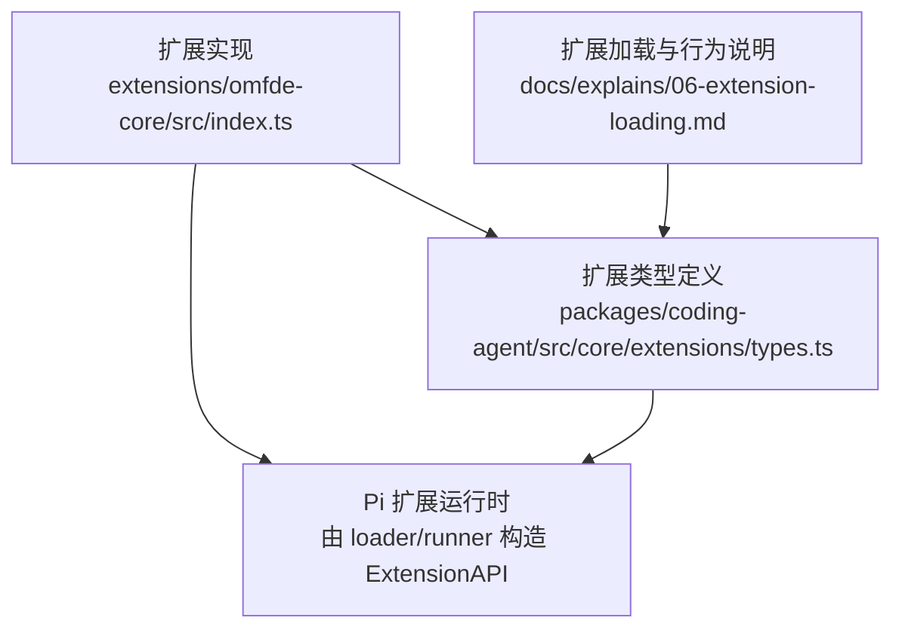

**图表来源**
- [extensions/omfde-core/src/index.ts:1-20](file://extensions/omfde-core/src/index.ts#L1-L20)
- [packages/coding-agent/src/core/extensions/types.ts:1637-2093](file://packages/coding-agent/src/core/extensions/types.ts#L1637-L2093)
- [docs/explains/06-extension-loading.md:33-42](file://docs/explains/06-extension-loading.md#L33-L42)

**章节来源**
- [extensions/omfde-core/src/index.ts:1-20](file://extensions/omfde-core/src/index.ts#L1-L20)
- [packages/coding-agent/src/core/extensions/types.ts:1637-2093](file://packages/coding-agent/src/core/extensions/types.ts#L1637-L2093)
- [docs/explains/06-extension-loading.md:33-42](file://docs/explains/06-extension-loading.md#L33-L42)

## 核心组件
本节聚焦三个关键类型及其职责边界：
- InlineExtension：扩展的“入口形态”，决定如何被加载、显示和替换。
- ExtensionContext：扩展运行时的“环境视图”，提供 UI、会话、模型、信号等只读能力。
- ExtensionAPI：扩展的“能力入口”，用于注册工具、命令、事件、渲染器、模型提供者等。

```mermaid
classDiagram
class InlineExtension {
"+name? : string"
"+factory(pi)"
"+hidden? : boolean"
"+replaceable? : boolean"
"+builtin? : boolean"
}
class ExtensionAPI {
"+on(event, handler)"
"+registerTool(tool)"
"+registerCommand(name, options)"
"+registerShortcut(shortcut, options)"
"+registerFlag(name, options)"
"+registerMessageRenderer(type, renderer)"
"+registerEntryRenderer(type, renderer)"
"+registerToolRenderer(resolver)"
"+registerMarkdownTransformer(transformer, options)"
"+registerProvider(...)"
"+unregisterProvider(name)"
"+registerMcpServer(name, config)"
"+unregisterMcpServer(name)"
"+getMcpServers()"
"+registerVirtualModel(model)"
"+unregisterVirtualModel(provider, id)"
"+sendMessage(message, options)"
"+sendUserMessage(content, options)"
"+appendEntry(type, data)"
"+setSessionName(name)"
"+getSessionName()"
"+setLabel(entryId, label)"
"+exec(command, args, options)"
"+getActiveTools()"
"+getAllTools()"
"+getSettings()"
"+setActiveTools(names)"
"+getCommands()"
"+setModel(model)"
"+getThinkingLevel()"
"+setThinkingLevel(level)"
"+events"
}
class ExtensionContext {
"+ui"
"+mode"
"+hasUI"
"+cwd"
"+sessionManager"
"+modelRegistry"
"+model"
"+scopedModels"
"+thinkingLevel?"
"+isIdle()"
"+isProjectTrusted()"
"+signal"
"+abort()"
"+hasPendingMessages()"
"+shutdown()"
"+getContextUsage()"
"+compact(options)"
"+getSystemPrompt()"
}
InlineExtension --> ExtensionAPI : "工厂函数参数"
ExtensionAPI --> ExtensionContext : "事件处理器参数"
```

**图表来源**
- [packages/coding-agent/src/core/extensions/types.ts:2095-2123](file://packages/coding-agent/src/core/extensions/types.ts#L2095-L2123)
- [packages/coding-agent/src/core/extensions/types.ts:1637-1966](file://packages/coding-agent/src/core/extensions/types.ts#L1637-L1966)
- [packages/coding-agent/src/core/extensions/types.ts:345-385](file://packages/coding-agent/src/core/extensions/types.ts#L345-L385)

**章节来源**
- [packages/coding-agent/src/core/extensions/types.ts:2095-2123](file://packages/coding-agent/src/core/extensions/types.ts#L2095-L2123)
- [packages/coding-agent/src/core/extensions/types.ts:1637-1966](file://packages/coding-agent/src/core/extensions/types.ts#L1637-L1966)
- [packages/coding-agent/src/core/extensions/types.ts:345-385](file://packages/coding-agent/src/core/extensions/types.ts#L345-L385)

## 架构总览
扩展系统围绕“发现 → 加载 → 绑定 → 运行”的生命周期展开。扩展以默认导出的工厂函数形式暴露，宿主通过 `ExtensionAPI` 注入能力，扩展通过 `on()` 订阅事件、通过 `register*` 注册能力。

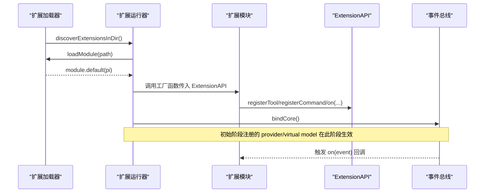

**图表来源**
- [docs/explains/06-extension-loading.md:33-42](file://docs/explains/06-extension-loading.md#L33-L42)
- [packages/coding-agent/src/core/extensions/types.ts:2092-2093](file://packages/coding-agent/src/core/extensions/types.ts#L2092-L2093)
- [packages/coding-agent/src/core/extensions/types.ts:1637-1710](file://packages/coding-agent/src/core/extensions/types.ts#L1637-L1710)

**章节来源**
- [docs/explains/06-extension-loading.md:33-42](file://docs/explains/06-extension-loading.md#L33-L42)
- [packages/coding-agent/src/core/extensions/types.ts:1637-1710](file://packages/coding-agent/src/core/extensions/types.ts#L1637-L1710)

## 详细组件分析

### InlineExtension：扩展元数据与加载形态
InlineExtension 是扩展的“入口形态”。它可以是一个简单的工厂函数，也可以是一个包含元数据的对象。该类型决定了扩展在启动列表中的显示方式、是否可被替换、是否作为内置资源加载等。

- 简单工厂：`(pi: ExtensionAPI) => void | Promise<void>`
- 对象形态字段：
  - name：扩展显示名称，影响错误信息和诊断输出。
  - factory：实际工厂函数。
  - hidden：是否在启动扩展列表中隐藏。
  - replaceable：当第三方扩展注册同名 tool/command/flag 时，允许让位并产生警告。
  - builtin：将扩展作为内置资源加载，受 settings 控制，且在项目信任后加载。

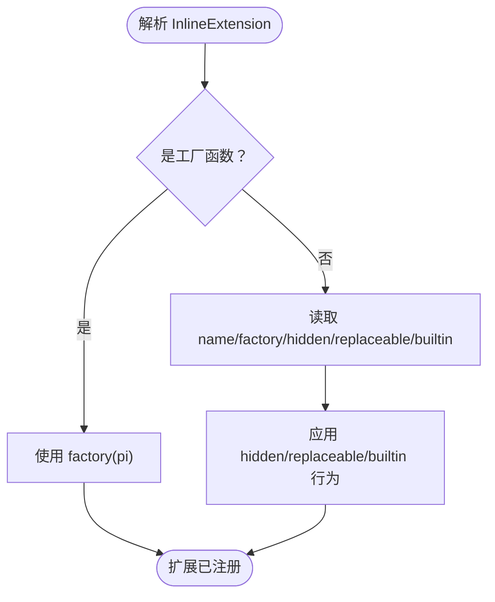

**图表来源**
- [packages/coding-agent/src/core/extensions/types.ts:2095-2123](file://packages/coding-agent/src/core/extensions/types.ts#L2095-L2123)
- [docs/explains/06-extension-loading.md:57-65](file://docs/explains/06-extension-loading.md#L57-L65)

**章节来源**
- [packages/coding-agent/src/core/extensions/types.ts:2095-2123](file://packages/coding-agent/src/core/extensions/types.ts#L2095-L2123)
- [docs/explains/06-extension-loading.md:57-65](file://docs/explains/06-extension-loading.md#L57-L65)

### ExtensionContext：扩展运行上下文
ExtensionContext 是扩展事件处理器和工具执行时看到的“运行时视图”。它提供 UI 交互、会话状态、模型信息、工作目录、信号、压缩、系统提示等能力。

关键字段与方法：
- ui：扩展 UI 上下文，提供对话框、通知、终端输入监听、编辑器、主题等。
- mode：当前运行模式（tui/rpc/json/print）。
- hasUI：是否具备对话框能力。
- cwd：当前工作目录。
- sessionManager：只读的会话管理器。
- modelRegistry：模型注册表。
- model：当前模型（可能为 undefined）。
- scopedModels：会话作用域内的模型快照。
- thinkingLevel：思考级别（可选）。
- isIdle/isProjectTrusted/signal/abort/hasPendingMessages/shutdown/getContextUsage/compact/getSystemPrompt：运行时控制与查询方法。

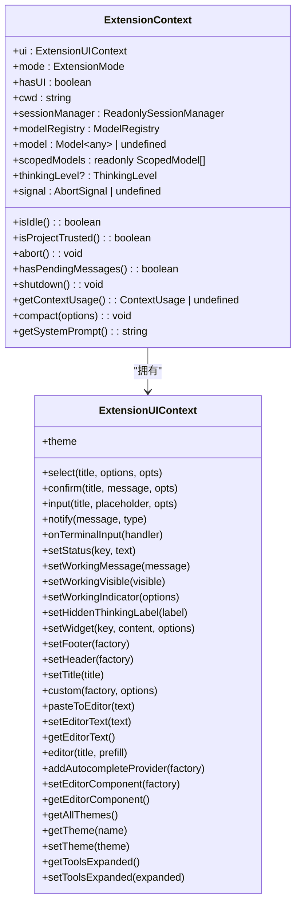

**图表来源**
- [packages/coding-agent/src/core/extensions/types.ts:345-385](file://packages/coding-agent/src/core/extensions/types.ts#L345-L385)
- [packages/coding-agent/src/core/extensions/types.ts:164-320](file://packages/coding-agent/src/core/extensions/types.ts#L164-L320)

**章节来源**
- [packages/coding-agent/src/core/extensions/types.ts:345-385](file://packages/coding-agent/src/core/extensions/types.ts#L345-L385)
- [packages/coding-agent/src/core/extensions/types.ts:164-320](file://packages/coding-agent/src/core/extensions/types.ts#L164-L320)

### ExtensionAPI：扩展能力入口
ExtensionAPI 是扩展工厂函数的唯一参数，提供事件订阅、工具注册、命令/快捷键/标志注册、消息渲染、会话操作、模型与思考级别控制、Provider/MCP/VirtualModel 注册、事件总线等能力。

主要能力分组：
- 事件订阅：on(event, handler)，覆盖项目信任、资源发现、会话生命周期、代理请求、Agent 生命周期、工具调用、用户输入等。
- 工具注册：registerTool(ToolDefinition)。
- 命令/快捷键/标志：registerCommand/registerShortcut/registerFlag/getFlag。
- 渲染扩展：registerMessageRenderer/registerEntryRenderer/registerToolRenderer/registerMarkdownTransformer。
- 动作：sendMessage/sendUserMessage/appendEntry/setSessionName/getSessionName/setLabel/exec/getActiveTools/getAllTools/getSettings/setActiveTools/getCommands。
- 模型与思考级别：setModel/getThinkingLevel/setThinkingLevel。
- Provider/MCP/VirtualModel：registerProvider/unregisterProvider/registerMcpServer/unregisterMcpServer/getMcpServers/registerVirtualModel/unregisterVirtualModel。
- 事件总线：events。

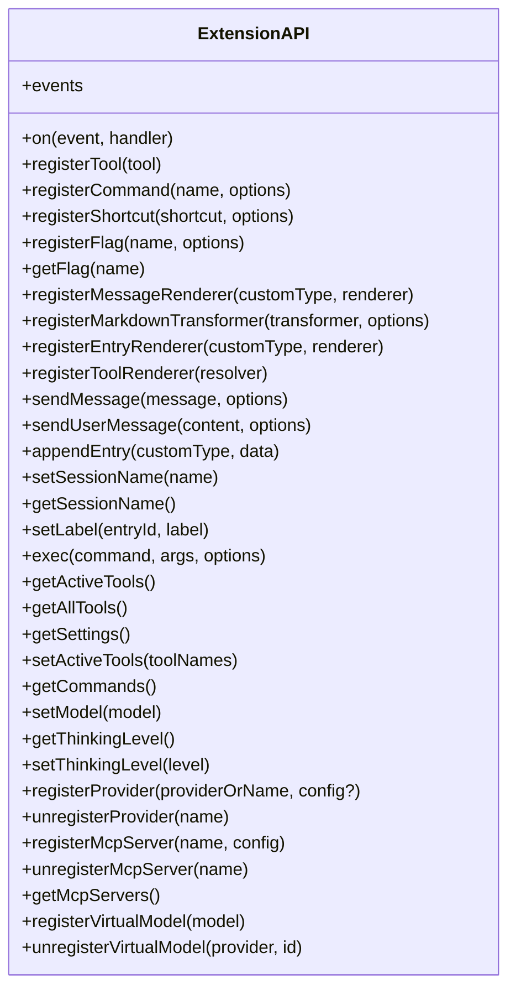

**图表来源**
- [packages/coding-agent/src/core/extensions/types.ts:1637-1966](file://packages/coding-agent/src/core/extensions/types.ts#L1637-L1966)

**章节来源**
- [packages/coding-agent/src/core/extensions/types.ts:1637-1966](file://packages/coding-agent/src/core/extensions/types.ts#L1637-L1966)

### 工具定义与执行上下文
工具通过 ToolDefinition 描述其名称、标签、描述、参数 Schema、输出 Schema、暴露方式、命名空间、注解、执行模式、执行函数以及自定义渲染。工具执行上下文 ExtensionToolContext 继承自 ExtensionContext，并提供 executeTool 与 tools 列表，使工具可以安全地调用其他工具，走同一套校验、hook 和权限检查。

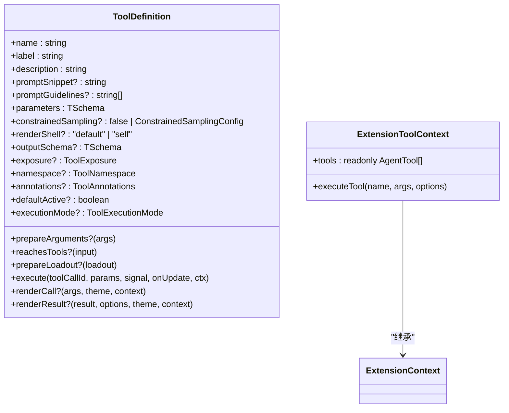

**图表来源**
- [packages/coding-agent/src/core/extensions/types.ts:599-688](file://packages/coding-agent/src/core/extensions/types.ts#L599-L688)
- [packages/coding-agent/src/core/extensions/types.ts:403-415](file://packages/coding-agent/src/core/extensions/types.ts#L403-L415)

**章节来源**
- [packages/coding-agent/src/core/extensions/types.ts:599-688](file://packages/coding-agent/src/core/extensions/types.ts#L599-L688)
- [packages/coding-agent/src/core/extensions/types.ts:403-415](file://packages/coding-agent/src/core/extensions/types.ts#L403-L415)

### 事件类型与生命周期
扩展通过 `on(event, handler)` 订阅事件。事件覆盖：
- 项目信任与资源发现：project_trust、resources_discover。
- 会话生命周期：session_start、session_info_changed、session_before_switch、session_before_fork、session_before_compact、session_compact、session_compact_failed、session_shutdown、session_before_tree、session_tree。
- 上下文与缓存预热：context、context_with_system、cache_warming_decision。
- 模型提供方请求与响应：before_provider_request、before_provider_headers、after_provider_response、provider_stream_event。
- Agent 生命周期：before_agent_start、agent_start、agent_end、agent_before_settle、agent_settled。
- UI 与对话轮次：ui_prompt_start、ui_prompt_end、turn_start、turn_end。
- 消息流：message_start、message_update、message_end。
- 工具调用：tool_execution_start、tool_execution_update、tool_execution_end、tool_call、tool_result。
- 用户输入：user_bash、input。

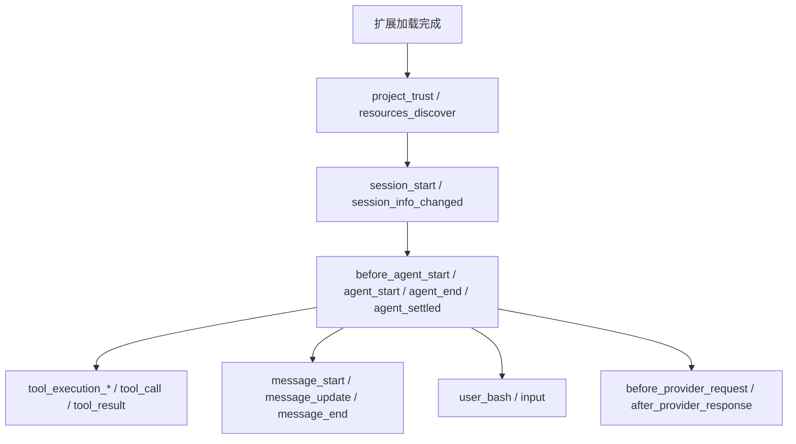

**图表来源**
- [packages/coding-agent/src/core/extensions/types.ts:1642-1710](file://packages/coding-agent/src/core/extensions/types.ts#L1642-L1710)

**章节来源**
- [packages/coding-agent/src/core/extensions/types.ts:1642-1710](file://packages/coding-agent/src/core/extensions/types.ts#L1642-L1710)

### 扩展元数据与配置选项
- InlineExtension 元数据：name、factory、hidden、replaceable、builtin。
- ToolDefinition 元数据：name、label、description、promptSnippet、promptGuidelines、parameters、outputSchema、exposure、namespace、annotations、defaultActive、executionMode。
- ProviderConfig 元数据：name、baseUrl、apiKey、api、streamSimple、images、classifiers、headers、authHeader、models、refreshModels、oauth。
- VirtualModel 元数据：route(request, ctx)。
- 扩展运行时状态：ExtensionRuntimeState 包含 flagValues、pendingProviderRegistrations、pendingNativeProviderRegistrations、pendingVirtualModelRegistrations、createContext、assertActive、invalidate、trackEventBusSubscription、registerProvider、registerNativeProvider、unregisterProvider、mcpServers、registerVirtualModel、unregisterVirtualModel。

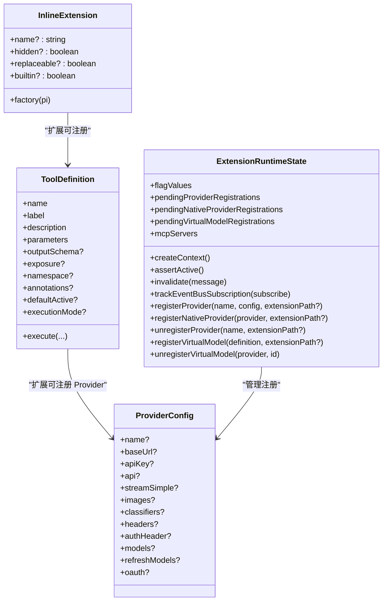

**图表来源**
- [packages/coding-agent/src/core/extensions/types.ts:2095-2123](file://packages/coding-agent/src/core/extensions/types.ts#L2095-L2123)
- [packages/coding-agent/src/core/extensions/types.ts:599-688](file://packages/coding-agent/src/core/extensions/types.ts#L599-L688)
- [packages/coding-agent/src/core/extensions/types.ts:1978-2090](file://packages/coding-agent/src/core/extensions/types.ts#L1978-L2090)
- [packages/coding-agent/src/core/extensions/types.ts:2202-2231](file://packages/coding-agent/src/core/extensions/types.ts#L2202-L2231)

**章节来源**
- [packages/coding-agent/src/core/extensions/types.ts:2095-2123](file://packages/coding-agent/src/core/extensions/types.ts#L2095-L2123)
- [packages/coding-agent/src/core/extensions/types.ts:599-688](file://packages/coding-agent/src/core/extensions/types.ts#L599-L688)
- [packages/coding-agent/src/core/extensions/types.ts:1978-2090](file://packages/coding-agent/src/core/extensions/types.ts#L1978-L2090)
- [packages/coding-agent/src/core/extensions/types.ts:2202-2231](file://packages/coding-agent/src/core/extensions/types.ts#L2202-L2231)

### 示例扩展：omfde-core
示例扩展展示了如何使用 ExtensionAPI 注册命令并通过 ctx.ui.notify 进行通知。

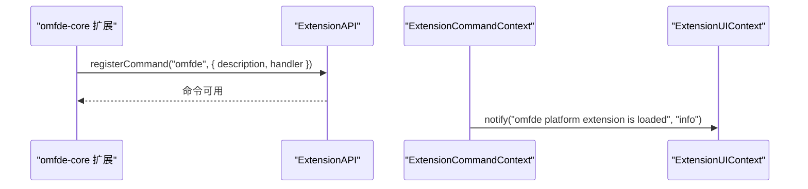

**图表来源**
- [extensions/omfde-core/src/index.ts:12-19](file://extensions/omfde-core/src/index.ts#L12-L19)

**章节来源**
- [extensions/omfde-core/src/index.ts:1-20](file://extensions/omfde-core/src/index.ts#L1-L20)

## 依赖关系分析
扩展类型定义依赖多个内部模块的类型，包括 Agent、AI、TUI、Bash、Exec、Session、Settings、MCP、Model、Compaction、CacheWarmer、Keybindings、SourceInfo、SystemPrompt、Tools、VirtualModels 等。这些依赖确保扩展类型具有强约束，避免运行时出现类型不匹配。

```mermaid
graph TB
Types["extensions/types.ts"] --> Agent["@earendil-works/pi-agent-core"]
Types --> AI["@earendil-works/pi-ai"]
Types --> TUI["@earendil-works/pi-tui"]
Types --> Exec["exec.ts"]
Types --> Bash["bash-executor.ts"]
Types --> Session["session-manager.ts"]
Types --> Settings["settings-manager.ts"]
Types --> MCP["mcp-servers.ts"]
Types --> Model["model-registry.ts"]
Types --> Compaction["compaction/index.ts"]
Types --> Cache["cache-warmer.ts"]
Types --> Keybindings["keybindings.ts"]
Types --> Source["source-info.ts"]
Types --> SystemPrompt["system-prompt.ts"]
Types --> Tools["tools/index.ts"]
Types --> VirtualModels["virtual-models.ts"]
```

**图表来源**
- [packages/coding-agent/src/core/extensions/types.ts:11-108](file://packages/coding-agent/src/core/extensions/types.ts#L11-L108)

**章节来源**
- [packages/coding-agent/src/core/extensions/types.ts:11-108](file://packages/coding-agent/src/core/extensions/types.ts#L11-L108)

## 性能与行为特征
- 加载顺序：扩展加载顺序决定 handler 执行顺序与工具优先级；没有显式 priority 字段。
- 替换机制：内置扩展可标记 replaceable，第三方扩展同名 tool/command/flag 会覆盖并产生 warning。
- 项目信任：项目级 pack 不能在信任决定前生效；全局扩展永远先加载。
- 配置合并：全局与项目 settings 递归合并，未受信任的项目配置会被忽略。
- 工具装载：已有渐进增强原语（defaultTools、setActiveTools），无需自行发明。

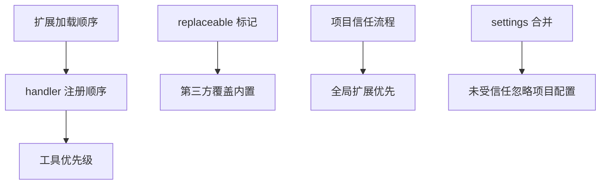

**图表来源**
- [docs/explains/06-extension-loading.md:44-65](file://docs/explains/06-extension-loading.md#L44-L65)
- [docs/explains/06-extension-loading.md:67-109](file://docs/explains/06-extension-loading.md#L67-L109)
- [docs/explains/06-extension-loading.md:145-185](file://docs/explains/06-extension-loading.md#L145-L185)

**章节来源**
- [docs/explains/06-extension-loading.md:44-65](file://docs/explains/06-extension-loading.md#L44-L65)
- [docs/explains/06-extension-loading.md:67-109](file://docs/explains/06-extension-loading.md#L67-L109)
- [docs/explains/06-extension-loading.md:145-185](file://docs/explains/06-extension-loading.md#L145-L185)

## 排错指南
常见扩展问题与定位要点：
- 扩展工厂未默认导出：必须 `export default function (pi: ExtensionAPI) {...}`。
- 异步初始化未完成：工厂可以是 async，宿主会 await 完成再继续启动。
- 加载失败不影响整体：错误进入 errors，其他扩展继续加载。
- 替换冲突：同名 tool/command/flag 会产生 warning，确认 replaceable 语义。
- 项目信任限制：项目级 pack 不能保护信任决定本身，第一道边界必须是全局。
- 扩展实例失效：reload 后旧 ctx 会 invalidate，需重新创建。

**章节来源**
- [docs/explains/06-extension-loading.md:33-42](file://docs/explains/06-extension-loading.md#L33-L42)
- [docs/explains/06-extension-loading.md:57-65](file://docs/explains/06-extension-loading.md#L57-L65)
- [docs/explains/06-extension-loading.md:145-185](file://docs/explains/06-extension-loading.md#L145-L185)

## 结论
扩展类型定义围绕 InlineExtension、ExtensionContext、ExtensionAPI 三大核心构建，形成清晰的扩展入口、运行上下文与能力边界。通过强类型约束与事件驱动模型，扩展可以在不改内核的前提下接入工具、命令、UI、模型与 MCP 能力。遵循本文的类型规范、生命周期约定与最佳实践，可显著提升扩展的可维护性、可测试性与向后兼容性。

## 附录：扩展开发最佳实践
- 使用 TypeBox 定义 parameters/outputSchema，保证 LLM 调用参数与结构化输出的类型安全。
- 明确 ToolExposure 与 namespace，合理组织工具组与可见性。
- 使用 annotations 表达工具副作用（只读、破坏性、幂等、开放世界），便于权限扩展决策。
- 在事件处理器中使用 ExtensionContext 的只读能力，避免直接修改内核状态。
- 使用 pi.getSettings()/getActiveTools()/setActiveTools() 管理配置与工具集，避免硬编码。
- 对异步初始化与 abort 信号敏感，及时释放资源。
- 使用 replaceable 与 hidden 控制扩展行为，避免不必要的冲突与噪音。
- 对 Provider/VirtualModel 注册保持幂等，注意初始加载阶段与运行阶段的差异。
- 对扩展版本与兼容性：
  - 保持 ExtensionAPI 方法签名稳定，新增能力优先以可选字段或新事件形式提供。
  - 对 ToolDefinition 字段采用可选设计，避免破坏旧扩展。
  - 对 ProviderConfig 与 VirtualModel 定义保留向后兼容字段，废弃字段标注 @deprecated。
  - 在扩展 manifest 中声明依赖与顺序，避免隐式耦合。

[本节为通用指导，不直接分析具体文件]