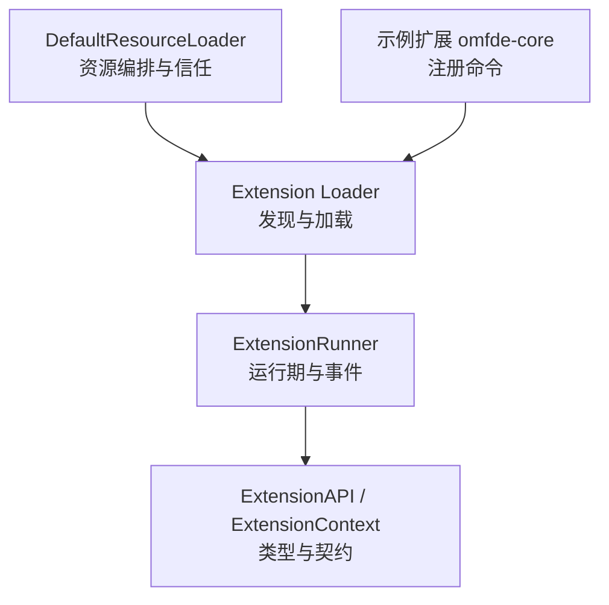
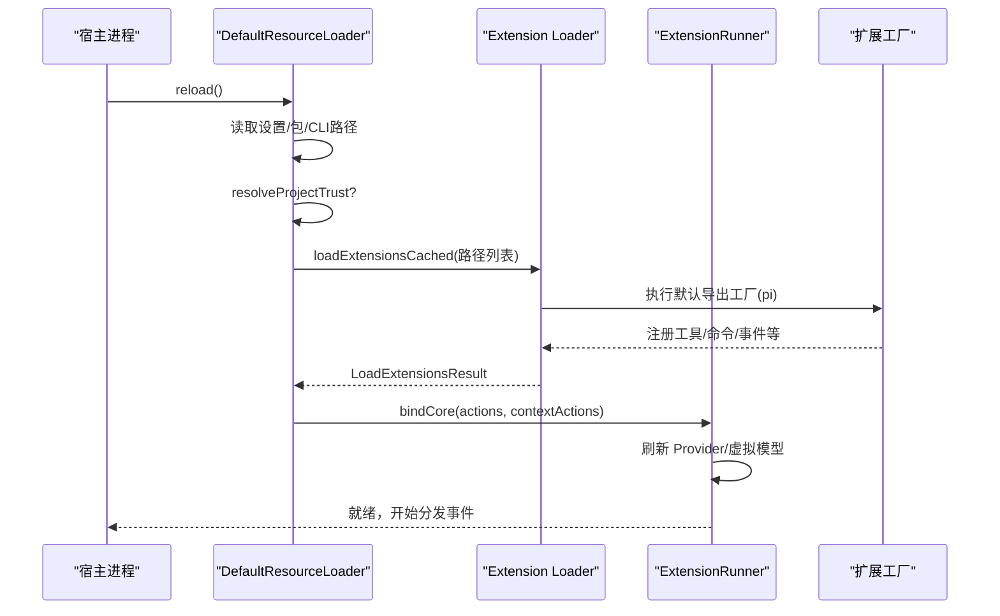
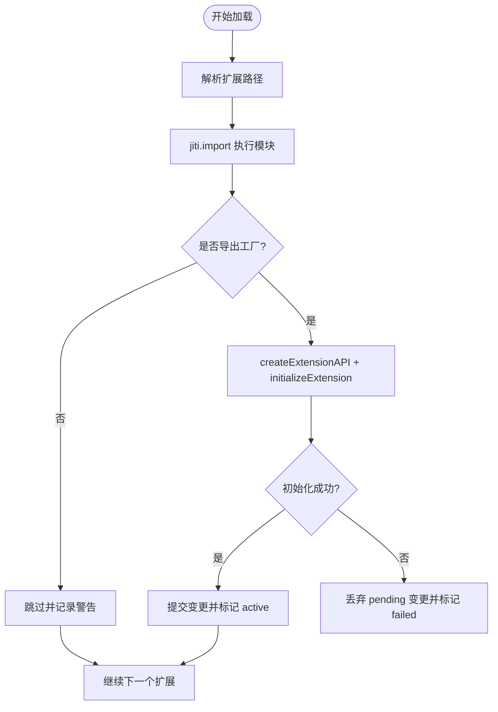
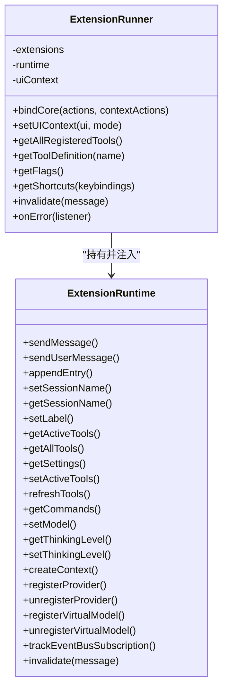
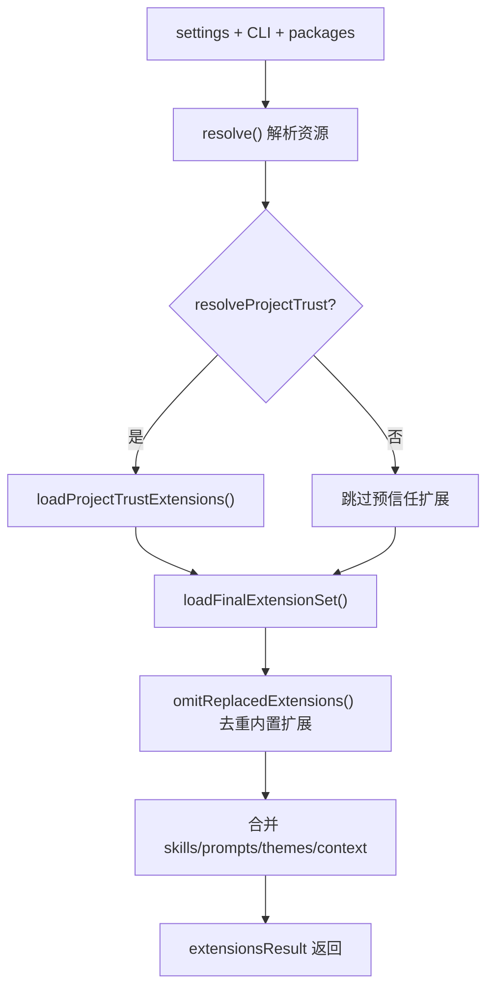
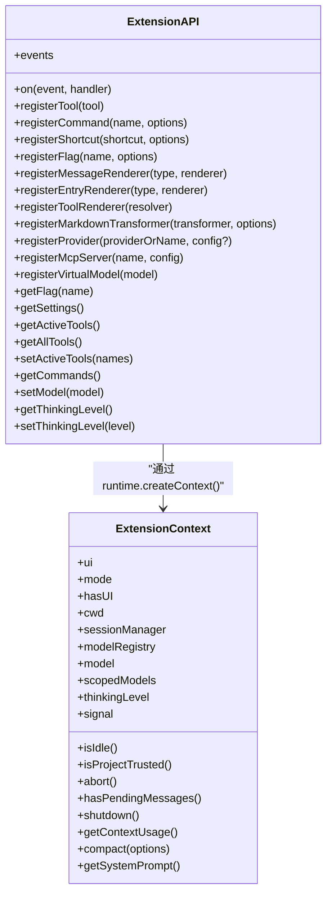
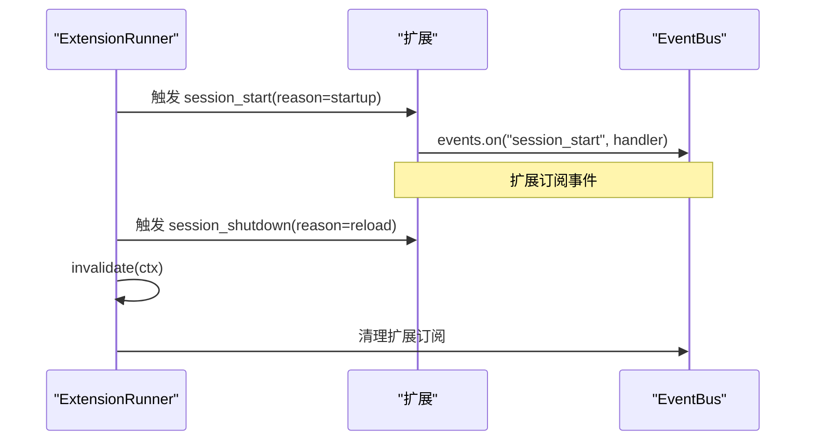
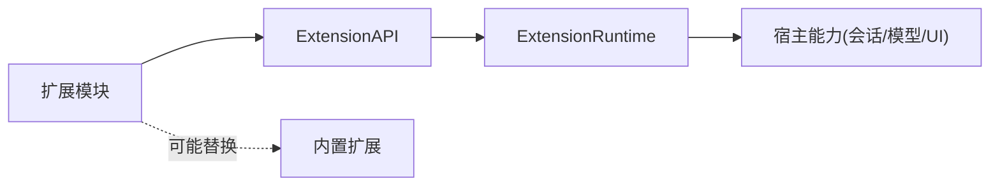
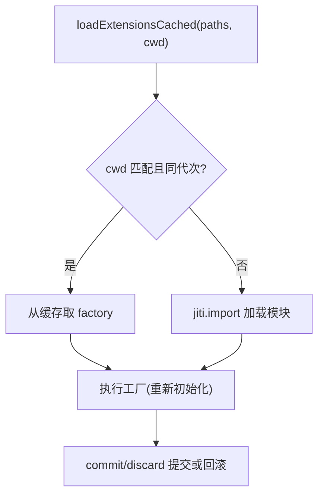

# 扩展系统

<cite>
**本文引用的文件**
- [loader.ts](file://packages/coding-agent/src/core/extensions/loader.ts)
- [types.ts](file://packages/coding-agent/src/core/extensions/types.ts)
- [runner.ts](file://packages/coding-agent/src/core/extensions/runner.ts)
- [resource-loader.ts](file://packages/coding-agent/src/core/resource-loader.ts)
- [06-extension-loading.md](file://docs/explains/06-extension-loading.md)
- [index.ts](file://extensions/omfde-core/src/index.ts)
- [extension-factory-cache.test.ts](file://packages/coding-agent/test/suite/regressions/extension-factory-cache.test.ts)
- [7193-event-bus-lifecycle.test.ts](file://packages/coding-agent/test/suite/regressions/7193-event-bus-lifecycle.test.ts)
- [agent-session-model-extension.test.ts](file://packages/coding-agent/test/suite/agent-session-model-extension.test.ts)
</cite>

## 目录
1. [简介](#简介)
2. [项目结构](#项目结构)
3. [核心组件](#核心组件)
4. [架构总览](#架构总览)
5. [详细组件分析](#详细组件分析)
6. [依赖关系分析](#依赖关系分析)
7. [性能与缓存](#性能与缓存)
8. [扩展开发指南](#扩展开发指南)
9. [内置扩展与第三方扩展规范](#内置扩展与第三方扩展规范)
10. [故障排查](#故障排查)
11. [结论](#结论)

## 简介
本文件面向扩展开发者，系统性说明扩展系统的加载机制、插件架构、生命周期管理、扩展 API、事件系统、资源管理与依赖注入。文档同时给出扩展开发最佳实践、常见模式，以及内置扩展与第三方扩展的协作规范，帮助你在 Pi 生态中构建稳定、可替换、可观测的扩展能力。

## 项目结构
扩展系统主要位于 `packages/coding-agent/src/core` 下，关键文件如下：
- 扩展发现与加载：`core/extensions/loader.ts`
- 扩展类型与上下文：`core/extensions/types.ts`
- 扩展运行期与事件分发：`core/extensions/runner.ts`
- 资源编排与信任控制：`core/resource-loader.ts`
- 官方设计说明：`docs/explains/06-extension-loading.md`
- 示例扩展：`extensions/omfde-core/src/index.ts`

**图表来源**
- [resource-loader.ts:343-710](file://packages/coding-agent/src/core/resource-loader.ts#L343-L710)
- [loader.ts:571-746](file://packages/coding-agent/src/core/extensions/loader.ts#L571-L746)
- [runner.ts:364-551](file://packages/coding-agent/src/core/extensions/runner.ts#L364-L551)
- [types.ts:345-415](file://packages/coding-agent/src/core/extensions/types.ts#L345-L415)
- [index.ts:12-19](file://extensions/omfde-core/src/index.ts#L12-L19)

**章节来源**
- [resource-loader.ts:343-710](file://packages/coding-agent/src/core/resource-loader.ts#L343-L710)
- [loader.ts:571-746](file://packages/coding-agent/src/core/extensions/loader.ts#L571-L746)
- [runner.ts:364-551](file://packages/coding-agent/src/core/extensions/runner.ts#L364-L551)
- [types.ts:345-415](file://packages/coding-agent/src/core/extensions/types.ts#L345-L415)
- [index.ts:12-19](file://extensions/omfde-core/src/index.ts#L12-L19)

## 核心组件
- 扩展加载器（loader）：负责发现扩展入口、使用 jiti 执行 TypeScript、构造 ExtensionAPI、维护模块缓存与运行时状态。
- 扩展运行期（runner）：绑定宿主能力、分发事件、管理工具/命令/快捷键/标志位、处理 MCP 服务器与虚拟模型。
- 资源加载器（resource-loader）：统一解析包、合并 CLI/全局/项目路径、决定信任范围、编排技能/提示词/主题等静态资源。
- 类型与上下文（types）：定义 ExtensionAPI、ExtensionContext、工具定义、事件类型、UI 交互能力等契约。
- 示例扩展（omfde-core）：演示如何注册命令并调用 UI。

**章节来源**
- [loader.ts:1-149](file://packages/coding-agent/src/core/extensions/loader.ts#L1-L149)
- [runner.ts:364-551](file://packages/coding-agent/src/core/extensions/runner.ts#L364-L551)
- [resource-loader.ts:343-710](file://packages/coding-agent/src/core/resource-loader.ts#L343-L710)
- [types.ts:111-415](file://packages/coding-agent/src/core/extensions/types.ts#L111-L415)
- [index.ts:12-19](file://extensions/omfde-core/src/index.ts#L12-L19)

## 架构总览
扩展系统采用“发现 → 加载 → 初始化 → 绑定 → 运行”的分阶段流程。资源加载器负责路径与信任决策；扩展加载器负责模块执行与 API 构造；运行期负责事件分发与宿主能力注入。

**图表来源**
- [resource-loader.ts:541-710](file://packages/coding-agent/src/core/resource-loader.ts#L541-L710)
- [loader.ts:688-746](file://packages/coding-agent/src/core/extensions/loader.ts#L688-L746)
- [runner.ts:417-551](file://packages/coding-agent/src/core/extensions/runner.ts#L417-L551)

## 详细组件分析

### 扩展发现与加载（loader）
- 发现规则：支持直接 `.ts/.js` 文件、子目录 `index.ts/index.js`、以及含 `pi.extensions` 声明的包。
- 标准顺序：项目级 `.pi/extensions` → 全局 `~/.pi/agent/extensions` → settings 显式配置路径。
- 执行机制：通过 jiti 直接执行 TypeScript，禁用模块缓存以便 reload 时获得新实例；宿主包通过别名映射到 Pi 自身副本，避免重复运行时。
- 工厂约定：模块必须默认导出一个工厂函数，可为 async；Pi 会等待其完成再继续启动。
- 错误隔离：单个扩展失败不会中断其他扩展加载，错误进入 errors 列表。

**图表来源**
- [loader.ts:571-644](file://packages/coding-agent/src/core/extensions/loader.ts#L571-L644)
- [loader.ts:688-746](file://packages/coding-agent/src/core/extensions/loader.ts#L688-L746)

**章节来源**
- [loader.ts:571-746](file://packages/coding-agent/src/core/extensions/loader.ts#L571-L746)
- [06-extension-loading.md:11-43](file://docs/explains/06-extension-loading.md#L11-L43)

### 扩展运行期与事件分发（runner）
- 能力绑定：`bindCore` 将宿主动作注入共享 runtime，使扩展在加载后能调用消息发送、会话控制、模型切换等能力。
- 事件总线：扩展通过 `pi.events.on/emit` 订阅/发布事件；reload 或 session 切换时会失效旧 ctx，防止使用过期上下文。
- 工具与渲染：聚合所有扩展的工具定义、消息/条目渲染器、Markdown 转换器，并按加载顺序执行。
- MCP 与虚拟模型：收集加载期间注册的 Provider/MCP/虚拟模型，并在绑定阶段统一生效；若未被任何扩展连接 MCP，会发出未处理告警。

**图表来源**
- [runner.ts:364-551](file://packages/coding-agent/src/core/extensions/runner.ts#L364-L551)
- [loader.ts:164-244](file://packages/coding-agent/src/core/extensions/loader.ts#L164-L244)

**章节来源**
- [runner.ts:364-551](file://packages/coding-agent/src/core/extensions/runner.ts#L364-L551)
- [runner.ts:772-800](file://packages/coding-agent/src/core/extensions/runner.ts#L772-L800)
- [loader.ts:164-244](file://packages/coding-agent/src/core/extensions/loader.ts#L164-L244)

### 资源编排与信任控制（resource-loader）
- 路径合并：CLI 临时路径优先，随后合并 settings.packages 解析结果；最终由 extensionPaths 决定顺序。
- 信任边界：先以“项目不信任”模式加载全局/CLI 扩展，再根据 `resolveProjectTrust` 决定是否加载项目级扩展。
- 替换机制：当第三方扩展注册同名 tool/command/flag 时，内置扩展让位并产生 warning，形成“默认实现 vs 团队覆盖”。
- 资源类别：统一管理 skills、prompts、themes、context files，并提供 override 钩子供宿主定制。

**图表来源**
- [resource-loader.ts:541-710](file://packages/coding-agent/src/core/resource-loader.ts#L541-L710)
- [resource-loader.ts:148-179](file://packages/coding-agent/src/core/resource-loader.ts#L148-L179)

**章节来源**
- [resource-loader.ts:541-710](file://packages/coding-agent/src/core/resource-loader.ts#L541-L710)
- [06-extension-loading.md:19-31](file://docs/explains/06-extension-loading.md#L19-L31)
- [06-extension-loading.md:57-65](file://docs/explains/06-extension-loading.md#L57-L65)

### 扩展 API 与上下文（types）
- 注册类 API：`on`、`registerTool`、`registerCommand`、`registerShortcut`、`registerFlag`、`registerMessageRenderer`、`registerEntryRenderer`、`registerToolRenderer`、`registerMarkdownTransformer`、`registerProvider`、`registerMcpServer`、`registerVirtualModel`。
- 动作类 API：`sendMessage`、`sendUserMessage`、`appendEntry`、`setSessionName`、`getSessionName`、`setLabel`、`exec`、`getFlag`、`getSettings`、`getActiveTools`、`getAllTools`、`setActiveTools`、`getCommands`、`setModel`、`getThinkingLevel`、`setThinkingLevel`、`events.emit/on`。
- 上下文：`ExtensionContext` 提供 UI、模式、工作目录、会话管理器、模型注册表、当前模型、思考级别、中止信号、上下文用量、压缩、系统提示等；工具执行上下文额外提供 `executeTool`。

**图表来源**
- [types.ts:345-415](file://packages/coding-agent/src/core/extensions/types.ts#L345-L415)
- [loader.ts:253-560](file://packages/coding-agent/src/core/extensions/loader.ts#L253-L560)

**章节来源**
- [types.ts:345-415](file://packages/coding-agent/src/core/extensions/types.ts#L345-L415)
- [loader.ts:253-560](file://packages/coding-agent/src/core/extensions/loader.ts#L253-L560)

### 生命周期与事件系统
- 生命周期事件：`session_start`、`session_shutdown`、`project_trust`、`resources_discover`、`mcp_servers_change`、`ui_prompt_start/end` 等。
- 会话生命周期：测试验证了 `bindExtensions` 触发 `session_start(startup)`，`reload` 触发 `session_shutdown(reload)` 后再触发 `session_start(reload)`。
- 事件总线清理：reload/dispose 时移除扩展拥有的事件监听，避免内存泄漏与误触发。

**图表来源**
- [agent-session-model-extension.test.ts:538-559](file://packages/coding-agent/test/suite/agent-session-model-extension.test.ts#L538-L559)
- [7193-event-bus-lifecycle.test.ts:16-25](file://packages/coding-agent/test/suite/regressions/7193-event-bus-lifecycle.test.ts#L16-L25)
- [runner.ts:265-278](file://packages/coding-agent/src/core/extensions/runner.ts#L265-L278)

**章节来源**
- [agent-session-model-extension.test.ts:538-559](file://packages/coding-agent/test/suite/agent-session-model-extension.test.ts#L538-L559)
- [7193-event-bus-lifecycle.test.ts:16-25](file://packages/coding-agent/test/suite/regressions/7193-event-bus-lifecycle.test.ts#L16-L25)
- [runner.ts:265-278](file://packages/coding-agent/src/core/extensions/runner.ts#L265-L278)

## 依赖关系分析
- 扩展与宿主耦合点：
  - 通过 ExtensionAPI 注册能力，避免直接依赖内部实现。
  - 通过 ExtensionContext 访问会话、模型、UI 等运行时信息。
- 外部依赖：
  - jiti：动态执行 TS，禁用模块缓存。
  - pi-ai/pi-tui/pi-agent-core：通过别名映射到宿主版本，避免多份运行时。
- 冲突与替换：
  - 同名 tool/command/flag 会被第三方扩展替换内置扩展，并产生 warning。
  - 快捷键冲突按保留键优先级处理，内置键优先于扩展键。

**图表来源**
- [resource-loader.ts:148-179](file://packages/coding-agent/src/core/resource-loader.ts#L148-L179)
- [runner.ts:680-723](file://packages/coding-agent/src/core/extensions/runner.ts#L680-L723)
- [loader.ts:72-132](file://packages/coding-agent/src/core/extensions/loader.ts#L72-L132)

**章节来源**
- [resource-loader.ts:148-179](file://packages/coding-agent/src/core/resource-loader.ts#L148-L179)
- [runner.ts:680-723](file://packages/coding-agent/src/core/extensions/runner.ts#L680-L723)
- [loader.ts:72-132](file://packages/coding-agent/src/core/extensions/loader.ts#L72-L132)

## 性能与缓存
- 模块缓存：`loadExtensionsCached` 对同一 cwd 的扩展工厂进行缓存，减少重复 import 开销；但每次加载仍会重新执行工厂，保证状态隔离。
- 运行时复用：共享 `ExtensionRuntime`，避免重复创建 Provider/MCP/虚拟模型注册表。
- 资源重载：reload 时清空扩展缓存，重新解析包与路径，确保最新配置生效。

**图表来源**
- [loader.ts:136-158](file://packages/coding-agent/src/core/extensions/loader.ts#L136-L158)
- [loader.ts:571-602](file://packages/coding-agent/src/core/extensions/loader.ts#L571-L602)
- [extension-factory-cache.test.ts:69-81](file://packages/coding-agent/test/suite/regressions/extension-factory-cache.test.ts#L69-L81)

**章节来源**
- [loader.ts:136-158](file://packages/coding-agent/src/core/extensions/loader.ts#L136-L158)
- [loader.ts:571-602](file://packages/coding-agent/src/core/extensions/loader.ts#L571-L602)
- [extension-factory-cache.test.ts:69-81](file://packages/coding-agent/test/suite/regressions/extension-factory-cache.test.ts#L69-L81)

## 扩展开发指南

### 快速上手
- 在项目中放置扩展文件，例如 `.pi/extensions/my-ext.ts`。
- 默认导出工厂函数，接收 `pi: ExtensionAPI`。
- 使用 `pi.registerCommand`、`pi.registerTool`、`pi.on` 等 API 注册能力。
- 示例参考：`extensions/omfde-core/src/index.ts` 注册 `/omfde` 命令并通过 `ctx.ui.notify` 输出通知。

**章节来源**
- [index.ts:12-19](file://extensions/omfde-core/src/index.ts#L12-L19)

### 推荐模式
- 渐进增强工具装载：使用 `defaultTools` 的 `+name/-name` 或运行期的 `pi.setActiveTools()`，无需自研机制。
- 命名空间与分组：为工具定义 `namespace`，便于 codemode 与搜索工具组织展示。
- 安全标注：为工具添加 `annotations`（只读/破坏性/幂等/开放世界），辅助权限扩展做确认策略。
- 自定义渲染：通过 `renderCall`/`renderResult` 或 `registerToolRenderer` 定制工具调用与结果的显示。
- Markdown 转换：通过 `registerMarkdownTransformer` 扩展聊天内容渲染。

**章节来源**
- [06-extension-loading.md:97-109](file://docs/explains/06-extension-loading.md#L97-L109)
- [types.ts:599-688](file://packages/coding-agent/src/core/extensions/types.ts#L599-L688)
- [loader.ts:360-383](file://packages/coding-agent/src/core/extensions/loader.ts#L360-L383)

### 最佳实践
- 避免在扩展内直接依赖宿主内部模块，统一通过 ExtensionAPI 暴露的能力访问。
- 使用 `pi.events.on` 订阅生命周期事件，并在回调中避免持有已失效的 ctx。
- 谨慎使用全局状态；扩展应尽可能无副作用地注册能力，状态放在会话或上下文中。
- 对工具参数使用 TypeBox schema，配合 `prepareArguments` 兼容旧格式。
- 对长耗时操作使用 `onUpdate` 流式更新，提升用户体验。

**章节来源**
- [types.ts:599-688](file://packages/coding-agent/src/core/extensions/types.ts#L599-L688)
- [7193-event-bus-lifecycle.test.ts:16-25](file://packages/coding-agent/test/suite/regressions/7193-event-bus-lifecycle.test.ts#L16-L25)

## 内置扩展与第三方扩展规范
- 内置扩展可通过 `replaceable` 标记，允许第三方扩展以同名 tool/command/flag 替换内置实现，并产生 warning。
- 建议遵循“单一实现原则”：同一能力在同一时刻仅加载一个实现，避免重复连接或行为冲突。
- 对于 MCP 服务器：若被注册但未被任何扩展连接，运行期会报告未处理告警，提醒开发者检查连接逻辑。

**章节来源**
- [resource-loader.ts:148-179](file://packages/coding-agent/src/core/resource-loader.ts#L148-L179)
- [runner.ts:755-770](file://packages/coding-agent/src/core/extensions/runner.ts#L755-L770)

## 故障排查
- 扩展初始化失败：查看 `LoadExtensionsResult.errors`，定位具体扩展路径与错误信息。
- 上下文失效：若在 `newSession/fork/switchSession/reload` 之后继续使用旧 ctx，会抛出 stale 错误；应将后续逻辑放入 `withSession` 回调或使用新的 ctx。
- 事件未触发：确认扩展是否正确订阅对应事件，并在 reload 后重新订阅；注意事件总线会在失效时清理监听。
- 工具未生效：检查是否被第三方扩展替换；查看 `omitReplacedExtensions` 产生的 warning。
- 快捷键冲突：查看扩展快捷键诊断，避免与保留键冲突或被内置键覆盖。

**章节来源**
- [loader.ts:646-669](file://packages/coding-agent/src/core/extensions/loader.ts#L646-L669)
- [runner.ts:729-742](file://packages/coding-agent/src/core/extensions/runner.ts#L729-L742)
- [7193-event-bus-lifecycle.test.ts:16-25](file://packages/coding-agent/test/suite/regressions/7193-event-bus-lifecycle.test.ts#L16-L25)
- [resource-loader.ts:148-179](file://packages/coding-agent/src/core/resource-loader.ts#L148-L179)
- [runner.ts:680-723](file://packages/coding-agent/src/core/extensions/runner.ts#L680-L723)

## 结论
扩展系统通过清晰的职责分层与严格的契约定义，实现了可扩展、可替换、可观测的插件生态。开发者应遵循 API 契约、利用事件系统与资源管理机制，结合内置扩展的替换策略与运行期诊断，构建健壮且易维护的扩展能力。