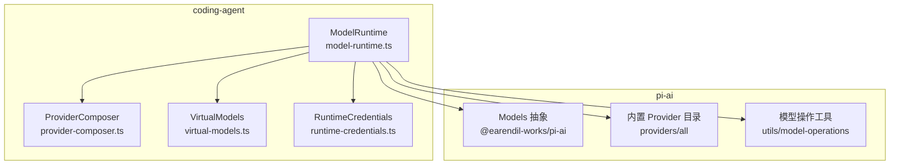
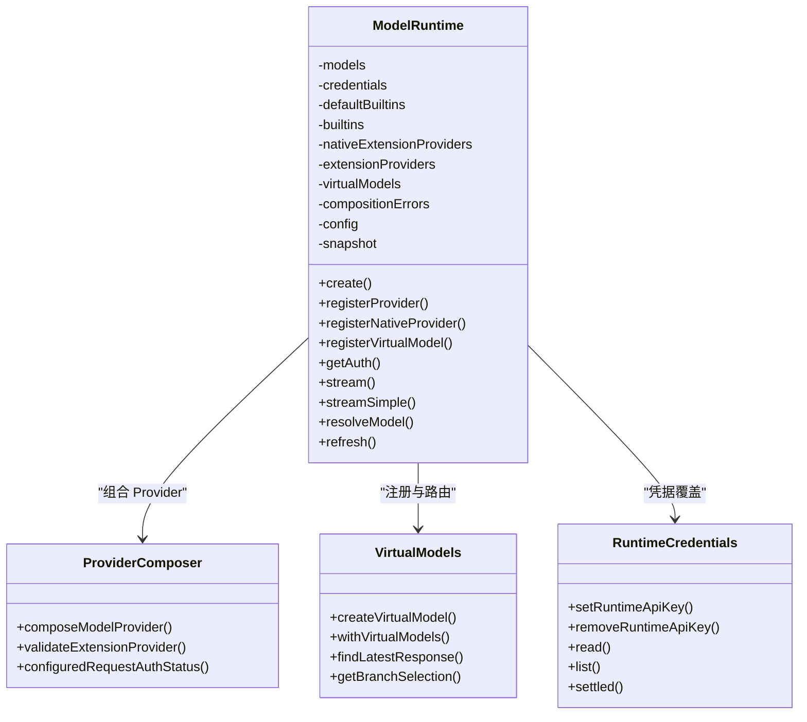
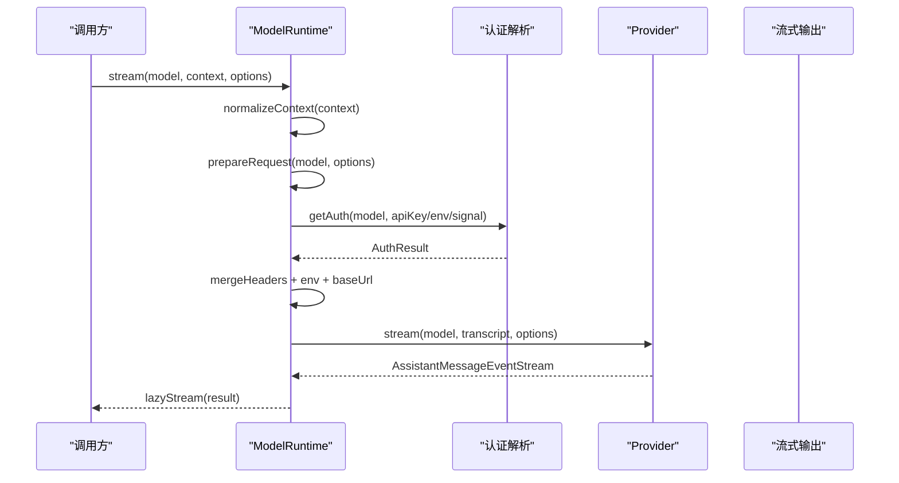
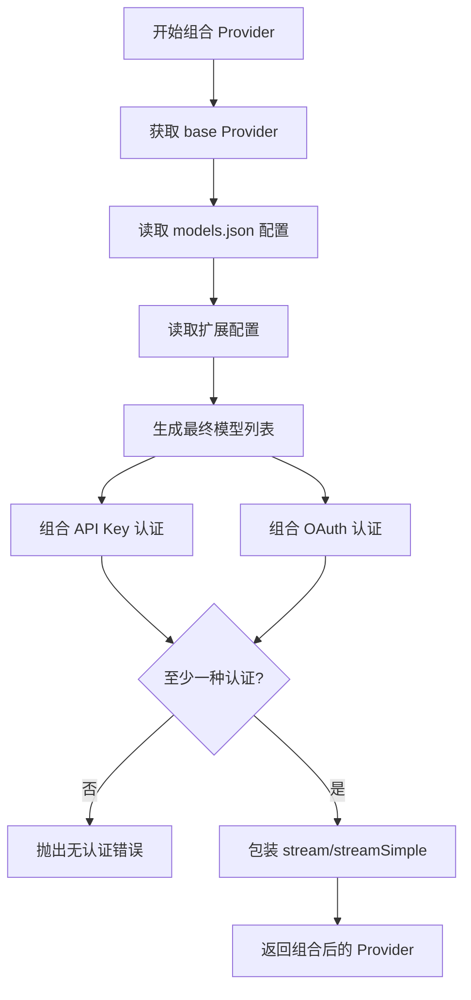
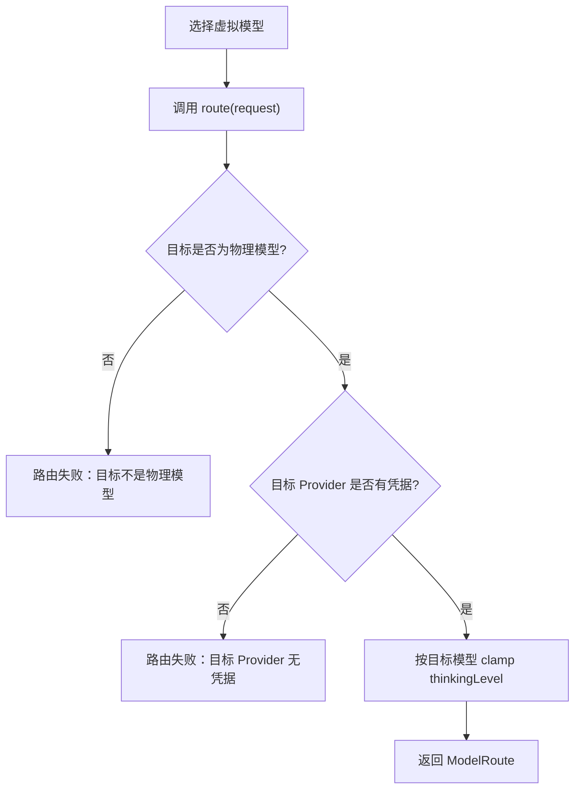
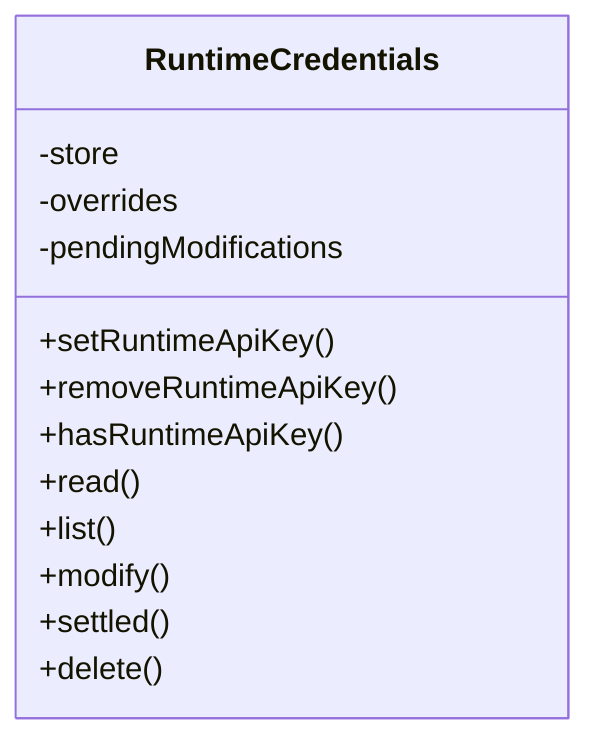
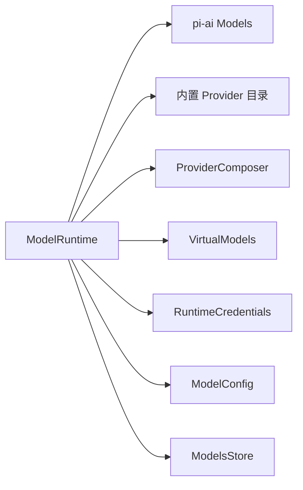
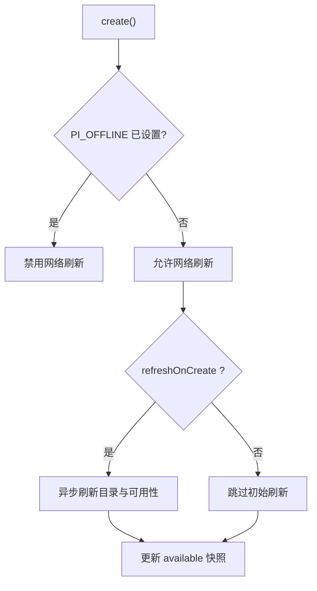
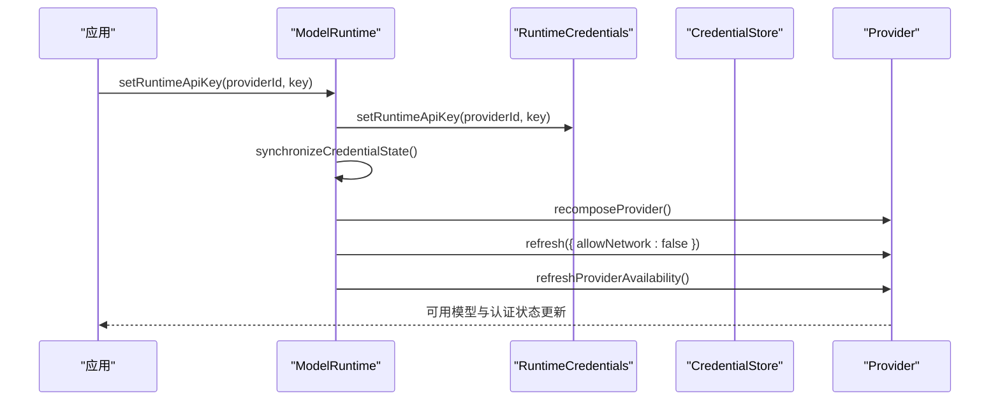
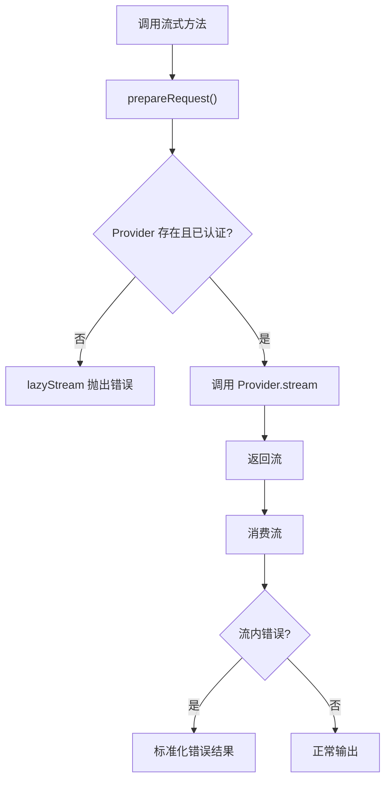

# 模型运行时

<cite>
**本文引用的文件**   
- [model-runtime.ts](file://packages/coding-agent/src/core/model-runtime.ts)
- [provider-composer.ts](file://packages/coding-agent/src/core/provider-composer.ts)
- [virtual-models.ts](file://packages/coding-agent/src/core/virtual-models.ts)
- [runtime-credentials.ts](file://packages/coding-agent/src/core/runtime-credentials.ts)
- [11-model-runtime.md](file://docs/explains/11-model-runtime.md)
</cite>

## 目录
1. [简介](#简介)
2. [项目结构](#项目结构)
3. [核心组件](#核心组件)
4. [架构总览](#架构总览)
5. [详细组件分析](#详细组件分析)
6. [依赖关系分析](#依赖关系分析)
7. [性能与缓存](#性能与缓存)
8. [认证管理](#认证管理)
9. [错误处理与重试](#错误处理与重试)
10. [多提供商集成与配置](#多提供商集成与配置)
11. [扩展与自定义最佳实践](#扩展与自定义最佳实践)
12. [故障排查指南](#故障排查指南)
13. [结论](#结论)

## 简介
本文面向开发者，系统化说明 ModelRuntime 的架构设计与实现细节。重点覆盖：
- 多提供商支持与组合机制
- 模型选择策略与虚拟模型路由
- 请求准备、流式响应与延迟响应
- 认证管理、凭据同步与状态快照
- 缓存策略、错误处理与性能优化
- 不同 AI 提供商的集成方式、配置选项与使用示例
- 扩展与自定义 Provider 的最佳实践

ModelRuntime 是编码代理和 SDK 消费者使用的统一模型运行时入口，它实现了 pi-ai 的 Models 接口，既暴露模型目录查询能力，也承担请求分发、认证合并、流式输出和错误归一化职责。

## 项目结构
围绕模型运行时的核心代码集中在 coding-agent 包的 core 层，并与 ai 包提供的 provider 抽象、模型目录和工具函数协作。

**图表来源**
- [model-runtime.ts:174-269](file://packages/coding-agent/src/core/model-runtime.ts#L174-L269)
- [provider-composer.ts:546-693](file://packages/coding-agent/src/core/provider-composer.ts#L546-L693)
- [virtual-models.ts:169-238](file://packages/coding-agent/src/core/virtual-models.ts#L169-L238)
- [runtime-credentials.ts:4-70](file://packages/coding-agent/src/core/runtime-credentials.ts#L4-L70)

**章节来源**
- [model-runtime.ts:174-269](file://packages/coding-agent/src/core/model-runtime.ts#L174-L269)
- [11-model-runtime.md:12-24](file://docs/explains/11-model-runtime.md#L12-L24)

## 核心组件
- ModelRuntime：统一运行时入口，负责 Provider 组合、模型目录、认证合并、可用性快照、请求准备、流式调用、虚拟模型路由和扩展注册。
- ProviderComposer：将内置 Provider、models.json 配置、扩展配置和 OAuth/API Key 认证组合为最终 Provider。
- VirtualModels：定义虚拟模型、路由协议、会话分支选择和状态持久化。
- RuntimeCredentials：在持久化凭据之上提供进程级 API Key 覆盖，并跟踪未完成的凭据写入。

**章节来源**
- [model-runtime.ts:174-269](file://packages/coding-agent/src/core/model-runtime.ts#L174-L269)
- [provider-composer.ts:92-110](file://packages/coding-agent/src/core/provider-composer.ts#L92-L110)
- [virtual-models.ts:84-102](file://packages/coding-agent/src/core/virtual-models.ts#L84-L102)
- [runtime-credentials.ts:4-24](file://packages/coding-agent/src/core/runtime-credentials.ts#L4-L24)

## 架构总览
ModelRuntime 不是简单转发器，而是“组合层 + 状态层 + 路由层”的统一体：
- 组合层：从内置 Provider、原生扩展 Provider、配置式扩展 Provider、models.json 覆盖、虚拟模型中聚合出最终 Provider。
- 状态层：维护模型快照、可用 Provider 集合、存储的 Provider 集合、认证检查结果、可用性刷新序号和错误信息。
- 路由层：对虚拟模型进行请求路由，把逻辑模型映射到物理模型；对普通模型执行认证合并、Header 合并、环境变量合并后交给底层 Provider。

**图表来源**
- [model-runtime.ts:174-269](file://packages/coding-agent/src/core/model-runtime.ts#L174-L269)
- [model-runtime.ts:928-1079](file://packages/coding-agent/src/core/model-runtime.ts#L928-L1079)
- [provider-composer.ts:546-693](file://packages/coding-agent/src/core/provider-composer.ts#L546-L693)
- [virtual-models.ts:169-238](file://packages/coding-agent/src/core/virtual-models.ts#L169-L238)
- [runtime-credentials.ts:4-70](file://packages/coding-agent/src/core/runtime-credentials.ts#L4-L70)

## 详细组件分析

### ModelRuntime：多提供商支持、模型选择、请求路由与响应处理
ModelRuntime 的核心职责包括：
- 初始化时加载凭据、模型配置、模型目录缓存，并构建内置 Provider。
- 根据 Radius 网关配置替换特定 Provider。
- 对 OpenRouter 等需要个性化目录的 Provider 应用远程目录包装。
- 重建 Provider 列表，更新模型快照。
- 异步刷新可用模型与认证状态，使用序号避免旧结果覆盖新结果。
- 合并认证、Header、环境变量，构造最终 Provider 请求参数。
- 通过 lazyStream 封装流式调用，让认证失败、Provider 不存在等错误在流启动时抛出。
- 对虚拟模型在 streamSimple 中先 resolveModel，再递归调用实际物理模型。

**图表来源**
- [model-runtime.ts:715-734](file://packages/coding-agent/src/core/model-runtime.ts#L174-L269)
- [model-runtime.ts:667-713](file://packages/coding-agent/src/core/model-runtime.ts#L667-L713)
- [model-runtime.ts:715-734](file://packages/coding-agent/src/core/model-runtime.ts#L715-L734)

#### 关键流程要点
- 创建阶段：`create()` 构建 `RuntimeCredentials`、`ModelConfig`、`ModelsStore`，加载内置 Provider，必要时启用网络刷新，并在超时或外部 AbortSignal 下安全退出。
- Provider 组合：`composeProvider()` 优先使用原生扩展 Provider，否则回退到内置 Provider；若存在 models.json 或扩展配置，则调用 `composeModelProvider()` 组合；组合失败记录错误并回退。
- 可用性刷新：`queueAvailabilityRefresh()` 使用全局序号，`refreshProviderAvailability()` 使用 Provider 级别序号，保证并发刷新不会互相覆盖。
- 请求准备：`prepareRequest()` 校验 Provider 是否存在、认证是否已配置，合并 Session Header、认证 Header、调用方 Header，并合并环境变量。
- 流式方法：`stream()`、`streamSimple()`、`streamDeferred()`、`fetchDeferred()`、`cancelDeferred()` 都基于 `lazyStream`，使错误延迟到流消费时抛出。
- 虚拟模型：`streamSimple()` 遇到虚拟模型时调用 `resolveModel()`，按目标物理模型的 `maxTokens` 限制输出预算，并将非同一 Provider 的凭据剥离，防止跨厂商泄露。

**章节来源**
- [model-runtime.ts:218-269](file://packages/coding-agent/src/core/model-runtime.ts#L218-L269)
- [model-runtime.ts:271-332](file://packages/coding-agent/src/core/model-runtime.ts#L271-L332)
- [model-runtime.ts:343-440](file://packages/coding-agent/src/core/model-runtime.ts#L343-L440)
- [model-runtime.ts:486-578](file://packages/coding-agent/src/core/model-runtime.ts#L486-L578)
- [model-runtime.ts:667-713](file://packages/coding-agent/src/core/model-runtime.ts#L667-L713)
- [model-runtime.ts:715-785](file://packages/coding-agent/src/core/model-runtime.ts#L715-L785)
- [model-runtime.ts:807-861](file://packages/coding-agent/src/core/model-runtime.ts#L807-L861)

### ProviderComposer：Provider 叠加、认证合并与模型覆盖
ProviderComposer 负责把以下层次组合成最终 Provider：
- 内置 Provider
- models.json 中的 Provider 配置与模型覆盖
- 扩展注册的 Provider 配置或原生 Provider
- API Key 认证与 OAuth 认证
- 模型级 Header、环境变量、兼容字段、采样参数、上下文窗口、最大 Token 等

**图表来源**
- [provider-composer.ts:546-693](file://packages/coding-agent/src/core/provider-composer.ts#L546-L693)

#### 关键规则
- 模型覆盖优先级：extensions.models > models.json.models > base models；chat 模型额外支持 modelOverrides。
- Header 合并顺序：base headers → config headers → extension headers → 模型级 headers。
- authHeader：当配置为 true 时，会把最终 apiKey 注入 Authorization Bearer Header。
- OAuth 适配：扩展 OAuth 被适配为标准 OAuthAuth，login/refresh/toAuth 回调与认证交互桥接。
- 动态模型刷新：如果扩展或 base 支持 refreshModels，会在刷新时发布新模型列表，并应用 OAuth 的 modifyModels。

**章节来源**
- [provider-composer.ts:120-210](file://packages/coding-agent/src/core/provider-composer.ts#L120-L210)
- [provider-composer.ts:302-356](file://packages/coding-agent/src/core/provider-composer.ts#L302-L356)
- [provider-composer.ts:358-511](file://packages/coding-agent/src/core/provider-composer.ts#L358-L511)
- [provider-composer.ts:546-693](file://packages/coding-agent/src/core/provider-composer.ts#L546-L693)

### VirtualModels：虚拟模型定义、路由协议与状态持久化
虚拟模型不是真实 Provider 调用端点，而是“选择层语法糖”。它允许上层以逻辑模型名选择物理模型，同时保持消息记录、会话恢复和重试语义清晰。

**图表来源**
- [virtual-models.ts:84-102](file://packages/coding-agent/src/core/virtual-models.ts#L84-L102)
- [virtual-models.ts:169-187](file://packages/coding-agent/src/core/virtual-models.ts#L169-L187)
- [virtual-models.ts:201-238](file://packages/coding-agent/src/core/virtual-models.ts#L201-L238)
- [model-runtime.ts:1040-1071](file://packages/coding-agent/src/core/model-runtime.ts#L1040-L1071)

#### 路由输入与输出
- 路由输入包含：当前虚拟模型、thinkingLevel、reason、最近一次成功响应的物理模型、失败的请求、上次保存的路由状态、完整对话消息。
- reason 区分用户消息后首次请求、工具结果后继续请求、自动重试、以及 agent loop 之外的直接请求。
- 路由输出必须指向已注册物理模型，且该 Provider 有凭据；thinkingLevel 会被 clamp 到目标模型支持范围。
- 路由 state 会持久化为 session 的 custom entry，下次同 Provider/Model 路由可恢复。

**章节来源**
- [virtual-models.ts:43-70](file://packages/coding-agent/src/core/virtual-models.ts#L43-L70)
- [virtual-models.ts:109-167](file://packages/coding-agent/src/core/virtual-models.ts#L109-L167)
- [model-runtime.ts:1040-1071](file://packages/coding-agent/src/core/model-runtime.ts#L1040-L1071)

### RuntimeCredentials：进程级凭据覆盖与写入等待
RuntimeCredentials 在持久化 CredentialStore 之上增加一层内存覆盖，用于：
- 临时设置或移除某个 Provider 的 API Key，不写磁盘。
- 合并 list 结果，让运行时 API Key 出现在凭据列表中。
- 跟踪 pending 修改，确保进程退出前完成 OAuth refresh token 写入。

**图表来源**
- [runtime-credentials.ts:4-70](file://packages/coding-agent/src/core/runtime-credentials.ts#L4-L70)

**章节来源**
- [runtime-credentials.ts:4-70](file://packages/coding-agent/src/core/runtime-credentials.ts#L4-L70)

## 依赖关系分析
ModelRuntime 依赖多个子系统，耦合点明确：
- 依赖 pi-ai 的 Models 抽象，作为 Provider 注册表与模型目录的统一入口。
- 依赖内置 Provider 目录，提供默认 Provider 实现。
- 依赖 provider-composer 完成 Provider 叠加与认证组合。
- 依赖 virtual-models 完成虚拟模型注册与路由。
- 依赖 runtime-credentials 完成凭据覆盖与写入等待。
- 依赖 model-config 与 models-store 完成配置加载与目录缓存。

**图表来源**
- [model-runtime.ts:174-269](file://packages/coding-agent/src/core/model-runtime.ts#L174-L269)
- [provider-composer.ts:546-693](file://packages/coding-agent/src/core/provider-composer.ts#L546-L693)
- [virtual-models.ts:169-238](file://packages/coding-agent/src/core/virtual-models.ts#L169-L238)
- [runtime-credentials.ts:4-70](file://packages/coding-agent/src/core/runtime-credentials.ts#L4-L70)

**章节来源**
- [model-runtime.ts:174-269](file://packages/coding-agent/src/core/model-runtime.ts#L174-L269)

## 性能与缓存
ModelRuntime 的性能设计体现在以下几个方面：
- 模型目录缓存：通过 ModelsStore 避免每次启动都拉取远端目录；可选文件缓存或内存缓存。
- 可用性快照：available 不是全量模型，而是“当前有认证的 Provider 的模型”，减少 UI 和选择逻辑的开销。
- 异步刷新与序号保护：availabilityRefreshSeq、providerAvailabilitySeq、availabilityErrorSeq 防止并发刷新导致旧数据覆盖。
- lazyStream：认证失败、Provider 不存在等错误延迟到流消费时抛出，避免同步阻塞和异常传播。
- 按需刷新：refreshOnCreate 可关闭初始网络刷新；refresh() 支持只刷新指定 Provider。
- 网络开关：PI_OFFLINE 环境变量控制是否允许网络刷新；allowModelNetwork 控制 create 时是否允许刷新。

**图表来源**
- [model-runtime.ts:218-269](file://packages/coding-agent/src/core/model-runtime.ts#L218-L269)
- [model-runtime.ts:343-440](file://packages/coding-agent/src/core/model-runtime.ts#L343-L440)
- [model-runtime.ts:885-926](file://packages/coding-agent/src/core/model-runtime.ts#L885-L926)

**章节来源**
- [model-runtime.ts:218-269](file://packages/coding-agent/src/core/model-runtime.ts#L218-L269)
- [model-runtime.ts:343-440](file://packages/coding-agent/src/core/model-runtime.ts#L343-L440)
- [model-runtime.ts:885-926](file://packages/coding-agent/src/core/model-runtime.ts#L885-L926)

## 认证管理
认证管理分为三层：
- 持久化凭据：auth.json，支持 API Key 与 OAuth，带锁与读缓存。
- 运行时覆盖：RuntimeCredentials 提供进程级 API Key 覆盖，不写磁盘。
- 配置层认证：models.json 或扩展配置可声明 apiKey、oauth、authHeader、headers、baseUrl 等。

**图表来源**
- [model-runtime.ts:622-641](file://packages/coding-agent/src/core/model-runtime.ts#L622-L641)
- [model-runtime.ts:600-619](file://packages/coding-agent/src/core/model-runtime.ts#L600-L619)
- [runtime-credentials.ts:14-24](file://packages/coding-agent/src/core/runtime-credentials.ts#L14-L24)

#### 认证检查与状态
- hasConfiguredAuth：判断 Provider 是否在 snapshot.configuredProviders 中。
- isUsingOAuth / isUsingSubscription：判断 OAuth 与订阅类型。
- getProviderAuthStatus：综合 runtime apiKey、stored providers、models.json/扩展配置、环境认证源。
- getAuth：在 models.getAuth 基础上合并模型级 headers 与 env。

**章节来源**
- [model-runtime.ts:544-578](file://packages/coding-agent/src/core/model-runtime.ts#L544-L578)
- [model-runtime.ts:651-665](file://packages/coding-agent/src/core/model-runtime.ts#L651-L665)
- [provider-composer.ts:422-511](file://packages/coding-agent/src/core/provider-composer.ts#L422-L511)

## 错误处理与重试
ModelRuntime 的错误处理遵循“尽量进流”的原则：
- 流式方法使用 lazyStream，认证失败、Provider 不存在、不支持的功能等错误在流启动时抛出。
- generateImages 与 classify 捕获异常并返回标准化错误结果。
- 可用性刷新失败会记录 availabilityError，但不会破坏已可用的模型。
- 凭据变更同步失败会抛出 CredentialSynchronizationError，携带 provider、operation、credential，便于上层诊断。
- 虚拟模型路由失败会抛出明确错误，指出目标不是物理模型或缺少凭据。

**图表来源**
- [model-runtime.ts:715-734](file://packages/coding-agent/src/core/model-runtime.ts#L715-L734)
- [model-runtime.ts:828-861](file://packages/coding-agent/src/core/model-runtime.ts#L828-L861)
- [model-runtime.ts:1040-1071](file://packages/coding-agent/src/core/model-runtime.ts#L1040-L1071)

**章节来源**
- [model-runtime.ts:667-713](file://packages/coding-agent/src/core/model-runtime.ts#L667-L713)
- [model-runtime.ts:828-861](file://packages/coding-agent/src/core/model-runtime.ts#L828-L861)
- [model-runtime.ts:1040-1071](file://packages/coding-agent/src/core/model-runtime.ts#L1040-L1071)

## 多提供商集成与配置
ModelRuntime 支持多种 Provider 来源与配置方式：

### Provider 来源
- 内置 Provider：来自 @earendil-works/pi-ai/providers/all。
- 原生扩展 Provider：通过 registerNativeProvider 注册。
- 配置式扩展 Provider：通过 registerProvider 注册 ProviderConfigInput。
- models.json 覆盖：通过 ModelConfig 加载 models.json，覆盖 baseUrl、headers、compat、modelOverrides、models。
- 虚拟模型：通过 registerVirtualModel 注册逻辑模型，不直接调用 Provider。

### 配置选项
- baseUrl：覆盖 Provider 或模型的基础地址。
- headers：Provider 级或模型级 Header。
- authHeader：是否将 apiKey 注入 Authorization Bearer。
- apiKey：API Key 配置，支持命令配置值与环境变量。
- oauth：OAuth 登录、刷新、toAuth 钩子。
- models：自定义模型定义，支持 chat/image/classifier。
- refreshModels：动态刷新模型列表。
- modifyModels：OAuth 登录后修改模型列表。

### 使用示例
- 注册扩展 Provider：传入 providerId 与 ProviderConfigInput，包含 name、baseUrl、apiKey、api、models、oauth 等。
- 注册原生 Provider：传入 Provider 实例，保留其原生 auth/login/stream 行为。
- 注册虚拟模型：传入 VirtualModelDefinition，实现 route 函数，返回物理模型与 thinkingLevel。
- 设置运行时 API Key：setRuntimeApiKey 仅影响当前进程，适合临时切换或测试。
- 刷新模型目录：refresh({ allowNetwork: true/false, providers: [...] })。

**章节来源**
- [model-runtime.ts:218-269](file://packages/coding-agent/src/core/model-runtime.ts#L218-L269)
- [model-runtime.ts:928-1029](file://packages/coding-agent/src/core/model-runtime.ts#L928-L1029)
- [provider-composer.ts:92-110](file://packages/coding-agent/src/core/provider-composer.ts#L92-L110)
- [provider-composer.ts:302-356](file://packages/coding-agent/src/core/provider-composer.ts#L302-L356)

## 扩展与自定义最佳实践
### 扩展 Provider
- 优先使用 registerProvider 注册配置式 Provider，便于热更新与验证。
- 如果需要完全自定义流式行为，可在 ProviderConfigInput 中提供 streamSimple，并确保 api 字段匹配。
- 使用 refreshModels 动态拉取模型列表，并通过 publish 更新 UI。
- 使用 modifyModels 在 OAuth 登录后调整模型可见性或能力。

### 自定义虚拟模型
- 路由函数应返回已注册物理模型，并确保目标 Provider 有凭据。
- 利用 previous 与 failed 信息实现智能降级或重试策略。
- 使用 state 保存路由偏好，如最近成功模型、thinkingLevel 历史等。
- 避免在 direct 请求中使用 state，因为 direct 请求通常不需要持久化路由状态。

### 认证与 Header
- 使用 models.json 或扩展配置集中管理 baseUrl、headers、authHeader。
- 避免在业务代码中硬编码 apiKey，优先使用 RuntimeCredentials 或配置层。
- 注意 Header 合并顺序，确保系统 Header、认证 Header、调用方 Header 不冲突。

### 性能与可靠性
- 合理使用 refreshOnCreate 与 allowModelNetwork，避免启动时不必要的网络请求。
- 使用 settleCredentialWrites 在进程退出前等待凭据写入完成。
- 使用 signal 取消长时间运行的刷新或流式请求。
- 对虚拟模型路由失败、Provider 不支持功能等情况，提供明确错误提示。

**章节来源**
- [model-runtime.ts:928-1029](file://packages/coding-agent/src/core/model-runtime.ts#L928-L1029)
- [provider-composer.ts:546-693](file://packages/coding-agent/src/core/provider-composer.ts#L546-L693)
- [virtual-models.ts:84-102](file://packages/coding-agent/src/core/virtual-models.ts#L84-L102)
- [runtime-credentials.ts:56-63](file://packages/coding-agent/src/core/runtime-credentials.ts#L56-L63)

## 故障排查指南
常见问题与定位方式：
- Provider 未配置：getAuth 返回 undefined，prepareRequest 抛出“Provider is not configured”。
- Provider 不存在：prepareRequest 抛出“Unknown provider”。
- 虚拟模型未路由：stream 直接调用虚拟模型会抛出“must be routed before streaming”。
- 路由目标无效：resolveModel 抛出“routed to ... which is not a physical model”或“which has no credentials”。
- 凭据同步失败：CredentialSynchronizationError，检查 provider、operation、credential。
- 可用性刷新失败：getError 返回 availability refresh 错误，但不影响已可用模型。
- Header 冲突：检查 mergeHeaders 合并顺序，确认系统 Header、认证 Header、调用方 Header 不重复。

建议排查步骤：
1. 调用 getError 获取配置错误、组合错误、可用性刷新错误。
2. 调用 getProviderAuthStatus 判断认证来源。
3. 调用 getAvailableSnapshot 查看当前可用模型。
4. 检查 registerProvider/registerNativeProvider/registerVirtualModel 是否成功。
5. 检查 models.json 与扩展配置是否合法。
6. 使用 settleCredentialWrites 确保退出前凭据写入完成。

**章节来源**
- [model-runtime.ts:512-521](file://packages/coding-agent/src/core/model-runtime.ts#L512-L521)
- [model-runtime.ts:667-713](file://packages/coding-agent/src/core/model-runtime.ts#L667-L713)
- [model-runtime.ts:600-619](file://packages/coding-agent/src/core/model-runtime.ts#L600-L619)
- [virtual-models.ts:189-194](file://packages/coding-agent/src/core/virtual-models.ts#L189-L194)

## 结论
ModelRuntime 是一个高度组合化、状态化、可扩展的模型运行时。它通过 ProviderComposer 统一多提供商实现，通过 VirtualModels 提供灵活的选择层，通过 RuntimeCredentials 提供安全的凭据管理，并通过 lazyStream 与序号机制保证错误处理与并发安全。对于开发者而言，最佳实践是：
- 使用 registerProvider 或 registerNativeProvider 扩展 Provider。
- 使用 VirtualModelDefinition 抽象业务选择逻辑。
- 使用 models.json 与扩展配置集中管理认证与模型元数据。
- 合理使用 refresh、signal、settleCredentialWrites 提升性能与可靠性。
- 通过 getError、getProviderAuthStatus、getAvailableSnapshot 快速定位问题。