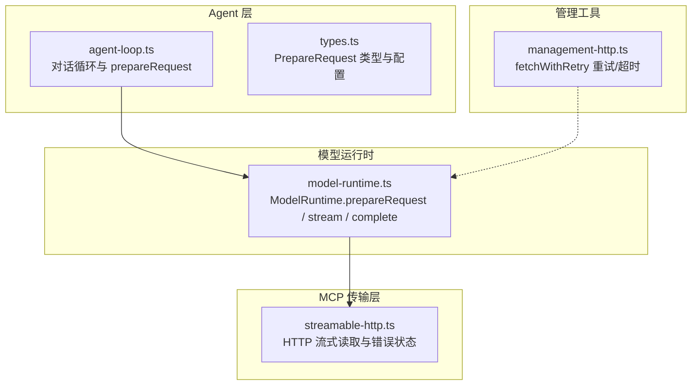
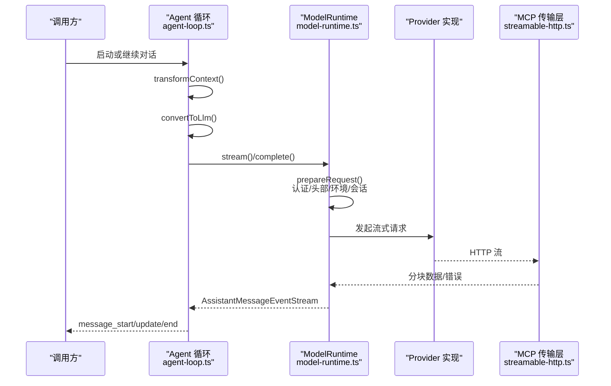
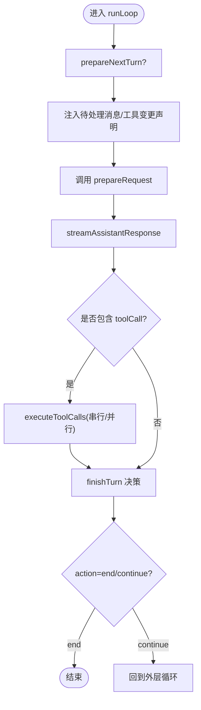
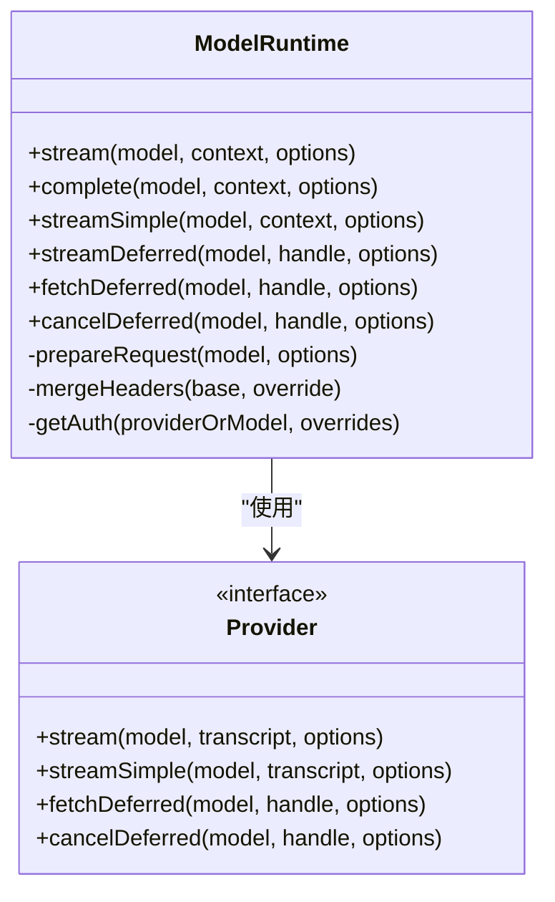
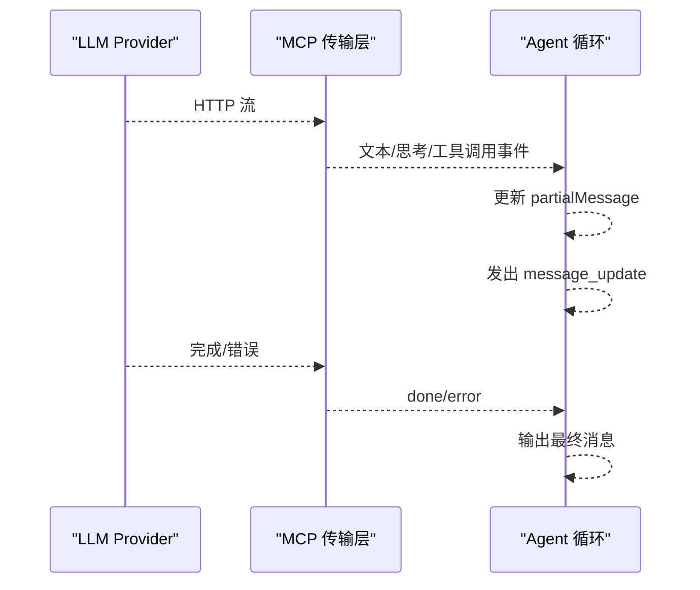
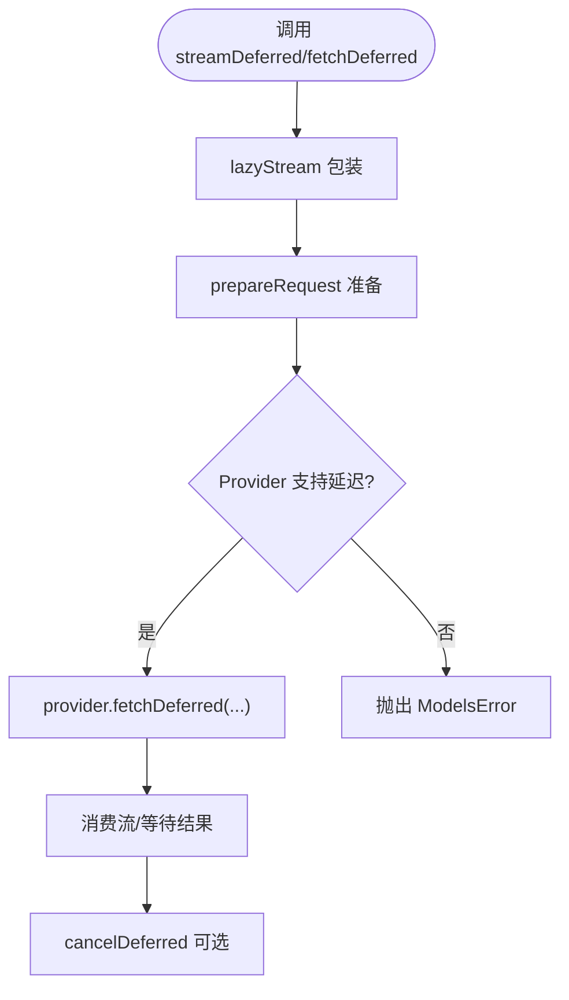
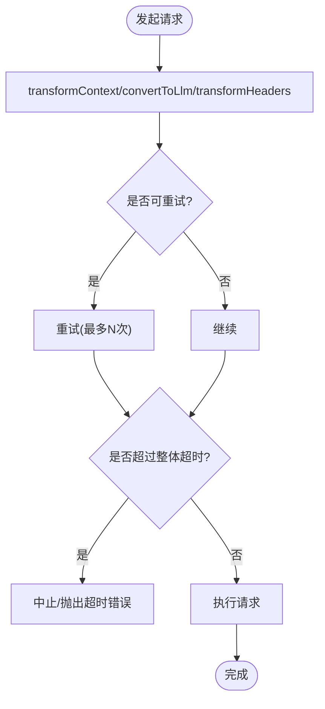
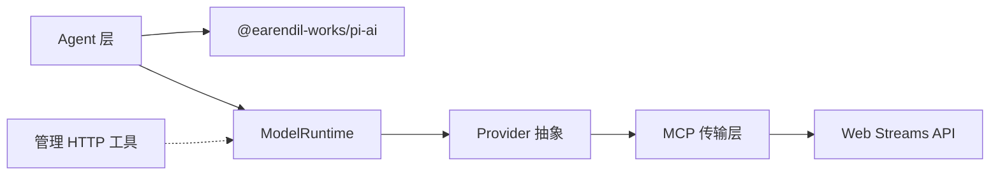

# 请求处理管道

<cite>
**本文引用的文件**   
- [agent-loop.ts](file://packages/agent/src/agent-loop.ts)
- [types.ts](file://packages/agent/src/types.ts)
- [model-runtime.ts](file://packages/coding-agent/src/core/model-runtime.ts)
- [streamable-http.ts](file://packages/mcp/src/transports/streamable-http.ts)
- [management-http.ts](file://packages/coding-agent/src/utils/management-http.ts)
</cite>

## 目录
1. [引言](#引言)
2. [项目结构](#项目结构)
3. [核心组件](#核心组件)
4. [架构总览](#架构总览)
5. [详细组件分析](#详细组件分析)
6. [依赖关系分析](#依赖关系分析)
7. [性能与可观测性](#性能与可观测性)
8. [故障排查指南](#故障排查指南)
9. [结论](#结论)

## 引言
本文面向开发者，系统化梳理“请求处理管道”的实现：从 Agent 层的 `prepareRequest` 钩子、上下文转换与 LLM 消息适配，到 ModelRuntime 的认证合并、头部注入、环境变量融合与会话头生成；并覆盖流式响应生命周期、延迟请求、异步操作取消、错误重试与超时控制。文末提供定制请求与性能监控的最佳实践。

## 项目结构
本仓库采用多包架构，与请求处理管道直接相关的代码主要分布在以下位置：
- Agent 层：负责对话循环、工具调用编排、以及每次 LLM 请求前的 `prepareRequest` 钩子执行。
- ModelRuntime：封装模型路由、认证解析、请求准备（认证、头部、环境变量、会话）、以及流式/延迟接口。
- MCP 传输层：实现 HTTP 流式读取、错误状态判断与可重试状态识别。
- 管理 HTTP 工具：提供带重试、整体超时与单次尝试超时的通用 fetch 包装。

**图表来源**
- [agent-loop.ts:228-251](file://packages/agent/src/agent-loop.ts#L228-L251)
- [types.ts:172-189](file://packages/agent/src/types.ts#L172-L189)
- [model-runtime.ts:667-713](file://packages/coding-agent/src/core/model-runtime.ts#L667-L713)
- [streamable-http.ts:188-202](file://packages/mcp/src/transports/streamable-http.ts#L188-L202)
- [management-http.ts:1-41](file://packages/coding-agent/src/utils/management-http.ts#L1-L41)

**章节来源**
- [agent-loop.ts:1-135](file://packages/agent/src/agent-loop.ts#L1-L135)
- [types.ts:172-342](file://packages/agent/src/types.ts#L172-L342)
- [model-runtime.ts:667-805](file://packages/coding-agent/src/core/model-runtime.ts#L667-L805)
- [streamable-http.ts:188-239](file://packages/mcp/src/transports/streamable-http.ts#L188-L239)
- [management-http.ts:1-41](file://packages/coding-agent/src/utils/management-http.ts#L1-L41)

## 核心组件
- Agent 层 `prepareRequest`
  - 在每次 LLM 请求前被调用，允许替换当前上下文、模型与推理级别。
  - 不轮询队列，仅做请求级上下文调整。
- ModelRuntime `prepareRequest`
  - 解析 Provider、认证信息、动态 baseUrl、会话头、环境变量与自定义头部。
  - 支持 `transformHeaders` 回调进行最终头部定制。
- 流式响应处理
  - Agent 层将 LLM 事件映射为内部消息更新事件。
  - MCP 层对 HTTP 流进行分块解码与长度限制。
- 延迟请求与异步生命周期
  - ModelRuntime 暴露 `streamDeferred`/`fetchDeferred`/`cancelDeferred`。
  - 所有流均通过 `lazyStream` 与 `AbortSignal` 管理取消。
- 错误重试与超时
  - MCP 层识别可重试状态码。
  - 管理 HTTP 工具提供统一的重试策略与双重超时（整体 + 单次）。

**章节来源**
- [types.ts:172-189](file://packages/agent/src/types.ts#L172-L189)
- [agent-loop.ts:228-251](file://packages/agent/src/agent-loop.ts#L228-L251)
- [model-runtime.ts:667-713](file://packages/coding-agent/src/core/model-runtime.ts#L667-L713)
- [streamable-http.ts:188-239](file://packages/mcp/src/transports/streamable-http.ts#L188-L239)
- [management-http.ts:1-41](file://packages/coding-agent/src/utils/management-http.ts#L1-L41)

## 架构总览
下图展示一次典型对话请求从 Agent 到 Provider 的完整路径，包括上下文转换、认证合并、头部与环境变量注入、流式事件分发与工具调用编排。

**图表来源**
- [agent-loop.ts:390-479](file://packages/agent/src/agent-loop.ts#L390-L479)
- [model-runtime.ts:715-780](file://packages/coding-agent/src/core/model-runtime.ts#L715-L780)
- [streamable-http.ts:204-233](file://packages/mcp/src/transports/streamable-http.ts#L204-L233)

## 详细组件分析

### Agent 层：prepareRequest 与对话循环
- 触发时机
  - 在每轮助手回复之前，先执行 `prepareRequest`，再调用底层流式函数。
- 可替换项
  - 上下文、模型、推理级别（thinkingLevel）。
- 与工具调用的关系
  - 工具调用发生在助手消息之后，由 `executeToolCalls` 串行或并行执行。
- 流式响应处理
  - 将 LLM 事件转换为 `message_start/update/end`，并在上下文中维护部分消息对象。

**图表来源**
- [agent-loop.ts:172-330](file://packages/agent/src/agent-loop.ts#L172-L330)
- [agent-loop.ts:390-479](file://packages/agent/src/agent-loop.ts#L390-L479)

**章节来源**
- [agent-loop.ts:172-330](file://packages/agent/src/agent-loop.ts#L172-L330)
- [agent-loop.ts:390-479](file://packages/agent/src/agent-loop.ts#L390-L479)
- [types.ts:172-189](file://packages/agent/src/types.ts#L172-L189)

### ModelRuntime：prepareRequest 实现细节
- 认证信息合并
  - 通过 `getAuth` 获取 provider 认证结果，若未配置则抛出错误。
  - 支持传入 `apiKey` 与 `env` 覆盖。
- 头部处理
  - 合并顺序：OpenCode 会话头 → 认证 headers → 调用方 headers。
  - 支持 `transformHeaders` 回调进行最终定制。
- 环境变量注入
  - 合并认证 env 与调用方 env，形成最终 `env`。
- 会话管理
  - 根据 `sessionId` 生成 OpenCode 会话头，并注入到请求中。
- 模型 baseUrl 覆盖
  - 若认证返回 `baseUrl`，则覆盖模型地址。

**图表来源**
- [model-runtime.ts:667-713](file://packages/coding-agent/src/core/model-runtime.ts#L667-L713)
- [model-runtime.ts:715-805](file://packages/coding-agent/src/core/model-runtime.ts#L715-L805)

**章节来源**
- [model-runtime.ts:667-713](file://packages/coding-agent/src/core/model-runtime.ts#L667-L713)
- [model-runtime.ts:715-805](file://packages/coding-agent/src/core/model-runtime.ts#L715-L805)

### 流式响应处理与生命周期
- Agent 层
  - 将 LLM 事件映射为内部消息事件，维护部分消息对象并在结束时产出最终消息。
  - 支持 thinking/text/toolcall 等事件类型的增量更新。
- MCP 层
  - 对 HTTP 响应体进行分块解码，支持最大字节数截断。
  - 识别可重试状态码（如 408、429、5xx），用于上层重试策略。

**图表来源**
- [agent-loop.ts:424-479](file://packages/agent/src/agent-loop.ts#L424-L479)
- [streamable-http.ts:204-233](file://packages/mcp/src/transports/streamable-http.ts#L204-L233)

**章节来源**
- [agent-loop.ts:424-479](file://packages/agent/src/agent-loop.ts#L424-L479)
- [streamable-http.ts:204-233](file://packages/mcp/src/transports/streamable-http.ts#L204-L233)

### 延迟请求与异步操作的生命周期管理
- 延迟请求
  - `streamDeferred`/`fetchDeferred` 通过 `lazyStream` 延迟实际网络请求，直到消费流时触发。
  - `cancelDeferred` 支持取消已提交的延迟请求。
- 取消信号
  - 所有流均接受 `signal`，并通过 `operationSignal`/`raceWithAbortSignal` 组合外部取消。
- 虚拟模型路由
  - `streamSimple` 对虚拟模型进行路由，必要时裁剪 `maxTokens` 与推理级别。

**图表来源**
- [model-runtime.ts:787-826](file://packages/coding-agent/src/core/model-runtime.ts#L787-L826)

**章节来源**
- [model-runtime.ts:787-826](file://packages/coding-agent/src/core/model-runtime.ts#L787-L826)

### 请求转换、错误重试与超时控制
- 请求转换
  - Agent 层：`transformContext` 与 `convertToLlm` 分别负责 AgentMessage 级预处理与 LLM 兼容转换。
  - ModelRuntime：`transformHeaders` 允许在认证与会话头合并后进一步定制头部。
- 错误重试
  - MCP 层：识别 408、429、5xx 为可重试状态。
  - 管理 HTTP：`fetchWithRetry` 提供重试次数、状态码重试开关、整体超时与单次尝试超时。
- 超时控制
  - 双重超时：整体预算与单次尝试预算，避免挂起连接。
  - 取消信号：与外部 `AbortSignal` 组合，确保调用方可中断。

**图表来源**
- [management-http.ts:1-41](file://packages/coding-agent/src/utils/management-http.ts#L1-L41)
- [streamable-http.ts:188-202](file://packages/mcp/src/transports/streamable-http.ts#L188-L202)
- [agent-loop.ts:390-479](file://packages/agent/src/agent-loop.ts#L390-L479)
- [model-runtime.ts:667-713](file://packages/coding-agent/src/core/model-runtime.ts#L667-L713)

**章节来源**
- [management-http.ts:1-41](file://packages/coding-agent/src/utils/management-http.ts#L1-L41)
- [streamable-http.ts:188-202](file://packages/mcp/src/transports/streamable-http.ts#L188-L202)
- [agent-loop.ts:390-479](file://packages/agent/src/agent-loop.ts#L390-L479)
- [model-runtime.ts:667-713](file://packages/coding-agent/src/core/model-runtime.ts#L667-L713)

## 依赖关系分析
- Agent 层依赖 pi-ai 的事件流与工具声明能力，并通过 `streamFunction` 接入具体 Provider。
- ModelRuntime 依赖 Provider 抽象，封装认证、头部与环境变量，并提供统一的流式/延迟接口。
- MCP 传输层依赖标准 Web Streams API，提供 HTTP 流的分块读取与错误状态判断。
- 管理 HTTP 工具独立于业务逻辑，提供通用的重试与超时能力。

**图表来源**
- [agent-loop.ts:6-21](file://packages/agent/src/agent-loop.ts#L6-L21)
- [model-runtime.ts:1-59](file://packages/coding-agent/src/core/model-runtime.ts#L1-L59)
- [streamable-http.ts:188-239](file://packages/mcp/src/transports/streamable-http.ts#L188-L239)

**章节来源**
- [agent-loop.ts:6-21](file://packages/agent/src/agent-loop.ts#L6-L21)
- [model-runtime.ts:1-59](file://packages/coding-agent/src/core/model-runtime.ts#L1-L59)
- [streamable-http.ts:188-239](file://packages/mcp/src/transports/streamable-http.ts#L188-L239)

## 性能与可观测性
- 上下文窗口优化
  - 使用 `transformContext` 进行旧消息修剪或外部上下文注入，减少无效 token 消耗。
- 动态密钥刷新
  - 通过 `getApiKey` 在长任务中刷新短期 OAuth 令牌，避免过期导致的失败。
- 流式可观测性
  - 监听 `message_start/update/end` 与 `tool_execution_start/update/end` 事件，构建实时 UI 与指标采集。
- 资源释放
  - 及时取消流与延迟请求，避免内存泄漏与悬挂连接。
- 并发工具调用
  - 合理选择串行/并行模式，平衡吞吐与资源占用。

[本节为通用指导，不直接分析具体文件]

## 故障排查指南
- 认证未配置
  - 现象：请求前抛出“Provider is not configured”。
  - 排查：检查 `getAuth` 返回值与 Provider 配置。
- 头部冲突
  - 现象：重复键值覆盖异常。
  - 排查：确认 `mergeHeaders` 合并顺序与 `transformHeaders` 行为。
- 流式响应过长
  - 现象：响应体过大导致内存压力。
  - 排查：使用 MCP 层的最大字节截断逻辑，或在应用层限制消费。
- 重试与超时
  - 现象：请求卡住或频繁重试。
  - 排查：检查 `fetchWithRetry` 的重试次数、状态码白名单与双重超时设置。
- 延迟请求取消
  - 现象：取消后仍产生副作用。
  - 排查：确保调用 `cancelDeferred` 并正确传递 `signal`。

**章节来源**
- [model-runtime.ts:667-713](file://packages/coding-agent/src/core/model-runtime.ts#L667-L713)
- [streamable-http.ts:204-233](file://packages/mcp/src/transports/streamable-http.ts#L204-L233)
- [management-http.ts:1-41](file://packages/coding-agent/src/utils/management-http.ts#L1-L41)

## 结论
该请求处理管道以 Agent 层的 `prepareRequest` 为入口，结合 ModelRuntime 的认证、头部与环境变量合并，实现了灵活且可控的请求准备流程。流式响应与延迟请求通过统一的事件流与取消信号管理，保障了生命周期安全。配合 MCP 层的可重试状态识别与管理 HTTP 工具的双重超时策略，系统在稳定性与性能之间取得良好平衡。开发者可通过上下文转换、动态密钥刷新与事件观测，进一步优化体验与成本。

[本节为总结性内容，不直接分析具体文件]