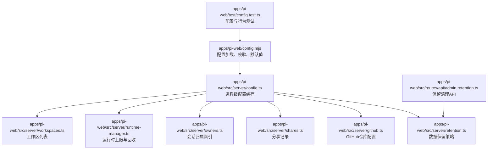
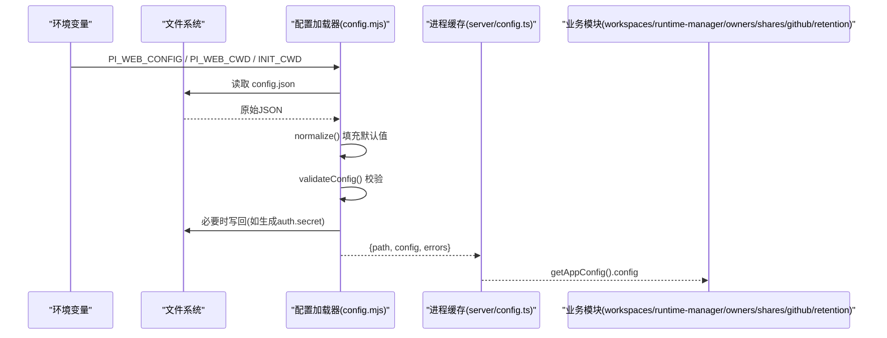
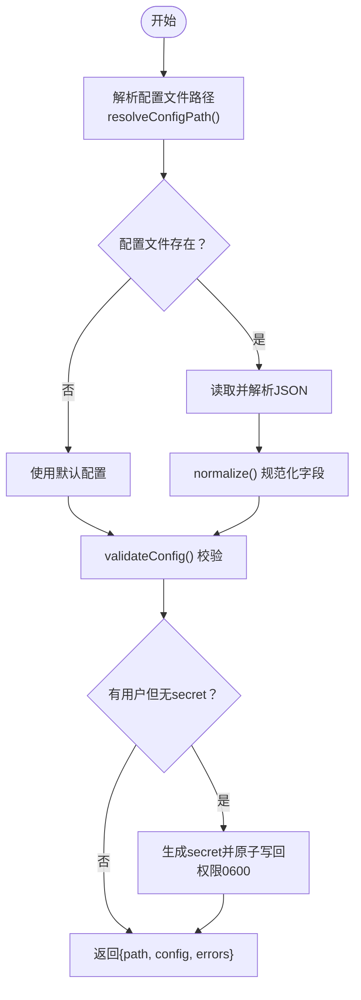
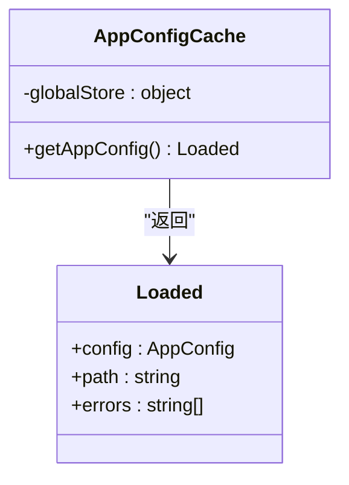
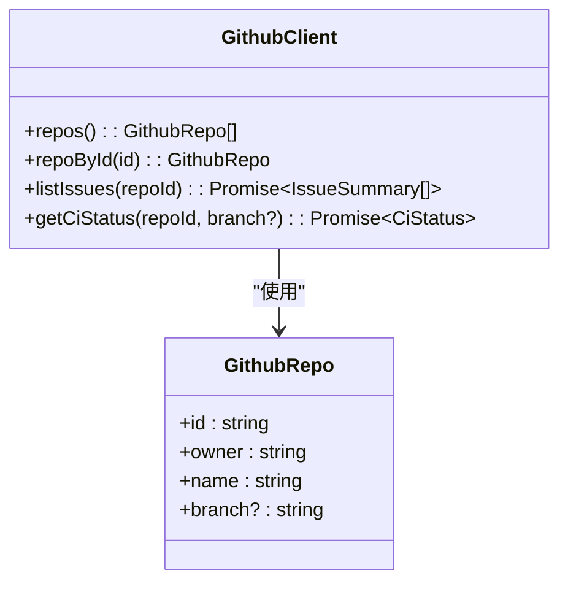
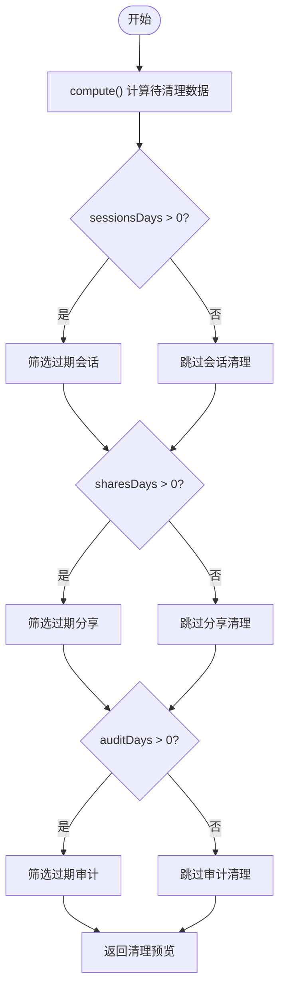
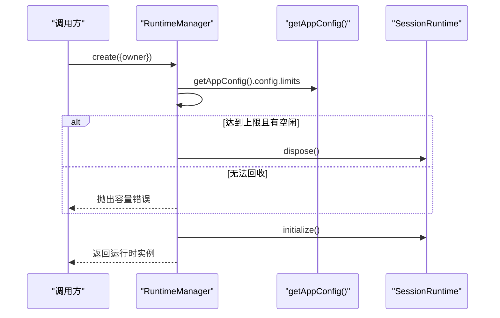
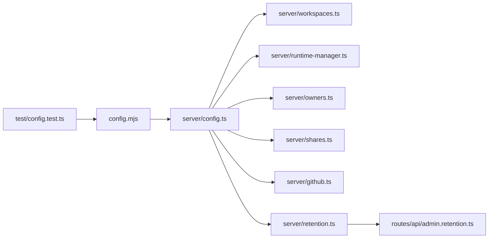

# 配置管理

<cite>
**本文引用的文件**   
- [apps/pi-web/config.mjs](file://apps/pi-web/config.mjs)
- [apps/pi-web/config.d.mts](file://apps/pi-web/config.d.mts)
- [apps/pi-web/src/server/config.ts](file://apps/pi-web/src/server/config.ts)
- [apps/pi-web/test/config.test.ts](file://apps/pi-web/test/config.test.ts)
- [apps/pi-web/src/server/workspaces.ts](file://apps/pi-web/src/server/workspaces.ts)
- [apps/pi-web/src/server/runtime-manager.ts](file://apps/pi-web/src/server/runtime-manager.ts)
- [apps/pi-web/src/server/owners.ts](file://apps/pi-web/src/server/owners.ts)
- [apps/pi-web/src/server/shares.ts](file://apps/pi-web/src/server/shares.ts)
- [apps/pi-web/src/server/github.ts](file://apps/pi-web/src/server/github.ts)
- [apps/pi-web/src/server/retention.ts](file://apps/pi-web/src/server/retention.ts)
- [apps/pi-web/src/routes/api/admin.retention.ts](file://apps/pi-web/src/routes/api/admin.retention.ts)
</cite>

## 更新摘要
**变更内容**   
- 新增 GitHub 仓库配置支持，包含 owner、name、branch 字段规范
- 新增数据保留策略配置，支持 sessionsDays、auditDays、sharesDays 设置
- 扩展配置类型定义和验证逻辑
- 新增保留清理功能模块

## 目录
1. [简介](#简介)
2. [项目结构](#项目结构)
3. [核心组件](#核心组件)
4. [架构总览](#架构总览)
5. [详细组件分析](#详细组件分析)
6. [依赖关系分析](#依赖关系分析)
7. [性能与并发特性](#性能与并发特性)
8. [故障排查指南](#故障排查指南)
9. [结论](#结论)

## 简介
本文件聚焦于 pi-web 应用的"配置管理"子系统，说明配置文件的解析、校验、默认值填充、持久化策略，以及进程内缓存机制；同时梳理配置如何被工作区、运行时管理器、会话归属、分享、GitHub 集成和数据保留等模块消费。目标是帮助开发者快速理解配置的来源、结构与生命周期，并在部署或排障时准确定位问题。

## 项目结构
配置相关代码集中在 apps/pi-web 下：
- 顶层配置文件加载器：config.mjs
- TypeScript 类型声明：config.d.mts
- 应用侧配置读取封装：src/server/config.ts
- 使用配置的服务器模块：workspaces.ts、runtime-manager.ts、owners.ts、shares.ts、github.ts、retention.ts
- API 路由：admin.retention.ts
- 单元测试：test/config.test.ts

图表来源
- [apps/pi-web/config.mjs:1-149](file://apps/pi-web/config.mjs#L1-L149)
- [apps/pi-web/src/server/config.ts:1-34](file://apps/pi-web/src/server/config.ts#L1-L34)
- [apps/pi-web/src/server/workspaces.ts:1-51](file://apps/pi-web/src/server/workspaces.ts#L1-L51)
- [apps/pi-web/src/server/runtime-manager.ts:1-254](file://apps/pi-web/src/server/runtime-manager.ts#L1-L254)
- [apps/pi-web/src/server/owners.ts:1-118](file://apps/pi-web/src/server/owners.ts#L1-L118)
- [apps/pi-web/src/server/shares.ts:1-149](file://apps/pi-web/src/server/shares.ts#L1-L149)
- [apps/pi-web/src/server/github.ts:1-227](file://apps/pi-web/src/server/github.ts#L1-L227)
- [apps/pi-web/src/server/retention.ts:1-173](file://apps/pi-web/src/server/retention.ts#L1-L173)
- [apps/pi-web/src/routes/api/admin.retention.ts:1-42](file://apps/pi-web/src/routes/api/admin.retention.ts#L1-L42)
- [apps/pi-web/test/config.test.ts:1-101](file://apps/pi-web/test/config.test.ts#L1-L101)

章节来源
- [apps/pi-web/config.mjs:1-149](file://apps/pi-web/config.mjs#L1-L149)
- [apps/pi-web/src/server/config.ts:1-34](file://apps/pi-web/src/server/config.ts#L1-L34)

## 核心组件
- 配置加载器（config.mjs）
  - 负责解析环境变量、读取 JSON 配置文件、规范化字段、生成默认值、校验并持久化敏感信息。
- 应用侧配置缓存（src/server/config.ts）
  - 在进程内缓存已加载的配置对象，避免重复 IO 与校验。
- 类型定义（config.d.mts）
  - 对外暴露 AppConfig、LoadedConfig 等类型，供其他模块进行类型约束。
- 消费者模块
  - workspaces.ts：列出与查找工作区。
  - runtime-manager.ts：根据配置限制创建与管理运行时。
  - owners.ts：维护 session → owner/workspace 的索引。
  - shares.ts：维护只读分享的 token 哈希与过期策略。
  - github.ts：处理 GitHub 仓库配置，支持 owner、name、branch 字段。
  - retention.ts：实现数据保留策略，支持 sessionsDays、auditDays、sharesDays 配置。

章节来源
- [apps/pi-web/config.mjs:1-149](file://apps/pi-web/config.mjs#L1-L149)
- [apps/pi-web/config.d.mts:1-49](file://apps/pi-web/config.d.mts#L1-L49)
- [apps/pi-web/src/server/config.ts:1-34](file://apps/pi-web/src/server/config.ts#L1-L34)
- [apps/pi-web/src/server/workspaces.ts:1-51](file://apps/pi-web/src/server/workspaces.ts#L1-L51)
- [apps/pi-web/src/server/runtime-manager.ts:1-254](file://apps/pi-web/src/server/runtime-manager.ts#L1-L254)
- [apps/pi-web/src/server/owners.ts:1-118](file://apps/pi-web/src/server/owners.ts#L1-L118)
- [apps/pi-web/src/server/shares.ts:1-149](file://apps/pi-web/src/server/shares.ts#L1-L149)
- [apps/pi-web/src/server/github.ts:1-227](file://apps/pi-web/src/server/github.ts#L1-L227)
- [apps/pi-web/src/server/retention.ts:1-173](file://apps/pi-web/src/server/retention.ts#L1-L173)

## 架构总览
配置系统采用"加载器 + 进程缓存 + 多模块消费"的分层设计：
- 加载器统一处理配置来源、默认值、校验与安全写入。
- 应用侧通过单一入口获取配置，减少重复解析成本。
- 各业务模块仅消费标准化后的配置，不直接感知底层实现细节。

图表来源
- [apps/pi-web/config.mjs:16-148](file://apps/pi-web/config.mjs#L16-L148)
- [apps/pi-web/src/server/config.ts:18-33](file://apps/pi-web/src/server/config.ts#L18-L33)

## 详细组件分析

### 配置加载器（config.mjs）
职责与流程：
- 路径解析
  - 优先使用环境变量 PI_WEB_CONFIG，否则使用默认路径 ~/.pi-web/config.json。
- 默认值构造
  - host、port、publicOrigins、auth、workspaces、limits、github、retention 等字段具备合理默认值。
  - GitHub 仓库配置默认为空数组，保留策略默认值为 0（关闭）。
  - 工作区 path 会解析为绝对路径；未提供 workspaces 时使用当前目录作为默认工作区。
- 规范化
  - 对每个字段做类型检查与过滤，确保数据结构稳定。
  - GitHub repos 数组过滤出有效的仓库配置，包含 id、owner、name、可选 branch 字段。
  - retention 配置中的 sessionsDays、auditDays、sharesDays 字段进行整数验证。
- 校验
  - port 范围校验。
  - workspaces.path 存在且为目录。
  - workspaces.id 唯一。
- 安全增强
  - 当存在用户但缺少 auth.secret 时，自动生成并原子写回配置文件，权限设为 0600。
- 错误返回
  - 解析失败时返回默认配置与错误消息，保证服务可启动。

关键函数与数据流：
- resolveConfigPath：决定配置文件路径。
- defaultConfig：构建默认配置，包含新的 github 和 retention 配置。
- normalize：规范化输入配置，处理 GitHub repos 和 retention 字段。
- validateConfig：校验端口与工作区。
- loadConfig：串联上述步骤，必要时写回 secret。

图表来源
- [apps/pi-web/config.mjs:8-148](file://apps/pi-web/config.mjs#L8-L148)

章节来源
- [apps/pi-web/config.mjs:1-149](file://apps/pi-web/config.mjs#L1-L149)

### 应用侧配置缓存（server/config.ts）
职责与实现要点：
- 通过 globalThis 缓存已加载的配置对象，避免每次请求重复解析与校验。
- 基于配置文件路径判断缓存是否失效，支持切换不同配置文件场景。
- 对外暴露 getAppConfig()，返回包含 config、path、errors 的结构。

图表来源
- [apps/pi-web/src/server/config.ts:12-33](file://apps/pi-web/src/server/config.ts#L12-L33)

章节来源
- [apps/pi-web/src/server/config.ts:1-34](file://apps/pi-web/src/server/config.ts#L1-L34)

### GitHub 仓库配置（github.ts）
职责与实现要点：
- 从配置中读取 GitHub 仓库列表，支持 owner、name、branch 字段。
- 提供 Issue 查询、CI 状态检查等功能。
- 支持环境变量覆盖 API 地址和 Token。

关键配置结构：
- GithubRepo 接口：包含 id、owner、name、可选 branch 字段。
- repos() 函数：从配置中获取仓库列表。
- repoById() 函数：按 id 查找仓库配置。

图表来源
- [apps/pi-web/src/server/github.ts:17-22](file://apps/pi-web/src/server/github.ts#L17-L22)
- [apps/pi-web/src/server/github.ts:77-83](file://apps/pi-web/src/server/github.ts#L77-L83)

章节来源
- [apps/pi-web/src/server/github.ts:1-227](file://apps/pi-web/src/server/github.ts#L1-L227)

### 数据保留策略（retention.ts）
职责与实现要点：
- 基于配置中的 retention 设置自动清理过期数据。
- 支持三种类型的保留策略：sessionsDays（会话）、auditDays（审计）、sharesDays（分享）。
- 提供预览和应用两种模式，确保数据安全。

关键配置字段：
- sessionsDays：会话保留天数，0 表示关闭。
- auditDays：审计日志保留天数，0 表示关闭。
- sharesDays：分享链接保留天数，0 表示关闭。

核心功能：
- compute()：计算将被清理的数据。
- previewRetention()：预览清理结果。
- applyRetention()：应用清理操作。

图表来源
- [apps/pi-web/src/server/retention.ts:64-123](file://apps/pi-web/src/server/retention.ts#L64-L123)

章节来源
- [apps/pi-web/src/server/retention.ts:1-173](file://apps/pi-web/src/server/retention.ts#L1-L173)

### 工作区模块（workspaces.ts）
职责：
- 从配置中列出工作区，并提供按 id 查找与默认工作区能力。
- 所有工作区数据来自 getAppConfig().config.workspaces，保证一致性。

关键点：
- listWorkspaces：返回配置中的工作区副本。
- findWorkspace：按 id 查找。
- defaultWorkspace：若配置为空则回退到当前目录。

章节来源
- [apps/pi-web/src/server/workspaces.ts:1-51](file://apps/pi-web/src/server/workspaces.ts#L1-L51)

### 运行时管理器（runtime-manager.ts）
职责：
- 管理多个会话运行时的生命周期，包括懒启动、并发上限、空闲回收。
- 从配置中读取每用户与全局最大运行时数量，并允许环境变量覆盖。

关键逻辑：
- getRuntimeManager：进程级单例，初始化参数来源于配置与环境变量。
- create：在达到上限时尝试回收空闲运行时，否则抛出容量错误。
- sweep：周期性清理空闲超时的运行时。
- limits 来源：maxRuntimesPerUser、maxRuntimesTotal 来自 getAppConfig().config.limits。

图表来源
- [apps/pi-web/src/server/runtime-manager.ts:235-253](file://apps/pi-web/src/server/runtime-manager.ts#L235-L253)
- [apps/pi-web/src/server/runtime-manager.ts:87-115](file://apps/pi-web/src/server/runtime-manager.ts#L87-L115)
- [apps/pi-web/src/server/runtime-manager.ts:217-232](file://apps/pi-web/src/server/runtime-manager.ts#L217-L232)

章节来源
- [apps/pi-web/src/server/runtime-manager.ts:1-254](file://apps/pi-web/src/server/runtime-manager.ts#L1-L254)

### 会话归属索引（owners.ts）
职责：
- 维护 session id → owner + workspaceId 的映射，持久化到 sessions.json。
- 使用临时文件 + rename 原子写，权限 0600，内存 Map 缓存提升读取性能。

关键点：
- indexPath：基于配置路径确定存储位置。
- recordSessionOwner / getSessionOwner / removeSessionOwner / listSessionOwners。
- resetOwnerCache：测试用缓存重置。

章节来源
- [apps/pi-web/src/server/owners.ts:1-118](file://apps/pi-web/src/server/owners.ts#L1-L118)

### 分享功能（shares.ts）
职责：
- 为会话生成只读分享链接，token 以 SHA-256 哈希形式存储。
- 默认 7 天过期，支持撤销；持久化到 shares.json，权限 0600。

关键点：
- createShare：生成随机 token 与过期时间，落盘。
- findValidShare：校验有效性（未撤销、未过期）。
- listShares / revokeShare：管理与撤销分享。

章节来源
- [apps/pi-web/src/server/shares.ts:1-149](file://apps/pi-web/src/server/shares.ts#L1-L149)

## 依赖关系分析
- 配置加载器（config.mjs）是根依赖，提供统一的配置源。
- server/config.ts 依赖 config.mjs，提供进程级缓存。
- workspaces.ts、runtime-manager.ts、owners.ts、shares.ts、github.ts、retention.ts 均依赖 server/config.ts，间接依赖 config.mjs。
- admin.retention.ts 依赖 retention.ts，提供保留清理的 API 接口。
- test/config.test.ts 直接测试 config.mjs 的行为，并验证 owners 与 shares 的持久化与权限。

图表来源
- [apps/pi-web/config.mjs:1-149](file://apps/pi-web/config.mjs#L1-L149)
- [apps/pi-web/src/server/config.ts:1-34](file://apps/pi-web/src/server/config.ts#L1-L34)
- [apps/pi-web/src/server/workspaces.ts:1-51](file://apps/pi-web/src/server/workspaces.ts#L1-L51)
- [apps/pi-web/src/server/runtime-manager.ts:1-254](file://apps/pi-web/src/server/runtime-manager.ts#L1-L254)
- [apps/pi-web/src/server/owners.ts:1-118](file://apps/pi-web/src/server/owners.ts#L1-L118)
- [apps/pi-web/src/server/shares.ts:1-149](file://apps/pi-web/src/server/shares.ts#L1-L149)
- [apps/pi-web/src/server/github.ts:1-227](file://apps/pi-web/src/server/github.ts#L1-L227)
- [apps/pi-web/src/server/retention.ts:1-173](file://apps/pi-web/src/server/retention.ts#L1-L173)
- [apps/pi-web/src/routes/api/admin.retention.ts:1-42](file://apps/pi-web/src/routes/api/admin.retention.ts#L1-L42)
- [apps/pi-web/test/config.test.ts:1-101](file://apps/pi-web/test/config.test.ts#L1-L101)

章节来源
- [apps/pi-web/config.mjs:1-149](file://apps/pi-web/config.mjs#L1-L149)
- [apps/pi-web/src/server/config.ts:1-34](file://apps/pi-web/src/server/config.ts#L1-L34)
- [apps/pi-web/test/config.test.ts:1-101](file://apps/pi-web/test/config.test.ts#L1-L101)

## 性能与并发特性
- 进程级配置缓存
  - 通过 globalThis 缓存配置对象，避免重复 IO 与校验，降低请求延迟。
- 原子写与权限控制
  - 配置文件、sessions.json、shares.json 均采用"临时文件 + rename"原子写，并将权限设置为 0600，提高安全性与一致性。
- 内存缓存
  - owners.ts 与 shares.ts 使用内存 Map 缓存索引，减少频繁磁盘读取。
  - github.ts 使用 ETag 缓存 GitHub API 响应，减少网络请求。
- 运行时回收
  - RuntimeManager 定期扫描空闲运行时并回收，避免资源泄漏。
- 批量清理优化
  - retention.ts 使用批量操作减少数据库和文件系统访问次数。

[本节为通用性能讨论，不直接分析具体文件]

## 故障排查指南
常见问题与定位建议：
- 配置文件无法解析
  - 现象：loadConfig 返回错误消息，但仍使用默认配置启动。
  - 排查：检查配置文件语法与编码；查看 loadConfig 的错误分支。
  - 参考：[apps/pi-web/config.mjs:134-136](file://apps/pi-web/config.mjs#L134-L136)
- 端口不合法
  - 现象：validateConfig 报告端口不在有效范围。
  - 排查：确认 port 为整数且在 1-65535。
  - 参考：[apps/pi-web/config.mjs:108-110](file://apps/pi-web/config.mjs#L108-L110)
- 工作区路径不存在或非目录
  - 现象：validateConfig 报告工作区异常。
  - 排查：确认 workspaces[].path 存在且为目录。
  - 参考：[apps/pi-web/config.mjs:112-118](file://apps/pi-web/config.mjs#L112-L118)
- 工作区 id 重复
  - 现象：validateConfig 报告 id 重复。
  - 排查：确保 workspaces[].id 唯一。
  - 参考：[apps/pi-web/config.mjs:120-122](file://apps/pi-web/config.mjs#L120-L122)
- 用户存在但未生成 secret
  - 现象：auth.users 非空但无 auth.secret。
  - 排查：loadConfig 会自动生成并写回 secret；检查文件权限与写入路径。
  - 参考：[apps/pi-web/config.mjs:142-145](file://apps/pi-web/config.mjs#L142-L145)
- GitHub 仓库配置无效
  - 现象：GitHub API 调用失败或仓库未找到。
  - 排查：检查 github.repos 配置格式，确保包含有效的 id、owner、name 字段。
  - 参考：[apps/pi-web/config.mjs:63-80](file://apps/pi-web/config.mjs#L63-L80)
- 保留策略未生效
  - 现象：数据未按预期清理。
  - 排查：检查 retention.sessionsDays、auditDays、sharesDays 配置是否为正数。
  - 参考：[apps/pi-web/config.mjs:82-86](file://apps/pi-web/config.mjs#L82-L86)
- 运行时容量不足
  - 现象：创建运行时报错"已达到活跃会话上限"。
  - 排查：检查 limits.maxRuntimesPerUser 与 maxRuntimesTotal，或环境变量覆盖。
  - 参考：[apps/pi-web/src/server/runtime-manager.ts:217-232](file://apps/pi-web/src/server/runtime-manager.ts#L217-L232)
- 会话归属或分享索引无法读取
  - 现象：控制台警告无法读取索引。
  - 排查：检查 sessions.json 或 shares.json 是否存在与可读；确认权限 0600。
  - 参考：[apps/pi-web/src/server/owners.ts:43-51](file://apps/pi-web/src/server/owners.ts#L43-L51)、[apps/pi-web/src/server/shares.ts:47-55](file://apps/pi-web/src/server/shares.ts#L47-L55)

章节来源
- [apps/pi-web/config.mjs:108-145](file://apps/pi-web/config.mjs#L108-L145)
- [apps/pi-web/src/server/runtime-manager.ts:217-232](file://apps/pi-web/src/server/runtime-manager.ts#L217-L232)
- [apps/pi-web/src/server/owners.ts:43-51](file://apps/pi-web/src/server/owners.ts#L43-L51)
- [apps/pi-web/src/server/shares.ts:47-55](file://apps/pi-web/src/server/shares.ts#L47-L55)

## 结论
该配置管理系统以 config.mjs 为核心，提供健壮的默认值、规范化与校验能力，并通过 server/config.ts 实现进程级缓存，显著降低重复开销。新增的 GitHub 仓库配置支持和数据保留策略功能进一步增强了系统的企业级特性。工作区、运行时、会话归属、分享、GitHub 集成和数据保留等模块统一消费标准化配置，形成清晰的分层与解耦。配合原子写与严格权限控制，系统在可用性与安全性之间取得良好平衡。建议在部署时明确 PI_WEB_CONFIG 与 PI_WEB_CWD，并根据业务需求调整 limits、workspaces、github.repos 和 retention 配置，以获得最佳稳定性与性能。