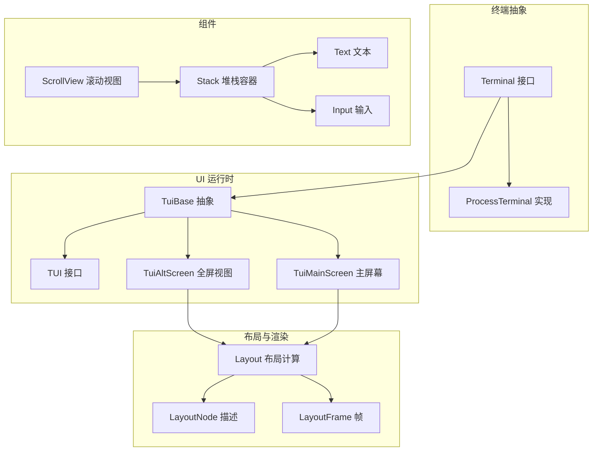
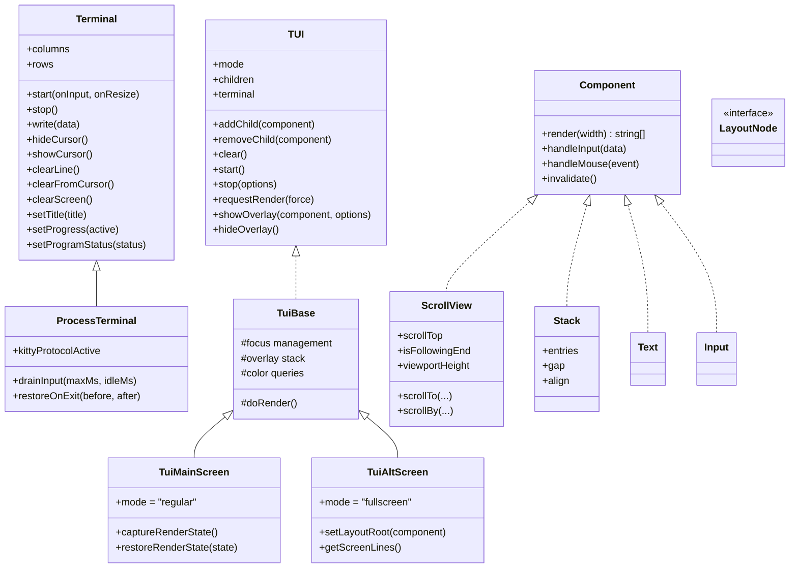
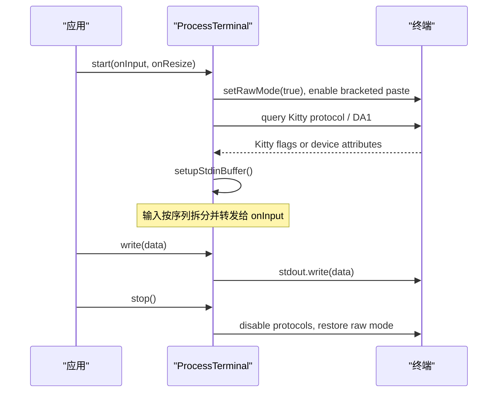
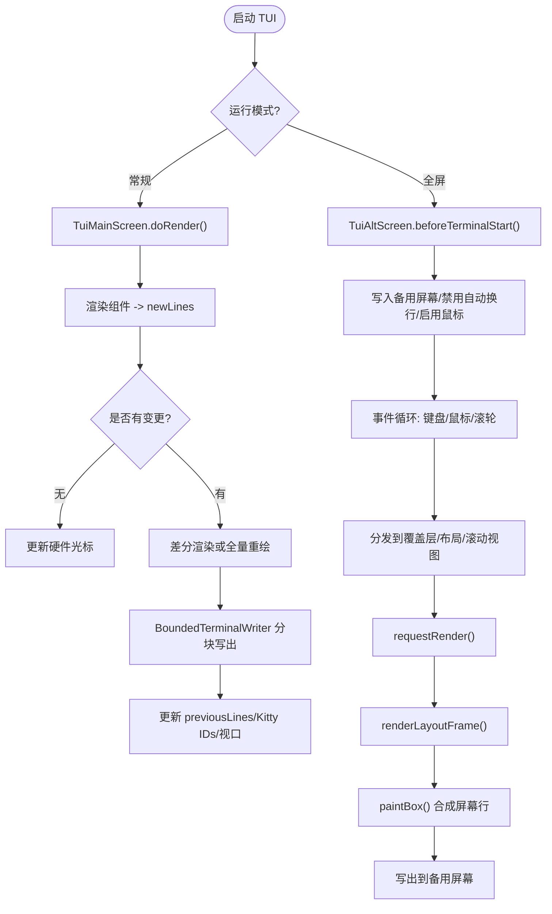
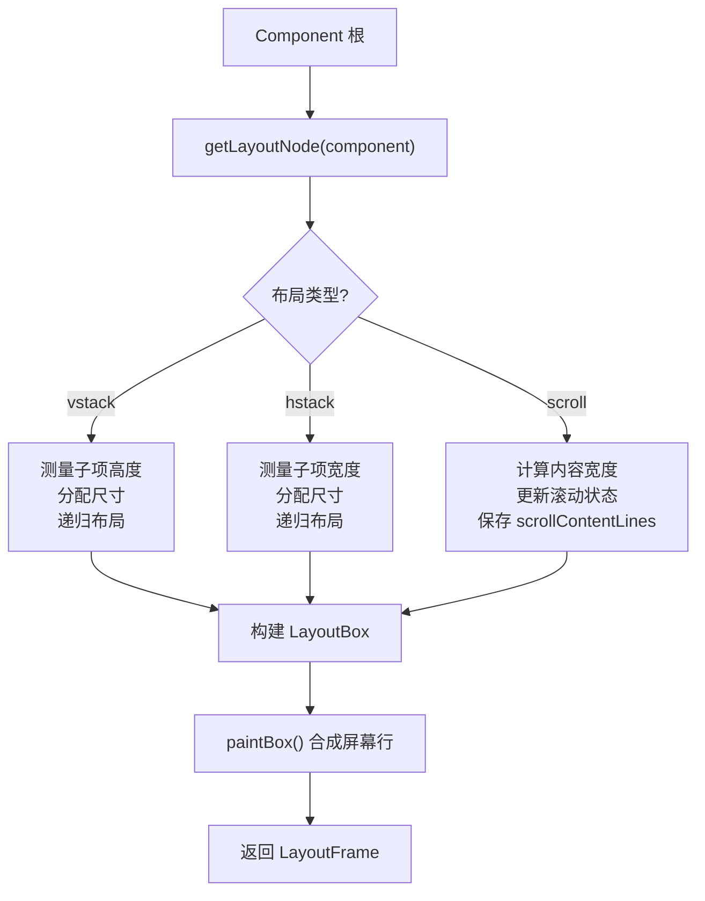
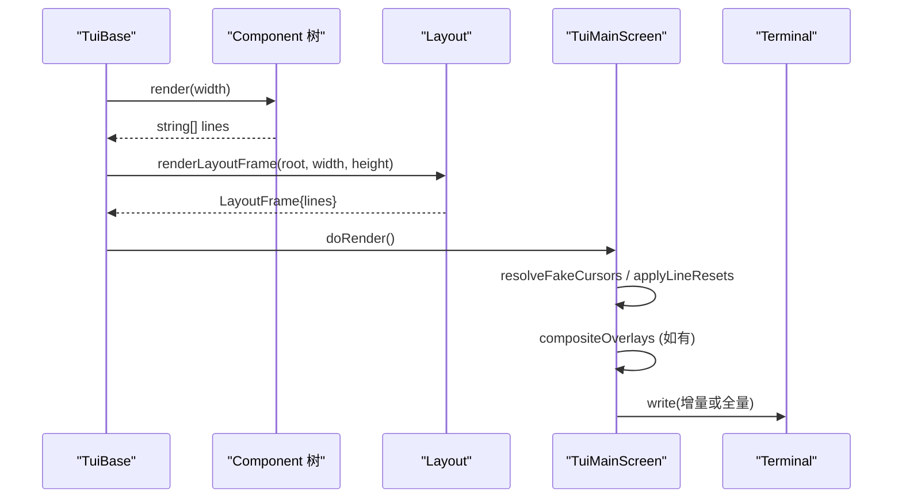
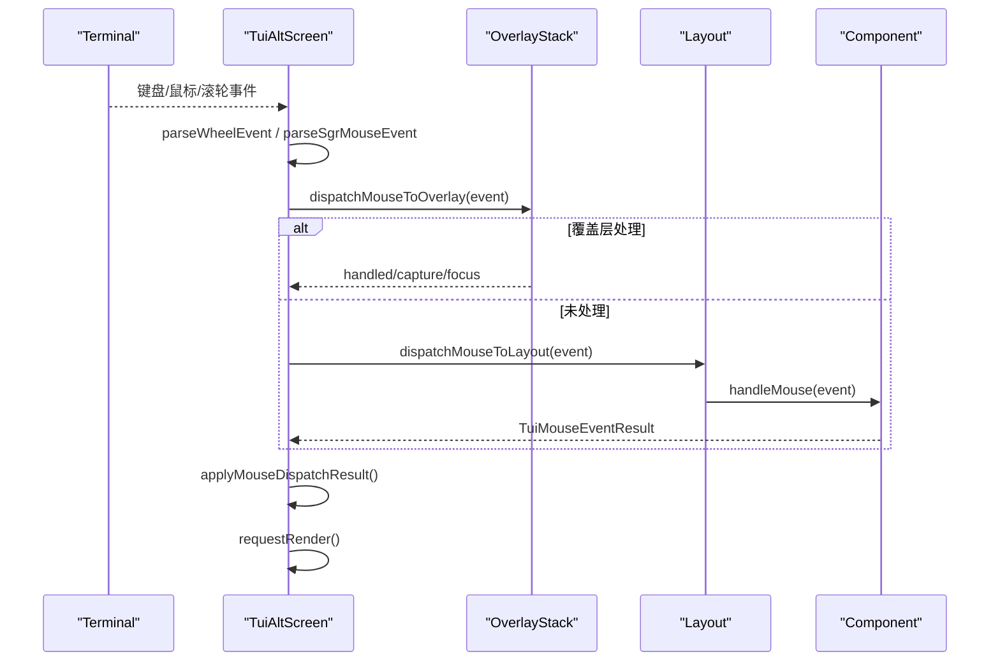
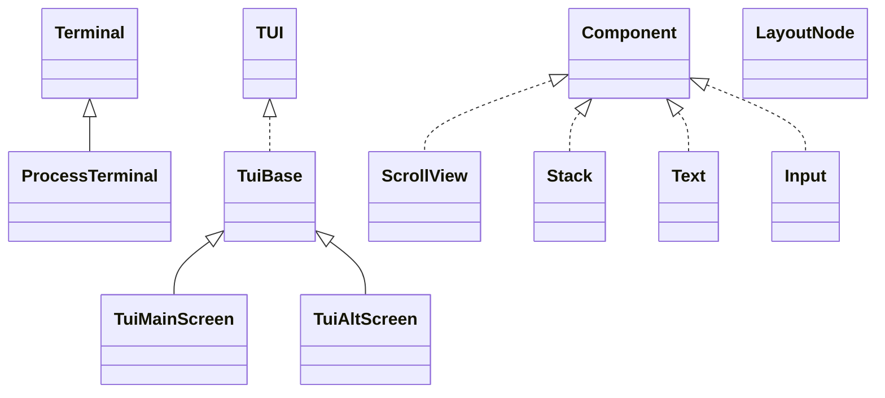
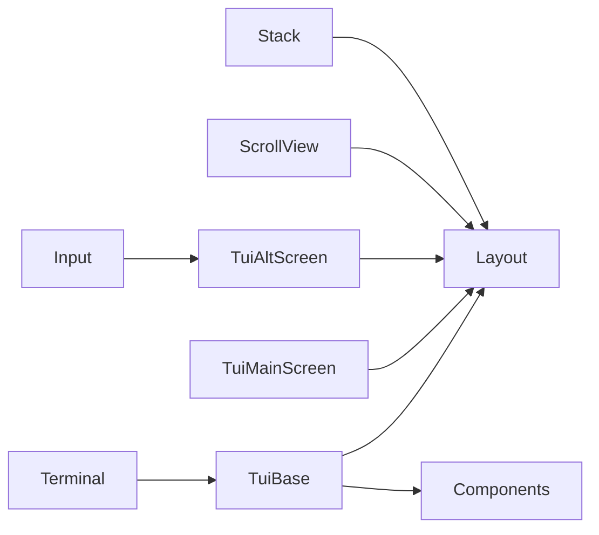

# TUI架构设计

<cite>
**本文引用的文件**
- [terminal.ts](file://packages/tui/src/terminal.ts)
- [tui.ts](file://packages/tui/src/tui.ts)
- [tui-main-screen.ts](file://packages/tui/src/tui-main-screen.ts)
- [tui-alt-screen.ts](file://packages/tui/src/tui-alt-screen.ts)
- [layout.ts](file://packages/tui/src/layout.ts)
- [layout-node.ts](file://packages/tui/src/layout-node.ts)
- [scroll-view.ts](file://packages/tui/src/components/scroll-view.ts)
- [stack.ts](file://packages/tui/src/components/stack.ts)
- [text.ts](file://packages/tui/src/components/text.ts)
- [input.ts](file://packages/tui/src/components/input.ts)
</cite>

## 目录
1. [引言](#引言)
2. [项目结构](#项目结构)
3. [核心组件](#核心组件)
4. [架构总览](#架构总览)
5. [详细组件分析](#详细组件分析)
6. [依赖关系分析](#依赖关系分析)
7. [性能与内存优化](#性能与内存优化)
8. [故障排查指南](#故障排查指南)
9. [结论](#结论)

## 引言
本文件面向终端用户界面（TUI）的架构设计与实现，聚焦以下目标：
- 解释主屏幕管理与全屏视图切换机制
- 说明布局系统的组件树结构与渲染管线
- 解析事件处理机制（键盘、鼠标、滚轮、焦点与覆盖层）
- 梳理 Terminal 抽象、Layout 系统、渲染引擎之间的关系
- 给出屏幕切换、视图管理、内存优化和性能调优建议
- 提供架构图表与关键类关系图，帮助读者快速理解代码结构

该 TUI 库支持两种运行模式：
- 常规模式：在主屏幕和滚动缓冲区中增量渲染输出
- 全屏模式：在备用屏幕中维护应用级视口，支持滚动、选择、搜索、图像等高级能力

## 项目结构
TUI 相关源码位于 `packages/tui/src`，核心分层如下：
- 终端抽象层：Terminal 接口与进程终端实现
- UI 运行时层：TUI/TuiBase 抽象、主屏幕实现、全屏实现
- 布局与渲染层：Layout 节点、布局计算、画布合成
- 组件层：文本、输入、滚动视图、堆栈容器等基础组件
- 工具与平台适配：颜色、图像协议、键绑定、原生平台能力

图表来源
- [terminal.ts:86-140](file://packages/tui/src/terminal.ts#L86-L140)
- [tui.ts:470-506](file://packages/tui/src/tui.ts#L470-L506)
- [tui-main-screen.ts:126-169](file://packages/tui/src/tui-main-screen.ts#L126-L169)
- [tui-alt-screen.ts:202-283](file://packages/tui/src/tui-alt-screen.ts#L202-L283)
- [layout.ts:16-58](file://packages/tui/src/layout.ts#L16-L58)
- [layout-node.ts:44-52](file://packages/tui/src/layout-node.ts#L44-L52)
- [scroll-view.ts:22-56](file://packages/tui/src/components/scroll-view.ts#L22-L56)
- [stack.ts:32-80](file://packages/tui/src/components/stack.ts#L32-L80)

章节来源
- [terminal.ts:86-140](file://packages/tui/src/terminal.ts#L86-L140)
- [tui.ts:470-506](file://packages/tui/src/tui.ts#L470-L506)
- [tui-main-screen.ts:126-169](file://packages/tui/src/tui-main-screen.ts#L126-L169)
- [tui-alt-screen.ts:202-283](file://packages/tui/src/tui-alt-screen.ts#L202-L283)
- [layout.ts:16-58](file://packages/tui/src/layout.ts#L16-L58)
- [layout-node.ts:44-52](file://packages/tui/src/layout-node.ts#L44-L52)
- [scroll-view.ts:22-56](file://packages/tui/src/components/scroll-view.ts#L22-L56)
- [stack.ts:32-80](file://packages/tui/src/components/stack.ts#L32-L80)

## 核心组件
- Terminal：定义最小化终端抽象，封装输入、尺寸、光标、标题、进度条、程序状态等能力；ProcessTerminal 基于 Node.js stdin/stdout 实现。
- TUI/TuiBase：定义 UI 运行时接口与通用逻辑，包括组件树、焦点管理、覆盖层、渲染调度、颜色查询、调试钩子等。
- TuiMainScreen：主屏幕实现，负责增量渲染到主屏与滚动缓冲区，处理 Kitty 图像行、同步输出、硬件光标定位。
- TuiAltScreen：全屏视图实现，负责备用屏幕切换、应用级视口、鼠标交互、文本选择、搜索、滚动条、Kitty 图像缓存等。
- Layout/LayoutNode：声明式布局描述与布局计算，支持垂直/水平堆栈、滚动区域、裁剪、滚动条绘制、命中检测。
- 组件：Text、Input、ScrollView、Stack 等基础 UI 构件，遵循 Component 接口并可参与布局。

章节来源
- [terminal.ts:86-140](file://packages/tui/src/terminal.ts#L86-L140)
- [tui.ts:117-148](file://packages/tui/src/tui.ts#L117-L148)
- [tui-main-screen.ts:126-169](file://packages/tui/src/tui-main-screen.ts#L126-L169)
- [tui-alt-screen.ts:202-283](file://packages/tui/src/tui-alt-screen.ts#L202-L283)
- [layout.ts:16-58](file://packages/tui/src/layout.ts#L16-L58)
- [layout-node.ts:44-52](file://packages/tui/src/layout-node.ts#L44-L52)
- [scroll-view.ts:22-56](file://packages/tui/src/components/scroll-view.ts#L22-L56)
- [stack.ts:32-80](file://packages/tui/src/components/stack.ts#L32-L80)

## 架构总览
TUI 采用“终端抽象 + UI 运行时 + 布局渲染 + 组件”的分层架构。Terminal 屏蔽底层差异；TuiBase 提供通用 UI 生命周期与事件分发；TuiMainScreen/TuiAltScreen 分别实现主屏与全屏模式；Layout 将组件树转换为可绘制的 LayoutFrame；组件通过 render(width) 返回 ANSI 字符串行，由布局系统合成最终输出。

图表来源
- [terminal.ts:86-140](file://packages/tui/src/terminal.ts#L86-L140)
- [tui.ts:470-506](file://packages/tui/src/tui.ts#L470-L506)
- [tui-main-screen.ts:126-169](file://packages/tui/src/tui-main-screen.ts#L126-L169)
- [tui-alt-screen.ts:202-283](file://packages/tui/src/tui-alt-screen.ts#L202-L283)
- [scroll-view.ts:22-56](file://packages/tui/src/components/scroll-view.ts#L22-L56)
- [stack.ts:32-80](file://packages/tui/src/components/stack.ts#L32-L80)

## 详细组件分析

### Terminal 与 ProcessTerminal
- Terminal 定义了 TUI 所需的最低终端能力：启动/停止、写入、尺寸、光标控制、清屏、标题、进度指示、程序状态上报。
- ProcessTerminal 实现了真实终端交互：
  - 启用原始输入、括号粘贴模式、窗口大小变化监听
  - Kitty 键盘协议协商与 modifyOtherKeys 回退
  - 输入缓冲与序列拆分，避免批量输入导致的事件合并
  - 退出时恢复终端模式，防止父 shell 被污染
  - 支持 OSC 7501 程序状态与 OSC 9;4 进度条

图表来源
- [terminal.ts:207-238](file://packages/tui/src/terminal.ts#L207-L238)
- [terminal.ts:248-284](file://packages/tui/src/terminal.ts#L248-L284)
- [terminal.ts:302-344](file://packages/tui/src/terminal.ts#L302-L344)
- [terminal.ts:481-533](file://packages/tui/src/terminal.ts#L481-L533)

章节来源
- [terminal.ts:86-140](file://packages/tui/src/terminal.ts#L86-L140)
- [terminal.ts:164-238](file://packages/tui/src/terminal.ts#L164-L238)
- [terminal.ts:248-284](file://packages/tui/src/terminal.ts#L248-L284)
- [terminal.ts:302-344](file://packages/tui/src/terminal.ts#L302-L344)
- [terminal.ts:481-533](file://packages/tui/src/terminal.ts#L481-L533)

### TUI 运行时与屏幕切换
- TUI 接口定义了 UI 运行时契约：模式、子组件、终端引用、渲染请求、覆盖层、焦点、颜色查询等。
- TuiBase 实现通用逻辑：
  - 组件树管理、焦点转移、覆盖层栈、渲染节流与立即渲染
  - 颜色查询队列与超时处理、终端颜色方案通知
  - 退出保护前缀/后缀，确保异常路径下终端状态恢复
- TuiMainScreen：
  - 主屏幕增量渲染，记录 previousLines、Kitty 图像 ID、光标位置、视口顶部
  - 宽度变化强制全量重绘；高度变化在非 Termux 环境全量重绘
  - 内容收缩时可清空空行；变更范围扩展以包含多行 Kitty 图像
  - 使用 BoundedTerminalWriter 分块写出，避免 V8 字符串上限
- TuiAltScreen：
  - 全屏模式，进入/退出备用屏幕，禁用自动换行，启用鼠标协议
  - 维护当前 LayoutFrame、隐式文档与滚动视图、闪烁提示、搜索、选择、URL 点击
  - Kitty 图像上传与离屏缓存淘汰策略，限制传输字节与解码字节
  - 滚轮加速、页面滚动、半页滚动、行滚动、跳转到提示符等

图表来源
- [tui-main-screen.ts:250-324](file://packages/tui/src/tui-main-screen.ts#L250-L324)
- [tui-main-screen.ts:335-401](file://packages/tui/src/tui-main-screen.ts#L335-L401)
- [tui-main-screen.ts:454-551](file://packages/tui/src/tui-main-screen.ts#L454-L551)
- [tui-alt-screen.ts:347-387](file://packages/tui/src/tui-alt-screen.ts#L347-L387)
- [tui-alt-screen.ts:446-494](file://packages/tui/src/tui-alt-screen.ts#L446-L494)

章节来源
- [tui.ts:470-506](file://packages/tui/src/tui.ts#L470-L506)
- [tui-main-screen.ts:126-169](file://packages/tui/src/tui-main-screen.ts#L126-L169)
- [tui-main-screen.ts:250-324](file://packages/tui/src/tui-main-screen.ts#L250-L324)
- [tui-main-screen.ts:335-401](file://packages/tui/src/tui-main-screen.ts#L335-L401)
- [tui-main-screen.ts:454-551](file://packages/tui/src/tui-main-screen.ts#L454-L551)
- [tui-alt-screen.ts:202-283](file://packages/tui/src/tui-alt-screen.ts#L202-L283)
- [tui-alt-screen.ts:347-387](file://packages/tui/src/tui-alt-screen.ts#L347-L387)
- [tui-alt-screen.ts:446-494](file://packages/tui/src/tui-alt-screen.ts#L446-L494)

### Layout 系统与组件树
- LayoutNode：描述布局类型（vstack/hstack/scroll），包含条目、间距、对齐、滚动状态等元数据。
- Layout：根据 viewport 计算每个组件的矩形、裁剪区域、滚动偏移，生成 LayoutFrame；支持滚动条几何计算与绘制。
- LayoutFrame：包含根节点、宽高、合成后的 lines 数组、主滚动视图引用。
- 组件如 ScrollView、Stack 通过 [LAYOUT_NODE] 暴露布局信息，供 Layout 识别与分配空间。

图表来源
- [layout-node.ts:44-52](file://packages/tui/src/layout-node.ts#L44-L52)
- [layout.ts:106-247](file://packages/tui/src/layout.ts#L106-L247)
- [layout.ts:383-412](file://packages/tui/src/layout.ts#L383-L412)
- [scroll-view.ts:221-223](file://packages/tui/src/components/scroll-view.ts#L221-L223)
- [stack.ts:72-79](file://packages/tui/src/components/stack.ts#L72-L79)

章节来源
- [layout-node.ts:44-52](file://packages/tui/src/layout-node.ts#L44-L52)
- [layout.ts:106-247](file://packages/tui/src/layout.ts#L106-L247)
- [layout.ts:383-412](file://packages/tui/src/layout.ts#L383-L412)
- [scroll-view.ts:221-223](file://packages/tui/src/components/scroll-view.ts#L221-L223)
- [stack.ts:72-79](file://packages/tui/src/components/stack.ts#L72-L79)

### 渲染管道与屏幕合成
- 组件 render(width) 返回 ANSI 字符串行数组。
- Layout 对组件进行布局计算，得到 LayoutBox 树；paintBox 将各 Box 的行合成到屏幕行数组。
- TuiMainScreen 对 newLines 进行假光标解析、OSC 133 标记清理、行重置应用、Kitty 图像行处理，再差分写出。
- TuiAltScreen 维护 previousScreen，并在备用屏幕中进行增量绘制，同时处理 Kitty 图像替换与离屏缓存淘汰。

图表来源
- [tui.ts:432-461](file://packages/tui/src/tui.ts#L432-L461)
- [layout.ts:383-412](file://packages/tui/src/layout.ts#L383-L412)
- [tui-main-screen.ts:250-324](file://packages/tui/src/tui-main-screen.ts#L250-L324)

章节来源
- [tui.ts:432-461](file://packages/tui/src/tui.ts#L432-L461)
- [layout.ts:383-412](file://packages/tui/src/layout.ts#L383-L412)
- [tui-main-screen.ts:250-324](file://packages/tui/src/tui-main-screen.ts#L250-L324)

### 事件处理机制
- 键盘事件：
  - ProcessTerminal 通过 StdinBuffer 拆分输入序列，支持 Kitty 协议与 modifyOtherKeys 回退
  - TuiAltScreen 处理焦点捕获、搜索、页面滚动、行滚动、跳转提示符等快捷键
  - Input 组件实现撤销栈、剪贴板环、光标移动、单词导航、粘贴处理
- 鼠标事件：
  - TuiAltScreen 解析 SGR 鼠标事件与滚轮事件，分发到覆盖层与布局命中区域
  - Container 根据鼠标坐标路由到子组件，支持 capture/focus/render 结果
- 滚轮事件：
  - WheelScrollAccelerator 加速快滚，Alt+滚轮放大步长
  - TuiAltScreen 根据滚动方向与修饰键决定滚动策略

图表来源
- [tui-alt-screen.ts:694-739](file://packages/tui/src/tui-alt-screen.ts#L694-L739)
- [tui.ts:81-115](file://packages/tui/src/tui.ts#L81-L115)
- [tui.ts:389-423](file://packages/tui/src/tui.ts#L389-L423)

章节来源
- [terminal.ts:248-284](file://packages/tui/src/terminal.ts#L248-L284)
- [tui-alt-screen.ts:694-739](file://packages/tui/src/tui-alt-screen.ts#L694-L739)
- [tui.ts:81-115](file://packages/tui/src/tui.ts#L81-L115)
- [tui.ts:389-423](file://packages/tui/src/tui.ts#L389-L423)
- [input.ts:71-234](file://packages/tui/src/components/input.ts#L71-L234)

### 关键类关系图

图表来源
- [terminal.ts:86-140](file://packages/tui/src/terminal.ts#L86-L140)
- [tui.ts:470-506](file://packages/tui/src/tui.ts#L470-L506)
- [tui-main-screen.ts:126-169](file://packages/tui/src/tui-main-screen.ts#L126-L169)
- [tui-alt-screen.ts:202-283](file://packages/tui/src/tui-alt-screen.ts#L202-L283)
- [layout-node.ts:44-52](file://packages/tui/src/layout-node.ts#L44-L52)
- [scroll-view.ts:22-56](file://packages/tui/src/components/scroll-view.ts#L22-L56)
- [stack.ts:32-80](file://packages/tui/src/components/stack.ts#L32-L80)
- [text.ts:7-23](file://packages/tui/src/components/text.ts#L7-L23)
- [input.ts:32-60](file://packages/tui/src/components/input.ts#L32-L60)

## 依赖关系分析
- 终端抽象与实现：Terminal 接口被 TuiBase 及其子类依赖；ProcessTerminal 提供具体实现。
- UI 运行时与布局：TuiBase 调用 layout.ts 的 renderLayoutFrame 生成 LayoutFrame；TuiAltScreen 维护 currentLayout 并用于命中检测与滚动。
- 组件与布局：ScrollView 与 Stack 通过 [LAYOUT_NODE] 暴露布局元数据；Layout 根据节点类型进行空间分配与裁剪。
- 事件流：Terminal 输入经 TuiAltScreen 分发至覆盖层与布局命中区域；Input 组件处理键盘与鼠标交互。

图表来源
- [tui.ts:470-506](file://packages/tui/src/tui.ts#L470-L506)
- [layout.ts:383-412](file://packages/tui/src/layout.ts#L383-L412)
- [scroll-view.ts:221-223](file://packages/tui/src/components/scroll-view.ts#L221-L223)
- [stack.ts:72-79](file://packages/tui/src/components/stack.ts#L72-L79)
- [tui-alt-screen.ts:694-739](file://packages/tui/src/tui-alt-screen.ts#L694-L739)

章节来源
- [tui.ts:470-506](file://packages/tui/src/tui.ts#L470-L506)
- [layout.ts:383-412](file://packages/tui/src/layout.ts#L383-L412)
- [scroll-view.ts:221-223](file://packages/tui/src/components/scroll-view.ts#L221-L223)
- [stack.ts:72-79](file://packages/tui/src/components/stack.ts#L72-L79)
- [tui-alt-screen.ts:694-739](file://packages/tui/src/tui-alt-screen.ts#L694-L739)

## 性能与内存优化
- 渲染节流与批量写出：
  - TuiBase 维护 renderRequested/immediateRenderScheduled，最小渲染间隔为 16ms
  - TuiMainScreen 使用 BoundedTerminalWriter 分块写出，避免 V8 字符串上限
- 增量渲染：
  - TuiMainScreen 比较 previousLines 与 newLines，仅重绘变更行；宽度变化强制全量重绘
  - 内容收缩时可选择清空空行以减少闪烁
- Kitty 图像优化：
  - TuiMainScreen 收集并删除变更范围内的 Kitty 图像 ID，避免残留
  - TuiAltScreen 维护 uploadedKittyImages 缓存，限制离屏图像数量与字节数，触发淘汰时发送删除命令
- 布局缓存：
  - Layout.renderCached 按组件与宽度缓存渲染结果，减少重复计算
- 滚动优化：
  - ScrollView.updateLayout 仅在必要时触发 requestRender，避免频繁重绘
  - WheelScrollAccelerator 加速滚轮，减少事件频率

章节来源
- [tui.ts:512-556](file://packages/tui/src/tui.ts#L512-L556)
- [tui-main-screen.ts:21-77](file://packages/tui/src/tui-main-screen.ts#L21-L77)
- [tui-main-screen.ts:250-324](file://packages/tui/src/tui-main-screen.ts#L250-L324)
- [tui-main-screen.ts:181-248](file://packages/tui/src/tui-main-screen.ts#L181-L248)
- [tui-alt-screen.ts:446-494](file://packages/tui/src/tui-alt-screen.ts#L446-L494)
- [layout.ts:68-89](file://packages/tui/src/layout.ts#L68-L89)
- [scroll-view.ts:189-201](file://packages/tui/src/components/scroll-view.ts#L189-L201)

## 故障排查指南
- 行宽超限错误：
  - TuiMainScreen 检测到渲染行可见宽度超过终端宽度时抛出错误，并写入崩溃日志
  - 建议使用 visibleWidth/truncateToWidth 控制行宽
- 退出状态恢复：
  - TuiBase.getExitRestorePrefix/Suffix 与 ProcessTerminal.restoreOnExit 协作，确保异常退出时恢复终端模式
- 颜色查询超时：
  - TuiBase.pendingTerminalColorQueries 管理颜色查询队列，超时后收集迟到的回复
- 滚动与视口：
  - TuiAltScreen 的 refreshSearch 与 scrollToPrompt 依赖 primaryScrollView 的 scrollContentLines，若为空需检查布局是否已生成

章节来源
- [tui-main-screen.ts:522-549](file://packages/tui/src/tui-main-screen.ts#L522-L549)
- [tui.ts:570-591](file://packages/tui/src/tui.ts#L570-L591)
- [tui.ts:152-177](file://packages/tui/src/tui.ts#L152-L177)
- [tui-alt-screen.ts:518-530](file://packages/tui/src/tui-alt-screen.ts#L518-L530)

## 结论
该 TUI 架构通过清晰的层次划分与职责分离，实现了高性能、可扩展的终端用户界面：
- Terminal 抽象屏蔽平台差异，ProcessTerminal 提供健壮的实现
- TuiBase 统一管理 UI 生命周期、焦点、覆盖层与渲染调度
- TuiMainScreen/TuiAltScreen 分别满足主屏输出与全屏视口需求
- Layout 系统提供声明式布局与高效合成，支持滚动、裁剪与命中检测
- 组件体系丰富且可组合，支持文本、输入、滚动、堆栈等常见场景
- 性能优化贯穿渲染、布局、图像缓存与事件处理，确保流畅体验

在实际使用中，建议：
- 使用 Layout 与组件组合构建复杂界面
- 控制行宽与图像尺寸，避免渲染异常
- 合理使用覆盖层与焦点管理，保证交互一致性
- 利用滚动视图与布局缓存提升性能
- 关注退出路径与终端状态恢复，确保用户体验稳定