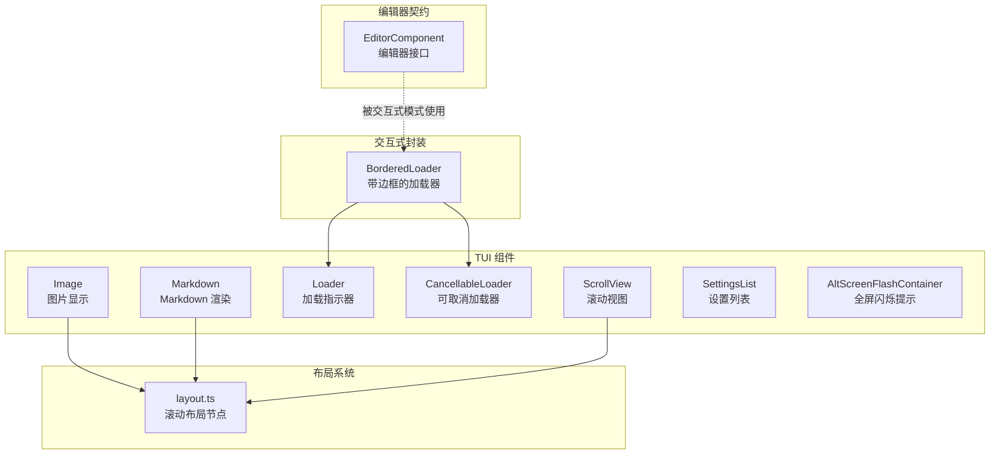
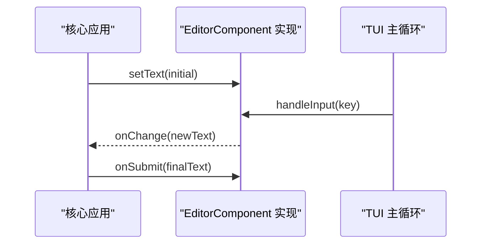
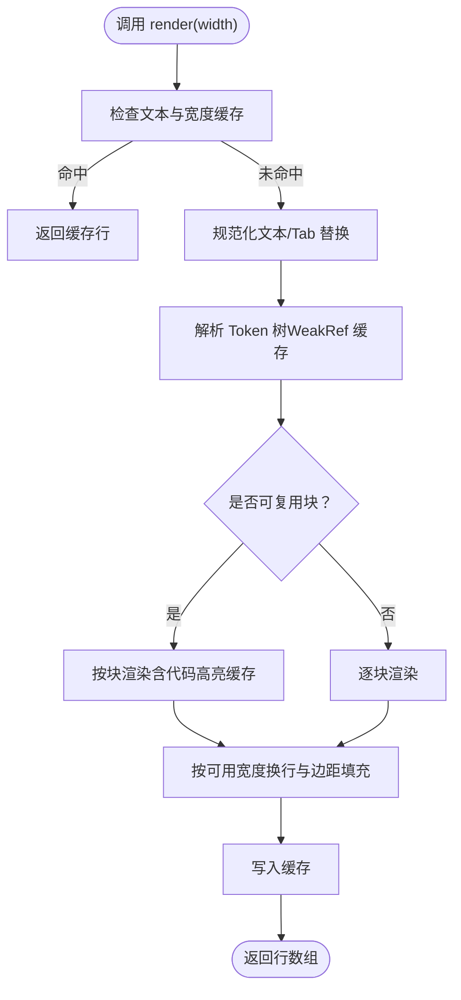
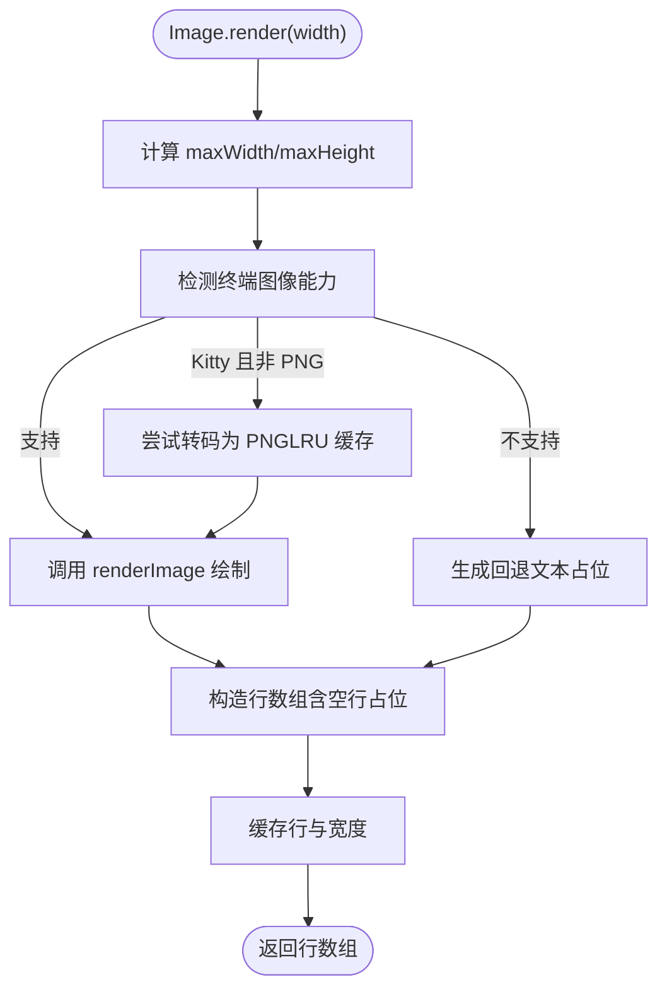
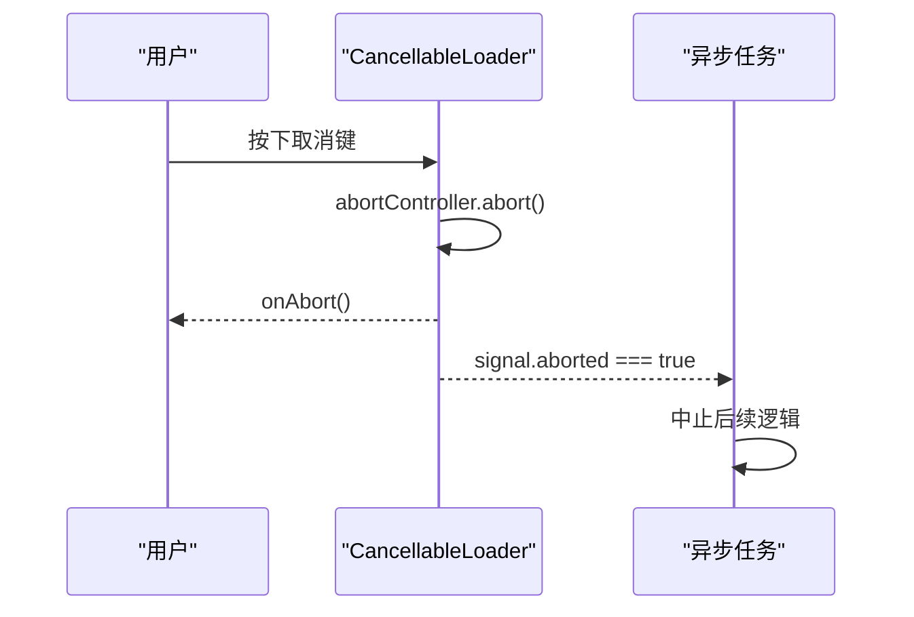
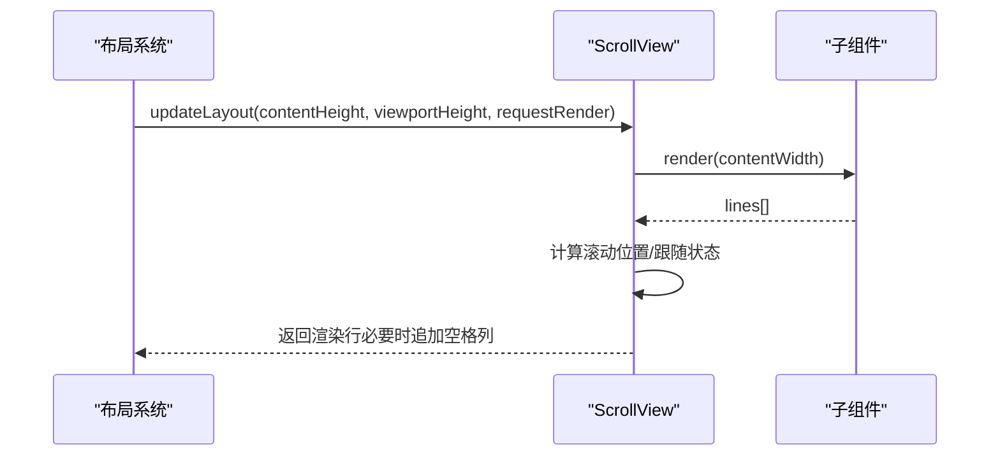
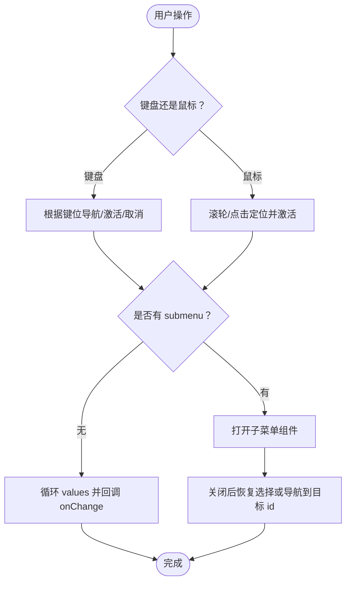
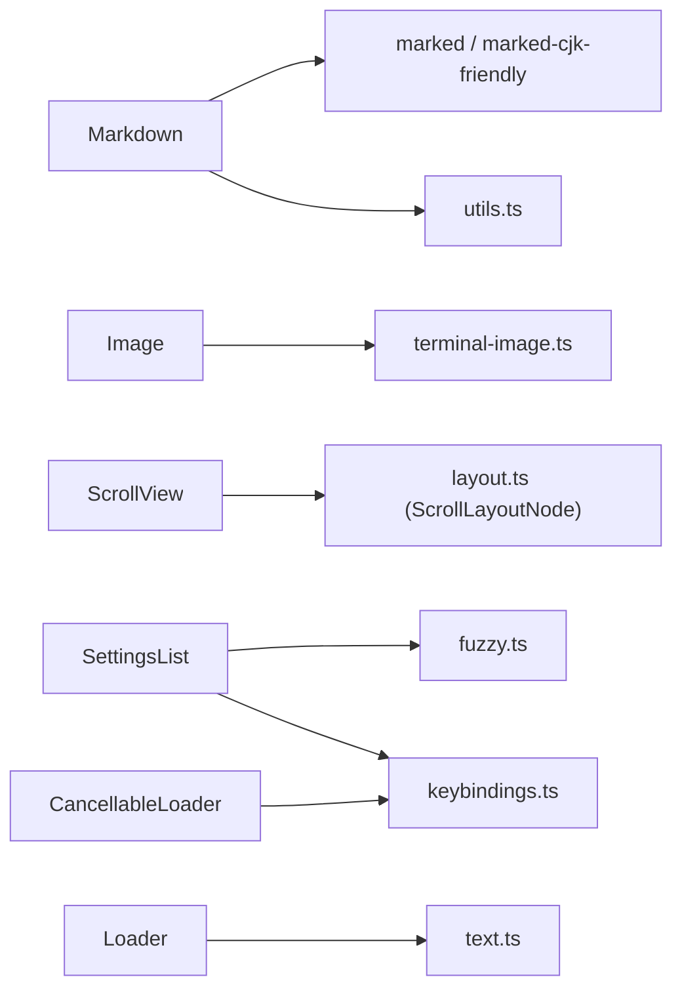

# 专用组件

<cite>
**本文引用的文件**   
- [packages/tui/src/components/image.ts](file://packages/tui/src/components/image.ts)
- [packages/tui/src/components/loader.ts](file://packages/tui/src/components/loader.ts)
- [packages/tui/src/components/cancellable-loader.ts](file://packages/tui/src/components/cancellable-loader.ts)
- [packages/tui/src/components/markdown.ts](file://packages/tui/src/components/markdown.ts)
- [packages/tui/src/components/scroll-view.ts](file://packages/tui/src/components/scroll-view.ts)
- [packages/tui/src/components/settings-list.ts](file://packages/tui/src/components/settings-list.ts)
- [packages/tui/src/components/alt-screen-flash.ts](file://packages/tui/src/components/alt-screen-flash.ts)
- [packages/tui/src/editor-component.ts](file://packages/tui/src/editor-component.ts)
- [packages/tui/src/layout.ts](file://packages/tui/src/layout.ts)
- [packages/coding-agent/src/modes/interactive/components/bordered-loader.ts](file://packages/coding-agent/src/modes/interactive/components/bordered-loader.ts)
</cite>

## 目录
1. [引言](#引言)
2. [项目结构](#项目结构)
3. [核心组件](#核心组件)
4. [架构总览](#架构总览)
5. [详细组件分析](#详细组件分析)
6. [依赖关系分析](#依赖关系分析)
7. [性能与优化](#性能与优化)
8. [故障排查](#故障排查)
9. [结论](#结论)

## 引言
本文件面向终端用户界面（TUI）中的“专用组件”，聚焦以下能力：代码编辑器契约、Markdown 渲染、图片显示、加载指示器、可取消加载器、滚动视图、设置列表、全屏闪烁提示。文档从 API、配置项、事件回调、使用场景、集成方式与性能策略等维度进行系统化说明，帮助你在不深入源码的情况下正确组合这些组件构建高质量终端交互体验。

## 项目结构
这些组件统一位于 TUI 包中，部分业务封装在 coding-agent 的交互式模式中。关键路径如下：
- 通用 UI 组件：packages/tui/src/components/*
- 编辑器契约接口：packages/tui/src/editor-component.ts
- 布局系统对 ScrollView 的支持：packages/tui/src/layout.ts
- 交互式模式下的 Loader 包装：packages/coding-agent/src/modes/interactive/components/bordered-loader.ts



图表来源
- [packages/tui/src/components/image.ts:1-168](file://packages/tui/src/components/image.ts#L1-L168)
- [packages/tui/src/components/markdown.ts:283-348](file://packages/tui/src/components/markdown.ts#L283-L348)
- [packages/tui/src/components/loader.ts:1-102](file://packages/tui/src/components/loader.ts#L1-L102)
- [packages/tui/src/components/cancellable-loader.ts:1-41](file://packages/tui/src/components/cancellable-loader.ts#L1-L41)
- [packages/tui/src/components/scroll-view.ts:1-225](file://packages/tui/src/components/scroll-view.ts#L1-L225)
- [packages/tui/src/components/settings-list.ts:1-334](file://packages/tui/src/components/settings-list.ts#L1-L334)
- [packages/tui/src/components/alt-screen-flash.ts:1-52](file://packages/tui/src/components/alt-screen-flash.ts#L1-L52)
- [packages/tui/src/editor-component.ts:1-40](file://packages/tui/src/editor-component.ts#L1-L40)
- [packages/tui/src/layout.ts:136-168](file://packages/tui/src/layout.ts#L136-L168)
- [packages/coding-agent/src/modes/interactive/components/bordered-loader.ts:1-68](file://packages/coding-agent/src/modes/interactive/components/bordered-loader.ts#L1-L68)

章节来源
- [packages/tui/src/components/image.ts:1-168](file://packages/tui/src/components/image.ts#L1-L168)
- [packages/tui/src/components/markdown.ts:283-348](file://packages/tui/src/components/markdown.ts#L283-L348)
- [packages/tui/src/components/loader.ts:1-102](file://packages/tui/src/components/loader.ts#L1-L102)
- [packages/tui/src/components/cancellable-loader.ts:1-41](file://packages/tui/src/components/cancellable-loader.ts#L1-L41)
- [packages/tui/src/components/scroll-view.ts:1-225](file://packages/tui/src/components/scroll-view.ts#L1-L225)
- [packages/tui/src/components/settings-list.ts:1-334](file://packages/tui/src/components/settings-list.ts#L1-L334)
- [packages/tui/src/components/alt-screen-flash.ts:1-52](file://packages/tui/src/components/alt-screen-flash.ts#L1-L52)
- [packages/tui/src/editor-component.ts:1-40](file://packages/tui/src/editor-component.ts#L1-L40)
- [packages/tui/src/layout.ts:136-168](file://packages/tui/src/layout.ts#L136-L168)
- [packages/coding-agent/src/modes/interactive/components/bordered-loader.ts:1-68](file://packages/coding-agent/src/modes/interactive/components/bordered-loader.ts#L1-L68)

## 核心组件
本节概述各专用组件的职责、API 要点与典型用法。

- Editor（编辑器契约）
  - 角色：定义扩展自定义编辑器的最小接口，使核心应用能统一接入不同编辑器实现。
  - 关键能力：获取/设置文本、处理原始输入、提交与变更回调、可选历史与自动补全。
  - 典型场景：交互式命令输入、多行文本编辑、可扩展键绑定与主题。

- Markdown（Markdown 渲染）
  - 角色：将 Markdown 文本高效渲染为终端 ANSI 行，支持标题、段落、代码块、引用、表格、链接、粗斜体、删除线、下划线、LaTeX 数学表达式等。
  - 关键能力：主题函数、默认文本样式、缓存与弱引用、宽度自适应换行、代码高亮钩子。
  - 典型场景：日志输出、帮助信息、富文本消息流。

- Image（图片显示）
  - 角色：在终端中渲染图片，支持 Kitty 协议与回退文本占位；支持尺寸限制、文件名标注、Kitty imageId 复用。
  - 关键能力：base64 数据、MIME 类型、转码器、尺寸计算、回退色。
  - 典型场景：工具执行结果图、公告图、截图展示。

- Loader（加载指示器）
  - 角色：显示带动画的加载状态，支持自定义帧序列与间隔。
  - 关键能力：start/stop、setMessage、setIndicator、颜色函数注入。
  - 典型场景：异步任务进行中反馈。

- CancellableLoader（可取消加载器）
  - 角色：在 Loader 基础上提供 Escape 取消能力，暴露 AbortSignal 与 onAbort 回调。
  - 关键能力：signal、aborted、handleInput、dispose。
  - 典型场景：长时间任务允许用户中断。

- ScrollView（滚动视图）
  - 角色：为子组件提供垂直滚动、跟随底部、滚动条显隐控制、视口与内容高度同步。
  - 关键能力：scrollTop、followEnd、scrollTo、scrollBy、scrollToEnd、scrollbar 模式、可见范围计算。
  - 典型场景：长日志、聊天窗口、可滚动面板。

- SettingsList（设置列表）
  - 角色：交互式配置列表，支持值切换、子菜单、模糊搜索、键盘与鼠标操作。
  - 关键能力：SettingItem 模型、theme 函数、onChange/onCancel、selectItem/updateValue。
  - 典型场景：应用设置、偏好配置、动态选项选择。

- AltScreenFlashContainer（全屏闪烁提示）
  - 角色：在备用屏幕层短暂显示反色消息，超时自动移除。
  - 关键能力：flash(message, durationMs)、dispose。
  - 典型场景：临时通知、状态提示、操作确认。

章节来源
- [packages/tui/src/editor-component.ts:1-40](file://packages/tui/src/editor-component.ts#L1-L40)
- [packages/tui/src/components/markdown.ts:283-348](file://packages/tui/src/components/markdown.ts#L283-L348)
- [packages/tui/src/components/image.ts:1-168](file://packages/tui/src/components/image.ts#L1-L168)
- [packages/tui/src/components/loader.ts:1-102](file://packages/tui/src/components/loader.ts#L1-L102)
- [packages/tui/src/components/cancellable-loader.ts:1-41](file://packages/tui/src/components/cancellable-loader.ts#L1-L41)
- [packages/tui/src/components/scroll-view.ts:1-225](file://packages/tui/src/components/scroll-view.ts#L1-L225)
- [packages/tui/src/components/settings-list.ts:1-334](file://packages/tui/src/components/settings-list.ts#L1-L334)
- [packages/tui/src/components/alt-screen-flash.ts:1-52](file://packages/tui/src/components/alt-screen-flash.ts#L1-L52)

## 架构总览
下图展示了专用组件之间的协作关系以及它们如何嵌入到 TUI 布局系统中。

```mermaid
classDiagram
class EditorComponent {
+getText() string
+setText(text) void
+handleInput(data) void
+onSubmit(text) void
+onChange(text) void
+addToHistory(text) void
}
class Markdown {
+constructor(text, paddingX, paddingY, theme, defaultTextStyle, options)
+setText(text) void
+invalidate() void
+render(width) string[]
}
class Image {
+constructor(base64Data, mimeType, theme, options, dimensions)
+getImageId() number|undefined
+invalidate() void
+render(width) string[]
}
class Loader {
+start() void
+stop() void
+setMessage(message) void
+setIndicator(indicator) void
+render(width) string[]
}
class CancellableLoader {
+signal AbortSignal
+aborted boolean
+onAbort() void
+handleInput(data) void
+dispose() void
}
class ScrollView {
+scrollTop number
+isFollowingEnd boolean
+viewportHeight number
+scrollbar string
+setScrollbar(mode) void
+scrollTo(top, options) void
+scrollBy(lines) number
+scrollToEnd() void
+updateLayout(contentHeight, viewportHeight, requestRender) void
+render(width) string[]
}
class SettingsList {
+constructor(items, maxVisible, theme, onChange, onCancel, options)
+updateValue(id, newValue) void
+selectItem(id) void
+render(width) string[]
+handleMouse(event) any
+handleInput(data) void
}
class AltScreenFlashContainer {
+flash(message, durationMs) void
+dispose() void
+render(width) string[]
}
CancellableLoader --|> Loader
ScrollView --> Component : "包裹单一子组件"
SettingsList --> Component : "可打开子菜单"
Markdown --> Component
Image --> Component
EditorComponent <|.. "扩展实现"
```

图表来源
- [packages/tui/src/editor-component.ts:1-40](file://packages/tui/src/editor-component.ts#L1-L40)
- [packages/tui/src/components/markdown.ts:309-348](file://packages/tui/src/components/markdown.ts#L309-L348)
- [packages/tui/src/components/image.ts:55-81](file://packages/tui/src/components/image.ts#L55-L81)
- [packages/tui/src/components/loader.ts:17-41](file://packages/tui/src/components/loader.ts#L17-L41)
- [packages/tui/src/components/cancellable-loader.ts:13-40](file://packages/tui/src/components/cancellable-loader.ts#L13-L40)
- [packages/tui/src/components/scroll-view.ts:22-56](file://packages/tui/src/components/scroll-view.ts#L22-L56)
- [packages/tui/src/components/settings-list.ts:38-74](file://packages/tui/src/components/settings-list.ts#L38-L74)
- [packages/tui/src/components/alt-screen-flash.ts:13-20](file://packages/tui/src/components/alt-screen-flash.ts#L13-L20)

## 详细组件分析

### Editor（编辑器契约）
- 职责与定位
  - 定义“编辑器”的最小契约，使核心应用可以统一接入任意编辑器实现（如 vim 模式、自定义快捷键）。
- 关键 API
  - getText/setText：读写当前文本。
  - handleInput：处理原始终端输入（按键、粘贴等）。
  - onSubmit/onChange：提交与变更回调。
  - addToHistory：可选的历史记录支持。
- 使用建议
  - 通过该接口扩展编辑器行为，避免直接耦合具体实现。
  - 在交互式模式中，编辑器会被替换或增强，同时保留外观与行为一致性。



图表来源
- [packages/tui/src/editor-component.ts:11-40](file://packages/tui/src/editor-component.ts#L11-L40)

章节来源
- [packages/tui/src/editor-component.ts:1-40](file://packages/tui/src/editor-component.ts#L1-L40)

### Markdown（Markdown 渲染）
- 功能特性
  - 支持标题、段落、代码块、引用、表格、链接、粗斜体、删除线、下划线、LaTeX 数学表达式。
  - 提供 MarkdownTheme 与 DefaultTextStyle 两套样式体系，支持代码高亮钩子。
  - 内部使用 WeakRef 缓存 token 树与渲染块，减少重复解析与渲染开销。
- 关键 API
  - constructor(text, paddingX, paddingY, theme, defaultTextStyle?, options?)
  - setText(text)：更新内容并清理渲染缓存。
  - invalidate()：主题变化时失效缓存。
  - render(width)：返回 ANSI 行数组。
- 配置项
  - MarkdownOptions：preserveOrderedListMarkers、preserveBackslashEscapes、transform、renderLatex。
- 性能要点
  - 文本与宽度命中缓存直接返回。
  - 块级渲染复用 highlightedCode，避免重复高亮。
  - 大文档分块渲染，按需换行与背景填充。



图表来源
- [packages/tui/src/components/markdown.ts:368-442](file://packages/tui/src/components/markdown.ts#L368-L442)
- [packages/tui/src/components/markdown.ts:444-478](file://packages/tui/src/components/markdown.ts#L444-L478)

章节来源
- [packages/tui/src/components/markdown.ts:283-348](file://packages/tui/src/components/markdown.ts#L283-L348)
- [packages/tui/src/components/markdown.ts:368-442](file://packages/tui/src/components/markdown.ts#L368-L442)
- [packages/tui/src/components/markdown.ts:444-478](file://packages/tui/src/components/markdown.ts#L444-L478)

### Image（图片显示）
- 功能特性
  - 支持 Kitty 协议图片渲染与非 PNG 格式转码（需注册转码器）。
  - 支持最大宽高单元格限制、filename 标注、imageId 复用（用于动画/增量更新）。
  - 当终端不支持或转码失败时，回退为文本占位。
- 关键 API
  - setImageTranscoder(transcoder)：注册非 PNG 转 PNG 的转换器。
  - constructor(base64Data, mimeType, theme, options?, dimensions?)
  - getImageId()：获取当前使用的 Kitty imageId。
  - invalidate()/render(width)：刷新与渲染。
- 配置项
  - ImageOptions：maxWidthCells、maxHeightCells、filename、imageId。
  - ImageTheme：fallbackColor 用于回退文本着色。
- 使用建议
  - 对于频繁更新的图片，传入 imageId 以复用资源。
  - 在非 Kitty 终端上，确保 MIME 与尺寸合理，避免回退过多。



图表来源
- [packages/tui/src/components/image.ts:93-166](file://packages/tui/src/components/image.ts#L93-L166)
- [packages/tui/src/components/image.ts:28-41](file://packages/tui/src/components/image.ts#L28-L41)

章节来源
- [packages/tui/src/components/image.ts:1-168](file://packages/tui/src/components/image.ts#L1-L168)

### Loader（加载指示器）
- 功能特性
  - 基于 Text 组件，提供动画帧循环与消息着色。
  - 支持自定义帧序列与帧间隔，支持“原样渲染”模式。
- 关键 API
  - start()/stop()：启动/停止动画。
  - setMessage(message)：更新提示文案。
  - setIndicator(indicator)：设置帧序列与间隔。
  - render(width)：输出两行（第一行为空行，第二行为指示器+消息）。
- 使用建议
  - 若不需要动画，传入空 frames 数组即可隐藏指示器。
  - 结合 TUI.requestRender 自动刷新。

章节来源
- [packages/tui/src/components/loader.ts:1-102](file://packages/tui/src/components/loader.ts#L1-L102)

### CancellableLoader（可取消加载器）
- 功能特性
  - 继承 Loader，监听取消键（Escape），触发 AbortController.abort()。
  - 暴露 signal 与 aborted 属性，便于上层异步任务响应取消。
- 关键 API
  - signal：AbortSignal。
  - aborted：是否已取消。
  - onAbort：取消回调。
  - handleInput(data)/dispose()：输入处理与资源释放。
- 使用建议
  - 将 doWork(loader.signal) 作为异步工作入口，以便及时中断。
  - 在 dispose 中调用 stop 清理定时器。



图表来源
- [packages/tui/src/components/cancellable-loader.ts:13-40](file://packages/tui/src/components/cancellable-loader.ts#L13-L40)

章节来源
- [packages/tui/src/components/cancellable-loader.ts:1-41](file://packages/tui/src/components/cancellable-loader.ts#L1-L41)

### ScrollView（滚动视图）
- 功能特性
  - 单子容器，提供垂直滚动、跟随底部、滚动条显隐控制、视口与内容高度同步。
  - 支持 primary 标记、overscroll 行为、滚动条样式函数与延迟隐藏。
- 关键 API
  - scrollTo(scrollTop, options?)：跳转到指定位置，支持 disableFollow。
  - scrollBy(lines)：相对滚动，返回未消费的行数。
  - scrollToEnd()/scrollToStart()：快速跳转。
  - updateLayout(contentHeight, viewportHeight, requestRender)：由布局系统回调。
  - setScrollbar(mode)/setScrollbarActive(active)：滚动条显隐与活动态。
  - scrollTop/isFollowingEnd/viewportHeight/scrollbar/isScrollbarVisible/isScrollbarActive：状态查询。
- 布局集成
  - 通过 [LAYOUT_NODE] 返回 ScrollLayoutNode，参与布局计算与裁剪。



图表来源
- [packages/tui/src/components/scroll-view.ts:189-223](file://packages/tui/src/components/scroll-view.ts#L189-L223)
- [packages/tui/src/layout.ts:136-168](file://packages/tui/src/layout.ts#L136-L168)

章节来源
- [packages/tui/src/components/scroll-view.ts:1-225](file://packages/tui/src/components/scroll-view.ts#L1-L225)
- [packages/tui/src/layout.ts:136-168](file://packages/tui/src/layout.ts#L136-L168)

### SettingsList（设置列表）
- 功能特性
  - 支持值切换（values）、子菜单（submenu）、模糊搜索（fuzzyFilter）、键盘与鼠标操作。
  - 提供主题函数控制 label/value/description/cursor/hint 的样式。
- 关键 API
  - constructor(items, maxVisible, theme, onChange, onCancel, options?)
  - updateValue(id, newValue)：更新某项当前值。
  - selectItem(id)：移动到指定 id 的项。
  - render/renderMainList：渲染主列表或子菜单。
  - handleMouse/handleInput：鼠标滚轮/点击与键盘导航。
- 数据结构
  - SettingItem：id、label、description、currentValue、values、submenu。
  - SettingsListTheme：label/value/description/cursor/hint。
  - SettingsListOptions：enableSearch。
- 交互流程
  - Enter/Space：激活项（切换值或打开子菜单）。
  - Esc：取消或关闭子菜单。
  - 上下/PageUp/PageDown：移动选择。
  - 鼠标滚轮/点击：移动选择并激活。



图表来源
- [packages/tui/src/components/settings-list.ts:269-318](file://packages/tui/src/components/settings-list.ts#L269-L318)
- [packages/tui/src/components/settings-list.ts:180-255](file://packages/tui/src/components/settings-list.ts#L180-L255)

章节来源
- [packages/tui/src/components/settings-list.ts:1-334](file://packages/tui/src/components/settings-list.ts#L1-L334)

### AltScreenFlashContainer（全屏闪烁提示）
- 功能特性
  - 维护一组 FlashEntry，每条消息在指定时长后自动移除。
  - 渲染为反色文本行，宽度截断对齐。
- 关键 API
  - flash(message, durationMs?)：添加一条闪烁消息。
  - dispose()：清理所有定时器与条目。
  - render(width)：返回当前待显示的反色行数组。
- 使用建议
  - 适合短时通知，避免频繁创建大量条目导致内存压力。
  - 配合备用屏幕渲染器使用，获得最佳视觉反馈。

章节来源
- [packages/tui/src/components/alt-screen-flash.ts:1-52](file://packages/tui/src/components/alt-screen-flash.ts#L1-L52)

## 依赖关系分析
- 组件内聚性
  - Markdown、Image、Loader/CancellableLoader、ScrollView、SettingsList、AltScreenFlashContainer 均实现 Component 接口，具备独立渲染能力。
  - ScrollView 仅允许单一子组件，保证滚动语义清晰。
  - SettingsList 可动态切换到子菜单组件，形成轻量级页面嵌套。
- 外部依赖
  - Markdown 依赖 marked 与 marked-cjk-friendly，以及 LaTeX 渲染能力。
  - Image 依赖终端图像能力检测与 Kitty 协议。
  - ScrollView 与 layout.ts 的 ScrollLayoutNode 协同，参与整体布局。
- 可能的循环依赖
  - 组件之间无明显循环导入；主要依赖集中在 TUI 基础类型与工具函数。



图表来源
- [packages/tui/src/components/markdown.ts:1-6](file://packages/tui/src/components/markdown.ts#L1-L6)
- [packages/tui/src/components/image.ts:1-12](file://packages/tui/src/components/image.ts#L1-L12)
- [packages/tui/src/components/scroll-view.ts:1-2](file://packages/tui/src/components/scroll-view.ts#L1-L2)
- [packages/tui/src/components/settings-list.ts:1-5](file://packages/tui/src/components/settings-list.ts#L1-L5)
- [packages/tui/src/components/cancellable-loader.ts:1-2](file://packages/tui/src/components/cancellable-loader.ts#L1-L2)
- [packages/tui/src/components/loader.ts:1-2](file://packages/tui/src/components/loader.ts#L1-L2)

章节来源
- [packages/tui/src/components/markdown.ts:1-6](file://packages/tui/src/components/markdown.ts#L1-L6)
- [packages/tui/src/components/image.ts:1-12](file://packages/tui/src/components/image.ts#L1-L12)
- [packages/tui/src/components/scroll-view.ts:1-2](file://packages/tui/src/components/scroll-view.ts#L1-L2)
- [packages/tui/src/components/settings-list.ts:1-5](file://packages/tui/src/components/settings-list.ts#L1-L5)
- [packages/tui/src/components/cancellable-loader.ts:1-2](file://packages/tui/src/components/cancellable-loader.ts#L1-L2)
- [packages/tui/src/components/loader.ts:1-2](file://packages/tui/src/components/loader.ts#L1-L2)

## 性能与优化
- Markdown
  - 使用 WeakRef 缓存 token 树与渲染块，降低大文档渲染时的内存占用与重复解析成本。
  - 代码高亮结果按语言+源码键缓存，避免重复高亮。
  - 空白行与背景填充批量处理，减少字符串拼接次数。
- Image
  - 非 PNG 转 PNG 的结果经 LRU 缓存（上限 32），避免重复转码。
  - Kitty 模式下复用 imageId，减少资源分配。
  - 仅在必要时计算尺寸与转换，避免无用渲染。
- Loader/CancellableLoader
  - 动画通过 setInterval 驱动，帧数<=1 时跳过定时器。
  - dispose/stop 确保清理定时器，防止泄漏。
- ScrollView
  - 滚动条自动隐藏与活动态管理，减少不必要的重绘。
  - 仅当滚动位置或跟随状态变化时才请求渲染。
- SettingsList
  - 模糊搜索使用 fuzzyFilter，避免全量匹配开销。
  - 可见范围计算居中于选中项，减少 DOM/行数组规模。

[本节为通用指导，无需特定文件引用]

## 故障排查
- Markdown 渲染异常
  - 现象：样式泄漏到后续行或代码块闪烁。
  - 排查：检查 invalidate 是否被调用；确认主题函数是否正确重置 ANSI；关注 partial closing fences 的处理。
  - 参考：[packages/tui/src/components/markdown.ts:355-366](file://packages/tui/src/components/markdown.ts#L355-L366)、[packages/tui/src/components/markdown.ts:175-198](file://packages/tui/src/components/markdown.ts#L175-L198)
- Image 无法显示
  - 现象：终端只显示回退文本。
  - 排查：确认终端能力检测；如需非 PNG，注册 setImageTranscoder；检查 base64 与 MIME 类型；必要时传入 dimensions。
  - 参考：[packages/tui/src/components/image.ts:28-41](file://packages/tui/src/components/image.ts#L28-L41)、[packages/tui/src/components/image.ts:103-111](file://packages/tui/src/components/image.ts#L103-L111)
- Loader 不停止
  - 现象：动画持续运行或内存泄漏。
  - 排查：确保调用 stop/dispose；CancellableLoader 在 dispose 中会调用 stop。
  - 参考：[packages/tui/src/components/loader.ts:52-57](file://packages/tui/src/components/loader.ts#L52-L57)、[packages/tui/src/components/cancellable-loader.ts:37-40](file://packages/tui/src/components/cancellable-loader.ts#L37-L40)
- ScrollView 滚动异常
  - 现象：滚动位置不正确或跟随底部失效。
  - 排查：检查 updateLayout 是否被调用；确认 followEnd 与 disableFollow 参数；验证 contentHeight/viewportHeight 计算。
  - 参考：[packages/tui/src/components/scroll-view.ts:189-201](file://packages/tui/src/components/scroll-view.ts#L189-L201)、[packages/tui/src/layout.ts:136-168](file://packages/tui/src/layout.ts#L136-L168)
- SettingsList 选择错乱
  - 现象：选择项与显示不一致。
  - 排查：确认 selectItem 与 getDisplayItems 的逻辑；检查 searchEnabled 与 filteredItems；核对 activateItem 的 submenu/values 分支。
  - 参考：[packages/tui/src/components/settings-list.ts:84-91](file://packages/tui/src/components/settings-list.ts#L84-L91)、[packages/tui/src/components/settings-list.ts:269-297](file://packages/tui/src/components/settings-list.ts#L269-L297)
- AltScreenFlashContainer 消息不消失
  - 现象：闪烁消息常驻。
  - 排查：检查 dispose 是否调用；确认 timer.unref 与 clearTimeout 逻辑。
  - 参考：[packages/tui/src/components/alt-screen-flash.ts:38-41](file://packages/tui/src/components/alt-screen-flash.ts#L38-L41)

章节来源
- [packages/tui/src/components/markdown.ts:355-366](file://packages/tui/src/components/markdown.ts#L355-L366)
- [packages/tui/src/components/markdown.ts:175-198](file://packages/tui/src/components/markdown.ts#L175-L198)
- [packages/tui/src/components/image.ts:28-41](file://packages/tui/src/components/image.ts#L28-L41)
- [packages/tui/src/components/image.ts:103-111](file://packages/tui/src/components/image.ts#L103-L111)
- [packages/tui/src/components/loader.ts:52-57](file://packages/tui/src/components/loader.ts#L52-L57)
- [packages/tui/src/components/cancellable-loader.ts:37-40](file://packages/tui/src/components/cancellable-loader.ts#L37-L40)
- [packages/tui/src/components/scroll-view.ts:189-201](file://packages/tui/src/components/scroll-view.ts#L189-L201)
- [packages/tui/src/layout.ts:136-168](file://packages/tui/src/layout.ts#L136-L168)
- [packages/tui/src/components/settings-list.ts:84-91](file://packages/tui/src/components/settings-list.ts#L84-L91)
- [packages/tui/src/components/settings-list.ts:269-297](file://packages/tui/src/components/settings-list.ts#L269-L297)
- [packages/tui/src/components/alt-screen-flash.ts:38-41](file://packages/tui/src/components/alt-screen-flash.ts#L38-L41)

## 结论
上述专用组件覆盖了终端应用中常见的富文本、媒体、交互与状态反馈需求。通过统一的 Component 接口与清晰的 API 设计，它们可以在 TUI 布局系统中灵活组合。实践中建议：
- 优先使用 Markdown 与 Image 承载富信息与媒体。
- 使用 ScrollView 组织长内容，并结合 followEnd 提升可读性。
- 用 SettingsList 构建可配置的交互界面，利用其搜索与子菜单能力简化复杂设置。
- 用 Loader/CancellableLoader 表达异步状态，并确保正确清理资源。
- 用 AltScreenFlashContainer 提供瞬时反馈，避免干扰主界面。

[本节为总结性内容，无需特定文件引用]