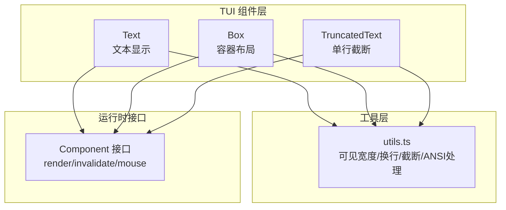
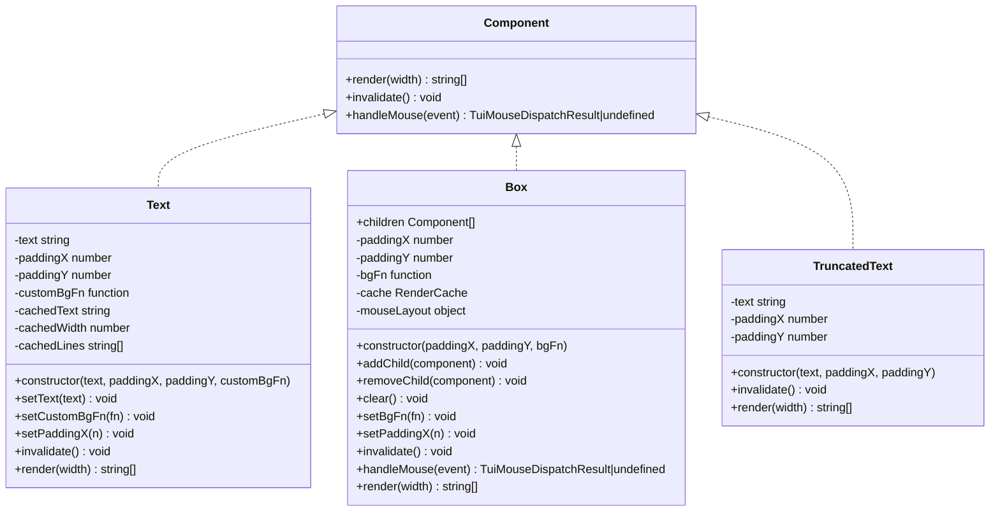
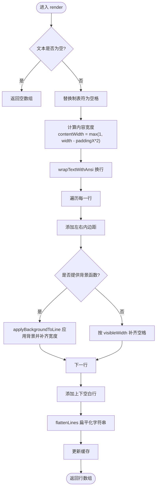
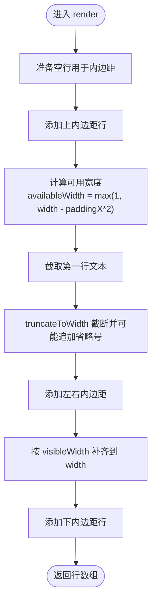
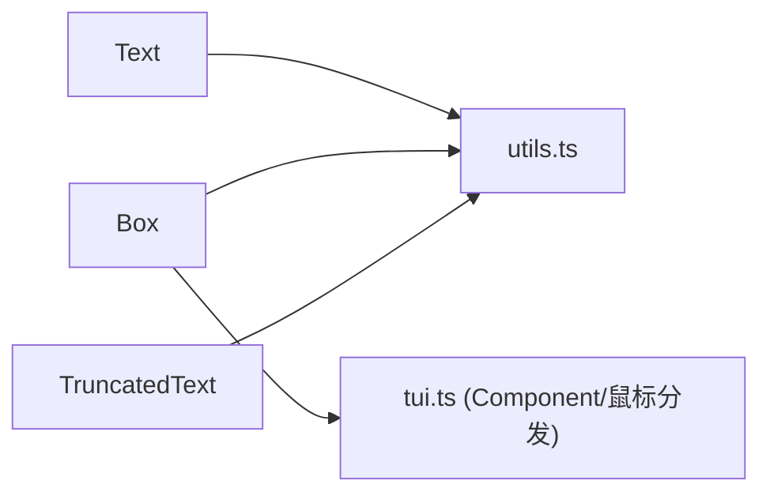

# 基础组件

<cite>
**本文引用的文件**
- [text.ts](file://packages/tui/src/components/text.ts)
- [box.ts](file://packages/tui/src/components/box.ts)
- [truncated-text.ts](file://packages/tui/src/components/truncated-text.ts)
- [utils.ts](file://packages/tui/src/utils.ts)
- [tui.ts](file://packages/tui/src/tui.ts)
- [text.test.ts](file://packages/tui/test/text.test.ts)
- [truncated-text.test.ts](file://packages/tui/test/truncated-text.test.ts)
</cite>

## 目录
1. [简介](#简介)
2. [项目结构](#项目结构)
3. [核心组件](#核心组件)
4. [架构总览](#架构总览)
5. [详细组件分析](#详细组件分析)
6. [依赖关系分析](#依赖关系分析)
7. [性能与渲染机制](#性能与渲染机制)
8. [常见问题排查](#常见问题排查)
9. [结论](#结论)

## 简介
本文件面向终端 UI 框架中的基础 UI 组件，重点说明以下三个核心组件的功能、属性与用法：
- Text：多行文本显示、自动换行、左右上下内边距、可选背景色函数。
- Box：容器组件，对子组件统一应用内边距和背景色，并转发鼠标事件。
- TruncatedText：单行文本截断组件，按可见宽度截断并补全到指定宽度，支持 ANSI 样式。

这些组件共同实现终端界面中“文本显示”“容器布局”“文本截断”等基础能力，并通过统一的 Component 接口参与渲染管线。

## 项目结构
在 TUI 包中，基础组件位于 `packages/tui/src/components` 目录下，工具函数位于 `packages/tui/src/utils.ts`，组件通过 `Component` 接口与渲染系统交互。



图表来源
- [text.ts:1-116](file://packages/tui/src/components/text.ts#L1-L116)
- [box.ts:1-173](file://packages/tui/src/components/box.ts#L1-L173)
- [truncated-text.ts:1-66](file://packages/tui/src/components/truncated-text.ts#L1-L66)
- [utils.ts:247-310](file://packages/tui/src/utils.ts#L247-L310)
- [utils.ts:953-976](file://packages/tui/src/utils.ts#L953-L976)
- [utils.ts:1186-1322](file://packages/tui/src/utils.ts#L1186-L1322)

章节来源
- [text.ts:1-116](file://packages/tui/src/components/text.ts#L1-L116)
- [box.ts:1-173](file://packages/tui/src/components/box.ts#L1-L173)
- [truncated-text.ts:1-66](file://packages/tui/src/components/truncated-text.ts#L1-L66)
- [utils.ts:247-310](file://packages/tui/src/utils.ts#L247-L310)
- [utils.ts:953-976](file://packages/tui/src/utils.ts#L953-L976)
- [utils.ts:1186-1322](file://packages/tui/src/utils.ts#L1186-L1322)

## 核心组件
本节概述三个基础组件的职责与关键行为：
- Text：负责将原始文本按可用宽度进行智能换行，保留 ANSI 样式；支持左右/上下内边距；可选背景色函数；具备渲染缓存。
- Box：作为容器，收集子组件输出，统一添加左右/上下内边距，并可应用背景色；支持鼠标事件转发。
- TruncatedText：仅展示第一行文本，按可见宽度截断（必要时省略号），并将整行补齐到指定宽度；支持 ANSI 样式。

章节来源
- [text.ts:4-23](file://packages/tui/src/components/text.ts#L4-L23)
- [box.ts:11-28](file://packages/tui/src/components/box.ts#L11-L28)
- [truncated-text.ts:4-16](file://packages/tui/src/components/truncated-text.ts#L4-L16)

## 架构总览
组件通过统一的 Component 接口参与渲染：
- render(width): string[]：根据当前可视宽度返回若干行字符串（含 ANSI）。
- invalidate(): void：通知上层该组件的缓存或状态已失效。
- handleMouse(event): ...：可选，用于处理鼠标事件（如 Box）。



图表来源
- [text.ts:7-114](file://packages/tui/src/components/text.ts#L7-L114)
- [box.ts:14-171](file://packages/tui/src/components/box.ts#L14-L171)
- [truncated-text.ts:7-64](file://packages/tui/src/components/truncated-text.ts#L7-L64)

## 详细组件分析

### Text 组件
职责与特性
- 多行文本显示，支持自动换行并保持 ANSI 样式。
- 支持左右内边距 paddingX 与上下内边距 paddingY。
- 可选背景色函数 customBgFn，用于为每行内容设置背景。
- 内部缓存渲染结果，避免重复计算。

关键 API
- constructor(text, paddingX=1, paddingY=1, customBgFn?)
- setText(text)
- setCustomBgFn(fn)
- setPaddingX(n)
- invalidate()
- render(width)

渲染流程要点
- 若文本为空则返回空数组。
- 将制表符替换为固定空格，计算实际内容宽度。
- 使用 wrapTextWithAnsi 进行带 ANSI 的智能换行。
- 逐行添加左右内边距；如有背景函数，则应用背景并补齐到 width。
- 添加上下空白行，最终扁平化字符串树以优化内存。



图表来源
- [text.ts:52-114](file://packages/tui/src/components/text.ts#L52-L114)
- [utils.ts:953-976](file://packages/tui/src/utils.ts#L953-L976)
- [utils.ts:1164-1173](file://packages/tui/src/utils.ts#L1164-L1173)

章节来源
- [text.ts:1-116](file://packages/tui/src/components/text.ts#L1-L116)
- [text.test.ts:5-12](file://packages/tui/test/text.test.ts#L5-L12)

### Box 组件
职责与特性
- 容器组件，聚合多个子组件的输出。
- 统一应用左右/上下内边距，并可应用背景色函数。
- 维护渲染缓存，减少重复计算。
- 支持鼠标事件转发：将事件坐标转换到子组件坐标系。

关键 API
- constructor(paddingX=1, paddingY=1, bgFn?)
- addChild(component)
- removeChild(component)
- clear()
- setBgFn(fn)
- setPaddingX(n)
- invalidate()
- handleMouse(event)
- render(width)

渲染流程要点
- 无子组件时返回空数组。
- 计算 contentWidth，依次调用子组件 render(contentWidth)。
- 合并所有子组件的行，构建鼠标布局缓存。
- 应用背景函数与左右/上下内边距，补齐每行到 width。
- 扁平化后更新缓存。

```mermaid
sequenceDiagram
participant Parent as "父级渲染器"
participant Box as "Box"
participant ChildA as "子组件A"
participant ChildB as "子组件B"
Parent->>Box : render(width)
Box->>ChildA : render(contentWidth)
ChildA-->>Box : linesA
Box->>ChildB : render(contentWidth)
ChildB-->>Box : linesB
Box->>Box : 合并linesA+linesB
Box->>Box : 应用背景/内边距/补齐宽度
Box-->>Parent : 最终行数组
```

图表来源
- [box.ts:106-163](file://packages/tui/src/components/box.ts#L106-L163)

章节来源
- [box.ts:1-173](file://packages/tui/src/components/box.ts#L1-L173)

### TruncatedText 组件
职责与特性
- 单行文本显示，超出可用宽度时截断并追加省略号。
- 支持左右/上下内边距。
- 正确处理 ANSI 样式，确保截断后的行仍补齐到指定宽度。

关键 API
- constructor(text, paddingX=0, paddingY=0)
- invalidate()
- render(width)

渲染流程要点
- 生成空行用于上下内边距。
- 取文本的第一行（遇到换行即停止）。
- 使用 truncateToWidth 按可见宽度截断，必要时追加省略号。
- 添加左右内边距，再按 visibleWidth 补齐到 width。



图表来源
- [truncated-text.ts:22-63](file://packages/tui/src/components/truncated-text.ts#L22-L63)
- [utils.ts:1186-1322](file://packages/tui/src/utils.ts#L1186-L1322)

章节来源
- [truncated-text.ts:1-66](file://packages/tui/src/components/truncated-text.ts#L1-L66)
- [truncated-text.test.ts:10-129](file://packages/tui/test/truncated-text.test.ts#L10-L129)

## 依赖关系分析
- Text 依赖 utils 中的换行、背景应用、可见宽度与字符串扁平化工具。
- Box 依赖 utils 中的可见宽度与字符串扁平化工具，同时依赖 Component 接口与鼠标分发逻辑。
- TruncatedText 依赖 utils 中的可见宽度与截断工具。



图表来源
- [text.ts:1-2](file://packages/tui/src/components/text.ts#L1-L2)
- [box.ts:1-2](file://packages/tui/src/components/box.ts#L1-L2)
- [truncated-text.ts:1-2](file://packages/tui/src/components/truncated-text.ts#L1-L2)
- [utils.ts:247-310](file://packages/tui/src/utils.ts#L247-L310)
- [utils.ts:953-976](file://packages/tui/src/utils.ts#L953-L976)
- [utils.ts:1164-1173](file://packages/tui/src/utils.ts#L1164-L1173)
- [utils.ts:1186-1322](file://packages/tui/src/utils.ts#L1186-L1322)

章节来源
- [text.ts:1-116](file://packages/tui/src/components/text.ts#L1-L116)
- [box.ts:1-173](file://packages/tui/src/components/box.ts#L1-L173)
- [truncated-text.ts:1-66](file://packages/tui/src/components/truncated-text.ts#L1-L66)
- [utils.ts:247-310](file://packages/tui/src/utils.ts#L247-L310)
- [utils.ts:953-976](file://packages/tui/src/utils.ts#L953-L976)
- [utils.ts:1164-1173](file://packages/tui/src/utils.ts#L1164-L1173)
- [utils.ts:1186-1322](file://packages/tui/src/utils.ts#L1186-L1322)

## 性能与渲染机制
- 可见宽度计算
  - 快速路径：纯 ASCII、制表符与 ANSI 序列可直接计算宽度，避免昂贵的 Unicode 分段。
  - 缓存：非 ASCII 字符串的可见宽度会被缓存，降低重复计算成本。
- 换行算法
  - 保持 ANSI 样式跨行传递，避免样式丢失。
  - 长单词会按图素粒度切分，保证不越界。
- 截断算法
  - 支持 ANSI 与制表符，正确计算可见宽度。
  - 当省略号本身超过目标宽度时，会裁剪省略号并补齐。
- 渲染缓存
  - Text 缓存文本、宽度与行数组，避免重复渲染。
  - Box 缓存子组件行、背景采样值与最终行数组，并在子节点变化时失效。
- 内存优化
  - flattenLines 将 V8 的字符串拼接树扁平化，减少内存占用。

章节来源
- [utils.ts:247-310](file://packages/tui/src/utils.ts#L247-L310)
- [utils.ts:953-976](file://packages/tui/src/utils.ts#L953-L976)
- [utils.ts:1186-1322](file://packages/tui/src/utils.ts#L1186-L1322)
- [text.ts:52-114](file://packages/tui/src/components/text.ts#L52-L114)
- [box.ts:106-163](file://packages/tui/src/components/box.ts#L106-L163)

## 常见问题排查
- 文本未换行或溢出
  - 检查传入 width 是否过小，或 paddingX 过大导致 contentWidth 不足。
  - 确认文本包含 ANSI 样式时，换行逻辑是否正确（由 wrapTextWithAnsi 处理）。
- 行宽不一致
  - 确保每行都经过 applyBackgroundToLine 或按 visibleWidth 补齐空格。
  - 使用 visibleWidth 验证输出行的可见宽度是否符合预期。
- 截断异常
  - 确认 truncateToWidth 的目标宽度已扣除左右内边距。
  - 检查省略号是否被正确追加，且 ANSI 样式在省略号前正确关闭。
- 背景色闪烁或错位
  - 确保背景函数应用在已补齐到 width 的行上。
  - 注意 underline/strikethrough 需要在行尾正确关闭，避免样式泄漏到填充区域。

章节来源
- [text.ts:74-114](file://packages/tui/src/components/text.ts#L74-L114)
- [box.ts:140-171](file://packages/tui/src/components/box.ts#L140-L171)
- [truncated-text.ts:33-63](file://packages/tui/src/components/truncated-text.ts#L33-L63)
- [utils.ts:1164-1173](file://packages/tui/src/utils.ts#L1164-L1173)
- [utils.ts:1186-1322](file://packages/tui/src/utils.ts#L1186-L1322)

## 结论
Text、Box、TruncatedText 构成了终端 UI 的基础设施：
- Text 提供稳健的多行文本显示与样式保持。
- Box 提供灵活的容器布局与背景控制，并支持鼠标事件转发。
- TruncatedText 提供安全的单行截断与宽度对齐。

三者均基于统一的 Component 接口，配合 utils.ts 中的可见宽度、换行、截断与 ANSI 处理工具，形成高性能、可维护的基础组件体系。在实际使用中，建议优先使用这些组件组合构建更复杂的界面，以获得一致的渲染行为与良好的性能表现。