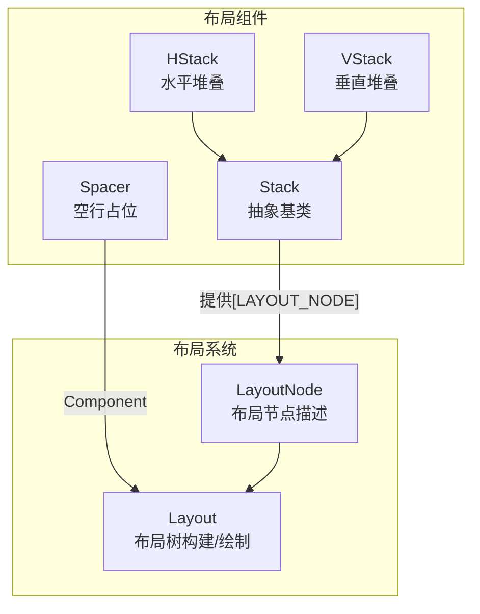
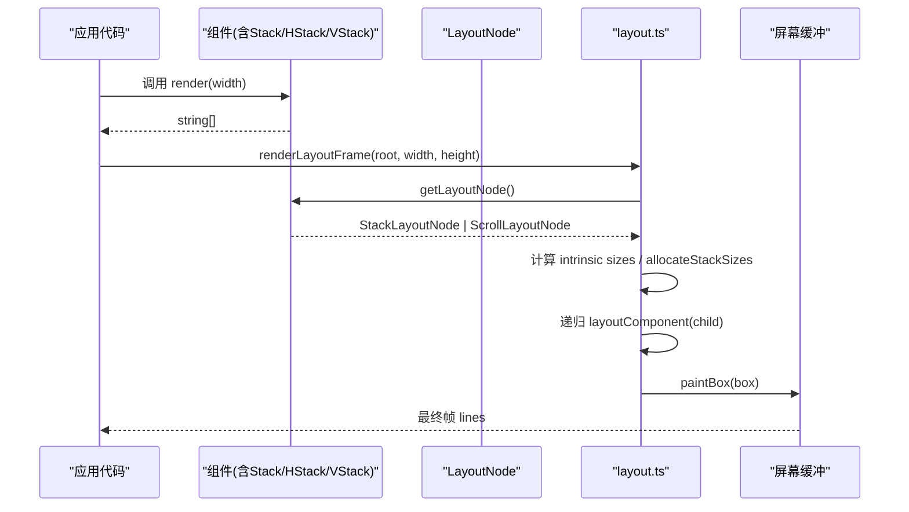
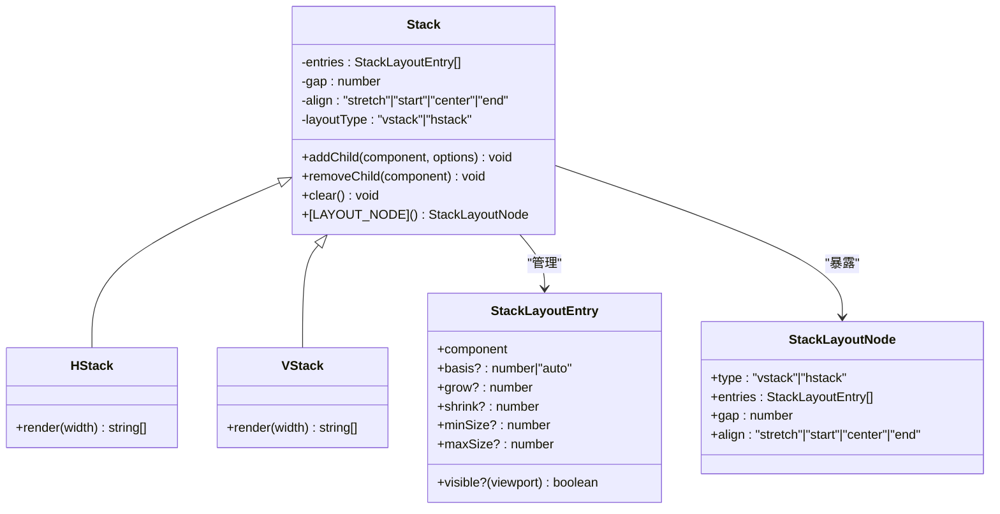
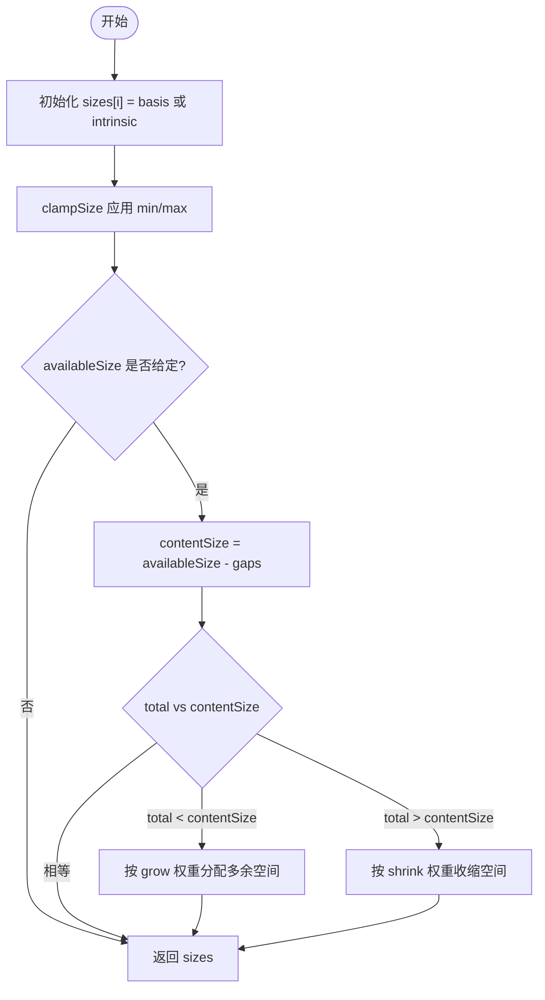
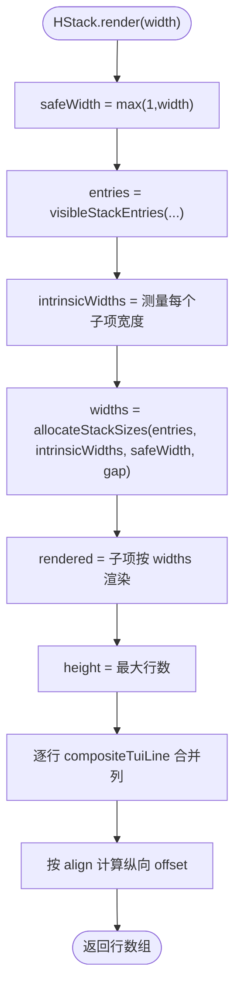
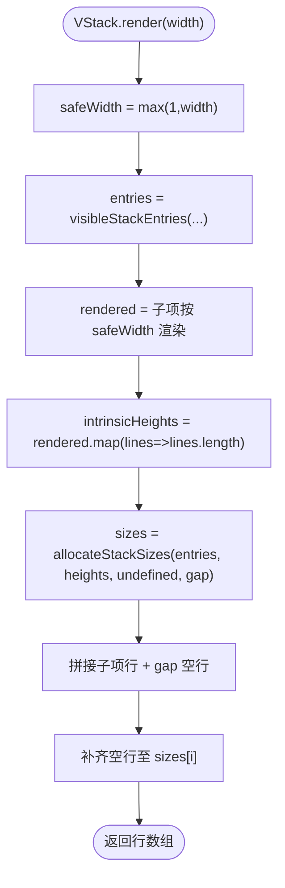
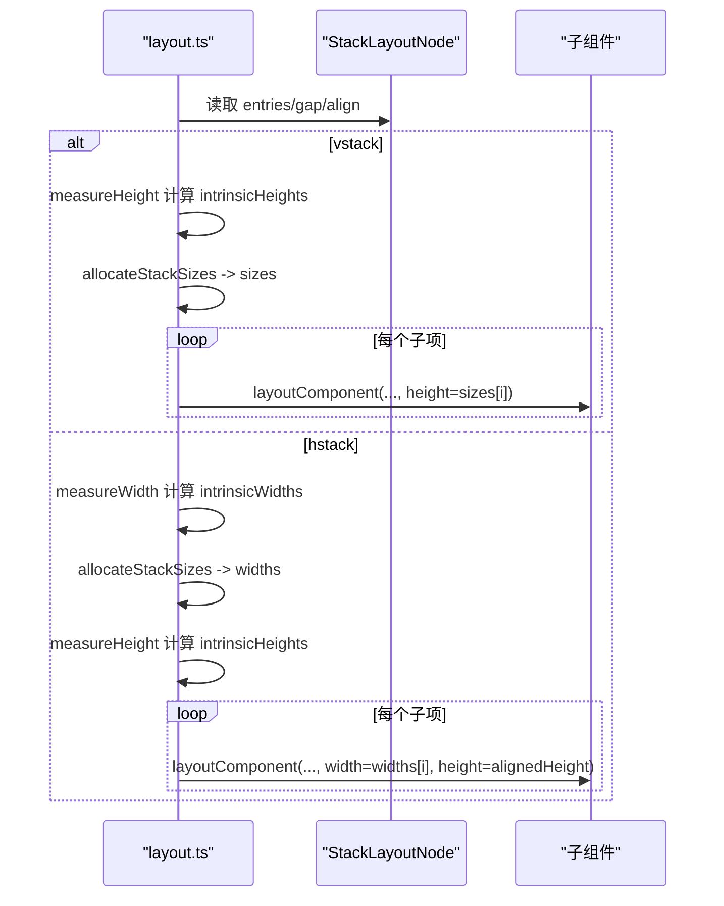
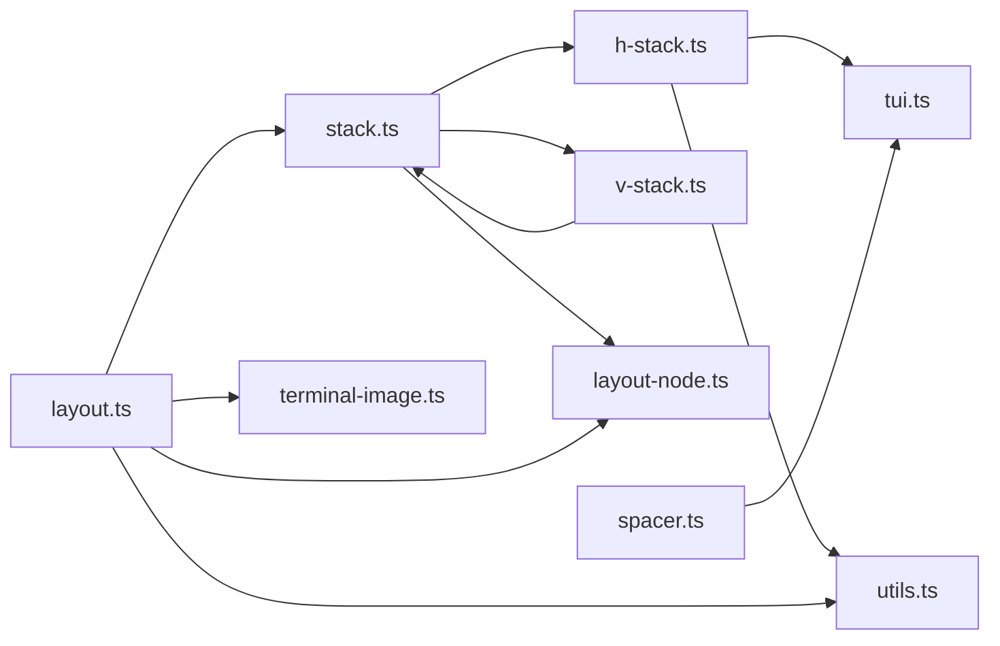

# 布局组件

<cite>
**本文引用的文件**   
- [packages/tui/src/components/stack.ts](file://packages/tui/src/components/stack.ts)
- [packages/tui/src/components/h-stack.ts](file://packages/tui/src/components/h-stack.ts)
- [packages/tui/src/components/v-stack.ts](file://packages/tui/src/components/v-stack.ts)
- [packages/tui/src/components/spacer.ts](file://packages/tui/src/components/spacer.ts)
- [packages/tui/src/layout-node.ts](file://packages/tui/src/layout-node.ts)
- [packages/tui/src/layout.ts](file://packages/tui/src/layout.ts)
- [packages/tui/test/layout.test.ts](file://packages/tui/test/layout.test.ts)
</cite>

## 目录
1. [简介](#简介)
2. [项目结构](#项目结构)
3. [核心组件](#核心组件)
4. [架构总览](#架构总览)
5. [详细组件分析](#详细组件分析)
6. [依赖关系分析](#依赖关系分析)
7. [性能与复杂度](#性能与复杂度)
8. [使用示例与最佳实践](#使用示例与最佳实践)
9. [故障排查](#故障排查)
10. [结论](#结论)

## 简介
本文件系统性梳理 TUI 包中的布局子系统，重点说明 Stack、HStack、VStack、Spacer 等布局组件的功能特性、参数含义、组合模式、对齐方式、间距控制以及响应式布局策略。文档同时给出类图、时序图和流程图，帮助读者从“概念”到“实现细节”逐步理解布局系统如何工作。

## 项目结构
TUI 的布局能力由以下关键模块组成：
- 抽象布局容器与尺寸分配算法：`components/stack.ts`
- 水平布局容器：`components/h-stack.ts`
- 垂直布局容器：`components/v-stack.ts`
- 弹性空白占位组件：`components/spacer.ts`
- 布局节点描述与类型定义：`layout-node.ts`
- 布局树构建、测量、裁剪与绘制管线：`layout.ts`
- 布局行为测试用例：`test/layout.test.ts`

**图表来源**
- [packages/tui/src/components/stack.ts:32-79](file://packages/tui/src/components/stack.ts#L32-L79)
- [packages/tui/src/components/h-stack.ts:5-44](file://packages/tui/src/components/h-stack.ts#L5-L44)
- [packages/tui/src/components/v-stack.ts:3-30](file://packages/tui/src/components/v-stack.ts#L3-L30)
- [packages/tui/src/components/spacer.ts:6-27](file://packages/tui/src/components/spacer.ts#L6-L27)
- [packages/tui/src/layout-node.ts:3-51](file://packages/tui/src/layout-node.ts#L3-L51)
- [packages/tui/src/layout.ts:106-247](file://packages/tui/src/layout.ts#L106-L247)

**章节来源**
- [packages/tui/src/components/stack.ts:1-155](file://packages/tui/src/components/stack.ts#L1-L155)
- [packages/tui/src/components/h-stack.ts:1-45](file://packages/tui/src/components/h-stack.ts#L1-L45)
- [packages/tui/src/components/v-stack.ts:1-34](file://packages/tui/src/components/v-stack.ts#L1-L34)
- [packages/tui/src/components/spacer.ts:1-29](file://packages/tui/src/components/spacer.ts#L1-L29)
- [packages/tui/src/layout-node.ts:1-52](file://packages/tui/src/layout-node.ts#L1-L52)
- [packages/tui/src/layout.ts:1-454](file://packages/tui/src/layout.ts#L1-L454)

## 核心组件
- Stack（抽象）
  - 职责：维护子项列表、间距 gap、对齐 align；将子项规范化为布局条目 entries；对外暴露 `[LAYOUT_NODE]` 供布局系统读取。
  - 关键能力：
    - 子项支持两种形式：直接 Component，或带选项的对象 { component, basis/grow/shrink/minSize/maxSize/visible }。
    - 尺寸分配算法 allocateStackSizes 支持 grow/shrink/basis/min/max 约束，并考虑 gap。
    - visibleStackEntries 根据 viewport 过滤可见子项。
- HStack
  - 职责：水平方向排列子项，按宽度分配空间，支持垂直方向的对齐（start/center/end/stretch）。
  - 渲染流程：先测量每个子项的内在宽度，再分配宽度，最后合成每行输出。
- VStack
  - 职责：垂直方向排列子项，按高度分配空间，支持拉伸对齐。
  - 渲染流程：先测量每个子项的高度，再分配高度，拼接行数组并填充空行以对齐。
- Spacer
  - 职责：渲染指定数量的空行，常用于在 VStack 中制造弹性空白。

**章节来源**
- [packages/tui/src/components/stack.ts:4-22](file://packages/tui/src/components/stack.ts#L4-L22)
- [packages/tui/src/components/stack.ts:32-79](file://packages/tui/src/components/stack.ts#L32-L79)
- [packages/tui/src/components/h-stack.ts:5-44](file://packages/tui/src/components/h-stack.ts#L5-L44)
- [packages/tui/src/components/v-stack.ts:3-30](file://packages/tui/src/components/v-stack.ts#L3-L30)
- [packages/tui/src/components/spacer.ts:6-27](file://packages/tui/src/components/spacer.ts#L6-L27)

## 架构总览
布局系统采用“声明式布局节点 + 两阶段布局”的模式：
- 组件通过 `[LAYOUT_NODE]` 暴露布局意图（如 vstack/hstack），包含 entries、gap、align。
- 布局器 layout.ts 遍历组件树，解析 LayoutNode，计算 rect、clip，生成 LayoutBox 树。
- 对 Stack 节点，使用 allocateStackSizes 进行 grow/shrink/basis/min/max 的尺寸分配，再递归布局子节点。
- 最终 paintBox 将各 Box 的 lines 合成到屏幕缓冲区，处理滚动条、图像裁剪等。

**图表来源**
- [packages/tui/src/layout.ts:383-412](file://packages/tui/src/layout.ts#L383-L412)
- [packages/tui/src/layout.ts:106-247](file://packages/tui/src/layout.ts#L106-L247)
- [packages/tui/src/layout-node.ts:44-51](file://packages/tui/src/layout-node.ts#L44-L51)
- [packages/tui/src/components/stack.ts:72-79](file://packages/tui/src/components/stack.ts#L72-L79)

## 详细组件分析

### Stack 抽象类与尺寸分配
Stack 是所有堆叠布局的基类，负责：
- 规范化子项为 entries，记录 basis/grow/shrink/minSize/maxSize/visible。
- 提供 `[LAYOUT_NODE]` 返回 StackLayoutNode，供布局系统识别。
- 提供 visibleStackEntries 基于 viewport 过滤可见子项。
- 提供 allocateStackSizes 实现弹性尺寸分配。

**图表来源**
- [packages/tui/src/components/stack.ts:32-79](file://packages/tui/src/components/stack.ts#L32-L79)
- [packages/tui/src/components/h-stack.ts:5-10](file://packages/tui/src/components/h-stack.ts#L5-L10)
- [packages/tui/src/components/v-stack.ts:3-8](file://packages/tui/src/components/v-stack.ts#L3-L8)
- [packages/tui/src/layout-node.ts:10-25](file://packages/tui/src/layout-node.ts#L10-L25)

#### 尺寸分配算法 allocateStackSizes
该函数是布局系统的核心，决定每个子项的最终尺寸：
- 初始尺寸：若 entry.basis 为数字则用 basis，否则用 intrinsicSizes[index]（auto）。
- 边界约束：clampSize 确保 minSize ≤ size ≤ maxSize。
- 总量调整：
  - 若可用空间 > 总和：按 grow 权重分配多余空间。
  - 若可用空间 < 总和：按 shrink 权重收缩空间。
- gap 参与：contentSize = availableSize - (entries.length - 1) * gap。

**图表来源**
- [packages/tui/src/components/stack.ts:89-154](file://packages/tui/src/components/stack.ts#L89-L154)

**章节来源**
- [packages/tui/src/components/stack.ts:24-59](file://packages/tui/src/components/stack.ts#L24-L59)
- [packages/tui/src/components/stack.ts:82-87](file://packages/tui/src/components/stack.ts#L82-L87)
- [packages/tui/src/components/stack.ts:89-154](file://packages/tui/src/components/stack.ts#L89-L154)

### HStack 水平布局
- 布局方向：水平。
- 对齐方式：垂直方向对齐（start/center/end），默认 stretch。
- 渲染步骤：
  1) 安全宽度 safeWidth = max(1, width)。
  2) 过滤可见子项 visibleStackEntries。
  3) 测量每个子项的内在宽度（取各行可见宽度最大值）。
  4) 调用 allocateStackSizes 分配宽度。
  5) 按分配宽度再次渲染子项。
  6) 合成每行结果，按 align 计算纵向偏移 offset。
  7) 使用 compositeTuiLine 合并左右相邻子项的行内容。

**图表来源**
- [packages/tui/src/components/h-stack.ts:12-43](file://packages/tui/src/components/h-stack.ts#L12-L43)

**章节来源**
- [packages/tui/src/components/h-stack.ts:1-45](file://packages/tui/src/components/h-stack.ts#L1-L45)

### VStack 垂直布局
- 布局方向：垂直。
- 对齐方式：垂直方向拉伸（stretch），可通过 padding 空行保证统一高度。
- 渲染步骤：
  1) 安全宽度 safeWidth = max(1, width)。
  2) 过滤可见子项。
  3) 渲染所有子项得到 lines 数组。
  4) 以 lines.length 作为 intrinsicHeights，调用 allocateStackSizes 分配高度。
  5) 拼接子项行，并在子项之间插入 gap 空行。
  6) 对不足高度的子项补空行，使每个子项达到分配高度。

**图表来源**
- [packages/tui/src/components/v-stack.ts:10-30](file://packages/tui/src/components/v-stack.ts#L10-L30)

**章节来源**
- [packages/tui/src/components/v-stack.ts:1-34](file://packages/tui/src/components/v-stack.ts#L1-L34)

### Spacer 弹性空白
- 作用：渲染固定数量的空行，常用于在 VStack 中占据 grow 空间，形成弹性间距。
- 用法：在 VStack 中以 { component: new Spacer(n), grow: 1 } 的形式加入，配合 grow 属性可自动填充剩余空间。

**章节来源**
- [packages/tui/src/components/spacer.ts:1-29](file://packages/tui/src/components/spacer.ts#L1-L29)

### 布局系统与 Stack 的协作
- Stack 通过 `[LAYOUT_NODE]` 返回 StackLayoutNode，包含 type、entries、gap、align。
- layout.ts 的 layoutComponent 根据 node.type 分支处理 vstack/hstack：
  - vstack：测量 intrinsicHeights，分配 sizes，递归布局子项，childY += size + gap。
  - hstack：测量 intrinsicWidths，分配 widths，再测量 intrinsicHeights，按 align 计算 childY 偏移，递归布局子项，childX += width + gap。

**图表来源**
- [packages/tui/src/layout.ts:170-247](file://packages/tui/src/layout.ts#L170-L247)
- [packages/tui/src/components/stack.ts:72-79](file://packages/tui/src/components/stack.ts#L72-L79)

**章节来源**
- [packages/tui/src/layout.ts:106-247](file://packages/tui/src/layout.ts#L106-L247)
- [packages/tui/src/layout-node.ts:10-25](file://packages/tui/src/layout-node.ts#L10-L25)

## 依赖关系分析
- components/stack.ts
  - 依赖 layout-node.ts 的类型与符号。
  - 被 h-stack.ts、v-stack.ts 复用尺寸分配与可见性过滤逻辑。
- components/h-stack.ts
  - 依赖 stack.ts 的 allocateStackSizes、visibleStackEntries、Stack。
  - 依赖 tui.ts 的 compositeTuiLine 用于行合成。
  - 依赖 utils.ts 的 visibleWidth 用于宽度测量。
- components/v-stack.ts
  - 依赖 stack.ts 的 allocateStackSizes、visibleStackEntries、Stack。
- components/spacer.ts
  - 仅实现 Component 接口，无外部布局依赖。
- layout.ts
  - 依赖 components/stack.ts 的 allocateStackSizes、visibleStackEntries。
  - 依赖 layout-node.ts 的 getLayoutNode、StackLayoutNode。
  - 依赖 terminal-image.ts、utils.ts 等辅助功能。

**图表来源**
- [packages/tui/src/components/stack.ts:1-2](file://packages/tui/src/components/stack.ts#L1-L2)
- [packages/tui/src/components/h-stack.ts:1-3](file://packages/tui/src/components/h-stack.ts#L1-L3)
- [packages/tui/src/components/v-stack.ts:1-1](file://packages/tui/src/components/v-stack.ts#L1-L1)
- [packages/tui/src/layout.ts:1-12](file://packages/tui/src/layout.ts#L1-L12)

**章节来源**
- [packages/tui/src/components/stack.ts:1-2](file://packages/tui/src/components/stack.ts#L1-L2)
- [packages/tui/src/components/h-stack.ts:1-3](file://packages/tui/src/components/h-stack.ts#L1-L3)
- [packages/tui/src/components/v-stack.ts:1-1](file://packages/tui/src/components/v-stack.ts#L1-L1)
- [packages/tui/src/layout.ts:1-12](file://packages/tui/src/layout.ts#L1-L12)

## 性能与复杂度
- 时间复杂度
  - 测量阶段：对每个子项进行一次 render(width)，O(N) 次渲染调用。
  - 分配阶段：allocateStackSizes 内部 distribute 循环按权重分配，最坏 O(N·K)（K 为迭代次数，通常很小）。
  - 合成阶段：HStack 使用 compositeTuiLine 合并行，整体 O(W·H) 级别的字符串操作。
- 空间复杂度
  - 缓存：layout.ts 使用 renderCache 缓存组件在不同 width 下的渲染结果，避免重复渲染。
  - 布局树：LayoutBox 树规模与组件数线性相关。
- 优化建议
  - 合理使用 basis 减少测量开销。
  - 使用 visible 回调隐藏不可见子项，减少渲染量。
  - 在 VStack 中使用 Spacer + grow 替代手动计算空白行。

**章节来源**
- [packages/tui/src/layout.ts:68-89](file://packages/tui/src/layout.ts#L68-L89)
- [packages/tui/src/components/stack.ts:95-133](file://packages/tui/src/components/stack.ts#L95-L133)

## 使用示例与最佳实践

### 基础用法
- 垂直布局 VStack
  - 将多个文本或组件放入 VStack，默认按高度堆叠。
  - 使用 gap 控制行间距。
  - 使用 align="stretch" 让子项高度填满父容器。
- 水平布局 HStack
  - 将多个组件放入 HStack，默认按宽度排列。
  - 使用 align="center" 或 "end" 控制垂直方向对齐。
  - 使用 gap 控制列间距。

参考路径
- [packages/tui/src/components/v-stack.ts:10-30](file://packages/tui/src/components/v-stack.ts#L10-L30)
- [packages/tui/src/components/h-stack.ts:12-43](file://packages/tui/src/components/h-stack.ts#L12-L43)

### 弹性间距与自适应
- 在 VStack 中，使用 Spacer 作为 grow 子项，自动填充剩余高度。
- 在 HStack 中，使用 Spacer 作为 grow 子项，自动填充剩余宽度。
- 结合 basis 设置子项初始尺寸，grow/shrink 控制弹性行为。

参考路径
- [packages/tui/test/layout.test.ts:15-32](file://packages/tui/test/layout.test.ts#L15-L32)
- [packages/tui/src/components/stack.ts:135-154](file://packages/tui/src/components/stack.ts#L135-L154)

### 对齐与间距
- align 取值
  - stretch：默认，尽量拉伸子项以填满容器。
  - start：顶部/左侧对齐。
  - center：居中。
  - end：底部/右侧对齐。
- gap 取值
  - 非负整数，表示子项之间的额外空白行/列。

参考路径
- [packages/tui/src/components/stack.ts:19-22](file://packages/tui/src/components/stack.ts#L19-L22)
- [packages/tui/src/layout.ts:170-247](file://packages/tui/src/layout.ts#L170-L247)

### 响应式可见性
- 使用 visible(viewport) 回调根据视口大小显示/隐藏子项。
- 适用于在小屏隐藏次要信息，在大屏展示完整布局。

参考路径
- [packages/tui/src/components/stack.ts:82-87](file://packages/tui/src/components/stack.ts#L82-L87)

### 组合模式
- 嵌套布局：HStack 内嵌 VStack，或反之，形成复杂网格。
- 与 ScrollView 组合：外层 VStack 承载内容，内层 ScrollView 承载长列表。

参考路径
- [packages/tui/src/layout.ts:136-168](file://packages/tui/src/layout.ts#L136-L168)

## 故障排查
- 子项未显示
  - 检查 visible 回调是否错误地返回 false。
  - 确认 basis/grow/shrink 配置是否导致尺寸为 0。
- 对齐异常
  - HStack 的 align 控制垂直方向对齐，不是水平方向。
  - VStack 默认 stretch，如需其他对齐需在外层容器调整。
- 间距不生效
  - 确认 gap 为非负整数。
  - 注意首个子项前不会插入 gap。
- 性能问题
  - 大量子项时，优先使用 visible 隐藏不可见项。
  - 避免频繁变更 basis/grow/shrink，减少重新分配。

**章节来源**
- [packages/tui/src/components/stack.ts:82-87](file://packages/tui/src/components/stack.ts#L82-L87)
- [packages/tui/src/components/h-stack.ts:32-35](file://packages/tui/src/components/h-stack.ts#L32-L35)
- [packages/tui/src/components/v-stack.ts:21-28](file://packages/tui/src/components/v-stack.ts#L21-L28)

## 结论
Stack、HStack、VStack、Spacer 共同构成了 TUI 的弹性布局体系。通过 basis/grow/shrink/minSize/maxSize/visible 的组合，可以在不同终端尺寸下实现稳定且灵活的界面。布局系统以 StackLayoutNode 为中心，将声明式布局转化为可测量的 LayoutBox 树，并通过 allocateStackSizes 实现高效的尺寸分配。掌握这些组件的参数与行为，即可构建出健壮、可维护的终端用户界面。