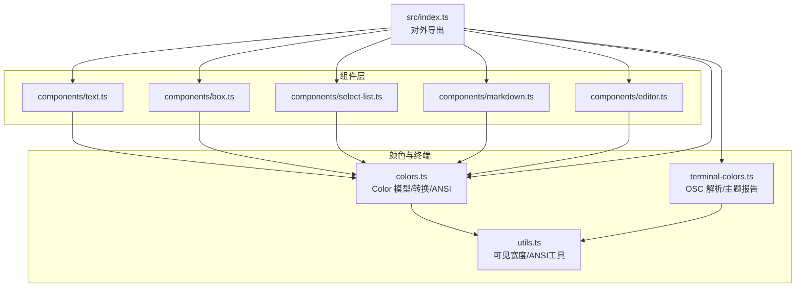
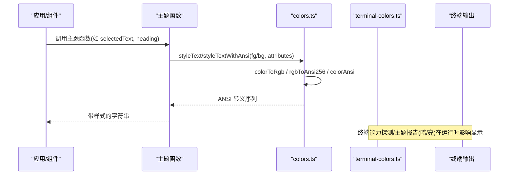
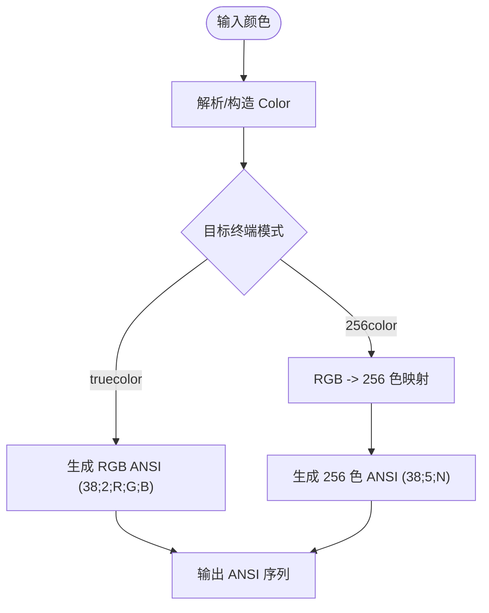
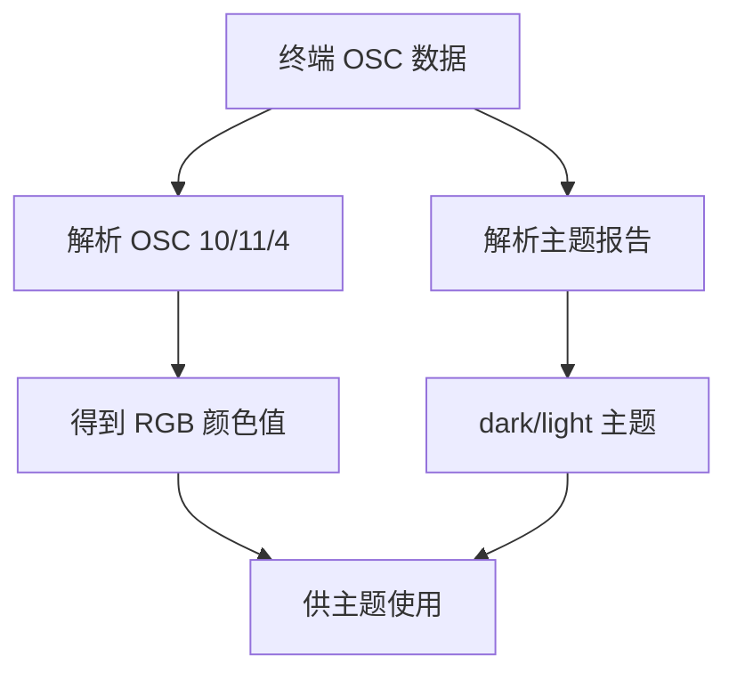
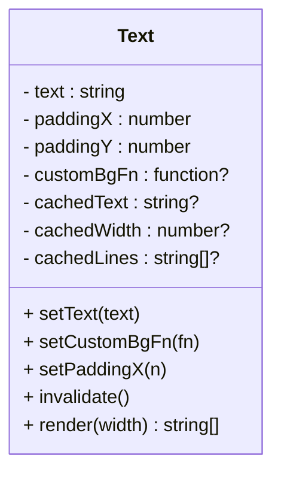
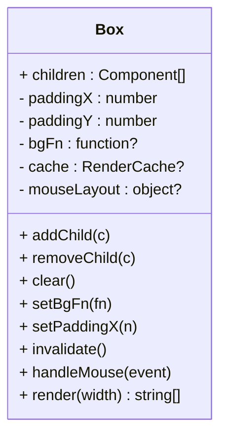
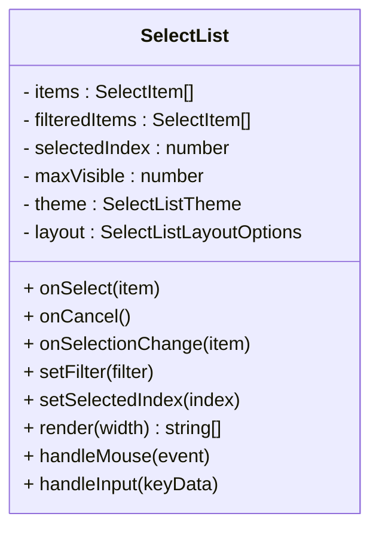
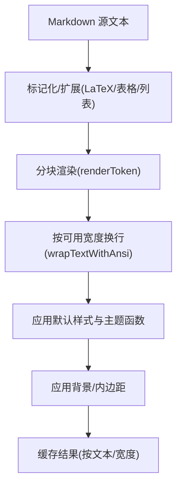
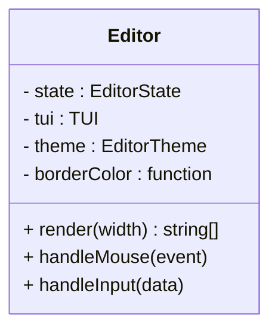
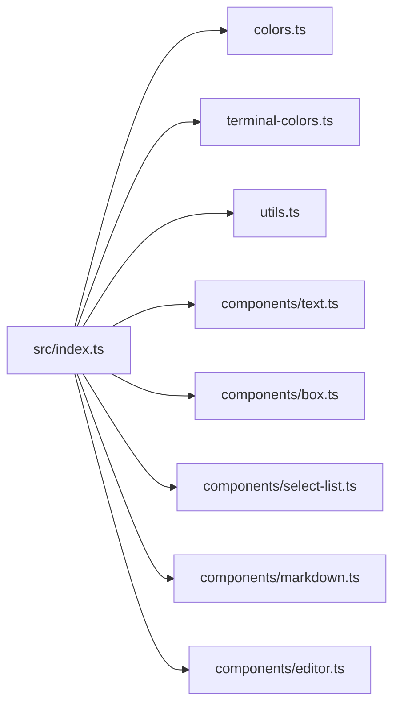

# 主题定制系统

<cite>
**本文引用的文件**   
- [packages/tui/src/colors.ts](file://packages/tui/src/colors.ts)
- [packages/tui/src/terminal-colors.ts](file://packages/tui/src/terminal-colors.ts)
- [packages/tui/src/utils.ts](file://packages/tui/src/utils.ts)
- [packages/tui/src/components/text.ts](file://packages/tui/src/components/text.ts)
- [packages/tui/src/components/box.ts](file://packages/tui/src/components/box.ts)
- [packages/tui/src/components/select-list.ts](file://packages/tui/src/components/select-list.ts)
- [packages/tui/src/components/markdown.ts](file://packages/tui/src/components/markdown.ts)
- [packages/tui/src/components/editor.ts](file://packages/tui/src/components/editor.ts)
- [packages/tui/src/index.ts](file://packages/tui/src/index.ts)
- [packages/tui/test/test-themes.ts](file://packages/tui/test/test-themes.ts)
</cite>

## 目录
1. [简介](#简介)
2. [项目结构](#项目结构)
3. [核心组件](#核心组件)
4. [架构总览](#架构总览)
5. [详细组件分析](#详细组件分析)
6. [依赖关系分析](#依赖关系分析)
7. [性能与可访问性](#性能与可访问性)
8. [故障排查指南](#故障排查指南)
9. [结论](#结论)
10. [附录：主题开发最佳实践](#附录主题开发最佳实践)

## 简介
本文件系统性阐述 TUI 主题定制体系，覆盖颜色系统、主题配置、样式定义与视觉反馈机制。重点包括：
- ColorPalette 设计：索引色、RGB、OKLCH 统一抽象，支持 ANSI 256 色与真彩输出
- 终端能力探测与主题适配：暗/亮主题检测、OSC 调色板解析
- 组件级样式：文本、容器、选择列表、Markdown、编辑器的主题接口
- 动态主题切换与可访问性建议
- 主题示例与最佳实践

## 项目结构
TUI 的主题能力由“颜色内核 + 终端能力 + 组件主题”三层构成：
- 颜色内核：colors.ts 提供 Color 类型、转换与 ANSI 编码；oklab.ts 提供色彩空间转换（被 colors.ts 引用）
- 终端能力：terminal-colors.ts 解析 OSC 响应与主题报告；utils.ts 提供可见宽度、ANSI 处理等工具
- 组件主题：text.ts、box.ts、select-list.ts、markdown.ts、editor.ts 暴露主题接口并消费颜色能力

图表来源
- [packages/tui/src/colors.ts:1-368](file://packages/tui/src/colors.ts#L1-L368)
- [packages/tui/src/terminal-colors.ts:1-92](file://packages/tui/src/terminal-colors.ts#L1-L92)
- [packages/tui/src/utils.ts:1-800](file://packages/tui/src/utils.ts#L1-L800)
- [packages/tui/src/components/text.ts:1-116](file://packages/tui/src/components/text.ts#L1-L116)
- [packages/tui/src/components/box.ts:1-173](file://packages/tui/src/components/box.ts#L1-L173)
- [packages/tui/src/components/select-list.ts:1-282](file://packages/tui/src/components/select-list.ts#L1-L282)
- [packages/tui/src/components/markdown.ts:1-800](file://packages/tui/src/components/markdown.ts#L1-L800)
- [packages/tui/src/components/editor.ts:1-800](file://packages/tui/src/components/editor.ts#L1-L800)
- [packages/tui/src/index.ts:1-198](file://packages/tui/src/index.ts#L1-L198)

章节来源
- [packages/tui/src/index.ts:1-198](file://packages/tui/src/index.ts#L1-L198)

## 核心组件
- Color 模型与转换
  - 统一 Color 联合类型：indexed / rgb / oklch
  - 工厂函数：indexedColor、rgbColor、oklchColor、okhslColor
  - 解析器：parseColor 支持数字、十六进制、oklch()/okhsl()
  - 转换：colorToRgb、colorToOklch、colorToHex、mixColors
  - ANSI 输出：foregroundAnsi、backgroundAnsi、styleText、styleTextWithAnsi
- 终端颜色与主题
  - TerminalColors：默认前景/背景、16 色调色板
  - parseOscColorResponse：解析 OSC 10/11/4 响应
  - parseTerminalColorSchemeReport：解析暗/亮主题报告
- 组件主题接口
  - Text：基础文本渲染，支持自定义背景函数
  - Box：容器，统一应用背景与内边距
  - SelectList：选择列表主题（选中前缀/文本/描述/滚动信息/无匹配）
  - Markdown：标题、链接、代码块、引用、分隔线等主题函数
  - Editor：边框颜色与内部 SelectList 主题

章节来源
- [packages/tui/src/colors.ts:1-368](file://packages/tui/src/colors.ts#L1-L368)
- [packages/tui/src/terminal-colors.ts:1-92](file://packages/tui/src/terminal-colors.ts#L1-L92)
- [packages/tui/src/components/text.ts:1-116](file://packages/tui/src/components/text.ts#L1-L116)
- [packages/tui/src/components/box.ts:1-173](file://packages/tui/src/components/box.ts#L1-L173)
- [packages/tui/src/components/select-list.ts:1-282](file://packages/tui/src/components/select-list.ts#L1-L282)
- [packages/tui/src/components/markdown.ts:1-800](file://packages/tui/src/components/markdown.ts#L1-L800)
- [packages/tui/src/components/editor.ts:1-800](file://packages/tui/src/components/editor.ts#L1-L800)

## 架构总览
颜色从高层语义到终端输出的关键路径如下：

图表来源
- [packages/tui/src/colors.ts:218-368](file://packages/tui/src/colors.ts#L218-L368)
- [packages/tui/src/terminal-colors.ts:44-91](file://packages/tui/src/terminal-colors.ts#L44-L91)

## 详细组件分析

### 颜色系统与 ColorPalette 设计
- 颜色表示
  - IndexedColor：ANSI 索引色（0-255）
  - RgbColorValue：sRGB 三元组
  - OklchColorValue：感知均匀的色彩空间，利于混合与对比度控制
- 颜色解析与构造
  - parseColor 支持数字、十六进制、oklch()/okhsl()
  - oklchColor/okhslColor 进行参数校验与范围归一化
- 颜色空间转换
  - colorToRgb：将 indexed/oklch 转为 sRGB
  - colorToOklch：用于 OKLCH 域计算
  - colorToHex：便于调试与序列化
- 颜色混合
  - mixColors：支持 oklch/srgb 两种混合空间，保持色相连续性
- ANSI 输出
  - foregroundAnsi/backgroundAnsi：根据模式输出 256 色或真彩
  - styleText/styleTextWithAnsi：组合 SGR 属性与颜色

图表来源
- [packages/tui/src/colors.ts:279-307](file://packages/tui/src/colors.ts#L279-L307)

章节来源
- [packages/tui/src/colors.ts:1-368](file://packages/tui/src/colors.ts#L1-L368)

### 终端颜色与主题探测
- TerminalColors：包含默认前景/背景与 16 色调色板
- parseOscColorResponse：解析 OSC 10/11/4 的颜色回复，兼容多种 HEX 格式
- parseTerminalColorSchemeReport：解析终端报告的暗/亮主题

图表来源
- [packages/tui/src/terminal-colors.ts:1-92](file://packages/tui/src/terminal-colors.ts#L1-L92)

章节来源
- [packages/tui/src/terminal-colors.ts:1-92](file://packages/tui/src/terminal-colors.ts#L1-L92)

### 组件样式与主题接口

#### Text 组件
- 功能：多行文本、自动换行、左右/上下内边距、可选背景函数
- 缓存：按文本与宽度缓存渲染结果
- 背景：通过 customBgFn 对整行应用背景（含填充）

图表来源
- [packages/tui/src/components/text.ts:1-116](file://packages/tui/src/components/text.ts#L1-L116)

章节来源
- [packages/tui/src/components/text.ts:1-116](file://packages/tui/src/components/text.ts#L1-L116)

#### Box 组件
- 功能：容器，统一为子组件添加内边距与背景
- 鼠标事件：将坐标转换到内容区域并分发到子组件
- 缓存：基于 childLines 与 bgSample 的增量更新

图表来源
- [packages/tui/src/components/box.ts:1-173](file://packages/tui/src/components/box.ts#L1-L173)

章节来源
- [packages/tui/src/components/box.ts:1-173](file://packages/tui/src/components/box.ts#L1-L173)

#### SelectList 组件
- 主题接口：selectedPrefix、selectedText、description、scrollInfo、noMatch
- 交互：键盘导航、滚轮、点击选择；支持分页与截断策略
- 布局：主列宽自适应，描述列最小宽度保护

图表来源
- [packages/tui/src/components/select-list.ts:1-282](file://packages/tui/src/components/select-list.ts#L1-L282)

章节来源
- [packages/tui/src/components/select-list.ts:1-282](file://packages/tui/src/components/select-list.ts#L1-L282)

#### Markdown 组件
- 主题接口：heading、link、linkUrl、code、codeBlock、codeBlockBorder、quote、quoteBorder、hr、listBullet、bold、italic、strikethrough、underline、highlightCode、codeBlockIndent
- 默认样式：DefaultTextStyle 支持前景/背景与粗体/斜体/删除线/下划线
- 渲染流程：解析 Markdown -> 分块渲染 -> 换行与背景填充 -> 缓存复用

图表来源
- [packages/tui/src/components/markdown.ts:239-442](file://packages/tui/src/components/markdown.ts#L239-L442)
- [packages/tui/src/components/markdown.ts:444-768](file://packages/tui/src/components/markdown.ts#L444-L768)

章节来源
- [packages/tui/src/components/markdown.ts:1-800](file://packages/tui/src/components/markdown.ts#L1-L800)

#### Editor 组件
- 主题接口：borderColor、selectList（复用 SelectListTheme）
- 行为：光标绘制、历史回退、自动补全菜单（SelectList）、滚动边界指示
- 渲染：顶部/底部边框、可视行数限制、自动补全叠加

图表来源
- [packages/tui/src/components/editor.ts:238-241](file://packages/tui/src/components/editor.ts#L238-L241)
- [packages/tui/src/components/editor.ts:516-636](file://packages/tui/src/components/editor.ts#L516-L636)

章节来源
- [packages/tui/src/components/editor.ts:1-800](file://packages/tui/src/components/editor.ts#L1-L800)

### 测试主题示例
- test-themes.ts 展示了基于 chalk 的默认主题实现，涵盖 SelectList、Markdown、Editor 的基础样式

章节来源
- [packages/tui/test/test-themes.ts:1-39](file://packages/tui/test/test-themes.ts#L1-L39)

## 依赖关系分析
- 模块导出
  - src/index.ts 集中导出颜色、终端能力、组件与工具，供上层应用使用
- 组件耦合
  - 所有组件均依赖 colors.ts 提供的 ANSI 输出与样式封装
  - utils.ts 提供可见宽度、ANSI 提取等通用能力，被多个组件共享
  - terminal-colors.ts 提供终端能力与主题报告解析，独立于组件

图表来源
- [packages/tui/src/index.ts:1-198](file://packages/tui/src/index.ts#L1-L198)

章节来源
- [packages/tui/src/index.ts:1-198](file://packages/tui/src/index.ts#L1-L198)

## 性能与可访问性
- 性能
  - 颜色转换与 ANSI 生成集中在 colors.ts，避免重复计算
  - 组件渲染缓存：Text/Box/Markdown 均按文本与宽度缓存输出，减少重绘
  - utils.ts 中 visibleWidth 对 ASCII+ANSI 快速路径优化，降低分割开销
- 可访问性
  - 使用 OKLCH 混合空间提升色彩感知一致性，有助于对比度控制
  - 主题函数应保证足够的明度差，避免仅用色相区分状态
  - 暗/亮主题检测可驱动主题切换，确保在不同终端背景下可读性

[本节为通用指导，不直接分析具体文件]

## 故障排查指南
- 颜色异常或闪烁
  - 检查是否混用了不同颜色空间（如误将 OKLCH 当作 RGB 使用）
  - 确认终端模式是否为 truecolor；否则 256 色映射可能导致色差
- 主题未生效
  - 确认终端是否支持 OSC 10/11/4 与主题报告
  - 检查 parseOscColorResponse/parseTerminalColorSchemeReport 返回值
- 文本错位或换行异常
  - 检查 ANSI 序列是否正确闭合；utils.ts 中的 ANSI 提取逻辑依赖标准 CSI/OSC/APC 格式
  - 验证可见宽度计算是否受特殊字符（CJK、Emoji）影响

章节来源
- [packages/tui/src/colors.ts:279-307](file://packages/tui/src/colors.ts#L279-L307)
- [packages/tui/src/terminal-colors.ts:44-91](file://packages/tui/src/terminal-colors.ts#L44-L91)
- [packages/tui/src/utils.ts:247-310](file://packages/tui/src/utils.ts#L247-L310)

## 结论
本主题系统以统一的 Color 模型为核心，结合终端能力探测与组件级主题接口，实现了从语义化颜色到终端 ANSI 的稳定输出。通过 OKLCH 色彩空间与 256 色/真彩双通道输出，兼顾了跨终端一致性与视觉表现力。组件层提供了完善的主题钩子，便于构建丰富且可维护的 TUI 界面。

[本节为总结性内容，不直接分析具体文件]

## 附录：主题开发最佳实践
- 颜色选择
  - 优先使用 parseColor/oklchColor/okhslColor 创建颜色，避免硬编码 RGB
  - 使用 mixColors 在 OKLCH 空间混合，获得更自然的过渡
- 主题函数
  - 为每个组件主题函数返回带 ANSI 的字符串，不要直接操作底层转义码
  - 在暗/亮主题下分别调整明度，确保对比度达标
- 终端能力
  - 使用 parseTerminalColorSchemeReport 检测暗/亮主题，动态切换主题集
  - 谨慎依赖 OSC 调色板，必要时提供降级方案
- 性能
  - 利用组件缓存机制，避免频繁重建样式对象
  - 批量渲染时复用已计算的 ANSI 前缀（styleTextWithAnsi）
- 可访问性
  - 避免仅靠颜色表达状态，辅以图标/文字提示
  - 在高对比度模式下测试主题效果

[本节为通用指导，不直接分析具体文件]