# 终端界面系统

<cite>
**本文引用的文件**
- [packages/tui/README.md](file://packages/tui/README.md)
- [packages/tui/src/tui.ts](file://packages/tui/src/tui.ts)
- [packages/tui/src/tui-main-screen.ts](file://packages/tui/src/tui-main-screen.ts)
- [packages/tui/src/layout.ts](file://packages/tui/src/layout.ts)
- [packages/tui/src/colors.ts](file://packages/tui/src/colors.ts)
- [packages/tui/src/keybindings.ts](file://packages/tui/src/keybindings.ts)
- [packages/tui/src/native-platform.ts](file://packages/tui/src/native-platform.ts)
- [packages/tui/src/components/text.ts](file://packages/tui/src/components/text.ts)
- [packages/tui/src/components/input.ts](file://packages/tui/src/components/input.ts)
- [packages/tui/src/components/editor.ts](file://packages/tui/src/components/editor.ts)
- [packages/tui/src/components/select-list.ts](file://packages/tui/src/components/select-list.ts)
- [docs/explains/27-tui-usage.md](file://docs/explains/27-tui-usage.md)
- [packages/coding-agent/src/core/keybindings.ts](file://packages/coding-agent/src/core/keybindings.ts)
</cite>

## 更新摘要
**变更内容**
- 新增了 TUI 使用指南章节，包含详细的终端界面操作说明
- 更新了快捷键系统部分，添加了应用级快捷键定义
- 增强了实际使用场景和故障排查内容
- 补充了会话恢复、工具调用等高级功能说明

## 目录
1. [简介](#简介)
2. [项目结构](#项目结构)
3. [核心组件](#核心组件)
4. [架构总览](#架构总览)
5. [详细组件分析](#详细组件分析)
6. [依赖关系分析](#依赖关系分析)
7. [性能与渲染特性](#性能与渲染特性)
8. [主题定制与样式指南](#主题定制与样式指南)
9. [响应式设计与可访问性](#响应式设计与可访问性)
10. [扩展与自定义最佳实践](#扩展与自定义最佳实践)
11. [TUI 使用指南](#tui-使用指南)
12. [故障排查](#故障排查)
13. [结论](#结论)

## 简介
本文件系统性地梳理终端用户界面库的架构、组件模型、渲染管线、主题系统与原生集成，帮助开发者构建高性能、可定制、可访问的终端应用。该库提供：
- 可互换的渲染器：主屏幕与备用屏幕两种模式
- 差异渲染：仅更新变化行或视口行，避免闪烁
- 应用级滚动：在备用屏幕中实现鼠标、键盘和轨迹板导航
- 同步输出：使用 CSI 2026 进行原子刷新
- 基于组件的 UI：统一的 Component 接口
- 主题支持：组件通过主题接口进行样式定制
- 内置组件：文本、输入、编辑器、列表、图像、布局容器等
- 自动补全：路径与斜杠命令
- 原生模块集成：剪贴板、修饰键检测、X11 辅助能力

## 项目结构
TUI 包采用"核心接口 + 渲染器 + 组件 + 工具"的分层组织方式：
- 核心接口与生命周期：`tui.ts`
- 渲染器实现：主屏幕 `tui-main-screen.ts`
- 布局引擎：`layout.ts`、`layout-node.ts`、`components/stack.ts`
- 颜色与样式：`colors.ts`、`terminal-colors.ts`、`oklab.ts`
- 键盘与快捷键：`keys.ts`、`keybindings.ts`
- 原生平台能力：`native-platform.ts`、`native-module-path.ts`
- 内置组件：`components/` 下的文本、输入、编辑器、选择列表、滚动视图、图像等

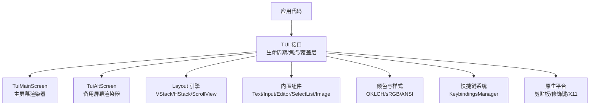

**图表来源**
- [packages/tui/src/tui.ts:470-510](file://packages/tui/src/tui.ts#L470-L510)
- [packages/tui/src/tui-main-screen.ts:126-159](file://packages/tui/src/tui-main-screen.ts#L126-L159)
- [packages/tui/src/layout.ts:383-412](file://packages/tui/src/layout.ts#L383-L412)
- [packages/tui/src/colors.ts:21-56](file://packages/tui/src/colors.ts#L21-L56)
- [packages/tui/src/keybindings.ts:71-210](file://packages/tui/src/keybindings.ts#L71-L210)
- [packages/tui/src/native-platform.ts:9-23](file://packages/tui/src/native-platform.ts#L9-L23)

**章节来源**
- [packages/tui/README.md:1-16](file://packages/tui/README.md#L1-L16)

## 核心组件
- Component 接口：所有 UI 元素统一实现 render、可选 handleInput/handleMouse、invalidate
- TUI 接口：管理子组件、焦点、覆盖层、输入监听、渲染调度、终端颜色查询
- Container：组合子组件并转发鼠标事件
- Focusable：用于 IME 光标定位的焦点组件标记
- Overlay：模态对话框、菜单等覆盖层，支持锚点、百分比定位、边距、可见性回调
- ScrollView：视口滚动，支持跟随底部、溢出链式滚动、语义提示跳转、搜索面板
- 布局节点：VStack/HStack/ScrollView 的组合与尺寸分配

关键职责：
- 渲染调度：合并多次 requestRender，最小化终端写入
- 焦点管理：在普通组件与覆盖层之间切换，保留恢复策略
- 输入分发：键盘、鼠标、滚轮、粘贴、IME 光标位置
- 颜色查询：探测终端调色板与前景背景色，支持延迟回复收集

**章节来源**
- [packages/tui/src/tui.ts:117-148](file://packages/tui/src/tui.ts#L117-L148)
- [packages/tui/src/tui.ts:180-213](file://packages/tui/src/tui.ts#L180-L213)
- [packages/tui/src/tui.ts:218-330](file://packages/tui/src/tui.ts#L218-L330)
- [packages/tui/src/tui.ts:364-424](file://packages/tui/src/tui.ts#L364-L424)
- [packages/tui/src/tui.ts:470-510](file://packages/tui/src/tui.ts#L470-L510)

## 架构总览
TUI 以 Component 为基本单元，由 TUI 实例驱动渲染循环；主屏幕渲染器直接写入终端缓冲区，备用屏幕渲染器维护固定高度的视口与应用级滚动。布局引擎负责将 VStack/HStack/ScrollView 组合成几何框树，并按视口裁剪绘制。颜色系统负责 OKLCH/OKHSL/sRGB/ANSI 之间的转换与样式生成。快捷键系统提供可配置的动作映射。原生模块提供剪贴板、修饰键、X11 能力。

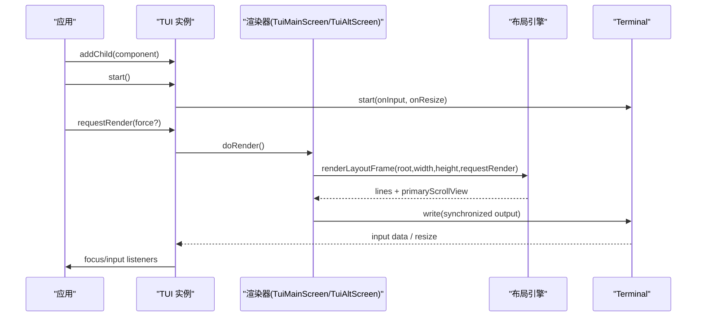

**图表来源**
- [packages/tui/src/tui.ts:512-595](file://packages/tui/src/tui.ts#L512-L595)
- [packages/tui/src/layout.ts:383-412](file://packages/tui/src/layout.ts#L383-L412)
- [packages/tui/src/tui-main-screen.ts:126-159](file://packages/tui/src/tui-main-screen.ts#L126-L159)

## 详细组件分析

### 文本组件 Text
- 功能：多行文本显示、自动换行、内边距、可选背景函数
- 缓存：按文本内容与宽度缓存渲染结果
- 宽度处理：根据可用宽度计算内容宽度，必要时缩减左右内边距
- ANSI 兼容：包装 ANSI 序列时保持每行样式正确

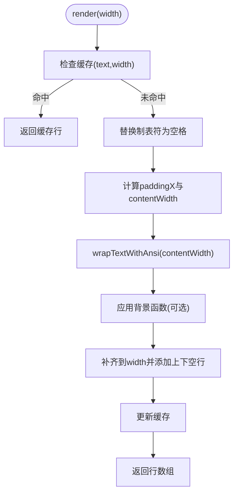

**图表来源**
- [packages/tui/src/components/text.ts:52-114](file://packages/tui/src/components/text.ts#L52-L114)

**章节来源**
- [packages/tui/src/components/text.ts:1-116](file://packages/tui/src/components/text.ts#L1-L116)

### 输入组件 Input
- 功能：单行输入、水平滚动、占位符、提交/取消回调
- 编辑能力：撤销栈、剪切环（kill ring）、单词导航、删除操作
- 粘贴处理：支持 bracketed paste 模式，清理换行与制表符
- IME 支持：实现 Focusable，输出 CURSOR_MARKER 与 fake cursor

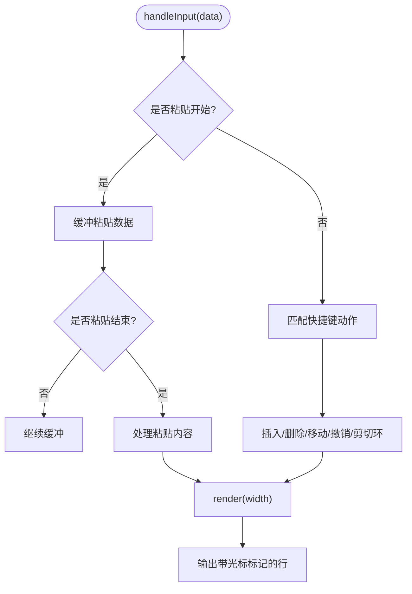

**图表来源**
- [packages/tui/src/components/input.ts:71-234](file://packages/tui/src/components/input.ts#L71-L234)
- [packages/tui/src/components/input.ts:419-500](file://packages/tui/src/components/input.ts#L419-L500)

**章节来源**
- [packages/tui/src/components/input.ts:1-502](file://packages/tui/src/components/input.ts#L1-L502)

### 编辑器组件 Editor
- 功能：多行编辑、自动补全（斜杠命令与文件路径）、大段粘贴标记、历史浏览、字符跳跃、垂直滚动
- 布局：顶部/底部边框含滚动指示，可视行数随终端高度动态调整
- 交互：点击定位光标、拖拽选择、autocomplete 列表交互
- IME：实现 Focusable，输出 CURSOR_MARKER 与 fake cursor，确保候选窗口位置正确

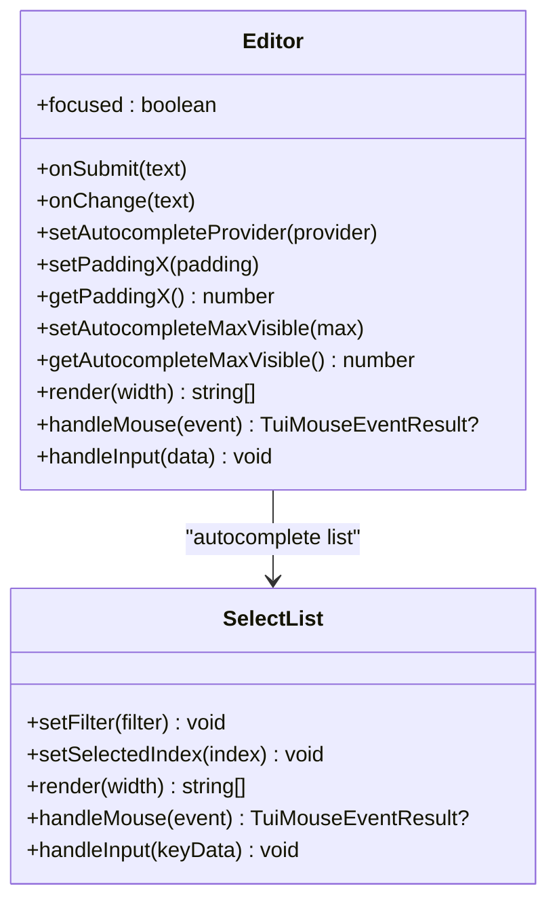

**图表来源**
- [packages/tui/src/components/editor.ts:297-387](file://packages/tui/src/components/editor.ts#L297-L387)
- [packages/tui/src/components/select-list.ts:40-60](file://packages/tui/src/components/select-list.ts#L40-L60)

**章节来源**
- [packages/tui/src/components/editor.ts:1-800](file://packages/tui/src/components/editor.ts#L1-L800)
- [packages/tui/src/components/select-list.ts:1-282](file://packages/tui/src/components/select-list.ts#L1-L282)

### 选择列表 SelectList
- 功能：可过滤的选择列表，支持键盘与鼠标交互
- 布局：主列宽度自适应，描述列在宽屏下显示
- 滚动：可视范围围绕选中项居中，显示滚动信息
- 快捷键：上下翻页、确认、取消

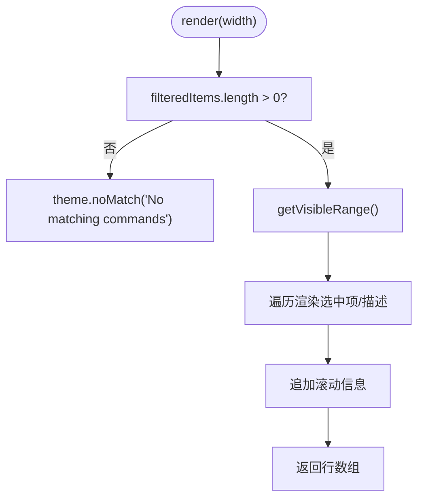

**图表来源**
- [packages/tui/src/components/select-list.ts:76-108](file://packages/tui/src/components/select-list.ts#L76-L108)

**章节来源**
- [packages/tui/src/components/select-list.ts:1-282](file://packages/tui/src/components/select-list.ts#L1-L282)

### 布局引擎 Layout
- 功能：将根组件与布局节点（VStack/HStack/ScrollView）转换为几何框树，计算 clip 区域，绘制到屏幕行
- 缓存：对每个组件按宽度缓存渲染行，减少重复计算
- 滚动条：根据内容高度与视口高度计算轨道与滑块位置，支持悬停激活
- 图像：支持 Kitty 图像元数据裁剪与 iTerm2 回退

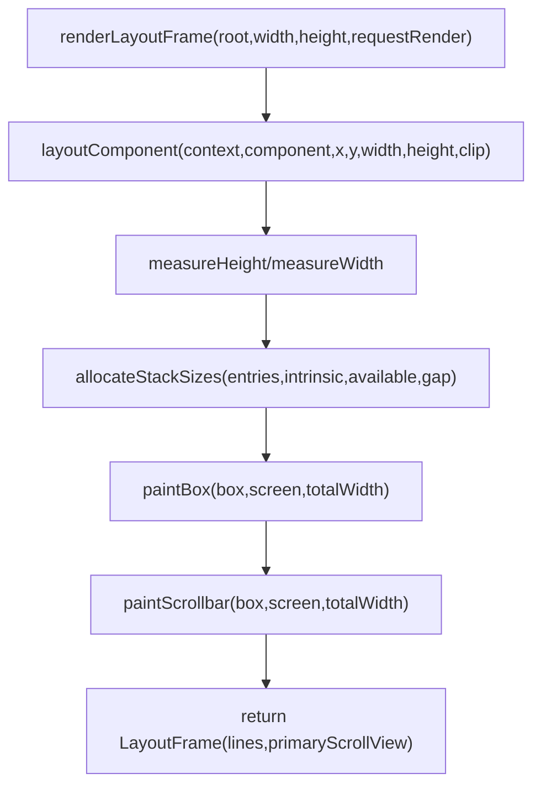

**图表来源**
- [packages/tui/src/layout.ts:383-412](file://packages/tui/src/layout.ts#L383-L412)
- [packages/tui/src/layout.ts:249-328](file://packages/tui/src/layout.ts#L249-L328)

**章节来源**
- [packages/tui/src/layout.ts:1-454](file://packages/tui/src/layout.ts#L1-L454)

### 颜色与样式 Colors
- 类型：IndexedColor、RgbColorValue、OklchColorValue、OkhslChannels
- 解析：parseColor 支持 hex、OKLCH、OKHSL
- 混合：mixColors 支持 OKLCH 与 sRGB 空间
- 输出：foregroundAnsi/backgroundAnsi/styleText 生成 ANSI 转义序列

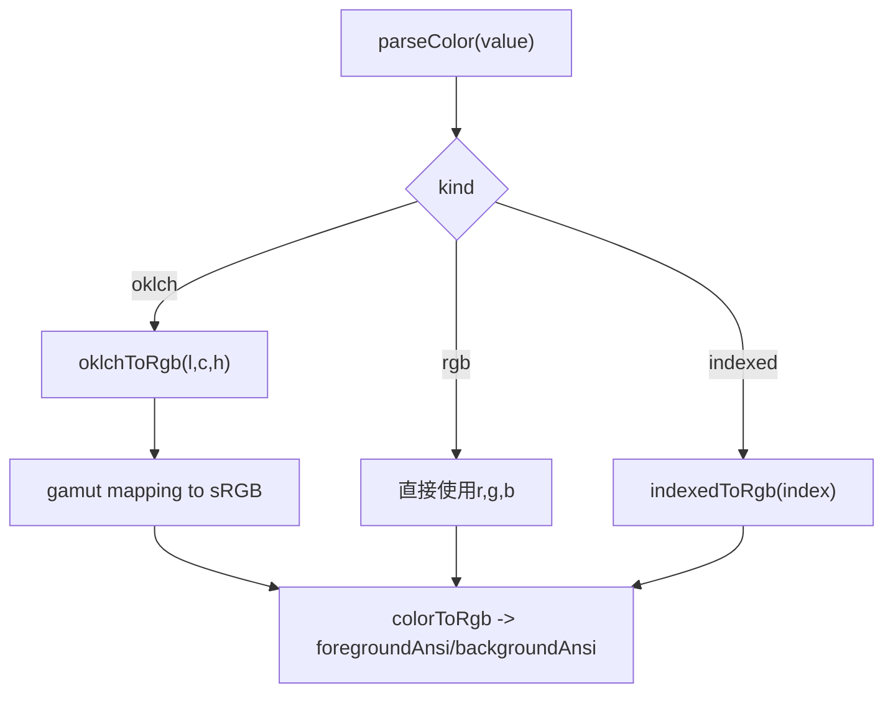

**图表来源**
- [packages/tui/src/colors.ts:121-148](file://packages/tui/src/colors.ts#L121-L148)
- [packages/tui/src/colors.ts:190-227](file://packages/tui/src/colors.ts#L190-L227)
- [packages/tui/src/colors.ts:299-324](file://packages/tui/src/colors.ts#L299-L324)

**章节来源**
- [packages/tui/src/colors.ts:1-368](file://packages/tui/src/colors.ts#L1-L368)

### 快捷键系统 Keybindings
- 定义：KeybindingDefinitions 包含默认键位与描述
- 管理器：KeybindingsManager 支持用户覆盖、冲突检测、按键匹配
- 作用域：编辑器、通用输入、选择列表、备用屏幕视口导航
- 应用级快捷键：工具输出展开、思考块切换、外部编辑器、消息复制、后续消息队列

**更新** 新增了应用级快捷键定义，包括 Ctrl+O（工具输出展开）、Ctrl+T（思考块切换）、Ctrl+G（外部编辑器）、Ctrl+X（复制消息）、Alt+Enter（后续消息队列）等功能。

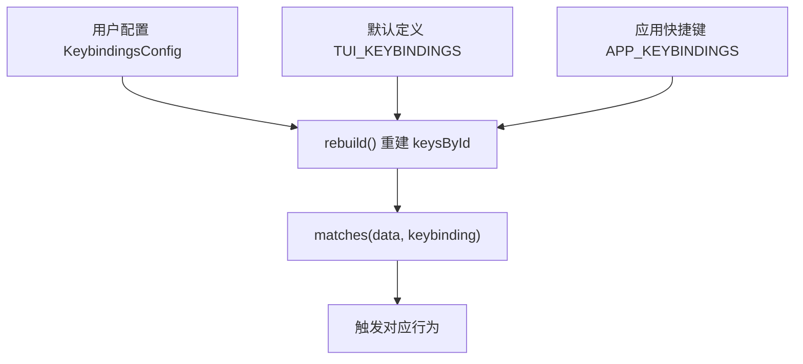

**图表来源**
- [packages/tui/src/keybindings.ts:231-307](file://packages/tui/src/keybindings.ts#L231-L307)
- [packages/tui/src/keybindings.ts:71-210](file://packages/tui/src/keybindings.ts#L71-L210)
- [packages/coding-agent/src/core/keybindings.ts:40-80](file://packages/coding-agent/src/core/keybindings.ts#L40-L80)

**章节来源**
- [packages/tui/src/keybindings.ts:1-340](file://packages/tui/src/keybindings.ts#L1-L340)
- [packages/coding-agent/src/core/keybindings.ts:1-360](file://packages/coding-agent/src/core/keybindings.ts#L1-L360)

### 原生模块集成 Native Platform
- 剪贴板：getText/getImage/getFilePaths/setText
- 修饰键：isModifierPressed(shift/command/control/option)
- 平台加载：按 platform/arch 查找预编译 .node 模块，Linux X11 需要 DISPLAY

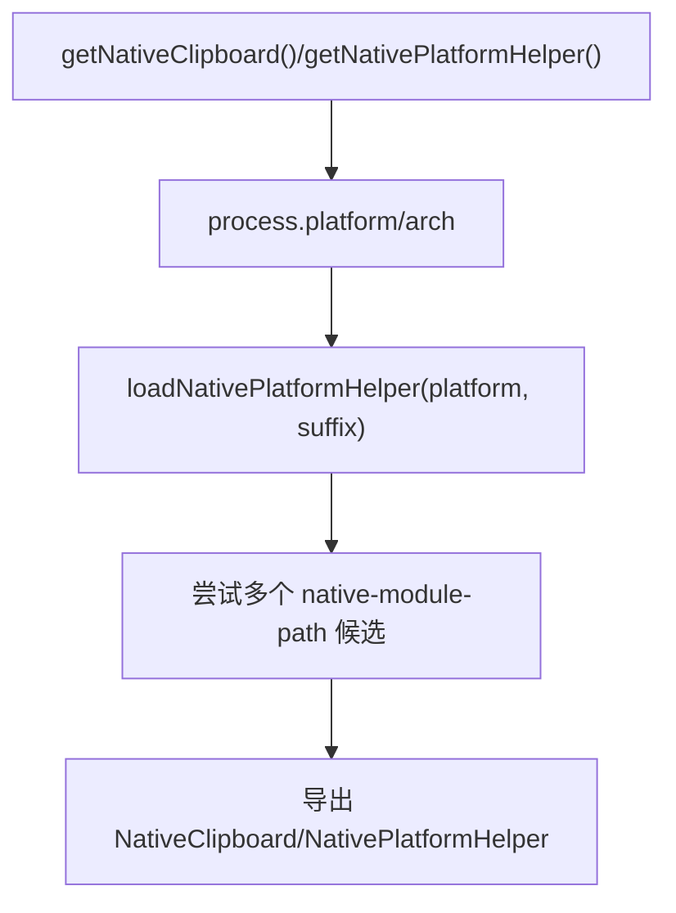

**图表来源**
- [packages/tui/src/native-platform.ts:28-65](file://packages/tui/src/native-platform.ts#L28-L65)

**章节来源**
- [packages/tui/src/native-platform.ts:1-66](file://packages/tui/src/native-platform.ts#L1-L66)

## 依赖关系分析
- TUI 依赖 Terminal 抽象，具体实现包括 ProcessTerminal 与 VirtualTerminal
- TUI 依赖 colors、utils、terminal-image、terminal-colors 等工具模块
- 组件依赖 TUI 提供的 CURSOR_MARKER、Focusable、Overlay 能力
- 布局引擎依赖 components/stack 与 layout-node，以及 terminal-image 的图像元数据
- 快捷键系统依赖 keys.ts 的 matchesKey 与 KeyId 类型
- 原生模块依赖 native-module-path 与 Node.js require

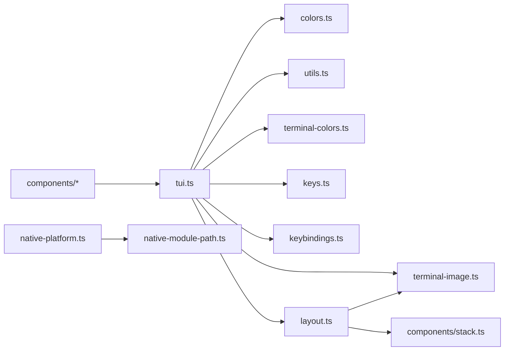

**图表来源**
- [packages/tui/src/tui.ts:1-16](file://packages/tui/src/tui.ts#L1-L16)
- [packages/tui/src/layout.ts:1-12](file://packages/tui/src/layout.ts#L1-L12)
- [packages/tui/src/native-platform.ts:1-4](file://packages/tui/src/native-platform.ts#L1-L4)

**章节来源**
- [packages/tui/src/tui.ts:1-16](file://packages/tui/src/tui.ts#L1-L16)
- [packages/tui/src/layout.ts:1-12](file://packages/tui/src/layout.ts#L1-L12)
- [packages/tui/src/native-platform.ts:1-4](file://packages/tui/src/native-platform.ts#L1-L4)

## 性能与渲染特性
- 差异渲染：仅更新变化的行或视口行，避免整屏重绘
- 同步输出：使用 CSI 2026 包裹写入，保证原子刷新无闪烁
- 渲染节流：requestRender 合并，最小间隔 16ms
- 布局缓存：组件按宽度缓存渲染行，减少重复计算
- 图像优化：Kitty 图像支持视口裁剪；iTerm2 回退为文本占位
- 滚动优化：ScrollView 维护 scrollTop 与可视范围，避免全量重排

建议：
- 复用已转换的颜色对象，避免每次渲染重新计算 OKLCH/sRGB
- 使用 truncateToWidth/wrapTextWithAnsi 控制行宽，避免越界错误
- 在频繁更新的组件中尽量只调用 invalidate 局部状态，而非全局重绘

**章节来源**
- [packages/tui/src/tui.ts:512-595](file://packages/tui/src/tui.ts#L512-L595)
- [packages/tui/src/layout.ts:68-89](file://packages/tui/src/layout.ts#L68-L89)
- [packages/tui/src/layout.ts:330-381](file://packages/tui/src/layout.ts#L330-L381)

## 主题定制与样式指南
- 颜色体系：支持 indexed、rgb、oklch、okhsl；推荐在主题初始化时解析并缓存颜色
- 文本样式：使用 styleText/styleTextWithAnsi 生成 ANSI 前缀与后缀，注意重置顺序
- 组件主题：
  - EditorTheme：borderColor、selectList
  - SelectListTheme：selectedPrefix、selectedText、description、scrollInfo、noMatch
  - MarkdownTheme：heading/link/code/quote/hr/listBullet/bold/italic/strikethrough/underline/highlightCode
  - ImageTheme：fallbackColor
- 背景函数：Text/Box 支持 customBgFn，按行应用背景色并补齐宽度

实践要点：
- 主题函数应幂等且快速，避免在 render 中进行昂贵计算
- 使用 parseColor 解析字符串颜色，并在主题对象中缓存 rgb 值
- 对于高对比度需求，优先使用 oklch 混合，以获得感知均匀的色彩过渡

**章节来源**
- [packages/tui/src/colors.ts:21-56](file://packages/tui/src/colors.ts#L21-L56)
- [packages/tui/src/colors.ts:121-148](file://packages/tui/src/colors.ts#L121-L148)
- [packages/tui/src/colors.ts:317-367](file://packages/tui/src/colors.ts#L317-L367)
- [packages/tui/src/components/editor.ts:238-246](file://packages/tui/src/components/editor.ts#L238-L246)
- [packages/tui/src/components/select-list.ts:18-24](file://packages/tui/src/components/select-list.ts#L18-L24)

## 响应式设计与可访问性
- 响应式：
  - OverlayOptions.visible 回调根据终端宽高控制可见性
  - VStack/HStack 支持 basis/grow/shrink/minSize/maxSize 与 visible 回调
  - ScrollView 支持 follow/end、overscroll chain、语义提示跳转
- 可访问性：
  - Focusable 接口与 CURSOR_MARKER 确保 IME 候选窗口正确定位
  - 硬件光标隐藏/显示可通过 setShowHardwareCursor 控制
  - 快捷键系统提供一致的键盘导航体验

最佳实践：
- 在容器组件中传播 focused 状态给内部 Input/Editor，避免 IME 错位
- 使用 getSelectPageIndex 计算 PageUp/PageDown 后的索引，保证列表可访问
- 在窄屏设备上通过 visible 回调隐藏复杂覆盖层

**章节来源**
- [packages/tui/src/tui.ts:218-330](file://packages/tui/src/tui.ts#L218-L330)
- [packages/tui/src/tui.ts:180-213](file://packages/tui/src/tui.ts#L180-L213)
- [packages/tui/src/keybindings.ts:327-339](file://packages/tui/src/keybindings.ts#L327-L339)

## 扩展与自定义最佳实践
- 自定义组件：
  - 实现 Component 接口，确保 render 返回不超过 width 的行数组
  - 如需 IME 支持，实现 Focusable 并输出 CURSOR_MARKER 与 renderFakeCursor
  - 在状态变更时调用 invalidate，并通过 tui.requestRender 触发渲染
- 自定义布局：
  - 使用 VStack/HStack 组合基础组件，必要时嵌套 ScrollView
  - 利用 layout-node 与 allocateStackSizes 控制尺寸分配
- 自定义快捷键：
  - 通过 KeybindingsManager 注册新动作，并提供默认键位与描述
  - 使用 matchesKey 与 KeyId 进行精确匹配
- 原生能力：
  - 使用 getNativeClipboard 获取剪贴板能力，区分 undefined/null 含义
  - 在 Linux 上需设置 DISPLAY 环境变量以启用 X11 剪贴板

注意事项：
- 不要直接在 render 中进行异步操作，应通过回调或 Promise 更新状态后请求渲染
- 避免在高频渲染路径中创建大量临时对象，尽量复用颜色与样式对象
- 正确处理终端退出时的状态恢复，避免遗留光标或颜色状态

**章节来源**
- [packages/tui/src/tui.ts:117-148](file://packages/tui/src/tui.ts#L117-L148)
- [packages/tui/src/tui.ts:180-213](file://packages/tui/src/tui.ts#L180-L213)
- [packages/tui/src/keybindings.ts:231-307](file://packages/tui/src/keybindings.ts#L231-L307)
- [packages/tui/src/native-platform.ts:9-23](file://packages/tui/src/native-platform.ts#L9-L23)

## TUI 使用指南

**新增** 本节基于实际的 TUI 使用经验，提供详细的终端界面操作说明和故障排除指南。

### 启动方式
仓库里有两个入口：

| 入口 | 命令 | 用途 |
|---|---|---|
| 源码 | `./pi-test.sh` | 开发用，直接跑 `packages/coding-agent/src/cli.ts` |
| 构建产物 | `node packages/coding-agent/dist/cli.js` | 跑 `dist/`，需要先 `npm run build` |

日常开发用源码入口：

```bash
cd
./pi-test.sh
```

带参数时直接追加，例如：

```bash
./pi-test.sh --provider deepseek --model deepseek-flash
./pi-test.sh --continue          # 恢复当前目录最近的会话
./pi-test.sh -p "只回复 OK"      # 非交互模式
```

### DeepSeek 配置
`~/.pi/agent/settings.json`：

```json
{
  "defaultProvider": "deepseek",
  "defaultModel": "deepseek-flash"
}
```

API key 存在 `~/.pi/agent/auth.json`，权限 `600`：

```json
{
  "deepseek": {
    "type": "api_key",
    "key": "sk-..."
  }
}
```

也可以临时用环境变量：

```bash
DEEPSEEK_API_KEY=sk-... ./pi-test.sh --provider deepseek --model deepseek-flash
```

验证：

```bash
node packages/coding-agent/dist/cli.js --list-models deepseek
node packages/coding-agent/dist/cli.js auth check --provider deepseek
```

### 启动界面
首次进入会问是否信任项目目录：

```
 Trust project folder?


 → Trust
   Trust parent folder (/home/abel)
   Trust (this session only)
   Do not trust
```

选 `Trust` 后会记住，后续不再询问。启动后显示：

```
▀▀█  v1.5.0
[Context]     AGENTS.md
[Skills]      add-llm-provider, github-work, interactive-testing, release
[Prompts]     /cl, /deslop, /dup, /is, /pr, /sa, /wr
[Extensions]  import-repro.ts, prompt-url-widget.ts, redraws.ts, tps.ts

~/omca (omca)
0.0%/1.0M (auto)                    deepseek-flash • high
```

底部状态栏：目录、分支、上下文占用、模型、thinking 等级。

### 实际使用场景

#### 普通对话 + 工具调用
输入：

```
用一句话说明这个仓库是做什么的，然后列出 packages 下的目录名。不要修改任何文件。
```

实际执行了 `ls packages/`、`head -40 README.md`，然后回答 9 个包名。统计：

```
TPS 88.6 tok/s. out 165, in 2,436, cache r/w 8,576/0, total 11,177, 1.9s
↑2.4k ↓165 R8.6k CH86.8% $0.001
```

#### 写文件与读文件
输入：

```
用 write 工具创建 /tmp/opencode/pi-tui-demo/greeting.txt，内容是 hello pi，
然后用 read 工具读回并告诉我内容。
```

TUI 显示了两个工具卡片：

```
write /tmp/opencode/pi-tui-demo/greeting.txt
hello pi

read /tmp/opencode/pi-tui-demo/greeting.txt
```

#### 修改文件与 diff
输入：

```
把 /tmp/opencode/pi-tui-demo/greeting.txt 的内容改成 hello omca，用 edit 工具。
```

TUI 渲染了行级 diff：

```
edit /tmp/opencode/pi-tui-demo/greeting.txt
-1 hello pi
+1 hello omca
```

**Pi 默认不逐个工具询问确认。** 命令和改动会显示在 transcript 里，但不会停下来等批准。需要门禁时要自己加扩展。

#### Bash 模式
输入 `!echo hello-from-bash`，TUI 显示：

```
$ echo hello-from-bash

hello-from-bash
```

`!` 的输出进入上下文；`!!` 的输出不进入上下文，适合只看一眼的命令。

#### 文件引用
输入 `@` 会打开文件选择器，可以直接把文件加入 prompt：

```
→ .pi/
  nix/
  docs/
  .npmrc
  .husky/
  (1/20)
```

#### 斜杠命令
输入 `/` 打开命令面板，共 39 项。实际用过：

| 命令 | 结果 |
|---|---|
| `/model` | 打开模型选择器，显示 `deepseek-flash` 已选中 |
| `/session` | 显示会话文件、ID、消息数、token、缓存命中率、费用 |
| `/tree` | 打开会话树，可切换分支 |
| `/settings` | 打开 33 项设置 |
| `/hotkeys` | 显示当前键位表 |
| `/quit` | 退出 |

`/session` 实际输出：

```
File: /home/abel/.pi/agent/sessions/--home-abel-omfde--/2026-...jsonl
ID: 01a1ae54-...
Messages: Total 11, User 2, Assistant 4, Tools 3 calls
Tokens: Input 23,168, Cached 20,352 (87.8%), Output 296
Cache Warming: streaming, Inactive (cache lifetime unavailable)
Cost: $0.001
```

#### 会话恢复
退出后运行：

```bash
./pi-test.sh --continue
```

TUI 恢复了上一轮的 `仅回复：resume check` 和回答。

### 常用键位

| 键 | 作用 |
|---|---|
| `Enter` | 发送 |
| `Shift+Enter` | 换行（tmux 需要 `extended-keys on`） |
| `Escape` | 中止当前生成 |
| `Ctrl+C` | 第一次清空编辑器，第二次退出 |
| `Ctrl+D` | 编辑器为空时退出 |
| `Ctrl+L` | 模型选择器 |
| `Ctrl+P` / `Alt+P` | 循环切换模型 |
| `Shift+Tab` | 循环 thinking 等级 |
| `Ctrl+O` | 展开/折叠工具输出 |
| `Ctrl+T` | 显示/隐藏 thinking 块 |
| `Ctrl+G` | 用外部编辑器写长 prompt |
| `Ctrl+X` | 复制最后一条助手消息 |
| `Ctrl+Q` | 排队 follow-up |
| `@` | 文件选择 |
| `!` / `!!` | Bash，输出是否进入上下文 |
| `/` | 命令面板 |

### 已知小问题
- tmux 默认关闭 extended-keys，`Shift+Enter` 可能不工作。提示会出现在启动页：

  ```
  Warning: tmux extended-keys is off.
  ```

  修复：`set -g extended-keys on`，然后重启 tmux。

- 在 tmux 里用 `tmux capture-pane` 截图时，如果弹层比终端高，顶部会被裁掉。
  把窗口调高即可。

### 结论
以下路径已经实际走通：

1. 源码启动 TUI；
2. DeepSeek 认证和默认模型；
3. 对话、工具调用、写文件、改文件、diff；
4. Bash 模式、文件引用；
5. 模型选择、会话统计、会话树、设置、键位表；
6. 退出与 `--continue` 恢复。

这套流程可以重复执行。下一步可以开始用真实任务检验"会用"，而不是继续验证功能。

**章节来源**
- [docs/explains/27-tui-usage.md:1-278](file://docs/explains/27-tui-usage.md#L1-L278)

## 故障排查
常见问题与解决思路：
- 渲染闪烁：确认使用同步输出（CSI 2026），避免手动分块写入
- 行宽越界：确保 render 返回的每一行长度不超过 width，使用 truncateToWidth 或 wrapTextWithAnsi
- IME 候选窗口错位：确保容器组件传播 focused 状态给内部 Input/Editor，并输出 CURSOR_MARKER
- 覆盖层焦点丢失：使用 OverlayHandle.unfocus({ target }) 明确释放焦点目标
- 颜色异常：检查 parseColor 输入格式，避免非法值；在高频路径缓存 rgb 值
- 原生剪贴板不可用：检查 process.platform 与 DISPLAY 环境变量；区分 undefined（不支持）与 null（无内容）
- tmux 快捷键问题：确保开启 extended-keys 模式

调试技巧：
- 使用 tui.onDebug 钩子打印调试信息
- 使用 VirtualTerminal 进行单元测试，模拟终端行为
- 查看 fullRedraws 统计，评估差异渲染效果

**章节来源**
- [packages/tui/src/tui.ts:512-595](file://packages/tui/src/tui.ts#L512-L595)
- [packages/tui/src/components/input.ts:419-500](file://packages/tui/src/components/input.ts#L419-L500)
- [packages/tui/src/native-platform.ts:55-65](file://packages/tui/src/native-platform.ts#L55-L65)
- [docs/explains/27-tui-usage.md:253-265](file://docs/explains/27-tui-usage.md#L253-L265)

## 结论
该终端界面系统以 Component 为核心，结合 TUI 生命周期管理、布局引擎、颜色系统与快捷键机制，提供了高性能、可定制、可访问的终端 UI 能力。通过主屏幕与备用屏幕两种渲染模式，配合差异渲染与同步输出，实现了流畅的交互体验。主题系统与原生模块集成进一步增强了视觉表现力与平台能力。遵循本文档的最佳实践，开发者可以构建稳定、可扩展、用户体验优良的终端应用。

新增的使用指南提供了详细的实际操作经验和故障排除方法，帮助用户快速上手并解决常见问题。