# 输入处理系统

<cite>
**本文引用的文件**   
- [keys.ts](file://packages/tui/src/keys.ts)
- [keybindings.ts](file://packages/tui/src/keybindings.ts)
- [components/input.ts](file://packages/tui/src/components/input.ts)
- [components/editor.ts](file://packages/tui/src/components/editor.ts)
- [word-navigation.ts](file://packages/tui/src/word-navigation.ts)
- [undo-stack.ts](file://packages/tui/src/undo-stack.ts)
- [kill-ring.ts](file://packages/tui/src/kill-ring.ts)
- [wheel-scroll.ts](file://packages/tui/src/wheel-scroll.ts)
- [tui.ts](file://packages/tui/src/tui.ts)
</cite>

## 目录
1. [简介](#简介)
2. [项目结构](#项目结构)
3. [核心组件](#核心组件)
4. [架构总览](#架构总览)
5. [详细组件分析](#详细组件分析)
6. [依赖关系分析](#依赖关系分析)
7. [性能与可访问性](#性能与可访问性)
8. [故障排查指南](#故障排查指南)
9. [结论](#结论)

## 简介
本文件系统性地梳理 TUI 输入处理子系统，覆盖键盘事件解析、鼠标交互、滚轮加速、文本编辑（单行输入与多行编辑器）、快捷键绑定、命令路由、撤销栈管理、单词导航算法、输入捕获机制、事件冒泡、组合键处理以及可访问性支持。目标是帮助开发者快速理解从终端原始字节到高层编辑动作的完整链路，并掌握扩展与调优方法。

## 项目结构
TUI 输入处理相关代码集中在 packages/tui/src 下：
- 键盘协议与匹配：keys.ts
- 快捷键注册与冲突检测：keybindings.ts
- 单行输入组件：components/input.ts
- 多行编辑器与自动补全：components/editor.ts
- 单词导航算法：word-navigation.ts
- 通用撤销栈：undo-stack.ts
- 剪贴板环（Emacs 风格）：kill-ring.ts
- 滚轮加速：wheel-scroll.ts
- UI 框架与事件分发：tui.ts

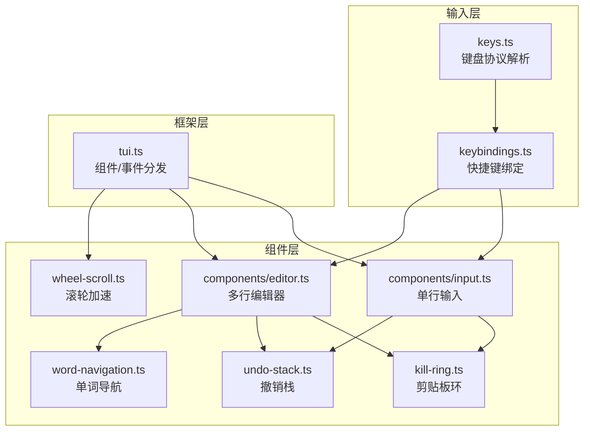

**图示来源**
- [keys.ts:1-100](file://packages/tui/src/keys.ts#L1-L100)
- [keybindings.ts:1-120](file://packages/tui/src/keybindings.ts#L1-L120)
- [components/input.ts:1-60](file://packages/tui/src/components/input.ts#L1-L60)
- [components/editor.ts:1-60](file://packages/tui/src/components/editor.ts#L1-L60)
- [word-navigation.ts:1-30](file://packages/tui/src/word-navigation.ts#L1-L30)
- [kill-ring.ts:1-20](file://packages/tui/src/kill-ring.ts#L1-L20)
- [undo-stack.ts:1-20](file://packages/tui/src/undo-stack.ts#L1-L20)
- [wheel-scroll.ts:1-30](file://packages/tui/src/wheel-scroll.ts#L1-L30)
- [tui.ts:117-148](file://packages/tui/src/tui.ts#L117-L148)

**章节来源**
- [keys.ts:1-100](file://packages/tui/src/keys.ts#L1-L100)
- [keybindings.ts:1-120](file://packages/tui/src/keybindings.ts#L1-L120)
- [components/input.ts:1-60](file://packages/tui/src/components/input.ts#L1-L60)
- [components/editor.ts:1-60](file://packages/tui/src/components/editor.ts#L1-L60)
- [word-navigation.ts:1-30](file://packages/tui/src/word-navigation.ts#L1-L30)
- [kill-ring.ts:1-20](file://packages/tui/src/kill-ring.ts#L1-L20)
- [undo-stack.ts:1-20](file://packages/tui/src/undo-stack.ts#L1-L20)
- [wheel-scroll.ts:1-30](file://packages/tui/src/wheel-scroll.ts#L1-L30)
- [tui.ts:117-148](file://packages/tui/src/tui.ts#L117-L148)

## 核心组件
- 键盘协议与匹配器（keys.ts）
  - 支持 Kitty 键盘协议 CSI-u、xterm modifyOtherKeys、传统序列与功能键映射。
  - 提供 matchesKey(data, keyId)、parseKey(data)、decodeKittyPrintable(data) 等 API。
  - 维护全局 Kitty 协议状态，区分 press/repeat/release 事件。
- 快捷键管理器（keybindings.ts）
  - 定义 Keybindings 接口与默认绑定 TUI_KEYBINDINGS。
  - KeybindingsManager 负责用户配置合并、冲突检测、按 keyId 匹配。
- 单行输入（components/input.ts）
  - 实现光标移动、删除、粘贴、撤销、剪贴板环、括号粘贴模式缓冲。
  - 通过 getKeybindings() 获取当前绑定进行命令路由。
- 多行编辑器（components/editor.ts）
  - 支持历史浏览、自动补全、字符跳转、滚动、粘滞列、大段粘贴标记、撤销快照。
  - 集成 word-navigation.ts 进行单词级导航。
- 单词导航（word-navigation.ts）
  - findWordBackward/findWordForward 基于 Intl.Segmenter 与标点规则。
- 撤销栈（undo-stack.ts）
  - 使用 structuredClone 保存深拷贝快照，pop 直接返回已克隆对象。
- 剪贴板环（kill-ring.ts）
  - Emacs 风格 kill/yank/yank-pop，支持累积与旋转。
- 滚轮加速（wheel-scroll.ts）
  - WheelScrollAccelerator 根据事件间隔计算每事件滚动行数，支持“auto”模式。
- UI 框架（tui.ts）
  - Component/Focusable 接口、Container 容器、TuiBase 主循环、鼠标事件分发与焦点管理。

**章节来源**
- [keys.ts:1-100](file://packages/tui/src/keys.ts#L1-L100)
- [keybindings.ts:1-120](file://packages/tui/src/keybindings.ts#L1-L120)
- [components/input.ts:1-60](file://packages/tui/src/components/input.ts#L1-L60)
- [components/editor.ts:1-60](file://packages/tui/src/components/editor.ts#L1-L60)
- [word-navigation.ts:1-30](file://packages/tui/src/word-navigation.ts#L1-L30)
- [undo-stack.ts:1-20](file://packages/tui/src/undo-stack.ts#L1-L20)
- [kill-ring.ts:1-20](file://packages/tui/src/kill-ring.ts#L1-L20)
- [wheel-scroll.ts:1-30](file://packages/tui/src/wheel-scroll.ts#L1-L30)
- [tui.ts:117-148](file://packages/tui/src/tui.ts#L117-L148)

## 架构总览
下图展示从终端输入到组件处理的端到端流程：

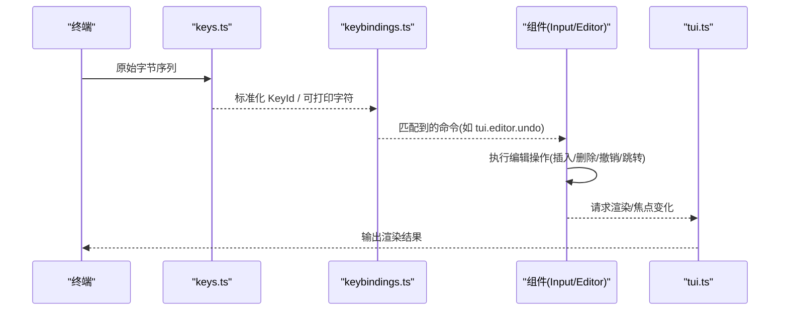

**图示来源**
- [keys.ts:892-1295](file://packages/tui/src/keys.ts#L892-L1295)
- [keybindings.ts:231-307](file://packages/tui/src/keybindings.ts#L231-L307)
- [components/input.ts:71-234](file://packages/tui/src/components/input.ts#L71-L234)
- [components/editor.ts:701-1006](file://packages/tui/src/components/editor.ts#L701-L1006)
- [tui.ts:117-148](file://packages/tui/src/tui.ts#L117-L148)

## 详细组件分析

### 键盘协议与组合键处理（keys.ts）
- 协议支持
  - Kitty CSI-u：解析 codepoint、shifted/base layout key、modifier、event type。
  - xterm modifyOtherKeys：兼容非 Kitty 环境下的修饰键与可打印键。
  - 传统序列：方向键、功能键、Home/End/PageUp/Down 等。
- 组合键与逻辑匹配
  - 支持 ctrl/shift/alt/super 及其组合；对 Ctrl+字母生成控制字符。
  - 逻辑 Shift 符号识别：例如 Shift+= 被识别为 +，保留其他修饰键。
  - 非拉丁布局：当 codepoint 不是已知拉丁字母或符号时，回退到 baseLayoutKey。
- 可打印字符解码
  - decodeKittyPrintable/decodePrintableKey：仅接受纯文本或 Shift 修饰的可打印字符，过滤控制符与未映射功能键。
- 事件类型
  - isKeyRelease/isKeyRepeat：在 Kitty 协议 flag 2 下区分 release/repeat。

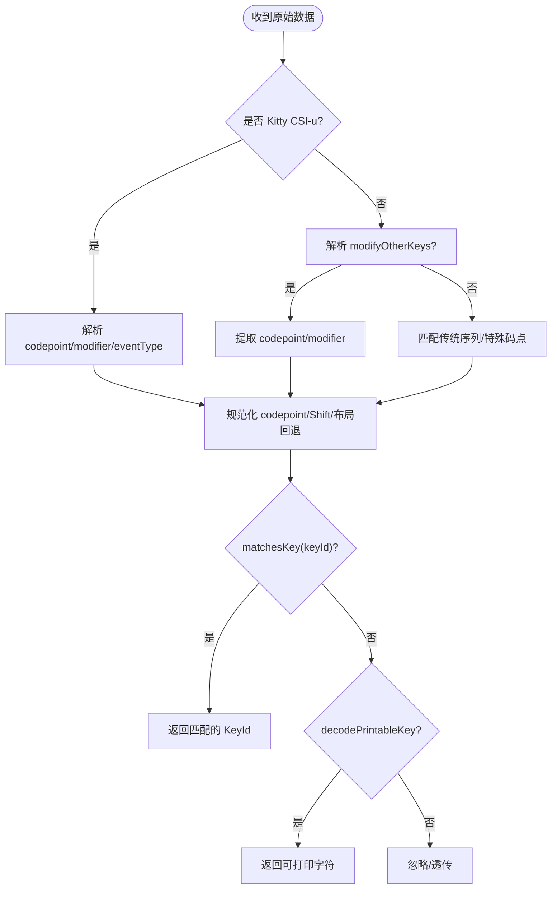

**图示来源**
- [keys.ts:529-716](file://packages/tui/src/keys.ts#L529-L716)
- [keys.ts:780-889](file://packages/tui/src/keys.ts#L780-L889)
- [keys.ts:892-1295](file://packages/tui/src/keys.ts#L892-L1295)
- [keys.ts:1435-1512](file://packages/tui/src/keys.ts#L1435-L1512)

**章节来源**
- [keys.ts:529-716](file://packages/tui/src/keys.ts#L529-L716)
- [keys.ts:780-889](file://packages/tui/src/keys.ts#L780-L889)
- [keys.ts:892-1295](file://packages/tui/src/keys.ts#L892-L1295)
- [keys.ts:1435-1512](file://packages/tui/src/keys.ts#L1435-L1512)

### 快捷键绑定与命令路由（keybindings.ts）
- 默认绑定
  - 编辑器导航、删除、yank/undo、输入提交、选择列表、备用屏幕滚动与搜索等。
- 用户配置与冲突检测
  - normalizeKeys 去重；rebuild 构建 keysById 映射；检测同一 KeyId 被多个命令占用的冲突。
- 运行时匹配
  - matches(data, keybinding) 遍历该命令的所有 KeyId，调用 matchesKey 判断。

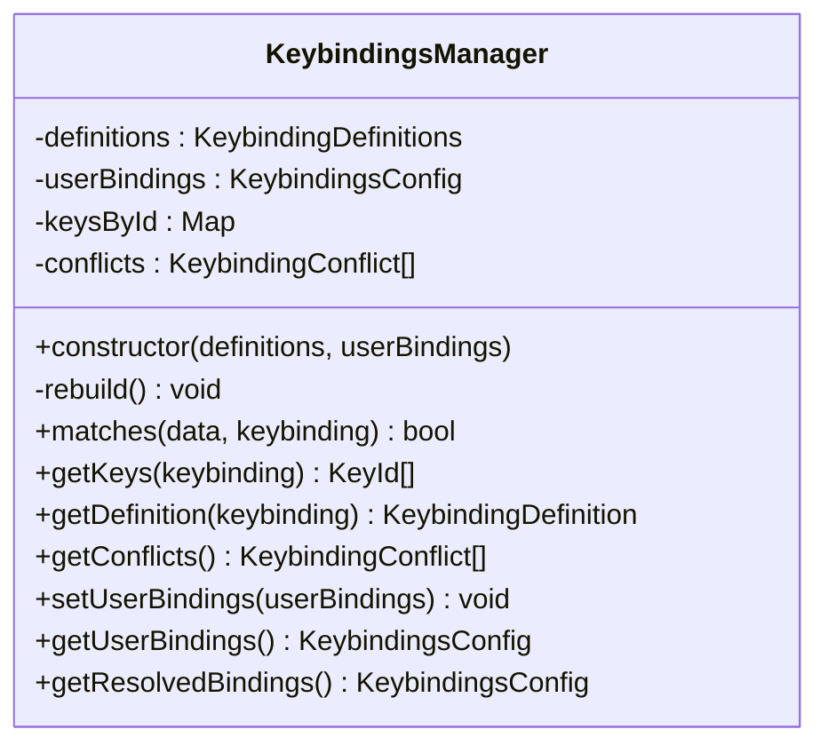

**图示来源**
- [keybindings.ts:231-307](file://packages/tui/src/keybindings.ts#L231-L307)

**章节来源**
- [keybindings.ts:1-210](file://packages/tui/src/keybindings.ts#L1-L210)
- [keybindings.ts:231-307](file://packages/tui/src/keybindings.ts#L231-L307)

### 单行输入组件（components/input.ts）
- 输入处理
  - 括号粘贴模式缓冲（\x1b[200~ ... \x1b[201~），清理换行/制表符后插入。
  - 命令路由：取消、撤销、提交、删除、yank/yank-pop、光标移动、字符插入。
  - 使用 getKeybindings() 获取当前绑定进行匹配。
- 鼠标交互
  - 左键点击定位光标，考虑可视列与 renderedStartColumn。
- 撤销与剪贴板环
  - UndoStack 保存 value/cursor 快照；KillRing 支持累积与旋转。
- 单词导航
  - moveWordBackwards/Forwards 委托 word-navigation.ts。

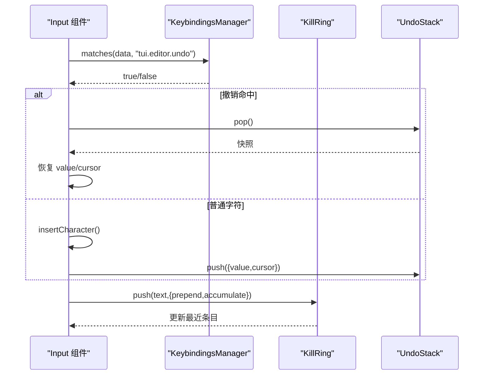

**图示来源**
- [components/input.ts:71-234](file://packages/tui/src/components/input.ts#L71-L234)
- [components/input.ts:254-377](file://packages/tui/src/components/input.ts#L254-L377)
- [components/input.ts:403-413](file://packages/tui/src/components/input.ts#L403-L413)

**章节来源**
- [components/input.ts:1-502](file://packages/tui/src/components/input.ts#L1-L502)

### 多行编辑器（components/editor.ts）
- 输入处理与命令路由
  - 字符跳转模式（jumpForward/jumpBackward）、括号粘贴、Tab 触发自动补全、删除、yank/yank-pop、历史浏览、换行与提交、箭头键导航、PageUp/Down。
- 自动补全
  - 支持斜杠命令与符号触发（@/#），防抖与异步请求，SelectList 交互。
- 粘贴与大段内容
  - 大段粘贴以标记形式插入（如 [paste #N +lines]），渲染时展开；segmentWithMarkers 将标记视为原子片段。
- 光标与滚动
  - 构建视觉行映射、粘滞列策略、页滚动、垂直移动保持视觉列。
- 撤销与剪贴板环
  - EditorSnapshot 包含 state/pastes/pasteCounter；KillRing 行为同 input。
- 单词导航
  - 使用 segment("word") 与 isPasteMarker 作为原子片段判定。

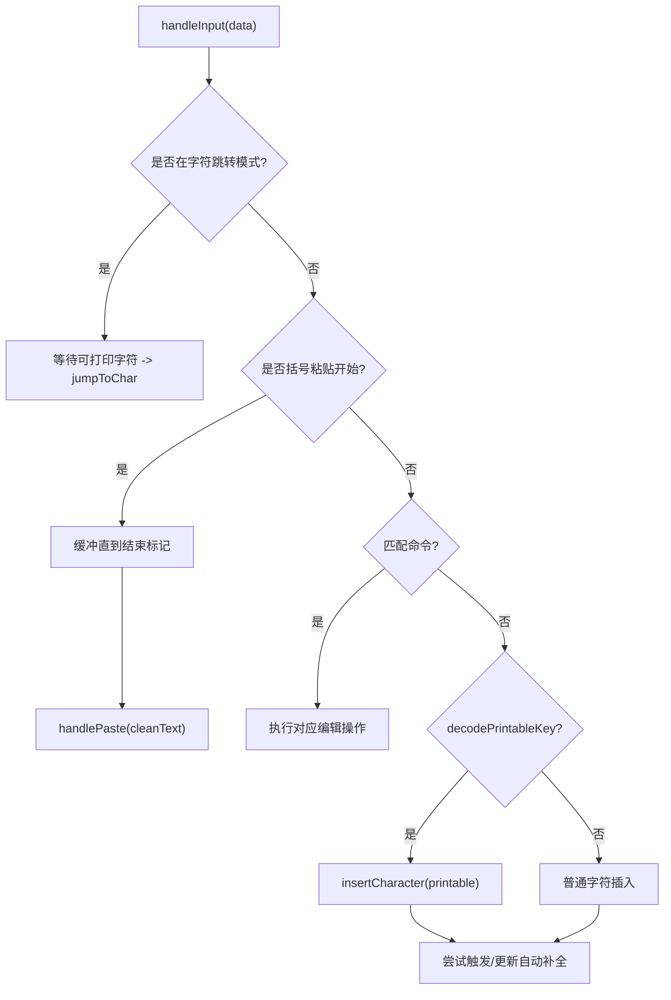

**图示来源**
- [components/editor.ts:701-1006](file://packages/tui/src/components/editor.ts#L701-L1006)
- [components/editor.ts:1270-1336](file://packages/tui/src/components/editor.ts#L1270-L1336)
- [components/editor.ts:1983-2003](file://packages/tui/src/components/editor.ts#L1983-L2003)

**章节来源**
- [components/editor.ts:1-2484](file://packages/tui/src/components/editor.ts#L1-L2484)

### 单词导航算法（word-navigation.ts）
- findWordBackward
  - 跳过尾部空白，若最后一段为原子片段则整体跳过；否则按词边界或标点边界回退。
- findWordForward
  - 跳过前导空白，遇到原子片段整体跳过；否则按词或标点前进。
- 选项
  - 自定义 segment 与 isAtomicSegment，便于编辑器将粘贴标记视为原子单元。

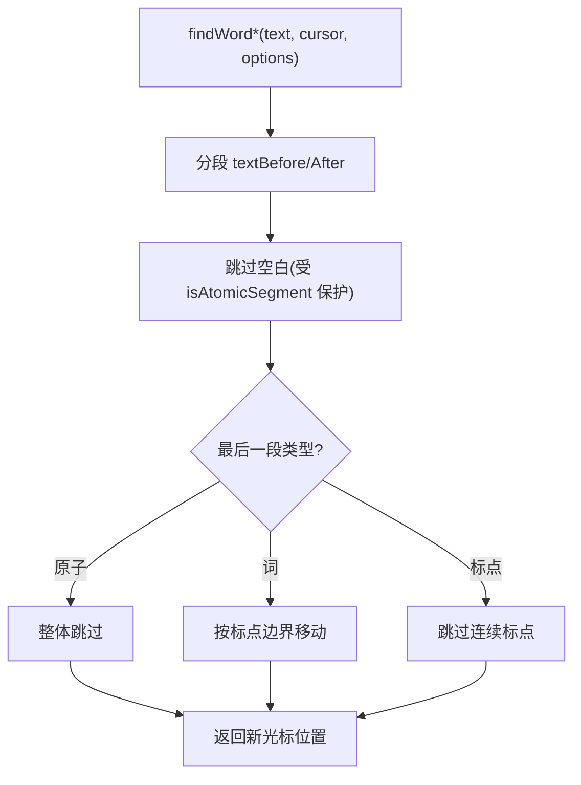

**图示来源**
- [word-navigation.ts:22-70](file://packages/tui/src/word-navigation.ts#L22-L70)
- [word-navigation.ts:78-117](file://packages/tui/src/word-navigation.ts#L78-L117)

**章节来源**
- [word-navigation.ts:1-118](file://packages/tui/src/word-navigation.ts#L1-L118)

### 撤销栈（undo-stack.ts）
- 设计要点
  - push 使用 structuredClone 深拷贝快照，避免共享引用。
  - pop 直接返回已克隆对象，减少重复克隆开销。
  - clear 清空栈；length 暴露长度。

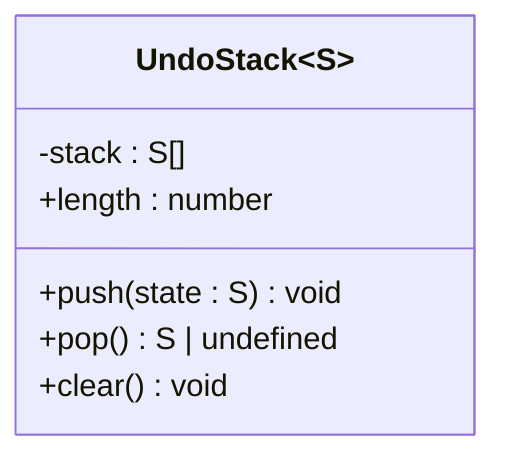

**图示来源**
- [undo-stack.ts:1-29](file://packages/tui/src/undo-stack.ts#L1-L29)

**章节来源**
- [undo-stack.ts:1-29](file://packages/tui/src/undo-stack.ts#L1-L29)

### 剪贴板环（kill-ring.ts）
- 功能
  - push(text, {prepend, accumulate})：支持向前/向后累积合并。
  - peek：查看最新条目。
  - rotate：将末尾项移至开头，用于 yank-pop 循环。
- 复杂度
  - push/peek O(1)，rotate O(1)。

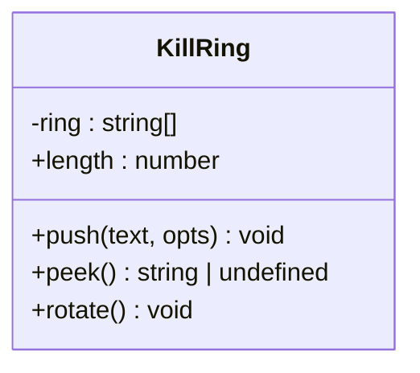

**图示来源**
- [kill-ring.ts:1-47](file://packages/tui/src/kill-ring.ts#L1-L47)

**章节来源**
- [kill-ring.ts:1-47](file://packages/tui/src/kill-ring.ts#L1-L47)

### 滚轮支持（wheel-scroll.ts）
- WheelScrollAccelerator
  - 支持固定行数或“auto”模式；根据事件间隔估算速度，最多每事件 6 行。
  - 本地 macOS 终端可能已由系统加速，需关闭内置加速以避免双重加速。
- 关键常量
  - BURST_GAP_MS、GESTURE_GAP_MS、REFERENCE_GAP_MS、MAX_AUTO_LINES。

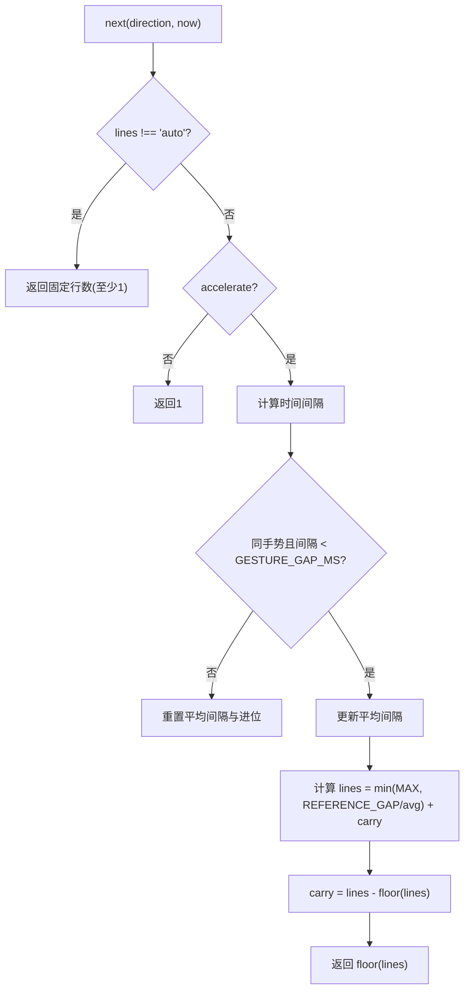

**图示来源**
- [wheel-scroll.ts:1-83](file://packages/tui/src/wheel-scroll.ts#L1-L83)

**章节来源**
- [wheel-scroll.ts:1-83](file://packages/tui/src/wheel-scroll.ts#L1-L83)

### 输入捕获机制、事件冒泡与焦点管理（tui.ts）
- 组件接口
  - Component.render/handleInput/handleMouse/invalidate；Focusable.focused。
- 鼠标事件分发
  - dispatchMouseEvent 将事件分发给子组件；Container 根据渲染高度计算命中区域。
  - retargetMouseEvent 将绝对坐标转换为局部坐标。
- 焦点与覆盖层
  - TuiBase 管理 focusedComponent 与 overlayStack；showOverlay/unfocus 控制焦点恢复策略。
- 硬件光标与 IME
  - CURSOR_MARKER 与 FAKE_CURSOR_* 标记用于 IME 候选窗口定位。

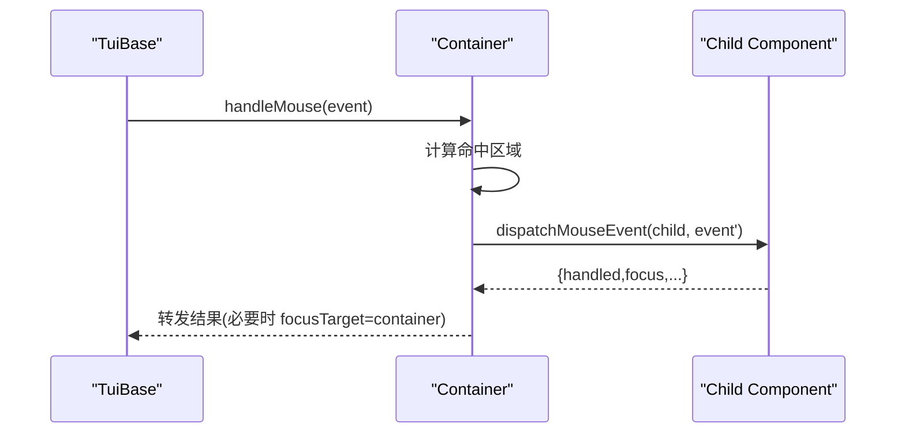

**图示来源**
- [tui.ts:81-115](file://packages/tui/src/tui.ts#L81-L115)
- [tui.ts:364-424](file://packages/tui/src/tui.ts#L364-L424)
- [tui.ts:512-800](file://packages/tui/src/tui.ts#L512-L800)

**章节来源**
- [tui.ts:117-148](file://packages/tui/src/tui.ts#L117-L148)
- [tui.ts:364-424](file://packages/tui/src/tui.ts#L364-L424)
- [tui.ts:512-800](file://packages/tui/src/tui.ts#L512-L800)

## 依赖关系分析
- 低耦合高内聚
  - keys.ts 与 keybindings.ts 解耦：前者负责协议解析，后者负责命令映射。
  - components/input.ts 与 components/editor.ts 复用 word-navigation.ts、kill-ring.ts、undo-stack.ts。
- 外部依赖
  - Intl.Segmenter 用于词/字素分割；Node.js 进程环境变量用于平台检测（Windows Terminal、macOS）。
- 潜在循环依赖
  - 无直接循环；编辑器与输入组件均依赖 keybindings 与 keys，但不反向依赖。

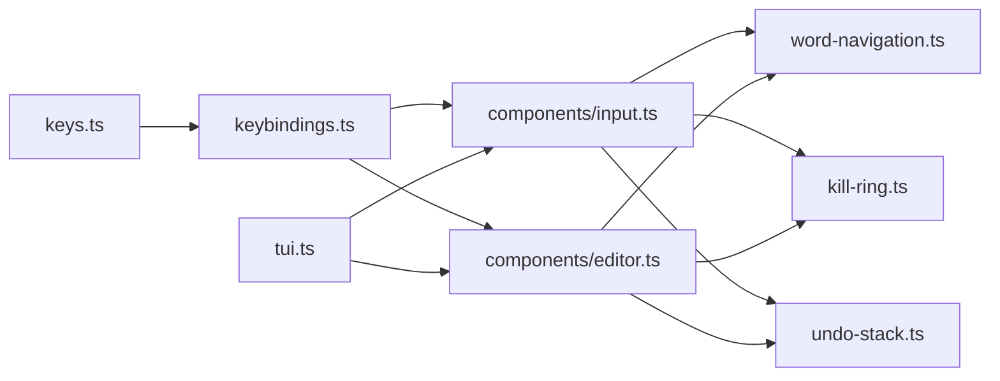

**图示来源**
- [keys.ts:1-100](file://packages/tui/src/keys.ts#L1-L100)
- [keybindings.ts:1-120](file://packages/tui/src/keybindings.ts#L1-L120)
- [components/input.ts:1-60](file://packages/tui/src/components/input.ts#L1-L60)
- [components/editor.ts:1-60](file://packages/tui/src/components/editor.ts#L1-L60)
- [word-navigation.ts:1-30](file://packages/tui/src/word-navigation.ts#L1-L30)
- [kill-ring.ts:1-20](file://packages/tui/src/kill-ring.ts#L1-L20)
- [undo-stack.ts:1-20](file://packages/tui/src/undo-stack.ts#L1-L20)
- [tui.ts:117-148](file://packages/tui/src/tui.ts#L117-L148)

**章节来源**
- [keys.ts:1-100](file://packages/tui/src/keys.ts#L1-L100)
- [keybindings.ts:1-120](file://packages/tui/src/keybindings.ts#L1-L120)
- [components/input.ts:1-60](file://packages/tui/src/components/input.ts#L1-L60)
- [components/editor.ts:1-60](file://packages/tui/src/components/editor.ts#L1-L60)
- [word-navigation.ts:1-30](file://packages/tui/src/word-navigation.ts#L1-L30)
- [kill-ring.ts:1-20](file://packages/tui/src/kill-ring.ts#L1-L20)
- [undo-stack.ts:1-20](file://packages/tui/src/undo-stack.ts#L1-L20)
- [tui.ts:117-148](file://packages/tui/src/tui.ts#L117-L148)

## 性能与可访问性
- 性能
  - 撤销快照使用 structuredClone，避免浅拷贝导致的意外共享；大量粘贴时使用标记压缩，减少渲染压力。
  - 自动补全请求串行化与防抖，避免频繁重算建议。
  - 滚轮加速根据事件间隔自适应，避免过度滚动。
- 可访问性
  - 通过 CURSOR_MARKER 与 FAKE_CURSOR_* 配合硬件光标，确保 IME 候选窗口正确定位。
  - Focusable 接口让组件声明焦点状态，TUI 统一管理焦点切换与覆盖层焦点恢复。

**章节来源**
- [components/editor.ts:1270-1336](file://packages/tui/src/components/editor.ts#L1270-L1336)
- [components/editor.ts:2272-2399](file://packages/tui/src/components/editor.ts#L2272-L2399)
- [wheel-scroll.ts:1-83](file://packages/tui/src/wheel-scroll.ts#L1-L83)
- [tui.ts:180-213](file://packages/tui/src/tui.ts#L180-L213)

## 故障排查指南
- 快捷键不生效
  - 检查是否启用了 Kitty 协议；确认终端是否发送 CSI-u 或 modifyOtherKeys。
  - 使用 getKeybindings().getResolvedBindings() 查看最终绑定；检查是否存在冲突。
- 粘贴内容异常
  - 确认终端启用括号粘贴模式；检查编辑器对控制字符的过滤逻辑。
  - 大段粘贴会插入标记，确认 expandPasteMarkers 在提交时展开。
- 撤销失效
  - 确认操作路径中调用了 pushUndoSnapshot；某些原子操作（如 handlePaste）会跳过合并但会单独入栈。
- 滚轮过快或过慢
  - 在 macOS 本地终端上，WheelScrollAccelerator 默认关闭加速；如需调整，修改 setLines 或构造函数参数。
- IME 候选窗口错位
  - 确保组件在聚焦时输出 CURSOR_MARKER；检查 renderFakeCursor 包裹是否正确。

**章节来源**
- [keys.ts:892-1295](file://packages/tui/src/keys.ts#L892-L1295)
- [keybindings.ts:231-307](file://packages/tui/src/keybindings.ts#L231-L307)
- [components/editor.ts:1270-1336](file://packages/tui/src/components/editor.ts#L1270-L1336)
- [components/editor.ts:2126-2142](file://packages/tui/src/components/editor.ts#L2126-L2142)
- [wheel-scroll.ts:1-83](file://packages/tui/src/wheel-scroll.ts#L1-L83)
- [tui.ts:180-213](file://packages/tui/src/tui.ts#L180-L213)

## 结论
本输入处理系统以协议无关的键解析为核心，结合可配置的快捷键绑定，将底层终端事件转化为高层编辑命令。单行输入与多行编辑器共享单词导航、剪贴板环与撤销栈能力，并通过 TUI 框架完成事件分发与焦点管理。系统在兼容性（Kitty/xterm/传统序列）、性能（快照深拷贝、自动补全防抖、滚轮加速）与可访问性（IME 光标定位）方面做了细致优化，适合在复杂终端环境中提供稳定高效的交互体验。