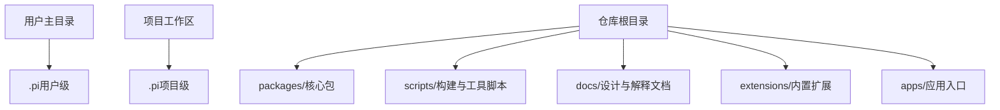
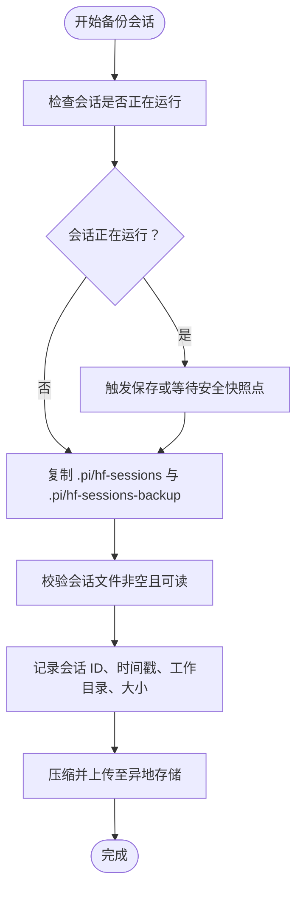
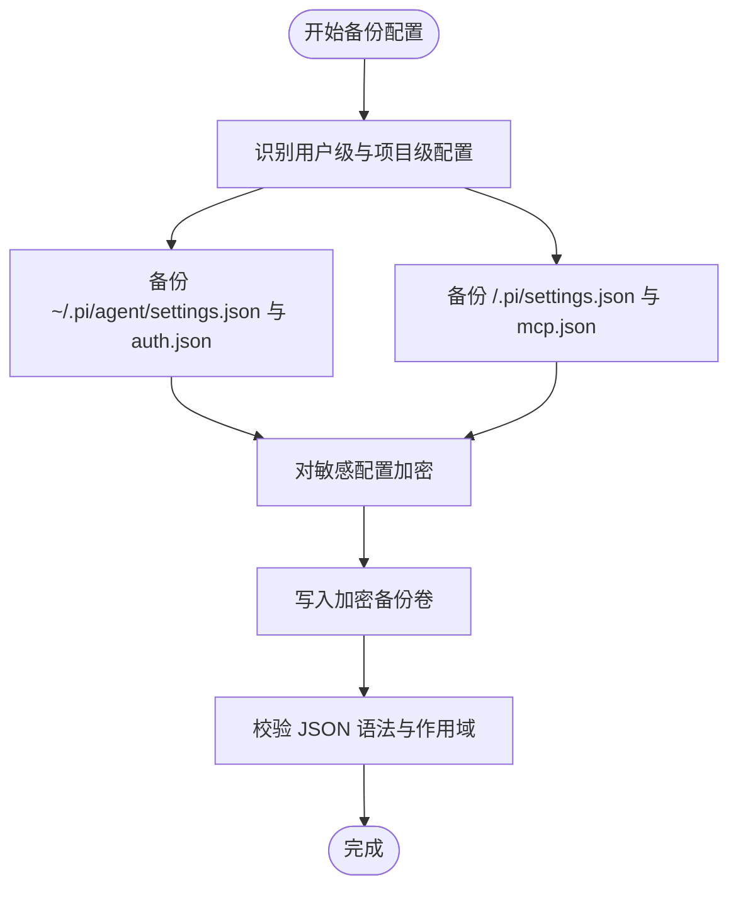
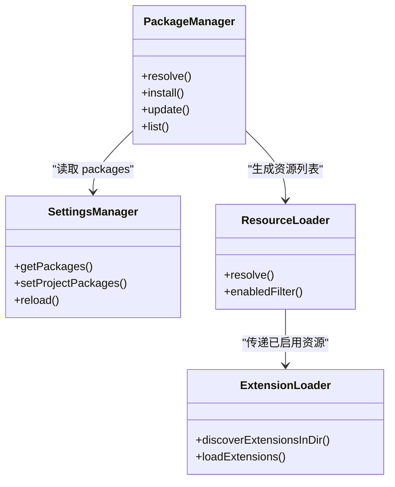
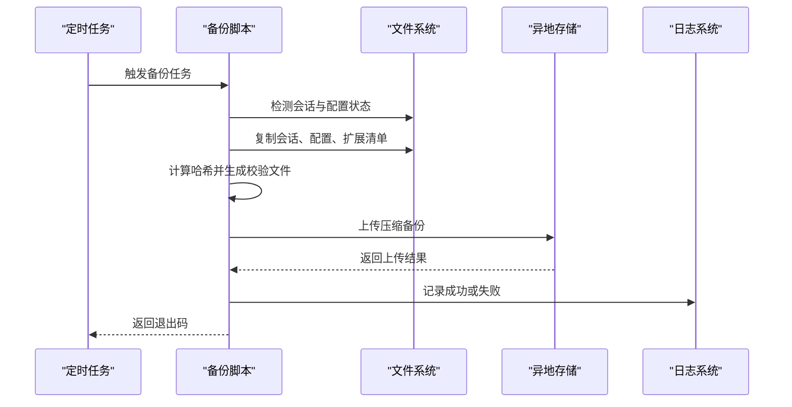
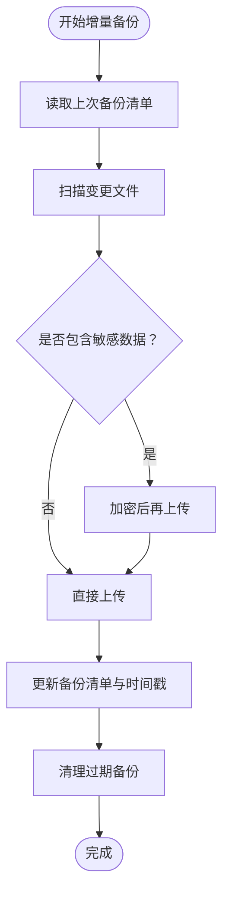
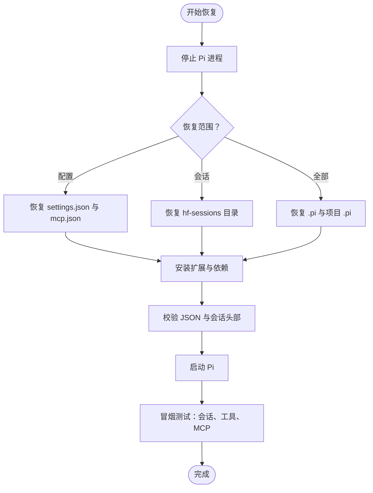
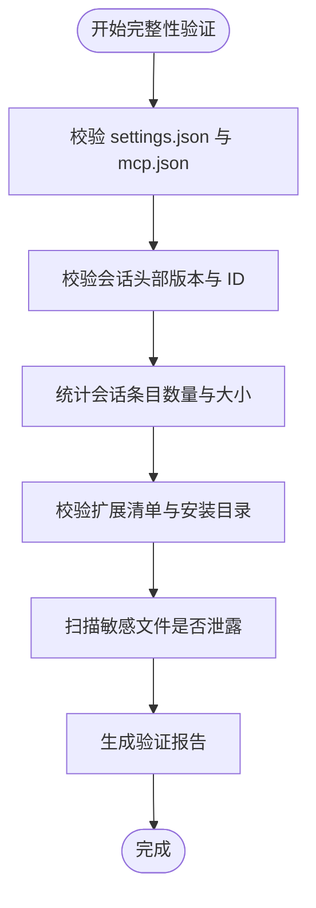
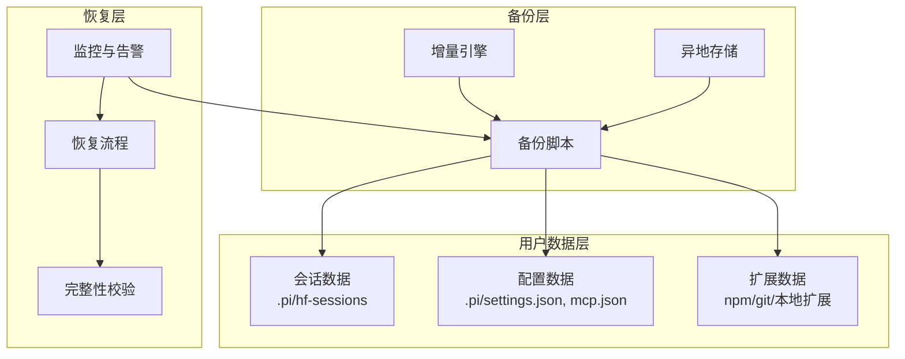

# 备份与恢复

<cite>
**本文引用的文件**   
- [.gitignore](file://.gitignore)
- [06-extension-loading.md](file://docs/explains/06-extension-loading.md)
- [07-package-manager.md](file://docs/explains/07-package-manager.md)
- [create-source-archive.sh](file://scripts/create-source-archive.sh)
- [load-entries.test.ts](file://packages/coding-agent/test/session-manager/load-entries.test.ts)
- [file-operations.test.ts](file://packages/coding-agent/test/session-manager/file-operations.test.ts)
- [settings-manager-bug.test.ts](file://packages/coding-agent/test/settings-manager-bug.test.ts)
- [3616-settings-inmemory-reload.test.ts](file://packages/coding-agent/test/suite/regressions/3616-settings-inmemory-reload.test.ts)
- [settings-diagnostics.test.ts](file://packages/coding-agent/test/settings-diagnostics.test.ts)
- [settings-manager.test.ts](file://packages/coding-agent/test/settings-manager.test.ts)
- [mcp-extension.test.ts](file://packages/coding-agent/test/mcp-extension.test.ts)
- [package-manager.test.ts](file://packages/coding-agent/test/package-manager.test.ts)
- [agent-session-model-extension.test.ts](file://packages/coding-agent/test/suite/agent-session-model-extension.test.ts)
</cite>

## 目录
1. [引言](#引言)
2. [项目结构与数据边界](#项目结构与数据边界)
3. [需要备份的数据范围](#需要备份的数据范围)
4. [会话数据备份策略](#会话数据备份策略)
5. [配置信息备份策略](#配置信息备份策略)
6. [扩展包与依赖备份策略](#扩展包与依赖备份策略)
7. [自动化备份脚本设计](#自动化备份脚本设计)
8. [增量备份与异地存储方案](#增量备份与异地存储方案)
9. [数据恢复流程](#数据恢复流程)
10. [灾难恢复计划与业务连续性](#灾难恢复计划与业务连续性)
11. [数据迁移、版本兼容性与完整性验证](#数据迁移版本兼容性与完整性验证)
12. [架构总览](#架构总览)
13. [故障排查指南](#故障排查指南)
14. [结论](#结论)

## 引言
本指南面向使用当前代码库的用户和运维人员，目标是建立一套可执行的备份与恢复体系。重点覆盖三类数据：
- 会话数据：用户对话、消息、工作区上下文等持久化状态。
- 配置信息：全局设置、项目设置、MCP 服务器配置、信任状态等。
- 扩展包与依赖：本地扩展、npm 包、git 仓库来源的扩展、内置扩展以及安装产物。

该仓库没有提供现成的“一键备份”命令，但通过 `.gitignore`、测试用例、文档说明和构建脚本，可以明确哪些路径是运行时数据、哪些是源码制品，从而设计可靠的备份、增量、异地恢复方案。

## 项目结构与数据边界
从仓库结构看，这是一个多包 Node.js 工程，核心运行数据通常位于用户目录或工作区下的隐藏目录中；源码、脚本、文档和包定义则位于仓库根目录及 `packages/`、`extensions/`、`scripts/`、`docs/` 等目录。

关键边界如下：
- 用户级数据目录：`.pi/` 及其子目录，例如会话缓存、设置文件、模型数据、扩展安装位置等。
- 项目级数据目录：工作区下的 `.pi/`，包含项目级设置、项目级 MCP 配置、项目级扩展等。
- 源码与制品：`packages/`、`extensions/`、`scripts/`、`apps/`、`docs/`、`package.json`、`pnpm-workspace.yaml`、`pnpm-lock.yaml` 等。
- 构建与发布制品：由 `scripts/create-source-archive.sh` 生成的确定性源码归档，用于 GitHub Releases。

**图表来源**
- [.gitignore:44-46](file://.gitignore#L44-L46)
- [06-extension-loading.md:19-31](file://docs/explains/06-extension-loading.md#L19-L31)
- [07-package-manager.md:15-21](file://docs/explains/07-package-manager.md#L15-L21)

**章节来源**
- [.gitignore:1-49](file://.gitignore#L1-L49)
- [06-extension-loading.md:1-31](file://docs/explains/06-extension-loading.md#L1-L31)
- [07-package-manager.md:1-21](file://docs/explains/07-package-manager.md#L1-L21)

## 需要备份的数据范围
根据现有实现和文档，建议将以下范围纳入备份：

| 数据类型 | 典型路径或范围 | 备份优先级 | 说明 |
|---|---|---|---|
| 会话数据 | `.pi/hf-sessions/`、`.pi/hf-sessions-backup/` | 高 | 会话缓存与备份目录被显式忽略到 Git，属于用户运行时数据。 |
| 用户设置 | `.pi/settings.json` | 高 | 用户级设置文件被忽略到 Git，不应提交源码。 |
| 项目设置 | `<cwd>/.pi/settings.json` | 高 | 项目级设置，可能随项目共享，需按团队策略决定是否纳入版本控制。 |
| MCP 配置 | `<cwd>/.pi/mcp.json`、`~/.pi/agent/mcp.json` | 高 | MCP 服务器配置可能包含敏感命令与环境变量。 |
| 凭据与密钥 | `~/.pi/agent/auth.json`、`.env` | 极高 | 绝对不要提交到源码仓库；应进入加密备份系统。 |
| 扩展安装产物 | `~/.pi/` 下 npm/git 安装目录、临时扩展目录 | 中 | 可通过重新安装还原，但离线环境或私有源场景需要保留。 |
| 源码与依赖清单 | `package.json`、`pnpm-lock.yaml`、`pnpm-workspace.yaml` | 高 | 用于重建环境与扩展来源。 |
| 构建产物与二进制 | `dist/`、`packages/*/dist*`、`packages/coding-agent/binaries/` | 低 | 通常可从源码重建；CI 发布的二进制可作为快速恢复选项。 |

**章节来源**
- [.gitignore:1-49](file://.gitignore#L1-L49)
- [AGENTS.md:95-156](file://AGENTS.md#L95-L156)
- [SECURITY.md:61-61](file://SECURITY.md#L61-L61)

## 会话数据备份策略
会话数据以条目流的形式存在，支持内存会话与持久化会话。测试表明：
- 会话可以不在文件系统上持久化。
- 会话文件具有头部信息，包含会话标识、版本、时间戳和工作目录。
- 旧版本头部可以在加载时迁移到当前版本。
- 无头部的条目会被当作当前版本直接采用。
- 会话列表、继续最近会话、打开损坏文件等路径都有测试覆盖。

因此，会话备份应遵循以下原则：
1. **优先备份完整会话目录**：包括 `.pi/hf-sessions/` 与 `.pi/hf-sessions-backup/`。
2. **避免只复制正在写入的文件**：如果会话仍在运行，应先触发保存或使用快照点，再复制。
3. **保留会话头部与条目顺序**：会话恢复依赖头部中的版本、ID、时间戳与工作目录。
4. **对损坏会话进行隔离**：不要把损坏会话直接覆盖到活跃目录，先复制到隔离目录验证。
5. **记录会话元数据**：备份时应记录会话 ID、创建时间、工作目录、会话文件大小，便于恢复后核对。

**图表来源**
- [load-entries.test.ts:115-182](file://packages/coding-agent/test/session-manager/load-entries.test.ts#L115-L182)
- [file-operations.test.ts:335-375](file://packages/coding-agent/test/session-manager/file-operations.test.ts#L335-L375)

**章节来源**
- [load-entries.test.ts:115-182](file://packages/coding-agent/test/session-manager/load-entries.test.ts#L115-L182)
- [file-operations.test.ts:335-375](file://packages/coding-agent/test/session-manager/file-operations.test.ts#L335-L375)

## 配置信息备份策略
配置信息分为用户级和项目级两类：
- 用户级配置：`~/.pi/agent/settings.json`。
- 项目级配置：`<cwd>/.pi/settings.json`。
- MCP 配置：`~/.pi/agent/mcp.json` 与 `<cwd>/.pi/mcp.json`。
- 其他敏感配置：`~/.pi/agent/auth.json`、`.env`。

配置备份的关键点：
1. **区分作用域**：用户级配置适合个人备份；项目级配置可按团队策略决定是否纳入版本控制。
2. **保护敏感字段**：认证信息、API Key、私有 MCP 命令必须加密备份，不能进入普通日志或明文归档。
3. **保留合并语义**：项目配置优先于全局配置；恢复时需确保两者都正确放置。
4. **处理外部编辑冲突**：SettingsManager 会跟踪显式修改字段，避免外部编辑数组时被内存旧值覆盖。
5. **诊断无效配置**：当 settings.json 语法错误时，应能收集并报告错误路径与作用域。

**图表来源**
- [06-extension-loading.md:69-77](file://docs/explains/06-extension-loading.md#L69-L77)
- [settings-manager-bug.test.ts:1-38](file://packages/coding-agent/test/settings-manager-bug.test.ts#L1-L38)
- [settings-diagnostics.test.ts:1-34](file://packages/coding-agent/test/settings-diagnostics.test.ts#L1-L34)
- [mcp-extension.test.ts:119-147](file://packages/coding-agent/test/mcp-extension.test.ts#L119-L147)

**章节来源**
- [06-extension-loading.md:69-77](file://docs/explains/06-extension-loading.md#L69-L77)
- [settings-manager-bug.test.ts:1-38](file://packages/coding-agent/test/settings-manager-bug.test.ts#L1-L38)
- [settings-diagnostics.test.ts:1-34](file://packages/coding-agent/test/settings-diagnostics.test.ts#L1-L34)
- [settings-manager.test.ts:237-266](file://packages/coding-agent/test/settings-manager.test.ts#L237-L266)
- [mcp-extension.test.ts:119-147](file://packages/coding-agent/test/mcp-extension.test.ts#L119-L147)

## 扩展包与依赖备份策略
扩展包来源包括 npm、git、本地路径和内置扩展。包管理器决定资源能否不加载，并维护安装路径与作用域：
- 用户作用域：`~/.pi/`。
- 项目作用域：`<cwd>/.pi/`。
- 临时作用域：CLI 传入，不持久化。
- 本地扩展扫描顺序：项目级 `.pi/extensions/`、全局 `~/.pi/agent/extensions/`、显式配置路径。
- 包解析优先级：项目设置在前，全局在后；同一身份去重；禁用资源零成本不加载。

备份策略：
1. **源码与依赖清单优先**：`package.json`、`pnpm-lock.yaml`、`pnpm-workspace.yaml` 是重建基础。
2. **扩展来源清单**：记录 `settings.packages` 中所有 npm、git、本地来源，以便离线环境重新安装。
3. **本地扩展目录**：备份 `<cwd>/.pi/extensions/` 与 `~/.pi/agent/extensions/`。
4. **npm/git 安装产物**：在无法联网或私有源不可用时，备份已安装的扩展目录。
5. **内置扩展**：不需要备份源码，但需要记录启用/禁用状态。
6. **临时扩展**：一般不备份，除非有调试或审计需求。

**图表来源**
- [07-package-manager.md:6-39](file://docs/explains/07-package-manager.md#L6-L39)
- [06-extension-loading.md:19-31](file://docs/explains/06-extension-loading.md#L19-L31)

**章节来源**
- [07-package-manager.md:6-39](file://docs/explains/07-package-manager.md#L6-L39)
- [06-extension-loading.md:19-31](file://docs/explains/06-extension-loading.md#L19-L31)
- [package-manager.test.ts:780-815](file://packages/coding-agent/test/package-manager.test.ts#L780-L815)
- [package-manager.test.ts:1537-1573](file://packages/coding-agent/test/package-manager.test.ts#L1537-L1573)
- [package-manager.test.ts:2550-2584](file://packages/coding-agent/test/package-manager.test.ts#L2550-L2584)

## 自动化备份脚本设计
仓库已有构建期源码归档脚本 `scripts/create-source-archive.sh`，它展示了如何：
- 校验版本号与 Git 引用。
- 生成确定性归档。
- 校验必需路径。
- 排除 `node_modules` 与二进制产物。
- 解压并执行模型数据校验。

可基于该脚本风格设计备份脚本，但目标不同：源码归档关注发布一致性，备份脚本关注用户数据一致性。建议备份脚本具备以下能力：
1. **参数化目标**：支持选择备份会话、配置、扩展、全部。
2. **锁定运行态**：检测 Pi 进程是否运行，必要时暂停或等待会话保存。
3. **增量标记**：记录上次备份时间戳与文件哈希。
4. **压缩与校验**：生成 tar.gz 或 zip，并输出 SHA256 校验文件。
5. **异地同步**：调用 rsync、rclone、AWS CLI、Azure CLI 等工具上传。
6. **清理策略**：保留 N 份历史备份，删除过期快照。
7. **失败回滚**：备份失败不覆盖原数据，保留临时目录供排查。

**图表来源**
- [create-source-archive.sh:1-162](file://scripts/create-source-archive.sh#L1-L162)

**章节来源**
- [create-source-archive.sh:1-162](file://scripts/create-source-archive.sh#L1-L162)

## 增量备份与异地存储方案
### 增量备份
增量备份的核心是“只备份变化部分”。推荐做法：
- 首次全量备份：备份 `.pi/`、`<cwd>/.pi/`、扩展清单、依赖清单。
- 后续增量：仅备份自上次备份以来修改过的文件。
- 使用文件时间戳或内容哈希判断变更。
- 对会话文件特别谨慎：若会话仍在写入，应跳过或等待保存点。

### 异地存储
异地存储至少应有两份独立副本：
- 本地 NAS 或磁盘阵列：用于快速恢复。
- 云对象存储：用于灾难恢复。
- 可选第三副本：跨地域或跨云厂商。

传输建议：
- 使用加密通道：SSH、TLS、SFTP。
- 使用加密文件：对敏感配置与会话进行端到端加密。
- 使用幂等上传：支持断点续传与重复执行。
- 保留访问凭证分离：备份脚本不硬编码密钥，改用环境变量或密钥管理服务。

[本节为概念性流程，不直接映射具体源码文件]

## 数据恢复流程
恢复流程应按风险等级分层：

### 正常恢复
适用场景：误删会话、配置写错、扩展失效。
步骤：
1. 停止 Pi 进程，避免写入冲突。
2. 从最新备份恢复 `.pi/` 与 `<cwd>/.pi/`。
3. 校验 JSON 语法与作用域。
4. 重启 Pi，观察会话列表与配置加载。
5. 如扩展缺失，根据 `settings.packages` 重新安装。

### 部分恢复
适用场景：仅会话损坏或仅配置损坏。
步骤：
1. 隔离损坏文件，不直接覆盖。
2. 尝试用健康备份替换对应文件。
3. 启动 Pi 并验证会话头部、消息顺序、配置合并结果。
4. 如仍异常，逐步缩小恢复范围。

### 完全恢复
适用场景：系统重装、磁盘损坏、用户目录丢失。
步骤：
1. 恢复源码与依赖清单。
2. 安装 Node.js、pnpm 与必要工具。
3. 安装扩展与依赖。
4. 恢复用户配置与项目配置。
5. 恢复会话数据。
6. 执行完整性校验与冒烟测试。

**图表来源**
- [load-entries.test.ts:146-182](file://packages/coding-agent/test/session-manager/load-entries.test.ts#L146-L182)
- [settings-diagnostics.test.ts:1-34](file://packages/coding-agent/test/settings-diagnostics.test.ts#L1-L34)

**章节来源**
- [load-entries.test.ts:146-182](file://packages/coding-agent/test/session-manager/load-entries.test.ts#L146-L182)
- [settings-diagnostics.test.ts:1-34](file://packages/coding-agent/test/settings-diagnostics.test.ts#L1-L34)

## 灾难恢复计划与业务连续性
### RTO 与 RPO
- RPO（恢复点目标）：建议不超过一次会话周期，例如每小时或每次重要会话结束。
- RTO（恢复时间目标）：配置恢复应在分钟级；会话恢复应在小时级；完全恢复应在天级。

### 灾难场景
- 单盘损坏：从异地云存储恢复。
- 用户目录丢失：从备份重建 `.pi/`。
- 扩展源不可用：使用离线扩展包或预装镜像。
- 配置污染：从干净备份恢复，并对比差异。

### 业务连续性保障
- 多副本策略：本地+云端双活或冷备。
- 定期演练：每季度执行一次恢复演练。
- 监控告警：备份失败、空间不足、校验失败应告警。
- 权限最小化：备份服务只读访问用户数据目录。
- 审计日志：记录备份、恢复、校验操作。

[本节为通用运维策略，不直接分析具体源码文件]

## 数据迁移、版本兼容性与完整性验证
### 会话数据迁移
会话头部包含版本字段，测试覆盖了旧版本头部迁移行为：
- 旧版本头部会被迁移到当前版本。
- 无头部条目会被当作当前版本直接采用。
- 会话 ID、时间戳、工作目录在恢复后应保持合理。

迁移建议：
1. 恢复前先记录原始版本。
2. 恢复后检查会话头部版本是否被升级。
3. 对旧版本会话做只读验证，确认消息角色、ID、时间戳未破坏。
4. 如发现异常，回滚到备份前状态。

### 配置兼容性
SettingsManager 的行为表明：
- 外部编辑数组时，只有显式修改字段才会覆盖文件值。
- 内存设置可 reload 并保持初始值。
- 无效 JSON 会收集诊断信息，包含文件路径与作用域。
- 项目信任会影响项目配置加载。

兼容性建议：
1. 升级前导出配置快照。
2. 升级后检查 `drainErrors()` 或诊断输出。
3. 对项目信任状态进行显式确认。
4. 对 MCP 配置进行 BOM 与命名冲突校验。

### 完整性验证
完整性验证应包括：
- JSON 语法校验。
- 会话头部版本校验。
- 会话条目数量与大小基线比对。
- 扩展清单与安装目录一致性校验。
- 敏感文件未泄露校验。

**图表来源**
- [load-entries.test.ts:146-182](file://packages/coding-agent/test/session-manager/load-entries.test.ts#L146-L182)
- [settings-manager-bug.test.ts:1-38](file://packages/coding-agent/test/settings-manager-bug.test.ts#L1-L38)
- [3616-settings-inmemory-reload.test.ts:1-41](file://packages/coding-agent/test/suite/regressions/3616-settings-inmemory-reload.test.ts#L1-L41)
- [settings-diagnostics.test.ts:1-34](file://packages/coding-agent/test/settings-diagnostics.test.ts#L1-L34)
- [mcp-extension.test.ts:119-147](file://packages/coding-agent/test/mcp-extension.test.ts#L119-L147)

**章节来源**
- [load-entries.test.ts:146-182](file://packages/coding-agent/test/session-manager/load-entries.test.ts#L146-L182)
- [settings-manager-bug.test.ts:1-38](file://packages/coding-agent/test/settings-manager-bug.test.ts#L1-L38)
- [3616-settings-inmemory-reload.test.ts:1-41](file://packages/coding-agent/test/suite/regressions/3616-settings-inmemory-reload.test.ts#L1-L41)
- [settings-diagnostics.test.ts:1-34](file://packages/coding-agent/test/settings-diagnostics.test.ts#L1-L34)
- [mcp-extension.test.ts:119-147](file://packages/coding-agent/test/mcp-extension.test.ts#L119-L147)

## 架构总览
整体备份与恢复架构围绕三类数据展开：会话、配置、扩展。它们分别由不同的子系统管理，但统一受备份脚本调度，并通过校验与恢复流程保证一致性。

[本节为概念性架构图，不直接映射具体源码文件]

## 故障排查指南
常见故障与排查要点：
1. **会话无法恢复**：检查会话文件是否为空、头部是否有效、版本是否过旧。
2. **配置未生效**：检查全局与项目配置作用域、项目信任状态、JSON 语法错误。
3. **扩展未加载**：检查 `settings.packages`、自动发现路径、禁用规则、安装失败记录。
4. **MCP 配置异常**：检查 UTF-8 BOM、服务器名称冲突、命令与环境变量。
5. **备份失败**：检查磁盘空间、权限、网络、加密密钥、校验文件。

相关测试提供了有价值的线索：
- 会话加载与迁移逻辑。
- 设置管理器对外部编辑的保护。
- 设置诊断错误收集。
- MCP 配置 BOM 与命名冲突。
- 包安装失败记录与临时扩展路径。

**章节来源**
- [agent-session-model-extension.test.ts:538-559](file://packages/coding-agent/test/suite/agent-session-model-extension.test.ts#L538-L559)
- [settings-manager-bug.test.ts:1-38](file://packages/coding-agent/test/settings-manager-bug.test.ts#L1-L38)
- [settings-diagnostics.test.ts:1-34](file://packages/coding-agent/test/settings-diagnostics.test.ts#L1-L34)
- [mcp-extension.test.ts:119-147](file://packages/coding-agent/test/mcp-extension.test.ts#L119-L147)
- [package-manager.test.ts:2565-2584](file://packages/coding-agent/test/package-manager.test.ts#L2565-L2584)

## 结论
当前仓库没有内置一键备份命令，但通过 `.gitignore`、测试用例、文档与构建脚本，可以清晰界定会话、配置、扩展三类数据的边界与行为。建议采用“源码与依赖清单 + 用户数据快照 + 增量 + 异地多副本 + 完整性校验 + 定期演练”的组合策略，确保在正常运行、部分故障与灾难场景下都能快速恢复业务。

对于生产环境，还应补充：
- 统一的备份编排平台。
- 加密与密钥管理。
- 备份与恢复的自动化测试。
- 可观测性与审计。
- 明确的 RTO/RPO 指标与责任人。

[本节为总结性内容，不直接分析具体源码文件]