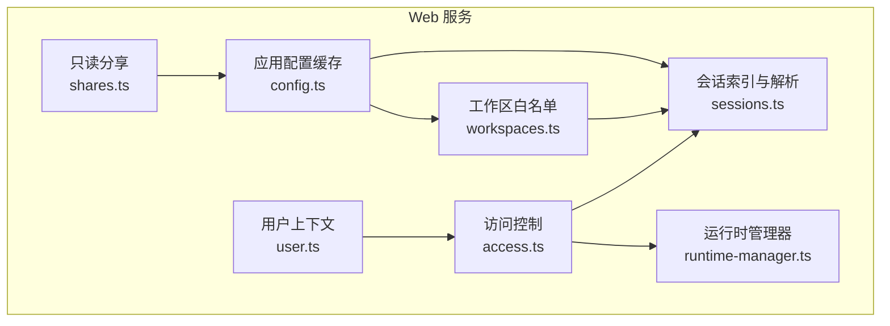
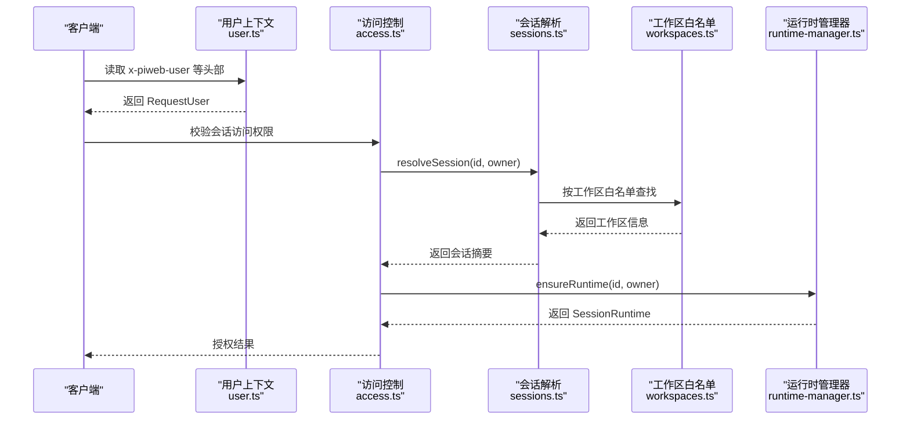
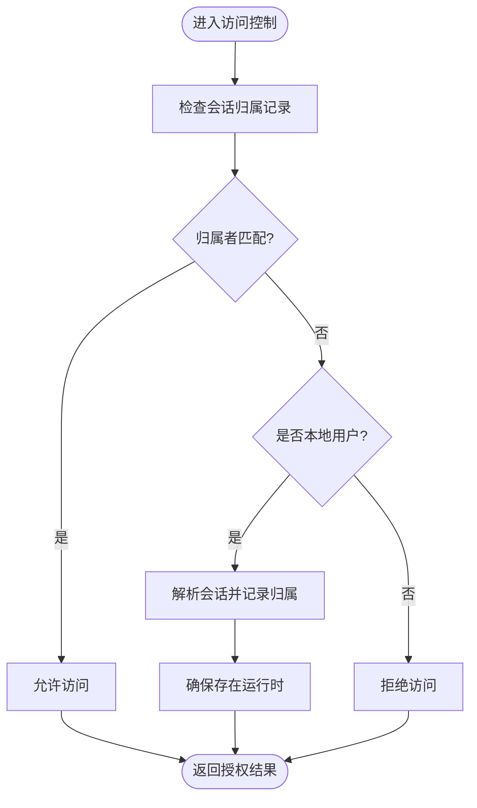
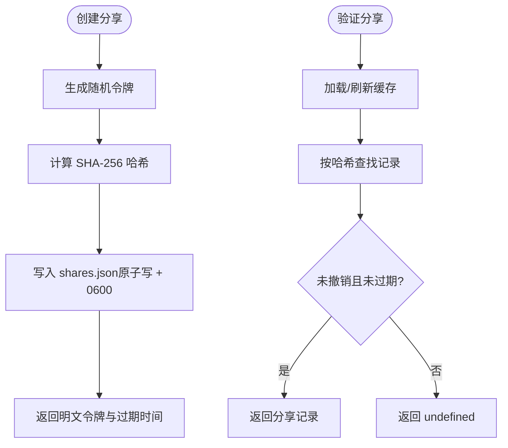
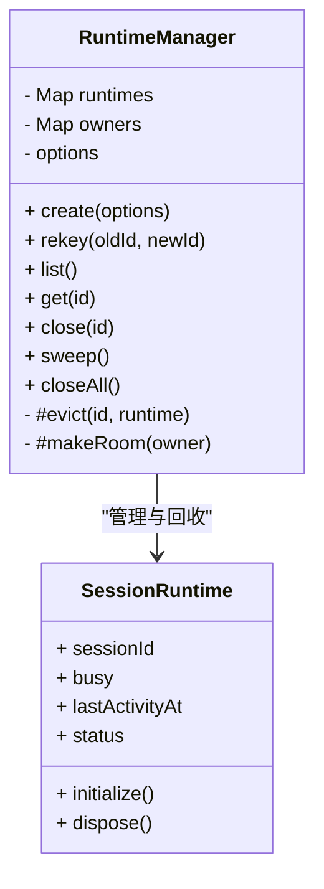
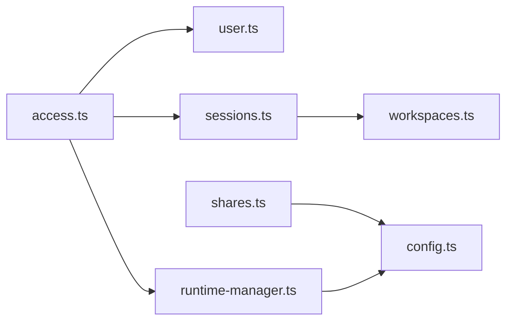

# 安全加固

<cite>
**本文引用的文件**   
- [SECURITY.md](file://SECURITY.md)
- [access.ts](file://apps/pi-web/src/server/access.ts)
- [user.ts](file://apps/pi-web/src/server/user.ts)
- [config.ts](file://apps/pi-web/src/server/config.ts)
- [sessions.ts](file://apps/pi-web/src/server/sessions.ts)
- [shares.ts](file://apps/pi-web/src/server/shares.ts)
- [workspaces.ts](file://apps/pi-web/src/server/workspaces.ts)
- [runtime-manager.ts](file://apps/pi-web/src/server/runtime-manager.ts)
</cite>

## 目录
1. [简介](#简介)
2. [项目结构](#项目结构)
3. [核心组件](#核心组件)
4. [架构总览](#架构总览)
5. [详细组件分析](#详细组件分析)
6. [依赖关系分析](#依赖关系分析)
7. [性能与资源控制](#性能与资源控制)
8. [故障排查指南](#故障排查指南)
9. [结论](#结论)

## 简介
本文件聚焦于仓库的安全加固策略与实现，围绕以下维度展开：
- 安全边界与信任模型：明确本地代理、用户账户与工作区的信任边界。
- Web 服务访问控制：会话归属校验、工作区白名单、运行时并发上限与空闲回收。
- 分享机制安全：令牌哈希存储、权限校验、过期与撤销。
- 配置加载与缓存：避免重复解析与路径校验开销。
- 威胁建模与缓解措施：从攻击面出发给出可操作的加固建议。

## 项目结构
本次安全加固主要涉及后端服务器模块，关键目录与职责如下：
- apps/pi-web/src/server：Web 服务侧的访问控制、会话管理、分享、工作区、运行时管理等。
- SECURITY.md：安全策略与漏洞报告范围说明。

图示来源
- [access.ts:1-48](file://apps/pi-web/src/server/access.ts#L1-L48)
- [user.ts:1-35](file://apps/pi-web/src/server/user.ts#L1-L35)
- [config.ts:1-34](file://apps/pi-web/src/server/config.ts#L1-L34)
- [sessions.ts:1-120](file://apps/pi-web/src/server/sessions.ts#L1-L120)
- [shares.ts:1-149](file://apps/pi-web/src/server/shares.ts#L1-L149)
- [workspaces.ts:1-51](file://apps/pi-web/src/server/workspaces.ts#L1-L51)
- [runtime-manager.ts:1-254](file://apps/pi-web/src/server/runtime-manager.ts#L1-L254)

章节来源
- [SECURITY.md:1-88](file://SECURITY.md#L1-L88)

## 核心组件
- 访问控制与会话解析：确保只有会话所有者或本地用户可访问会话，并在需要时启动对应运行时。
- 用户上下文：从请求头注入当前用户身份与角色，开发模式回退为本地用户。
- 工作区白名单：仅允许配置中声明的工作区被访问。
- 分享机制：使用随机令牌并仅持久化其 SHA-256 哈希，支持过期与撤销。
- 运行时管理器：限制全局与单用户的活跃运行时数量，自动回收空闲进程。

章节来源
- [access.ts:1-48](file://apps/pi-web/src/server/access.ts#L1-L48)
- [user.ts:1-35](file://apps/pi-web/src/server/user.ts#L1-L35)
- [workspaces.ts:1-51](file://apps/pi-web/src/server/workspaces.ts#L1-L51)
- [sessions.ts:1-120](file://apps/pi-web/src/server/sessions.ts#L1-L120)
- [shares.ts:1-149](file://apps/pi-web/src/server/shares.ts#L1-L149)
- [runtime-manager.ts:1-254](file://apps/pi-web/src/server/runtime-manager.ts#L1-L254)

## 架构总览
下图展示了一次“访问受保护会话”的典型调用链：请求进入后先解析用户上下文，再进行会话访问控制；若需执行操作，则通过运行时管理器获取或创建会话运行时。

图示来源
- [user.ts:1-35](file://apps/pi-web/src/server/user.ts#L1-L35)
- [access.ts:1-48](file://apps/pi-web/src/server/access.ts#L1-L48)
- [sessions.ts:1-120](file://apps/pi-web/src/server/sessions.ts#L1-L120)
- [workspaces.ts:1-51](file://apps/pi-web/src/server/workspaces.ts#L1-L51)
- [runtime-manager.ts:1-254](file://apps/pi-web/src/server/runtime-manager.ts#L1-L254)

## 详细组件分析

### 访问控制与会话解析
- 会话访问控制：根据会话归属记录判断是否允许访问；非本地用户必须匹配所有者。
- 运行时保障：若无运行中的 Pi 进程，则根据会话与工作区信息创建新进程。
- 错误处理：当会话不存在或无权限时返回空值，由上层统一处理。

图示来源
- [access.ts:1-48](file://apps/pi-web/src/server/access.ts#L1-L48)
- [sessions.ts:1-120](file://apps/pi-web/src/server/sessions.ts#L1-L120)

章节来源
- [access.ts:1-48](file://apps/pi-web/src/server/access.ts#L1-L48)
- [sessions.ts:1-120](file://apps/pi-web/src/server/sessions.ts#L1-L120)

### 用户上下文与角色判定
- 用户来源：生产环境由边缘层注入请求头；开发模式回退为本地用户。
- 角色判定：若用户标识为本地或携带管理员角色头，则赋予管理员角色。
- 安全注意：不应信任浏览器直接传入的同名头，应由可信边缘层设置。

章节来源
- [user.ts:1-35](file://apps/pi-web/src/server/user.ts#L1-L35)

### 工作区白名单与默认工作区
- 白名单来源：从应用配置中读取工作区列表，禁止访问未配置目录。
- 默认回退：当配置为空时回退到当前工作目录，便于开发与测试。
- 安全性：所有会话与运行时均基于白名单工作区进行约束。

章节来源
- [workspaces.ts:1-51](file://apps/pi-web/src/server/workspaces.ts#L1-L51)
- [config.ts:1-34](file://apps/pi-web/src/server/config.ts#L1-L34)

### 会话索引与解析
- 会话列表：遍历配置中的所有工作区，聚合会话并按修改时间排序。
- 会话解析：优先按归属记录定位会话，否则在工作区白名单内搜索。
- 归属记录：首次本地用户访问时记录归属，便于后续快速过滤。

章节来源
- [sessions.ts:1-120](file://apps/pi-web/src/server/sessions.ts#L1-L120)

### 只读分享机制
- 令牌生成：使用加密安全的随机字节生成 base64url 令牌。
- 持久化安全：仅存储令牌的 SHA-256 哈希，文件权限设置为 0600，原子写入。
- 生命周期：默认 7 天过期，支持随时撤销；查询时同时校验过期与撤销状态。
- 内存缓存：进程内缓存提升性能，并提供测试重置接口。

图示来源
- [shares.ts:1-149](file://apps/pi-web/src/server/shares.ts#L1-L149)
- [config.ts:1-34](file://apps/pi-web/src/server/config.ts#L1-L34)

章节来源
- [shares.ts:1-149](file://apps/pi-web/src/server/shares.ts#L1-L149)

### 运行时管理器（并发与回收）
- 并发上限：全局与单用户双上限，超过上限时优先回收最久未活动且不忙的运行时。
- 空闲回收：定时任务清理空闲超时的运行时，释放系统资源。
- 生命周期：监听运行时退出事件，及时从注册表移除。
- 配置来源：环境变量优先，其次来自应用配置的限额项。

图示来源
- [runtime-manager.ts:1-254](file://apps/pi-web/src/server/runtime-manager.ts#L1-L254)

章节来源
- [runtime-manager.ts:1-254](file://apps/pi-web/src/server/runtime-manager.ts#L1-L254)

## 依赖关系分析
- access.ts 依赖 user.ts、sessions.ts、runtime-manager.ts 与 workspaces.ts。
- sessions.ts 依赖 workspaces.ts 与 owners.ts（归属记录）。
- shares.ts 依赖 config.ts 以定位持久化路径。
- runtime-manager.ts 依赖 config.ts 获取默认限额。

图示来源
- [access.ts:1-48](file://apps/pi-web/src/server/access.ts#L1-L48)
- [sessions.ts:1-120](file://apps/pi-web/src/server/sessions.ts#L1-L120)
- [shares.ts:1-149](file://apps/pi-web/src/server/shares.ts#L1-L149)
- [workspaces.ts:1-51](file://apps/pi-web/src/server/workspaces.ts#L1-L51)
- [runtime-manager.ts:1-254](file://apps/pi-web/src/server/runtime-manager.ts#L1-L254)
- [config.ts:1-34](file://apps/pi-web/src/server/config.ts#L1-L34)

章节来源
- [access.ts:1-48](file://apps/pi-web/src/server/access.ts#L1-L48)
- [sessions.ts:1-120](file://apps/pi-web/src/server/sessions.ts#L1-L120)
- [shares.ts:1-149](file://apps/pi-web/src/server/shares.ts#L1-L149)
- [workspaces.ts:1-51](file://apps/pi-web/src/server/workspaces.ts#L1-L51)
- [runtime-manager.ts:1-254](file://apps/pi-web/src/server/runtime-manager.ts#L1-L254)
- [config.ts:1-34](file://apps/pi-web/src/server/config.ts#L1-L34)

## 性能与资源控制
- 配置缓存：应用配置在进程级缓存一次，避免每个请求重复解析与校验工作区路径。
- 分享索引缓存：进程内缓存分享记录，减少磁盘 I/O；提供测试重置方法。
- 运行时回收：后台定时扫描并回收空闲运行时，降低常驻进程数。
- 并发限制：全局与单用户双重上限，防止资源耗尽。

章节来源
- [config.ts:1-34](file://apps/pi-web/src/server/config.ts#L1-L34)
- [shares.ts:1-149](file://apps/pi-web/src/server/shares.ts#L1-L149)
- [runtime-manager.ts:1-254](file://apps/pi-web/src/server/runtime-manager.ts#L1-L254)

## 故障排查指南
- 无法访问会话：
  - 确认会话归属记录是否存在且与当前用户匹配。
  - 检查是否处于本地用户模式；非本地用户必须拥有会话所有权。
- 分享令牌无效：
  - 检查令牌是否已过期或被撤销。
  - 确认 shares.json 文件权限是否为 0600，且内容未被破坏。
- 运行时不足：
  - 查看全局与单用户并发上限是否达到阈值。
  - 检查是否有空闲但超时的运行时未被回收。
- 配置异常：
  - 检查工作区白名单是否正确配置。
  - 确认应用配置文件路径与权限正确。

章节来源
- [access.ts:1-48](file://apps/pi-web/src/server/access.ts#L1-L48)
- [sessions.ts:1-120](file://apps/pi-web/src/server/sessions.ts#L1-L120)
- [shares.ts:1-149](file://apps/pi-web/src/server/shares.ts#L1-L149)
- [runtime-manager.ts:1-254](file://apps/pi-web/src/server/runtime-manager.ts#L1-L254)
- [workspaces.ts:1-51](file://apps/pi-web/src/server/workspaces.ts#L1-L51)

## 结论
本项目通过明确的信任边界、严格的访问控制、白名单工作区、安全的分享机制以及健壮的运行时管理，构建了较为完善的安全加固体系。建议在部署时：
- 严格限定工作区白名单，避免暴露敏感目录。
- 在生产环境中由可信边缘层注入用户上下文，禁用浏览器直传。
- 合理配置运行时并发上限与空闲回收阈值，平衡性能与安全。
- 定期审计分享令牌与归属记录，及时撤销不再使用的分享。
- 遵循安全策略文档，对超出范围的本地代码执行、沙箱行为、提示注入等问题保持警惕。