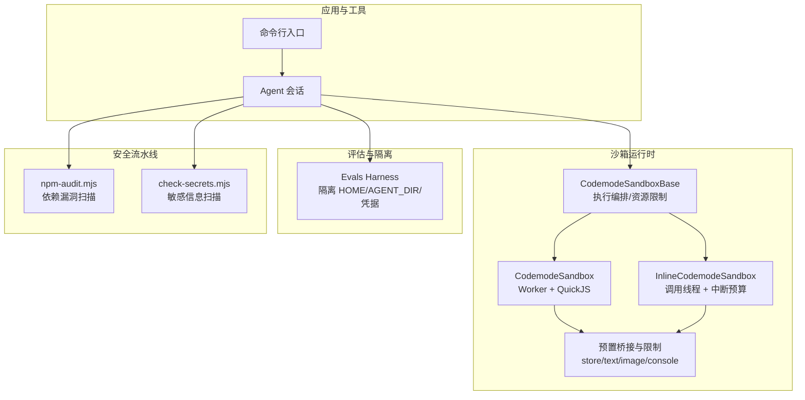
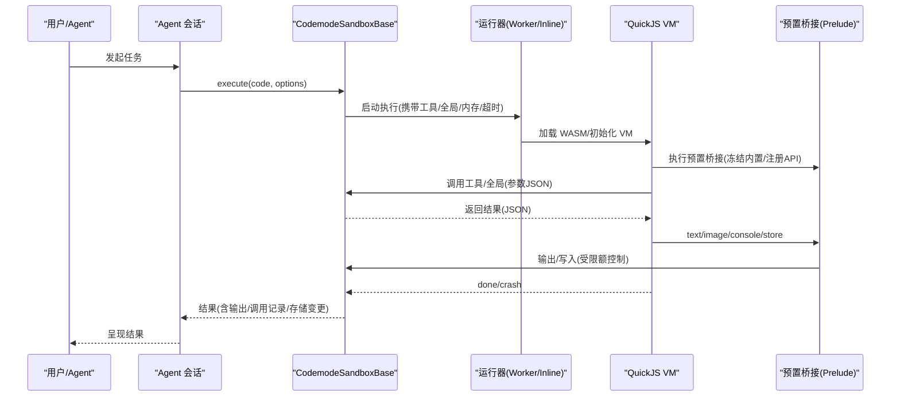
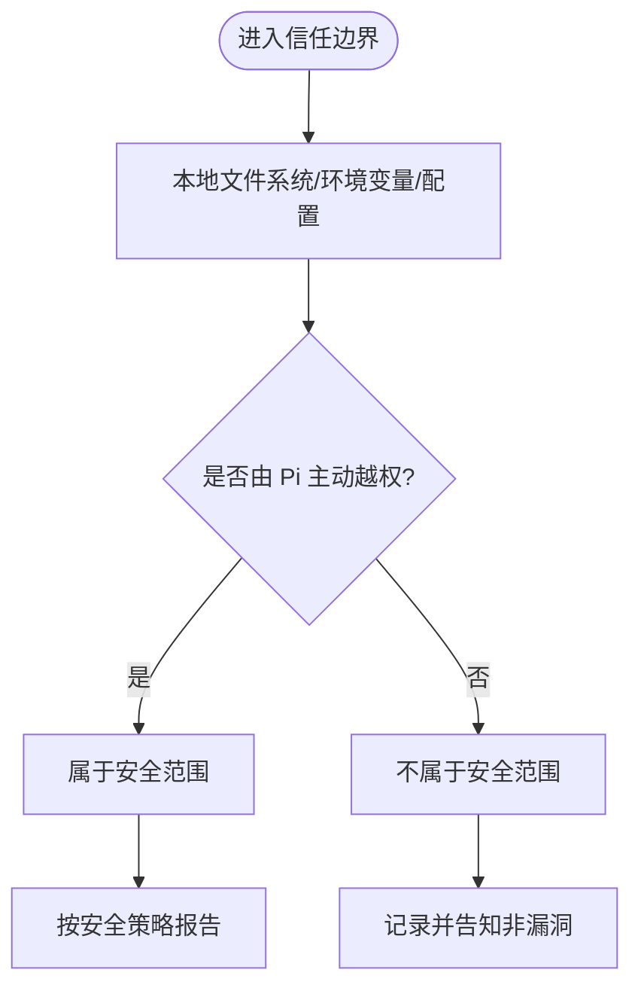
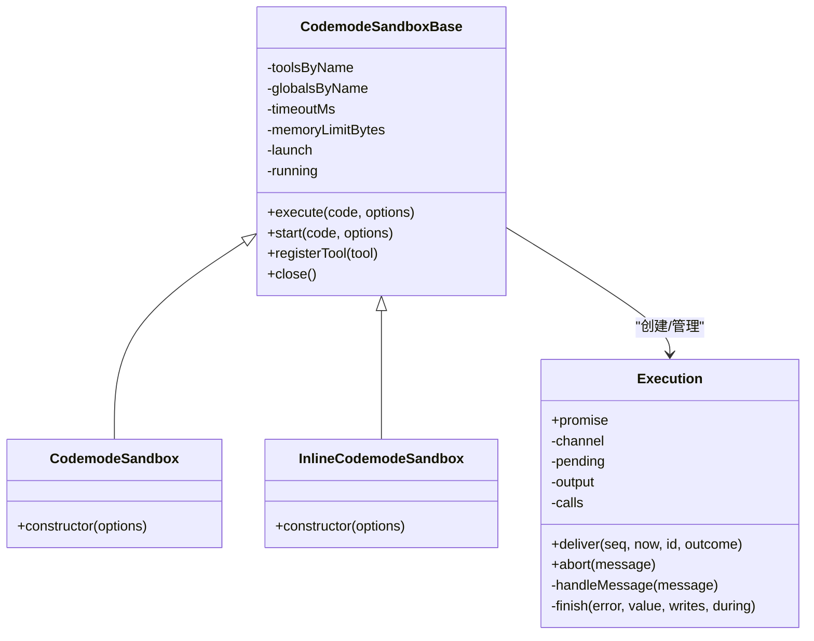
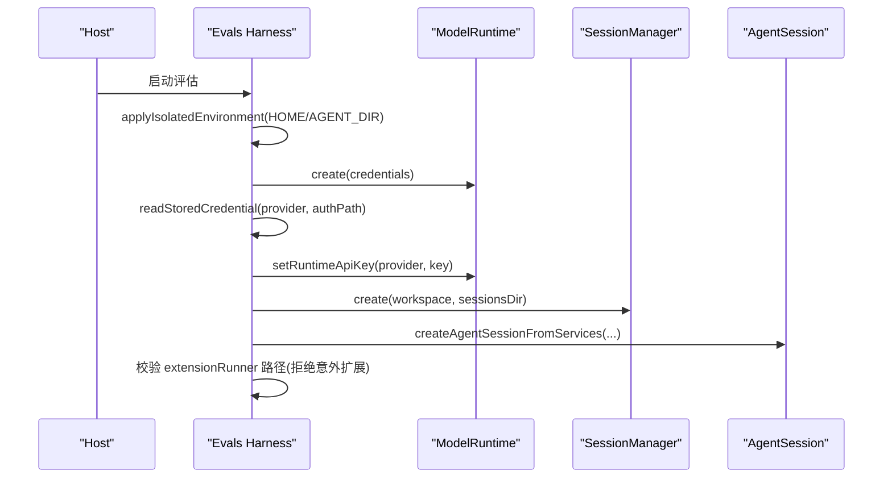
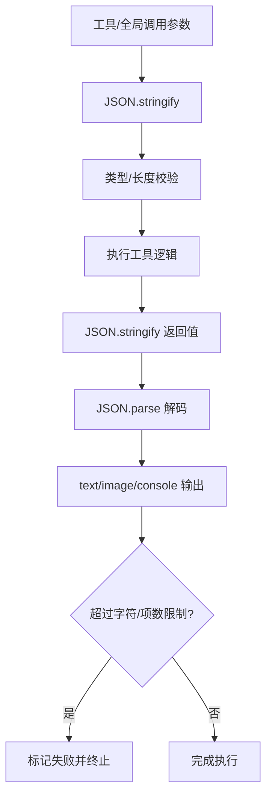
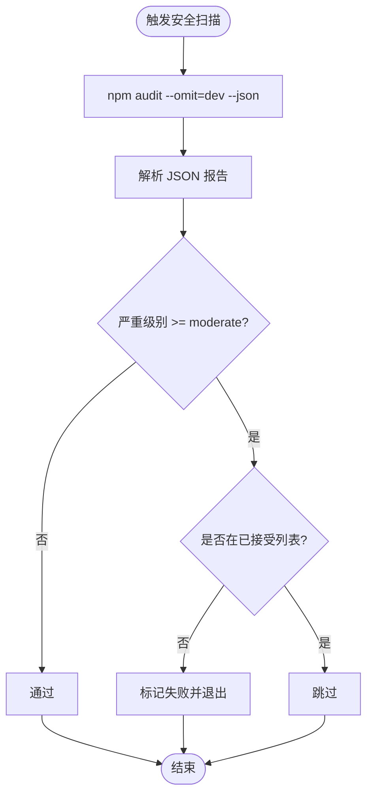
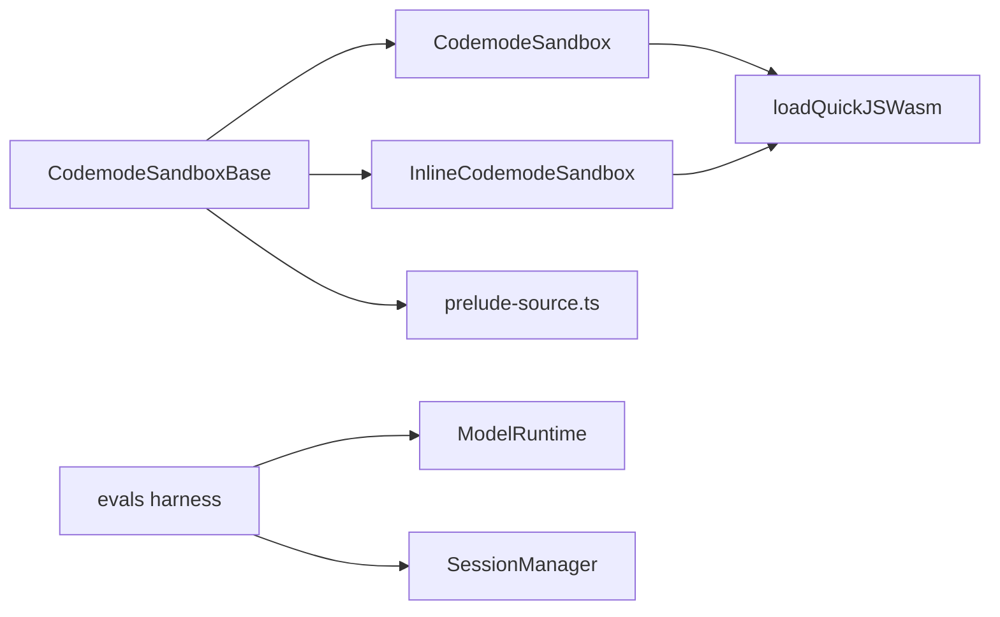

# 安全加固

<cite>
**本文引用的文件**
- [SECURITY.md](file://SECURITY.md)
- [packages/codemode/src/index.ts](file://packages/codemode/src/index.ts)
- [packages/codemode/src/runtime/execution.ts](file://packages/codemode/src/runtime/execution.ts)
- [packages/codemode/src/runtime/host.ts](file://packages/codemode/src/runtime/host.ts)
- [packages/codemode/src/runtime/inline.ts](file://packages/codemode/src/runtime/inline.ts)
- [packages/codemode/src/runtime/prelude-source.ts](file://packages/codemode/src/runtime/prelude-source.ts)
- [packages/evals/src/harness.ts](file://packages/evals/src/harness.ts)
- [scripts/npm-audit.mjs](file://scripts/npm-audit.mjs)
- [scripts/check-secrets.mjs](file://scripts/check-secrets.mjs)
</cite>

## 目录
1. [引言](#引言)
2. [项目结构](#项目结构)
3. [核心组件](#核心组件)
4. [架构总览](#架构总览)
5. [详细组件分析](#详细组件分析)
6. [依赖关系分析](#依赖关系分析)
7. [性能与安全权衡](#性能与安全权衡)
8. [故障排查指南](#故障排查指南)
9. [结论](#结论)
10. [附录：安全配置模板与检查清单](#附录安全配置模板与检查清单)

## 引言
本指南面向本地代码代理（Pi）的安全加固，围绕权限模型、沙箱机制、网络安全与数据安全展开，覆盖认证授权、输入验证、输出编码与依赖安全检查。同时提供漏洞扫描与渗透测试实践、安全事件响应、审计日志与合规性要求建议。仓库明确将“本地用户账户与可写文件”视为信任边界，且未内置系统级沙箱；因此，安全重点在于最小化暴露面、严格隔离执行环境、强化输入校验与输出限制，以及通过自动化手段持续发现依赖风险与敏感信息泄露。

**章节来源**
- [SECURITY.md:1-23](file://SECURITY.md#L1-L23)

## 项目结构
本项目采用多包工作区组织，安全相关能力主要分布在以下位置：
- 代码执行沙箱：packages/codemode（QuickJS VM、Worker/Inline/Remote 三种运行模式）
- 评估与隔离：packages/evals（隔离环境、凭据注入、会话创建）
- 安全脚本：scripts/npm-audit.mjs、scripts/check-secrets.mjs（依赖审计与密钥扫描）
- 安全策略：SECURITY.md（范围、报告流程、边界说明）

**图表来源**
- [packages/codemode/src/index.ts:1-66](file://packages/codemode/src/index.ts#L1-L66)
- [packages/codemode/src/runtime/execution.ts:460-573](file://packages/codemode/src/runtime/execution.ts#L460-L573)
- [packages/codemode/src/runtime/host.ts:1-89](file://packages/codemode/src/runtime/host.ts#L1-L89)
- [packages/codemode/src/runtime/inline.ts:1-127](file://packages/codemode/src/runtime/inline.ts#L1-L127)
- [packages/codemode/src/runtime/prelude-source.ts:1-523](file://packages/codemode/src/runtime/prelude-source.ts#L1-L523)
- [packages/evals/src/harness.ts:272-363](file://packages/evals/src/harness.ts#L272-L363)
- [scripts/npm-audit.mjs:1-76](file://scripts/npm-audit.mjs#L1-L76)
- [scripts/check-secrets.mjs:1-79](file://scripts/check-secrets.mjs#L1-L79)

**章节来源**
- [packages/codemode/src/index.ts:1-66](file://packages/codemode/src/index.ts#L1-L66)
- [SECURITY.md:1-23](file://SECURITY.md#L1-L23)

## 核心组件
- 代码执行沙箱（CodemodeSandboxBase）
  - 统一编排：超时、内存上限、工具表、全局名白名单、输出与存储限额、结果序列化与解码校验。
  - 生命周期：启动、消息收发、终止（超时/中止/崩溃）、清理待处理调用。
- Worker 与 Inline 两种运行器
  - Worker：每个执行独立 worker 线程，支持 terminate 快速终止，适合 Node/Bun。
  - Inline：在调用线程运行，使用中断预算防止死循环阻塞事件循环。
- 预置桥接（Prelude）
  - 冻结内置对象与全局，限制 tools/ALL_TOOLS、text/image/console/store/load 等 API。
  - 对 store 值大小、总大小、输出字符数与项数进行硬性限制。
- 评估隔离（Evals Harness）
  - 隔离 HOME 与 Agent 目录，注入凭据，拒绝意外扩展加载。
- 安全流水线
  - npm-audit.mjs：以 moderate 为阈值扫描依赖漏洞，支持已接受告警的白名单管理。
  - check-secrets.mjs：扫描提交或暂存文件中的常见密钥模式，跳过二进制与测试占位符。

**章节来源**
- [packages/codemode/src/runtime/execution.ts:49-61](file://packages/codemode/src/runtime/execution.ts#L49-L61)
- [packages/codemode/src/runtime/execution.ts:151-167](file://packages/codemode/src/runtime/execution.ts#L151-L167)
- [packages/codemode/src/runtime/execution.ts:460-573](file://packages/codemode/src/runtime/execution.ts#L460-L573)
- [packages/codemode/src/runtime/host.ts:12-20](file://packages/codemode/src/runtime/host.ts#L12-L20)
- [packages/codemode/src/runtime/inline.ts:11-25](file://packages/codemode/src/runtime/inline.ts#L11-L25)
- [packages/codemode/src/runtime/prelude-source.ts:34-43](file://packages/codemode/src/runtime/prelude-source.ts#L34-L43)
- [packages/codemode/src/runtime/prelude-source.ts:273-335](file://packages/codemode/src/runtime/prelude-source.ts#L273-L335)
- [packages/evals/src/harness.ts:272-363](file://packages/evals/src/harness.ts#L272-L363)
- [scripts/npm-audit.mjs:1-76](file://scripts/npm-audit.mjs#L1-L76)
- [scripts/check-secrets.mjs:1-79](file://scripts/check-secrets.mjs#L1-L79)

## 架构总览
下图展示从 Agent 到沙箱执行的端到端流程，包括输入校验、工具调用、输出限制与终止策略。

**图表来源**
- [packages/codemode/src/runtime/execution.ts:206-258](file://packages/codemode/src/runtime/execution.ts#L206-L258)
- [packages/codemode/src/runtime/execution.ts:330-365](file://packages/codemode/src/runtime/execution.ts#L330-L365)
- [packages/codemode/src/runtime/host.ts:20-74](file://packages/codemode/src/runtime/host.ts#L20-L74)
- [packages/codemode/src/runtime/inline.ts:57-113](file://packages/codemode/src/runtime/inline.ts#L57-L113)
- [packages/codemode/src/runtime/prelude-source.ts:48-523](file://packages/codemode/src/runtime/prelude-source.ts#L48-L523)

## 详细组件分析

### 权限模型与信任边界
- 信任边界定义
  - Pi 作为本地代码代理，默认以当前用户身份运行；该用户账户及其可写文件被视为同一信任边界。
  - 若攻击者已能修改用户家目录、工作区、Shell 启动文件或 Pi 配置，通常可影响 Pi 行为；此类问题不在安全范围内，除非证明 Pi 主动授予了越权访问。
- 扩展与技能信任
  - 仅安装可信扩展与技能，并在可信仓库中使用；AGENTS.md 或注释中的指令可能被用于提示注入，无法完全防护。
- 报告范围与排除
  - 本地代码执行/沙箱行为、不受信仓库风险、不受信扩展/技能、MITM 代理、公开暴露、Prompt 注入、第三方凭据泄露等不在范围。

**图表来源**
- [SECURITY.md:6-23](file://SECURITY.md#L6-L23)
- [SECURITY.md:42-68](file://SECURITY.md#L42-L68)

**章节来源**
- [SECURITY.md:6-23](file://SECURITY.md#L6-L23)
- [SECURITY.md:42-68](file://SECURITY.md#L42-L68)

### 沙箱机制与执行隔离
- CodemodeSandboxBase
  - 工具与全局名白名单校验，禁止保留字与冲突命名。
  - 统一的超时、内存上限、输出与存储限额。
  - 严格的 JSON 编解码与错误描述规范化，避免原型污染导致的数据损坏。
- Worker 运行器
  - 每个执行独立 worker 线程，支持共享中断标志与 terminate 快速终止。
  - 过滤调试消息，避免干扰通道。
- Inline 运行器
  - 使用中断预算限制无等待的死循环计算，避免阻塞事件循环。
  - 设置栈大小上限，防止递归过深。
- 预置桥接（Prelude）
  - 冻结所有可达内置对象与全局，阻断原型链篡改。
  - 限制 store 单值与总量、输出字符数与项数，阻止内存耗尽。
  - image() 仅允许 data URI base64，并校验文件头签名（PNG/JPEG/GIF/WebP）。

**图表来源**
- [packages/codemode/src/runtime/execution.ts:188-258](file://packages/codemode/src/runtime/execution.ts#L188-L258)
- [packages/codemode/src/runtime/execution.ts:460-573](file://packages/codemode/src/runtime/execution.ts#L460-L573)
- [packages/codemode/src/runtime/host.ts:84-88](file://packages/codemode/src/runtime/host.ts#L84-L88)
- [packages/codemode/src/runtime/inline.ts:122-126](file://packages/codemode/src/runtime/inline.ts#L122-L126)

**章节来源**
- [packages/codemode/src/runtime/execution.ts:49-61](file://packages/codemode/src/runtime/execution.ts#L49-L61)
- [packages/codemode/src/runtime/execution.ts:151-167](file://packages/codemode/src/runtime/execution.ts#L151-L167)
- [packages/codemode/src/runtime/execution.ts:206-258](file://packages/codemode/src/runtime/execution.ts#L206-L258)
- [packages/codemode/src/runtime/execution.ts:330-365](file://packages/codemode/src/runtime/execution.ts#L330-L365)
- [packages/codemode/src/runtime/host.ts:12-20](file://packages/codemode/src/runtime/host.ts#L12-L20)
- [packages/codemode/src/runtime/host.ts:20-74](file://packages/codemode/src/runtime/host.ts#L20-L74)
- [packages/codemode/src/runtime/inline.ts:11-25](file://packages/codemode/src/runtime/inline.ts#L11-L25)
- [packages/codemode/src/runtime/inline.ts:57-113](file://packages/codemode/src/runtime/inline.ts#L57-L113)
- [packages/codemode/src/runtime/prelude-source.ts:48-523](file://packages/codemode/src/runtime/prelude-source.ts#L48-L523)

### 认证与授权
- 凭据管理
  - 评估环境通过 InMemoryCredentialStore 注入凭据，必要时从 host agent 目录读取 auth.json。
  - 当启用沙箱身份时，会删除 auth.json 并从进程环境中隐藏凭据变量，避免泄露。
- 会话与服务
  - 通过 createAgentSessionServices 创建服务，结合 SessionManager 管理会话生命周期。
  - 拒绝意外的扩展加载，确保评估环境的纯净性。

**图表来源**
- [packages/evals/src/harness.ts:272-363](file://packages/evals/src/harness.ts#L272-L363)

**章节来源**
- [packages/evals/src/harness.ts:272-363](file://packages/evals/src/harness.ts#L272-L363)

### 输入验证与输出编码
- 输入验证
  - 全局名与工具名白名单校验，禁止保留字与重复注册。
  - 工具参数与返回值均经 JSON 序列化/反序列化，异常被捕获并转为安全的错误描述。
  - store 键必须为字符串，值必须可 JSON 序列化，且受单值与总量限制。
- 输出编码与限制
  - text/image/console 输出累计字符数与项数限制，超限即失败。
  - image() 仅接受 data URI base64，并校验文件头签名，拒绝远程 URL。
  - 错误对象字段强制为字符串，避免原型污染导致的畸形数据。

**图表来源**
- [packages/codemode/src/runtime/execution.ts:378-408](file://packages/codemode/src/runtime/execution.ts#L378-L408)
- [packages/codemode/src/runtime/prelude-source.ts:273-335](file://packages/codemode/src/runtime/prelude-source.ts#L273-L335)
- [packages/codemode/src/runtime/prelude-source.ts:337-429](file://packages/codemode/src/runtime/prelude-source.ts#L337-L429)

**章节来源**
- [packages/codemode/src/runtime/execution.ts:378-408](file://packages/codemode/src/runtime/execution.ts#L378-L408)
- [packages/codemode/src/runtime/prelude-source.ts:273-335](file://packages/codemode/src/runtime/prelude-source.ts#L273-L335)
- [packages/codemode/src/runtime/prelude-source.ts:337-429](file://packages/codemode/src/runtime/prelude-source.ts#L337-L429)

### 网络安全与数据安全
- 网络访问
  - 沙箱内不提供 fetch、process、require 等网络/系统 API，仅暴露受限工具集。
  - 图片输出仅允许 data URI base64，拒绝远程 URL，降低 SSRF 风险。
- 数据存储
  - store 仅用于小状态（如 ID/摘要），大对象应通过工具写入文件。
  - 存储值与总量限制防止内存耗尽。
- 凭据保护
  - 评估环境隐藏凭据环境变量，避免子进程或日志泄露。
  - 安全脚本扫描提交/暂存文件中的常见密钥模式，阻断误提交。

**章节来源**
- [packages/codemode/src/runtime/host.ts:12-20](file://packages/codemode/src/runtime/host.ts#L12-L20)
- [packages/codemode/src/runtime/prelude-source.ts:337-429](file://packages/codemode/src/runtime/prelude-source.ts#L337-L429)
- [packages/evals/src/harness.ts:309-335](file://packages/evals/src/harness.ts#L309-L335)
- [scripts/check-secrets.mjs:1-79](file://scripts/check-secrets.mjs#L1-L79)

### 依赖安全检查与漏洞治理
- 依赖审计
  - npm-audit.mjs 以 moderate 为阈值扫描依赖漏洞，支持已接受告警的白名单管理，并对不再匹配的条目发出警告。
- 密钥扫描
  - check-secrets.mjs 扫描私有密钥、GitHub/AWS/OpenAI/Google/Slack/GitLab/Stripe/JWT 等模式，忽略二进制与测试占位符。

**图表来源**
- [scripts/npm-audit.mjs:1-76](file://scripts/npm-audit.mjs#L1-L76)

**章节来源**
- [scripts/npm-audit.mjs:1-76](file://scripts/npm-audit.mjs#L1-L76)
- [scripts/check-secrets.mjs:1-79](file://scripts/check-secrets.mjs#L1-L79)

## 依赖关系分析
- 模块耦合
  - CodemodeSandboxBase 是所有运行器的基类，封装执行编排与资源限制。
  - CodemodeSandbox 与 InlineCodemodeSandbox 分别实现 Worker 与 Inline 运行器，复用 Base 能力。
  - Prelude 作为 VM 内预置脚本，与 Host 侧通过 JSON 消息通信，强约束 API 与数据格式。
- 外部依赖
  - QuickJS WASM 模块由 wasm.ts 加载，host.ts/inline.ts 负责实例化与生命周期管理。
  - evals harness 依赖 ModelRuntime 与 SessionManager，负责凭据与会话隔离。
  - 安全脚本依赖 Node child_process/fs，不引入业务依赖。

**图表来源**
- [packages/codemode/src/index.ts:1-66](file://packages/codemode/src/index.ts#L1-L66)
- [packages/codemode/src/runtime/host.ts:1-89](file://packages/codemode/src/runtime/host.ts#L1-L89)
- [packages/codemode/src/runtime/inline.ts:1-127](file://packages/codemode/src/runtime/inline.ts#L1-L127)
- [packages/codemode/src/runtime/prelude-source.ts:1-523](file://packages/codemode/src/runtime/prelude-source.ts#L1-L523)
- [packages/evals/src/harness.ts:272-363](file://packages/evals/src/harness.ts#L272-L363)

**章节来源**
- [packages/codemode/src/index.ts:1-66](file://packages/codemode/src/index.ts#L1-L66)
- [packages/codemode/src/runtime/host.ts:1-89](file://packages/codemode/src/runtime/host.ts#L1-L89)
- [packages/codemode/src/runtime/inline.ts:1-127](file://packages/codemode/src/runtime/inline.ts#L1-L127)
- [packages/codemode/src/runtime/prelude-source.ts:1-523](file://packages/codemode/src/runtime/prelude-source.ts#L1-L523)
- [packages/evals/src/harness.ts:272-363](file://packages/evals/src/harness.ts#L272-L363)

## 性能与安全权衡
- 超时与中断预算
  - 默认超时 300 秒；Inline 模式使用中断预算（默认 100,000）防止 CPU 占用过高。
  - Worker 模式通过 terminate 快速终止，但某些内置操作可能延迟退出，需配合中断标志。
- 输出与存储限额
  - 输出字符上限 16MB、项数上限 100,000；store 单值 256KB、总量 1MB。
- 内存限制
  - 支持 memoryLimitBytes，具体由底层 VM 实现决定。
- 栈大小
  - Inline 模式设置最大栈大小，防止递归过深导致宿主栈溢出。

**章节来源**
- [packages/codemode/src/runtime/execution.ts:49-50](file://packages/codemode/src/runtime/execution.ts#L49-L50)
- [packages/codemode/src/runtime/inline.ts:39-42](file://packages/codemode/src/runtime/inline.ts#L39-L42)
- [packages/codemode/src/runtime/host.ts:12-20](file://packages/codemode/src/runtime/host.ts#L12-L20)
- [packages/codemode/src/runtime/prelude-source.ts:34-43](file://packages/codemode/src/runtime/prelude-source.ts#L34-L43)
- [packages/codemode/src/runtime/prelude-source.ts:273-335](file://packages/codemode/src/runtime/prelude-source.ts#L273-L335)

## 故障排查指南
- 执行失败
  - 检查是否触发超时、中断预算耗尽、worker 异常退出或 remote 错误。
  - 查看输出与调用记录，确认是否存在未知工具/全局名或参数序列化失败。
- 输出限制
  - 若出现“超出字符/项数限制”，请改为输出摘要或借助工具写入文件。
- 凭据泄露
  - 运行 check-secrets.mjs 扫描提交/暂存文件，修复误提交的密钥。
- 依赖漏洞
  - 运行 npm-audit.mjs，根据告警升级依赖或添加已接受告警条目并附原因。
- 扩展加载异常
  - 在评估环境中，确认未加载意外扩展；extensionRunner 路径校验失败会直接报错。

**章节来源**
- [packages/codemode/src/runtime/execution.ts:330-365](file://packages/codemode/src/runtime/execution.ts#L330-L365)
- [packages/codemode/src/runtime/host.ts:49-58](file://packages/codemode/src/runtime/host.ts#L49-L58)
- [packages/codemode/src/runtime/inline.ts:77-99](file://packages/codemode/src/runtime/inline.ts#L77-L99)
- [packages/codemode/src/runtime/prelude-source.ts:337-429](file://packages/codemode/src/runtime/prelude-source.ts#L337-L429)
- [scripts/check-secrets.mjs:1-79](file://scripts/check-secrets.mjs#L1-L79)
- [scripts/npm-audit.mjs:1-76](file://scripts/npm-audit.mjs#L1-L76)
- [packages/evals/src/harness.ts:357-363](file://packages/evals/src/harness.ts#L357-L363)

## 结论
本项目以“本地用户信任边界”为核心，通过最小化暴露面、严格隔离执行环境、强化输入校验与输出限制，以及自动化依赖审计与密钥扫描，构建了一套务实的安全加固体系。建议在部署与使用中：
- 始终在可信仓库与可信扩展下运行；
- 使用 Worker/Inline 沙箱运行不可信代码；
- 开启依赖审计与密钥扫描，纳入 CI；
- 对输出与存储实施限额，避免资源耗尽；
- 遵循安全策略文档的报告流程，聚焦真实越权与边界突破。

[本节为总结性内容，不直接分析具体文件]

## 附录：安全配置模板与检查清单

- 安全策略与范围
  - 明确本地信任边界与报告范围，避免将预期行为或不受信输入视为漏洞。
  - 参考：[SECURITY.md:24-40](file://SECURITY.md#L24-L40)、[SECURITY.md:42-68](file://SECURITY.md#L42-L68)

- 沙箱配置要点
  - 设置超时与中断预算；启用内存限制；限制输出与存储大小；仅注册必要工具与全局。
  - 参考：[packages/codemode/src/runtime/execution.ts:49-61](file://packages/codemode/src/runtime/execution.ts#L49-L61)、[packages/codemode/src/runtime/inline.ts:39-55](file://packages/codemode/src/runtime/inline.ts#L39-L55)、[packages/codemode/src/runtime/prelude-source.ts:34-43](file://packages/codemode/src/runtime/prelude-source.ts#L34-L43)

- 认证与凭据
  - 使用 InMemoryCredentialStore 注入凭据；在沙箱模式下隐藏环境变量；避免持久化敏感信息。
  - 参考：[packages/evals/src/harness.ts:309-335](file://packages/evals/src/harness.ts#L309-L335)

- 输入/输出校验
  - 工具参数与返回值 JSON 编解码；store 键值类型与大小校验；image 仅允许 data URI base64 并校验签名。
  - 参考：[packages/codemode/src/runtime/execution.ts:378-408](file://packages/codemode/src/runtime/execution.ts#L378-L408)、[packages/codemode/src/runtime/prelude-source.ts:273-335](file://packages/codemode/src/runtime/prelude-source.ts#L273-L335)、[packages/codemode/src/runtime/prelude-source.ts:376-429](file://packages/codemode/src/runtime/prelude-source.ts#L376-L429)

- 依赖与密钥安全
  - 运行 npm-audit.mjs 与 check-secrets.mjs；维护已接受告警白名单；定期更新依赖。
  - 参考：[scripts/npm-audit.mjs:1-76](file://scripts/npm-audit.mjs#L1-L76)、[scripts/check-secrets.mjs:1-79](file://scripts/check-secrets.mjs#L1-L79)

- 渗透测试与事件响应
  - 针对 Prompt 注入、不受信仓库、不受信扩展/技能、MITM 代理等场景进行专项测试；
  - 建立私报渠道与披露流程，聚焦真实越权与边界突破。
  - 参考：[SECURITY.md:24-40](file://SECURITY.md#L24-L40)、[SECURITY.md:42-68](file://SECURITY.md#L42-L68)