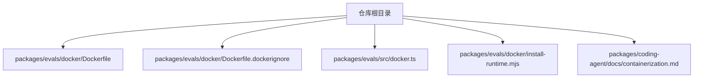
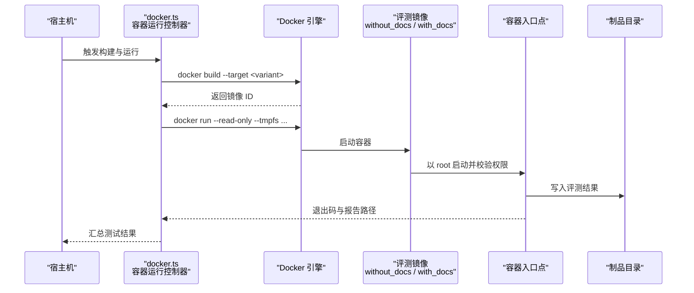
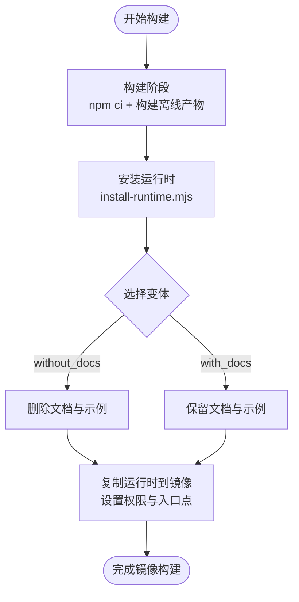
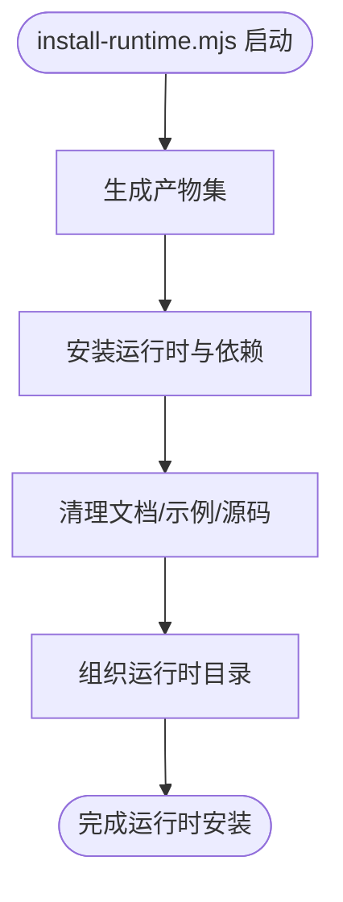
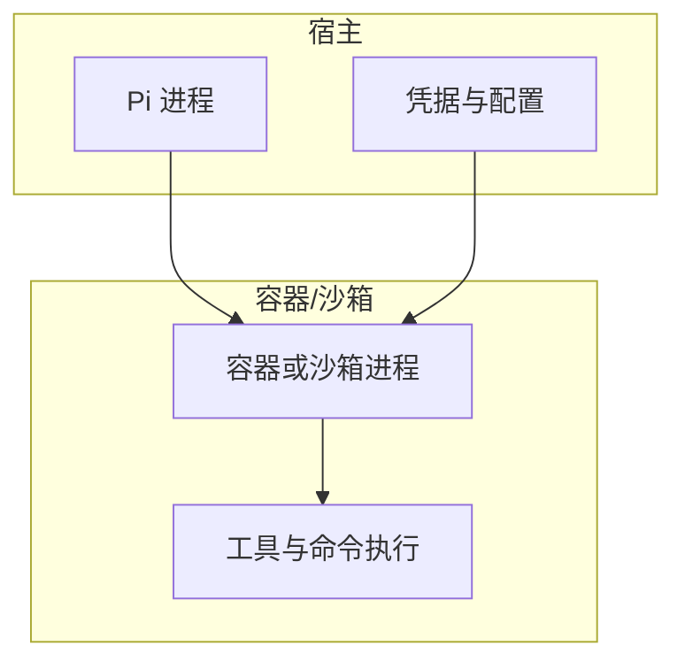
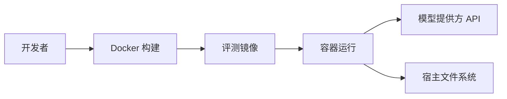
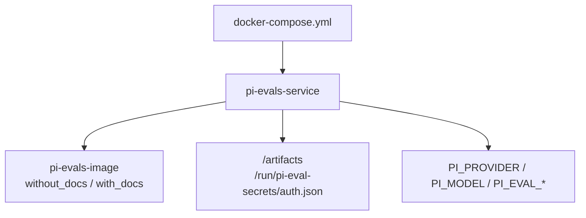
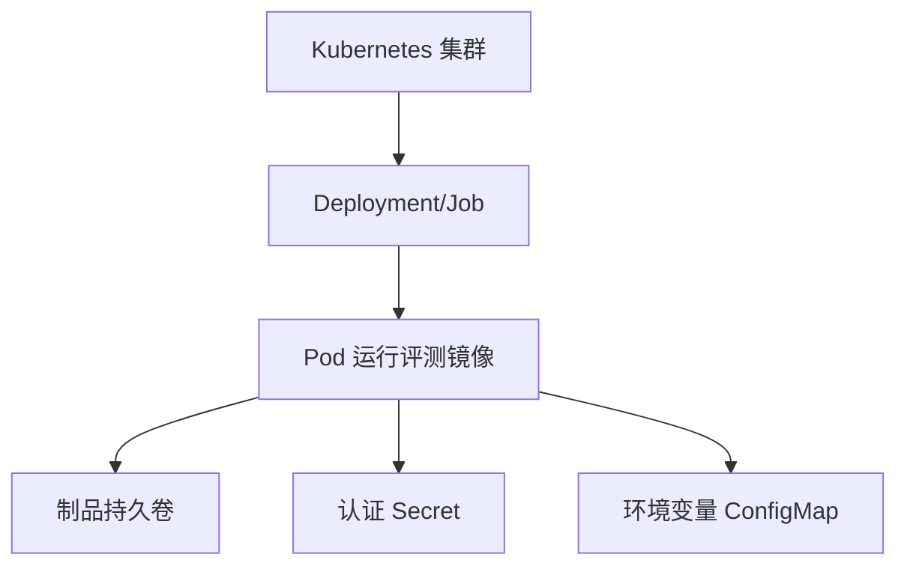

# 容器化部署

<cite>
**本文引用的文件**   
- [packages/evals/docker/Dockerfile](file://packages/evals/docker/Dockerfile)
- [packages/evals/docker/Dockerfile.dockerignore](file://packages/evals/docker/Dockerfile.dockerignore)
- [packages/evals/src/docker.ts](file://packages/evals/src/docker.ts)
- [packages/evals/docker/install-runtime.mjs](file://packages/evals/docker/install-runtime.mjs)
- [packages/coding-agent/docs/containerization.md](file://packages/coding-agent/docs/containerization.md)
</cite>

## 目录
1. [简介](#简介)
2. [项目结构](#项目结构)
3. [核心组件](#核心组件)
4. [架构总览](#架构总览)
5. [详细组件分析](#详细组件分析)
6. [依赖关系分析](#依赖关系分析)
7. [性能与构建优化](#性能与构建优化)
8. [编排与部署示例](#编排与部署示例)
9. [安全与隔离最佳实践](#安全与隔离最佳实践)
10. [故障排查指南](#故障排查指南)
11. [结论](#结论)

## 简介
本指南面向需要在本地或集群中容器化运行该仓库的评测与执行环境。文档围绕以下目标展开：
- Docker 镜像多阶段构建与变体裁剪
- 微 VM（Gondolin）与沙箱环境的配置方法
- 环境变量、数据持久化与网络挂载策略
- Kubernetes、Docker Compose 等编排工具的完整配置示例
- 资源限制、安全隔离与性能调优的最佳实践

## 项目结构
与容器化相关的代码主要位于以下位置：
- 评测镜像定义与忽略规则：`packages/evals/docker/Dockerfile`、`packages/evals/docker/Dockerfile.dockerignore`
- 镜像构建与容器运行控制逻辑：`packages/evals/src/docker.ts`
- 运行时安装与产物整理脚本：`packages/evals/docker/install-runtime.mjs`
- 通用容器化模式说明（Plain Docker、Docker Sandboxes、OpenShell、Gondolin）：`packages/coding-agent/docs/containerization.md`



**图示来源**
- [packages/evals/docker/Dockerfile:1-45](file://packages/evals/docker/Dockerfile#L1-L45)
- [packages/evals/docker/Dockerfile.dockerignore:1-8](file://packages/evals/docker/Dockerfile.dockerignore#L1-L8)
- [packages/evals/src/docker.ts:1-176](file://packages/evals/src/docker.ts#L1-L176)
- [packages/evals/docker/install-runtime.mjs:1-71](file://packages/evals/docker/install-runtime.mjs#L1-L71)
- [packages/coding-agent/docs/containerization.md:1-184](file://packages/coding-agent/docs/containerization.md#L1-L184)

**章节来源**
- [packages/evals/docker/Dockerfile:1-45](file://packages/evals/docker/Dockerfile#L1-L45)
- [packages/evals/docker/Dockerfile.dockerignore:1-8](file://packages/evals/docker/Dockerfile.dockerignore#L1-L8)
- [packages/evals/src/docker.ts:1-176](file://packages/evals/src/docker.ts#L1-L176)
- [packages/evals/docker/install-runtime.mjs:1-71](file://packages/evals/docker/install-runtime.mjs#L1-L71)
- [packages/coding-agent/docs/containerization.md:1-184](file://packages/coding-agent/docs/containerization.md#L1-L184)

## 核心组件
- 镜像构建器与变体
  - 使用 Node 基础镜像进行离线构建，并通过多阶段输出两个变体：含文档与不含文档。
  - 通过 `--target` 选择最终变体，便于实验对比。
- 运行时安装脚本
  - 在构建期安装最小化运行时依赖，并清理不必要的文档、示例和源码目录以减小镜像体积。
- 容器运行控制器
  - 负责调用 Docker CLI 构建镜像、发现测试用例、运行任务，并注入必要的环境变量与只读挂载。
- 容器入口点
  - 以 root 启动，随后将工作进程降级到非特权用户，确保模型工具与生成代码无法读取评测源码与夹具。

**章节来源**
- [packages/evals/docker/Dockerfile:1-45](file://packages/evals/docker/Dockerfile#L1-L45)
- [packages/evals/docker/install-runtime.mjs:1-71](file://packages/evals/docker/install-runtime.mjs#L1-L71)
- [packages/evals/src/docker.ts:38-124](file://packages/evals/src/docker.ts#L38-L124)

## 架构总览
下图展示了从宿主到容器的关键流程：构建镜像、准备认证、运行评测任务、产出结果。



**图示来源**
- [packages/evals/src/docker.ts:38-124](file://packages/evals/src/docker.ts#L38-L124)
- [packages/evals/docker/Dockerfile:21-44](file://packages/evals/docker/Dockerfile#L21-L44)

## 详细组件分析

### 镜像构建与变体管理
- 构建阶段
  - 使用 `node:24-slim` 作为构建基础镜像，绑定仓库源目录到 `/repo`，仅缓存 npm 包目录以提升重复构建速度。
  - 执行离线构建命令，并将运行时产物安装到 `/opt/evaluator`。
- 变体裁剪
  - `without-docs-install` 阶段删除编码代理的文档与示例，从而减少镜像体积并影响评测指标。
- 运行阶段
  - 复制已安装的运行时到 `/repo`，设置评测相关目录权限为 root-only，防止模型工具访问敏感源码。
  - 创建只读密钥目录 `/run/pi-eval-secrets`，并在入口点中以 root 启动后降级到非特权用户。



**图示来源**
- [packages/evals/docker/Dockerfile:1-44](file://packages/evals/docker/Dockerfile#L1-L44)
- [packages/evals/docker/install-runtime.mjs:15-71](file://packages/evals/docker/install-runtime.mjs#L15-L71)

**章节来源**
- [packages/evals/docker/Dockerfile:1-44](file://packages/evals/docker/Dockerfile#L1-L44)
- [packages/evals/docker/install-runtime.mjs:15-71](file://packages/evals/docker/install-runtime.mjs#L15-L71)

### 容器运行控制器
- 镜像构建
  - 根据仓库根路径生成镜像前缀，分别构建 `without_docs` 与 `with_docs` 两个变体，并通过 `docker image inspect` 获取镜像 ID。
- 认证文件校验
  - 检查宿主机的认证文件是否存在且包含对应 provider 的凭据，若缺失则抛出错误。
- 容器参数组装
  - 启用只读文件系统、临时目录、绑定制品目录、注入评测环境变量（如运行次数、沙箱 UID/GID、provider、model）。
  - 将宿主机的认证文件以只读方式挂载到容器内的 `/run/pi-eval-secrets/auth.json`。
- 用例发现与任务执行
  - 提供用例发现与单任务执行的封装，统一输出 JSON 报告到制品目录。

```mermaid
classDiagram
class DockerController {
+buildImages() BuiltImages
+requireEvalAuthFile(provider) string
+discoverCases(context, variant, files, vitestArgs) string
+runTask(context, task) string | undefined
-dockerArgs(context, variant, outputDirectory, entrypointArgs) string[]
-execute(command, args, capture) object
-requireSuccess(command, args) void
}
class BuiltImages {
+without_docs : { name, id }
+with_docs : { name, id }
}
class DockerContext {
+images : BuiltImages
+artifactDirectory : string
+authPath : string
+provider : string
+model : string
+runsPerVariant : number
}
DockerController --> BuiltImages : "构建并记录"
DockerController --> DockerContext : "使用上下文"
```

**图示来源**
- [packages/evals/src/docker.ts:12-135](file://packages/evals/src/docker.ts#L12-L135)

**章节来源**
- [packages/evals/src/docker.ts:38-135](file://packages/evals/src/docker.ts#L38-L135)

### 运行时安装与产物整理
- 产物集生成
  - 基于仓库根目录生成产物集，用于安装最小化运行时依赖。
- 依赖安装与清理
  - 安装指定包与评测所需依赖，删除各包中的文档、示例、源码与测试目录以减少镜像体积。
- 运行时目录组织
  - 将必要的配置文件与评测源码复制到运行时根目录，并拷贝入口点脚本。



**图示来源**
- [packages/evals/docker/install-runtime.mjs:15-71](file://packages/evals/docker/install-runtime.mjs#L15-L71)

**章节来源**
- [packages/evals/docker/install-runtime.mjs:15-71](file://packages/evals/docker/install-runtime.mjs#L15-L71)

### 环境变量与数据持久化
- 环境变量
  - `PI_EVAL_ARTIFACT_DIR`：制品输出目录
  - `PI_EVAL_RUNS_PER_VARIANT`：每个变体的运行次数
  - `PI_EVAL_SANDBOX_UID/GID`：沙箱非特权用户标识
  - `PI_PROVIDER`、`PI_MODEL`：模型提供方与模型标识
  - `PI_EVAL_ARTIFACT_UID/GID`：制品目录的宿主 UID/GID（可选）
- 数据持久化
  - 通过 bind mount 将宿主制品目录映射到容器内 `/artifacts`，保证评测结果可被宿主访问。
  - 认证文件以只读方式挂载到 `/run/pi-eval-secrets/auth.json`，避免泄露。

**章节来源**
- [packages/evals/src/docker.ts:91-124](file://packages/evals/src/docker.ts#L91-L124)

### 微 VM 与沙箱环境
- Plain Docker
  - 最简单的方式，将整个 Pi 进程放入容器边界；适合本地快速隔离。
- Docker Sandboxes
  - 托管式沙箱，代理可在请求离开沙箱时替换真实凭据，无需将密钥暴露给容器。
- OpenShell
  - 支持本地或远程沙箱，具备文件系统、进程、网络与凭据策略能力。
- Gondolin（微 VM）
  - 在 Linux 上以 QEMU 运行微 VM，将内置工具与用户命令路由到 VM，而 Pi 进程与凭据留在宿主。



**图示来源**
- [packages/coding-agent/docs/containerization.md:1-184](file://packages/coding-agent/docs/containerization.md#L1-L184)

**章节来源**
- [packages/coding-agent/docs/containerization.md:1-184](file://packages/coding-agent/docs/containerization.md#L1-L184)

## 依赖关系分析
- 构建依赖
  - Node.js 运行时与 npm 包管理器
  - Docker 引擎（用于构建与运行）
- 运行时依赖
  - Node.js 运行时（镜像基础镜像）
  - 评测框架与依赖（由 install-runtime.mjs 安装）
- 外部集成
  - 模型提供方 API（通过环境变量与认证文件）
  - 宿主文件系统（制品目录与认证文件）



**图示来源**
- [packages/evals/docker/Dockerfile:1-44](file://packages/evals/docker/Dockerfile#L1-L44)
- [packages/evals/src/docker.ts:38-124](file://packages/evals/src/docker.ts#L38-L124)

**章节来源**
- [packages/evals/docker/Dockerfile:1-44](file://packages/evals/docker/Dockerfile#L1-L44)
- [packages/evals/src/docker.ts:38-124](file://packages/evals/src/docker.ts#L38-L124)

## 性能与构建优化
- 多阶段构建
  - 构建阶段与运行阶段分离，避免将构建工具与中间产物带入运行镜像。
- 缓存优化
  - 使用 `--mount=type=cache` 缓存 npm 包目录，提升重复构建速度。
- 产物裁剪
  - 删除文档、示例、源码与测试目录，显著降低镜像体积。
- 只读文件系统
  - 启用 `--read-only` 与 `--tmpfs` 临时目录，减少磁盘写入与潜在污染。
- 并行与增量
  - 按变体独立构建，结合 CI 缓存层加速流水线。

**章节来源**
- [packages/evals/docker/Dockerfile:1-44](file://packages/evals/docker/Dockerfile#L1-L44)
- [packages/evals/docker/install-runtime.mjs:41-53](file://packages/evals/docker/install-runtime.mjs#L41-L53)
- [packages/evals/src/docker.ts:91-124](file://packages/evals/src/docker.ts#L91-L124)

## 编排与部署示例

### Docker Compose
- 服务定义要点
  - 使用评测镜像的两个变体之一
  - 挂载制品目录与认证文件
  - 注入环境变量（provider、model、运行次数等）
  - 设置只读文件系统与临时目录
- 建议
  - 将制品目录置于宿主固定路径，便于后续分析与归档
  - 使用命名卷保存会话与缓存（如需）



[本节为概念性编排说明，不直接分析具体文件]

### Kubernetes
- Deployment 要点
  - 镜像字段指向评测镜像变体
  - 通过 ConfigMap/Secret 注入环境变量与认证文件
  - 使用 PersistentVolumeClaim 挂载制品目录
  - 设置资源限制（CPU、内存）与安全上下文（只读根文件系统、非特权用户）
- Job/CronJob
  - 针对单次评测任务使用 Job，完成后自动清理 Pod
  - CronJob 定期执行回归评测



[本节为概念性编排说明，不直接分析具体文件]

## 安全与隔离最佳实践
- 最小权限原则
  - 容器以 root 启动以便加载评测代码，随后立即降级到非特权用户（UID/GID 65532）。
  - 评测源码与夹具设置为 root-only，防止模型工具访问。
- 只读文件系统
  - 启用 `--read-only`，仅允许必要的 tmpfs 与制品目录写入。
- 凭据隔离
  - 认证文件以只读方式挂载到容器内受保护目录，避免泄露。
- 网络隔离
  - 按需开放网络访问，必要时通过代理或网关转发模型请求。
- 微 VM 与沙箱
  - 使用 Gondolin 或 Docker Sandboxes/OpenShell 实现更严格的进程与文件系统隔离。

**章节来源**
- [packages/evals/docker/Dockerfile:21-36](file://packages/evals/docker/Dockerfile#L21-L36)
- [packages/evals/src/docker.ts:91-124](file://packages/evals/src/docker.ts#L91-L124)
- [packages/coding-agent/docs/containerization.md:1-184](file://packages/coding-agent/docs/containerization.md#L1-L184)

## 故障排查指南
- 镜像构建失败
  - 检查 Docker 版本与构建上下文是否包含必要文件
  - 确认 npm 缓存与离线构建命令可用
- 认证文件缺失或无效
  - 确认宿主认证文件存在且包含对应 provider 的凭据
  - 检查挂载路径与权限是否正确
- 评测结果未产出
  - 检查制品目录挂载与写入权限
  - 查看容器日志与退出码，定位用例发现或任务执行失败原因
- 性能问题
  - 评估镜像大小与依赖数量，确认已执行产物裁剪
  - 调整运行并发与资源限制，避免 OOM 或 CPU 争用

**章节来源**
- [packages/evals/src/docker.ts:38-124](file://packages/evals/src/docker.ts#L38-L124)
- [packages/evals/docker/Dockerfile:21-44](file://packages/evals/docker/Dockerfile#L21-L44)

## 结论
通过多阶段构建、产物裁剪与严格的安全上下文，该仓库提供了高隔离性的评测与执行环境。结合 Docker Compose 与 Kubernetes 的编排能力，可实现从本地开发到生产级批处理的端到端容器化部署。建议在 CI/CD 中固化镜像构建与评测流程，并使用沙箱或微 VM 进一步收敛风险面。