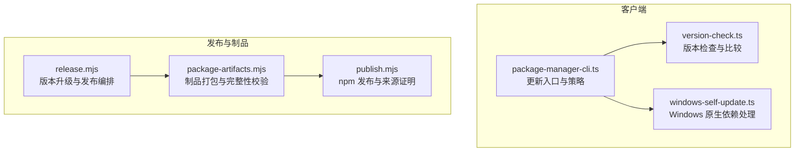
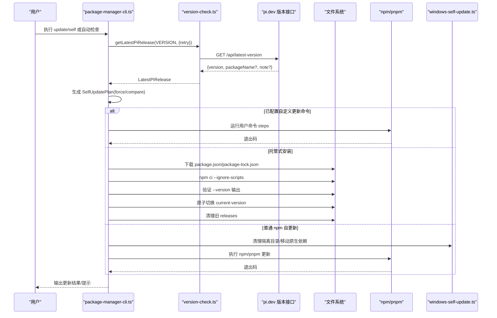
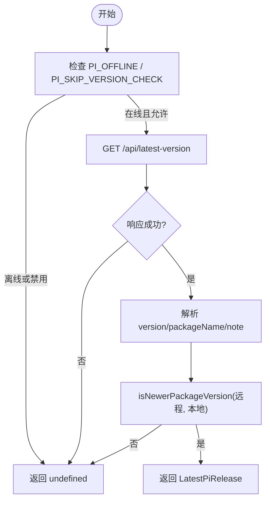
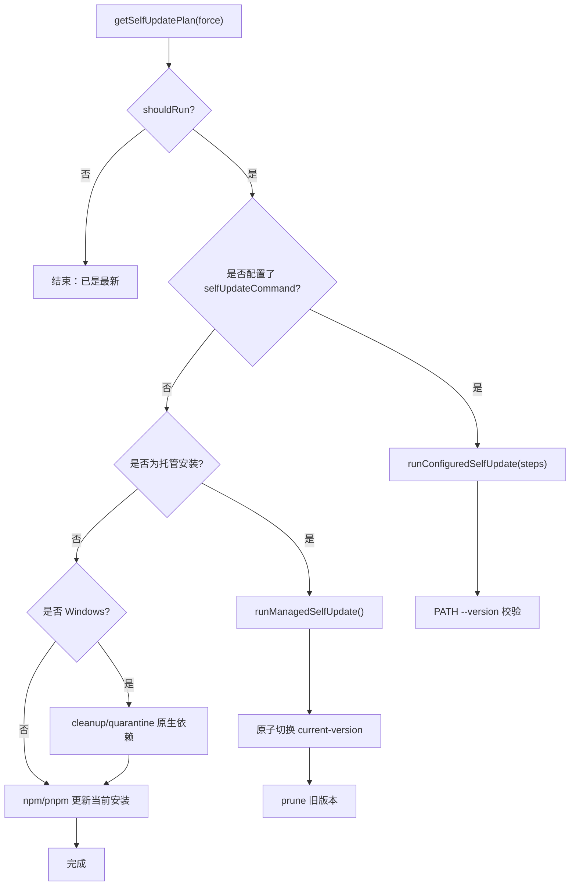
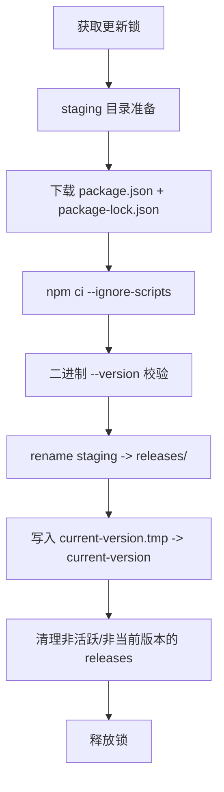
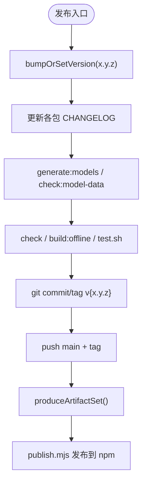
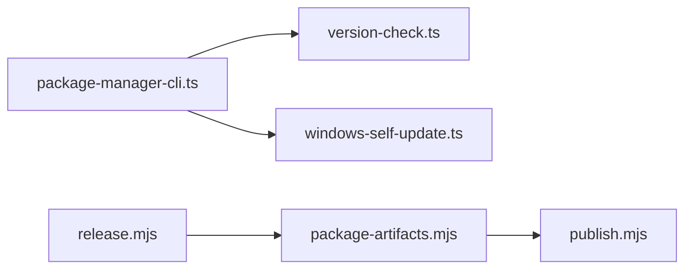

# 自更新与版本管理

<cite>
**本文引用的文件**   
- [package-manager-cli.ts](file://packages/coding-agent/src/package-manager-cli.ts)
- [version-check.ts](file://packages/coding-agent/src/utils/version-check.ts)
- [windows-self-update.ts](file://packages/coding-agent/src/utils/windows-self-update.ts)
- [release.mjs](file://scripts/release.mjs)
- [package-artifacts.mjs](file://scripts/package-artifacts.mjs)
- [publish.mjs](file://scripts/publish.mjs)
</cite>

## 目录
1. [引言](#引言)
2. [项目结构](#项目结构)
3. [核心组件](#核心组件)
4. [架构总览](#架构总览)
5. [详细组件分析](#详细组件分析)
6. [依赖关系分析](#依赖关系分析)
7. [性能与可靠性考虑](#性能与可靠性考虑)
8. [故障排查指南](#故障排查指南)
9. [结论](#结论)
10. [附录：平台适配与安全建议](#附录平台适配与安全建议)

## 引言
本指南围绕仓库中的自更新机制与版本管理进行系统化说明，覆盖自动更新流程、版本检查、增量/全量更新策略、回滚机制、语义化版本控制、兼容性检查、Windows 自更新实现与其他平台适配方案，以及更新包签名、安全校验和失败恢复逻辑。文档以代码级事实为依据，通过流程图和时序图帮助读者理解从“发现新版本”到“完成安装并切换版本”的完整链路。

## 项目结构
与自更新和版本管理直接相关的代码主要分布在以下位置：
- 客户端更新入口与执行器：`packages/coding-agent/src/package-manager-cli.ts`
- 版本检查与语义化版本比较：`packages/coding-agent/src/utils/version-check.ts`
- Windows 原生依赖隔离与清理：`packages/coding-agent/src/utils/windows-self-update.ts`
- 发布与制品打包脚本：`scripts/release.mjs`、`scripts/package-artifacts.mjs`、`scripts/publish.mjs`

**图表来源**
- [package-manager-cli.ts:1-120](file://packages/coding-agent/src/package-manager-cli.ts#L1-L120)
- [version-check.ts:1-110](file://packages/coding-agent/src/utils/version-check.ts#L1-L110)
- [windows-self-update.ts:1-85](file://packages/coding-agent/src/utils/windows-self-update.ts#L1-L85)
- [release.mjs:1-290](file://scripts/release.mjs#L1-L290)
- [package-artifacts.mjs:1-142](file://scripts/package-artifacts.mjs#L1-L142)
- [publish.mjs:1-65](file://scripts/publish.mjs#L1-L65)

**章节来源**
- [package-manager-cli.ts:1-120](file://packages/coding-agent/src/package-manager-cli.ts#L1-L120)
- [version-check.ts:1-110](file://packages/coding-agent/src/utils/version-check.ts#L1-L110)
- [windows-self-update.ts:1-85](file://packages/coding-agent/src/utils/windows-self-update.ts#L1-L85)
- [release.mjs:1-290](file://scripts/release.mjs#L1-L290)
- [package-artifacts.mjs:1-142](file://scripts/package-artifacts.mjs#L1-L142)
- [publish.mjs:1-65](file://scripts/publish.mjs#L1-L65)

## 核心组件
- 版本检查模块：负责查询最新版本、语义化版本比较、错误格式化与重试控制。
- 更新计划生成：根据当前版本、远程最新信息与强制参数决定是否需要更新，并输出安装包名、安装规格和目标版本。
- 更新执行器：支持用户自定义更新命令、托管式安装（managed install）与 npm 自更新路径；在 Windows 上对原生依赖进行隔离与清理。
- 托管式安装管理器：下载预构建制品、验证可执行版本、原子切换 active 版本、清理旧版本。
- 发布与制品流水线：统一版本号、生成带完整性信息的制品清单、发布到 npm 并启用来源证明。

**章节来源**
- [version-check.ts:1-110](file://packages/coding-agent/src/utils/version-check.ts#L1-L110)
- [package-manager-cli.ts:684-772](file://packages/coding-agent/src/package-manager-cli.ts#L684-L772)
- [package-manager-cli.ts:196-248](file://packages/coding-agent/src/package-manager-cli.ts#L196-L248)
- [package-artifacts.mjs:76-142](file://scripts/package-artifacts.mjs#L76-L142)
- [publish.mjs:1-65](file://scripts/publish.mjs#L1-L65)

## 架构总览
下图展示从“启动更新”到“完成切换”的整体流程，包括版本检查、更新计划、执行路径选择、Windows 特殊处理和托管式安装的原子切换。

**图表来源**
- [package-manager-cli.ts:692-772](file://packages/coding-agent/src/package-manager-cli.ts#L692-L772)
- [package-manager-cli.ts:196-248](file://packages/coding-agent/src/package-manager-cli.ts#L196-L248)
- [version-check.ts:51-88](file://packages/coding-agent/src/utils/version-check.ts#L51-L88)
- [windows-self-update.ts:50-84](file://packages/coding-agent/src/utils/windows-self-update.ts#L50-L84)

## 详细组件分析

### 版本检查与语义化版本控制
- 版本查询：通过 `getLatestPiRelease` 调用 `https://pi.dev/api/latest-version`，携带 `User-Agent` 包含当前版本，支持可选重试与超时控制。
- 版本比较：基于 `semver` 的 `compare` 与 `valid`，提供 `comparePackageVersions` 与 `isNewerPackageVersion`。
- 自动检查开关：`PI_SKIP_VERSION_CHECK` 关闭自动检查；`PI_OFFLINE` 跳过网络请求。
- 错误格式化：`formatVersionCheckError` 聚合底层网络错误码，便于诊断。

**图表来源**
- [version-check.ts:1-110](file://packages/coding-agent/src/utils/version-check.ts#L1-L110)

**章节来源**
- [version-check.ts:1-110](file://packages/coding-agent/src/utils/version-check.ts#L1-L110)

### 更新计划与执行策略
- 更新计划生成：`getSelfUpdatePlan` 获取最新版本，结合 `force`、包名变更与版本比较决定是否更新，并输出 `installSpec`（如 `@scope/pkg@x.y.z`）。
- 执行路径选择：
  - 用户自定义命令：`runConfiguredSelfUpdate` 执行配置的 steps，并通过 PATH 上的 `--version` 校验实际安装版本。
  - 托管式安装：`runManagedSelfUpdate` 拉取预构建制品、`npm ci` 安装、smoke test 验证版本、原子切换 `current-version`、清理旧版本。
  - 普通 npm 自更新：在非托管环境中使用 npm/pnpm 更新当前安装。
- Windows 特殊处理：`prepareWindowsNpmSelfUpdate` 清理隔离目录并将正在加载的原生依赖移动到 `.pi-native-quarantine`，避免文件被占用导致更新失败。

**图表来源**
- [package-manager-cli.ts:692-772](file://packages/coding-agent/src/package-manager-cli.ts#L692-L772)
- [package-manager-cli.ts:196-248](file://packages/coding-agent/src/package-manager-cli.ts#L196-L248)
- [package-manager-cli.ts:786-794](file://packages/coding-agent/src/package-manager-cli.ts#L786-L794)
- [windows-self-update.ts:50-84](file://packages/coding-agent/src/utils/windows-self-update.ts#L50-L84)

**章节来源**
- [package-manager-cli.ts:692-772](file://packages/coding-agent/src/package-manager-cli.ts#L692-L772)
- [package-manager-cli.ts:196-248](file://packages/coding-agent/src/package-manager-cli.ts#L196-L248)
- [package-manager-cli.ts:786-794](file://packages/coding-agent/src/package-manager-cli.ts#L786-L794)
- [windows-self-update.ts:50-84](file://packages/coding-agent/src/utils/windows-self-update.ts#L50-L84)

### 托管式安装与回滚机制
- 版本锁定与校验：仅接受符合正则的语义化版本，防止非法标签进入。
- 预构建制品拉取：从 `PI_INSTALLER_API_BASE`（默认 `https://pi.dev/api/installer/releases`）拉取 `package.json` 与 `package-lock.json`，在 staging 目录中 `npm ci` 安装。
- 健康检查：执行二进制 `--version` 校验，确保安装产物正确。
- 原子切换：写入临时 `current-version.tmp.*` 后原子重命名为 `current-version`，保证切换过程不可分割。
- 回滚策略：保留当前活跃版本与本次更新进程所在版本，其他旧版本逐步清理；若切换失败，可通过编辑 `current-version` 快速回滚。
- 并发控制：使用锁文件防止同时运行多个托管更新。

**图表来源**
- [package-manager-cli.ts:196-248](file://packages/coding-agent/src/package-manager-cli.ts#L196-L248)
- [package-manager-cli.ts:131-160](file://packages/coding-agent/src/package-manager-cli.ts#L131-L160)

**章节来源**
- [package-manager-cli.ts:196-248](file://packages/coding-agent/src/package-manager-cli.ts#L196-L248)
- [package-manager-cli.ts:131-160](file://packages/coding-agent/src/package-manager-cli.ts#L131-L160)

### 发布与制品完整性
- 统一版本：`release.mjs` 支持 `major/minor/patch` 或显式 `x.y.z`，同步工作区版本、更新 CHANGELOG、重新生成模型数据、运行检查与测试、提交打标签并推送触发 CI。
- 制品打包：`package-artifacts.mjs` 对每个公开包执行 `npm pack`，计算 SHA-512 摘要并生成 `manifest.json`，包含 `integrity` 字段用于后续校验。
- 发布流程：`publish.mjs` 读取制品清单，检测是否已发布，使用 `--provenance` 启用来源证明并发布到 npm。

**图表来源**
- [release.mjs:142-290](file://scripts/release.mjs#L142-L290)
- [package-artifacts.mjs:76-142](file://scripts/package-artifacts.mjs#L76-L142)
- [publish.mjs:1-65](file://scripts/publish.mjs#L1-L65)

**章节来源**
- [release.mjs:142-290](file://scripts/release.mjs#L142-L290)
- [package-artifacts.mjs:76-142](file://scripts/package-artifacts.mjs#L76-L142)
- [publish.mjs:1-65](file://scripts/publish.mjs#L1-L65)

## 依赖关系分析
- 客户端侧：
  - `package-manager-cli.ts` 依赖 `version-check.ts` 获取最新版本与比较逻辑。
  - `package-manager-cli.ts` 在 Windows 平台调用 `windows-self-update.ts` 处理原生依赖隔离。
- 发布侧：
  - `release.mjs` 协调版本升级、CHANGELOG 更新、构建与测试、打标签与推送。
  - `package-artifacts.mjs` 生成带完整性信息的制品清单。
  - `publish.mjs` 基于制品清单进行 npm 发布，启用来源证明。

**图表来源**
- [package-manager-cli.ts:1-120](file://packages/coding-agent/src/package-manager-cli.ts#L1-L120)
- [version-check.ts:1-110](file://packages/coding-agent/src/utils/version-check.ts#L1-L110)
- [windows-self-update.ts:1-85](file://packages/coding-agent/src/utils/windows-self-update.ts#L1-L85)
- [release.mjs:1-290](file://scripts/release.mjs#L1-L290)
- [package-artifacts.mjs:1-142](file://scripts/package-artifacts.mjs#L1-L142)
- [publish.mjs:1-65](file://scripts/publish.mjs#L1-L65)

**章节来源**
- [package-manager-cli.ts:1-120](file://packages/coding-agent/src/package-manager-cli.ts#L1-L120)
- [version-check.ts:1-110](file://packages/coding-agent/src/utils/version-check.ts#L1-L110)
- [windows-self-update.ts:1-85](file://packages/coding-agent/src/utils/windows-self-update.ts#L1-L85)
- [release.mjs:1-290](file://scripts/release.mjs#L1-L290)
- [package-artifacts.mjs:1-142](file://scripts/package-artifacts.mjs#L1-L142)
- [publish.mjs:1-65](file://scripts/publish.mjs#L1-L65)

## 性能与可靠性考虑
- 版本检查：
  - 默认超时 10 秒，可选重试（仅在明确开启时），避免阻塞主流程。
  - 支持离线模式与跳过检查的环境变量，提升内网与受限环境下的稳定性。
- 托管式安装：
  - 使用 `npm ci` 严格锁定依赖，减少安装时间与不确定性。
  - 原子切换 `current-version`，避免部分写入导致的版本不一致。
  - 并行拉取 `package.json` 与 `package-lock.json`，缩短下载时间。
- Windows 原生依赖：
  - 将正在加载的原生模块移动到隔离目录，避免文件占用导致更新失败。
  - 每次更新前清理历史隔离目录，降低磁盘占用。

[本节为通用指导，不直接分析具体文件]

## 故障排查指南
- 无法获取最新版本：
  - 检查网络连通性与代理设置；确认 `PI_OFFLINE` 未误开启。
  - 查看 `formatVersionCheckError` 输出的错误码，定位 DNS、超时或证书问题。
- 自定义更新命令失败：
  - 检查 `selfUpdateCommand` 配置是否正确；观察子进程退出码与信号。
  - 使用 `PATH --version` 校验实际安装版本是否与目标一致。
- 托管式安装失败：
  - 确认 `PI_INSTALLER_API_BASE` 可达；检查 staging 目录权限。
  - 查看二进制 smoke test 输出，确认 `--version` 返回值是否符合预期。
  - 若并发冲突，等待锁释放或手动清理 `update` 锁文件。
- Windows 原生依赖报错：
  - 确认 `.pi-native-quarantine` 目录存在并可写；必要时重启进程释放句柄。
  - 若更新后仍报找不到原生模块，检查隔离目录是否残留旧文件。

**章节来源**
- [version-check.ts:14-32](file://packages/coding-agent/src/utils/version-check.ts#L14-L32)
- [package-manager-cli.ts:744-772](file://packages/coding-agent/src/package-manager-cli.ts#L744-L772)
- [package-manager-cli.ts:196-248](file://packages/coding-agent/src/package-manager-cli.ts#L196-L248)
- [windows-self-update.ts:50-84](file://packages/coding-agent/src/utils/windows-self-update.ts#L50-L84)

## 结论
该仓库实现了完整的自更新与版本管理体系：客户端通过语义化版本检查与多路径更新策略（自定义命令、托管式安装、npm 自更新）保障稳定升级；Windows 平台通过原生依赖隔离解决常见文件占用问题；发布侧通过统一版本、制品完整性校验与来源证明提升安全性与可追溯性。托管式安装采用原子切换与版本保留策略，提供良好的回滚能力。整体设计兼顾可靠性、可维护性与跨平台适配。

[本节为总结性内容，不直接分析具体文件]

## 附录：平台适配与安全建议
- 平台适配
  - Windows：优先执行 `prepareWindowsNpmSelfUpdate`，清理隔离目录并移动正在加载的原生依赖，再执行 npm 更新。
  - macOS/Linux：可直接走 npm/pnpm 更新路径；如需托管式安装，遵循相同流程。
  - 容器/CI：建议使用托管式安装，避免修改宿主环境；通过环境变量控制安装根目录与 API 地址。
- 安全与签名
  - 制品完整性：`package-artifacts.mjs` 生成 `sha512` 摘要并写入 manifest；发布时使用 `--provenance` 启用来源证明。
  - 运行时校验：建议在下载制品后再次校验 `integrity`，确保未被篡改。
  - 最小权限：更新过程尽量以非 root 用户运行，限制对系统目录的写权限。
- 兼容性检查
  - 使用 `check-model-catalog-compat.mjs` 等脚本确保新发布的模型目录与已发布客户端兼容。
  - 在发布前运行 `npm run check` 与 `test.sh`，确保行为一致性。

[本节为通用指导，不直接分析具体文件]