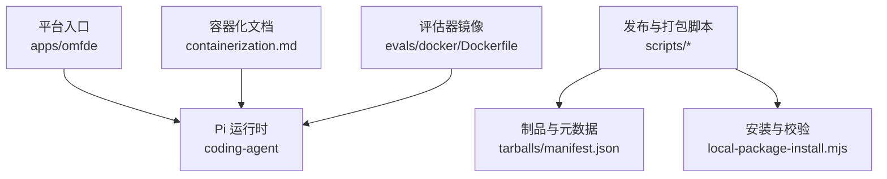
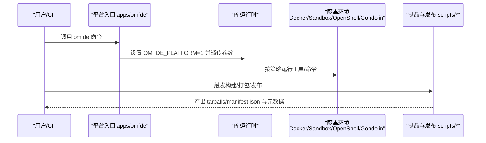
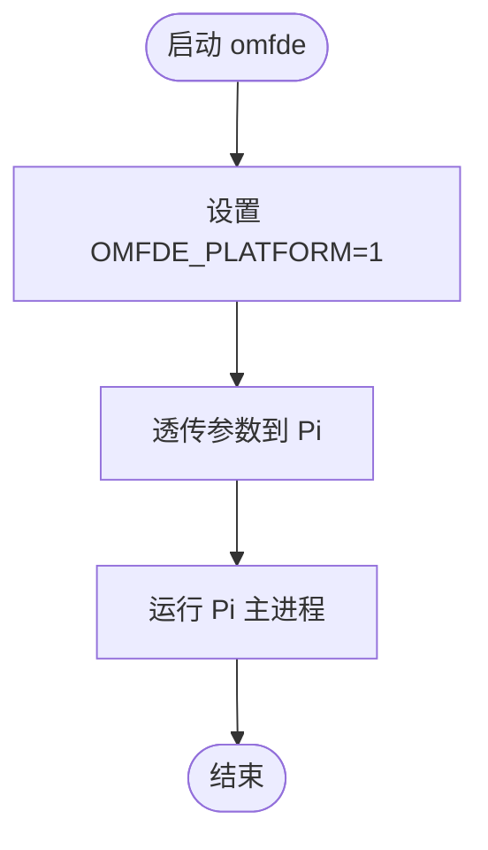
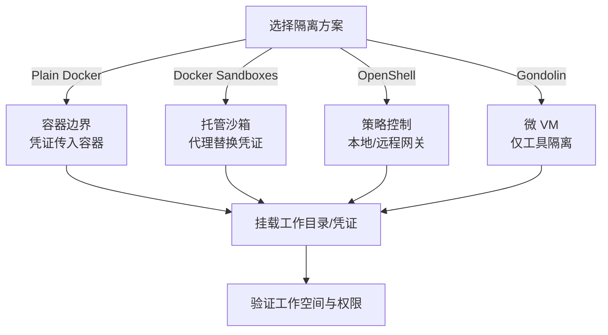
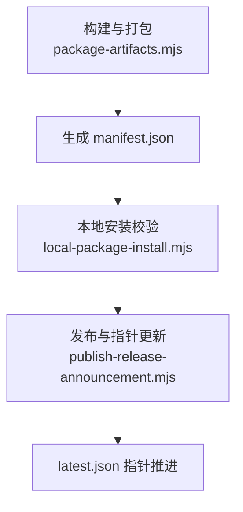
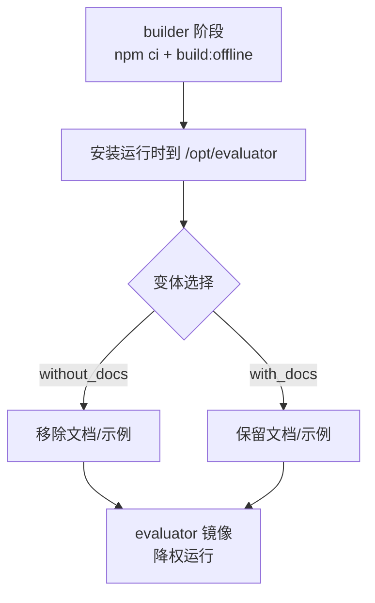
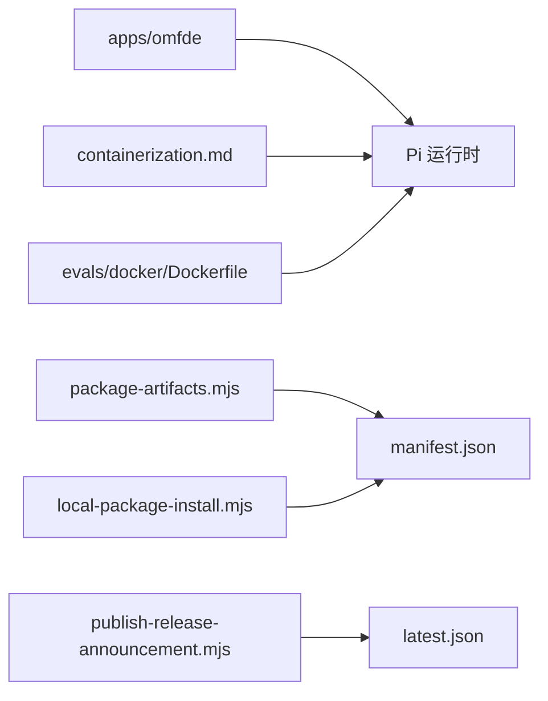

# 部署与运维

<cite>
**本文引用的文件**
- [README.md](file://README.md)
- [apps/omfde/README.md](file://apps/omfde/README.md)
- [apps/omfde/bin/omfde.mjs](file://apps/omfde/bin/omfde.mjs)
- [packages/coding-agent/docs/containerization.md](file://packages/coding-agent/docs/containerization.md)
- [packages/evals/docker/Dockerfile](file://packages/evals/docker/Dockerfile)
- [scripts/local-release.mjs](file://scripts/local-release.mjs)
- [scripts/package-artifacts.mjs](file://scripts/package-artifacts.mjs)
- [scripts/publish-release-announcement.mjs](file://scripts/publish-release-announcement.mjs)
- [scripts/local-package-install.mjs](file://scripts/local-package-install.mjs)
</cite>

## 目录
1. [简介](#简介)
2. [项目结构](#项目结构)
3. [核心组件](#核心组件)
4. [架构总览](#架构总览)
5. [详细组件分析](#详细组件分析)
6. [依赖关系分析](#依赖关系分析)
7. [性能考虑](#性能考虑)
8. [故障排查指南](#故障排查指南)
9. [结论](#结论)
10. [附录：常见部署场景配置示例](#附录常见部署场景配置示例)

## 简介
本指南面向生产环境的部署与运维，覆盖容器化部署（Docker、微 VM、沙箱）、生产环境配置、监控与日志收集、自更新机制、版本管理、故障恢复、性能优化、安全加固与备份恢复等主题。仓库提供多种隔离运行模式与发布流水线脚本，便于构建可重复、可审计、可回滚的交付物。

## 项目结构
仓库采用多包工作区组织，包含平台入口应用、扩展骨架、AI/Agent/TUI 等核心包以及大量构建与发布脚本。与部署运维直接相关的部分包括：
- 平台入口应用：用于在 monorepo 中启动 Pi 并注入平台环境变量。
- 容器化文档与 Dockerfile：提供多种隔离运行方式与评估器镜像构建。
- 发布与打包脚本：负责制品生成、本地安装验证、发布元数据与最新版本指针更新。

图示来源
- [apps/omfde/README.md:1-14](file://apps/omfde/README.md#L1-L14)
- [packages/coding-agent/docs/containerization.md:1-184](file://packages/coding-agent/docs/containerization.md#L1-L184)
- [packages/evals/docker/Dockerfile:1-45](file://packages/evals/docker/Dockerfile#L1-L45)
- [scripts/package-artifacts.mjs:76-101](file://scripts/package-artifacts.mjs#L76-L101)
- [scripts/local-package-install.mjs:148-160](file://scripts/local-package-install.mjs#L148-L160)

章节来源
- [README.md:56-69](file://README.md#L56-L69)
- [apps/omfde/README.md:1-14](file://apps/omfde/README.md#L1-L14)

## 核心组件
- 平台入口应用：解析 monorepo 中的 Pi 可执行文件，设置平台环境变量后透传参数给 Pi。
- 容器化与沙箱：提供 Plain Docker、Docker Sandboxes、OpenShell、Gondolin 四种隔离方案，分别适用于不同边界与凭证处理需求。
- 制品与发布：通过脚本构建、打包、校验并发布制品；支持离线模型数据与最小化安装。
- 安装与校验：为外部消费者生成受控的安装工件集，确保依赖一致性与可重复性。

章节来源
- [apps/omfde/README.md:1-14](file://apps/omfde/README.md#L1-L14)
- [packages/coding-agent/docs/containerization.md:7-28](file://packages/coding-agent/docs/containerization.md#L7-L28)
- [scripts/package-artifacts.mjs:76-101](file://scripts/package-artifacts.mjs#L76-L101)
- [scripts/local-package-install.mjs:148-160](file://scripts/local-package-install.mjs#L148-L160)

## 架构总览
下图展示从“平台入口”到“Pi 运行时”，再到“容器/沙箱”和“发布制品”的整体流程。

图示来源
- [apps/omfde/bin/omfde.mjs:26-26](file://apps/omfde/bin/omfde.mjs#L26-L26)
- [packages/coding-agent/docs/containerization.md:7-28](file://packages/coding-agent/docs/containerization.md#L7-L28)
- [scripts/package-artifacts.mjs:76-101](file://scripts/package-artifacts.mjs#L76-L101)

## 详细组件分析

### 平台入口与运行模式
- 行为要点
  - 作为薄启动器，解析 monorepo 内的 Pi 可执行文件。
  - 注入平台环境变量 `OMFDE_PLATFORM=1`。
  - 将命令行参数原样传递给 Pi。
- 适用场景
  - 在 monorepo 内统一入口启动 Pi，便于后续扩展平台能力。
  - 通过环境变量区分平台化行为，避免耦合核心代码。

图示来源
- [apps/omfde/README.md:1-14](file://apps/omfde/README.md#L1-L14)
- [apps/omfde/bin/omfde.mjs:26-26](file://apps/omfde/bin/omfde.mjs#L26-L26)

章节来源
- [apps/omfde/README.md:1-14](file://apps/omfde/README.md#L1-L14)
- [apps/omfde/bin/omfde.mjs:26-26](file://apps/omfde/bin/omfde.mjs#L26-L26)

### 容器化与沙箱部署
- 隔离方案对比
  - Plain Docker：整个 Pi 进程在容器中运行，适合简单本地隔离。
  - Docker Sandboxes：托管沙箱，代理替换凭证，避免真实密钥进入沙箱。
  - OpenShell：文件系统、进程、网络、凭证与推理策略控制，支持远程网关。
  - Gondolin：本地微 VM，仅路由内置工具与命令，保留宿主接口。
- 关键注意事项
  - 只暴露任务所需的工作目录、凭证与网络目的地。
  - 使用只读挂载或复制进出以避免写回宿主机。
  - 工具级隔离不约束宿主 Pi 或未走隔离后端的扩展工具。

图示来源
- [packages/coding-agent/docs/containerization.md:7-28](file://packages/coding-agent/docs/containerization.md#L7-L28)
- [packages/coding-agent/docs/containerization.md:30-80](file://packages/coding-agent/docs/containerization.md#L30-L80)
- [packages/coding-agent/docs/containerization.md:82-119](file://packages/coding-agent/docs/containerization.md#L82-L119)
- [packages/coding-agent/docs/containerization.md:121-151](file://packages/coding-agent/docs/containerization.md#L121-L151)
- [packages/coding-agent/docs/containerization.md:153-184](file://packages/coding-agent/docs/containerization.md#L153-L184)

章节来源
- [packages/coding-agent/docs/containerization.md:7-28](file://packages/coding-agent/docs/containerization.md#L7-L28)
- [packages/coding-agent/docs/containerization.md:30-80](file://packages/coding-agent/docs/containerization.md#L30-L80)
- [packages/coding-agent/docs/containerization.md:82-119](file://packages/coding-agent/docs/containerization.md#L82-L119)
- [packages/coding-agent/docs/containerization.md:121-151](file://packages/coding-agent/docs/containerization.md#L121-L151)
- [packages/coding-agent/docs/containerization.md:153-184](file://packages/coding-agent/docs/containerization.md#L153-L184)

### 制品构建与发布流水线
- 制品构建
  - 清理与构建产物，支持离线模型数据。
  - 打包公共工作区包，生成清单 manifest.json，记录包名、版本、tarball 路径与完整性信息。
- 本地安装与校验
  - 为外部消费者生成受控安装工件集，支持 npm/bun。
  - 安装时禁用生命周期脚本，减少供应链风险。
- 发布与最新版本指针
  - 校验安装包与锁文件一致性。
  - 上传制品与元数据，原子推进 latest.json 指针，保证客户端拉取一致性。

图示来源
- [scripts/package-artifacts.mjs:76-101](file://scripts/package-artifacts.mjs#L76-L101)
- [scripts/local-package-install.mjs:148-160](file://scripts/local-package-install.mjs#L148-L160)
- [scripts/publish-release-announcement.mjs:220-354](file://scripts/publish-release-announcement.mjs#L220-L354)

章节来源
- [scripts/package-artifacts.mjs:76-101](file://scripts/package-artifacts.mjs#L76-L101)
- [scripts/local-package-install.mjs:148-160](file://scripts/local-package-install.mjs#L148-L160)
- [scripts/publish-release-announcement.mjs:220-354](file://scripts/publish-release-announcement.mjs#L220-L354)

### 评估器镜像与最小化安装
- 构建阶段
  - 在 builder 阶段安装依赖并构建离线产物，将运行时安装到 /opt/evaluator。
- 运行阶段
  - evaluator 镜像以 root 启动测试，随后降权至非特权 UID，保护评估器源码与夹具。
  - 提供 with_docs 与 without_docs 两种变体，便于实验对比。

图示来源
- [packages/evals/docker/Dockerfile:1-45](file://packages/evals/docker/Dockerfile#L1-L45)

章节来源
- [packages/evals/docker/Dockerfile:1-45](file://packages/evals/docker/Dockerfile#L1-L45)

## 依赖关系分析
- 组件耦合
  - 平台入口对 Pi 运行时是单向依赖，职责单一，便于扩展平台能力而不侵入核心。
  - 容器化文档与 Dockerfile 独立于业务逻辑，仅描述运行环境与构建步骤。
  - 发布脚本之间通过共享函数与输入输出契约协作，降低耦合度。
- 外部依赖
  - Node.js 运行时与 npm/pnpm 生态。
  - 第三方容器/沙箱运行时（Docker、OpenShell、Gondolin）。

图示来源
- [apps/omfde/README.md:1-14](file://apps/omfde/README.md#L1-L14)
- [packages/coding-agent/docs/containerization.md:1-184](file://packages/coding-agent/docs/containerization.md#L1-L184)
- [packages/evals/docker/Dockerfile:1-45](file://packages/evals/docker/Dockerfile#L1-L45)
- [scripts/package-artifacts.mjs:76-101](file://scripts/package-artifacts.mjs#L76-L101)
- [scripts/local-package-install.mjs:148-160](file://scripts/local-package-install.mjs#L148-L160)
- [scripts/publish-release-announcement.mjs:220-354](file://scripts/publish-release-announcement.mjs#L220-L354)

章节来源
- [README.md:56-69](file://README.md#L56-L69)
- [scripts/package-artifacts.mjs:76-101](file://scripts/package-artifacts.mjs#L76-L101)
- [scripts/local-package-install.mjs:148-160](file://scripts/local-package-install.mjs#L148-L160)
- [scripts/publish-release-announcement.mjs:220-354](file://scripts/publish-release-announcement.mjs#L220-L354)

## 性能考虑
- 构建与缓存
  - 使用离线模型数据构建以减少网络抖动与重复下载。
  - 利用构建缓存加速依赖安装与编译。
- 运行期资源
  - 在容器/沙箱中限制 CPU/内存配额，避免影响宿主与其他租户。
  - 合理设置 I/O 与网络超时，防止长尾请求拖慢整体吞吐。
- 镜像体积
  - 使用 slim 基础镜像，按需安装系统依赖。
  - 移除不必要的文档与示例以减小镜像体积。

[本节为通用指导，不涉及具体文件分析]

## 故障排查指南
- 容器/沙箱无法访问工作目录
  - 检查是否挂载了正确的只读/读写目录。
  - 确认容器内工作目录与宿主映射一致。
- 凭证泄露或不可用
  - 在 Plain Docker 中确认凭证通过环境变量传入。
  - 在 Docker Sandboxes 中确认代理已正确替换凭证占位符。
  - 在 OpenShell 中确认推理端点指向网关暴露的兼容接口。
- 发布失败或指针未更新
  - 校验安装包与锁文件版本一致性。
  - 检查 latest.json 原子推进条件是否满足。
- 本地安装异常
  - 确认使用 --ignore-scripts 安装，避免生命周期脚本干扰。
  - 核对 artifactSet 清单与消费者 package.json 的一致性。

章节来源
- [packages/coding-agent/docs/containerization.md:30-80](file://packages/coding-agent/docs/containerization.md#L30-L80)
- [packages/coding-agent/docs/containerization.md:82-119](file://packages/coding-agent/docs/containerization.md#L82-L119)
- [packages/coding-agent/docs/containerization.md:121-151](file://packages/coding-agent/docs/containerization.md#L121-L151)
- [scripts/publish-release-announcement.mjs:220-354](file://scripts/publish-release-announcement.mjs#L220-L354)
- [scripts/local-package-install.mjs:148-160](file://scripts/local-package-install.mjs#L148-L160)

## 结论
本项目提供了从平台入口、容器化与沙箱隔离，到制品构建、发布与指针管理的完整链路。通过严格的依赖锁定、离线构建与最小化安装，结合多种隔离方案，可在生产环境中实现安全、稳定、可回滚的部署与运维。建议在生产中优先使用托管沙箱或 OpenShell，配合只读挂载与最小权限原则，并建立完善的监控、日志与备份恢复流程。

[本节为总结性内容，不涉及具体文件分析]

## 附录：常见部署场景配置示例

- 场景一：Plain Docker 快速隔离
  - 构建镜像：参考容器化文档中的 Dockerfile 示例。
  - 启动容器：挂载工作目录与命名卷保存会话与配置。
  - 验证：在 Pi 内执行工作目录命令确认映射正确。

  章节来源
  - [packages/coding-agent/docs/containerization.md:30-80](file://packages/coding-agent/docs/containerization.md#L30-L80)

- 场景二：Docker Sandboxes 托管沙箱
  - 预配置凭证：在沙箱外设置自定义密钥或 API Key。
  - 启动 Pi：使用 sbx run 或 exec 运行交互或非交互任务。
  - 注意：不要在沙箱内执行登录写入真实凭证。

  章节来源
  - [packages/coding-agent/docs/containerization.md:82-119](file://packages/coding-agent/docs/containerization.md#L82-L119)

- 场景三：OpenShell 策略沙箱
  - 选择网关：添加并选择远端网关。
  - 创建沙箱：以 pi 为模板创建沙箱并运行 Pi。
  - 文件传输：远程网关需显式上传/下载工作目录。
  - 推理路由：通过网关暴露的兼容端点接入模型服务。

  章节来源
  - [packages/coding-agent/docs/containerization.md:121-151](file://packages/coding-agent/docs/containerization.md#L121-L151)

- 场景四：Gondolin 微 VM 工具路由
  - 安装扩展：复制示例扩展到扩展目录并安装依赖。
  - 启动 Pi：指定扩展路径运行 Pi。
  - 注意：VM 继承宿主环境变量，谨慎处理敏感变量。

  章节来源
  - [packages/coding-agent/docs/containerization.md:153-184](file://packages/coding-agent/docs/containerization.md#L153-L184)

- 场景五：评估器镜像构建与运行
  - 构建：在 builder 阶段完成依赖安装与离线构建，安装运行时。
  - 运行：evaluator 镜像以 root 启动后降权，保护评估器源码。
  - 变体：根据实验需要选择 with_docs 或 without_docs。

  章节来源
  - [packages/evals/docker/Dockerfile:1-45](file://packages/evals/docker/Dockerfile#L1-L45)

- 场景六：本地制品安装与校验
  - 生成制品集：构建并打包公共包，生成 manifest.json。
  - 安装消费者：为外部项目生成受控安装工件集，禁用生命周期脚本。
  - 校验：确保包名、版本与完整性一致。

  章节来源
  - [scripts/package-artifacts.mjs:76-101](file://scripts/package-artifacts.mjs#L76-L101)
  - [scripts/local-package-install.mjs:148-160](file://scripts/local-package-install.mjs#L148-L160)

- 场景七：发布与最新版本指针推进
  - 校验安装包与锁文件一致性。
  - 上传制品与元数据，原子推进 latest.json。
  - 客户端拉取 latest.json 获取最新稳定版本。

  章节来源
  - [scripts/publish-release-announcement.mjs:220-354](file://scripts/publish-release-announcement.mjs#L220-L354)