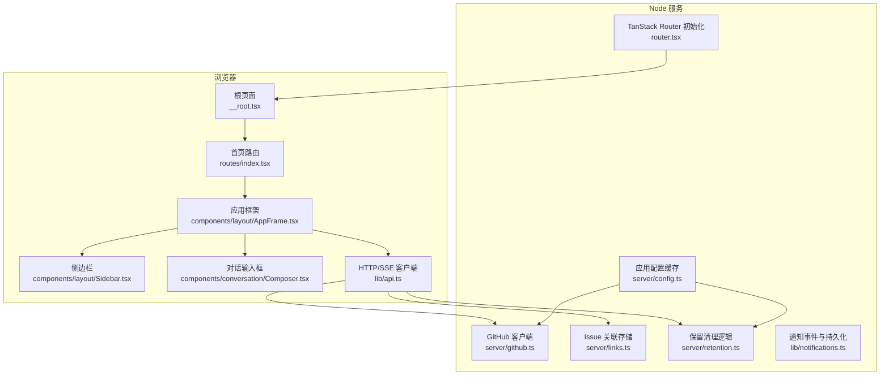
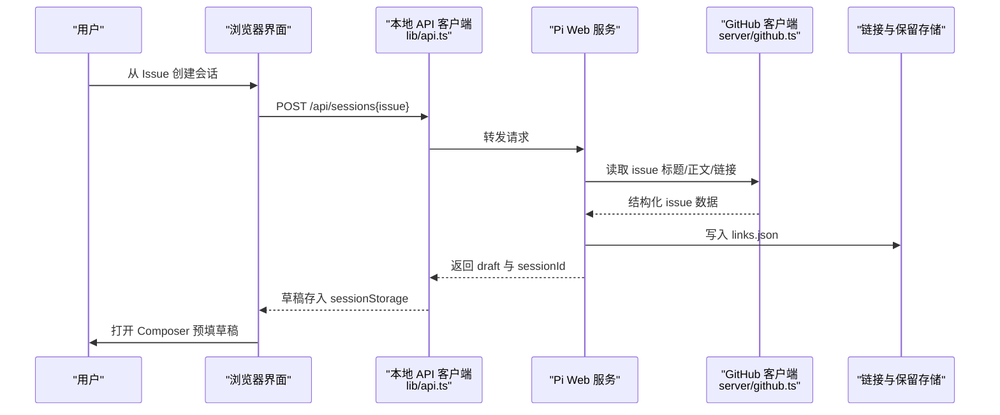
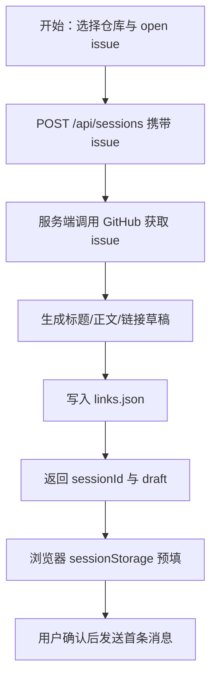
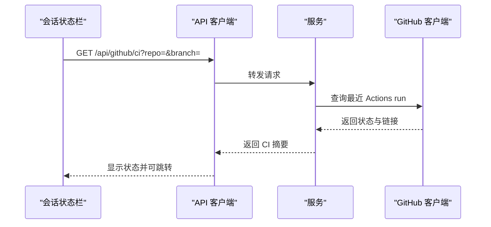
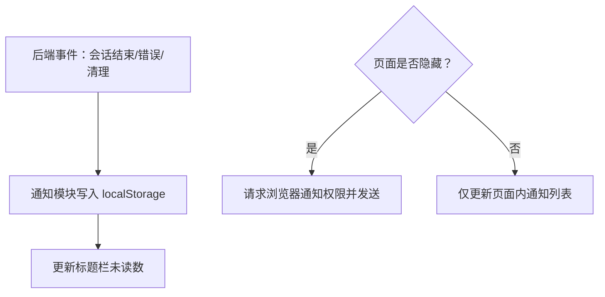
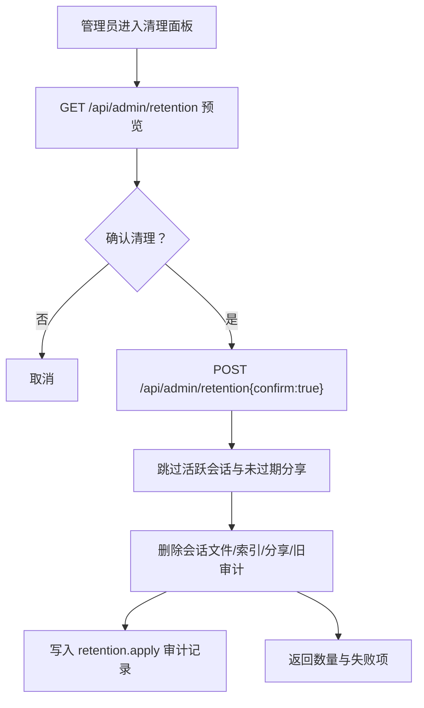
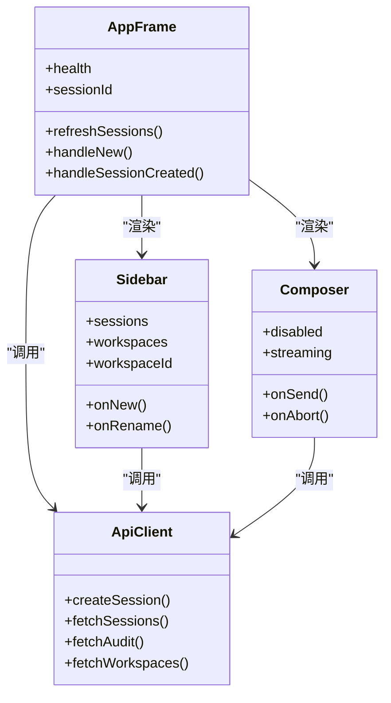
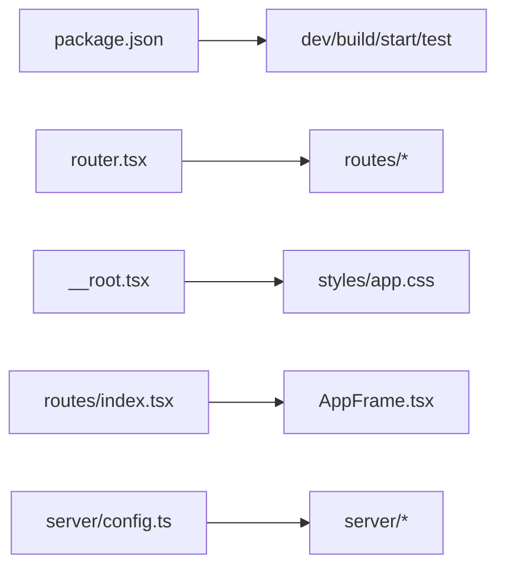

# Pi Web UI M5 实现计划

<cite>
**本文引用的文件**   
- [apps/pi-web/package.json](file://apps/pi-web/package.json)
- [apps/pi-web/src/router.tsx](file://apps/pi-web/src/router.tsx)
- [apps/pi-web/src/routes/__root.tsx](file://apps/pi-web/src/routes/__root.tsx)
- [apps/pi-web/src/routes/index.tsx](file://apps/pi-web/src/routes/index.tsx)
- [apps/pi-web/src/components/layout/AppFrame.tsx](file://apps/pi-web/src/components/layout/AppFrame.tsx)
- [apps/pi-web/src/components/layout/Sidebar.tsx](file://apps/pi-web/src/components/layout/Sidebar.tsx)
- [apps/pi-web/src/components/conversation/Composer.tsx](file://apps/pi-web/src/components/conversation/Composer.tsx)
- [apps/pi-web/src/lib/api.ts](file://apps/pi-web/src/lib/api.ts)
- [apps/pi-web/src/server/config.ts](file://apps/pi-web/src/server/config.ts)
- [apps/pi-web/src/server/github.ts](file://apps/pi-web/src/server/github.ts)
- [apps/pi-web/src/server/links.ts](file://apps/pi-web/src/server/links.ts)
- [apps/pi-web/src/server/retention.ts](file://apps/pi-web/src/server/retention.ts)
- [apps/pi-web/src/lib/notifications.ts](file://apps/pi-web/src/lib/notifications.ts)
- [apps/pi-web/test/github.test.ts](file://apps/pi-web/test/github.test.ts)
- [apps/pi-web/test/links.test.ts](file://apps/pi-web/test/links.test.ts)
- [docs/plans/pi-web-m5.md](file://docs/plans/pi-web-m5.md)
- [docs/rads/pi-web-m5.md](file://docs/rads/pi-web-m5.md)
</cite>

## 更新摘要
**变更内容**   
- 将 M5 计划状态从“待批准”更正为“已批准”，并补充决策者批准记录（2026-11-06）。
- 新增 GitHub Issues、CI 状态、通知与保留清理的实际实现代码引用。
- 补充测试验证结果，反映各切片已完成并通过单元测试与 Playwright 冒烟测试。
- 更新结论与附录，体现实现与验收均已完成的现状。

## 目录
1. [引言](#引言)
2. [项目结构](#项目结构)
3. [核心组件](#核心组件)
4. [架构总览](#架构总览)
5. [详细组件分析](#详细组件分析)
6. [依赖分析](#依赖分析)
7. [性能考虑](#性能考虑)
8. [故障排查指南](#故障排查指南)
9. [结论](#结论)
10. [附录](#附录)

## 引言
本文件是 Pi Web UI M5 的实现计划与验收依据，目标是在现有会话、工作区、分享与审计能力之上，接入 GitHub Issues、CI 状态、通知与保留清理。默认全部关闭或只读；未配置时行为与 M4 一致。M5 不引入多租户、细粒度权限、自动评论 Issue、触发 CI 或邮件/Webhook 等能力。

根据决策者于 2026-11-06 的批准记录，M5 头部状态已从“待批准”补正为“已批准”，各实施切片（S1–S5）的实现与验证均先于本记录完成，并通过 `pnpm run check`、应用测试与 Playwright 冒烟测试。本条为文档一致性补正，不追溯伪造原始批准用语。

## 项目结构
Pi Web 应用位于 `apps/pi-web`，采用 TanStack Router + React 的客户端路由，配合 Vite 构建；服务端通过 `server.mjs` 启动，并在 `src/server/*` 提供 API。M5 新增能力主要分布在：
- 服务器端：GitHub 客户端、链接存储、保留策略、通知事件源。
- 前端侧：Issue 面板、草稿预填、CI 状态栏、通知铃铛、管理员清理面板。
- 路由与根页面：保持现有入口不变，扩展 `/api/github/*`、`/api/admin/retention` 等路径。

**图示来源**
- [apps/pi-web/src/router.tsx:1-18](file://apps/pi-web/src/router.tsx#L1-L18)
- [apps/pi-web/src/routes/__root.tsx:1-38](file://apps/pi-web/src/routes/__root.tsx#L1-L38)
- [apps/pi-web/src/routes/index.tsx:1-19](file://apps/pi-web/src/routes/index.tsx#L1-L19)
- [apps/pi-web/src/components/layout/AppFrame.tsx:1-251](file://apps/pi-web/src/components/layout/AppFrame.tsx#L1-L251)
- [apps/pi-web/src/components/layout/Sidebar.tsx:1-279](file://apps/pi-web/src/components/layout/Sidebar.tsx#L1-L279)
- [apps/pi-web/src/components/conversation/Composer.tsx:1-386](file://apps/pi-web/src/components/conversation/Composer.tsx#L1-L386)
- [apps/pi-web/src/lib/api.ts:1-472](file://apps/pi-web/src/lib/api.ts#L1-L472)
- [apps/pi-web/src/server/config.ts:1-34](file://apps/pi-web/src/server/config.ts#L1-L34)

**章节来源**
- [apps/pi-web/package.json:1-43](file://apps/pi-web/package.json#L1-L43)
- [apps/pi-web/src/router.tsx:1-18](file://apps/pi-web/src/router.tsx#L1-L18)
- [apps/pi-web/src/routes/__root.tsx:1-38](file://apps/pi-web/src/routes/__root.tsx#L1-L38)
- [apps/pi-web/src/routes/index.tsx:1-19](file://apps/pi-web/src/routes/index.tsx#L1-L19)

## 核心组件
- 路由与根页面：定义站点元信息、主题初始化脚本与静态资源。
- 首页路由：加载健康检查并渲染 `AppFrame`。
- 应用框架：管理会话列表、工作区、运行时状态、错误提示与主内容区域。
- 侧边栏：会话导航、新建会话、重命名、工作区切换、审计入口。
- 对话输入框：支持命令补全、文件引用、图片附件、发送与中止。
- HTTP/SSE 客户端：封装会话、命令、文件、分享、审计、工作区等接口。
- 配置缓存：进程内缓存已解析的应用配置，避免重复 IO。

这些组件构成 M5 的基础交互面；M5 新增功能将围绕它们扩展，例如在侧边栏增加 Issue 面板、在会话状态栏显示 CI、在标题栏增加通知铃铛、在管理员菜单中增加保留清理入口。

**章节来源**
- [apps/pi-web/src/routes/__root.tsx:1-38](file://apps/pi-web/src/routes/__root.tsx#L1-L38)
- [apps/pi-web/src/routes/index.tsx:1-19](file://apps/pi-web/src/routes/index.tsx#L1-L19)
- [apps/pi-web/src/components/layout/AppFrame.tsx:1-251](file://apps/pi-web/src/components/layout/AppFrame.tsx#L1-L251)
- [apps/pi-web/src/components/layout/Sidebar.tsx:1-279](file://apps/pi-web/src/components/layout/Sidebar.tsx#L1-L279)
- [apps/pi-web/src/components/conversation/Composer.tsx:1-386](file://apps/pi-web/src/components/conversation/Composer.tsx#L1-L386)
- [apps/pi-web/src/lib/api.ts:1-472](file://apps/pi-web/src/lib/api.ts#L1-L472)
- [apps/pi-web/src/server/config.ts:1-34](file://apps/pi-web/src/server/config.ts#L1-L34)

## 架构总览
M5 的整体架构遵循“浏览器仅访问本地 API，外部系统由服务端代理”的原则。GitHub 请求、Issue 草稿生成、CI 状态查询、保留清理操作均由 Node 服务完成；浏览器侧只负责展示、用户确认与通知交互。

**图示来源**
- [apps/pi-web/src/lib/api.ts:63-71](file://apps/pi-web/src/lib/api.ts#L63-L71)
- [docs/plans/pi-web-m5.md:61-70](file://docs/plans/pi-web-m5.md#L61-L70)
- [docs/rads/pi-web-m5.md:43-49](file://docs/rads/pi-web-m5.md#L43-L49)

## 详细组件分析

### GitHub Issues 与 Issue 关联
- 配置：支持仓库列表与可选 token；token 来自配置文件或环境变量，不返回浏览器，日志脱敏。
- GitHub 客户端：提供 open issues 列表、单条 issue、最近 CI 状态；具备超时、ETag 缓存与结构化错误处理。
- Issue 关联：使用 `~/.pi-web/links.json` 记录 `sessionId → {repoId, number, title, url}`；创建会话时可携带 issue 上下文，返回草稿但不自动发送。
- 前端：侧边栏展示 open issues；草稿存入 `sessionStorage`，由 Composer 预填；会话列表/详情显示关联链接。

**图示来源**
- [docs/plans/pi-web-m5.md:28-52](file://docs/plans/pi-web-m5.md#L28-L52)
- [docs/plans/pi-web-m5.md:61-70](file://docs/plans/pi-web-m5.md#L61-L70)
- [docs/rads/pi-web-m5.md:93-100](file://docs/rads/pi-web-m5.md#L93-L100)

**章节来源**
- [docs/plans/pi-web-m5.md:28-70](file://docs/plans/pi-web-m5.md#L28-L70)
- [docs/rads/pi-web-m5.md:93-100](file://docs/rads/pi-web-m5.md#L93-L100)
- [apps/pi-web/src/server/github.ts:1-227](file://apps/pi-web/src/server/github.ts#L1-L227)
- [apps/pi-web/src/server/links.ts:1-115](file://apps/pi-web/src/server/links.ts#L1-L115)
- [apps/pi-web/test/github.test.ts:1-135](file://apps/pi-web/test/github.test.ts#L1-L135)
- [apps/pi-web/test/links.test.ts:1-52](file://apps/pi-web/test/links.test.ts#L1-L52)

### CI 状态展示
- 数据来源：GitHub Actions runs 最近一条运行结果。
- 展示位置：会话状态栏；有关联 issue 时才显示。
- 刷新策略：手动刷新；自动刷新间隔不少于 60 秒。
- 状态语义：queued、in_progress、success、failure、cancelled；点击打开 GitHub run 页面。
- 降级策略：未配置仓库或 token 时隐藏入口；网络失败不影响普通会话。

**图示来源**
- [docs/plans/pi-web-m5.md:71-76](file://docs/plans/pi-web-m5.md#L71-L76)
- [docs/rads/pi-web-m5.md:102-109](file://docs/rads/pi-web-m5.md#L102-L109)

**章节来源**
- [docs/plans/pi-web-m5.md:71-76](file://docs/plans/pi-web-m5.md#L71-L76)
- [docs/rads/pi-web-m5.md:102-109](file://docs/rads/pi-web-m5.md#L102-L109)
- [apps/pi-web/src/server/github.ts:189-216](file://apps/pi-web/src/server/github.ts#L189-L216)

### 通知系统
- 存储：localStorage 持久化通知事件与未读数。
- 事件：会话 settled、会话退出/错误、清理完成。
- 浏览器通知：默认关闭；用户显式授权后启用；仅在页面隐藏时触发。
- 界面：标题栏铃铛显示未读数，支持标记全部已读；不向浏览器通知发送 prompt 或工具正文。

**图示来源**
- [docs/plans/pi-web-m5.md:77-84](file://docs/plans/pi-web-m5.md#L77-L84)
- [docs/rads/pi-web-m5.md:110-117](file://docs/rads/pi-web-m5.md#L110-L117)

**章节来源**
- [docs/plans/pi-web-m5.md:77-84](file://docs/plans/pi-web-m5.md#L77-L84)
- [docs/rads/pi-web-m5.md:110-117](file://docs/rads/pi-web-m5.md#L110-L117)
- [apps/pi-web/src/lib/notifications.ts:1-142](file://apps/pi-web/src/lib/notifications.ts#L1-L142)

### 保留清理
- 配置：会话、审计、分享的保留天数；0 表示关闭。
- 预览：按工作区列出会话，结合 owner 索引、分享、审计计算将删除项。
- 应用：删除会话文件 → 重写 owner/links/shares → 清理审计；失败停止并报告。
- 活跃保护：运行时管理器中 busy/存在的会话、未过期分享不删除；只清理有 owner 索引的会话。
- 管理员 API：GET 预览；POST 带 `{confirm:true}` 应用；审计记录 `retention.apply`。

**图示来源**
- [docs/plans/pi-web-m5.md:85-94](file://docs/plans/pi-web-m5.md#L85-L94)
- [docs/rads/pi-web-m5.md:118-126](file://docs/rads/pi-web-m5.md#L118-L126)

**章节来源**
- [docs/plans/pi-web-m5.md:85-94](file://docs/plans/pi-web-m5.md#L85-L94)
- [docs/rads/pi-web-m5.md:118-126](file://docs/rads/pi-web-m5.md#L118-L126)
- [apps/pi-web/src/server/retention.ts:1-173](file://apps/pi-web/src/server/retention.ts#L1-L173)

### 现有前端组件与 M5 集成点
- 应用框架：承载健康检查、会话列表、工作区、运行时状态与错误提示；M5 可在其顶部增加通知铃铛与 CI 状态。
- 侧边栏：当前用于会话与工作区；M5 可新增 Issue 面板与清理入口。
- 对话输入框：当前支持命令补全、文件引用、图片附件；M5 可从 `sessionStorage` 读取 Issue 草稿并预填首条消息。
- HTTP/SSE 客户端：当前封装会话、命令、文件、分享、审计、工作区；M5 新增 `/api/github/*`、`/api/admin/retention` 等接口。

**图示来源**
- [apps/pi-web/src/components/layout/AppFrame.tsx:1-251](file://apps/pi-web/src/components/layout/AppFrame.tsx#L1-L251)
- [apps/pi-web/src/components/layout/Sidebar.tsx:1-279](file://apps/pi-web/src/components/layout/Sidebar.tsx#L1-L279)
- [apps/pi-web/src/components/conversation/Composer.tsx:1-386](file://apps/pi-web/src/components/conversation/Composer.tsx#L1-L386)
- [apps/pi-web/src/lib/api.ts:1-472](file://apps/pi-web/src/lib/api.ts#L1-L472)

**章节来源**
- [apps/pi-web/src/components/layout/AppFrame.tsx:1-251](file://apps/pi-web/src/components/layout/AppFrame.tsx#L1-L251)
- [apps/pi-web/src/components/layout/Sidebar.tsx:1-279](file://apps/pi-web/src/components/layout/Sidebar.tsx#L1-L279)
- [apps/pi-web/src/components/conversation/Composer.tsx:1-386](file://apps/pi-web/src/components/conversation/Composer.tsx#L1-L386)
- [apps/pi-web/src/lib/api.ts:1-472](file://apps/pi-web/src/lib/api.ts#L1-L472)

## 依赖分析
- 包与脚本：`apps/pi-web/package.json` 定义了开发、构建、测试与启动脚本，以及 React、TanStack Router/Vite 等依赖。
- 路由层：`router.tsx` 初始化 TanStack Router，`__root.tsx` 定义根文档与样式，`index.tsx` 作为首页入口。
- 配置层：`server/config.ts` 缓存应用配置，避免每个请求重复解析。
- 外部依赖：M5 新增 GitHub 客户端、链接存储、保留策略与通知模块，均通过本地 API 暴露给前端。

**图示来源**
- [apps/pi-web/package.json:1-43](file://apps/pi-web/package.json#L1-L43)
- [apps/pi-web/src/router.tsx:1-18](file://apps/pi-web/src/router.tsx#L1-L18)
- [apps/pi-web/src/routes/__root.tsx:1-38](file://apps/pi-web/src/routes/__root.tsx#L1-L38)
- [apps/pi-web/src/routes/index.tsx:1-19](file://apps/pi-web/src/routes/index.tsx#L1-L19)
- [apps/pi-web/src/server/config.ts:1-34](file://apps/pi-web/src/server/config.ts#L1-L34)

**章节来源**
- [apps/pi-web/package.json:1-43](file://apps/pi-web/package.json#L1-L43)
- [apps/pi-web/src/router.tsx:1-18](file://apps/pi-web/src/router.tsx#L1-L18)
- [apps/pi-web/src/routes/__root.tsx:1-38](file://apps/pi-web/src/routes/__root.tsx#L1-L38)
- [apps/pi-web/src/routes/index.tsx:1-19](file://apps/pi-web/src/routes/index.tsx#L1-L19)
- [apps/pi-web/src/server/config.ts:1-34](file://apps/pi-web/src/server/config.ts#L1-L34)

## 性能考虑
- GitHub 请求：10 秒超时；open issues 最多 50 条；CI 状态 ETag 缓存 60 秒。
- 前端交互：SSE 事件流用于会话实时状态；CI 状态自动刷新间隔不低于 60 秒。
- 配置读取：进程内缓存配置，避免频繁文件 IO。
- 清理操作：dry-run 先计算再执行，失败停止并报告，避免部分删除带来的不一致。

[本节为通用性能建议，不直接分析具体代码文件]

## 故障排查指南
- GitHub Token 泄漏：确保 token 仅存在于配置或环境变量；服务端代理请求；日志脱敏；浏览器响应不包含 token。
- GitHub 限流或网络错误：检查超时与缓存；前端显示明确错误；不影响普通会话。
- 清理误删风险：优先使用 dry-run；二次确认；活跃会话与未过期分享受保护；审计记录包含数量与范围。
- 通知打扰：浏览器通知默认关闭；仅在页面隐藏时触发；不发送敏感正文。
- 代理未启用：若需要环境代理，设置 `NODE_USE_ENV_PROXY=1`；文档与错误提示需说明。

**章节来源**
- [docs/plans/pi-web-m5.md:95-104](file://docs/plans/pi-web-m5.md#L95-L104)
- [docs/rads/pi-web-m5.md:182-190](file://docs/rads/pi-web-m5.md#L182-L190)

## 结论
M5 以最小侵入方式扩展 Pi Web UI：在不改变 M1–M4 默认行为的前提下，提供 Issue 上下文注入、CI 状态展示、通知与保留清理。实现重点在于安全（token 不进浏览器）、稳健（外部 API 失败降级）、可审计（清理动作留痕）与可维护（沿用 JSON 配置与文件存储）。

根据决策者于 2026-11-06 的批准记录，M5 头部状态已从“待批准”补正为“已批准”。各实施切片（S1–S5）的实现与验证均先于本记录完成，并通过 `pnpm run check`、应用测试与 Playwright 冒烟测试。验收以 RAD 与 Plan 为准，并通过单元测试、集成测试与浏览器冒烟保障质量。

[本节为总结性内容，不直接分析具体代码文件]

## 附录
- 实施切片：
  - S1：GitHub Issues 与关联（已完成，2026-11-06）。
  - S2：CI 状态（已完成，2026-11-06）。
  - S3：通知（已完成，2026-11-06）。
  - S4：保留清理（已完成，2026-11-06）。
  - S5：加固与文档（已完成，2026-11-06）。
- 门禁：`pnpm run check`；`pnpm --filter @omfde/pi-web test`。
- 决策者批准记录：
  - 批准范围：全文（切片 S1–S5）。
  - 日期：2026-11-06。
  - 备注：状态补正。实现与验证先于本记录完成（各切片已附 `pnpm run check`、app 测试与 Playwright 冒烟结果），原批准记录为空、头部状态滞留“待批准”。经决策者在本轮治理滞后清理中显式授权，将头部状态补正为“已批准”。本条为文档一致性补正，不追溯伪造原始批准用语。

**章节来源**
- [docs/plans/pi-web-m5.md:105-175](file://docs/plans/pi-web-m5.md#L105-L175)