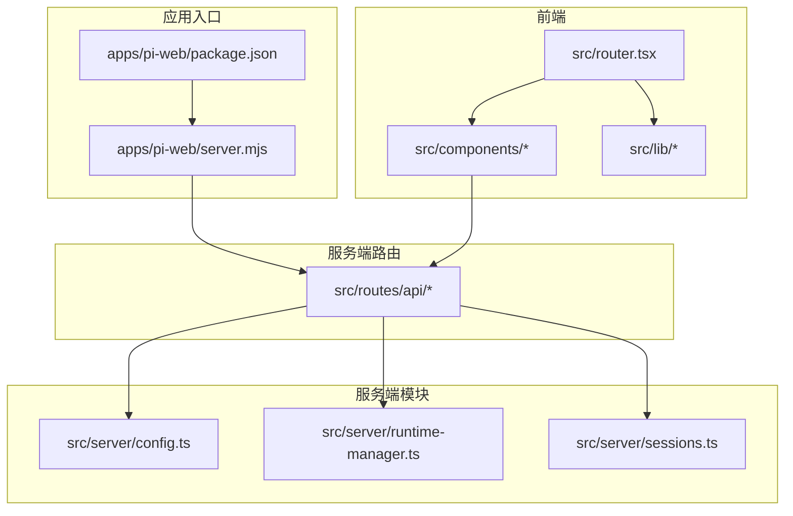
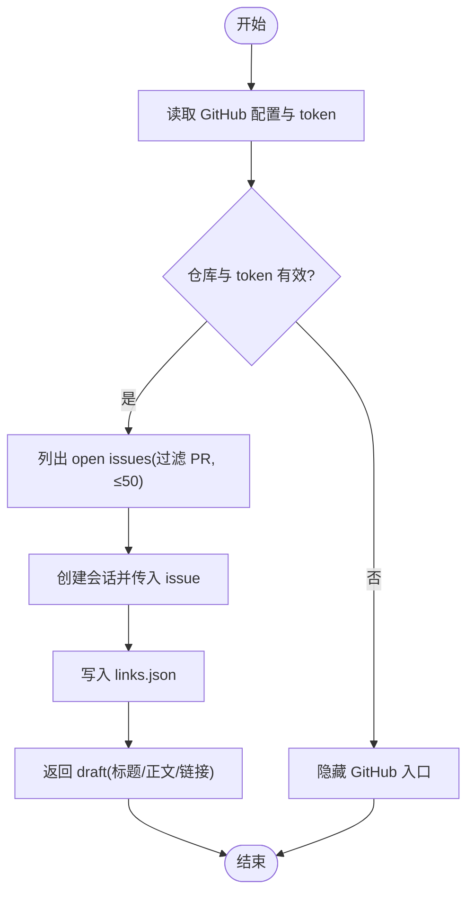
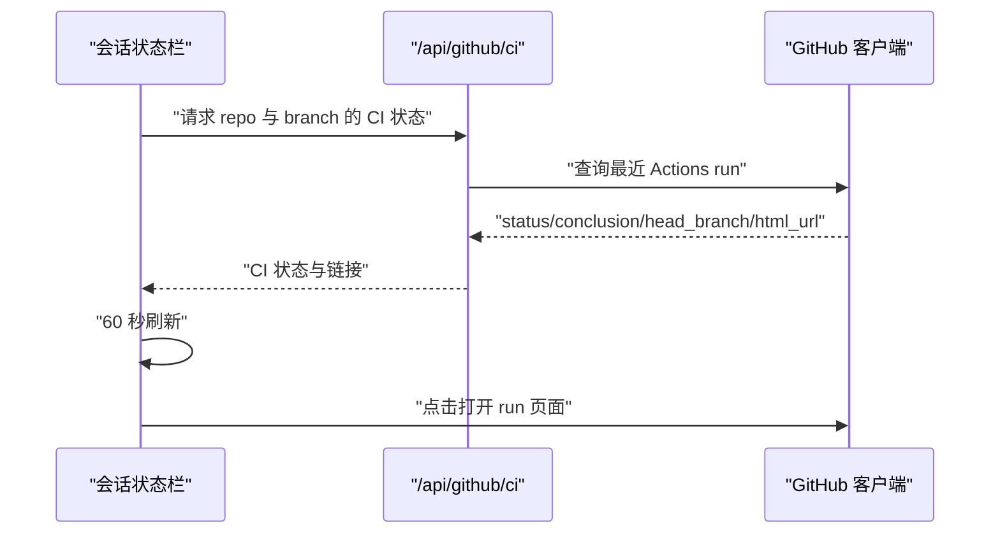
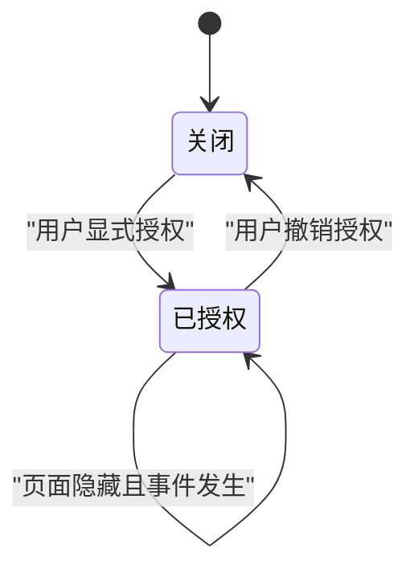
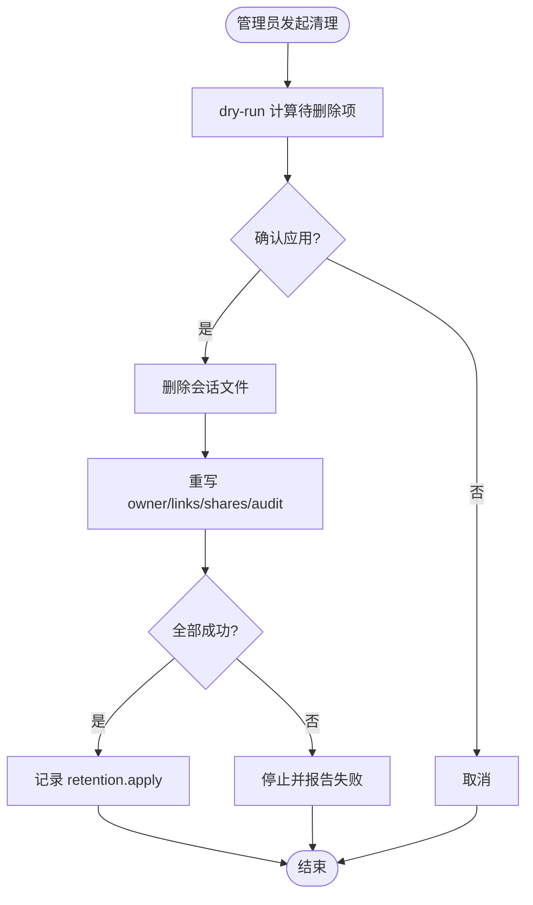
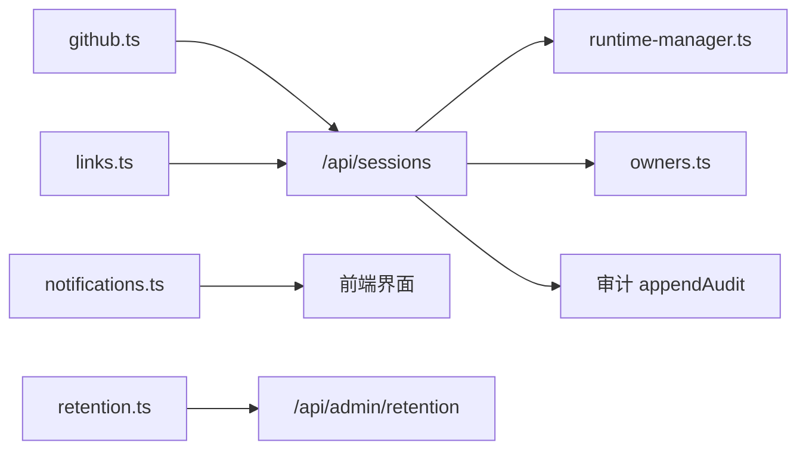

# Pi Web UI M5 需求文档

<cite>
**本文引用的文件**   
- [docs/plans/pi-web-m5.md](file://docs/plans/pi-web-m5.md)
- [docs/rads/pi-web-m5.md](file://docs/rads/pi-web-m5.md)
- [docs/spikes/pi-web-m5.md](file://docs/spikes/pi-web-m5.md)
- [apps/pi-web/src/server/config.ts](file://apps/pi-web/src/server/config.ts)
- [apps/pi-web/src/routes/api/sessions.ts](file://apps/pi-web/src/routes/api/sessions.ts)
- [apps/pi-web/src/components/layout/Sidebar.tsx](file://apps/pi-web/src/components/layout/Sidebar.tsx)
</cite>

## 目录
1. [引言](#引言)
2. [项目结构](#项目结构)
3. [核心组件](#核心组件)
4. [架构总览](#架构总览)
5. [详细组件分析](#详细组件分析)
6. [依赖关系分析](#依赖关系分析)
7. [性能与可用性考虑](#性能与可用性考虑)
8. [故障排查指南](#故障排查指南)
9. [结论](#结论)
10. [附录：M5 实施切片与验收](#附录m5-实施切片与验收)

## 引言
本文件是 Pi Web UI M5 的需求与实现依据说明。M5 在已有会话、分享、交接和审计能力之上，新增 GitHub Issue 关联、CI 状态展示、页面通知与保留清理等能力；默认关闭或只读，未配置时行为与 M4 保持一致。M5 不引入多租户、细粒度权限、自动评论/关闭 Issue、邮件/Webhook 等非目标能力。

## 项目结构
Pi Web UI 位于 `apps/pi-web`，采用 TanStack Router 的文件路由模式：前端组件放在 `src/components`，业务逻辑库放在 `src/lib`，服务端路由放在 `src/routes/api`，服务端工具模块放在 `src/server`。M5 新增的 GitHub、链接、通知、保留等功能应遵循该组织方式。



**图表来源**
- [apps/pi-web/src/server/config.ts:1-34](file://apps/pi-web/src/server/config.ts#L1-L34)
- [apps/pi-web/src/routes/api/sessions.ts:1-82](file://apps/pi-web/src/routes/api/sessions.ts#L1-L82)

**章节来源**
- [docs/rads/pi-web-m5.md:85-90](file://docs/rads/pi-web-m5.md#L85-L90)

## 核心组件
本节聚焦 M5 需要新增或扩展的核心能力，并对照现有代码边界说明实现位置。

- GitHub 客户端与 Issue 接口
  - 新增服务端 GitHub 客户端，负责读取仓库列表、过滤 PR、获取 open issues、查询最近 Actions run。
  - 提供 `/api/github/issues`、`/api/github/issue`、`/api/github/ci` 三个只读 API。
  - 超时 10 秒，ETag 缓存 60 秒，最多返回 50 条 issue。

- Issue 关联与草稿
  - 新增 `server/links.ts`，使用 `~/.pi-web/links.json`（权限 0600）保存 `sessionId → {repoId, number, title, url}`。
  - `POST /api/sessions` 支持传入 `issue`，创建后记录关联并返回 draft，包含标题、正文、链接；不自动发送。
  - 前端将 draft 存入 `sessionStorage`，由 Composer 预填首条消息。

- CI 状态展示
  - 当会话有关联仓库时，在会话状态栏显示最近一次 workflow run 的状态，包括 queued、in_progress、success、failure、cancelled。
  - 每 60 秒刷新一次，点击可打开 GitHub run 页面。

- 通知系统
  - 新增 `lib/notifications.ts`，使用 localStorage 持久化通知事件，支持未读计数、全部已读。
  - 触发事件包括会话 settled、退出/错误、清理完成。
  - 浏览器通知默认关闭，需用户显式授权；仅在页面隐藏时发送，且不包含 prompt 或工具输出正文。

- 保留清理
  - 新增 `server/retention.ts`，支持预览与应用两种模式。
  - 活跃保护：运行时管理器中 busy 或存在的会话、未过期分享不会被删除。
  - 仅清理有 owner 索引的会话；未知会话报告并跳过。
  - 管理员 API：`GET /api/admin/retention` 预览，`POST` 带 `{confirm:true}` 应用。
  - 审计记录 `retention.apply`，包含数量，不含正文。

**章节来源**
- [docs/plans/pi-web-m5.md:28-94](file://docs/plans/pi-web-m5.md#L28-L94)
- [docs/rads/pi-web-m5.md:91-126](file://docs/rads/pi-web-m5.md#L91-L126)
- [docs/spikes/pi-web-m5.md:29-59](file://docs/spikes/pi-web-m5.md#L29-L59)

## 架构总览
M5 的整体交互流程如下：用户在侧栏选择仓库与 open issue，创建会话时后端记录关联并返回草稿；前端预填首条消息；会话详情或状态栏展示关联 issue 与最近 CI 状态；长任务结束时通过页面内通知与可选浏览器通知提醒；管理员通过保留策略预览与实际清理控制磁盘占用。

```mermaid
sequenceDiagram
participant User as "用户"
participant Frontend as "前端界面"
participant API as "服务端路由"
participant GitHub as "GitHub 客户端"
participant Links as "链接存储"
participant Retention as "保留清理"
User->>Frontend : "选择仓库与 open issue"
Frontend->>API : "POST /api/sessions(issue)"
API->>GitHub : "校验仓库与 issue"
GitHub-->>API : "issue 信息"
API->>Links : "写入 sessionId 关联"
API-->>Frontend : "返回会话与 draft"
Frontend->>Frontend : "Composer 预填首条消息"
Frontend->>API : "GET /api/github/ci(repo, branch)"
API->>GitHub : "查询最近 Actions run"
GitHub-->>API : "CI 状态"
API-->>Frontend : "CI 状态"
Note over Frontend : "页面隐藏时触发通知"
User->>API : "管理员 GET/POST /api/admin/retention"
API->>Retention : "预览或应用清理"
Retention-->>API : "结果与审计"
```

**图表来源**
- [docs/plans/pi-web-m5.md:44-94](file://docs/plans/pi-web-m5.md#L44-L94)
- [docs/rads/pi-web-m5.md:41-74](file://docs/rads/pi-web-m5.md#L41-L74)

## 详细组件分析

### GitHub Issues 与 Issue 上下文注入
- 设计要点
  - GitHub PAT 从配置或环境变量 `PI_WEB_GITHUB_TOKEN` 读取，不返回浏览器，日志脱敏。
  - 支持一个或多个仓库配置；open issues 列表过滤 PR，最多 50 条。
  - Issue 上下文以 draft 形式注入首条消息，不自动发送。
- 关键路径
  - 服务端 GitHub 客户端：issues、issue、ci 查询。
  - 链接存储：`~/.pi-web/links.json`，权限 0600。
  - 会话创建：`POST /api/sessions` 支持 issue 参数。
- 错误处理
  - 404、限流、网络错误返回结构化错误，不影响普通会话。
  - 未配置仓库或 token 时隐藏相关入口。



**图表来源**
- [docs/plans/pi-web-m5.md:44-70](file://docs/plans/pi-web-m5.md#L44-L70)
- [docs/rads/pi-web-m5.md:93-100](file://docs/rads/pi-web-m5.md#L93-L100)

**章节来源**
- [docs/plans/pi-web-m5.md:44-70](file://docs/plans/pi-web-m5.md#L44-L70)
- [docs/rads/pi-web-m5.md:93-100](file://docs/rads/pi-web-m5.md#L93-L100)
- [docs/spikes/pi-web-m5.md:31-45](file://docs/spikes/pi-web-m5.md#L31-L45)

### CI 状态展示
- 设计要点
  - 优先使用 Actions runs，check runs 作为补充。
  - 状态包含 queued、in_progress、success、failure、cancelled。
  - 手动刷新与至少 60 秒自动刷新；点击打开 GitHub run。
- 关键路径
  - 服务端 GitHub 客户端查询最近 run。
  - 前端状态栏展示与跳转。
- 降级策略
  - 未配置仓库或 token 时隐藏入口。
  - 外部 API 失败时显示明确错误，不阻塞会话。



**图表来源**
- [docs/plans/pi-web-m5.md:71-76](file://docs/plans/pi-web-m5.md#L71-L76)
- [docs/rads/pi-web-m5.md:102-109](file://docs/rads/pi-web-m5.md#L102-L109)
- [docs/spikes/pi-web-m5.md:31-45](file://docs/spikes/pi-web-m5.md#L31-L45)

**章节来源**
- [docs/plans/pi-web-m5.md:71-76](file://docs/plans/pi-web-m5.md#L71-L76)
- [docs/rads/pi-web-m5.md:102-109](file://docs/rads/pi-web-m5.md#L102-L109)

### 通知系统
- 设计要点
  - 页面内通知列表 + 可选浏览器通知。
  - 浏览器通知默认关闭，需用户显式授权。
  - 页面隐藏时才发通知；不发 prompt 或工具正文。
  - 支持未读数与全部已读。
- 关键路径
  - 前端 `lib/notifications.ts` 管理 localStorage 与事件订阅。
  - 触发事件：会话 settled、退出/错误、清理完成。



**图表来源**
- [docs/plans/pi-web-m5.md:77-84](file://docs/plans/pi-web-m5.md#L77-L84)
- [docs/rads/pi-web-m5.md:110-117](file://docs/rads/pi-web-m5.md#L110-L117)

**章节来源**
- [docs/plans/pi-web-m5.md:77-84](file://docs/plans/pi-web-m5.md#L77-L84)
- [docs/rads/pi-web-m5.md:110-117](file://docs/rads/pi-web-m5.md#L110-L117)

### 保留清理
- 设计要点
  - 配置支持会话、审计、分享的保留天数；0 表示关闭。
  - dry-run 预览与实际清理分离；活跃会话、未过期分享、当前会话不被删除。
  - 清理对象包括会话文件、owner 索引、分享记录；审计只清理旧记录。
  - 失败停止并报告，不静默部分删除；审计记录 `retention.apply`。
- 关键路径
  - 服务端 `server/retention.ts`：计算待删除项、删除文件、重写索引/分享/审计。
  - 管理员 API：`GET /api/admin/retention` 预览，`POST` 带 `{confirm:true}` 应用。



**图表来源**
- [docs/plans/pi-web-m5.md:85-94](file://docs/plans/pi-web-m5.md#L85-L94)
- [docs/rads/pi-web-m5.md:118-126](file://docs/rads/pi-web-m5.md#L118-L126)
- [docs/spikes/pi-web-m5.md:47-59](file://docs/spikes/pi-web-m5.md#L47-L59)

**章节来源**
- [docs/plans/pi-web-m5.md:85-94](file://docs/plans/pi-web-m5.md#L85-L94)
- [docs/rads/pi-web-m5.md:118-126](file://docs/rads/pi-web-m5.md#L118-L126)
- [docs/spikes/pi-web-m5.md:47-59](file://docs/spikes/pi-web-m5.md#L47-L59)

## 依赖关系分析
M5 对现有系统的耦合点主要集中在会话创建、运行时管理与审计记录。GitHub、链接、通知、保留为新增模块，应尽量保持低耦合，并通过 API 路由暴露能力。



**图表来源**
- [apps/pi-web/src/routes/api/sessions.ts:1-82](file://apps/pi-web/src/routes/api/sessions.ts#L1-L82)
- [apps/pi-web/src/server/runtime-manager.ts:1-200](file://apps/pi-web/src/server/runtime-manager.ts#L1-L200)

**章节来源**
- [apps/pi-web/src/routes/api/sessions.ts:1-82](file://apps/pi-web/src/routes/api/sessions.ts#L1-L82)

## 性能与可用性考虑
- GitHub 请求
  - 10 秒超时；ETag 条件请求；缓存 60 秒；最多 50 条 issue。
  - 限流与网络错误降级，不阻塞普通会话。
- 通知
  - 页面内通知轻量持久化；浏览器通知仅在页面隐藏时触发。
- 保留清理
  - dry-run 先计算再删除；失败立即停止；审计记录数量但不含正文。
- 代理
  - Node 22 需要 `NODE_USE_ENV_PROXY=1` 才走 HTTP 代理；文档与错误提示需明确。

[本节为通用指导，不直接分析具体文件]

## 故障排查指南
- GitHub Token 与代理
  - 检查是否配置 `PI_WEB_GITHUB_TOKEN`；确认 `NODE_USE_ENV_PROXY=1`；查看日志是否脱敏。
- Issue 列表为空或报错
  - 检查仓库是否存在、token 权限、是否被限流；确认过滤 PR 逻辑。
- CI 状态不显示
  - 检查是否配置仓库与分支；确认 Actions runs 可用；查看缓存与刷新间隔。
- 通知未触发
  - 检查浏览器通知授权；确认页面隐藏；核对事件类型。
- 清理未生效或误删风险
  - 先执行 dry-run；确认活跃会话与未过期分享；查看审计记录；失败路径是否停止。

**章节来源**
- [docs/spikes/pi-web-m5.md:79-86](file://docs/spikes/pi-web-m5.md#L79-L86)
- [docs/rads/pi-web-m5.md:182-190](file://docs/rads/pi-web-m5.md#L182-L190)

## 结论
M5 在不改变 M1–M4 基本行为的前提下，补齐团队日常所需的 Issue 关联、CI 状态、通知与保留清理能力。实现应保持只读与安全边界：token 不进浏览器、外部 API 失败不阻塞主流程、清理前必须 dry-run 且失败停止。Spike 验证了 REST API、Actions runs、ETag 缓存与清理顺序可行；Plan 明确了实施切片与验收标准。

[本节为总结性内容，不直接分析具体文件]

## 附录：M5 实施切片与验收
- S1 GitHub Issues 与关联
  - 交付：配置、GitHub 客户端、issues/issue API、Issue 面板、草稿预填、links 存储。
  - 验收：从 Issue 创建会话，首条草稿包含标题/正文/链接。
- S2 CI 状态
  - 交付：Actions runs 查询、缓存、状态栏、刷新、链接。
  - 验收：关联会话显示最近 run 状态并可跳转。
- S3 通知
  - 交付：通知存储、铃铛、已读、浏览器通知授权与页面隐藏触发。
  - 验收：页面隐藏时任务结束可收到通知。
- S4 保留清理
  - 交付：配置、预览、应用、活跃保护、审计。
  - 验收：dry-run 与实际清理一致；活跃会话不被删除。
- S5 加固与文档
  - 交付：README 配置、token、代理、保留说明；全量 check 与测试通过。
  - 验收：RAD 第 10 节可复现；M1–M4 无回归。

**章节来源**
- [docs/plans/pi-web-m5.md:105-141](file://docs/plans/pi-web-m5.md#L105-L141)
- [docs/rads/pi-web-m5.md:171-180](file://docs/rads/pi-web-m5.md#L171-L180)