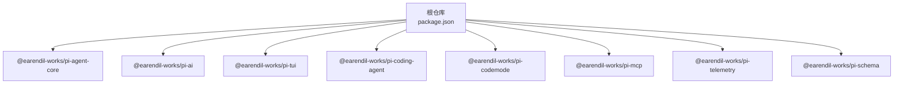
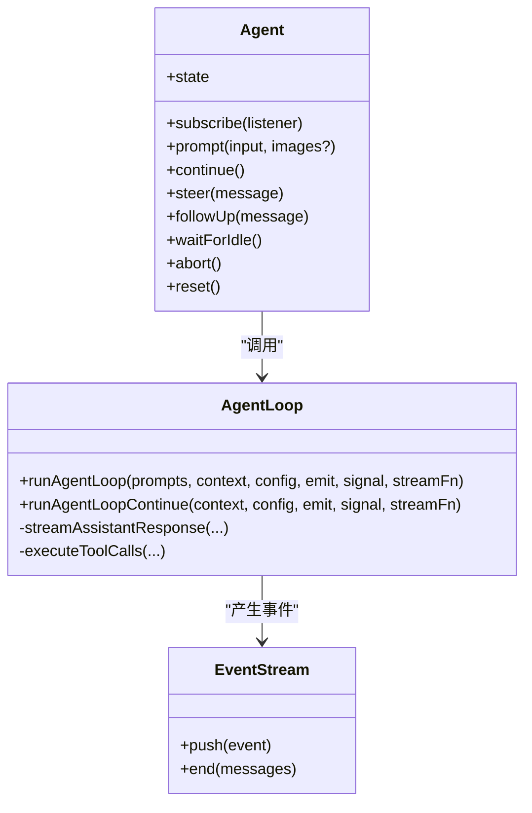
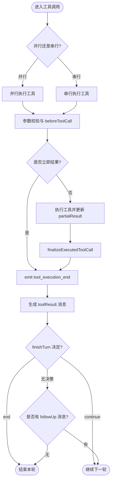
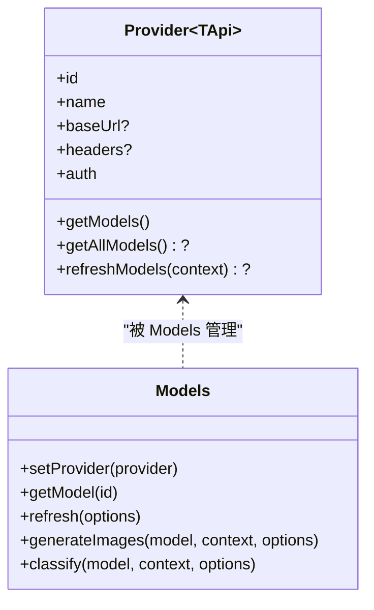
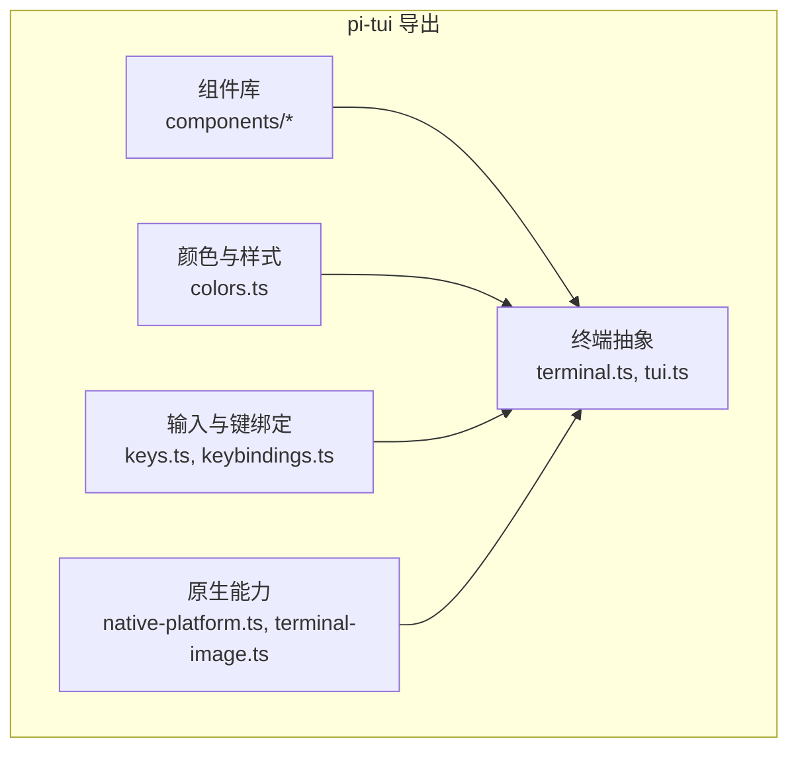
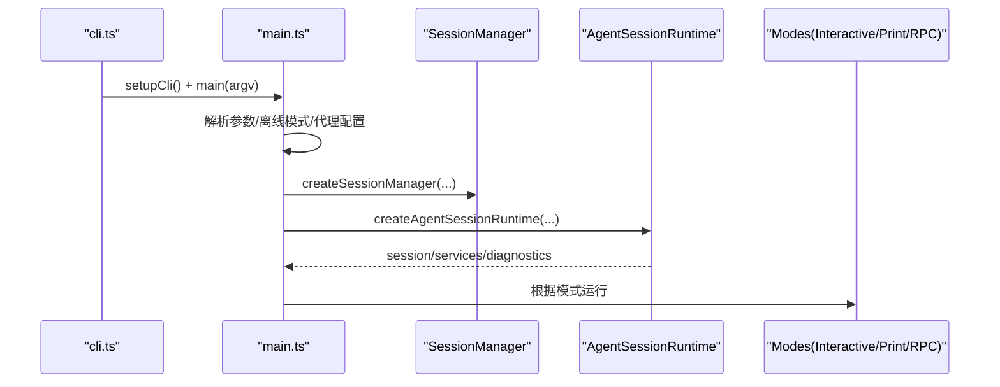
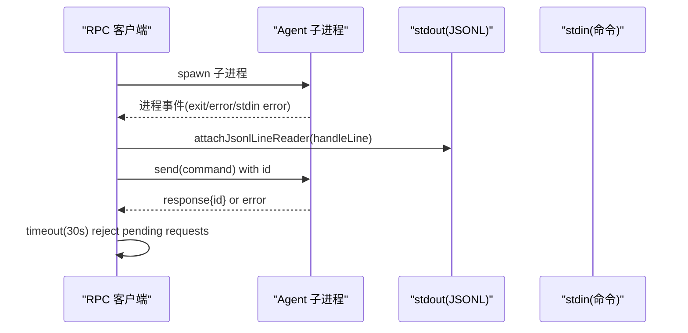
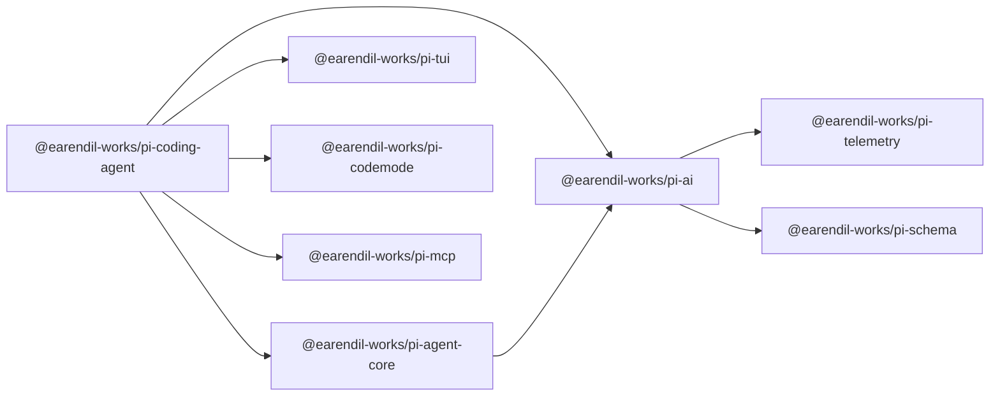

# 架构概览

<cite>
**本文引用的文件**   
- [README.md](file://README.md)
- [package.json](file://package.json)
- [packages/agent/package.json](file://packages/agent/package.json)
- [packages/ai/package.json](file://packages/ai/package.json)
- [packages/tui/package.json](file://packages/tui/package.json)
- [packages/coding-agent/package.json](file://packages/coding-agent/package.json)
- [packages/agent/src/index.ts](file://packages/agent/src/index.ts)
- [packages/agent/src/agent.ts](file://packages/agent/src/agent.ts)
- [packages/agent/src/agent-loop.ts](file://packages/agent/src/agent-loop.ts)
- [packages/ai/src/index.ts](file://packages/ai/src/index.ts)
- [packages/ai/src/models.ts](file://packages/ai/src/models.ts)
- [packages/tui/src/index.ts](file://packages/tui/src/index.ts)
- [packages/coding-agent/src/main.ts](file://packages/coding-agent/src/main.ts)
- [packages/coding-agent/src/cli.ts](file://packages/coding-agent/src/cli.ts)
- [packages/coding-agent/src/core/agent-session-runtime.ts](file://packages/coding-agent/src/core/agent-session-runtime.ts)
- [packages/coding-agent/src/core/agent-session.ts](file://packages/coding-agent/src/core/agent-session.ts)
- [packages/coding-agent/src/modes/rpc/rpc-client.ts](file://packages/coding-agent/src/modes/rpc/rpc-client.ts)
</cite>

## 目录
1. [引言](#引言)
2. [项目结构](#项目结构)
3. [核心组件](#核心组件)
4. [架构总览](#架构总览)
5. [详细组件分析](#详细组件分析)
6. [依赖关系分析](#依赖关系分析)
7. [性能与可扩展性](#性能与可扩展性)
8. [故障排查指南](#故障排查指南)
9. [结论](#结论)
10. [附录](#附录)

## 引言
本文件面向开发者，系统性梳理 Pi 的整体架构、Monorepo 包组织方式以及关键子系统之间的交互关系。重点覆盖：
- Agent 运行时：会话生命周期、事件驱动循环、工具调用编排。
- LLM 抽象层：统一多提供商模型发现、认证、流式推理与成本统计。
- TUI 界面：终端 UI 组件库、差异化渲染、原生能力集成。
- 工具系统与插件扩展：命令、技能、提示词、主题与 MCP 集成。
- 事件驱动架构、RPC 模式与进程隔离。
- 技术选型与权衡：为什么采用 Node.js + TypeScript、NPM Workspaces、分层包与可插拔提供商。

## 项目结构
Pi 是一个基于 NPM Workspaces 的 Monorepo，根 package.json 定义了工作区与构建脚本；各功能以独立 npm 包形式发布，并通过版本化依赖耦合。



**图表来源**
- [package.json:1-11](file://package.json#L1-L11)
- [package.json:12-18](file://package.json#L12-L18)

**章节来源**
- [README.md:72-86](file://README.md#L72-L86)
- [package.json:1-18](file://package.json#L1-L18)

## 核心组件
- Agent 运行时（@earendil-works/pi-agent-core）
  - 提供 Agent 状态机、消息队列、工具执行（并行/串行）、事件发射与重试控制。
  - 通过 StreamFn 将内部 AgentMessage 转换为 LLM 所需的 Message[]，并处理流式事件。
- LLM 抽象层（@earendil-works/pi-ai）
  - 统一多提供商 API（OpenAI、Anthropic、Google、Bedrock 等），模型注册、动态刷新、认证与遥测。
  - 暴露 Provider 接口与 Models 集合，支持 chat/image/classifier 多种模型类型。
- TUI 界面（@earendil-works/pi-tui）
  - 终端 UI 组件库，包含布局、编辑器、图片、颜色、键盘绑定、原生剪贴板等。
- 编码代理 CLI（@earendil-works/pi-coding-agent）
  - 用户入口，解析参数、选择会话、加载扩展、创建 AgentSessionRuntime，并在不同模式下运行（交互式、打印、JSON、RPC）。

**章节来源**
- [packages/agent/src/index.ts:1-6](file://packages/agent/src/index.ts#L1-L6)
- [packages/ai/src/index.ts:1-48](file://packages/ai/src/index.ts#L1-L48)
- [packages/tui/src/index.ts:1-198](file://packages/tui/src/index.ts#L1-L198)
- [packages/coding-agent/src/cli.ts:1-7](file://packages/coding-agent/src/cli.ts#L1-L7)

## 架构总览
下图展示从 CLI 到 Agent 运行时、LLM 抽象层、TUI 与外部提供商的整体数据流。

```mermaid
sequenceDiagram
participant User as "用户"
participant CLI as "coding-agent CLI<br/>main.ts"
participant Runtime as "AgentSessionRuntime<br/>agent-session-runtime.ts"
participant Agent as "Agent<br/>agent.ts"
participant Loop as "AgentLoop<br/>agent-loop.ts"
participant AI as "pi-ai<br/>models.ts"
participant Provider as "LLM 提供商"
participant TUI as "pi-tui"
User->>CLI : 启动 pi / 输入命令
CLI->>Runtime : 创建会话运行时
Runtime->>Agent : 初始化 Agent 状态与会话
Agent->>Loop : 启动 runAgentLoop/runAgentLoopContinue
Loop->>AI : 转换上下文并调用 streamFunction
AI->>Provider : 发送请求并返回流式事件
Provider-->>AI : 文本/思考/工具调用事件
AI-->>Loop : 事件分发
Loop-->>Agent : message/tool/turn/agent 事件
Agent-->>TUI : 渲染输出与交互
TUI-->>User : 终端界面反馈
```

**图表来源**
- [packages/coding-agent/src/main.ts:621-776](file://packages/coding-agent/src/main.ts#L621-L776)
- [packages/coding-agent/src/core/agent-session-runtime.ts:67-95](file://packages/coding-agent/src/core/agent-session-runtime.ts#L67-L95)
- [packages/agent/src/agent.ts:194-263](file://packages/agent/src/agent.ts#L194-L263)
- [packages/agent/src/agent-loop.ts:111-160](file://packages/agent/src/agent-loop.ts#L111-L160)
- [packages/ai/src/models.ts:147-196](file://packages/ai/src/models.ts#L147-L196)
- [packages/tui/src/index.ts:1-198](file://packages/tui/src/index.ts#L1-L198)

## 详细组件分析

### Agent 运行时与事件驱动循环
Agent 类封装了会话状态、消息队列（steering/follow-up）、事件订阅与生命周期管理；AgentLoop 负责主循环：准备上下文、调用 LLM、执行工具、处理错误与终止条件。



**图表来源**
- [packages/agent/src/agent.ts:194-263](file://packages/agent/src/agent.ts#L194-L263)
- [packages/agent/src/agent-loop.ts:111-160](file://packages/agent/src/agent-loop.ts#L111-L160)

#### 工具调用流程
工具调用支持并行与串行两种模式，具备 before/after 钩子、参数校验、截断保护与终止策略。



**图表来源**
- [packages/agent/src/agent-loop.ts:518-670](file://packages/agent/src/agent-loop.ts#L518-L670)
- [packages/agent/src/agent-loop.ts:696-800](file://packages/agent/src/agent-loop.ts#L696-L800)

**章节来源**
- [packages/agent/src/agent.ts:194-624](file://packages/agent/src/agent.ts#L194-L624)
- [packages/agent/src/agent-loop.ts:111-800](file://packages/agent/src/agent-loop.ts#L111-L800)

### LLM 抽象层（pi-ai）
pi-ai 提供统一的 Provider 抽象与 Models 集合，支持：
- 静态/动态模型列表与 refreshModels。
- 认证（apiKey/OAuth）与凭据存储。
- 流式响应、成本计算、遥测与身份标识。
- 多模型类型（chat/image/classifier）与 API 适配。



**图表来源**
- [packages/ai/src/models.ts:147-196](file://packages/ai/src/models.ts#L147-L196)
- [packages/ai/src/models.ts:1213-1260](file://packages/ai/src/models.ts#L1213-L1260)

**章节来源**
- [packages/ai/src/index.ts:1-48](file://packages/ai/src/index.ts#L1-L48)
- [packages/ai/src/models.ts:147-196](file://packages/ai/src/models.ts#L147-L196)
- [packages/ai/src/models.ts:1213-1260](file://packages/ai/src/models.ts#L1213-L1260)

### TUI 界面（pi-tui）
pi-tui 提供终端 UI 组件与平台能力：
- 组件系统：Box、Editor、Image、Markdown、ScrollView、SelectList 等。
- 颜色与样式：ANSI/RGB/OKLCH 转换、主题与终端颜色检测。
- 输入与键绑定：键盘协议、模糊匹配、滚动与鼠标区域。
- 原生能力：剪贴板、图像协议、能力探测与跨平台实现。



**图表来源**
- [packages/tui/src/index.ts:1-198](file://packages/tui/src/index.ts#L1-L198)

**章节来源**
- [packages/tui/src/index.ts:1-198](file://packages/tui/src/index.ts#L1-L198)

### 编码代理 CLI 与运行时装配
coding-agent 作为用户入口，负责：
- 参数解析、模式选择（interactive/print/json/rpc）。
- 会话管理与迁移、信任与权限检查。
- 扩展加载、MCP 命令、主题与资源复制。
- 创建 AgentSessionRuntime 并驱动 Agent 运行。



**图表来源**
- [packages/coding-agent/src/cli.ts:1-7](file://packages/coding-agent/src/cli.ts#L1-L7)
- [packages/coding-agent/src/main.ts:621-776](file://packages/coding-agent/src/main.ts#L621-L776)
- [packages/coding-agent/src/core/agent-session-runtime.ts:421-445](file://packages/coding-agent/src/core/agent-session-runtime.ts#L421-L445)

**章节来源**
- [packages/coding-agent/src/main.ts:621-776](file://packages/coding-agent/src/main.ts#L621-L776)
- [packages/coding-agent/src/core/agent-session-runtime.ts:67-95](file://packages/coding-agent/src/core/agent-session-runtime.ts#L67-L95)
- [packages/coding-agent/src/core/agent-session.ts:1-14](file://packages/coding-agent/src/core/agent-session.ts#L1-L14)

### RPC 模式与进程隔离
RPC 模式通过子进程通信，使用 JSONL 行协议传输命令与响应，具备超时、错误传播与退出处理。



**图表来源**
- [packages/coding-agent/src/modes/rpc/rpc-client.ts:107-140](file://packages/coding-agent/src/modes/rpc/rpc-client.ts#L107-L140)
- [packages/coding-agent/src/modes/rpc/rpc-client.ts:545-583](file://packages/coding-agent/src/modes/rpc/rpc-client.ts#L545-L583)

**章节来源**
- [packages/coding-agent/src/modes/rpc/rpc-client.ts:107-140](file://packages/coding-agent/src/modes/rpc/rpc-client.ts#L107-L140)
- [packages/coding-agent/src/modes/rpc/rpc-client.ts:545-583](file://packages/coding-agent/src/modes/rpc/rpc-client.ts#L545-L583)

## 依赖关系分析
各包的职责与依赖如下：



**图表来源**
- [packages/coding-agent/package.json:43-65](file://packages/coding-agent/package.json#L43-L65)
- [packages/agent/package.json:25-28](file://packages/agent/package.json#L25-L28)
- [packages/ai/package.json:77-88](file://packages/ai/package.json#L77-L88)

**章节来源**
- [packages/coding-agent/package.json:43-65](file://packages/coding-agent/package.json#L43-L65)
- [packages/agent/package.json:25-28](file://packages/agent/package.json#L25-L28)
- [packages/ai/package.json:77-88](file://packages/ai/package.json#L77-L88)

## 性能与可扩展性
- 流式处理：AgentLoop 对 LLM 响应进行增量事件分发，减少内存峰值并提升交互体验。
- 工具执行优化：并行执行工具调用，结合 before/after 钩子与 abort 信号，避免阻塞与无效执行。
- 模型刷新与缓存：pi-ai 支持动态 provider 刷新与持久化存储，降低网络开销。
- 差异化渲染：pi-tui 提供高效终端渲染能力，适合长对话与大量输出场景。
- 可扩展点：
  - 自定义 Provider：实现 Provider 接口并注册到 Models。
  - 工具扩展：在 Agent 中注入 AgentTool，支持参数预处理与即时结果。
  - 扩展机制：coding-agent 支持 extensions/skills/prompt-templates/themes，可通过 npm/git 共享。

[本节为通用指导，不直接分析具体文件]

## 故障排查指南
- Agent 运行失败
  - 检查 Agent.runWithLifecycle 的错误处理路径，确认 event 序列是否完整（message_start/end、turn_end、agent_end）。
  - 若出现“无法继续”或“助手消息角色”错误，检查上下文最后一条消息是否符合要求。
- 工具调用异常
  - 查看 prepareToolCall 的参数校验与 beforeToolCall 拦截逻辑，确认是否被 block 或中止。
  - 注意输出 token 限制导致的工具参数截断，框架会主动失败并重试。
- RPC 子进程问题
  - 关注 exit/error/stdin error 事件，检查 stderr 与 pending requests 清理逻辑。
  - 超时处理会在 30 秒内拒绝未响应的请求。

**章节来源**
- [packages/agent/src/agent.ts:517-558](file://packages/agent/src/agent.ts#L517-L558)
- [packages/agent/src/agent-loop.ts:488-513](file://packages/agent/src/agent-loop.ts#L488-L513)
- [packages/agent/src/agent-loop.ts:718-787](file://packages/agent/src/agent-loop.ts#L718-L787)
- [packages/coding-agent/src/modes/rpc/rpc-client.ts:107-140](file://packages/coding-agent/src/modes/rpc/rpc-client.ts#L107-L140)
- [packages/coding-agent/src/modes/rpc/rpc-client.ts:545-583](file://packages/coding-agent/src/modes/rpc/rpc-client.ts#L545-L583)

## 结论
Pi 通过清晰的 Monorepo 结构与分层包设计，将 Agent 运行时、LLM 抽象层、TUI 界面与 CLI 解耦，形成高内聚、低耦合的系统。事件驱动的 AgentLoop 与 Provider 抽象使得系统具备良好的可扩展性与可替换性；RPC 模式与扩展机制进一步增强了部署灵活性与生态丰富度。整体架构在易用性、性能与安全性之间取得平衡，适合构建多样化的 AI 应用与工作流。

[本节为总结性内容，不直接分析具体文件]

## 附录
- 技术选型与权衡
  - Node.js + TypeScript：现代前端/后端生态成熟，便于复用工具链与测试框架。
  - NPM Workspaces：统一管理依赖与构建流程，简化本地开发与发布。
  - 分层包：agent/ai/tui/coding-agent 各司其职，便于独立演进与复用。
  - 提供商抽象：统一 API 屏蔽底层差异，支持动态模型发现与认证。
  - RPC 模式：进程隔离提升稳定性，但增加调试复杂度。

[本节为概念性内容，不直接分析具体文件]