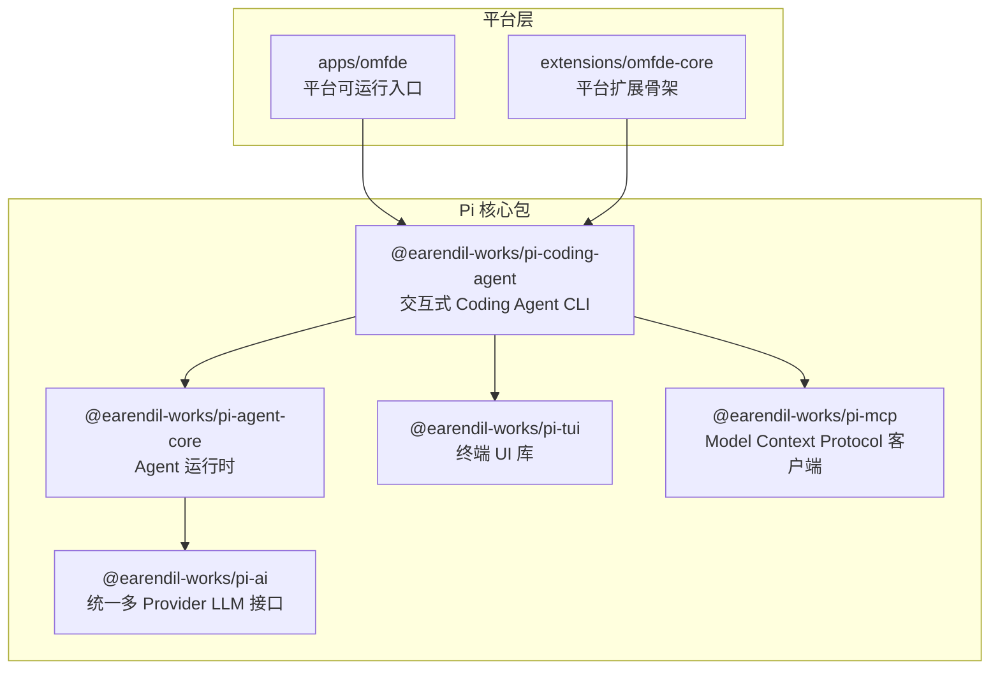
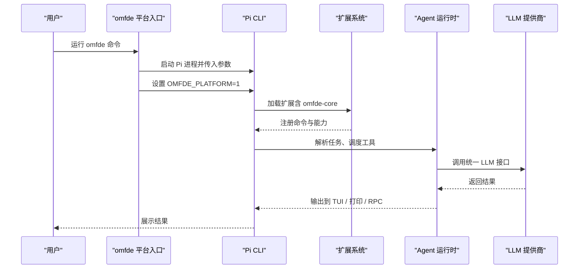
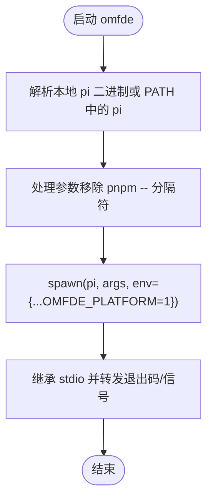
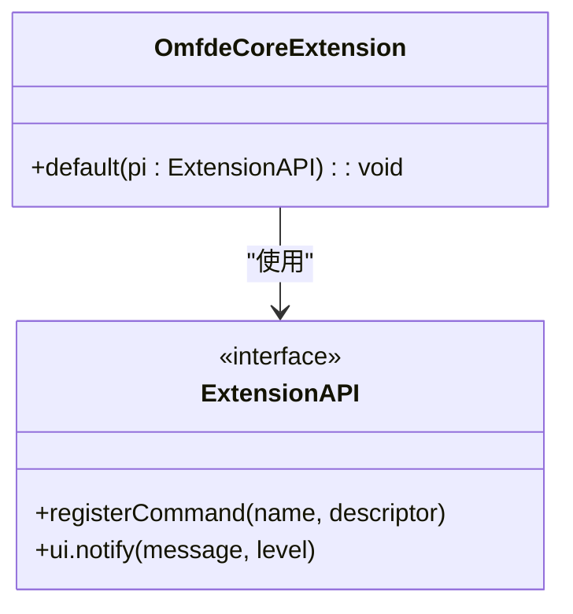
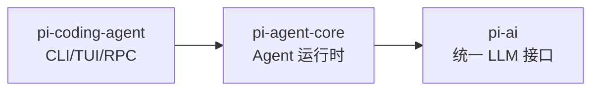
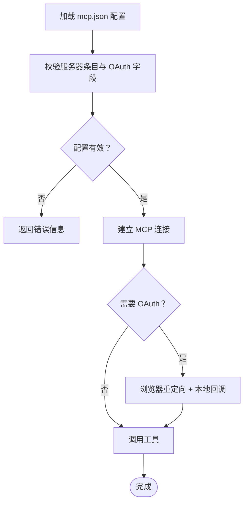
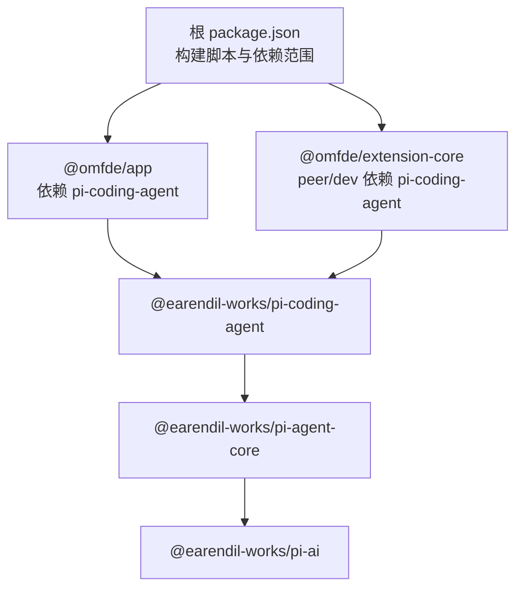

# 项目介绍

<cite>
**本文引用的文件**   
- [README.md](file://README.md)
- [README.zh-CN.md](file://README.zh-CN.md)
- [package.json](file://package.json)
- [apps/omfde/README.md](file://apps/omfde/README.md)
- [apps/omfde/package.json](file://apps/omfde/package.json)
- [apps/omfde/bin/omfde.mjs](file://apps/omfde/bin/omfde.mjs)
- [extensions/omfde-core/package.json](file://extensions/omfde-core/package.json)
- [extensions/omfde-core/src/index.ts](file://extensions/omfde-core/src/index.ts)
- [AGENTS.zh-CN.md](file://AGENTS.zh-CN.md)
</cite>

## 目录
1. [引言](#引言)
2. [项目结构](#项目结构)
3. [核心组件](#核心组件)
4. [架构总览](#架构总览)
5. [详细组件分析](#详细组件分析)
6. [依赖关系分析](#依赖关系分析)
7. [性能与可扩展性](#性能与可扩展性)
8. [故障排查指南](#故障排查指南)
9. [结论](#结论)
10. [附录](#附录)

## 引言
OMFDE（Pi AI 代理框架）基于 Pi，是一个最小化、可扩展的代理框架。其核心理念是“让 Pi 适应你的工作流，而不是反过来”。Pi 提供强大的默认能力，同时刻意保持内核精简，通过扩展、技能、提示模板和主题进行深度定制；你可以以交互方式使用它，也可以在打印或 JSON 模式下自动化，或通过 RPC 控制，甚至用 TypeScript SDK 构建应用。

在本仓库中，OMFDE 作为平台层存在：`apps/omfde` 是第一个平台入口，负责启动 Pi 并注入平台标识；`extensions/omfde-core` 是第一个扩展骨架，用于在不侵入 Pi 内核的前提下接入平台能力。

- 官方网站：https://pi.dev
- 社区支持：Discord 社区链接位于仓库顶部
- 开源协议：MIT

**章节来源**
- [README.md:13-21](file://README.md#L13-L21)
- [README.zh-CN.md:15-23](file://README.zh-CN.md#L15-L23)
- [README.md:182-190](file://README.md#L182-L190)

## 项目结构
本仓库采用 monorepo 组织方式，包含 CLI、核心库、平台应用与扩展：
- `packages/`：Pi 的核心包与共享库，如统一 LLM 接口、Agent 运行时、TUI、MCP 客户端等
- `apps/`：平台应用，当前为 `apps/omfde`
- `extensions/`：平台扩展，当前为 `extensions/omfde-core`
- `scripts/`：构建、检查、发布等工程脚本
- `docs/`：设计说明、规范与解释文档

**图表来源**
- [package.json:6-10](file://package.json#L6-L10)
- [apps/omfde/package.json:12-14](file://apps/omfde/package.json#L12-L14)
- [extensions/omfde-core/package.json:9-14](file://extensions/omfde-core/package.json#L9-L14)

**章节来源**
- [README.zh-CN.md:27-39](file://README.zh-CN.md#L27-L39)
- [package.json:1-10](file://package.json#L1-L10)

## 核心组件
- 统一 LLM 接口抽象：`@earendil-works/pi-ai` 提供跨厂商的统一 API，屏蔽 OpenAI、Anthropic、Google 等差异
- Agent 运行时：`@earendil-works/pi-agent-core` 管理工具调用、状态与会话
- 交互式 CLI：`@earendil-works/pi-coding-agent` 提供 TUI、打印/JSON 模式与 RPC 控制
- 终端 UI：`@earendil-works/pi-tui` 提供差分渲染的终端界面
- MCP 客户端：`@earendil-works/pi-mcp` 实现 Model Context Protocol 连接与认证流程
- 平台入口与扩展：`apps/omfde` 与 `extensions/omfde-core` 将 Pi 平台化，不修改内核

这些组件共同支撑了 OMFDE 的“最小内核 + 强扩展”理念，使系统既能开箱即用，又能按需定制。

**章节来源**
- [README.md:56-68](file://README.md#L56-L68)
- [README.zh-CN.md:74-88](file://README.zh-CN.md#L74-L88)

## 架构总览
下图展示了 OMFDE 在 Pi 之上的平台化架构：用户通过 `omfde` 命令进入平台，平台启动 Pi 并注入环境变量，随后加载扩展，最终由 Pi 的 CLI 与 Agent 运行时驱动任务执行。

**图表来源**
- [apps/omfde/bin/omfde.mjs:23-27](file://apps/omfde/bin/omfde.mjs#L23-L27)
- [extensions/omfde-core/src/index.ts:12-18](file://extensions/omfde-core/src/index.ts#L12-L18)
- [package.json:6-10](file://package.json#L6-L10)

## 详细组件分析

### 平台入口 apps/omfde
- 职责：作为平台的薄启动器，解析 monorepo 中的 Pi 可执行文件，设置 `OMFDE_PLATFORM=1`，并将命令行参数原样转发给 Pi
- 行为：保留子进程的退出码与信号，确保 `omfde` 的行为与直接调用 Pi 一致
- 扩展点：后续平台能力在此处组合，避免直接绑定 Pi 核心代码

**图表来源**
- [apps/omfde/bin/omfde.mjs:13-27](file://apps/omfde/bin/omfde.mjs#L13-L27)
- [apps/omfde/bin/omfde.mjs:29-41](file://apps/omfde/bin/omfde.mjs#L29-L41)

**章节来源**
- [apps/omfde/README.md:1-14](file://apps/omfde/README.md#L1-L14)
- [apps/omfde/bin/omfde.mjs:1-42](file://apps/omfde/bin/omfde.mjs#L1-L42)

### 平台扩展 extensions/omfde-core
- 职责：注册 `/omfde` 命令作为加载探针，显示平台扩展已加载的通知
- 原则：通过扩展机制接入平台能力，不修改 Pi 内核
- 集成：作为 peer/dev 依赖与 `@earendil-works/pi-coding-agent` 协同

**图表来源**
- [extensions/omfde-core/src/index.ts:1-19](file://extensions/omfde-core/src/index.ts#L1-L19)

**章节来源**
- [extensions/omfde-core/src/index.ts:1-20](file://extensions/omfde-core/src/index.ts#L1-L20)
- [extensions/omfde-core/package.json:1-16](file://extensions/omfde-core/package.json#L1-L16)

### 统一 LLM 接口与 Agent 运行时
- `@earendil-works/pi-ai`：统一多 Provider LLM API，屏蔽厂商差异
- `@earendil-works/pi-agent-core`：Agent 运行时，管理工具调用与状态
- `@earendil-works/pi-coding-agent`：交互式 CLI，支持 TUI、打印/JSON 模式与 RPC

**图表来源**
- [README.md:56-68](file://README.md#L56-L68)
- [README.zh-CN.md:74-88](file://README.zh-CN.md#L74-L88)

**章节来源**
- [README.md:56-68](file://README.md#L56-L68)
- [README.zh-CN.md:74-88](file://README.zh-CN.md#L74-L88)

### MCP 集成与认证
- `@earendil-works/pi-mcp`：独立的 Model Context Protocol 客户端，支持 HTTP/stdio 传输与 OAuth 配置校验
- 测试覆盖 OAuth 字段校验（端口、回调 URL、作用域、客户端名称、注册策略等）

**图表来源**
- [packages/mcp/src/config.ts:76-105](file://packages/mcp/src/config.ts#L76-L105)
- [packages/mcp/src/config.ts:181-205](file://packages/mcp/src/config.ts#L181-L205)

**章节来源**
- [packages/mcp/src/config.ts:76-105](file://packages/mcp/src/config.ts#L76-L105)
- [packages/mcp/src/config.ts:181-205](file://packages/mcp/src/config.ts#L181-L205)

## 依赖关系分析
- 顶层 `package.json` 定义了 monorepo 的构建脚本与依赖版本范围
- `apps/omfde` 依赖 `@earendil-works/pi-coding-agent`，作为平台入口
- `extensions/omfde-core` 以 peer/dev 依赖形式与 `@earendil-works/pi-coding-agent` 协作
- 根脚本按顺序构建 telemetry、schema、tui、codemode、mcp、ai、agent-core、coding-agent

**图表来源**
- [package.json:6-10](file://package.json#L6-L10)
- [apps/omfde/package.json:12-14](file://apps/omfde/package.json#L12-L14)
- [extensions/omfde-core/package.json:9-14](file://extensions/omfde-core/package.json#L9-L14)

**章节来源**
- [package.json:1-10](file://package.json#L1-L10)
- [apps/omfde/package.json:1-16](file://apps/omfde/package.json#L1-L16)
- [extensions/omfde-core/package.json:1-16](file://extensions/omfde-core/package.json#L1-L16)

## 性能与可扩展性
- 最小内核：Pi 刻意跳过 sub-agents 与 plan mode 等功能，保持内核精简，提升可维护性与性能
- 扩展优先：通过扩展、技能、提示模板与主题定制行为，避免修改内核
- 多模式交互：TUI、打印/JSON 模式与 RPC 控制，适配不同场景的性能与自动化需求
- 供应链加固：依赖锁定与安全检查，降低引入风险

[本节为通用指导，不直接分析具体文件]

## 故障排查指南
- 启动失败：若 `omfde` 无法启动 Pi，检查本地二进制是否存在以及 PATH 是否可用；查看控制台错误输出
- 信号与退出码：`omfde` 会转发子进程的信号与退出码，便于 Shell 正确处理 Ctrl+C 等终止信号
- 扩展未加载：确认 `extensions/omfde-core` 已正确安装并通过扩展机制加载；可通过 `/omfde` 命令验证
- MCP 配置错误：检查 OAuth 字段（端口、回调 URL、作用域、客户端名称、注册策略），参考配置校验规则

**章节来源**
- [apps/omfde/bin/omfde.mjs:29-41](file://apps/omfde/bin/omfde.mjs#L29-L41)
- [extensions/omfde-core/src/index.ts:12-18](file://extensions/omfde-core/src/index.ts#L12-L18)
- [packages/mcp/src/config.ts:181-205](file://packages/mcp/src/config.ts#L181-L205)

## 结论
OMFDE 在 Pi 的最小内核之上构建了平台层，通过 `apps/omfde` 与 `extensions/omfde-core` 实现了“平台化而不侵入内核”的目标。结合统一的 LLM 接口、Agent 运行时、TUI、MCP 客户端与丰富的扩展生态，OMFDE 能够灵活适应用户的工作流，既适合交互式编程，也支持自动化与系统集成。项目采用 MIT 协议开源，拥有活跃的社区支持与官方网站资源。

[本节为总结性内容，不直接分析具体文件]

## 附录
- 贡献指南与项目规则：参见 CONTRIBUTING.md 与 AGENTS.md
- 长期规划：可在 RFC 站点查阅 Pi 的路线图
- 官方文档与演示：https://pi.dev/docs/latest 与 https://pi.dev

**章节来源**
- [README.md:82-84](file://README.md#L82-L84)
- [README.zh-CN.md:102-104](file://README.zh-CN.md#L102-L104)
- [AGENTS.zh-CN.md:15-15](file://AGENTS.zh-CN.md#L15-L15)