# 项目概述

<cite>
**本文引用的文件**
- [README.md](file://README.md)
- [README.zh-CN.md](file://README.zh-CN.md)
- [AGENTS.zh-CN.md](file://AGENTS.zh-CN.md)
- [package.json](file://package.json)
- [packages/coding-agent/package.json](file://packages/coding-agent/package.json)
- [packages/ai/package.json](file://packages/ai/package.json)
- [packages/agent/package.json](file://packages/agent/package.json)
- [docs/explains/README.md](file://docs/explains/README.md)
- [docs/explains/17-system-overview.md](file://docs/explains/17-system-overview.md)
- [docs/explains/01-repo-map.md](file://docs/explains/01-repo-map.md)
- [docs/explains/08-boot-and-session.md](file://docs/explains/08-boot-and-session.md)
</cite>

## 更新摘要
**所做更改**
- 新增"文档架构与学习路径"章节，反映新的 `docs/explains/` 组织结构
- 更新"核心组件"部分，强调多语言支持和本地化能力
- 增强"架构总览"以包含新的解释性文档系统
- 添加"中文本地化支持"专门章节
- 更新"详细组件分析"中的扩展系统和资源装配部分

## 目录
1. [引言](#引言)
2. [项目结构](#项目结构)
3. [核心组件](#核心组件)
4. [架构总览](#架构总览)
5. [文档架构与学习路径](#文档架构与学习路径)
6. [中文本地化支持](#中文本地化支持)
7. [详细组件分析](#详细组件分析)
8. [依赖关系分析](#依赖关系分析)
9. [性能与可靠性考虑](#性能与可靠性考虑)
10. [故障排查指南](#故障排查指南)
11. [结论](#结论)
12. [附录：安装、快速开始与使用示例](#附录安装快速开始与使用示例)

## 引言
Pi 是一个"最小化、可扩展的 AI Agent 框架"。它的核心价值在于：以精简默认能力为起点，通过扩展、技能、提示模板和主题等机制，把 Pi 适配到你的工作流，而不是让你去适应它。Pi 提供 CLI、SDK、RPC、TUI、会话管理、工具调用、多 LLM 提供商统一接口以及可插拔的扩展系统，适合从交互式编码助手到自动化脚本、从本地开发到容器化部署的多种场景。

对于初学者，你可以把它理解为"一个能理解你的代码仓库、执行命令、读写文件，并通过扩展接入任意 LLM 的智能助手外壳"。对于有经验的开发者，Pi 暴露了清晰的运行时边界：Agent 状态机、Session 树、ResourceLoader、ExtensionRunner、ModelRuntime 与 Provider 抽象，便于你替换或增强其中任一环节。

**更新** 本项目现已支持完整的中文本地化，包括用户界面、文档和配置文件的中文版本，使中文用户能够无障碍地使用和学习 Pi 框架。

## 项目结构
仓库采用 monorepo 组织，根 `package.json` 定义工作区与构建脚本；各功能按包拆分在 `packages/` 下。关键包职责如下：

- `@earendil-works/pi-coding-agent`：交互式编码 Agent CLI、SDK 入口、会话与资源加载、扩展运行器、RPC/TUI 模式。
- `@earendil-works/pi-ai`：统一多提供商 LLM API（OpenAI、Anthropic、Google、Bedrock 等），模型发现、OAuth、模型目录。
- `@earendil-works/pi-agent-core`：通用 Agent 运行时，包含传输抽象、状态管理与附件支持。
- `@earendil-works/pi-tui`：终端 UI 库，支持差异渲染。
- `@earendil-works/pi-telemetry`：厂商无关遥测契约、参考适配器与一致性测试。
- `@earendil-works/pi-schema`：类型与 JSON Schema 基础设施。
- `@earendil-works/pi-mcp` / `@earendil-works/pi-codemode` / `@earendil-works/pi-evals`：MCP 集成、代码模式、评测工具集。

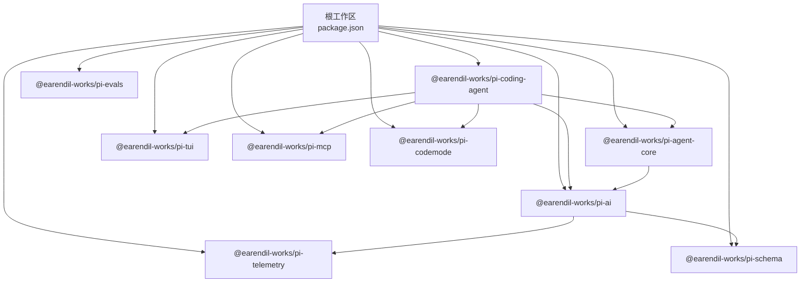

图表来源
- [package.json:1-11](file://package.json#L1-L11)
- [packages/coding-agent/package.json:43-48](file://packages/coding-agent/package.json#L43-L48)
- [packages/ai/package.json:77-87](file://packages/ai/package.json#L77-L87)
- [packages/agent/package.json:25-28](file://packages/agent/package.json#L25-L28)

章节来源
- [README.md:72-86](file://README.md#L72-L86)
- [package.json:1-11](file://package.json#L1-L11)

## 核心组件
- CLI 与交互界面：`pi` 命令提供交互式 TUI、打印模式、JSON 事件流与 RPC 模式，支持管道输入、文件引用、系统提示注入、离线模式、信任控制等。
- SDK：`createAgentSession()` 创建会话，封装模型选择、工具集、设置、会话持久化、扩展绑定与事件订阅。
- Agent 运行时：基于 `@earendil-works/pi-agent-core` 的状态机，驱动消息轮次、工具调用、重试与压缩。
- 会话与上下文：基于 SessionManager 的 JSONL 会话树，支持分支、克隆、压缩与投影。
- 扩展系统：TypeScript 模块，注册工具、命令、快捷键、Provider、事件处理器、TUI 组件，支持热重载与沙箱隔离建议。
- 多 LLM 提供商：`@earendil-works/pi-ai` 统一抽象 OpenAI、Anthropic、Google、Bedrock 等，提供模型目录、OAuth 与代理支持。
- 资源加载：Skill、Prompt Template、Theme、Context File、System Prompt 由 ResourceLoader 统一发现与装配。
- **多语言支持**：完整的中文本地化，包括 README、AGENTS 规则、CONTRIBUTING 指南等核心文档的中文版本。

章节来源
- [README.zh-CN.md:15-24](file://README.zh-CN.md#L15-L24)
- [AGENTS.zh-CN.md:1-16](file://AGENTS.zh-CN.md#L1-L16)

## 架构总览
Pi 的整体流程可以概括为：CLI/SDK 接收用户输入 → 解析模式与参数 → 加载资源与扩展 → 创建 AgentSession → 进入 Agent 循环（模型请求 + 工具执行）→ 输出文本/事件 → 持久化会话。

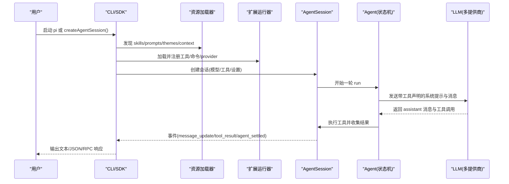

图表来源
- [packages/coding-agent/src/core/agent-session.ts:266-293](file://packages/coding-agent/src/core/agent-session.ts#L266-L293)
- [packages/coding-agent/src/core/agent-session.ts:518-542](file://packages/coding-agent/src/core/agent-session.ts#L518-L542)
- [packages/coding-agent/src/core/extensions/loader.ts:75-104](file://packages/coding-agent/src/core/extensions/loader.ts#L75-L104)
- [packages/coding-agent/src/modes/rpc/rpc-mode.ts:693-731](file://packages/coding-agent/src/modes/rpc/rpc-mode.ts#L693-L731)

## 文档架构与学习路径

### 新的解释性文档系统
项目现已建立完整的 `docs/explains/` 文档体系，提供深入的技术分析和学习路径。这个系统不是设计提案，而是对系统的深入理解和记录。

**核心特点：**
- **渐进式学习**：从系统总览开始，逐步深入到具体实现细节
- **可验证性**：每个概念都有对应的验证脚本和实际案例
- **问题驱动**：按常见问题组织内容，便于查找和理解
- **完整调用链**：追踪从 CLI 到 provider 的完整执行路径

### 推荐学习路径

#### 入门路径（新用户）
1. **系统总览** (`17-system-overview.md`) - 一句话理解 Pi 的分层架构
2. **仓库地图** (`01-repo-map.md`) - 了解包依赖和规模
3. **启动与会话** (`08-boot-and-session.md`) - 理解从 CLI 到第一次请求的完整流程

#### 深度理解路径（开发者）
1. **关键路径** (`03-critical-path.md`) - Agent loop 与工具执行的完整调用链
2. **会话转录** (`04-session-transcript.md`) - JSONL 会话格式、树结构、投影、压缩语义
3. **Provider 流** (`05-provider-stream.md`) - Context/TranscriptContext、prompt 增量流、缓存
4. **扩展加载** (`06-extension-loading.md`) - 扩展发现、加载、Handler 顺序、API 能力面

#### 专题研究路径（专家）
- **系统提示** (`09-system-prompt.md`) - 分节 prompt、AGENTS.md、skills、prompt templates
- **压缩机制** (`10-compaction.md`) - 触发条件、切点、摘要、溢出恢复、分支摘要
- **模型运行时** (`11-model-runtime.md`) - provider 组合、auth.json、虚拟模型、模型解析
- **工具系统** (`12-tools.md`) - read/write/edit/bash/grep/find/ls、路径、截断、输出累积

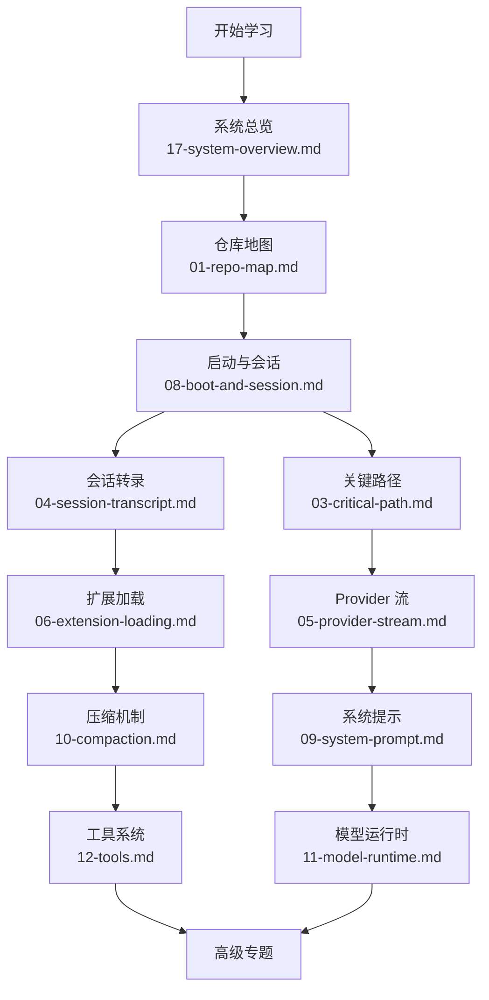

图表来源
- [docs/explains/README.md:8-39](file://docs/explains/README.md#L8-L39)
- [docs/explains/17-system-overview.md:1-12](file://docs/explains/17-system-overview.md#L1-L12)

**章节来源**
- [docs/explains/README.md:1-90](file://docs/explains/README.md#L1-L90)
- [docs/explains/17-system-overview.md:1-217](file://docs/explains/17-system-overview.md#L1-L217)
- [docs/explains/01-repo-map.md:1-96](file://docs/explains/01-repo-map.md#L1-L96)

## 中文本地化支持

### 完整的中文文档生态
项目提供了全面的中文本地化支持，确保中文用户能够获得与英文用户相同的使用体验和学习资源。

**支持的中文内容：**
- **README.zh-CN.md** - 完整的中文项目介绍和使用指南
- **AGENTS.zh-CN.md** - 中文开发规则和最佳实践
- **CONTRIBUTING.zh-CN.md** - 中文贡献指南
- **交互式界面** - TUI 界面的中文支持
- **错误消息** - 所有用户可见的错误信息中文翻译

### 本地化架构
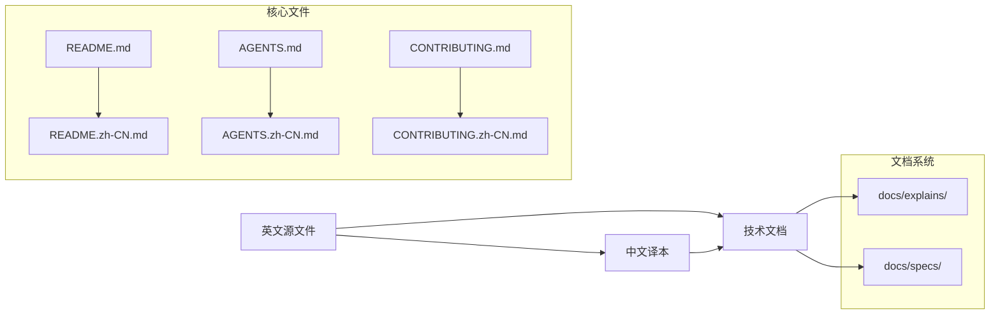

**章节来源**
- [README.zh-CN.md:1-215](file://README.zh-CN.md#L1-L215)
- [AGENTS.zh-CN.md:1-131](file://AGENTS.zh-CN.md#L1-L131)

## 详细组件分析

### CLI 与模式
CLI 是 Pi 的主要入口，支持：
- 交互式 TUI：默认模式，适合人类操作。
- 打印模式：一次性 prompt 后输出最终结果。
- JSON 模式：将 agent 事件写入 JSONL，便于自动化消费。
- RPC 模式：stdin/stdout 上的 JSONL 命令通道，适合进程间集成。

常用行为包括：
- 直接传入消息、`@path` 引用文件或图片、管道 stdin 内容。
- `--system-prompt`、`--append-system-prompt` 注入系统提示。
- `--tui-mode`、`--verbose`、`--offline`、`--approve/--no-approve` 控制交互与安全。
- 包管理命令：`install/remove/uninstall/list/config`。

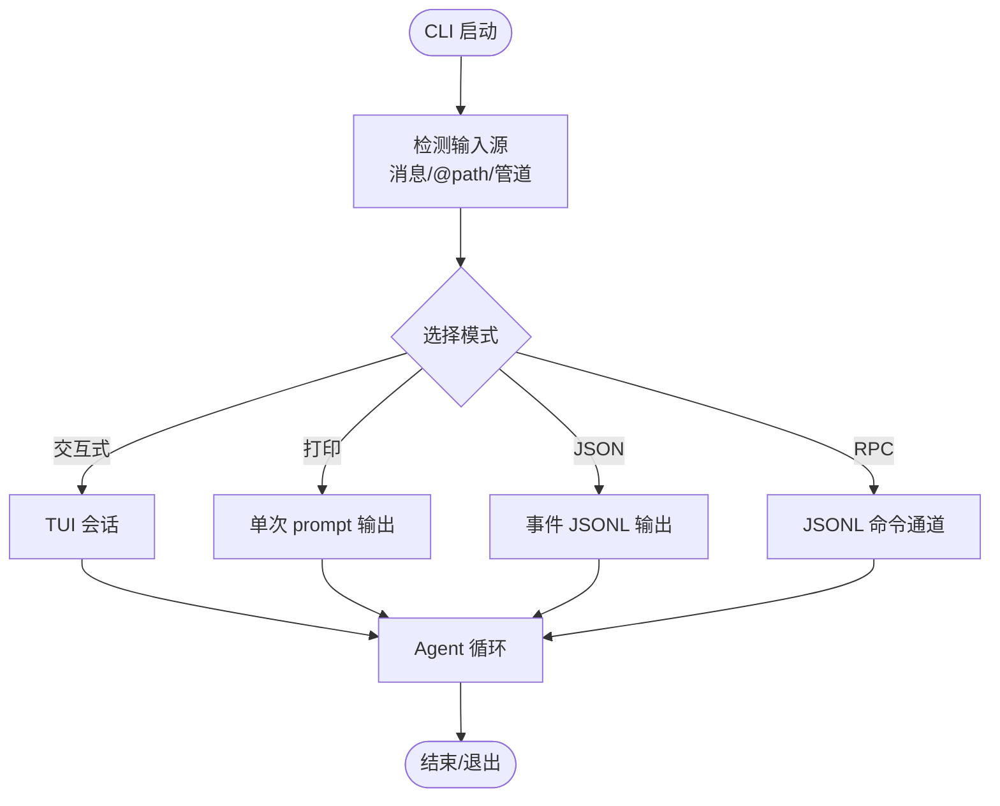

图表来源
- [packages/coding-agent/docs/cli.md:23-39](file://packages/coding-agent/docs/cli.md#L23-L39)
- [packages/coding-agent/docs/cli.md:231-249](file://packages/coding-agent/docs/cli.md#L231-L249)
- [packages/coding-agent/docs/cli.md:252-269](file://packages/coding-agent/docs/cli.md#L252-L269)

### SDK 接口与会话生命周期
SDK 暴露 `createAgentSession()`，用于在 Node.js/Bun 中嵌入 Pi。典型用法：
- 创建会话、订阅事件、发送 prompt、读取最后助手文本、释放会话。
- 通过 `SessionManager.inMemory()` 切换内存会话。
- 通过 `session.subscribe` 获取 `message_update`、`agent_end`、`agent_settled` 等事件。
- 通过 `session.prompt`、`steer`、`followUp`、`abort`、`waitForIdle` 控制对话流。
- 通过工厂选项配置 `modelRuntime`、`settingsManager`、`sessionManager`、`resourceLoader`、工具集等。

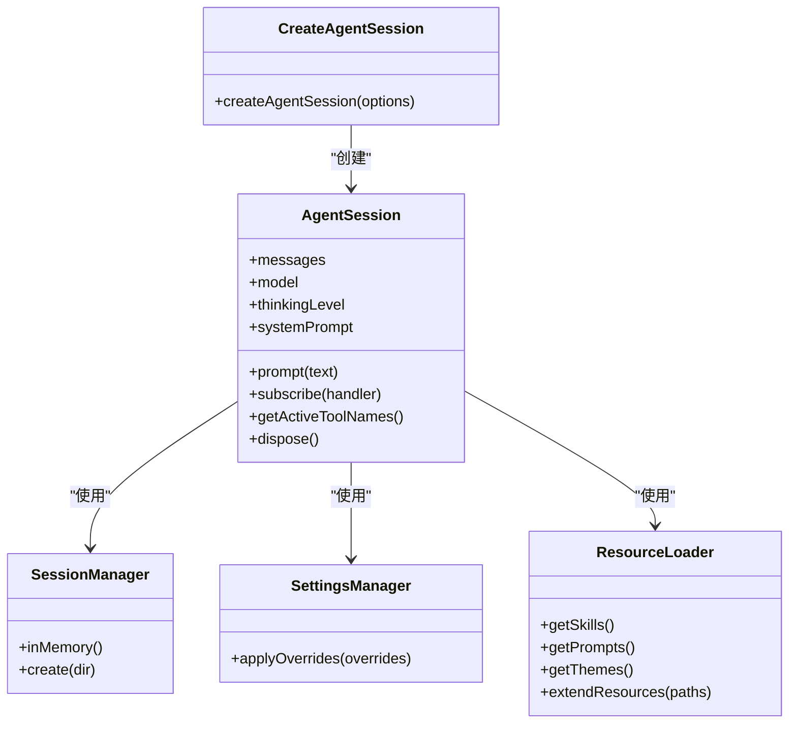

图表来源
- [packages/coding-agent/docs/sdk.md:1-22](file://packages/coding-agent/docs/sdk.md#L1-L22)
- [packages/coding-agent/docs/sdk.md:24-58](file://packages/coding-agent/docs/sdk.md#L24-L58)
- [packages/coding-agent/docs/sdk.md:62-118](file://packages/coding-agent/docs/sdk.md#L62-L118)

### 扩展系统与资源装配
扩展是 TypeScript 模块，可在 Pi 进程中注册：
- 自定义工具（供 LLM 调用）。
- 事件拦截（tool_call、before_agent_start、turn_end 等）。
- 用户交互（select/confirm/input/notify/custom）。
- 自定义命令、快捷键、Flag。
- Provider 与 MCP 服务器注册。
- 主题、技能、提示模板、上下文文件。

扩展通过 `DefaultResourceLoader` 与 `ExtensionRunner` 装配，并在 session 生命周期事件中协调。

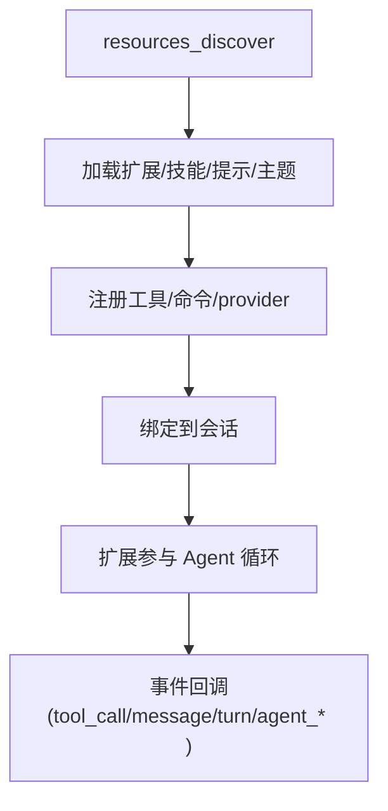

图表来源
- [packages/coding-agent/docs/extensions.md:1-32](file://packages/coding-agent/docs/extensions.md#L1-L32)
- [packages/coding-agent/docs/extensions.md:305-408](file://packages/coding-agent/docs/extensions.md#L305-L408)
- [packages/coding-agent/src/core/extensions/loader.ts:75-104](file://packages/coding-agent/src/core/extensions/loader.ts#L75-L104)
- [packages/coding-agent/src/core/resource-loader.ts:477-514](file://packages/coding-agent/src/core/resource-loader.ts#L477-L514)

### 多 LLM 提供商支持与模型目录
`@earendil-works/pi-ai` 提供统一的 LLM API，内置对 OpenAI、Anthropic、Google、Bedrock 等的支持，并提供：
- 自动模型发现与模型目录生成。
- OAuth 与凭据管理。
- 代理与网络配置。
- 遥测与类型安全的数据结构。

构建时可通过脚本生成模型数据与目录，离线构建也支持预置模型数据。

**章节来源**
- [packages/ai/package.json:1-12](file://packages/ai/package.json#L1-L12)
- [packages/ai/package.json:66-75](file://packages/ai/package.json#L66-L75)
- [packages/ai/package.json:77-87](file://packages/ai/package.json#L77-L87)

### Agent 状态与工具集
Agent 状态包含当前模型、思考级别、工具列表、消息历史、流式消息、待执行工具调用与错误信息。工具集由 SDK/CLI 根据默认策略与设置装配，支持允许/排除名单、基础工具覆盖、动态激活等。

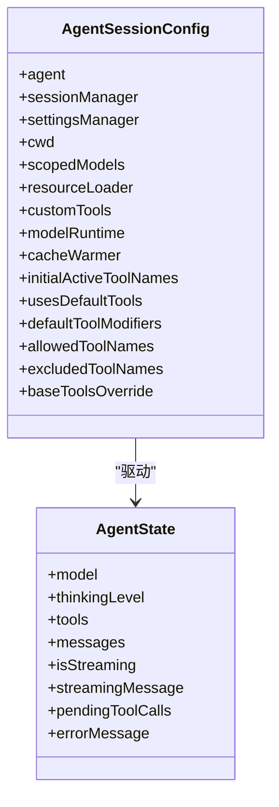

图表来源
- [packages/agent/README.md:285-317](file://packages/agent/README.md#L285-L317)
- [packages/coding-agent/src/core/agent-session.ts:266-293](file://packages/coding-agent/src/core/agent-session.ts#L266-L293)
- [packages/coding-agent/src/core/agent-session.ts:518-542](file://packages/coding-agent/src/core/agent-session.ts#L518-L542)

### 系统提示与技能装配
系统提示由 `buildSystemPrompt` 组装，包含：
- 自定义前缀或强制完整提示。
- 已选工具及其规则与片段。
- 附加提示文本。
- XML 包裹的 sections。
- 工作目录、上下文文件与技能列表。

技能通过 `formatSkillsForPrompt` 格式化，遵循 Agent Skills 标准，支持禁用模型调用的技能仅通过显式命令触发。

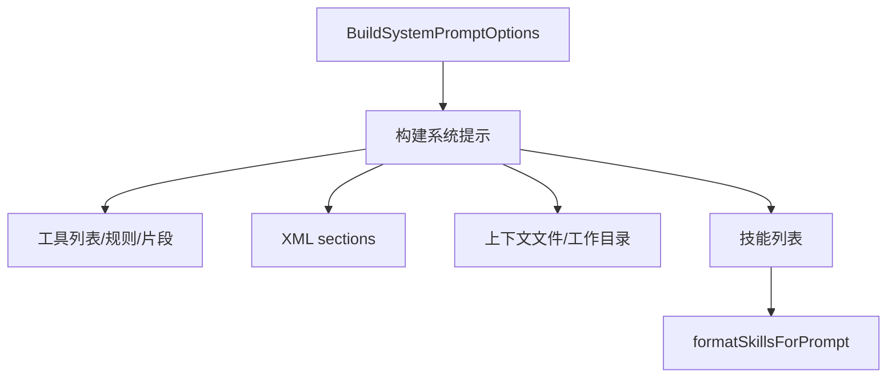

图表来源
- [packages/coding-agent/src/core/system-prompt.ts:1-37](file://packages/coding-agent/src/core/system-prompt.ts#L1-L37)
- [packages/coding-agent/src/core/skills.ts:347-375](file://packages/coding-agent/src/core/skills.ts#L347-L375)

### RPC 模式与外部集成
RPC 模式通过 JSONL 命令通道暴露会话能力，例如获取消息、列出命令（扩展命令、提示模板、技能）等。适合语言无关或隔离子进程集成。

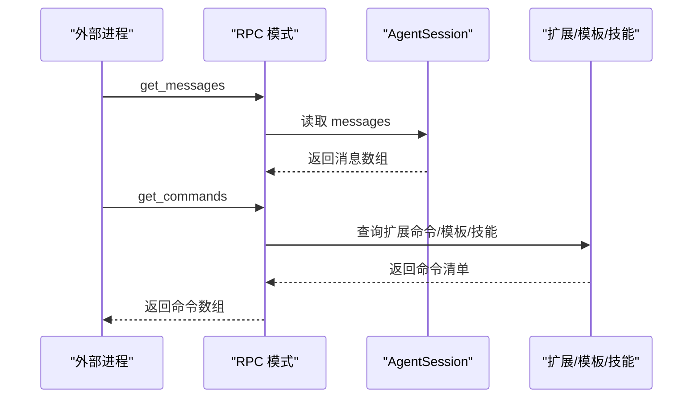

图表来源
- [packages/coding-agent/src/modes/rpc/rpc-mode.ts:693-731](file://packages/coding-agent/src/modes/rpc/rpc-mode.ts#L693-L731)

## 依赖关系分析
- 顶层工作区通过 `workspaces` 聚合所有包，并提供统一的 build/check/test/publish 脚本。
- `pi-coding-agent` 依赖 `pi-agent-core`、`pi-ai`、`pi-codemode`、`pi-mcp`、`pi-tui`。
- `pi-ai` 依赖多个 LLM SDK（OpenAI、Anthropic、Google、Bedrock）与代理库，同时依赖 `pi-schema` 与 `pi-telemetry`。
- `pi-agent-core` 依赖 `pi-ai` 与 `pi-schema`。

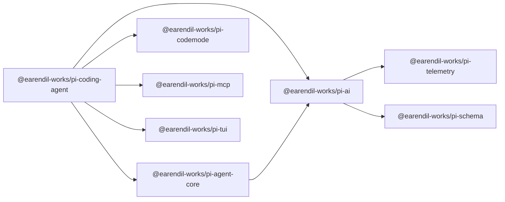

图表来源
- [packages/coding-agent/package.json:43-48](file://packages/coding-agent/package.json#L43-L48)
- [packages/ai/package.json:77-87](file://packages/ai/package.json#L77-L87)
- [packages/agent/package.json:25-28](file://packages/agent/package.json#L25-L28)

## 性能与可靠性考虑
- 会话压缩与上下文投影：SessionManager 负责压缩与投影，避免上下文过大导致请求失败或成本上升。
- 缓存预热：可选 CacheWarmer 保持最近一次会话请求的提示缓存命中。
- 工具并行执行：扩展文档说明并行工具模式下工具执行更新与结果顺序，有助于优化长耗时工具。
- 重试与恢复：Agent 层支持自动重试与最终尝试恢复，提高稳定性。
- 离线构建与模型目录：Nix 与离线构建支持预置模型数据，减少网络依赖与启动时间。

## 故障排查指南
- 权限与沙箱：Pi 默认以启动用户的权限运行，如需更强隔离，建议使用容器或沙箱（Gondolin、Docker、OpenShell）。
- 扩展安全：扩展在 Pi 进程内运行，拥有操作系统权限，应只加载可信来源。
- 信任决策：项目信任决定影响本地配置与资源加载，可通过 `project_trust` 事件或 CLI 参数控制。
- 日志与诊断：启用 `--verbose`，查看扩展/命令/技能/提示模板注册情况，检查 RPC 命令是否可用。
- 凭据与 OAuth：通过 `pi auth` 管理提供商凭据，确认 OAuth 流程与浏览器登录是否正常。

**章节来源**
- [README.md:88-96](file://README.md#L88-L96)
- [packages/coding-agent/docs/extensions.md:121-153](file://packages/coding-agent/docs/extensions.md#L121-L153)
- [packages/coding-agent/docs/extensions.md:427-445](file://packages/coding-agent/docs/extensions.md#L427-L445)
- [packages/coding-agent/docs/cli.md:231-249](file://packages/coding-agent/docs/cli.md#L231-L249)

## 结论
Pi 通过"最小默认 + 强扩展"的设计，既能让新手快速上手，又能为高级用户提供细粒度的运行时控制。其 CLI、SDK、RPC、TUI、会话管理、工具调用、多 LLM 提供商与扩展系统共同构成一个灵活且可组合的 AI Agent 平台。

**更新** 随着新的文档架构和中文本地化支持的加入，Pi 现在为不同层次的用户提供了更好的学习和使用体验。无论是初学者还是经验丰富的开发者，都能通过精心组织的解释性文档找到所需的信息。推荐在生产环境中结合容器化与权限控制，按需启用扩展与工具，并通过 SDK 或 RPC 进行系统集成。

## 附录：安装、快速开始与使用示例

### 安装
- 使用官方安装脚本（macOS/Linux）：
  - `curl -fsSL https://pi.dev/install.sh | sh`
- Windows PowerShell：
  - `powershell -c "irm https://pi.dev/install.ps1 | iex"`
- 通过 npm 全局安装：
  - `npm install -g --ignore-scripts @earendil-works/pi-coding-agent`
- Nix 运行稳定版：
  - `nix run github:earendil-works/pi/stable`

**章节来源**
- [README.md:23-54](file://README.md#L23-L54)
- [README.md:56-70](file://README.md#L56-L70)

### 快速开始
- 进入目标项目目录并启动：
  - `cd /path/to/project && pi`
- 内置提供商：在 Pi 内运行 `/login` 连接订阅或 API Key，然后给出任务。
- 非交互模式：
  - `pi --print "Summarize this repository"`
  - `git diff | pi --print "Review this change"`
  - `pi --mode json "Inspect this repository" > events.jsonl`

**章节来源**
- [README.md:45-54](file://README.md#L45-L54)
- [packages/coding-agent/docs/cli.md:23-32](file://packages/coding-agent/docs/cli.md#L23-L32)

### 基本使用示例
- SDK 最小示例：
  - 导入 `createAgentSession`，创建会话，发送 prompt，读取最后助手文本，释放会话。
- 自定义模型与思考级别：
  - 通过 SDK 工厂选项指定 model/thinkingLevel/scopedModels。
- 自定义系统提示：
  - 使用 `--system-prompt` 或 `--append-system-prompt`，或在 SDK 中注入 systemPrompt。
- 技能与提示模板：
  - 通过 ResourceLoader 添加 skillPaths/promptPaths，或使用 CLI 配置。
- 工具与工作目录：
  - 通过 SDK 工厂选项设置 tools/noTools/excludeTools/customTools 与 cwd。
- 扩展与 MCP：
  - 在 SDK 中添加 codemode/tool_search/MCP 扩展，并通过 `session.bindExtensions()` 连接 MCP 服务器。

**章节来源**
- [packages/coding-agent/docs/sdk.md:1-22](file://packages/coding-agent/docs/sdk.md#L1-L22)
- [packages/coding-agent/docs/sdk.md:96-118](file://packages/coding-agent/docs/sdk.md#L96-L118)
- [packages/coding-agent/docs/cli.md:231-249](file://packages/coding-agent/docs/cli.md#L231-L249)