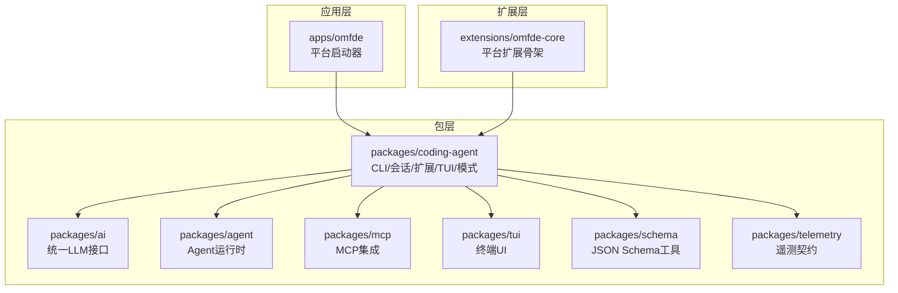
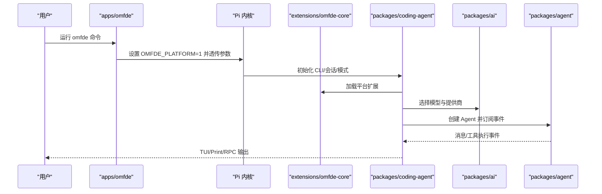
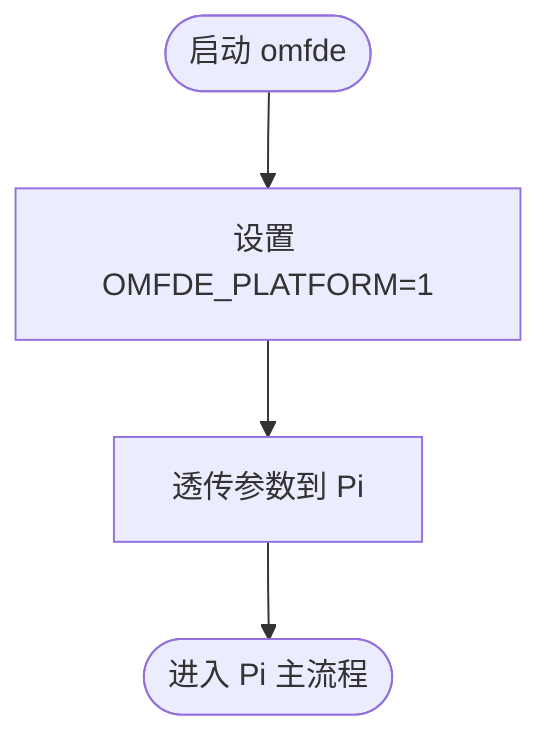
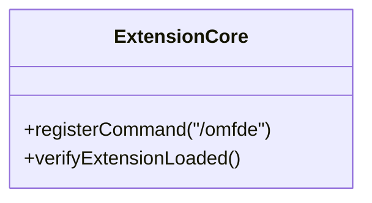
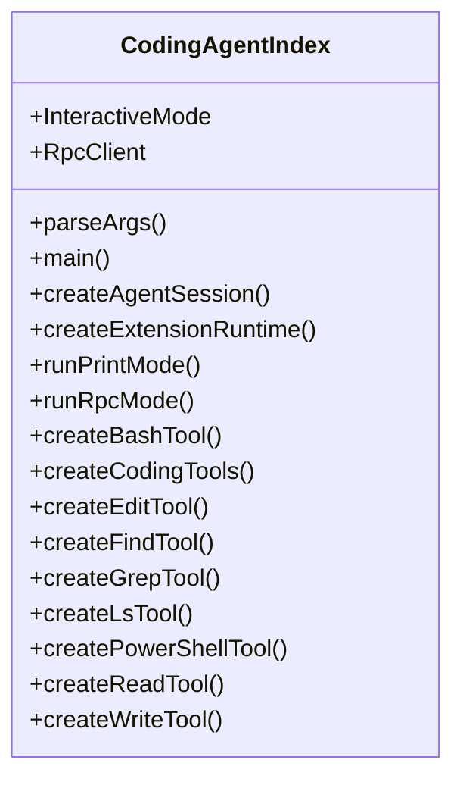
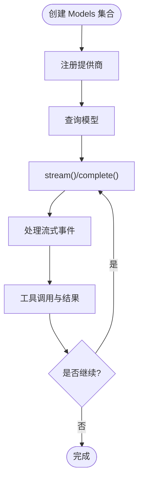
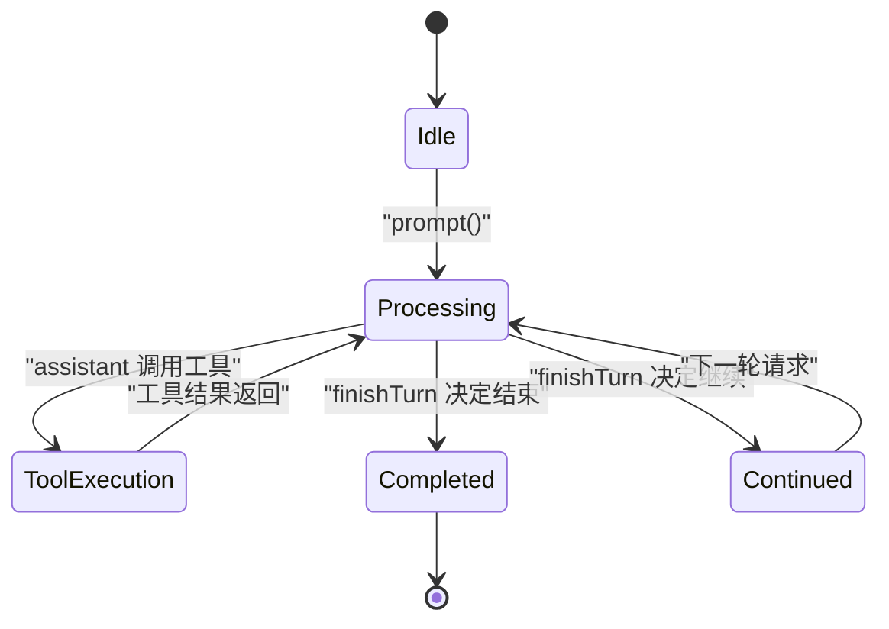
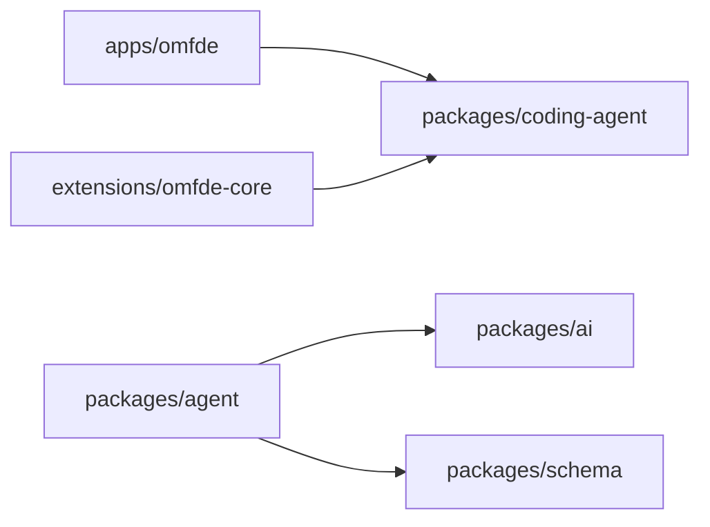

# 项目概述

<cite>
**本文引用的文件**
- [README.md](file://README.md)
- [apps/omfde/README.md](file://apps/omfde/README.md)
- [extensions/omfde-core/README.md](file://extensions/omfde-core/README.md)
- [packages/coding-agent/src/index.ts](file://packages/coding-agent/src/index.ts)
- [packages/ai/README.md](file://packages/ai/README.md)
- [packages/agent/README.md](file://packages/agent/README.md)
- [pnpm-lock.yaml](file://pnpm-lock.yaml)
- [tsconfig.json](file://tsconfig.json)
</cite>

## 目录
1. [引言](#引言)
2. [项目结构](#项目结构)
3. [核心组件](#核心组件)
4. [架构总览](#架构总览)
5. [详细组件分析](#详细组件分析)
6. [依赖关系分析](#依赖关系分析)
7. [性能与可扩展性](#性能与可扩展性)
8. [故障排查指南](#故障排查指南)
9. [结论](#结论)
10. [附录：快速开始与基本用法](#附录快速开始与基本用法)

## 引言
OMFDE（Pi AI 代理框架）是一个最小化、可扩展的 AI 代理运行时。它围绕“让工具适应你的工作流，而不是让你去适应工具”的理念构建，提供统一的 LLM 接口抽象、强大的工具生态系统和扩展机制，并支持多种交互模式：交互式 TUI、打印模式和 RPC 模式。

在 OMFDE 中：
- `apps/omfde` 是平台可运行入口，负责设置平台环境变量并将参数透传给 Pi 内核。
- `extensions/omfde-core` 是平台基础扩展骨架，用于注册命令和扩展能力，而不直接修改 Pi 内核。
- `packages/coding-agent` 暴露完整的 CLI、会话管理、扩展系统、工具集、TUI 以及三种运行模式。
- `packages/ai` 提供统一的多提供商 LLM 抽象，屏蔽底层 API 差异。
- `packages/agent` 提供带工具执行与会话状态管理的 Agent 运行时。

该文档既为初学者提供概念性概览，也为有经验的开发者提供代码级定位与依赖说明。

## 项目结构
仓库采用 monorepo 组织方式，核心由应用层、扩展层与包层组成：
- `apps/omfde`：平台启动器，不绑定 Pi 核心代码，优先通过扩展、配置和公开 API 组合能力。
- `extensions/omfde-core`：平台扩展骨架，示例注册 `/omfde` 命令以确认扩展加载。
- `packages`：公共库集合，包括编码代理、LLM 抽象、Agent 运行时、TUI、MCP、Schema、Telemetry 等。
- `scripts`：构建、发布、校验与本地开发脚本。
- `docs`：设计说明、规范与解释文档。



**图表来源**
- [apps/omfde/README.md:1-14](file://apps/omfde/README.md#L1-L14)
- [extensions/omfde-core/README.md:1-12](file://extensions/omfde-core/README.md#L1-L12)
- [packages/coding-agent/src/index.ts:1-503](file://packages/coding-agent/src/index.ts#L1-L503)

**章节来源**
- [apps/omfde/README.md:1-14](file://apps/omfde/README.md#L1-L14)
- [extensions/omfde-core/README.md:1-12](file://extensions/omfde-core/README.md#L1-L12)
- [packages/coding-agent/src/index.ts:1-503](file://packages/coding-agent/src/index.ts#L1-L503)

## 核心组件
- **平台启动器**：解析 monorepo 中的 Pi 可执行文件，设置 `OMFDE_PLATFORM=1`，并将参数原样传递给 Pi。
- **平台扩展骨架**：注册 `/omfde` 命令，验证扩展加载；强调扩展放在 `extensions/`，避免改动 Pi 内核。
- **编码代理包**：导出 CLI、会话、扩展系统、工具、TUI、RPC/Print/Interactive 模式、主题、工具定义与渲染等。
- **统一 LLM 抽象**：多提供商模型集合、认证、工具调用、流式事件、成本统计、跨模型上下文传递。
- **Agent 运行时**：带工具执行、事件流、会话状态、并行/顺序工具执行、钩子与请求准备。

这些组件共同构成 OMFDE 的最小化但可扩展的代理运行时。

**章节来源**
- [apps/omfde/README.md:1-14](file://apps/omfde/README.md#L1-L14)
- [extensions/omfde-core/README.md:1-12](file://extensions/omfde-core/README.md#L1-L12)
- [packages/coding-agent/src/index.ts:1-503](file://packages/coding-agent/src/index.ts#L1-L503)
- [packages/ai/README.md:1-800](file://packages/ai/README.md#L1-L800)
- [packages/agent/README.md:1-572](file://packages/agent/README.md#L1-L572)

## 架构总览
OMFDE 的架构围绕“平台入口 → 扩展 → 编码代理 → LLM 抽象 → 工具与 UI”的分层展开：



**图表来源**
- [apps/omfde/README.md:1-14](file://apps/omfde/README.md#L1-L14)
- [extensions/omfde-core/README.md:1-12](file://extensions/omfde-core/README.md#L1-L12)
- [packages/coding-agent/src/index.ts:420-439](file://packages/coding-agent/src/index.ts#L420-L439)
- [packages/ai/README.md:1-800](file://packages/ai/README.md#L1-L800)
- [packages/agent/README.md:1-572](file://packages/agent/README.md#L1-L572)

## 详细组件分析

### 平台启动器：apps/omfde
- 职责：作为 OMFDE 平台的可运行入口，仅做薄包装。
- 行为：解析 monorepo 中的 Pi 可执行文件，设置 `OMFDE_PLATFORM=1`，将参数原样传给 Pi。
- 扩展点：后续平台能力加在此处或拆成新的 `apps/*`，避免直接绑定 Pi 核心代码。



**图表来源**
- [apps/omfde/README.md:1-14](file://apps/omfde/README.md#L1-L14)

**章节来源**
- [apps/omfde/README.md:1-14](file://apps/omfde/README.md#L1-L14)

### 平台扩展骨架：extensions/omfde-core
- 职责：提供平台基础扩展骨架。
- 行为：注册 `/omfde` 命令，用于确认扩展已被加载。
- 约束：扩展放在 `extensions/`，不要放进 `packages/`，也不要改 Pi 内核，以便 Pi 包继续从上游 rebase。



**图表来源**
- [extensions/omfde-core/README.md:1-12](file://extensions/omfde-core/README.md#L1-L12)

**章节来源**
- [extensions/omfde-core/README.md:1-12](file://extensions/omfde-core/README.md#L1-L12)

### 编码代理包：packages/coding-agent
- 职责：提供 CLI、会话管理、扩展系统、工具、TUI、RPC/Print/Interactive 模式、主题、工具定义与渲染等。
- 关键导出：
  - 会话与事件：`AgentSession`、`AgentSessionEvent`、`createAgentSession*`。
  - 扩展系统：`createExtensionRuntime`、`discoverAndLoadExtensions`、`defineTool`。
  - 模式：`runPrintMode`、`runRpcMode`、`InteractiveMode`、`RpcClient`。
  - 工具：`createBashTool`、`createCodingTools`、`createEditTool`、`createFindTool`、`createGrepTool`、`createLsTool`、`createPowerShellTool`、`createReadTool`、`createWriteTool`。
  - TUI 组件：消息、工具执行、模型选择、会话选择、设置、技能、主题等组件。



**图表来源**
- [packages/coding-agent/src/index.ts:1-503](file://packages/coding-agent/src/index.ts#L1-L503)

**章节来源**
- [packages/coding-agent/src/index.ts:1-503](file://packages/coding-agent/src/index.ts#L1-L503)

### 统一 LLM 抽象：packages/ai
- 职责：统一多提供商 LLM API，包含提供商集合、自动认证解析、令牌与成本追踪、简单上下文持久化与跨模型上下文传递。
- 关键能力：
  - 提供商工厂与内置提供商列表。
  - 模型查询与静态目录读取。
  - 认证解析与环境变量映射。
  - 工具定义与参数校验。
  - 流式事件与停止原因。
  - 图像输入与生成、分类、思考/推理。
  - 自定义提供商与 OAuth。



**图表来源**
- [packages/ai/README.md:1-800](file://packages/ai/README.md#L1-L800)

**章节来源**
- [packages/ai/README.md:1-800](file://packages/ai/README.md#L1-L800)

### Agent 运行时：packages/agent
- 职责：基于 `@earendil-works/pi-ai` 的状态化 Agent，具备工具执行与事件流。
- 关键概念：
  - `AgentMessage` 与 LLM Message 的桥接。
  - 消息流：`transformContext()` → `convertToLlm()` → LLM。
  - 事件序列：`agent_start` → `turn_start` → `message_*` → `tool_execution_*` → `turn_end` → `agent_end`。
  - 工具执行模式：并行与顺序。
  - 钩子：`beforeToolCall`、`afterToolCall`、`prepareRequest`、`finishTurn`。
  - 控制：`prompt()`、`continue()`、`abort()`、`waitForIdle()`。



**图表来源**
- [packages/agent/README.md:1-572](file://packages/agent/README.md#L1-L572)

**章节来源**
- [packages/agent/README.md:1-572](file://packages/agent/README.md#L1-L572)

## 依赖关系分析
- `apps/omfde` 依赖 `@earendil-works/pi-coding-agent`。
- `extensions/omfde-core` 依赖 `@earendil-works/pi-coding-agent`。
- `packages/agent` 依赖 `@earendil-works/pi-ai` 与 `@earendil-works/pi-schema`。
- TypeScript 路径映射将 `@omfde/extension-core` 指向 `extensions/omfde-core/src/index.ts`。



**图表来源**
- [pnpm-lock.yaml:39-58](file://pnpm-lock.yaml#L39-L58)
- [tsconfig.json:59-75](file://tsconfig.json#L59-L75)

**章节来源**
- [pnpm-lock.yaml:39-58](file://pnpm-lock.yaml#L39-L58)
- [tsconfig.json:59-75](file://tsconfig.json#L59-L75)

## 性能与可扩展性
- **最小化默认值**：Pi 提供强大默认值，但跳过子代理与计划模式等功能，鼓励按需扩展。
- **扩展机制**：通过扩展、技能、提示模板与主题进行定制，并可打包为 Pi 包并通过 npm 或 git 分享。
- **工具生态**：内置 Bash、编辑、查找、grep、ls、PowerShell、读、写等工具，支持流式进度与终止提示。
- **模式选择**：交互式 TUI 适合人类操作；打印/JSON 模式适合自动化；RPC 模式适合进程间控制与应用集成。
- **LLM 抽象**：统一接口屏蔽提供商差异，支持流式事件、工具调用、成本统计与跨模型上下文传递。

[本节为通用指导，无需具体文件引用]

## 故障排查指南
- **认证问题**：检查提供商环境变量或存储凭据；使用 `getAuth()` 或 `checkAuth()` 诊断认证来源。
- **工具参数错误**：使用 `validateToolCall()` 校验工具参数，捕获并返回错误消息供模型重试。
- **RPC 客户端异常**：子进程退出会拒绝进行中的请求；确保正确监听 SIGINT/SIGTERM 并清理资源。
- **MCP 服务器连接**：确认 OAuth 回调端口与 URL 一致，且服务已正确初始化。

**章节来源**
- [packages/ai/README.md:1-800](file://packages/ai/README.md#L1-L800)
- [packages/coding-agent/test/rpc-client-process-exit.test.ts:1-38](file://packages/coding-agent/test/rpc-client-process-exit.test.ts#L1-L38)
- [packages/mcp/test/client.test.ts:19-57](file://packages/mcp/test/client.test.ts#L19-L57)

## 结论
OMFDE 通过最小化的核心与强大的扩展机制，使 AI 代理能够灵活适配不同工作流。平台启动器与扩展骨架确保平台能力与 Pi 内核解耦；编码代理包提供完整的 CLI、会话、工具与多模式支持；统一 LLM 抽象屏蔽提供商差异；Agent 运行时提供状态管理与工具执行。整体架构清晰、可扩展性强，适合从个人工具到企业级应用的广泛场景。

[本节为总结性内容，无需具体文件引用]

## 附录：快速开始与基本用法

### 安装
- 使用官方安装脚本：
  ```bash
  curl -fsSL https://pi.dev/install.sh | sh
  ```
- Windows PowerShell：
  ```powershell
  powershell -c "irm https://pi.dev/install.ps1 | iex"
  ```
- 或通过 npm 全局安装：
  ```bash
  npm install -g --ignore-scripts @earendil-works/pi-coding-agent
  ```

### 启动
在项目目录下运行：
```bash
cd /path/to/project
pi
```
如需使用内置 AI 提供商，先在 Pi 内运行 `/login` 连接订阅或 API Key，然后给出任务。

### 使用 OMFDE 平台入口
```bash
pnpm run omfde
pnpm run omfde -- --continue
pnpm run omfde -- -p "只回复 OK"
```

### 编程式使用（SDK）
- 创建 Agent 会话并订阅事件。
- 使用 `createBashTool`、`createEditTool` 等工厂函数注册工具。
- 通过 `runPrintMode`、`runRpcMode` 或 `InteractiveMode` 切换交互模式。

**章节来源**
- [README.md:23-54](file://README.md#L23-L54)
- [apps/omfde/README.md:7-11](file://apps/omfde/README.md#L7-L11)
- [packages/coding-agent/src/index.ts:254-282](file://packages/coding-agent/src/index.ts#L254-L282)
- [packages/coding-agent/src/index.ts:420-439](file://packages/coding-agent/src/index.ts#L420-L439)