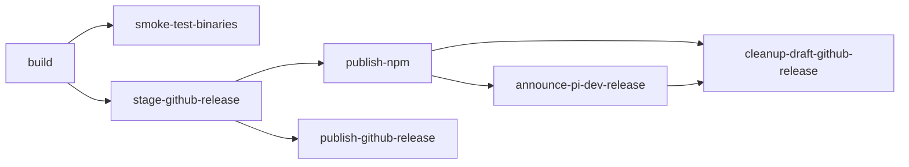

> **知识卡元数据**（Repo Wiki 自动生成，可能过时）
>
> - 类型：`build_system`
> - 适用范围：`**`
> - 覆盖源文件（15）：[`package.json`](https://github.com/FDE-GROUP/oh-my-fde/blob/main/package.json)、[`pnpm-workspace.yaml`](https://github.com/FDE-GROUP/oh-my-fde/blob/main/pnpm-workspace.yaml)、[`scripts/release.mjs`](https://github.com/FDE-GROUP/oh-my-fde/blob/main/scripts/release.mjs)、[`scripts/publish.mjs`](https://github.com/FDE-GROUP/oh-my-fde/blob/main/scripts/publish.mjs)、[`scripts/pack-packages.mjs`](https://github.com/FDE-GROUP/oh-my-fde/blob/main/scripts/pack-packages.mjs)、[`scripts/package-artifacts.mjs`](https://github.com/FDE-GROUP/oh-my-fde/blob/main/scripts/package-artifacts.mjs)、[`scripts/build-binaries.sh`](https://github.com/FDE-GROUP/oh-my-fde/blob/main/scripts/build-binaries.sh)、[`scripts/create-source-archive.sh`](https://github.com/FDE-GROUP/oh-my-fde/blob/main/scripts/create-source-archive.sh)、[`.github/workflows/build-binaries.yml`](https://github.com/FDE-GROUP/oh-my-fde/blob/main/.github/workflows/build-binaries.yml)、[`.github/workflows/ci.yml`](https://github.com/FDE-GROUP/oh-my-fde/blob/main/.github/workflows/ci.yml)、[`.github/workflows/preview-packages.yml`](https://github.com/FDE-GROUP/oh-my-fde/blob/main/.github/workflows/preview-packages.yml)、[`.github/workflows/npm-audit.yml`](https://github.com/FDE-GROUP/oh-my-fde/blob/main/.github/workflows/npm-audit.yml)、[`.husky/pre-commit`](https://github.com/FDE-GROUP/oh-my-fde/blob/main/.husky/pre-commit)、[`.husky/pre-push`](https://github.com/FDE-GROUP/oh-my-fde/blob/main/.husky/pre-push)、[`pi-test.sh`](https://github.com/FDE-GROUP/oh-my-fde/blob/main/pi-test.sh)

## 1. 使用的系统与工具

- **包管理器**：pnpm 11.15.1（`package.json#packageManager`），配合 `pnpm-workspace.yaml` 管理 monorepo。
- **语言/运行时**：Node.js ≥22.19.0（`engines.node`），TypeScript 7.0.2，ESM（`"type": "module"`）。
- **打包器**：Bun 1.4.4 用于把 `pi-coding-agent` 打包为跨平台可执行文件；esbuild 作为 devDependency 供各子包使用。
- **代码质量**：Biome 2.3.5（`biome.json`）、Husky 9.1.7（pre-commit/pre-push hooks）。
- **测试**：Vitest（`vitest.base.ts`）+ Node `--test` 运行脚本自身测试。
- **CI/CD**：GitHub Actions（`.github/workflows/*.yml`），无 Dockerfile，二进制通过源码在 CI 中交叉编译。

## 2. 关键文件

| 文件 | 作用 |
|---|---|
| `pnpm-workspace.yaml` | workspace 定义（`packages/*`, `apps/*`, `extensions/*` 及若干 examples） |
| `package.json` | 根脚本入口：`build`、`check`、`test`、`version:*`、`release:*`、`publish` |
| `scripts/release.mjs` | 版本 bump → CHANGELOG → 生成 artifacts → 检查/测试 → git tag → push |
| `scripts/publish.mjs` | 校验 lockstep 版本、预检 npm 已发布状态、带 provenance 的 npm publish |
| `scripts/pack-packages.mjs` | 本地打包所有 public package 到 `.artifacts/` |
| `scripts/package-artifacts.mjs` | 核心 artifact 生产逻辑（被 pack / publish / preview 共用） |
| `scripts/build-binaries.sh` | 从源码 tarball 构建多平台 `pi` 二进制 |
| `scripts/create-source-archive.sh` | 生成不含 node_modules 的可复现源码归档 |
| `.github/workflows/ci.yml` | 手动触发的 build + check + test + MCP conformance |
| `.github/workflows/build-binaries.yml` | 对 `v*` tag 触发：构建二进制 → smoke-test → draft release → npm publish → pi.dev 公告 → 发布 GitHub Release |
| `.github/workflows/preview-packages.yml` | PR/main 上构建预览包 |
| `.github/workflows/npm-audit.yml` | 依赖审计 |
| `.husky/pre-commit` / `pre-push` | 本地钩子 |
| `pi-test.sh` / `pi-test.bat` / `pi-test.ps1` | 跨平台测试入口 |

## 3. 架构与约定

### 3.1 Workspace 与依赖图
- 根 `package.json` 是 private 聚合包，不对外发布；真实发布的包位于 `packages/*`、`apps/*`、`extensions/*`。
- `pnpm-workspace.yaml` 显式声明 workspace 目录，并通过 `linkWorkspacePackages: true`、`preferWorkspacePackages: true` 强制本地 link。
- 根 `build` 脚本按固定顺序串行调用各包的 `pnpm --filter ... run build`：telemetry → schema → tui → codemode → mcp → ai → agent-core → coding-agent，体现依赖方向。

### 3.2 版本策略
- 所有公开 workspace 包 **lockstep 同版本发布**：`scripts/publish.mjs` 在发布前断言 `versions.length === 1`。
- 版本变更统一走 `npm run version:patch|minor:major` 或 `node scripts/release.mjs <major|minor|patch|x.y.z>`，后者会调用 `sync-versions.js` 同步 inter-package ranges。
- `scripts/release.mjs` 要求工作区干净（`git status --porcelain` 为空），并先通过 `npm view <pkg>` 校验每个 public package 已在 npm 注册。

### 3.3 构建产物
- 源码归档：`scripts/create-source-archive.sh` 产出 `pi-<version>-source.tar.gz`，CI 用它在隔离目录中重建二进制，保证可复现。
- 二进制产物（由 `scripts/build-binaries.sh` 产出）：
  - `pi-darwin-arm64.tar.gz`
  - `pi-darwin-x64.tar.gz`
  - `pi-linux-x64.tar.gz`
  - `pi-linux-arm64.tar.gz`
  - `pi-windows-x64.zip`
  - `pi-windows-arm64.zip`
- 安装锁：`packages/coding-agent/install-lock/package.json` + `package-lock.json` 随 release 一起发布，供外部安装器使用。
- npm tarballs：`scripts/pack-packages.mjs` 调用 `produceArtifactSet` 生成 `.artifacts/`，`scripts/publish.mjs` 基于该 manifest 逐个 `npm publish --provenance`。

### 3.4 CI 流水线（`.github/workflows/build-binaries.yml`）
触发条件：push `v*` tag 或 `workflow_dispatch` 指定 tag。

- `build`：checkout → setup Bun 1.4.4 + Node 22 → hydrate model data → create source archive → 解压到临时目录 → 执行 `scripts/build-binaries.sh --offline-model-data`。
- `smoke-test-binaries`：在 ubuntu/macos/windows 三套 runner 上下载对应平台二进制，跑 `--help`、`--version`、`smoke-test-codemode-binary.mjs`。
- `stage-github-release`：生成 `RELEASE_NOTES.md` + `SHA256SUMS`，创建 **draft** GitHub Release，拒绝覆盖已发布的 release。
- `publish-npm`：下载 `pi-env-*` 预编译 daemon，`npm ci` → `npm run build` → `npm run check` → `npm test` → `check:package-install` → `publish.mjs --dry-run` → `publish.mjs`（trusted publishing via OIDC）。
- `announce-pi-dev-release`：通过 AWS CLI 向 Cloudflare R2 上传发布公告。
- `publish-github-release`：将 draft release 改为 published。
- `cleanup-draft-github-release`：任一上游失败时删除 draft release。

### 3.5 本地开发流程
- `pnpm install`（由 pnpm-workspace 自动处理）。
- `pnpm build` / `pnpm check` / `pnpm test`。
- `pnpm release:local` 走本地 release 流程（跳过远端推送）。
- Husky pre-commit / pre-push 钩子在提交前运行 Biome 检查。

## 4. 约定与约束

- **Node 版本**：`package.json#engines.node >= 22.19.0`，CI 固定使用 Node 22。
- **包管理器锁定**：`package.json#packageManager = "pnpm@11.15.1"`，CI 通过 `npm ci --ignore-scripts` 安装（根脚本实际仍用 npm 调用 pnpm workspace）。
- **workspace 包必须 dist**：`scripts/publish.mjs` 在发布前检查每个包的 `dist/` 是否存在，否则报错。
- **lockstep 版本**：`scripts/publish.mjs` 断言所有 public packages 版本一致，否则抛出错误。
- **Release 前置条件**：`scripts/release.mjs` 要求工作区无未提交更改，且所有 public workspace package 已在 npm 注册（`npm view` 非 404）。
- **二进制产物清单**：`.github/workflows/build-binaries.yml` 硬编码了 6 个二进制文件名，并在 upload 前逐一 `test -f` 校验存在。
- **Source archive 可复现**：CI 不直接在 checkout 目录构建，而是解压 `pi-${VERSION}-source.tar.gz` 到临时目录后执行 `scripts/build-binaries.sh`。
- **Draft Release 保护**：`stage-github-release` 拒绝修改已发布的 release；`publish-github-release` 仅在 draft 存在且未发布时操作；`cleanup-draft-github-release` 在所有下游失败时清理 draft。
- **Provenance 发布**：`scripts/publish.mjs` 使用 `npm publish --provenance --ignore-scripts`，CI 提前升级到 `npm@11.16.0` 以支持 trusted publishing。
- **模型数据**：发布前需 `npm run generate:models` + `npm run check:model-data`，CI 额外执行 `hydrate:model-data`。
- **MCP Conformance**：`ci.yml` 单独 job 运行 `npm run test:mcp-conformance`，对比 `packages/coding-agent/test/mcp-conformance/baseline.json`。
- **Preview Packages**：PR 与 main push 上通过 `scripts/preview-packages.mjs` 打包并以 SHA 命名的 tarball 上传为 CI artifact，保留 3 天。
