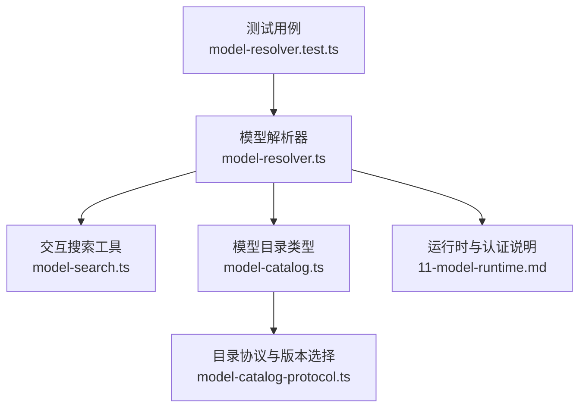
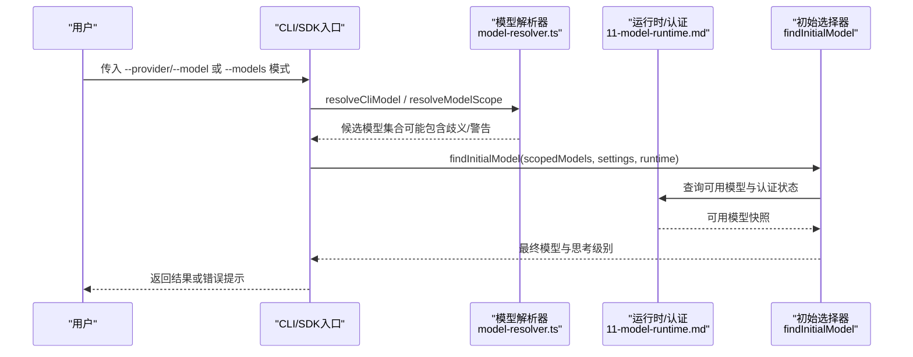
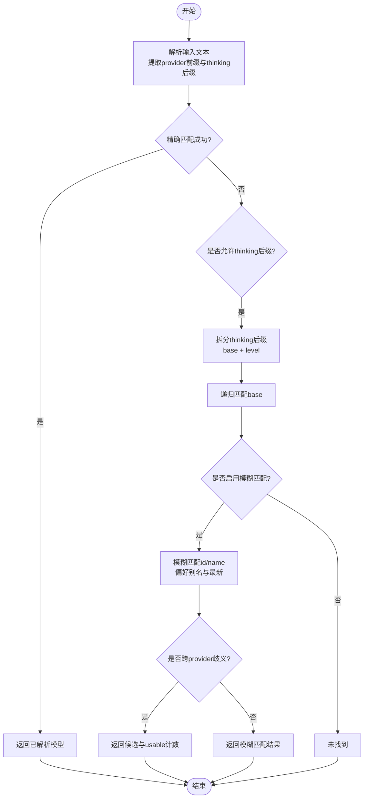
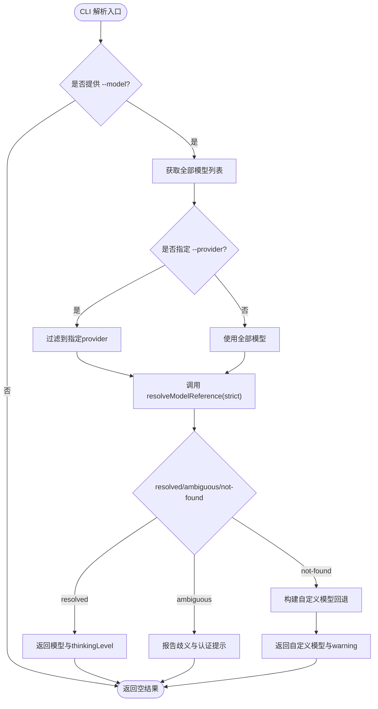
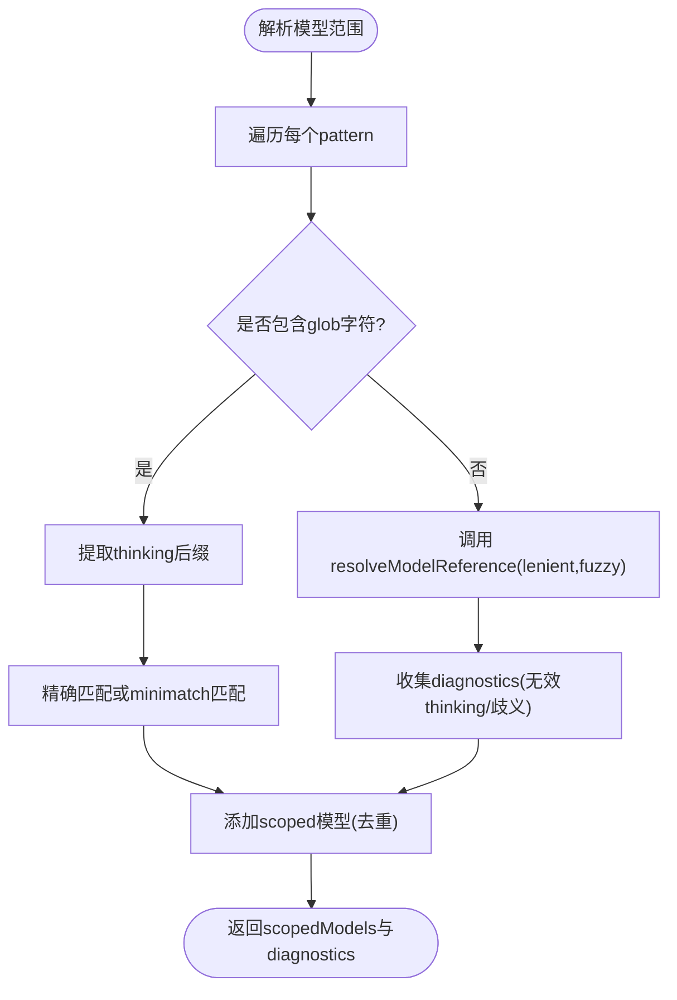
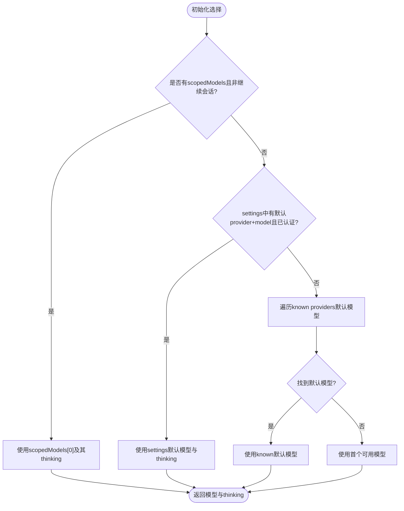
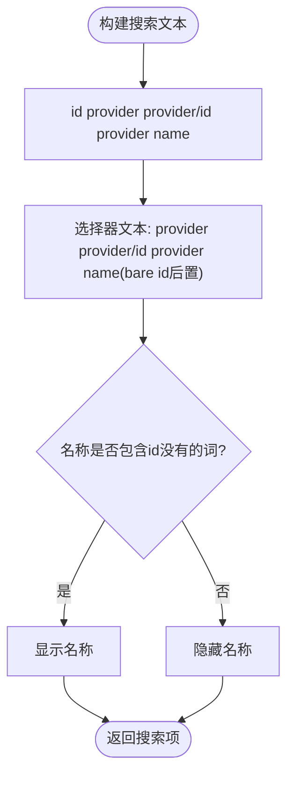
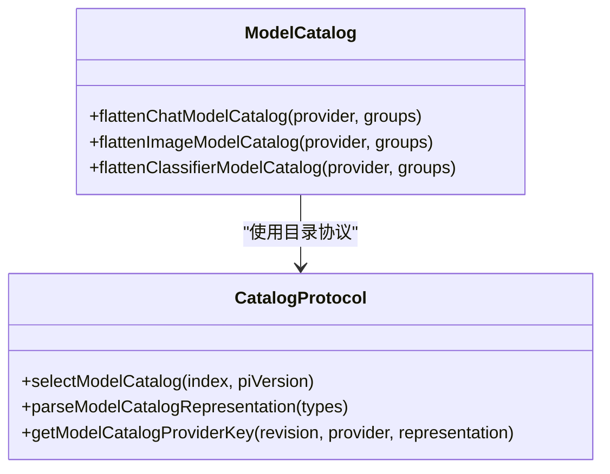
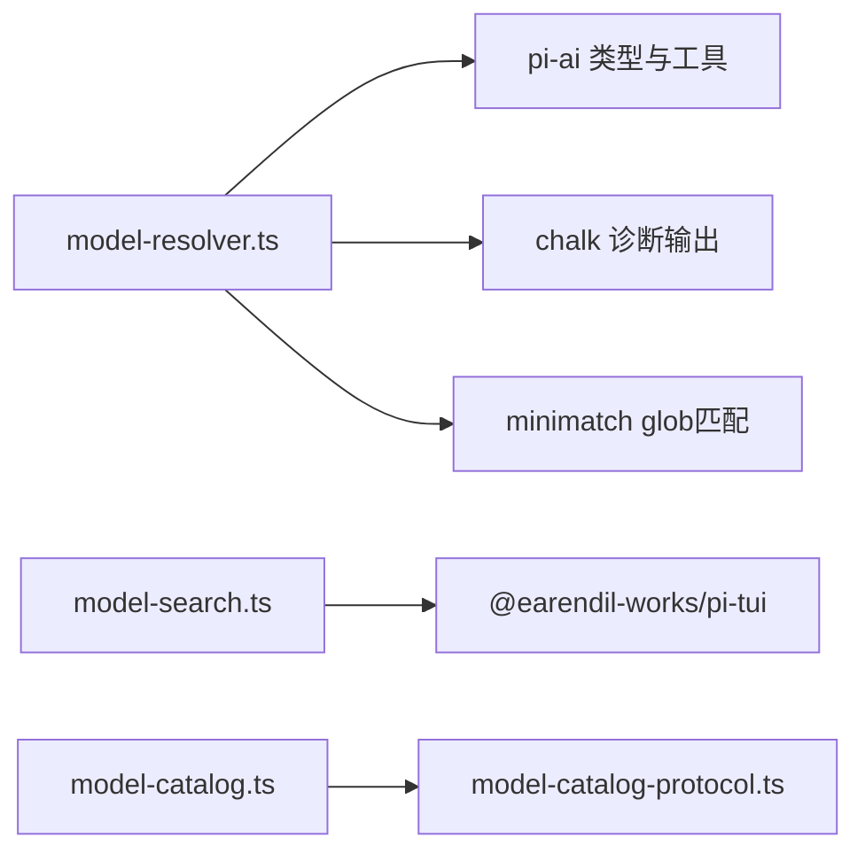

# 模型选择策略

**本文引用的文件**
- [packages/coding-agent/src/core/model-resolver.ts](https://github.com/FDE-GROUP/oh-my-fde/blob/main/packages/coding-agent/src/core/model-resolver.ts)
- [packages/coding-agent/test/model-resolver.test.ts](https://github.com/FDE-GROUP/oh-my-fde/blob/main/packages/coding-agent/test/model-resolver.test.ts)
- [packages/coding-agent/src/modes/interactive/model-search.ts](https://github.com/FDE-GROUP/oh-my-fde/blob/main/packages/coding-agent/src/modes/interactive/model-search.ts)
- [packages/ai/src/model-catalog.ts](https://github.com/FDE-GROUP/oh-my-fde/blob/main/packages/ai/src/model-catalog.ts)
- [scripts/model-catalog-protocol.ts](https://github.com/FDE-GROUP/oh-my-fde/blob/main/scripts/model-catalog-protocol.ts)
- [docs/explains/11-model-runtime.md](https://github.com/FDE-GROUP/oh-my-fde/blob/main/docs/explains/11-model-runtime.md)

## 目录
1. [引言](#引言)
2. [项目结构](#项目结构)
3. [核心组件](#核心组件)
4. [架构总览](#架构总览)
5. [详细组件分析](#详细组件分析)
6. [依赖关系分析](#依赖关系分析)
7. [性能与优化](#性能与优化)
8. [故障排查指南](#故障排查指南)
9. [结论](#结论)
10. [附录：配置与使用案例](#附录配置与使用案例)

## 引言
本文件系统性说明“模型选择策略”的设计与实现，覆盖模型解析器的工作原理、匹配算法、优先级规则、性能优化策略，以及如何根据任务类型、输入格式、成本等因素自动选择合适的模型。文档同时给出模型配置选项、自定义选择逻辑、性能调优指南和实际使用案例，帮助开发者与使用者在复杂多提供商环境中稳定、可预期地选择模型。

## 项目结构
围绕模型选择的代码主要分布在以下位置：
- 模型解析与初始选择：`packages/coding-agent/src/core/model-resolver.ts`
- 交互式模型搜索与展示文本生成：`packages/coding-agent/src/modes/interactive/model-search.ts`
- 模型目录类型与扁平化：`packages/ai/src/model-catalog.ts`
- 模型目录协议与版本选择：`scripts/model-catalog-protocol.ts`
- 运行时与认证、快照机制说明：`docs/explains/11-model-runtime.md`
- 行为验证用例：`packages/coding-agent/test/model-resolver.test.ts`

**图示来源**
- [packages/coding-agent/src/core/model-resolver.ts:1-691](https://github.com/FDE-GROUP/oh-my-fde/blob/main/packages/coding-agent/src/core/model-resolver.ts#L1-L691)
- [packages/coding-agent/src/modes/interactive/model-search.ts:1-45](https://github.com/FDE-GROUP/oh-my-fde/blob/main/packages/coding-agent/src/modes/interactive/model-search.ts#L1-L45)
- [packages/ai/src/model-catalog.ts:1-82](https://github.com/FDE-GROUP/oh-my-fde/blob/main/packages/ai/src/model-catalog.ts#L1-L82)
- [scripts/model-catalog-protocol.ts:62-157](https://github.com/FDE-GROUP/oh-my-fde/blob/main/scripts/model-catalog-protocol.ts#L62-L157)
- [docs/explains/11-model-runtime.md:1-303](https://github.com/FDE-GROUP/oh-my-fde/blob/main/docs/explains/11-model-runtime.md#L1-L303)

**章节来源**
- [packages/coding-agent/src/core/model-resolver.ts:1-691](https://github.com/FDE-GROUP/oh-my-fde/blob/main/packages/coding-agent/src/core/model-resolver.ts#L1-L691)
- [packages/coding-agent/src/modes/interactive/model-search.ts:1-45](https://github.com/FDE-GROUP/oh-my-fde/blob/main/packages/coding-agent/src/modes/interactive/model-search.ts#L1-L45)
- [packages/ai/src/model-catalog.ts:1-82](https://github.com/FDE-GROUP/oh-my-fde/blob/main/packages/ai/src/model-catalog.ts#L1-L82)
- [scripts/model-catalog-protocol.ts:62-157](https://github.com/FDE-GROUP/oh-my-fde/blob/main/scripts/model-catalog-protocol.ts#L62-L157)
- [docs/explains/11-model-runtime.md:1-303](https://github.com/FDE-GROUP/oh-my-fde/blob/main/docs/explains/11-model-runtime.md#L1-L303)

## 核心组件
- 模型引用解析器 `resolveModelReference`：负责将用户输入的文本（如 `provider/id` 或裸 `id`，可选 `:<thinking>`）解析为具体模型，处理精确匹配、前缀约束、模糊匹配、思考级别后缀等。
- CLI 模型解析器 `resolveCliModel`：从命令行参数解析模型，支持显式 provider、模糊匹配、无效后缀处理、自定义模型回退等。
- 模型范围解析器 `resolveModelScope*`：将模式（含 glob）展开为带思考级别的模型集合，并输出诊断信息。
- 初始模型选择器 `findInitialModel`：按优先级确定会话初始模型（scoped model → 设置默认 → 已知 provider 默认 → 首个可用）。
- 会话恢复 `restoreModelFromSession`：尝试恢复上次会话的模型，失败时回退到当前或首个可用模型。
- 交互搜索工具 `model-search.ts`：提供搜索文本构造与名称去重逻辑，提升 UI 体验。
- 模型目录类型与扁平化工具：统一 chat/image/classifier 模型的目录结构与类型。
- 目录协议与版本选择：根据 Pi 版本选择兼容的模型目录修订版。

**章节来源**
- [packages/coding-agent/src/core/model-resolver.ts:1-691](https://github.com/FDE-GROUP/oh-my-fde/blob/main/packages/coding-agent/src/core/model-resolver.ts#L1-L691)
- [packages/coding-agent/src/modes/interactive/model-search.ts:1-45](https://github.com/FDE-GROUP/oh-my-fde/blob/main/packages/coding-agent/src/modes/interactive/model-search.ts#L1-L45)
- [packages/ai/src/model-catalog.ts:1-82](https://github.com/FDE-GROUP/oh-my-fde/blob/main/packages/ai/src/model-catalog.ts#L1-L82)
- [scripts/model-catalog-protocol.ts:62-157](https://github.com/FDE-GROUP/oh-my-fde/blob/main/scripts/model-catalog-protocol.ts#L62-L157)

## 架构总览
模型选择流程由“解析层 + 选择层 + 运行时层”组成：
- 解析层：将用户输入（CLI、模式、会话保存值）解析为候选模型集合，处理 thinking 后缀、provider 前缀、模糊匹配与歧义。
- 选择层：依据优先级（scoped model、设置默认、已知 provider 默认、首个可用）确定最终模型与思考级别。
- 运行时层：结合认证状态、可用模型快照、虚拟模型路由与 provider 组合，确保所选模型可调用。

**图示来源**
- [packages/coding-agent/src/core/model-resolver.ts:451-535](https://github.com/FDE-GROUP/oh-my-fde/blob/main/packages/coding-agent/src/core/model-resolver.ts#L451-L535)
- [packages/coding-agent/src/core/model-resolver.ts:549-616](https://github.com/FDE-GROUP/oh-my-fde/blob/main/packages/coding-agent/src/core/model-resolver.ts#L549-L616)
- [docs/explains/11-model-runtime.md:55-78](https://github.com/FDE-GROUP/oh-my-fde/blob/main/docs/explains/11-model-runtime.md#L55-L78)

## 详细组件分析

### 模型解析器工作原理
- 输入形式
  - 裸模型 id：如 `gpt-4o`
  - 带 provider 前缀：如 `openai/gpt-4o`
  - 思考级别后缀：如 `sonnet:high`（仅在整段文本无法匹配模型时才解析）
- 匹配顺序
  1. 精确 id 匹配（忽略大小写）
  2. provider 前缀约束下的精确匹配（provider id 本身可含 `/`，取最长匹配）
  3. 若未找到且允许 thinking 后缀，则尝试解析 `:<thinking>` 并递归匹配 base
  4. 仍无结果时，进行模糊匹配（id/name 子串匹配），优先别名（非日期尾缀），再按 id 排序选最新
- 歧义处理
  - 同一 id 出现在多个 provider 时，仅凭“有认证”打破平局；若仍多 provider，返回歧义，要求用户用 `provider/id` 明确
- 回退机制
  - 当存在明确 provider 但无匹配模型时，构建“自定义模型 id”的回退模型，便于首次配置或透传上游模型 id

**图示来源**
- [packages/coding-agent/src/core/model-resolver.ts:150-177](https://github.com/FDE-GROUP/oh-my-fde/blob/main/packages/coding-agent/src/core/model-resolver.ts#L150-L177)
- [packages/coding-agent/src/core/model-resolver.ts:192-227](https://github.com/FDE-GROUP/oh-my-fde/blob/main/packages/coding-agent/src/core/model-resolver.ts#L192-L227)
- [packages/coding-agent/src/core/model-resolver.ts:236-300](https://github.com/FDE-GROUP/oh-my-fde/blob/main/packages/coding-agent/src/core/model-resolver.ts#L236-L300)

**章节来源**
- [packages/coding-agent/src/core/model-resolver.ts:150-300](https://github.com/FDE-GROUP/oh-my-fde/blob/main/packages/coding-agent/src/core/model-resolver.ts#L150-L300)

### CLI 模型解析与自定义回退
- 支持 `--provider` + `--model` 或 `--model provider/pattern`
- 严格处理 thinking 后缀：在 CLI 模式下，无效后缀保留为模型 id 的一部分，避免误解析
- 自定义模型回退：当 provider 存在但模型 id 不在注册表时，基于 provider 默认模型构建回退模型，并将 thinking 级别剥离后作为独立字段返回
- 认证影响：当使用 `--api-key` 时，存储的凭据不参与 provider 选择，避免隐式选择 provider

**图示来源**
- [packages/coding-agent/src/core/model-resolver.ts:451-535](https://github.com/FDE-GROUP/oh-my-fde/blob/main/packages/coding-agent/src/core/model-resolver.ts#L451-L535)

**章节来源**
- [packages/coding-agent/src/core/model-resolver.ts:451-535](https://github.com/FDE-GROUP/oh-my-fde/blob/main/packages/coding-agent/src/core/model-resolver.ts#L451-L535)
- [packages/coding-agent/test/model-resolver.test.ts:483-696](https://github.com/FDE-GROUP/oh-my-fde/blob/main/packages/coding-agent/test/model-resolver.test.ts#L483-L696)

### 模型范围解析与诊断
- 支持 glob 模式（`*sonnet*`、`provider/*`）与 thinking 后缀（`provider/*:high`）
- 对每个 pattern：
  - 先尝试精确匹配（包括方括号 id 不被当作 glob）
  - 否则使用 minimatch 匹配 `provider/id` 或裸 `id`
  - 收集所有匹配模型，去重并按 provider 分组输出歧义诊断
- 诊断项包括：
  - `no-match`：无匹配
  - `invalid-thinking-level`：thinking 后缀无效
  - `ambiguous`：跨 provider 歧义

**图示来源**
- [packages/coding-agent/src/core/model-resolver.ts:327-407](https://github.com/FDE-GROUP/oh-my-fde/blob/main/packages/coding-agent/src/core/model-resolver.ts#L327-L407)

**章节来源**
- [packages/coding-agent/src/core/model-resolver.ts:327-407](https://github.com/FDE-GROUP/oh-my-fde/blob/main/packages/coding-agent/src/core/model-resolver.ts#L327-L407)
- [packages/coding-agent/test/model-resolver.test.ts:350-481](https://github.com/FDE-GROUP/oh-my-fde/blob/main/packages/coding-agent/test/model-resolver.test.ts#L350-L481)

### 初始模型选择与优先级
- 优先级顺序：
  1. scoped models 中的第一个（新会话才生效）
  2. 设置中保存的默认模型（需该 provider 已认证）
  3. 已知 provider 的默认模型（按 `defaultModelPerProvider` 查找）
  4. 首个可用模型（按可用快照顺序）
- 思考级别：
  - 优先 scoped model 的 thinking level
  - 其次 per-model 配置
  - 再次 settings 默认
  - 最后使用默认值

**图示来源**
- [packages/coding-agent/src/core/model-resolver.ts:549-616](https://github.com/FDE-GROUP/oh-my-fde/blob/main/packages/coding-agent/src/core/model-resolver.ts#L549-L616)

**章节来源**
- [packages/coding-agent/src/core/model-resolver.ts:549-616](https://github.com/FDE-GROUP/oh-my-fde/blob/main/packages/coding-agent/src/core/model-resolver.ts#L549-L616)
- [packages/coding-agent/test/model-resolver.test.ts:699-772](https://github.com/FDE-GROUP/oh-my-fde/blob/main/packages/coding-agent/test/model-resolver.test.ts#L699-L772)

### 交互搜索与名称去重
- 搜索文本构造：
  - 基础搜索文本包含 `id provider provider/id provider name`
  - 选择器专用文本将 bare id 放在靠后位置，优先 exact provider-prefixed 查询
- 名称去重：
  - 如果名称只是 id 的大小写/分隔符变体或省略命名空间/版本后缀，则不显示名称
  - 只有名称包含 id 中没有的词时才显示名称，提升可读性

**图示来源**
- [packages/coding-agent/src/modes/interactive/model-search.ts:7-44](https://github.com/FDE-GROUP/oh-my-fde/blob/main/packages/coding-agent/src/modes/interactive/model-search.ts#L7-L44)

**章节来源**
- [packages/coding-agent/src/modes/interactive/model-search.ts:1-45](https://github.com/FDE-GROUP/oh-my-fde/blob/main/packages/coding-agent/src/modes/interactive/model-search.ts#L1-L45)
- [packages/coding-agent/test/model-search.test.ts:1-28](https://github.com/FDE-GROUP/oh-my-fde/blob/main/packages/coding-agent/test/model-search.test.ts#L1-L28)

### 模型目录类型与协议
- 目录类型：
  - 通过 `flattenChatModelCatalog`、`flattenImageModelCatalog`、`flattenClassifierModelCatalog` 将分组模型扁平化为以 id 为键的映射
- 协议与版本选择：
  - 根据 Pi 版本选择兼容的目录修订版，若无版本请求则返回默认修订
  - 比较语义化版本，选择最小版本不超过请求版本的最高条目

**图示来源**
- [packages/ai/src/model-catalog.ts:53-81](https://github.com/FDE-GROUP/oh-my-fde/blob/main/packages/ai/src/model-catalog.ts#L53-L81)
- [scripts/model-catalog-protocol.ts:62-157](https://github.com/FDE-GROUP/oh-my-fde/blob/main/scripts/model-catalog-protocol.ts#L62-L157)

**章节来源**
- [packages/ai/src/model-catalog.ts:1-82](https://github.com/FDE-GROUP/oh-my-fde/blob/main/packages/ai/src/model-catalog.ts#L1-L82)
- [scripts/model-catalog-protocol.ts:62-157](https://github.com/FDE-GROUP/oh-my-fde/blob/main/scripts/model-catalog-protocol.ts#L62-L157)

## 依赖关系分析
- 模块耦合
  - `model-resolver.ts` 依赖 `pi-ai` 的类型与工具（如 `modelsAreEqual`）、chalk 用于诊断输出、minimatch 用于 glob 匹配
  - `model-search.ts` 依赖 TUI 的模糊过滤工具（测试中引入）
  - `model-catalog.ts` 与 `model-catalog-protocol.ts` 共同维护目录结构与版本选择
- 外部集成点
  - 运行时与认证：通过 `ModelRuntime` 接口访问可用模型快照与认证状态
  - 交互模式：在 UI 中使用搜索文本与名称去重提升用户体验

**图示来源**
- [packages/coding-agent/src/core/model-resolver.ts:1-18](https://github.com/FDE-GROUP/oh-my-fde/blob/main/packages/coding-agent/src/core/model-resolver.ts#L1-L18)
- [packages/coding-agent/src/modes/interactive/model-search.ts:1-4](https://github.com/FDE-GROUP/oh-my-fde/blob/main/packages/coding-agent/src/modes/interactive/model-search.ts#L1-L4)
- [packages/ai/src/model-catalog.ts:1-10](https://github.com/FDE-GROUP/oh-my-fde/blob/main/packages/ai/src/model-catalog.ts#L1-L10)
- [scripts/model-catalog-protocol.ts:62-157](https://github.com/FDE-GROUP/oh-my-fde/blob/main/scripts/model-catalog-protocol.ts#L62-L157)

**章节来源**
- [packages/coding-agent/src/core/model-resolver.ts:1-18](https://github.com/FDE-GROUP/oh-my-fde/blob/main/packages/coding-agent/src/core/model-resolver.ts#L1-L18)
- [packages/coding-agent/src/modes/interactive/model-search.ts:1-4](https://github.com/FDE-GROUP/oh-my-fde/blob/main/packages/coding-agent/src/modes/interactive/model-search.ts#L1-L4)
- [packages/ai/src/model-catalog.ts:1-10](https://github.com/FDE-GROUP/oh-my-fde/blob/main/packages/ai/src/model-catalog.ts#L1-L10)
- [scripts/model-catalog-protocol.ts:62-157](https://github.com/FDE-GROUP/oh-my-fde/blob/main/scripts/model-catalog-protocol.ts#L62-L157)

## 性能与优化
- 匹配算法复杂度
  - 精确匹配：O(n) 扫描模型列表
  - 模糊匹配：O(n) 过滤 id/name 子串，随后排序 O(k log k)（k 为匹配数）
  - 最佳匹配优先别名与最新 id，减少后续分支
- 缓存与快照
  - 运行时维护可用模型快照，避免重复网络请求
  - 目录刷新使用序号防止旧结果覆盖新结果
- 诊断与警告
  - 将无效 thinking 级别与歧义转为结构化诊断，避免控制台噪音
- 建议优化
  - 在大规模模型目录场景下，优先使用 provider 前缀约束缩小搜索池
  - 使用 `resolveModelScopeWithDiagnostics` 收集诊断，避免多次 I/O
  - 合理设置 `thinkingSuffix` 策略，避免误解析含冒号的模型 id

**章节来源**
- [docs/explains/11-model-runtime.md:55-78](https://github.com/FDE-GROUP/oh-my-fde/blob/main/docs/explains/11-model-runtime.md#L55-L78)
- [packages/coding-agent/src/core/model-resolver.ts:268-300](https://github.com/FDE-GROUP/oh-my-fde/blob/main/packages/coding-agent/src/core/model-resolver.ts#L268-L300)

## 故障排查指南
- 常见错误与诊断
  - 无匹配：检查 pattern 是否正确，是否包含 glob 字符导致误判
  - 无效 thinking 级别：确认后缀是否为合法值（off/minimal/low/medium/high/xhigh/max）
  - 跨 provider 歧义：使用 `provider/id` 明确选择
  - CLI 自定义模型回退：确认 provider 是否存在，thinking 后缀是否被正确剥离
- 调试步骤
  - 使用 `resolveModelScopeWithDiagnostics` 获取结构化诊断
  - 检查 `defaultModelPerProvider` 是否与当前内置模型一致
  - 验证运行时可用模型快照与认证状态

**章节来源**
- [packages/coding-agent/src/core/model-resolver.ts:315-407](https://github.com/FDE-GROUP/oh-my-fde/blob/main/packages/coding-agent/src/core/model-resolver.ts#L315-L407)
- [packages/coding-agent/test/model-resolver.test.ts:350-481](https://github.com/FDE-GROUP/oh-my-fde/blob/main/packages/coding-agent/test/model-resolver.test.ts#L350-L481)

## 结论
模型选择策略通过清晰的解析层、选择层与运行时层协作，实现了在多提供商环境中的稳定、可预期选择。解析器支持精确与前缀匹配、thinking 后缀、模糊匹配与歧义处理；选择器按优先级确定初始模型；运行时提供认证与可用快照保障。配合目录协议与交互搜索工具，系统在易用性与性能之间取得平衡。

## 附录：配置与使用案例
- 模型配置选项
  - `defaultModelPerProvider`：为各 provider 设置默认模型 id
  - `thinkingSuffix`：控制 thinking 后缀解析策略（none/strict/lenient）
  - `fuzzy`：是否启用模糊匹配
- 自定义选择逻辑
  - 通过 `resolveModelReference` 自定义匹配规则
  - 通过 `resolveModelScopeFromModels` 自定义模式展开与诊断
- 性能调优指南
  - 使用 provider 前缀缩小搜索池
  - 利用快照与缓存减少网络开销
  - 合理使用 glob 与 thinking 后缀
- 实际使用案例
  - CLI：`--provider openai --model gpt-4o` 或 `--model openrouter/qwen/qwen3-coder:exacto:high`
  - SDK：调用 `findInitialModel` 获取初始模型与思考级别
  - 交互模式：使用 `/model` 选择器进行搜索与选择

**章节来源**
- [packages/coding-agent/src/core/model-resolver.ts:20-63](https://github.com/FDE-GROUP/oh-my-fde/blob/main/packages/coding-agent/src/core/model-resolver.ts#L20-L63)
- [packages/coding-agent/src/core/model-resolver.ts:150-177](https://github.com/FDE-GROUP/oh-my-fde/blob/main/packages/coding-agent/src/core/model-resolver.ts#L150-L177)
- [packages/coding-agent/src/core/model-resolver.ts:549-616](https://github.com/FDE-GROUP/oh-my-fde/blob/main/packages/coding-agent/src/core/model-resolver.ts#L549-L616)