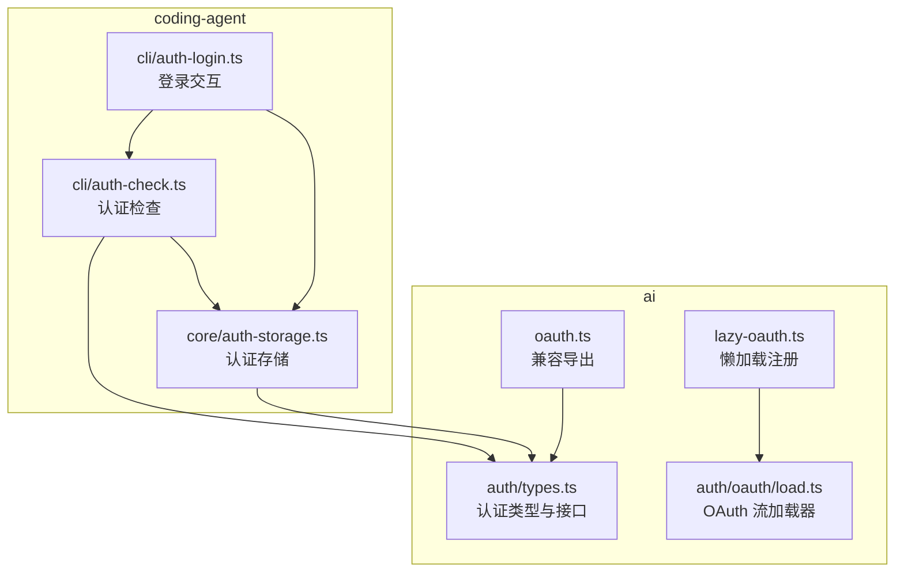
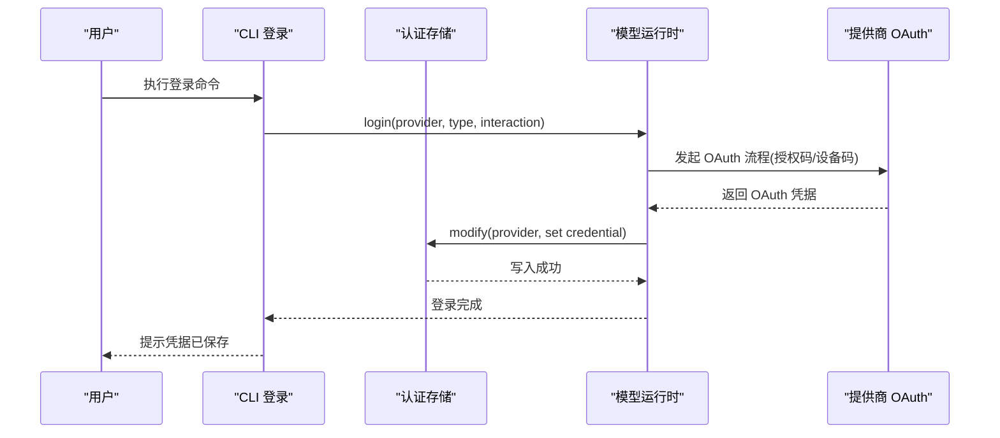
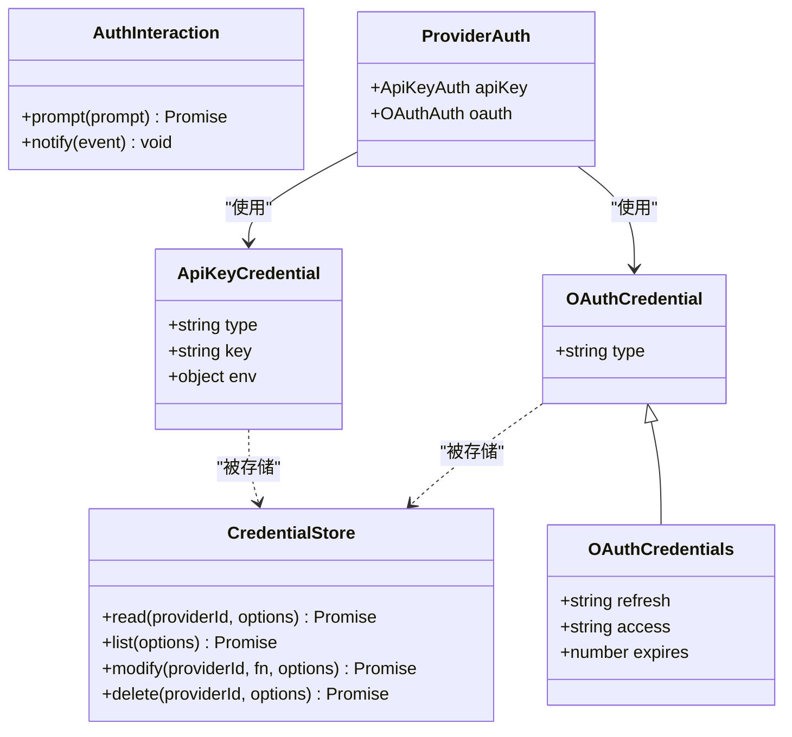
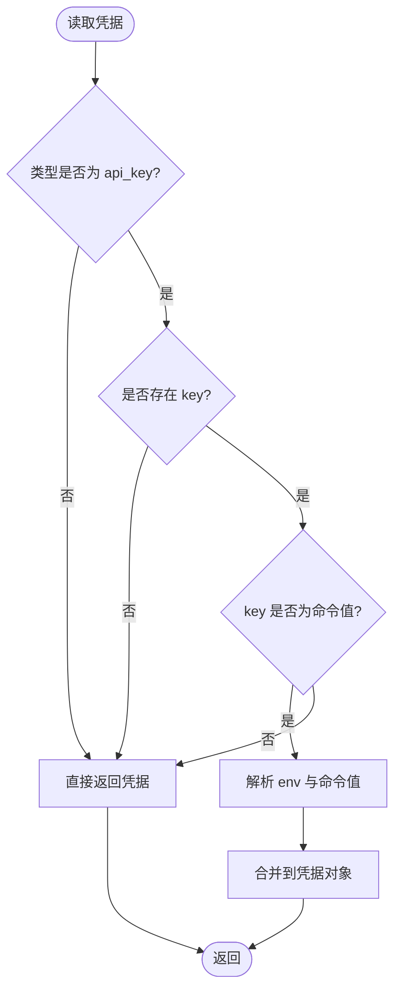
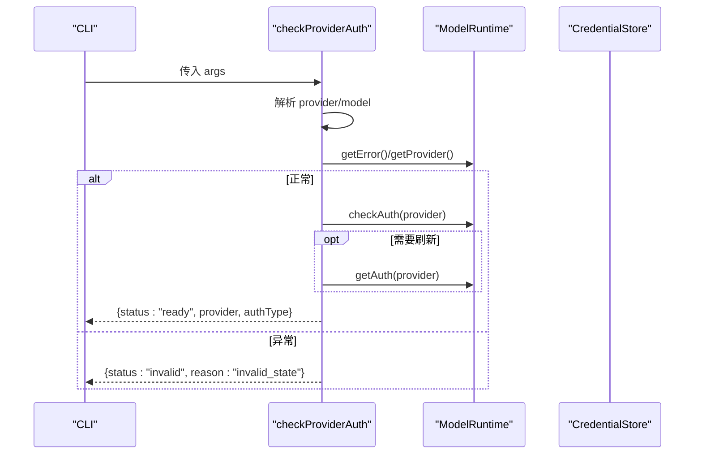
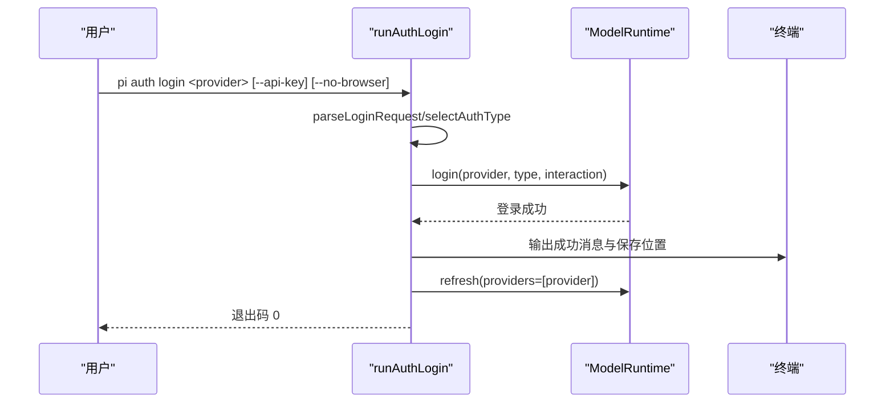
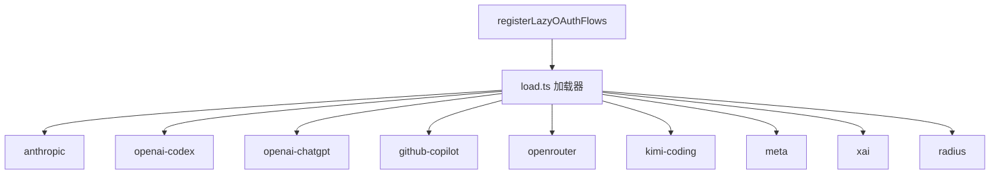
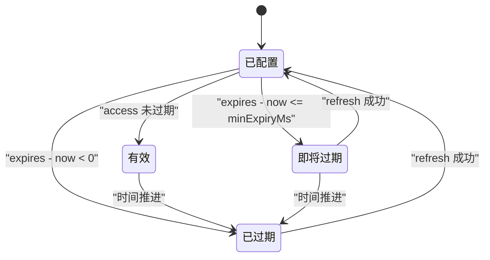
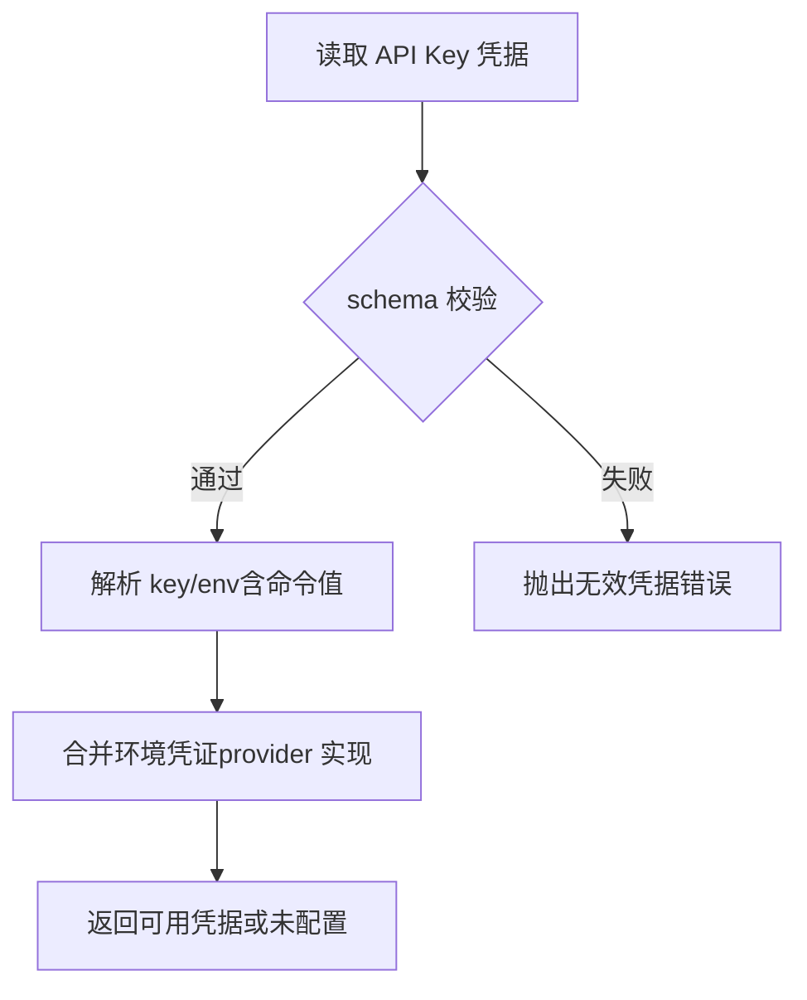
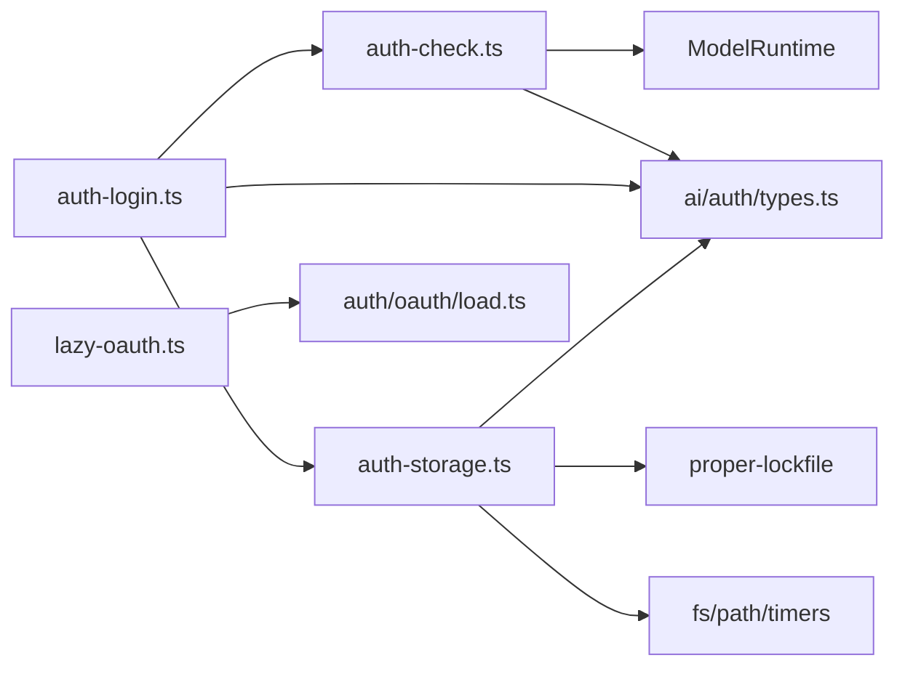

# 认证管理

**本文引用的文件**   
- [packages/coding-agent/src/core/auth-storage.ts](https://github.com/FDE-GROUP/oh-my-fde/blob/main/packages/coding-agent/src/core/auth-storage.ts)
- [packages/coding-agent/src/cli/auth-check.ts](https://github.com/FDE-GROUP/oh-my-fde/blob/main/packages/coding-agent/src/cli/auth-check.ts)
- [packages/coding-agent/src/cli/auth-login.ts](https://github.com/FDE-GROUP/oh-my-fde/blob/main/packages/coding-agent/src/cli/auth-login.ts)
- [packages/ai/src/auth/types.ts](https://github.com/FDE-GROUP/oh-my-fde/blob/main/packages/ai/src/auth/types.ts)
- [packages/ai/src/oauth.ts](https://github.com/FDE-GROUP/oh-my-fde/blob/main/packages/ai/src/oauth.ts)
- [packages/ai/src/lazy-oauth.ts](https://github.com/FDE-GROUP/oh-my-fde/blob/main/packages/ai/src/lazy-oauth.ts)
- [packages/ai/src/auth/oauth/load.ts](https://github.com/FDE-GROUP/oh-my-fde/blob/main/packages/ai/src/auth/oauth/load.ts)
- [packages/coding-agent/test/auth-storage.test.ts](https://github.com/FDE-GROUP/oh-my-fde/blob/main/packages/coding-agent/test/auth-storage.test.ts)
- [packages/coding-agent/test/auth-check.test.ts](https://github.com/FDE-GROUP/oh-my-fde/blob/main/packages/coding-agent/test/auth-check.test.ts)
- [packages/coding-agent/test/auth-login.test.ts](https://github.com/FDE-GROUP/oh-my-fde/blob/main/packages/coding-agent/test/auth-login.test.ts)
- [packages/coding-agent/test/credential-print.test.ts](https://github.com/FDE-GROUP/oh-my-fde/blob/main/packages/coding-agent/test/credential-print.test.ts)

## 目录
1. [简介](#简介)
2. [项目结构](#项目结构)
3. [核心组件](#核心组件)
4. [架构总览](#架构总览)
5. [详细组件分析](#详细组件分析)
6. [依赖关系分析](#依赖关系分析)
7. [性能与并发特性](#性能与并发特性)
8. [安全最佳实践](#安全最佳实践)
9. [常见问题排查](#常见问题排查)
10. [结论](#结论)

## 简介
本文件面向“认证管理”子系统，系统性说明系统支持的认证方式、认证存储机制、令牌生命周期管理，以及不同提供商的认证流程。重点覆盖：
- 支持的认证方式：API Key、OAuth（授权码、设备码）、环境凭证检测（如 AWS 等）
- 认证存储：基于文件的 auth.json 与内存实现，支持跨进程锁与并发安全
- 令牌生命周期：OAuth 刷新、过期处理、最小有效期过滤
- 交互流程：CLI 登录、交互式 TUI 登录、浏览器/设备码流程
- 配置示例与安全建议、故障排查指南

## 项目结构
认证相关代码主要分布在两个包中：
- packages/ai：提供认证类型定义、OAuth 流加载器与各提供商 OAuth 实现入口
- packages/coding-agent：提供 CLI 命令、认证检查、登录交互、认证存储实现

**图示来源**
- [packages/coding-agent/src/cli/auth-check.ts:1-74](https://github.com/FDE-GROUP/oh-my-fde/blob/main/packages/coding-agent/src/cli/auth-check.ts#L1-L74)
- [packages/coding-agent/src/cli/auth-login.ts:1-278](https://github.com/FDE-GROUP/oh-my-fde/blob/main/packages/coding-agent/src/cli/auth-login.ts#L1-L278)
- [packages/coding-agent/src/core/auth-storage.ts:1-509](https://github.com/FDE-GROUP/oh-my-fde/blob/main/packages/coding-agent/src/core/auth-storage.ts#L1-L509)
- [packages/ai/src/auth/types.ts:1-260](https://github.com/FDE-GROUP/oh-my-fde/blob/main/packages/ai/src/auth/types.ts#L1-L260)
- [packages/ai/src/oauth.ts:1-11](https://github.com/FDE-GROUP/oh-my-fde/blob/main/packages/ai/src/oauth.ts#L1-L11)
- [packages/ai/src/lazy-oauth.ts:1-24](https://github.com/FDE-GROUP/oh-my-fde/blob/main/packages/ai/src/lazy-oauth.ts#L1-L24)
- [packages/ai/src/auth/oauth/load.ts:1-84](https://github.com/FDE-GROUP/oh-my-fde/blob/main/packages/ai/src/auth/oauth/load.ts#L1-L84)

**章节来源**
- [packages/coding-agent/src/cli/auth-check.ts:1-74](https://github.com/FDE-GROUP/oh-my-fde/blob/main/packages/coding-agent/src/cli/auth-check.ts#L1-L74)
- [packages/coding-agent/src/cli/auth-login.ts:1-278](https://github.com/FDE-GROUP/oh-my-fde/blob/main/packages/coding-agent/src/cli/auth-login.ts#L1-L278)
- [packages/coding-agent/src/core/auth-storage.ts:1-509](https://github.com/FDE-GROUP/oh-my-fde/blob/main/packages/coding-agent/src/core/auth-storage.ts#L1-L509)
- [packages/ai/src/auth/types.ts:1-260](https://github.com/FDE-GROUP/oh-my-fde/blob/main/packages/ai/src/auth/types.ts#L1-L260)
- [packages/ai/src/oauth.ts:1-11](https://github.com/FDE-GROUP/oh-my-fde/blob/main/packages/ai/src/oauth.ts#L1-L11)
- [packages/ai/src/lazy-oauth.ts:1-24](https://github.com/FDE-GROUP/oh-my-fde/blob/main/packages/ai/src/lazy-oauth.ts#L1-L24)
- [packages/ai/src/auth/oauth/load.ts:1-84](https://github.com/FDE-GROUP/oh-my-fde/blob/main/packages/ai/src/auth/oauth/load.ts#L1-L84)

## 核心组件
- 认证类型与接口：定义 API Key、OAuth、CredentialStore、AuthInteraction、ProviderAuth 等核心类型
- 认证存储：FileAuthStorageBackend、ReadOnlyAuthStorage、InMemoryAuthStorageBackend、AuthStorage
- 认证检查：checkProviderAuth、getProviderCredential
- 登录交互：runAuthLogin、selectAuthType、createLoginInteraction
- OAuth 流加载：registerLazyOAuthFlows、load*OAuth

**章节来源**
- [packages/ai/src/auth/types.ts:1-260](https://github.com/FDE-GROUP/oh-my-fde/blob/main/packages/ai/src/auth/types.ts#L1-L260)
- [packages/coding-agent/src/core/auth-storage.ts:1-509](https://github.com/FDE-GROUP/oh-my-fde/blob/main/packages/coding-agent/src/core/auth-storage.ts#L1-L509)
- [packages/coding-agent/src/cli/auth-check.ts:1-74](https://github.com/FDE-GROUP/oh-my-fde/blob/main/packages/coding-agent/src/cli/auth-check.ts#L1-L74)
- [packages/coding-agent/src/cli/auth-login.ts:1-278](https://github.com/FDE-GROUP/oh-my-fde/blob/main/packages/coding-agent/src/cli/auth-login.ts#L1-L278)
- [packages/ai/src/lazy-oauth.ts:1-24](https://github.com/FDE-GROUP/oh-my-fde/blob/main/packages/ai/src/lazy-oauth.ts#L1-L24)

## 架构总览
认证子系统围绕“存储—检查—登录—请求鉴权”的主线展开：
- 存储层：AuthStorage 统一读写 provider 凭据，底层可文件/内存
- 检查层：checkProviderAuth 判断是否已配置并可用
- 登录层：runAuthLogin 驱动交互，完成 API Key 或 OAuth 登录
- 请求层：Models/ModelRuntime 在调用前解析 ModelAuth（apiKey、headers、baseUrl），必要时刷新 OAuth

**图示来源**
- [packages/coding-agent/src/cli/auth-login.ts:36-92](https://github.com/FDE-GROUP/oh-my-fde/blob/main/packages/coding-agent/src/cli/auth-login.ts#L36-L92)
- [packages/coding-agent/src/core/auth-storage.ts:451-473](https://github.com/FDE-GROUP/oh-my-fde/blob/main/packages/coding-agent/src/core/auth-storage.ts#L451-L473)
- [packages/ai/src/auth/types.ts:220-249](https://github.com/FDE-GROUP/oh-my-fde/blob/main/packages/ai/src/auth/types.ts#L220-L249)

## 详细组件分析

### 认证类型与接口
- ApiKeyCredential：type=api_key，支持 key 与 env 字段
- OAuthCredential：type=oauth，包含 access、refresh、expires
- CredentialStore：统一的凭据存取接口，强调 modify 为唯一写路径，保证并发安全
- AuthInteraction：登录交互抽象，支持 prompt/notify
- ProviderAuth：每个提供商暴露 apiKey 与/或 oauth 能力

**图示来源**
- [packages/ai/src/auth/types.ts:13-43](https://github.com/FDE-GROUP/oh-my-fde/blob/main/packages/ai/src/auth/types.ts#L13-L43)
- [packages/ai/src/auth/types.ts:65-94](https://github.com/FDE-GROUP/oh-my-fde/blob/main/packages/ai/src/auth/types.ts#L65-L94)
- [packages/ai/src/auth/types.ts:160-168](https://github.com/FDE-GROUP/oh-my-fde/blob/main/packages/ai/src/auth/types.ts#L160-L168)
- [packages/ai/src/auth/types.ts:256-259](https://github.com/FDE-GROUP/oh-my-fde/blob/main/packages/ai/src/auth/types.ts#L256-L259)

**章节来源**
- [packages/ai/src/auth/types.ts:1-260](https://github.com/FDE-GROUP/oh-my-fde/blob/main/packages/ai/src/auth/types.ts#L1-L260)

### 认证存储机制
- FileAuthStorageBackend：基于 auth.json 的文件后端，带同步/异步锁、EPERM/ELOCKED 重试、权限掩码 0o600、目录 0o700
- ReadOnlyAuthStorage：只读读取，校验 schema，支持环境变量与命令值解析
- InMemoryAuthStorageBackend：测试用内存后端，串行化异步链
- AuthStorage：对外统一 CredentialStore 实现，维护共享读状态、增量重载、并发 reader 引用计数

关键行为：
- 读取时若 key 是命令值则通过 resolveConfigValue 解析；env 作为 provider 作用域的环境变量
- 修改/删除通过 withLockAsync 序列化，避免并发重复刷新或覆盖
- 列表不解析敏感值，仅返回 providerId 与 type

**图示来源**
- [packages/coding-agent/src/core/auth-storage.ts:260-269](https://github.com/FDE-GROUP/oh-my-fde/blob/main/packages/coding-agent/src/core/auth-storage.ts#L260-L269)
- [packages/coding-agent/src/core/auth-storage.ts:443-449](https://github.com/FDE-GROUP/oh-my-fde/blob/main/packages/coding-agent/src/core/auth-storage.ts#L443-L449)

**章节来源**
- [packages/coding-agent/src/core/auth-storage.ts:61-203](https://github.com/FDE-GROUP/oh-my-fde/blob/main/packages/coding-agent/src/core/auth-storage.ts#L61-L203)
- [packages/coding-agent/src/core/auth-storage.ts:205-292](https://github.com/FDE-GROUP/oh-my-fde/blob/main/packages/coding-agent/src/core/auth-storage.ts#L205-L292)
- [packages/coding-agent/src/core/auth-storage.ts:294-324](https://github.com/FDE-GROUP/oh-my-fde/blob/main/packages/coding-agent/src/core/auth-storage.ts#L294-L324)
- [packages/coding-agent/src/core/auth-storage.ts:329-492](https://github.com/FDE-GROUP/oh-my-fde/blob/main/packages/coding-agent/src/core/auth-storage.ts#L329-L492)

### 认证检查与凭据获取
- checkProviderAuth：根据 --provider/--model 解析目标 provider，检查 runtime 错误、provider 存在性、credentials 配置情况，返回 ready/not_ready/invalid
- getProviderCredential：当类型为 oauth 且未要求刷新时，直接返回 stored access token；否则通过 modelRuntime.getAuth 获取最新鉴权信息

**图示来源**
- [packages/coding-agent/src/cli/auth-check.ts:22-53](https://github.com/FDE-GROUP/oh-my-fde/blob/main/packages/coding-agent/src/cli/auth-check.ts#L22-L53)

**章节来源**
- [packages/coding-agent/src/cli/auth-check.ts:1-74](https://github.com/FDE-GROUP/oh-my-fde/blob/main/packages/coding-agent/src/cli/auth-check.ts#L1-L74)

### 登录交互与提供商选择
- runAuthLogin：解析参数、匹配 provider、选择认证类型、驱动 login 交互、刷新模型目录、可选配置 MCP server
- selectAuthType：优先 OAuth，若无则回退到 apiKey.login；若强制 --api-key 但 provider 不支持则报错
- createLoginInteraction：将 provider 的 prompt/notify 适配到终端 UI，支持浏览器打开、设备码、手动粘贴码

**图示来源**
- [packages/coding-agent/src/cli/auth-login.ts:36-92](https://github.com/FDE-GROUP/oh-my-fde/blob/main/packages/coding-agent/src/cli/auth-login.ts#L36-L92)
- [packages/coding-agent/src/cli/auth-login.ts:116-128](https://github.com/FDE-GROUP/oh-my-fde/blob/main/packages/coding-agent/src/cli/auth-login.ts#L116-L128)
- [packages/coding-agent/src/cli/auth-login.ts:131-203](https://github.com/FDE-GROUP/oh-my-fde/blob/main/packages/coding-agent/src/cli/auth-login.ts#L131-L203)

**章节来源**
- [packages/coding-agent/src/cli/auth-login.ts:1-278](https://github.com/FDE-GROUP/oh-my-fde/blob/main/packages/coding-agent/src/cli/auth-login.ts#L1-L278)

### OAuth 流与提供商支持
- lazy-oauth：注册各提供商 OAuth 流加载器，支持 Node 打包拆分场景
- load.ts：按名称动态导入具体 flow 模块，支持 bundledLoaders 注入
- 支持的提供商（从加载器可见）：anthropic、openai-codex、openai-chatgpt、github-copilot、openrouter、kimi-coding、meta、xai、radius

**图示来源**
- [packages/ai/src/lazy-oauth.ts:11-23](https://github.com/FDE-GROUP/oh-my-fde/blob/main/packages/ai/src/lazy-oauth.ts#L11-L23)
- [packages/ai/src/auth/oauth/load.ts:31-83](https://github.com/FDE-GROUP/oh-my-fde/blob/main/packages/ai/src/auth/oauth/load.ts#L31-L83)

**章节来源**
- [packages/ai/src/oauth.ts:1-11](https://github.com/FDE-GROUP/oh-my-fde/blob/main/packages/ai/src/oauth.ts#L1-L11)
- [packages/ai/src/lazy-oauth.ts:1-24](https://github.com/FDE-GROUP/oh-my-fde/blob/main/packages/ai/src/lazy-oauth.ts#L1-L24)
- [packages/ai/src/auth/oauth/load.ts:1-84](https://github.com/FDE-GROUP/oh-my-fde/blob/main/packages/ai/src/auth/oauth/load.ts#L1-L84)

### 令牌生命周期管理
- 存储结构：OAuth 凭据包含 access、refresh、expires
- 刷新策略：Models/ModelRuntime 在 modify 内执行 refresh，避免并发重复刷新
- 最小有效期：CLI 打印 bearer token 时可指定 minExpiryMs，过滤即将过期的令牌
- 过期处理：refresh 失败会抛出错误，上层需捕获并提示重新登录

**图示来源**
- [packages/ai/src/auth/types.ts:23-34](https://github.com/FDE-GROUP/oh-my-fde/blob/main/packages/ai/src/auth/types.ts#L23-L34)
- [packages/coding-agent/test/credential-print.test.ts:121-128](https://github.com/FDE-GROUP/oh-my-fde/blob/main/packages/coding-agent/test/credential-print.test.ts#L121-L128)

**章节来源**
- [packages/ai/src/auth/types.ts:23-34](https://github.com/FDE-GROUP/oh-my-fde/blob/main/packages/ai/src/auth/types.ts#L23-L34)
- [packages/coding-agent/test/credential-print.test.ts:113-144](https://github.com/FDE-GROUP/oh-my-fde/blob/main/packages/coding-agent/test/credential-print.test.ts#L113-L144)

### API Key 验证与环境凭证检测
- API Key 存储支持 key 与 env；key 可为命令值，env 为 provider 作用域的环境变量
- 只读存储会校验 schema，确保 type 与字段合法
- 环境凭证检测：providers 可通过 apiKey.resolve 合并 credential.key/env 与系统环境变量（例如 AWS 配置文件、ADC 文件等由 providers 自行实现）

**图示来源**
- [packages/coding-agent/src/core/auth-storage.ts:230-253](https://github.com/FDE-GROUP/oh-my-fde/blob/main/packages/coding-agent/src/core/auth-storage.ts#L230-L253)
- [packages/coding-agent/src/core/auth-storage.ts:260-269](https://github.com/FDE-GROUP/oh-my-fde/blob/main/packages/coding-agent/src/core/auth-storage.ts#L260-L269)
- [packages/ai/src/auth/types.ts:174-203](https://github.com/FDE-GROUP/oh-my-fde/blob/main/packages/ai/src/auth/types.ts#L174-L203)

**章节来源**
- [packages/coding-agent/src/core/auth-storage.ts:205-292](https://github.com/FDE-GROUP/oh-my-fde/blob/main/packages/coding-agent/src/core/auth-storage.ts#L205-L292)
- [packages/ai/src/auth/types.ts:174-203](https://github.com/FDE-GROUP/oh-my-fde/blob/main/packages/ai/src/auth/types.ts#L174-L203)

## 依赖关系分析
- coding-agent 对 ai 的依赖集中在类型与 OAuth 流加载
- auth-storage 依赖 proper-lockfile 进行文件锁，依赖 fs/path/timers/promises
- auth-check 依赖 model-resolver 与 ModelRuntime
- auth-login 依赖 terminal 交互与 web-url 工具

**图示来源**
- [packages/coding-agent/src/cli/auth-check.ts:1-74](https://github.com/FDE-GROUP/oh-my-fde/blob/main/packages/coding-agent/src/cli/auth-check.ts#L1-L74)
- [packages/coding-agent/src/cli/auth-login.ts:1-278](https://github.com/FDE-GROUP/oh-my-fde/blob/main/packages/coding-agent/src/cli/auth-login.ts#L1-L278)
- [packages/coding-agent/src/core/auth-storage.ts:1-509](https://github.com/FDE-GROUP/oh-my-fde/blob/main/packages/coding-agent/src/core/auth-storage.ts#L1-L509)
- [packages/ai/src/lazy-oauth.ts:1-24](https://github.com/FDE-GROUP/oh-my-fde/blob/main/packages/ai/src/lazy-oauth.ts#L1-L24)
- [packages/ai/src/auth/oauth/load.ts:1-84](https://github.com/FDE-GROUP/oh-my-fde/blob/main/packages/ai/src/auth/oauth/load.ts#L1-L84)
- [packages/ai/src/auth/types.ts:1-260](https://github.com/FDE-GROUP/oh-my-fde/blob/main/packages/ai/src/auth/types.ts#L1-L260)

**章节来源**
- [packages/coding-agent/src/cli/auth-check.ts:1-74](https://github.com/FDE-GROUP/oh-my-fde/blob/main/packages/coding-agent/src/cli/auth-check.ts#L1-L74)
- [packages/coding-agent/src/cli/auth-login.ts:1-278](https://github.com/FDE-GROUP/oh-my-fde/blob/main/packages/coding-agent/src/cli/auth-login.ts#L1-L278)
- [packages/coding-agent/src/core/auth-storage.ts:1-509](https://github.com/FDE-GROUP/oh-my-fde/blob/main/packages/coding-agent/src/core/auth-storage.ts#L1-L509)
- [packages/ai/src/lazy-oauth.ts:1-24](https://github.com/FDE-GROUP/oh-my-fde/blob/main/packages/ai/src/lazy-oauth.ts#L1-L24)
- [packages/ai/src/auth/oauth/load.ts:1-84](https://github.com/FDE-GROUP/oh-my-fde/blob/main/packages/ai/src/auth/oauth/load.ts#L1-L84)
- [packages/ai/src/auth/types.ts:1-260](https://github.com/FDE-GROUP/oh-my-fde/blob/main/packages/ai/src/auth/types.ts#L1-L260)

## 性能与并发特性
- 文件锁：同步/异步双路径，支持 EPERM/ELOCKED 重试与指数退避，避免长时间阻塞
- 并发刷新保护：modify 串行化，防止多请求同时刷新同一 provider 的 OAuth 令牌
- 共享读状态：AuthStorage 维护共享 readState，减少重复 I/O；reader 引用计数控制后台重载任务的生命周期
- 超时与中止：withLockAsync 接受 AbortSignal，支持操作取消与超时

**章节来源**
- [packages/coding-agent/src/core/auth-storage.ts:81-157](https://github.com/FDE-GROUP/oh-my-fde/blob/main/packages/coding-agent/src/core/auth-storage.ts#L81-L157)
- [packages/coding-agent/src/core/auth-storage.ts:159-203](https://github.com/FDE-GROUP/oh-my-fde/blob/main/packages/coding-agent/src/core/auth-storage.ts#L159-L203)
- [packages/coding-agent/src/core/auth-storage.ts:371-441](https://github.com/FDE-GROUP/oh-my-fde/blob/main/packages/coding-agent/src/core/auth-storage.ts#L371-L441)

## 安全最佳实践
- 文件权限：auth.json 默认以 0o600 创建，目录 0o700，限制其他用户访问
- 最小权限原则：仅在必要时读取/写入凭据；列表操作不解析敏感值
- 命令值与 env：谨慎使用命令值；避免在日志中泄露密钥
- OAuth 安全：使用 PKCE、受信任 URL 校验、设备码流程；避免在客户端硬编码 client_secret
- 刷新保护：依赖 modify 串行化，避免并发刷新导致令牌不一致
- 环境凭证：优先使用系统级凭证管理器（如 AWS profiles、ADC 文件），避免明文存储

**章节来源**
- [packages/coding-agent/src/core/auth-storage.ts:36-37](https://github.com/FDE-GROUP/oh-my-fde/blob/main/packages/coding-agent/src/core/auth-storage.ts#L36-L37)
- [packages/coding-agent/src/core/auth-storage.ts:230-253](https://github.com/FDE-GROUP/oh-my-fde/blob/main/packages/coding-agent/src/core/auth-storage.ts#L230-L253)
- [packages/ai/src/auth/types.ts:174-203](https://github.com/FDE-GROUP/oh-my-fde/blob/main/packages/ai/src/auth/types.ts#L174-L203)

## 常见问题排查
- 无法解析 provider
  - 现象：checkProviderAuth 返回 not_ready/provider_not_found
  - 排查：确认 --provider/--model 是否正确；检查 ModelRuntime 是否初始化成功
  - 参考：[packages/coding-agent/src/cli/auth-check.ts:22-53](https://github.com/FDE-GROUP/oh-my-fde/blob/main/packages/coding-agent/src/cli/auth-check.ts#L22-L53)

- 凭据未配置或不可用
  - 现象：checkProviderAuth 返回 not_ready/credentials_not_configured
  - 排查：运行 pi auth login；确认 auth.json 中存在对应 provider 的凭据
  - 参考：[packages/coding-agent/src/cli/auth-check.ts:43-52](https://github.com/FDE-GROUP/oh-my-fde/blob/main/packages/coding-agent/src/cli/auth-check.ts#L43-L52)

- OAuth 令牌过期或刷新失败
  - 现象：bearer token 打印时报错或为空
  - 排查：检查 expires 与 minExpiryMs；尝试重新登录触发 refresh
  - 参考：[packages/coding-agent/test/credential-print.test.ts:121-128](https://github.com/FDE-GROUP/oh-my-fde/blob/main/packages/coding-agent/test/credential-print.test.ts#L121-L128)

- 登录交互中断或被取消
  - 现象：提示“Login cancelled”
  - 排查：检查 Ctrl+C 或信号中止；确认浏览器/设备码流程是否完成
  - 参考：[packages/coding-agent/src/cli/auth-login.ts:74-84](https://github.com/FDE-GROUP/oh-my-fde/blob/main/packages/coding-agent/src/cli/auth-login.ts#L74-L84)

- auth.json 损坏或格式错误
  - 现象：读取时报 Invalid auth.json
  - 排查：校验 JSON 结构与字段类型；确保 type 为 api_key 或 oauth，字段完整
  - 参考：[packages/coding-agent/src/core/auth-storage.ts:227-253](https://github.com/FDE-GROUP/oh-my-fde/blob/main/packages/coding-agent/src/core/auth-storage.ts#L227-L253)

- 并发写入冲突或锁竞争
  - 现象：ELOCKED/EPERM 错误或“Auth storage lock was compromised”
  - 排查：检查是否有多个进程同时写入 auth.json；确认杀毒软件/索引器占用锁
  - 参考：[packages/coding-agent/src/core/auth-storage.ts:118-157](https://github.com/FDE-GROUP/oh-my-fde/blob/main/packages/coding-agent/src/core/auth-storage.ts#L118-L157)

**章节来源**
- [packages/coding-agent/src/cli/auth-check.ts:22-53](https://github.com/FDE-GROUP/oh-my-fde/blob/main/packages/coding-agent/src/cli/auth-check.ts#L22-L53)
- [packages/coding-agent/src/cli/auth-login.ts:74-84](https://github.com/FDE-GROUP/oh-my-fde/blob/main/packages/coding-agent/src/cli/auth-login.ts#L74-L84)
- [packages/coding-agent/src/core/auth-storage.ts:227-253](https://github.com/FDE-GROUP/oh-my-fde/blob/main/packages/coding-agent/src/core/auth-storage.ts#L227-L253)
- [packages/coding-agent/src/core/auth-storage.ts:118-157](https://github.com/FDE-GROUP/oh-my-fde/blob/main/packages/coding-agent/src/core/auth-storage.ts#L118-L157)
- [packages/coding-agent/test/credential-print.test.ts:121-128](https://github.com/FDE-GROUP/oh-my-fde/blob/main/packages/coding-agent/test/credential-print.test.ts#L121-L128)

## 结论
本认证管理系统通过清晰的类型定义、安全的文件存储、健壮的并发控制与灵活的交互流程，提供了对 API Key、OAuth 与环境凭证的统一管理能力。结合 CLI/TUI 登录、OAuth 流懒加载与令牌生命周期管理，能够满足多提供商、多环境的复杂认证场景。遵循本文的安全最佳实践与排查指南，可有效降低凭据泄露风险并提升运维效率。