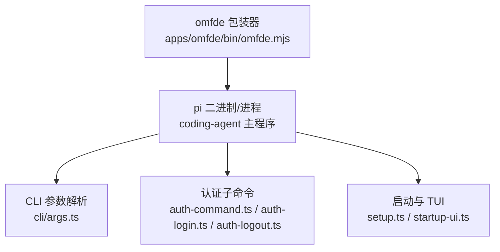
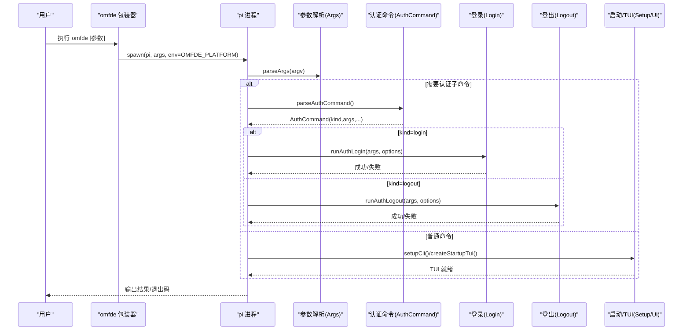
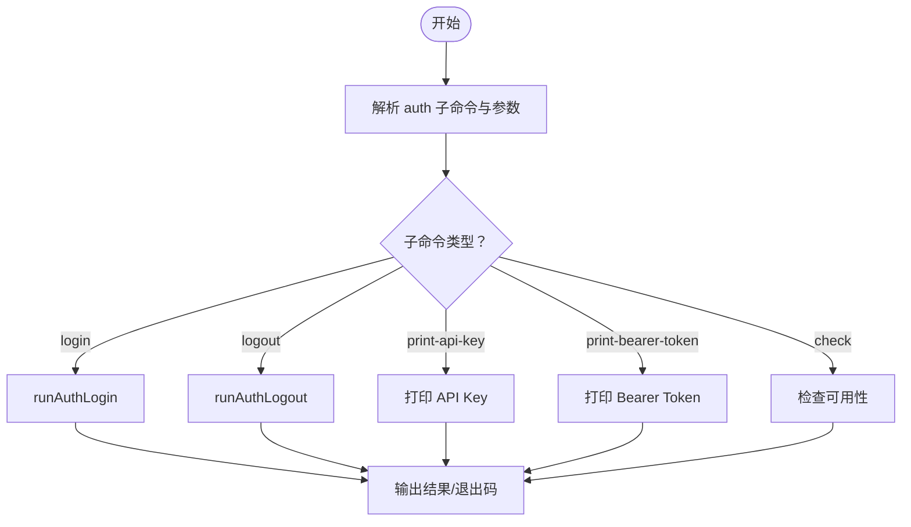
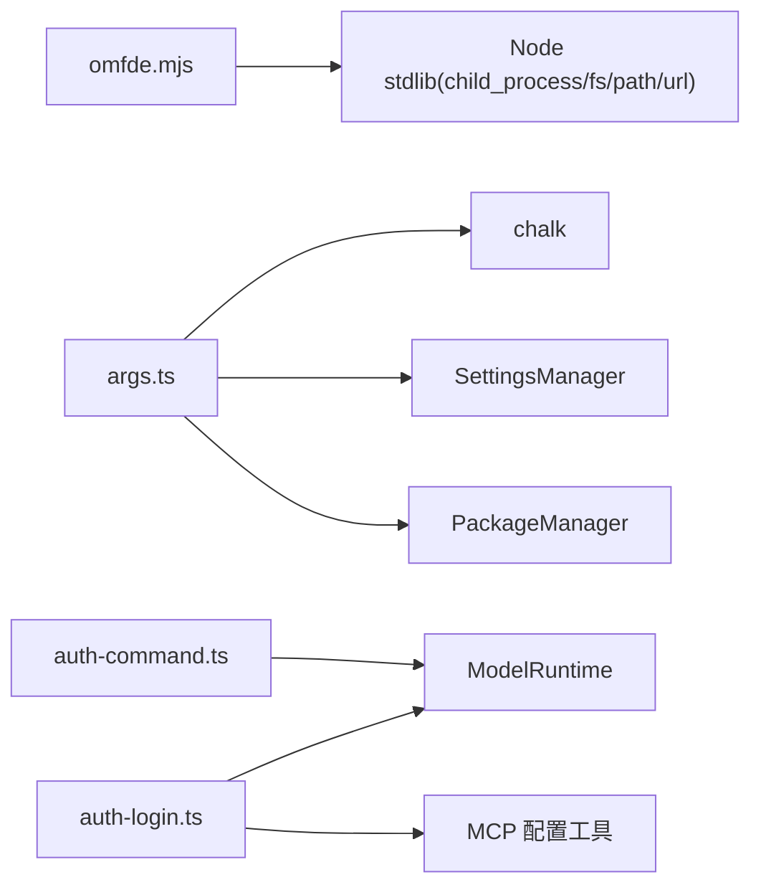

# CLI 工具参考

**本文引用的文件**   
- [apps/omfde/bin/omfde.mjs](https://github.com/FDE-GROUP/oh-my-fde/blob/main/apps/omfde/bin/omfde.mjs)
- [apps/omfde/package.json](https://github.com/FDE-GROUP/oh-my-fde/blob/main/apps/omfde/package.json)
- [packages/coding-agent/src/cli/args.ts](https://github.com/FDE-GROUP/oh-my-fde/blob/main/packages/coding-agent/src/cli/args.ts)
- [packages/coding-agent/src/cli/auth-command.ts](https://github.com/FDE-GROUP/oh-my-fde/blob/main/packages/coding-agent/src/cli/auth-command.ts)
- [packages/coding-agent/src/cli/auth-login.ts](https://github.com/FDE-GROUP/oh-my-fde/blob/main/packages/coding-agent/src/cli/auth-login.ts)
- [packages/coding-agent/src/cli/auth-logout.ts](https://github.com/FDE-GROUP/oh-my-fde/blob/main/packages/coding-agent/src/cli/auth-logout.ts)
- [packages/coding-agent/src/cli/auth-terminal.ts](https://github.com/FDE-GROUP/oh-my-fde/blob/main/packages/coding-agent/src/cli/auth-terminal.ts)
- [packages/coding-agent/src/cli/setup.ts](https://github.com/FDE-GROUP/oh-my-fde/blob/main/packages/coding-agent/src/cli/setup.ts)
- [packages/coding-agent/src/cli/startup-ui.ts](https://github.com/FDE-GROUP/oh-my-fde/blob/main/packages/coding-agent/src/cli/startup-ui.ts)

## 目录
1. [简介](#简介)
2. [项目结构](#项目结构)
3. [核心组件](#核心组件)
4. [架构总览](#架构总览)
5. [详细组件分析](#详细组件分析)
6. [依赖关系分析](#依赖关系分析)
7. [性能与行为特性](#性能与行为特性)
8. [故障排查指南](#故障排查指南)
9. [结论](#结论)
10. [附录：命令速查表](#附录命令速查表)

## 简介
本参考文档面向开发者与高级用户，系统化说明 omfde 平台提供的 CLI 能力。CLI 入口通过 omfde 包装器转发到内部 pi（编码代理）二进制，支持三种主要运行模式：
- 交互式模式（TUI）：终端内交互式对话、会话管理、主题与扩展选择等。
- 打印模式（非交互）：一次性处理提示并退出，适合脚本化调用。
- RPC 模式：以远程过程调用协议进行程序化控制。

此外，文档覆盖会话管理、认证命令、配置管理等高级功能，并提供命令示例与输出格式说明，便于快速定位所需能力。

## 项目结构
omfde 应用包提供命令行入口，实际能力由内部的 coding-agent 模块实现。关键路径如下：
- 应用入口与分发：apps/omfde/bin/omfde.mjs
- 应用包元数据：apps/omfde/package.json
- CLI 参数解析与帮助：packages/coding-agent/src/cli/args.ts
- 认证子命令与流程：packages/coding-agent/src/cli/auth-command.ts, auth-login.ts, auth-logout.ts, auth-terminal.ts
- 启动初始化与 TUI 启动：packages/coding-agent/src/cli/setup.ts, startup-ui.ts

图表来源
- [apps/omfde/bin/omfde.mjs:1-42](https://github.com/FDE-GROUP/oh-my-fde/blob/main/apps/omfde/bin/omfde.mjs#L1-L42)
- [packages/coding-agent/src/cli/args.ts:1-481](https://github.com/FDE-GROUP/oh-my-fde/blob/main/packages/coding-agent/src/cli/args.ts#L1-L481)
- [packages/coding-agent/src/cli/auth-command.ts:1-151](https://github.com/FDE-GROUP/oh-my-fde/blob/main/packages/coding-agent/src/cli/auth-command.ts#L1-L151)
- [packages/coding-agent/src/cli/auth-login.ts:1-278](https://github.com/FDE-GROUP/oh-my-fde/blob/main/packages/coding-agent/src/cli/auth-login.ts#L1-L278)
- [packages/coding-agent/src/cli/auth-logout.ts:1-73](https://github.com/FDE-GROUP/oh-my-fde/blob/main/packages/coding-agent/src/cli/auth-logout.ts#L1-L73)
- [packages/coding-agent/src/cli/setup.ts:1-14](https://github.com/FDE-GROUP/oh-my-fde/blob/main/packages/coding-agent/src/cli/setup.ts#L1-L14)
- [packages/coding-agent/src/cli/startup-ui.ts:1-254](https://github.com/FDE-GROUP/oh-my-fde/blob/main/packages/coding-agent/src/cli/startup-ui.ts#L1-L254)

章节来源
- [apps/omfde/bin/omfde.mjs:1-42](https://github.com/FDE-GROUP/oh-my-fde/blob/main/apps/omfde/bin/omfde.mjs#L1-L42)
- [apps/omfde/package.json:1-16](https://github.com/FDE-GROUP/oh-my-fde/blob/main/apps/omfde/package.json#L1-L16)

## 核心组件
- omfde 包装器：负责解析本地或 PATH 中的 pi 可执行文件，透传参数，设置 OMFDE_PLATFORM 环境变量，并保留子进程的退出码与信号。
- CLI 参数解析：统一解析所有选项、位置参数、@文件引用、扩展未知标志，生成结构化 Args，并输出帮助信息。
- 认证子系统：提供 login/logout/print-api-key/print-bearer-token/check 等子命令，支持 OAuth、API Key、设备码等多种登录方式，并可自动刷新凭据。
- 启动与 TUI：负责进程标题、HTTP 调度器初始化、首次设置引导、主题加载、TUI 生命周期管理。

章节来源
- [apps/omfde/bin/omfde.mjs:1-42](https://github.com/FDE-GROUP/oh-my-fde/blob/main/apps/omfde/bin/omfde.mjs#L1-L42)
- [packages/coding-agent/src/cli/args.ts:1-481](https://github.com/FDE-GROUP/oh-my-fde/blob/main/packages/coding-agent/src/cli/args.ts#L1-L481)
- [packages/coding-agent/src/cli/auth-command.ts:1-151](https://github.com/FDE-GROUP/oh-my-fde/blob/main/packages/coding-agent/src/cli/auth-command.ts#L1-L151)
- [packages/coding-agent/src/cli/auth-login.ts:1-278](https://github.com/FDE-GROUP/oh-my-fde/blob/main/packages/coding-agent/src/cli/auth-login.ts#L1-L278)
- [packages/coding-agent/src/cli/auth-logout.ts:1-73](https://github.com/FDE-GROUP/oh-my-fde/blob/main/packages/coding-agent/src/cli/auth-logout.ts#L1-L73)
- [packages/coding-agent/src/cli/setup.ts:1-14](https://github.com/FDE-GROUP/oh-my-fde/blob/main/packages/coding-agent/src/cli/setup.ts#L1-L14)
- [packages/coding-agent/src/cli/startup-ui.ts:1-254](https://github.com/FDE-GROUP/oh-my-fde/blob/main/packages/coding-agent/src/cli/startup-ui.ts#L1-L254)

## 架构总览
CLI 的整体调用链如下：

图表来源
- [apps/omfde/bin/omfde.mjs:1-42](https://github.com/FDE-GROUP/oh-my-fde/blob/main/apps/omfde/bin/omfde.mjs#L1-L42)
- [packages/coding-agent/src/cli/args.ts:1-481](https://github.com/FDE-GROUP/oh-my-fde/blob/main/packages/coding-agent/src/cli/args.ts#L1-L481)
- [packages/coding-agent/src/cli/auth-command.ts:1-151](https://github.com/FDE-GROUP/oh-my-fde/blob/main/packages/coding-agent/src/cli/auth-command.ts#L1-L151)
- [packages/coding-agent/src/cli/auth-login.ts:1-278](https://github.com/FDE-GROUP/oh-my-fde/blob/main/packages/coding-agent/src/cli/auth-login.ts#L1-L278)
- [packages/coding-agent/src/cli/auth-logout.ts:1-73](https://github.com/FDE-GROUP/oh-my-fde/blob/main/packages/coding-agent/src/cli/auth-logout.ts#L1-L73)
- [packages/coding-agent/src/cli/setup.ts:1-14](https://github.com/FDE-GROUP/oh-my-fde/blob/main/packages/coding-agent/src/cli/setup.ts#L1-L14)
- [packages/coding-agent/src/cli/startup-ui.ts:1-254](https://github.com/FDE-GROUP/oh-my-fde/blob/main/packages/coding-agent/src/cli/startup-ui.ts#L1-L254)

## 详细组件分析

### 命令行语法与参数总览
- 基本用法
  - 交互式模式：直接运行命令，进入 TUI。
  - 打印模式：使用 --print/-p 进行一次性处理并退出。
  - RPC 模式：使用 --mode rpc 进入远程过程调用模式。
- 常用选项（节选）
  - --provider/--model/--api-key：指定模型提供方、模型名称或 API Key。
  - --system-prompt/--append-system-prompt：设置或追加系统提示词。
  - --continue/-c/--resume/-r/--session/--session-id/--fork/--session-dir/--no-session/--name/-n：会话管理与恢复。
  - --models：为 Ctrl+P 切换模型设置过滤列表。
  - --tools/-t/--exclude-tools/-xt/--no-tools/-nt/--no-builtin-tools/-nbt：工具白名单/黑名单与默认启用策略。
  - --thinking：设置思考级别（off/minimal/low/medium/high/xhigh/max）。
  - --extension/-e/--no-extensions/-ne/--no-mcp：扩展与 MCP 控制。
  - --skill/--prompt-template/--theme/--use-theme/--no-skills/--no-prompt-templates/--no-themes：资源加载与主题控制。
  - --no-context-files/-nc：禁用 AGENTS.md/CLAUDE.md 发现。
  - --export：导出会话为 HTML。
  - --list-models：列出可用模型（可选搜索）。
  - --tui-mode：TUI 模式（regular/fullscreen）。
  - --verbose/--offline/--approve/--no-approve：调试、离线与项目信任开关。
  - --help/-h/--version/-v：帮助与版本。
  - --：结束选项解析，后续全部视为消息或 @文件。
- 位置参数
  - 文本消息：作为对话输入。
  - @文件：将文件内容附加到初始消息中。

章节来源
- [packages/coding-agent/src/cli/args.ts:72-271](https://github.com/FDE-GROUP/oh-my-fde/blob/main/packages/coding-agent/src/cli/args.ts#L72-L271)
- [packages/coding-agent/src/cli/args.ts:273-481](https://github.com/FDE-GROUP/oh-my-fde/blob/main/packages/coding-agent/src/cli/args.ts#L273-L481)

### 三种运行模式详解

#### 交互式模式（TUI）
- 触发条件：默认模式；或通过 --tui-mode regular/fullscreen 显式指定。
- 能力要点：
  - 会话创建与恢复：--continue/-c/--resume/-r/--session/--session-id/--fork/--session-dir/--no-session/--name/-n。
  - 模型切换与思考级别：--models/--thinking。
  - 工具控制：--tools/-t/--exclude-tools/-xt/--no-tools/-nt/--no-builtin-tools/-nbt。
  - 扩展与 MCP：--extension/-e/--no-extensions/-ne/--no-mcp。
  - 主题与资源：--theme/--use-theme/--no-themes/--skill/--prompt-template/--no-skills/--no-prompt-templates/--no-context-files/-nc。
  - 首次设置：官方发行版在实验特性开启且未存在 settings.json 时，会引导完成主题与分析上报等设置。
- 典型用法
  - 直接进入 TUI：omfde
  - 带初始提示的 TUI：omfde "解释这段代码"
  - 指定 TUI 模式：omfde --tui-mode fullscreen

章节来源
- [packages/coding-agent/src/cli/args.ts:225-238](https://github.com/FDE-GROUP/oh-my-fde/blob/main/packages/coding-agent/src/cli/args.ts#L225-L238)
- [packages/coding-agent/src/cli/startup-ui.ts:124-148](https://github.com/FDE-GROUP/oh-my-fde/blob/main/packages/coding-agent/src/cli/startup-ui.ts#L124-L148)
- [packages/coding-agent/src/cli/startup-ui.ts:85-103](https://github.com/FDE-GROUP/oh-my-fde/blob/main/packages/coding-agent/src/cli/startup-ui.ts#L85-L103)

#### 打印模式（非交互）
- 触发条件：--print/-p。
- 行为特征：
  - 立即处理一次提示并退出。
  - 支持紧随其后传递一条消息（若不以 @ 或 - 开头）。
  - 可与 --mode text/json 组合，控制输出格式。
- 典型用法
  - 非交互处理：omfde -p "总结以下变更"
  - 以 JSON 输出：omfde --mode json -p "列出 src 下 .ts 文件"

章节来源
- [packages/coding-agent/src/cli/args.ts:177-183](https://github.com/FDE-GROUP/oh-my-fde/blob/main/packages/coding-agent/src/cli/args.ts#L177-L183)
- [packages/coding-agent/src/cli/args.ts:96-110](https://github.com/FDE-GROUP/oh-my-fde/blob/main/packages/coding-agent/src/cli/args.ts#L96-L110)

#### RPC 模式
- 触发条件：--mode rpc。
- 用途：以 RPC 协议对外暴露能力，供外部客户端程序化调用。
- 注意：RPC 模式下通常配合其他选项（如 --provider/--model/--tools 等）限定行为。

章节来源
- [packages/coding-agent/src/cli/args.ts:96-110](https://github.com/FDE-GROUP/oh-my-fde/blob/main/packages/coding-agent/src/cli/args.ts#L96-L110)

### 会话管理命令与选项
- 继续最近会话：--continue/-c
- 选择会话恢复：--resume/-r
- 按路径或 ID 打开会话：--session \<path|id>
- 使用当前目录已有会话 ID（不存在则创建）：--session-id \<id>
- 分叉会话：--fork \<path|id>
- 指定会话存储目录：--session-dir \<dir>
- 不保存会话（临时）：--no-session
- 设置会话显示名：--name/-n \<name>

章节来源
- [packages/coding-agent/src/cli/args.ts:111-141](https://github.com/FDE-GROUP/oh-my-fde/blob/main/packages/coding-agent/src/cli/args.ts#L111-L141)

### 认证命令（auth）
支持的子命令：
- login \<provider> [--api-key] [--no-browser]
- logout \<provider>
- print-api-key [--provider \<provider>] [--model \<model>]
- print-bearer-token [--provider \<provider>] [--model \<model>] [--min-expiry \<duration>]
- check [--provider \<provider>] [--model \<model>] [--json] [--credentials] [--no-refresh]

行为要点：
- login：支持 OAuth、API Key、设备码等多种登录方式；可选择是否自动打开浏览器；登录后刷新模型目录；对特定 provider（如 Radius）可自动配置 MCP 服务器。
- logout：移除本地存储的凭据，不影响环境变量与 models.json。
- print-api-key/print-bearer-token：输出已解析的凭据；bearer token 支持最小剩余有效期校验。
- check：返回 ready/not_ready/invalid 状态，支持 JSON 输出与凭据输出；可选择是否刷新过期凭据。

图表来源
- [packages/coding-agent/src/cli/auth-command.ts:18-70](https://github.com/FDE-GROUP/oh-my-fde/blob/main/packages/coding-agent/src/cli/auth-command.ts#L18-L70)
- [packages/coding-agent/src/cli/auth-command.ts:72-120](https://github.com/FDE-GROUP/oh-my-fde/blob/main/packages/coding-agent/src/cli/auth-command.ts#L72-L120)
- [packages/coding-agent/src/cli/auth-login.ts:36-92](https://github.com/FDE-GROUP/oh-my-fde/blob/main/packages/coding-agent/src/cli/auth-login.ts#L36-L92)
- [packages/coding-agent/src/cli/auth-logout.ts:21-71](https://github.com/FDE-GROUP/oh-my-fde/blob/main/packages/coding-agent/src/cli/auth-logout.ts#L21-L71)

章节来源
- [packages/coding-agent/src/cli/auth-command.ts:1-151](https://github.com/FDE-GROUP/oh-my-fde/blob/main/packages/coding-agent/src/cli/auth-command.ts#L1-L151)
- [packages/coding-agent/src/cli/auth-login.ts:1-278](https://github.com/FDE-GROUP/oh-my-fde/blob/main/packages/coding-agent/src/cli/auth-login.ts#L1-L278)
- [packages/coding-agent/src/cli/auth-logout.ts:1-73](https://github.com/FDE-GROUP/oh-my-fde/blob/main/packages/coding-agent/src/cli/auth-logout.ts#L1-L73)
- [packages/coding-agent/src/cli/auth-terminal.ts:1-79](https://github.com/FDE-GROUP/oh-my-fde/blob/main/packages/coding-agent/src/cli/auth-terminal.ts#L1-L79)

### 配置管理与扩展
- 扩展安装/卸载/更新/列表：install/remove/uninstall/update/list
- 配置界面：config（TUI 中启用/禁用包资源）
- 扩展自定义标志：扩展可注册额外 CLI 标志，并在帮助中展示。

章节来源
- [packages/coding-agent/src/cli/args.ts:273-481](https://github.com/FDE-GROUP/oh-my-fde/blob/main/packages/coding-agent/src/cli/args.ts#L273-L481)

### 启动与 TUI 初始化
- 进程标题与环境变量：设置 process.title、PI_CODING_AGENT、AI_AGENT。
- HTTP 调度器：在 Provider SDK 发起请求前配置 undici。
- 首次设置：官方发行版在实验特性开启且未存在 settings.json 时，引导完成主题与分析上报等设置。
- TUI 生命周期：创建 UI、主题加载、键绑定、颜色查询与渲染。

章节来源
- [packages/coding-agent/src/cli/setup.ts:1-14](https://github.com/FDE-GROUP/oh-my-fde/blob/main/packages/coding-agent/src/cli/setup.ts#L1-L14)
- [packages/coding-agent/src/cli/startup-ui.ts:85-103](https://github.com/FDE-GROUP/oh-my-fde/blob/main/packages/coding-agent/src/cli/startup-ui.ts#L85-L103)
- [packages/coding-agent/src/cli/startup-ui.ts:124-148](https://github.com/FDE-GROUP/oh-my-fde/blob/main/packages/coding-agent/src/cli/startup-ui.ts#L124-L148)

## 依赖关系分析
- omfde 包装器依赖 Node.js child_process 与 fs/path/url 标准库，用于启动 pi 进程并透传参数。
- coding-agent CLI 依赖 chalk 进行彩色输出，依赖 SettingsManager、PackageManager、TUI 等内部模块。
- 认证模块依赖 ModelRuntime、Provider 匹配逻辑、MCP 配置工具与 Web URL 工具。

图表来源
- [apps/omfde/bin/omfde.mjs:1-42](https://github.com/FDE-GROUP/oh-my-fde/blob/main/apps/omfde/bin/omfde.mjs#L1-L42)
- [packages/coding-agent/src/cli/args.ts:1-10](https://github.com/FDE-GROUP/oh-my-fde/blob/main/packages/coding-agent/src/cli/args.ts#L1-L10)
- [packages/coding-agent/src/cli/auth-command.ts:1-10](https://github.com/FDE-GROUP/oh-my-fde/blob/main/packages/coding-agent/src/cli/auth-command.ts#L1-L10)
- [packages/coding-agent/src/cli/auth-login.ts:1-10](https://github.com/FDE-GROUP/oh-my-fde/blob/main/packages/coding-agent/src/cli/auth-login.ts#L1-L10)

章节来源
- [apps/omfde/bin/omfde.mjs:1-42](https://github.com/FDE-GROUP/oh-my-fde/blob/main/apps/omfde/bin/omfde.mjs#L1-L42)
- [packages/coding-agent/src/cli/args.ts:1-10](https://github.com/FDE-GROUP/oh-my-fde/blob/main/packages/coding-agent/src/cli/args.ts#L1-L10)
- [packages/coding-agent/src/cli/auth-command.ts:1-10](https://github.com/FDE-GROUP/oh-my-fde/blob/main/packages/coding-agent/src/cli/auth-command.ts#L1-L10)
- [packages/coding-agent/src/cli/auth-login.ts:1-10](https://github.com/FDE-GROUP/oh-my-fde/blob/main/packages/coding-agent/src/cli/auth-login.ts#L1-L10)

## 性能与行为特性
- 退出码与信号保留：omfde 会将子进程的信号（如 Ctrl+C）转发给父进程，确保终端体验一致。
- 网络操作：--offline 可禁用启动时的网络操作；认证流程可能涉及网络刷新（如模型目录）。
- 工具与扩展：--no-tools/--no-builtin-tools 可减少运行时开销；--no-extensions/--no-mcp 可避免扩展与 MCP 初始化成本。
- TUI 渲染：首次设置与主题加载会在启动阶段进行，必要时异步获取终端颜色以提升渲染质量。

章节来源
- [apps/omfde/bin/omfde.mjs:29-41](https://github.com/FDE-GROUP/oh-my-fde/blob/main/apps/omfde/bin/omfde.mjs#L29-L41)
- [packages/coding-agent/src/cli/args.ts:245-246](https://github.com/FDE-GROUP/oh-my-fde/blob/main/packages/coding-agent/src/cli/args.ts#L245-L246)
- [packages/coding-agent/src/cli/startup-ui.ts:85-103](https://github.com/FDE-GROUP/oh-my-fde/blob/main/packages/coding-agent/src/cli/startup-ui.ts#L85-L103)

## 故障排查指南
- 无法启动 pi：检查本地 node_modules/.bin/pi 是否存在，或 PATH 中是否有 pi；查看 omfde 的错误输出。
- 认证失败：确认 provider 名称正确；如需账户登录，请确保终端为交互式；必要时使用 --no-browser 或 --api-key。
- 凭据刷新问题：使用 auth check --json 查看状态；必要时使用 --no-refresh 避免自动刷新。
- 会话相关错误：检查 --session/--session-id/--session-dir 是否正确；必要时使用 --no-session 进行临时会话。
- 工具不可用：检查 --tools/--exclude-tools 配置；必要时使用 --no-tools 重置默认策略。

章节来源
- [apps/omfde/bin/omfde.mjs:29-31](https://github.com/FDE-GROUP/oh-my-fde/blob/main/apps/omfde/bin/omfde.mjs#L29-L31)
- [packages/coding-agent/src/cli/auth-login.ts:46-92](https://github.com/FDE-GROUP/oh-my-fde/blob/main/packages/coding-agent/src/cli/auth-login.ts#L46-L92)
- [packages/coding-agent/src/cli/auth-logout.ts:21-71](https://github.com/FDE-GROUP/oh-my-fde/blob/main/packages/coding-agent/src/cli/auth-logout.ts#L21-L71)
- [packages/coding-agent/src/cli/args.ts:147-166](https://github.com/FDE-GROUP/oh-my-fde/blob/main/packages/coding-agent/src/cli/args.ts#L147-L166)

## 结论
omfde 通过简洁的包装器与强大的 coding-agent CLI，提供了完整的交互式、打印与 RPC 三种运行模式，并配套完善的会话管理、认证与配置管理能力。借助统一的参数解析与丰富的选项，开发者可以灵活地在不同场景下使用 CLI，同时保持行为一致性与可观测性。

## 附录：命令速查表
- 基础命令
  - omfde：进入交互式 TUI
  - omfde -p "提示"：打印模式
  - omfde --mode rpc：RPC 模式
- 会话管理
  - omfde --continue "继续讨论"
  - omfde --resume
  - omfde --session \<path|id>
  - omfde --session-id \<id>
  - omfde --fork \<path|id>
  - omfde --session-dir \<dir>
  - omfde --no-session
  - omfde --name "会话名"
- 模型与工具
  - omfde --provider openai --model gpt-4o-mini "提示"
  - omfde --thinking high "复杂问题"
  - omfde --tools read,bash,codemode
  - omfde --exclude-tools ask_question
  - omfde --no-tools
  - omfde --no-builtin-tools
- 扩展与资源
  - omfde --extension ./ext.ts
  - omfde --no-extensions
  - omfde --no-mcp
  - omfde --skill ./skill
  - omfde --prompt-template ./template
  - omfde --theme ./theme
  - omfde --use-theme dark
  - omfde --no-skills
  - omfde --no-prompt-templates
  - omfde --no-themes
  - omfde --no-context-files
- 输出与调试
  - omfde --export session.jsonl output.html
  - omfde --list-models
  - omfde --tui-mode fullscreen
  - omfde --verbose
  - omfde --offline
  - omfde --help
  - omfde --version
- 认证命令
  - omfde auth login \<provider> [--api-key] [--no-browser]
  - omfde auth logout \<provider>
  - omfde auth print-api-key [--provider \<provider>] [--model \<model>]
  - omfde auth print-bearer-token [--provider \<provider>] [--model \<model>] [--min-expiry \<duration>]
  - omfde auth check [--provider \<provider>] [--model \<model>] [--json] [--credentials] [--no-refresh]

章节来源
- [packages/coding-agent/src/cli/args.ts:273-481](https://github.com/FDE-GROUP/oh-my-fde/blob/main/packages/coding-agent/src/cli/args.ts#L273-L481)
- [packages/coding-agent/src/cli/auth-command.ts:18-70](https://github.com/FDE-GROUP/oh-my-fde/blob/main/packages/coding-agent/src/cli/auth-command.ts#L18-L70)