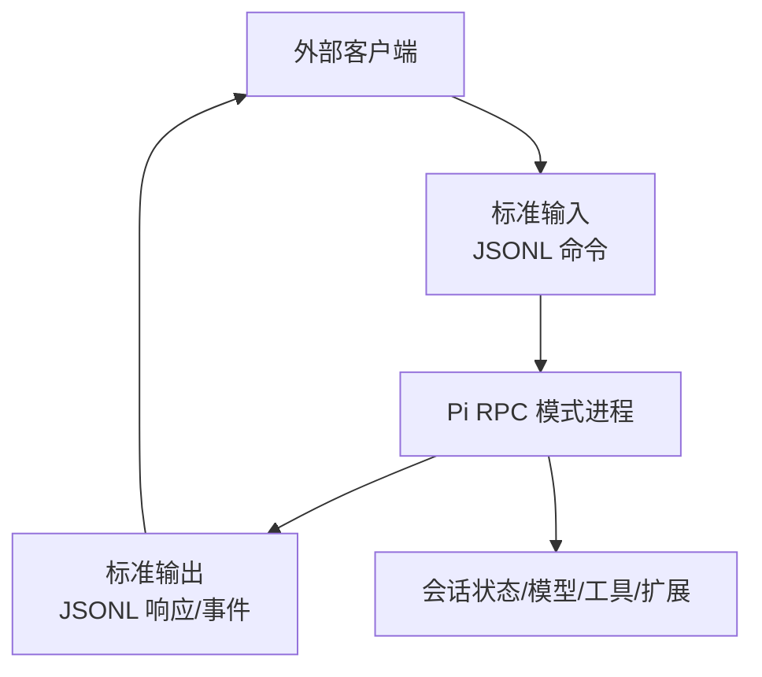
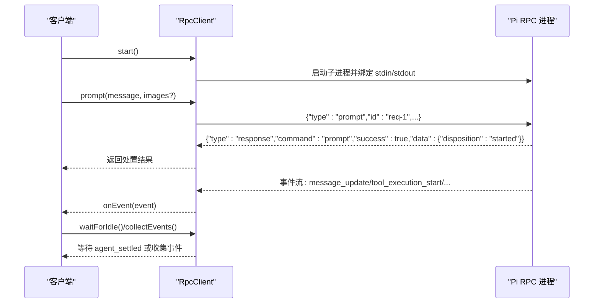
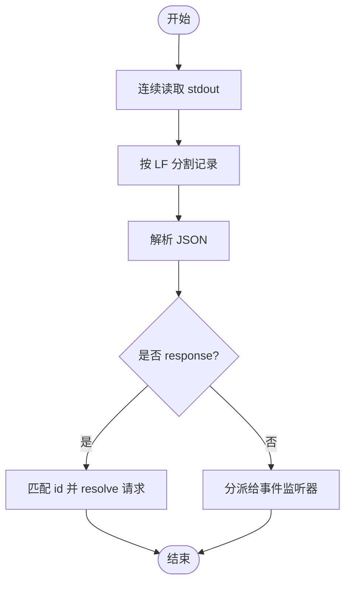
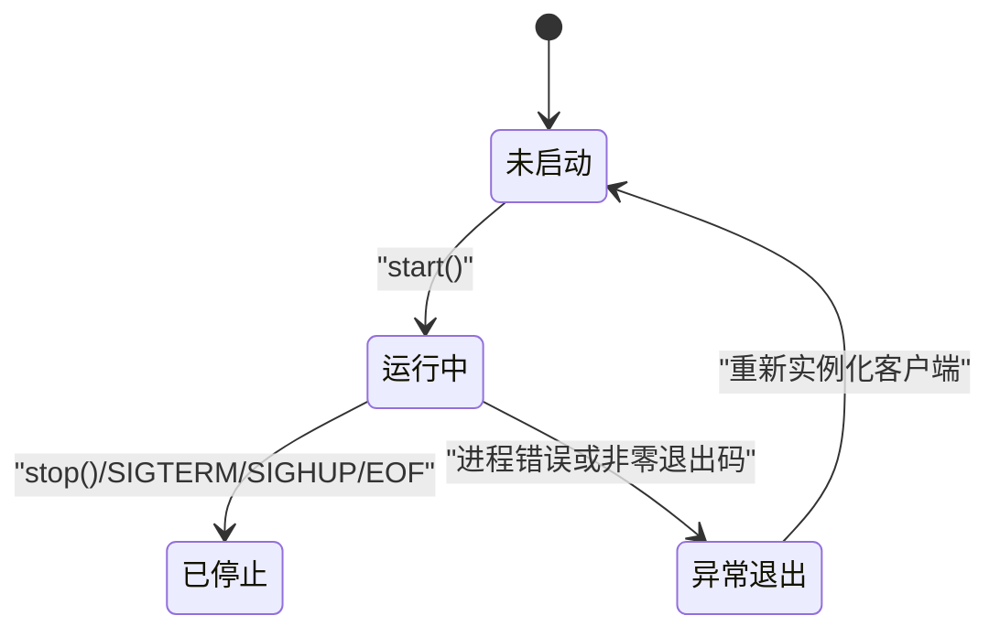
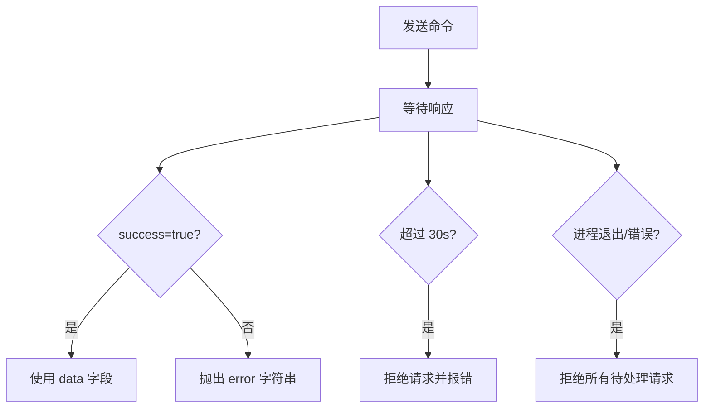
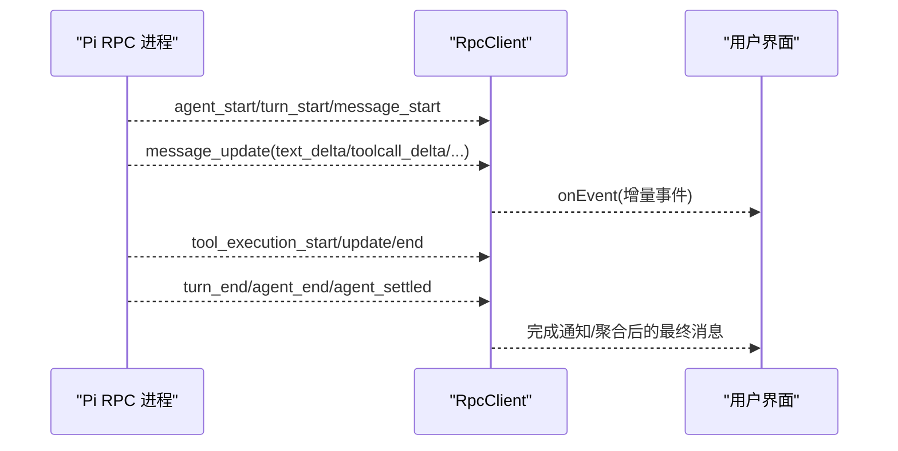
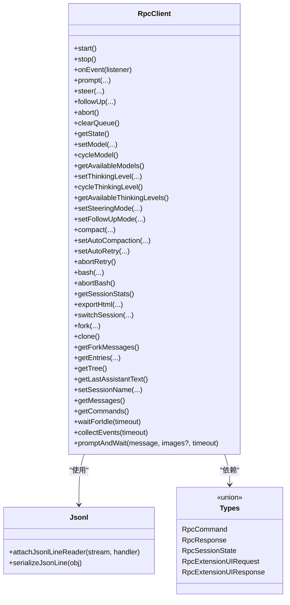

# RPC 接口规范

**本文引用的文件**   
- [rpc.md](https://github.com/FDE-GROUP/oh-my-fde/blob/main/packages/coding-agent/docs/rpc.md)
- [rpc-commands.md](https://github.com/FDE-GROUP/oh-my-fde/blob/main/packages/coding-agent/docs/rpc-commands.md)
- [json.md](https://github.com/FDE-GROUP/oh-my-fde/blob/main/packages/coding-agent/docs/json.md)
- [rpc-client.ts](https://github.com/FDE-GROUP/oh-my-fde/blob/main/packages/coding-agent/src/modes/rpc/rpc-client.ts)
- [rpc-types.ts](https://github.com/FDE-GROUP/oh-my-fde/blob/main/packages/coding-agent/src/modes/rpc/rpc-types.ts)
- [jsonl.ts](https://github.com/FDE-GROUP/oh-my-fde/blob/main/packages/coding-agent/src/modes/rpc/jsonl.ts)
- [rpc-client-clear-queue.test.ts](https://github.com/FDE-GROUP/oh-my-fde/blob/main/packages/coding-agent/test/rpc-client-clear-queue.test.ts)
- [rpc-client-clone.test.ts](https://github.com/FDE-GROUP/oh-my-fde/blob/main/packages/coding-agent/test/rpc-client-clone.test.ts)

## 目录
1. [引言](#引言)
2. [项目结构](#项目结构)
3. [核心组件](#核心组件)
4. [架构总览](#架构总览)
5. [详细组件分析](#详细组件分析)
6. [依赖关系分析](#依赖关系分析)
7. [性能与连接管理](#性能与连接管理)
8. [错误处理与调试](#错误处理与调试)
9. [客户端实现指南](#客户端实现指南)
10. [结论](#结论)

## 引言
本规范面向通过子进程 JSONL 协议控制 Pi 编码代理的客户端。RPC 模式将 Pi 作为长驻进程，使用标准输入输出上的严格 JSONL 帧进行命令、响应和事件通信。它适合跨语言集成、IDE 集成、自定义界面以及需要进程隔离的场景。对于 Node.js/Bun 内嵌场景，更推荐使用 SDK；对于 TypeScript 子进程集成，可使用导出的 `RpcClient`。

RPC 协议包含四类记录：
- 客户端到服务端：命令
- 服务端到客户端：响应
- 服务端到客户端：会话事件流
- 双向：扩展 UI 交互记录

RPC 不要求认证字段；身份与权限由启动参数、工作目录、环境变量及扩展机制决定。

**章节来源**
- [rpc.md:1-33](https://github.com/FDE-GROUP/oh-my-fde/blob/main/packages/coding-agent/docs/rpc.md#L1-L33)

## 项目结构
RPC 相关能力集中在 `packages/coding-agent` 中：
- 文档层：`docs/rpc.md`、`docs/rpc-commands.md`、`docs/json.md`
- 类型定义：`src/modes/rpc/rpc-types.ts`
- 客户端实现：`src/modes/rpc/rpc-client.ts`
- JSONL 帧工具：`src/modes/rpc/jsonl.ts`
- 测试用例：`test/rpc-client-clear-queue.test.ts`、`test/rpc-client-clone.test.ts`

**图示来源**
- [rpc.md:22-56](https://github.com/FDE-GROUP/oh-my-fde/blob/main/packages/coding-agent/docs/rpc.md#L22-L56)
- [rpc-client.ts:74-130](https://github.com/FDE-GROUP/oh-my-fde/blob/main/packages/coding-agent/src/modes/rpc/rpc-client.ts#L74-L130)

**章节来源**
- [rpc.md:1-33](https://github.com/FDE-GROUP/oh-my-fde/blob/main/packages/coding-agent/docs/rpc.md#L1-L33)
- [rpc-client.ts:1-17](https://github.com/FDE-GROUP/oh-my-fde/blob/main/packages/coding-agent/src/modes/rpc/rpc-client.ts#L1-L17)

## 核心组件
- RPC 客户端类：负责启动子进程、发送命令、关联请求 ID、订阅事件、等待空闲、收集事件。
- RPC 类型定义：集中描述所有命令、响应、会话状态、扩展 UI 请求/响应。
- JSONL 帧工具：提供严格的逐行序列化与解析。
- 文档参考：命令参考、事件流参考、最小客户端示例。

关键职责划分：
- `RpcClient`：进程生命周期、请求-响应关联、事件分发、超时与退出处理。
- `rpc-types.ts`：协议契约的类型化表达，保证命令与响应的字段一致性。
- `jsonl.ts`：确保 JSONL 帧边界正确，避免 Unicode 换行符误判。

**章节来源**
- [rpc-client.ts:28-66](https://github.com/FDE-GROUP/oh-my-fde/blob/main/packages/coding-agent/src/modes/rpc/rpc-client.ts#L28-L66)
- [rpc-types.ts:16-74](https://github.com/FDE-GROUP/oh-my-fde/blob/main/packages/coding-agent/src/modes/rpc/rpc-types.ts#L16-L74)
- [rpc-types.ts:112-245](https://github.com/FDE-GROUP/oh-my-fde/blob/main/packages/coding-agent/src/modes/rpc/rpc-types.ts#L112-L245)

## 架构总览
RPC 采用“命令-响应-事件”三通道：
- 命令：stdin 单向写入，每个命令可选 `id` 用于关联响应。
- 响应：stdout 返回成功或失败结果，成功时携带 `data`，失败时携带 `error`。
- 事件：stdout 持续推送会话级事件，如消息增量、工具执行、队列变化、压缩、重试等。

**图示来源**
- [rpc.md:35-71](https://github.com/FDE-GROUP/oh-my-fde/blob/main/packages/coding-agent/docs/rpc.md#L35-L71)
- [rpc-client.ts:198-205](https://github.com/FDE-GROUP/oh-my-fde/blob/main/packages/coding-agent/src/modes/rpc/rpc-client.ts#L198-L205)
- [rpc-client.ts:471-517](https://github.com/FDE-GROUP/oh-my-fde/blob/main/packages/coding-agent/src/modes/rpc/rpc-client.ts#L471-L517)

## 详细组件分析

### RPC 协议消息格式
- 帧格式：严格 JSONL，每条记录是一个完整 JSON 对象，以 LF 结尾。读取 stdout 时应按字节或 UTF-8 流拆分，仅以 LF 为边界，忽略可选的 CR。
- 方向：
  - stdin：命令
  - stdout：响应、会话事件、扩展 UI 记录
- 关联：命令可带可选字符串 `id`；匹配的响应会重复该 `id`。并发命令必须使用唯一 `id`。
- 特殊事件：`bash_execution_update` 在 bash 命令有 `id` 时会重复该 `id`；扩展 UI 响应使用其对应请求的 `id`，不产生普通命令响应。

**图示来源**
- [rpc.md:50-56](https://github.com/FDE-GROUP/oh-my-fde/blob/main/packages/coding-agent/docs/rpc.md#L50-L56)
- [rpc.md:35-49](https://github.com/FDE-GROUP/oh-my-fde/blob/main/packages/coding-agent/docs/rpc.md#L35-L49)
- [rpc-client.ts:523-543](https://github.com/FDE-GROUP/oh-my-fde/blob/main/packages/coding-agent/src/modes/rpc/rpc-client.ts#L523-L543)

**章节来源**
- [rpc.md:22-56](https://github.com/FDE-GROUP/oh-my-fde/blob/main/packages/coding-agent/docs/rpc.md#L22-L56)
- [rpc.md:35-49](https://github.com/FDE-GROUP/oh-my-fde/blob/main/packages/coding-agent/docs/rpc.md#L35-L49)

### 连接建立与生命周期
- 启动：客户端调用 `start()` 启动 Pi 子进程，传入 `--mode rpc` 及可选 provider/model/args。
- I/O 绑定：stdin 写命令，stdout 读 JSONL 记录，stderr 收集诊断信息。
- 初始化：启动后短暂等待进程就绪，若进程立即退出则抛出错误。
- 停止：调用 `stop()` 先关闭读取器，再发送 SIGTERM，并在超时后强制 SIGKILL。
- 信号与优雅关闭：Pi 支持 SIGTERM/SIGHUP 优雅关闭；stdin EOF 也触发优雅关闭。第二次信号会立即退出。

**图示来源**
- [rpc-client.ts:74-140](https://github.com/FDE-GROUP/oh-my-fde/blob/main/packages/coding-agent/src/modes/rpc/rpc-client.ts#L74-L140)
- [rpc-client.ts:145-167](https://github.com/FDE-GROUP/oh-my-fde/blob/main/packages/coding-agent/src/modes/rpc/rpc-client.ts#L145-L167)
- [rpc.md:91-98](https://github.com/FDE-GROUP/oh-my-fde/blob/main/packages/coding-agent/docs/rpc.md#L91-L98)

**章节来源**
- [rpc-client.ts:74-167](https://github.com/FDE-GROUP/oh-my-fde/blob/main/packages/coding-agent/src/modes/rpc/rpc-client.ts#L74-L167)
- [rpc.md:91-98](https://github.com/FDE-GROUP/oh-my-fde/blob/main/packages/coding-agent/docs/rpc.md#L91-L98)

### 认证机制
- 协议层：RPC 命令与响应不包含认证字段。
- 运行时安全：认证与权限由启动参数、工作目录、环境变量、Provider 配置及扩展机制承担。
- 建议：
  - 通过环境变量注入 Provider 凭据。
  - 使用容器或沙箱限制文件系统、网络与进程访问。
  - 对扩展进行白名单与签名校验。

**章节来源**
- [rpc.md:12-20](https://github.com/FDE-GROUP/oh-my-fde/blob/main/packages/coding-agent/docs/rpc.md#L12-L20)
- [README.md:72-80](https://github.com/FDE-GROUP/oh-my-fde/blob/main/README.md#L72-L80)

### 错误处理
- 命令失败：返回 `success: false` 的响应，包含 `error` 字符串。
- 解析失败：无请求 `id` 的 parse 响应，说明输入 JSON 不合法。
- 进程异常：子进程退出、stdin 错误、写入失败均会拒绝待处理请求并暴露 stderr。
- 超时：请求默认 30 秒超时；等待空闲/收集事件也有默认超时。
- 注意：`success: true` 仅代表命令被接受/排队/立即处理；后续 Provider 失败或中断通过事件与消息流报告。

**图示来源**
- [rpc.md:73-89](https://github.com/FDE-GROUP/oh-my-fde/blob/main/packages/coding-agent/docs/rpc.md#L73-L89)
- [rpc-client.ts:545-616](https://github.com/FDE-GROUP/oh-my-fde/blob/main/packages/coding-agent/src/modes/rpc/rpc-client.ts#L545-L616)

**章节来源**
- [rpc.md:73-89](https://github.com/FDE-GROUP/oh-my-fde/blob/main/packages/coding-agent/docs/rpc.md#L73-L89)
- [rpc-client.ts:545-616](https://github.com/FDE-GROUP/oh-my-fde/blob/main/packages/coding-agent/src/modes/rpc/rpc-client.ts#L545-L616)

### RPC 方法接口定义
以下列出所有 RPC 命令与其参数、返回值语义。具体 JSON 示例请参考命令参考文档。

- 提示与会话控制
  - `prompt`：提交用户提示，支持图片与流式行为（steer/followUp）。返回处置结果（handled/queued/started）。
  - `steer`：运行中插入引导消息。返回 handled/queued。
  - `follow_up`：完成后追加消息。返回 handled/queued。
  - `abort`：中止当前操作并等待会话空闲。
  - `clear_queue`：清空引导与后续消息队列，返回被清空的文本数组。
  - `new_session`：新建会话，支持父会话追踪；可能被扩展取消。

- 状态与消息
  - `get_state`：获取当前会话状态（模型、思考级别、流式状态、压缩状态、会话信息等）。
  - `get_messages`：获取会话中的全部消息。

- 模型与思考
  - `set_model`：切换到指定模型。
  - `cycle_model`：循环到下一个可用模型。
  - `get_available_models`：列出所有可用模型。
  - `set_thinking_level`：设置思考级别。
  - `cycle_thinking_level`：循环思考级别。
  - `get_available_thinking_levels`：获取当前模型支持的思考级别。

- 队列模式
  - `set_steering_mode`：设置引导消息处理模式（all/one-at-a-time）。
  - `set_follow_up_mode`：设置后续消息处理模式（all/one-at-a-time）。

- 上下文压缩与重试
  - `compact`：手动压缩上下文，返回摘要、保留条目 ID、token 估算与用量。
  - `set_auto_compaction`：启用/禁用自动压缩。
  - `set_auto_retry`：启用/禁用自动重试。
  - `abort_retry`：中止正在进行的重试。

- Bash 执行
  - `bash`：执行 shell 命令，支持实时事件与最终结果；可选择是否排除出模型上下文。
  - `abort_bash`：中止正在运行的 bash。

- 会话管理与导出
  - `get_session_stats`：获取 token 用量、成本与上下文窗口使用情况。
  - `export_html`：导出会话为 HTML。
  - `switch_session`：切换会话文件，可能被扩展取消。
  - `fork`：从历史用户消息创建分支，返回原文并可被扩展取消。
  - `clone`：克隆当前活动分支到新会话，可能被扩展取消。
  - `get_fork_messages`：获取可用于 fork 的用户消息列表。
  - `get_entries`：按追加顺序获取会话条目，支持游标分页。
  - `get_tree`：获取会话条目树。
  - `get_last_assistant_text`：获取最后一条助手消息文本。
  - `set_session_name`：设置会话显示名称。

- 命令发现
  - `get_commands`：获取可通过 `/name` 调用的扩展命令、提示模板与技能。

**章节来源**
- [rpc-commands.md:5-800](https://github.com/FDE-GROUP/oh-my-fde/blob/main/packages/coding-agent/docs/rpc-commands.md#L5-L800)
- [rpc-types.ts:20-74](https://github.com/FDE-GROUP/oh-my-fde/blob/main/packages/coding-agent/src/modes/rpc/rpc-types.ts#L20-L74)
- [rpc-types.ts:112-245](https://github.com/FDE-GROUP/oh-my-fde/blob/main/packages/coding-agent/src/modes/rpc/rpc-types.ts#L112-L245)

### 实时事件订阅与流式响应
- 事件流：stdout 持续推送会话事件，包括消息增量、工具执行、队列更新、压缩、重试等。
- 消息重建：`message_update` 是增量事件，需根据 `contentIndex` 累积 delta，并以 `text_end/thinking_end/toolcall_end` 或最终的 `message_end` 为准。
- 工具执行：通过 `tool_execution_start/update/end` 跟踪工具生命周期与部分结果。
- 队列与状态：`queue_update`、`session_info_changed`、`thinking_level_changed` 反映队列与状态变化。
- RPC 专属事件：`bash_execution_update` 与扩展错误 `extension_error`。

**图示来源**
- [json.md:31-99](https://github.com/FDE-GROUP/oh-my-fde/blob/main/packages/coding-agent/docs/json.md#L31-L99)
- [json.md:101-127](https://github.com/FDE-GROUP/oh-my-fde/blob/main/packages/coding-agent/docs/json.md#L101-L127)
- [json.md:182-196](https://github.com/FDE-GROUP/oh-my-fde/blob/main/packages/coding-agent/docs/json.md#L182-L196)

**章节来源**
- [json.md:31-99](https://github.com/FDE-GROUP/oh-my-fde/blob/main/packages/coding-agent/docs/json.md#L31-L99)
- [json.md:101-127](https://github.com/FDE-GROUP/oh-my-fde/blob/main/packages/coding-agent/docs/json.md#L101-L127)
- [json.md:182-196](https://github.com/FDE-GROUP/oh-my-fde/blob/main/packages/coding-agent/docs/json.md#L182-L196)

### 连接管理策略
- 单进程长驻：一个 `RpcClient` 对应一个 Pi 子进程，避免频繁启停。
- 并发命令：为每个命令分配唯一 `id`，基于 `id` 关联响应而非依赖顺序。
- 背压与连续性：
  - 持续消费 stdout，避免阻塞管道导致 Pi 停滞。
  - 写入 stdin 时遵循背压，必要时暂停发送。
- 优雅关闭：
  - 优先关闭 stdin 或发送 SIGTERM/SIGHUP，等待进程自然退出。
  - 二次信号或超时后强制终止。
- 事件订阅时机：在发送 `prompt` 前安装事件监听，避免错过快速完成的会话。

**章节来源**
- [rpc.md:50-71](https://github.com/FDE-GROUP/oh-my-fde/blob/main/packages/coding-agent/docs/rpc.md#L50-L71)
- [rpc.md:91-98](https://github.com/FDE-GROUP/oh-my-fde/blob/main/packages/coding-agent/docs/rpc.md#L91-L98)
- [rpc-client.ts:172-180](https://github.com/FDE-GROUP/oh-my-fde/blob/main/packages/coding-agent/src/modes/rpc/rpc-client.ts#L172-L180)

## 依赖关系分析
- `RpcClient` 依赖：
  - 子进程 API：spawn、stdin/stdout/stderr 事件。
  - JSONL 工具：`attachJsonlLineReader`、`serializeJsonLine`。
  - 类型定义：命令、响应、会话状态、消息类型。
  - 会话与工具类型：AgentMessage、ThinkingLevel、BashResult、CompactionResult、SessionEntry 等。
- 类型解耦：
  - 命令与响应通过 `RpcCommand` 与 `RpcResponse` 联合类型强约束。
  - 扩展 UI 请求/响应独立于会话事件，避免混淆。

**图示来源**
- [rpc-client.ts:1-618](https://github.com/FDE-GROUP/oh-my-fde/blob/main/packages/coding-agent/src/modes/rpc/rpc-client.ts#L1-L618)
- [rpc-types.ts:1-304](https://github.com/FDE-GROUP/oh-my-fde/blob/main/packages/coding-agent/src/modes/rpc/rpc-types.ts#L1-L304)

**章节来源**
- [rpc-client.ts:1-618](https://github.com/FDE-GROUP/oh-my-fde/blob/main/packages/coding-agent/src/modes/rpc/rpc-client.ts#L1-L618)
- [rpc-types.ts:1-304](https://github.com/FDE-GROUP/oh-my-fde/blob/main/packages/coding-agent/src/modes/rpc/rpc-types.ts#L1-L304)

## 性能与连接管理
- 事件流优化：
  - 增量重建：仅在 UI 层累积 delta，最终以 `message_end` 替换。
  - 批量渲染：合并短时间内的多次 `message_update`，减少重绘。
- 命令批处理：
  - 避免高频短命令；合并状态查询与配置变更。
  - 使用 `get_entries(since)` 游标增量同步，避免全量拉取。
- 资源控制：
  - 合理设置自动压缩阈值，降低上下文膨胀。
  - 谨慎使用大图片与长 bash 输出，必要时使用 `excludeFromContext`。
- 连接复用：
  - 保持单个 `RpcClient` 实例，避免频繁进程启停。
  - 使用 `waitForIdle`/`collectEvents` 控制异步完成点。

[本节为通用指导，不直接分析具体文件]

## 错误处理与调试
- 常见错误：
  - 进程启动失败：检查 CLI 路径、Node 版本、工作目录与环境变量。
  - 进程意外退出：捕获 exit/error 事件，查看 stderr 日志。
  - 命令超时：检查远端负载、Provider 限流与网络状况。
  - JSON 解析失败：确认 JSONL 帧仅以 LF 分隔，不使用通用 readline。
- 调试技巧：
  - 使用 `getStderr()` 获取子进程 stderr 内容。
  - 打印事件流，关注 `agent_settled` 与 `extension_error`。
  - 使用 `get_state` 与 `get_session_stats` 观察会话与用量。
  - 在 Python 示例中使用二进制管道读取器，避免 Unicode 换行符问题。

**章节来源**
- [rpc.md:73-98](https://github.com/FDE-GROUP/oh-my-fde/blob/main/packages/coding-agent/docs/rpc.md#L73-L98)
- [rpc-client.ts:101-118](https://github.com/FDE-GROUP/oh-my-fde/blob/main/packages/coding-agent/src/modes/rpc/rpc-client.ts#L101-L118)
- [rpc-client.ts:183-187](https://github.com/FDE-GROUP/oh-my-fde/blob/main/packages/coding-agent/src/modes/rpc/rpc-client.ts#L183-L187)

## 客户端实现指南

### 启动与基本流程
- 启动 Pi RPC 进程：
  - 命令行：`pi --mode rpc --no-session`
  - 程序化：使用 `RpcClient.start()` 传入 provider/model/args。
- 发送提示：
  - 调用 `prompt(message, images?, streamingBehavior?)`。
  - 监听事件流以接收增量消息与工具执行。
- 等待完成：
  - 使用 `waitForIdle()` 或 `collectEvents()` 等待 `agent_settled`。
  - 或使用 `promptAndWait()` 一次性发送并收集事件。

**章节来源**
- [rpc.md:12-20](https://github.com/FDE-GROUP/oh-my-fde/blob/main/packages/coding-agent/docs/rpc.md#L12-L20)
- [rpc.md:99-134](https://github.com/FDE-GROUP/oh-my-fde/blob/main/packages/coding-agent/docs/rpc.md#L99-L134)
- [rpc-client.ts:198-205](https://github.com/FDE-GROUP/oh-my-fde/blob/main/packages/coding-agent/src/modes/rpc/rpc-client.ts#L198-L205)
- [rpc-client.ts:471-517](https://github.com/FDE-GROUP/oh-my-fde/blob/main/packages/coding-agent/src/modes/rpc/rpc-client.ts#L471-L517)

### 事件订阅与流式重建
- 订阅事件：
  - 调用 `onEvent(listener)` 注册监听器。
  - 在发送 `prompt` 之前订阅，避免错过快速完成。
- 重建消息：
  - 维护 contentIndex 到块内容的映射。
  - 累积 `delta`，在 `text_end/thinking_end/toolcall_end` 时替换为权威内容。
  - 收到 `message_end` 时替换整个部分消息。

**章节来源**
- [json.md:70-99](https://github.com/FDE-GROUP/oh-my-fde/blob/main/packages/coding-agent/docs/json.md#L70-L99)
- [rpc-client.ts:172-180](https://github.com/FDE-GROUP/oh-my-fde/blob/main/packages/coding-agent/src/modes/rpc/rpc-client.ts#L172-L180)

### 连接与生命周期管理
- 启动：
  - 检查进程是否已启动，避免重复 `start()`。
  - 收集 stderr 用于调试。
- 停止：
  - 调用 `stop()` 优雅关闭，必要时强制终止。
- 异常处理：
  - 捕获进程退出与 stdin 错误。
  - 拒绝所有待处理请求并清理状态。

**章节来源**
- [rpc-client.ts:74-140](https://github.com/FDE-GROUP/oh-my-fde/blob/main/packages/coding-agent/src/modes/rpc/rpc-client.ts#L74-L140)
- [rpc-client.ts:145-167](https://github.com/FDE-GROUP/oh-my-fde/blob/main/packages/coding-agent/src/modes/rpc/rpc-client.ts#L145-L167)
- [rpc-client.ts:545-554](https://github.com/FDE-GROUP/oh-my-fde/blob/main/packages/coding-agent/src/modes/rpc/rpc-client.ts#L545-L554)

### 典型用法示例路径
- 最小 Python 客户端：见文档中的 Python 示例。
- TypeScript 客户端：使用 `RpcClient` 与 `rpc-client.ts` 中的方法。
- 测试用例：
  - `rpc-client-clear-queue.test.ts`：验证 `clear_queue` 命令与返回数据。
  - `rpc-client-clone.test.ts`：验证 `clone` 命令与返回数据。

**章节来源**
- [rpc.md:99-134](https://github.com/FDE-GROUP/oh-my-fde/blob/main/packages/coding-agent/docs/rpc.md#L99-L134)
- [rpc-client-clear-queue.test.ts:1-29](https://github.com/FDE-GROUP/oh-my-fde/blob/main/packages/coding-agent/test/rpc-client-clear-queue.test.ts#L1-L29)
- [rpc-client-clone.test.ts:1-29](https://github.com/FDE-GROUP/oh-my-fde/blob/main/packages/coding-agent/test/rpc-client-clone.test.ts#L1-L29)

## 结论
RPC 接口通过严格的 JSONL 帧提供跨语言、进程隔离的控制面。客户端应重视帧边界、事件连续性、请求关联与优雅关闭。结合命令参考与事件流参考，可实现完整的提示、状态查询、模型与思考级别控制、上下文压缩、重试、Bash 执行、会话管理与导出等功能。在生产环境中，建议结合容器化与扩展安全策略，并通过性能优化与调试手段保障稳定性与可观测性。

[本节为总结，不直接分析具体文件]