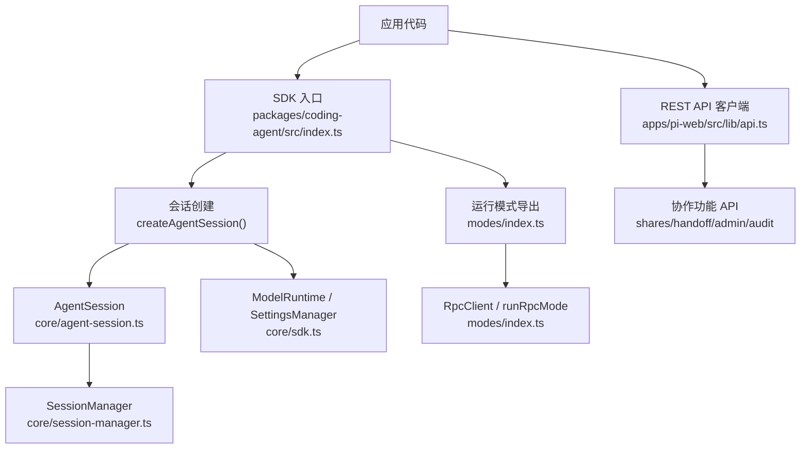
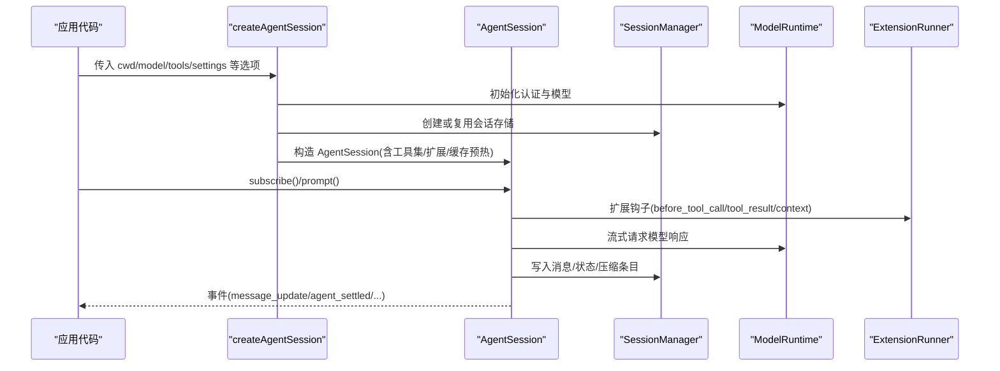
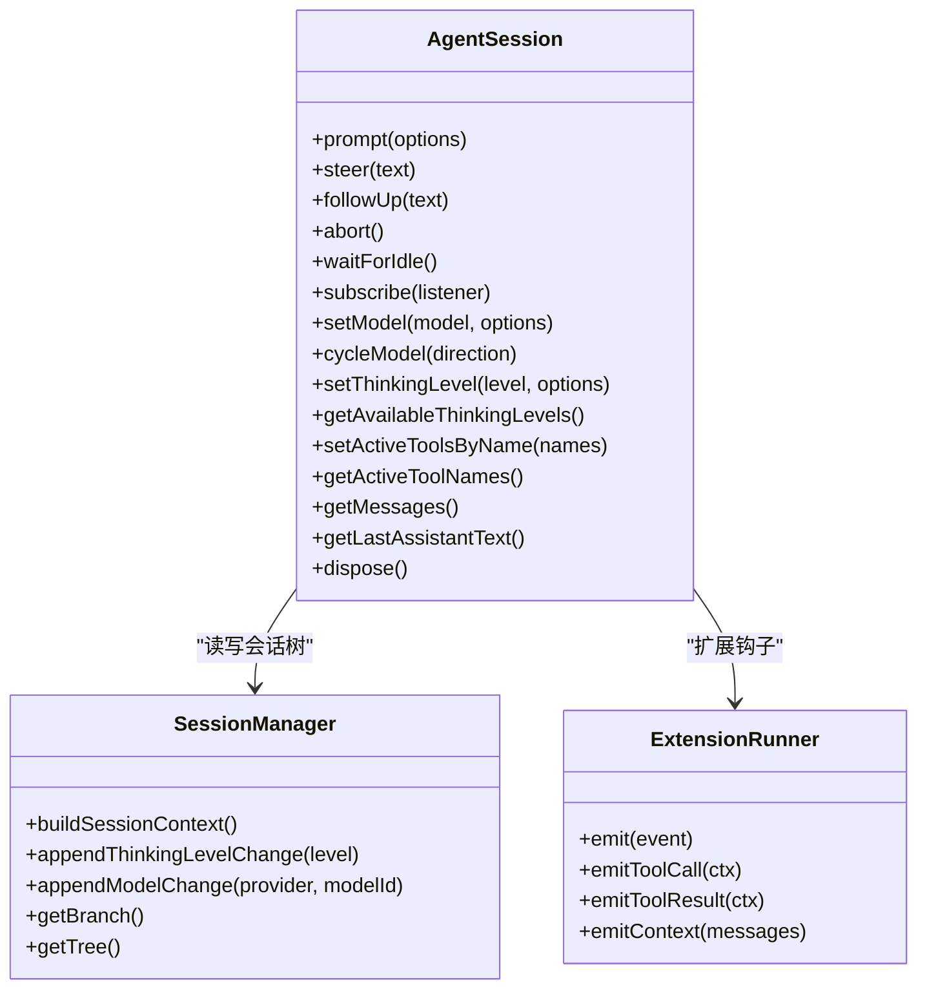
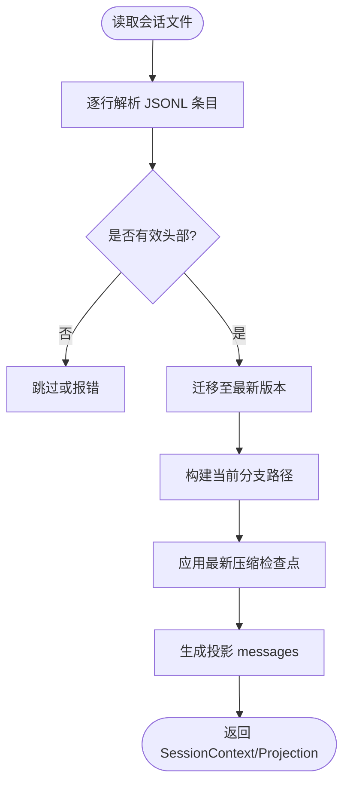
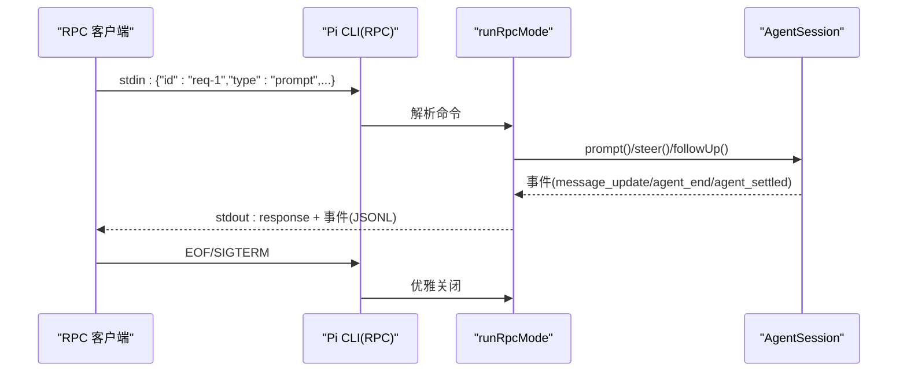
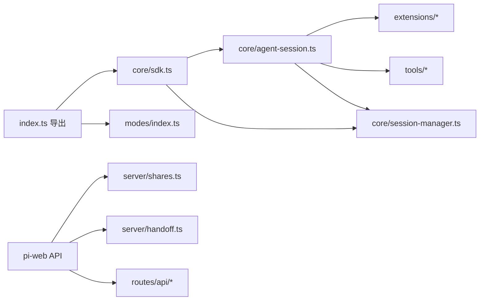

# SDK API 参考


**本文引用的文件**   
- [packages/coding-agent/src/index.ts](https://github.com/FDE-GROUP/oh-my-fde/blob/main/packages/coding-agent/src/index.ts)
- [packages/coding-agent/docs/sdk.md](https://github.com/FDE-GROUP/oh-my-fde/blob/main/packages/coding-agent/docs/sdk.md)
- [packages/coding-agent/docs/rpc.md](https://github.com/FDE-GROUP/oh-my-fde/blob/main/packages/coding-agent/docs/rpc.md)
- [packages/coding-agent/src/core/sdk.ts](https://github.com/FDE-GROUP/oh-my-fde/blob/main/packages/coding-agent/src/core/sdk.ts)
- [packages/coding-agent/src/core/agent-session.ts](https://github.com/FDE-GROUP/oh-my-fde/blob/main/packages/coding-agent/src/core/agent-session.ts)
- [packages/coding-agent/src/core/session-manager.ts](https://github.com/FDE-GROUP/oh-my-fde/blob/main/packages/coding-agent/src/core/session-manager.ts)
- [packages/coding-agent/src/modes/index.ts](https://github.com/FDE-GROUP/oh-my-fde/blob/main/packages/coding-agent/src/modes/index.ts)
- [apps/pi-web/src/routes/api/sessions.$sessionId.shares.ts](https://github.com/FDE-GROUP/oh-my-fde/blob/main/apps/pi-web/src/routes/api/sessions.$sessionId.shares.ts)
- [apps/pi-web/src/routes/api/sessions.$sessionId.handoff.ts](https://github.com/FDE-GROUP/oh-my-fde/blob/main/apps/pi-web/src/routes/api/sessions.$sessionId.handoff.ts)
- [apps/pi-web/src/routes/api/admin.audit.ts](https://github.com/FDE-GROUP/oh-my-fde/blob/main/apps/pi-web/src/routes/api/admin.audit.ts)
- [apps/pi-web/src/routes/api/admin.sessions.ts](https://github.com/FDE-GROUP/oh-my-fde/blob/main/apps/pi-web/src/routes/api/admin.sessions.ts)
- [apps/pi-web/src/routes/api/shares.$token.ts](https://github.com/FDE-GROUP/oh-my-fde/blob/main/apps/pi-web/src/routes/api/shares.$token.ts)
- [apps/pi-web/src/server/shares.ts](https://github.com/FDE-GROUP/oh-my-fde/blob/main/apps/pi-web/src/server/shares.ts)
- [apps/pi-web/src/server/handoff.ts](https://github.com/FDE-GROUP/oh-my-fde/blob/main/apps/pi-web/src/server/handoff.ts)
- [apps/pi-web/src/lib/api.ts](https://github.com/FDE-GROUP/oh-my-fde/blob/main/apps/pi-web/src/lib/api.ts)


## 更新摘要
**变更内容**   
- 新增会话分享 REST API 端点文档
- 新增交接文档生成 API 端点文档  
- 新增管理员会话管理 API 端点文档
- 新增审计日志检索 API 端点文档
- 扩展协作功能的客户端集成指南

## 目录
1. [简介](#简介)
2. [项目结构](#项目结构)
3. [核心组件](#核心组件)
4. [架构总览](#架构总览)
5. [详细组件分析](#详细组件分析)
6. [协作功能 API](#协作功能-api)
7. [依赖关系分析](#依赖关系分析)
8. [性能与可靠性](#性能与可靠性)
9. [故障排查指南](#故障排查指南)
10. [结论](#结论)
11. [附录：RPC 协议与客户端实现指南](#附录rpc-协议与客户端实现指南)

## 简介
本文件为 Pi TypeScript SDK 的完整 API 参考，面向希望在 Node.js 或 Bun 进程中集成 Pi 的开发者。文档覆盖会话管理、消息处理、工具调用、扩展加载、模型与设置边界、RPC 子进程模式等核心能力，并提供代码级图示、错误处理建议与最佳实践。

SDK 提供两类集成方式：
- 进程内 TypeScript SDK：直接调用 AgentSession、工具工厂、扩展系统等类型化 API。
- RPC 子进程模式：通过 JSONL 协议控制 Pi CLI，适合跨语言、隔离进程或 IDE 集成。
- REST API 协作功能：会话分享、交接文档生成、管理员会话管理和审计日志检索。

## 项目结构
Pi 的 SDK 入口位于 `@earendil-works/pi-coding-agent` 包中，对外暴露会话创建、工具工厂、扩展系统、会话持久化、模型运行时、设置管理器、RPC 客户端等能力。同时，pi-web 应用提供了完整的 REST API 用于协作功能。



图表来源
- [packages/coding-agent/src/index.ts:1-503](https://github.com/FDE-GROUP/oh-my-fde/blob/main/packages/coding-agent/src/index.ts#L1-L503)
- [apps/pi-web/src/lib/api.ts:290-472](https://github.com/FDE-GROUP/oh-my-fde/blob/main/apps/pi-web/src/lib/api.ts#L290-L472)
- [packages/coding-agent/src/core/sdk.ts:180-482](https://github.com/FDE-GROUP/oh-my-fde/blob/main/packages/coding-agent/src/core/sdk.ts#L180-L482)
- [packages/coding-agent/src/core/agent-session.ts:409-559](https://github.com/FDE-GROUP/oh-my-fde/blob/main/packages/coding-agent/src/core/agent-session.ts#L409-L559)
- [packages/coding-agent/src/core/session-manager.ts:43-227](https://github.com/FDE-GROUP/oh-my-fde/blob/main/packages/coding-agent/src/core/session-manager.ts#L43-L227)
- [packages/coding-agent/src/modes/index.ts:1-17](https://github.com/FDE-GROUP/oh-my-fde/blob/main/packages/coding-agent/src/modes/index.ts#L1-L17)

章节来源
- [packages/coding-agent/src/index.ts:1-503](https://github.com/FDE-GROUP/oh-my-fde/blob/main/packages/coding-agent/src/index.ts#L1-L503)
- [packages/coding-agent/docs/sdk.md:1-148](https://github.com/FDE-GROUP/oh-my-fde/blob/main/packages/coding-agent/docs/sdk.md#L1-L148)

## 核心组件
本节概述 SDK 的主要公共接口与职责。

- 会话生命周期
  - createAgentSession：创建并配置一个 AgentSession，负责模型选择、工具集、资源加载、会话恢复等。
  - AgentSession：封装一次对话的生命周期，包括 prompt、subscribe、abort、waitForIdle、模型切换、思考级别、工具注册、事件流、压缩（compaction）等。
  - SessionManager：会话树与持久化的权威来源，支持分支、标签、上下文编辑、投影构建等。

- 工具与扩展
  - 工具工厂：createBashTool、createReadTool、createWriteTool、createEditTool、createFindTool、createGrepTool、createLsTool、createPowerShellTool、createCodingTools、createReadOnlyTools 等。
  - 扩展系统：ExtensionRunner、InlineExtension、ExtensionFactory、ExtensionContext、ExtensionAPI 等，支持命令、快捷键、UI、工具注入、事件钩子。

- 模型与设置
  - ModelRuntime：统一认证、模型解析、流式请求。
  - SettingsManager：全局与 per-model 设置，如默认工具、重试策略、HTTP/WebSocket 超时、图片处理、思考预算等。

- 运行模式
  - InteractiveMode、PrintMode、RpcClient、runRpcMode：交互式、打印输出、RPC 子进程三种运行模式。

章节来源
- [packages/coding-agent/src/core/sdk.ts:48-148](https://github.com/FDE-GROUP/oh-my-fde/blob/main/packages/coding-agent/src/core/sdk.ts#L48-L148)
- [packages/coding-agent/src/core/agent-session.ts:266-354](https://github.com/FDE-GROUP/oh-my-fde/blob/main/packages/coding-agent/src/core/agent-session.ts#L266-L354)
- [packages/coding-agent/src/core/session-manager.ts:43-227](https://github.com/FDE-GROUP/oh-my-fde/blob/main/packages/coding-agent/src/core/session-manager.ts#L43-L227)
- [packages/coding-agent/src/modes/index.ts:1-17](https://github.com/FDE-GROUP/oh-my-fde/blob/main/packages/coding-agent/src/modes/index.ts#L1-L17)

## 架构总览
下图展示 SDK 在进程内的典型调用链：应用代码通过 SDK 入口创建会话，会话内部组合 Agent、SessionManager、SettingsManager、ResourceLoader、ModelRuntime，并通过扩展系统注入工具与 UI。



图表来源
- [packages/coding-agent/src/core/sdk.ts:191-482](https://github.com/FDE-GROUP/oh-my-fde/blob/main/packages/coding-agent/src/core/sdk.ts#L191-L482)
- [packages/coding-agent/src/core/agent-session.ts:409-559](https://github.com/FDE-GROUP/oh-my-fde/blob/main/packages/coding-agent/src/core/agent-session.ts#L409-L559)
- [packages/coding-agent/src/core/session-manager.ts:43-227](https://github.com/FDE-GROUP/oh-my-fde/blob/main/packages/coding-agent/src/core/session-manager.ts#L43-L227)

## 详细组件分析

### 会话创建与配置：createAgentSession
- 作用
  - 根据选项解析工作目录、Agent 目录、ModelRuntime、SettingsManager、SessionManager、ResourceLoader。
  - 从已有会话恢复模型与思考级别；若无则按设置与 provider 默认值选择初始模型。
  - 计算初始工具集（allowlist/denylist、MCP 工具保留策略）。
  - 包装 convertToLlm 以支持"屏蔽图片"等安全策略。
  - 组装 Agent、ExtensionRunner、CacheWarmer，并返回 { session, extensionsResult, modelFallbackMessage }。

- 关键参数（CreateAgentSessionOptions）
  - cwd：工作目录，影响资源发现、工具路径、会话分组。
  - agentDir：全局配置目录，默认 ~/.pi/agent。
  - modelRuntime：统一认证与模型运行时。
  - model/thinkingLevel/scopedModels：模型与思考级别选择。
  - noTools/tools/excludeTools/customTools：工具白名单/黑名单/自定义工具。
  - resourceLoader：资源加载器（扩展、技能、提示模板、主题、上下文文件）。
  - sessionManager/settingsManager：会话与设置管理器。
  - sessionStartEvent：扩展启动元数据。

- 返回值（CreateAgentSessionResult）
  - session：AgentSession 实例。
  - extensionsResult：扩展加载结果。
  - modelFallbackMessage：当无法恢复原模型时的提示。

- 行为要点
  - 若 tools 仅包含 +name/-name 形式，视为对 defaultTools 的增量修改而非替换。
  - MCP 工具在未显式排除时通常保留给 codemode/tool_search 使用。
  - 可注入 before_provider_headers/before_provider_request/after_provider_response/provider_stream_event 扩展钩子。

章节来源
- [packages/coding-agent/src/core/sdk.ts:48-148](https://github.com/FDE-GROUP/oh-my-fde/blob/main/packages/coding-agent/src/core/sdk.ts#L48-L148)
- [packages/coding-agent/src/core/sdk.ts:191-482](https://github.com/FDE-GROUP/oh-my-fde/blob/main/packages/coding-agent/src/core/sdk.ts#L191-L482)

### 会话对象：AgentSession
- 职责
  - 管理一次对话的状态与生命周期：消息队列、工具执行、模型切换、思考级别、压缩、重试、分支与会话树。
  - 订阅与分发事件：message_start/update/end、tool_execution_*、queue_update、compaction_*、auto_retry_*、summarization_retry_*、bash_execution_update、agent_end/settled 等。
  - 与扩展系统集成：before/after tool call、context transform、UI 交互、命令与快捷键。

- 主要方法与属性
  - prompt(options)：发送用户消息，支持模板展开、图片附件、流式行为（steer/followUp）、source。
  - steer()/followUp()：在当前运行后插入引导或后续消息。
  - abort()/waitForIdle()：中止当前操作或等待空闲。
  - subscribe(listener)：订阅会话事件。
  - setModel()/cycleModel()/setThinkingLevel()/getAvailableThinkingLevels()：模型与思考级别管理。
  - setActiveToolsByName()/getActiveToolNames()：动态启用/禁用工具。
  - getMessages()/getLastAssistantText()：读取会话消息与最后助手文本。
  - dispose()：释放资源、断开扩展、移除监听。

- 事件类型（部分）
  - message_start/message_update/message_end
  - tool_execution_start/tool_execution_update/tool_execution_end
  - queue_update
  - compaction_start/compaction_end
  - auto_retry_start/auto_retry_end
  - summarization_retry_scheduled/summarization_retry_attempt_start/summarization_retry_finished
  - bash_execution_update
  - agent_end/agent_settled

- 工具与扩展
  - 通过 ExtensionRunner 注入 before/after tool call、tool_result、context transform 等钩子。
  - 支持嵌套工具调用（ctx.executeTool），携带 parentToolCallId。



图表来源
- [packages/coding-agent/src/core/agent-session.ts:266-354](https://github.com/FDE-GROUP/oh-my-fde/blob/main/packages/coding-agent/src/core/agent-session.ts#L266-L354)
- [packages/coding-agent/src/core/agent-session.ts:409-559](https://github.com/FDE-GROUP/oh-my-fde/blob/main/packages/coding-agent/src/core/agent-session.ts#L409-L559)
- [packages/coding-agent/src/core/session-manager.ts:43-227](https://github.com/FDE-GROUP/oh-my-fde/blob/main/packages/coding-agent/src/core/session-manager.ts#L43-L227)

章节来源
- [packages/coding-agent/src/core/agent-session.ts:266-354](https://github.com/FDE-GROUP/oh-my-fde/blob/main/packages/coding-agent/src/core/agent-session.ts#L266-L354)
- [packages/coding-agent/src/core/agent-session.ts:409-559](https://github.com/FDE-GROUP/oh-my-fde/blob/main/packages/coding-agent/src/core/agent-session.ts#L409-L559)

### 会话持久化与树：SessionManager
- 作用
  - 维护会话的追加式条目树（JSONL），支持分支、标签、上下文编辑、摘要与压缩。
  - 提供投影构建：将原始条目转换为模型可见的消息序列，考虑压缩与上下文编辑。
  - 提供会话发现、最近会话查找、头信息读取等实用方法。

- 关键数据结构
  - SessionEntry：消息、思考级别变更、模型变更、用量、压缩、分支摘要、自定义条目、自定义消息、上下文编辑、标签、会话信息等。
  - SessionProjection：包含 entries/messages/thinkingLevel/model 的投影。
  - SessionTreeNode：带 label 的树节点视图。

- 常用函数
  - buildSessionContext/buildSessionProjection/buildContextEntries：构建最终上下文。
  - sessionEntryToContextMessages：单条条目到消息的转换。
  - loadEntriesFromFile/findMostRecentSession/getDefaultSessionDir：文件与目录操作。



图表来源
- [packages/coding-agent/src/core/session-manager.ts:350-370](https://github.com/FDE-GROUP/oh-my-fde/blob/main/packages/coding-agent/src/core/session-manager.ts#L350-L370)
- [packages/coding-agent/src/core/session-manager.ts:476-584](https://github.com/FDE-GROUP/oh-my-fde/blob/main/packages/coding-agent/src/core/session-manager.ts#L476-L584)
- [packages/coding-agent/src/core/session-manager.ts:628-670](https://github.com/FDE-GROUP/oh-my-fde/blob/main/packages/coding-agent/src/core/session-manager.ts#L628-L670)

章节来源
- [packages/coding-agent/src/core/session-manager.ts:43-227](https://github.com/FDE-GROUP/oh-my-fde/blob/main/packages/coding-agent/src/core/session-manager.ts#L43-L227)
- [packages/coding-agent/src/core/session-manager.ts:476-584](https://github.com/FDE-GROUP/oh-my-fde/blob/main/packages/coding-agent/src/core/session-manager.ts#L476-L584)

### 工具与扩展
- 工具工厂
  - Bash/PowerShell：命令行执行与输出累积。
  - Read/Write/Edit：文件读取、写入与差异编辑。
  - Find/Grep/Ls：文件搜索与列表。
  - CodingTools/ReadOnlyTools：高级编码与只读工具集合。
  - withFileMutationQueue：文件写操作的串行化队列。

- 扩展系统
  - InlineExtension/ExtensionFactory：定义内联或外部扩展。
  - ExtensionContext/ExtensionAPI：扩展运行上下文与可用 API。
  - ExtensionRunner：事件分发、命令/快捷键/UI 交互、工具包装。
  - 常见事件：tool_call、tool_result、before_provider_headers、before_provider_request、after_provider_response、provider_stream_event、session_start 等。

章节来源
- [packages/coding-agent/src/core/sdk.ts:135-148](https://github.com/FDE-GROUP/oh-my-fde/blob/main/packages/coding-agent/src/core/sdk.ts#L135-L148)
- [packages/coding-agent/src/index.ts:53-221](https://github.com/FDE-GROUP/oh-my-fde/blob/main/packages/coding-agent/src/index.ts#L53-L221)

### 运行模式与 RPC
- 运行模式
  - InteractiveMode：交互式终端界面。
  - PrintMode：打印模式，适合脚本化输出。
  - RpcClient/runRpcMode：RPC 子进程模式，通过 JSONL 协议控制 Pi。

- RPC 协议要点
  - 记录族：stdin 命令、stdout response、stdout 会话事件、双向 extension_ui 记录。
  - 帧格式：严格 JSONL，LF 分隔，避免 Unicode 换行符误判。
  - 关联 ID：命令可选 id，response 重复该 id；bash_execution_update 可携带命令 id。
  - 生命周期：prompt 成功仅代表接受/排队/被扩展处理；需等待 agent_settled 表示不再自动继续。
  - 错误：失败 response 含 success:false；解析错误无 request id；stderr 不解析为协议数据。
  - 关闭：EOF/SIGTERM/SIGHUP 优雅关闭；二次信号立即退出。



图表来源
- [packages/coding-agent/docs/rpc.md:1-196](https://github.com/FDE-GROUP/oh-my-fde/blob/main/packages/coding-agent/docs/rpc.md#L1-L196)
- [packages/coding-agent/src/modes/index.ts:1-17](https://github.com/FDE-GROUP/oh-my-fde/blob/main/packages/coding-agent/src/modes/index.ts#L1-L17)

章节来源
- [packages/coding-agent/docs/rpc.md:1-196](https://github.com/FDE-GROUP/oh-my-fde/blob/main/packages/coding-agent/docs/rpc.md#L1-L196)
- [packages/coding-agent/src/modes/index.ts:1-17](https://github.com/FDE-GROUP/oh-my-fde/blob/main/packages/coding-agent/src/modes/index.ts#L1-L17)

## 协作功能 API

### 会话分享 API

#### 创建会话分享
- **端点**: `POST /api/sessions/{sessionId}/shares`
- **权限**: 需要会话访问权限
- **请求体**: `{ expiresInDays?: number }` (默认 7 天，最大 30 天)
- **响应**: 
  ```json
  {
    "token": "分享令牌",
    "expiresAt": 过期时间戳,
    "url": "完整分享链接"
  }
  ```

#### 列出会话分享
- **端点**: `GET /api/sessions/{sessionId}/shares`
- **权限**: 需要会话访问权限
- **响应**: 
  ```json
  {
    "shares": [
      {
        "id": "分享ID",
        "createdAt": 创建时间,
        "expiresAt": 过期时间,
        "revokedAt": 撤销时间(可选)
      }
    ]
  }
  ```

#### 获取分享快照
- **端点**: `GET /api/shares/{token}`
- **权限**: 公开访问（无需登录）
- **响应**: 
  ```json
  {
    "snapshot": 会话快照数据,
    "session": {
      "id": "会话ID",
      "name": "会话名称",
      "workspace": "工作区名称"
    }
  }
  ```

#### 撤销分享
- **端点**: `DELETE /api/shares/{token}`
- **权限**: 需要分享所有者身份
- **响应**: `{ ok: true }`

**章节来源**
- [apps/pi-web/src/routes/api/sessions.$sessionId.shares.ts:12-58](https://github.com/FDE-GROUP/oh-my-fde/blob/main/apps/pi-web/src/routes/api/sessions.$sessionId.shares.ts#L12-L58)
- [apps/pi-web/src/routes/api/shares.$token.ts:13-54](https://github.com/FDE-GROUP/oh-my-fde/blob/main/apps/pi-web/src/routes/api/shares.$token.ts#L13-L54)
- [apps/pi-web/src/server/shares.ts:76-138](https://github.com/FDE-GROUP/oh-my-fde/blob/main/apps/pi-web/src/server/shares.ts#L76-L138)

### 交接文档生成 API

#### 生成交接文档
- **端点**: `GET /api/sessions/{sessionId}/handoff`
- **权限**: 需要会话读取权限
- **响应**: Markdown 格式的交接文档下载
- **内容结构**:
  - 会话基本信息（ID、工作区、所有者、模型）
  - 目标与结论
  - 工具调用摘要
  - 改动文件列表
  - 风险与下一步事项
  - 敏感信息自动脱敏

**章节来源**
- [apps/pi-web/src/routes/api/sessions.$sessionId.handoff.ts:12-43](https://github.com/FDE-GROUP/oh-my-fde/blob/main/apps/pi-web/src/routes/api/sessions.$sessionId.handoff.ts#L12-L43)
- [apps/pi-web/src/server/handoff.ts:92-152](https://github.com/FDE-GROUP/oh-my-fde/blob/main/apps/pi-web/src/server/handoff.ts#L92-L152)

### 管理员会话管理 API

#### 获取所有会话
- **端点**: `GET /api/admin/sessions`
- **权限**: 仅管理员角色
- **响应**: 
  ```json
  {
    "sessions": [
      {
        "id": "会话ID",
        "name": "会话名称",
        "owner": "所有者ID",
        ...其他会话信息
      }
    ]
  }
  ```

**章节来源**
- [apps/pi-web/src/routes/api/admin.sessions.ts:11-27](https://github.com/FDE-GROUP/oh-my-fde/blob/main/apps/pi-web/src/routes/api/admin.sessions.ts#L11-L27)

### 审计日志检索 API

#### 查询审计日志
- **端点**: `GET /api/admin/audit?limit={数量}`
- **权限**: 仅管理员角色
- **参数**: 
  - `limit`: 最多返回的记录数（默认 100）
- **响应**: 
  ```json
  {
    "entries": [
      {
        "ts": 时间戳,
        "user": "用户ID",
        "role": "admin|member",
        "action": "操作类型",
        "target": "目标资源",
        "result": "ok|failed",
        "detail": "详细信息(可选)"
      }
    ]
  }
  ```

**章节来源**
- [apps/pi-web/src/routes/api/admin.audit.ts:10-21](https://github.com/FDE-GROUP/oh-my-fde/blob/main/apps/pi-web/src/routes/api/admin.audit.ts#L10-L21)

### 客户端集成示例

```typescript
import { 
  createShare, 
  listShares, 
  revokeShare, 
  fetchSharedSession,
  openSharedEventStream,
  fetchAdminSessions,
  fetchAudit
} from './lib/api';

// 创建会话分享
const share = await createShare('session-id', 7);
console.log('分享链接:', share.url);

// 列出会话的所有分享
const shares = await listShares('session-id');

// 获取分享数据
const sharedData = await fetchSharedSession('share-token');

// 打开分享事件流
const closeStream = openSharedEventStream('share-token', {
  onSnapshot: (snapshot) => console.log('快照更新'),
  onEvent: (event) => console.log('事件更新'),
  onConnectionError: () => console.log('连接错误')
});

// 管理员功能
const sessions = await fetchAdminSessions();
const auditLogs = await fetchAudit(50);
```

**章节来源**
- [apps/pi-web/src/lib/api.ts:389-471](https://github.com/FDE-GROUP/oh-my-fde/blob/main/apps/pi-web/src/lib/api.ts#L389-L471)

## 依赖关系分析
SDK 对外导出大量类型与工厂，内部由 core 模块组织。以下图展示主要导出与依赖关系。



图表来源
- [packages/coding-agent/src/index.ts:1-503](https://github.com/FDE-GROUP/oh-my-fde/blob/main/packages/coding-agent/src/index.ts#L1-L503)
- [packages/coding-agent/src/core/sdk.ts:1-482](https://github.com/FDE-GROUP/oh-my-fde/blob/main/packages/coding-agent/src/core/sdk.ts#L1-L482)
- [packages/coding-agent/src/core/agent-session.ts:1-800](https://github.com/FDE-GROUP/oh-my-fde/blob/main/packages/coding-agent/src/core/agent-session.ts#L1-L800)
- [packages/coding-agent/src/core/session-manager.ts:1-800](https://github.com/FDE-GROUP/oh-my-fde/blob/main/packages/coding-agent/src/core/session-manager.ts#L1-L800)
- [apps/pi-web/src/server/shares.ts:1-149](https://github.com/FDE-GROUP/oh-my-fde/blob/main/apps/pi-web/src/server/shares.ts#L1-L149)
- [apps/pi-web/src/server/handoff.ts:1-153](https://github.com/FDE-GROUP/oh-my-fde/blob/main/apps/pi-web/src/server/handoff.ts#L1-L153)

## 性能与可靠性
- 模型与网络
  - 通过 SettingsManager 配置 HTTP/WebSocket 超时、重试次数与延迟上限。
  - 支持 before_provider_headers/before_provider_request/after_provider_response/provider_stream_event 扩展钩子，便于鉴权、日志与遥测。

- 上下文与缓存
  - CacheWarmer 针对选定的模型与上下文进行预热，减少冷启动开销。
  - 会话投影与压缩（compaction）控制上下文大小，避免溢出。

- 工具与 I/O
  - withFileMutationQueue 串行化文件写操作，避免并发冲突。
  - 图片内容可按设置自动调整尺寸或被屏蔽，降低传输与成本。

- 协作功能优化
  - 分享 token 使用 SHA-256 哈希存储，提高安全性。
  - 分享索引文件采用原子写入和权限保护（0600）。
  - 交接文档自动生成时进行敏感信息脱敏。

[本节为通用指导，无需特定文件引用]

## 故障排查指南
- 认证与模型
  - 若未找到 API Key 或 OAuth 过期，会抛出明确错误并给出登录指引。
  - 无法恢复会话中的模型时，返回 modelFallbackMessage 提示。

- 会话与持久化
  - 会话文件损坏或头部扫描超限会被跳过或报错，不影响其他会话发现。
  - 旧版本会话会自动迁移至当前版本。

- RPC 模式
  - 确保使用 LF 分隔的 JSONL，不要使用 readline 的 Unicode 换行分割。
  - 区分 command response 与 session event；stderr 不是协议数据。
  - 优雅关闭流程：先 EOF 或 SIGTERM，必要时再发第二次信号强制退出。

- 协作功能问题
  - 分享链接失效：检查分享是否已过期或被撤销。
  - 交接文档生成失败：确认会话运行时状态正常。
  - 管理员权限错误：验证用户角色是否为 admin。

章节来源
- [packages/coding-agent/src/core/agent-session.ts:565-603](https://github.com/FDE-GROUP/oh-my-fde/blob/main/packages/coding-agent/src/core/agent-session.ts#L565-L603)
- [packages/coding-agent/src/core/session-manager.ts:610-738](https://github.com/FDE-GROUP/oh-my-fde/blob/main/packages/coding-agent/src/core/session-manager.ts#L610-L738)
- [packages/coding-agent/docs/rpc.md:50-98](https://github.com/FDE-GROUP/oh-my-fde/blob/main/packages/coding-agent/docs/rpc.md#L50-L98)

## 结论
Pi TypeScript SDK 提供了完整的会话、工具、扩展与模型运行时抽象，既适合在 Node.js/Bun 中直接集成，也支持通过 RPC 子进程模式进行跨语言控制。通过 SessionManager 的追加式条目树与投影机制，SDK 在保证可扩展性的同时，兼顾了上下文压缩、分支管理与持久化。结合扩展系统与工具工厂，开发者可以灵活定制工具、UI 与工作流。

新增的协作功能 API 进一步增强了系统的实用性，提供了会话分享、交接文档生成、管理员会话管理和审计日志检索等企业级特性。这些功能通过 REST API 暴露，便于与其他系统集成，同时保证了安全性和性能。

[本节为总结性内容，无需特定文件引用]

## 附录：RPC 协议与客户端实现指南
- 启动方式
  - 使用 pi --mode rpc --no-session 启动 RPC 模式，配合 --provider/--model/--name/--no-session/--session-dir 等参数。

- 协议规范
  - 记录族：命令（stdin）、response（stdout）、会话事件（stdout）、extension_ui（双向）。
  - 帧格式：严格 JSONL，LF 分隔；避免 Unicode 换行符作为边界。
  - 关联 ID：命令可选 id，response 重复 id；bash_execution_update 可携带命令 id。
  - 生命周期：prompt 成功不代表完成；等待 agent_settled 表示不再自动继续。
  - 错误：失败 response 含 success:false；解析错误无 request id；stderr 非协议数据。
  - 关闭：EOF/SIGTERM/SIGHUP 优雅关闭；第二次信号立即退出。

- 客户端实现要点
  - 使用二进制管道读取 stdout，按 LF 拆分；写入 stdin 时遵循背压。
  - 先安装事件监听，再发送 prompt，避免丢失快速完成的事件。
  - 使用 RpcClient 或自行实现 JSONL 收发与 ID 关联。

章节来源
- [packages/coding-agent/docs/rpc.md:1-196](https://github.com/FDE-GROUP/oh-my-fde/blob/main/packages/coding-agent/docs/rpc.md#L1-L196)
- [packages/coding-agent/src/modes/index.ts:1-17](https://github.com/FDE-GROUP/oh-my-fde/blob/main/packages/coding-agent/src/modes/index.ts#L1-L17)