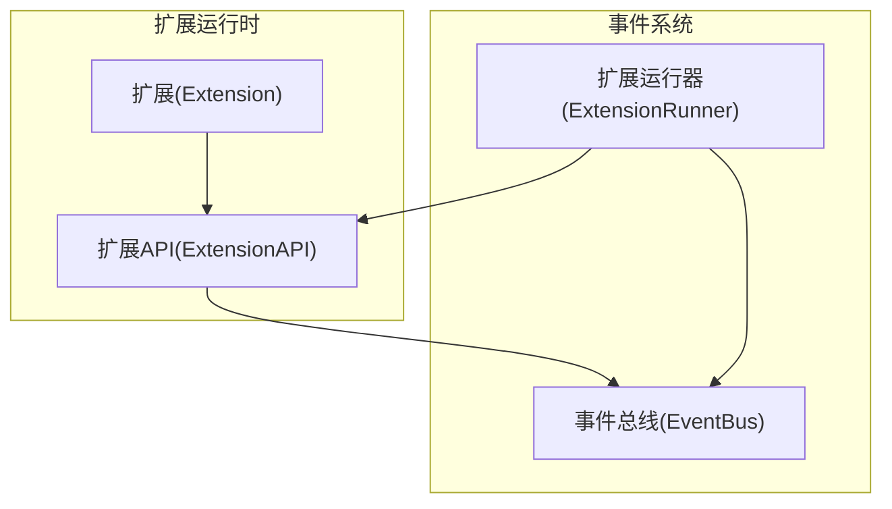
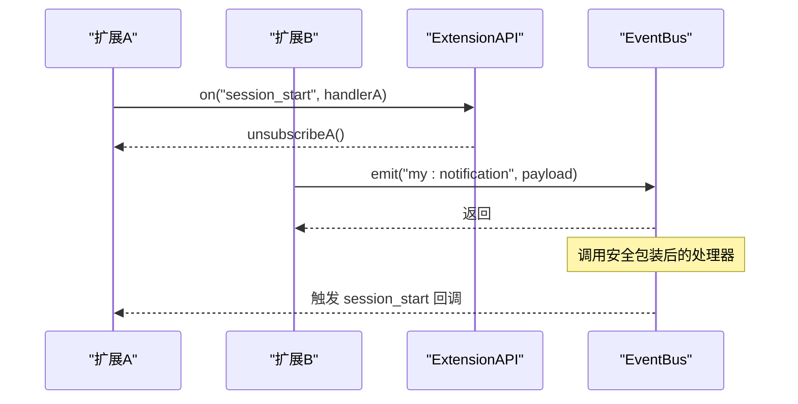
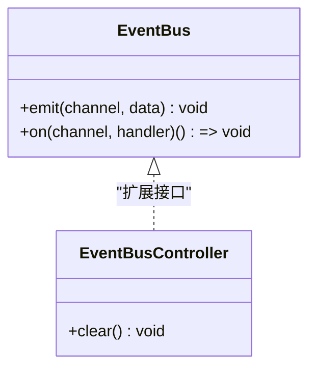
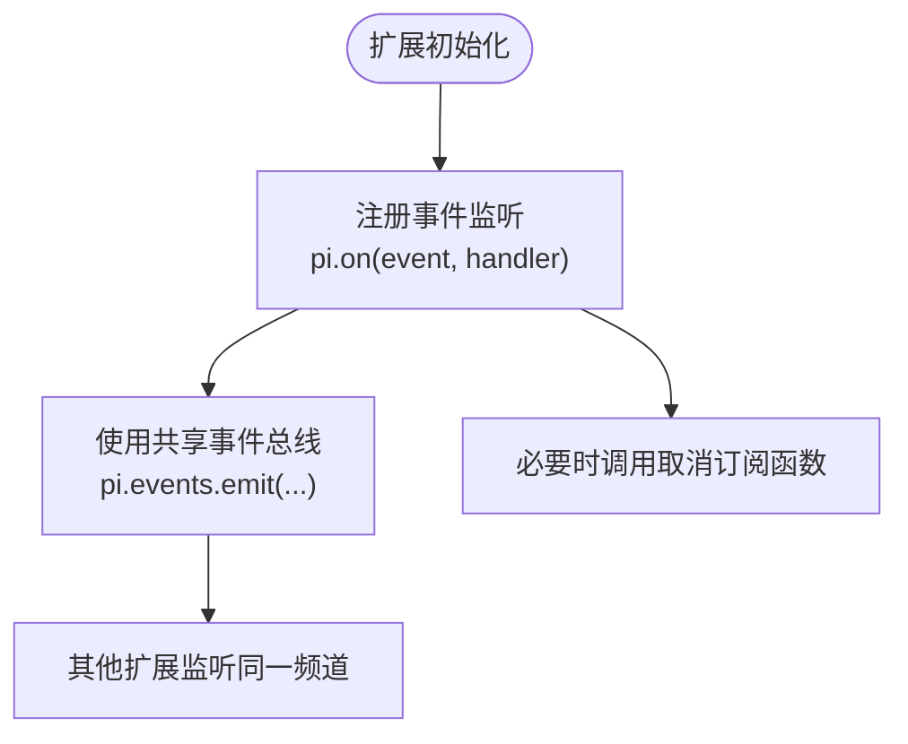
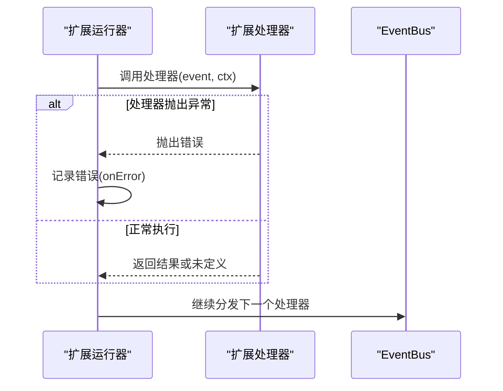
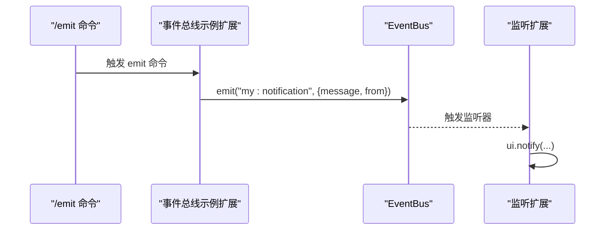
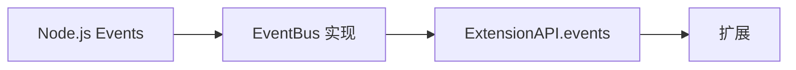

# 事件系统 API

**本文引用的文件**   
- [event-bus.ts](https://github.com/FDE-GROUP/oh-my-fde/blob/main/packages/coding-agent/src/core/event-bus.ts)
- [types.ts](https://github.com/FDE-GROUP/oh-my-fde/blob/main/packages/coding-agent/src/core/extensions/types.ts)
- [extensions-runner.test.ts](https://github.com/FDE-GROUP/oh-my-fde/blob/main/packages/coding-agent/test/extensions-runner.test.ts)
- [event-bus-example.ts](https://github.com/FDE-GROUP/oh-my-fde/blob/main/packages/coding-agent/examples/extensions/event-bus.ts)

## 目录
1. [简介](#简介)
2. [项目结构](#项目结构)
3. [核心组件](#核心组件)
4. [架构总览](#架构总览)
5. [详细组件分析](#详细组件分析)
6. [依赖关系分析](#依赖关系分析)
7. [性能与并发特性](#性能与并发特性)
8. [故障排查指南](#故障排查指南)
9. [结论](#结论)
10. [附录：预定义事件清单](#附录预定义事件清单)

## 简介
本文件为事件系统的完整 API 文档，聚焦以下目标：
- 说明 EventBus 的创建、使用、监听器注册、事件分发机制与异步处理。
- 梳理所有预定义事件的类型定义、触发时机与数据格式。
- 提供事件驱动编程模式与最佳实践。
- 展示如何在扩展中使用事件系统进行组件间通信。

## 项目结构
事件系统由两部分组成：
- 通用事件总线 EventBus：基于 Node.js EventEmitter 封装，提供 emit/on/clear 能力，并对处理器进行异步包装与错误捕获。
- 扩展事件体系 ExtensionEvent：在扩展 API 中暴露大量领域事件（会话、代理、工具、模型等），供扩展订阅与响应。

图表来源
- [event-bus.ts:12-33](https://github.com/FDE-GROUP/oh-my-fde/blob/main/packages/coding-agent/src/core/event-bus.ts#L12-L33)
- [types.ts:1637-1966](https://github.com/FDE-GROUP/oh-my-fde/blob/main/packages/coding-agent/src/core/extensions/types.ts#L1637-L1966)

章节来源
- [event-bus.ts:1-34](https://github.com/FDE-GROUP/oh-my-fde/blob/main/packages/coding-agent/src/core/event-bus.ts#L1-L34)
- [types.ts:1637-1966](https://github.com/FDE-GROUP/oh-my-fde/blob/main/packages/coding-agent/src/core/extensions/types.ts#L1637-L1966)

## 核心组件
- EventBus：轻量级发布/订阅通道，用于扩展间通信。
- ExtensionAPI：扩展对外暴露的统一接口，包含 on(event, handler) 订阅系统事件，以及 events 属性访问共享 EventBus。
- ExtensionEvent：扩展可订阅的事件联合类型，覆盖会话、代理、工具、模型、输入等多个维度。

章节来源
- [event-bus.ts:3-33](https://github.com/FDE-GROUP/oh-my-fde/blob/main/packages/coding-agent/src/core/event-bus.ts#L3-L33)
- [types.ts:1424-1457](https://github.com/FDE-GROUP/oh-my-fde/blob/main/packages/coding-agent/src/core/extensions/types.ts#L1424-L1457)
- [types.ts:1637-1966](https://github.com/FDE-GROUP/oh-my-fde/blob/main/packages/coding-agent/src/core/extensions/types.ts#L1637-L1966)

## 架构总览
下图展示了扩展通过 ExtensionAPI 订阅系统事件，并通过共享 EventBus 进行跨扩展通信的整体流程。

图表来源
- [types.ts:1647-1647](https://github.com/FDE-GROUP/oh-my-fde/blob/main/packages/coding-agent/src/core/extensions/types.ts#L1647-L1647)
- [event-bus-example.ts:16-24](https://github.com/FDE-GROUP/oh-my-fde/blob/main/packages/coding-agent/examples/extensions/event-bus.ts#L16-L24)
- [event-bus.ts:18-27](https://github.com/FDE-GROUP/oh-my-fde/blob/main/packages/coding-agent/src/core/event-bus.ts#L18-L27)

## 详细组件分析

### 事件总线 EventBus
- 接口
  - emit(channel, data)：向指定频道发送事件。
  - on(channel, handler)：注册监听器，返回取消订阅函数。
  - clear()：移除所有监听器。
- 实现要点
  - 内部基于 Node.js EventEmitter。
  - on 返回的处理器会被异步包装，异常被捕获并打印日志，避免阻塞事件循环。
  - clear 会清空所有监听器。

图表来源
- [event-bus.ts:3-10](https://github.com/FDE-GROUP/oh-my-fde/blob/main/packages/coding-agent/src/core/event-bus.ts#L3-L10)
- [event-bus.ts:12-33](https://github.com/FDE-GROUP/oh-my-fde/blob/main/packages/coding-agent/src/core/event-bus.ts#L12-L33)

章节来源
- [event-bus.ts:1-34](https://github.com/FDE-GROUP/oh-my-fde/blob/main/packages/coding-agent/src/core/event-bus.ts#L1-L34)

### 扩展事件订阅 API
- ExtensionAPI.on(event, handler)：订阅系统事件，handler 接收 (event, ctx)。
- ExtensionAPI.events：共享 EventBus，用于扩展间通信。
- 返回值：on 返回取消订阅函数，便于生命周期管理。

图表来源
- [types.ts:1637-1966](https://github.com/FDE-GROUP/oh-my-fde/blob/main/packages/coding-agent/src/core/extensions/types.ts#L1637-L1966)
- [event-bus-example.ts:20-34](https://github.com/FDE-GROUP/oh-my-fde/blob/main/packages/coding-agent/examples/extensions/event-bus.ts#L20-L34)

章节来源
- [types.ts:1637-1966](https://github.com/FDE-GROUP/oh-my-fde/blob/main/packages/coding-agent/src/core/extensions/types.ts#L1637-L1966)
- [event-bus-example.ts:1-44](https://github.com/FDE-GROUP/oh-my-fde/blob/main/packages/coding-agent/examples/extensions/event-bus.ts#L1-L44)

### 事件分发与异步处理
- 系统事件分发由扩展运行器负责，将事件派发至已注册的扩展处理器。
- 处理器支持同步或异步返回；若抛出异常，运行器会收集错误并通过 onError 上报。
- 取消订阅行为具备确定性：自删除不会跳过相邻处理器；重复注册独立清理；当前分发中的延迟注册延后至下一次分发。

图表来源
- [extensions-runner.test.ts:1281-1400](https://github.com/FDE-GROUP/oh-my-fde/blob/main/packages/coding-agent/test/extensions-runner.test.ts#L1281-L1400)

章节来源
- [extensions-runner.test.ts:1281-1400](https://github.com/FDE-GROUP/oh-my-fde/blob/main/packages/coding-agent/test/extensions-runner.test.ts#L1281-L1400)

### 扩展间通信示例
- 示例扩展演示了：
  - 订阅 session_start 以获取上下文。
  - 监听来自其他扩展的自定义频道 my:notification。
  - 通过命令 /emit 触发通知事件，其他扩展收到后显示 UI 通知。

图表来源
- [event-bus-example.ts:26-42](https://github.com/FDE-GROUP/oh-my-fde/blob/main/packages/coding-agent/examples/extensions/event-bus.ts#L26-L42)

章节来源
- [event-bus-example.ts:1-44](https://github.com/FDE-GROUP/oh-my-fde/blob/main/packages/coding-agent/examples/extensions/event-bus.ts#L1-L44)

## 依赖关系分析
- EventBus 依赖 Node.js 内置事件模块。
- ExtensionAPI 聚合系统事件订阅与共享事件总线。
- 扩展通过 ExtensionAPI 订阅系统事件，并通过 pi.events 访问共享 EventBus。

图表来源
- [event-bus.ts:1-33](https://github.com/FDE-GROUP/oh-my-fde/blob/main/packages/coding-agent/src/core/event-bus.ts#L1-L33)
- [types.ts:1964-1965](https://github.com/FDE-GROUP/oh-my-fde/blob/main/packages/coding-agent/src/core/extensions/types.ts#L1964-L1965)

章节来源
- [event-bus.ts:1-34](https://github.com/FDE-GROUP/oh-my-fde/blob/main/packages/coding-agent/src/core/event-bus.ts#L1-L34)
- [types.ts:1964-1965](https://github.com/FDE-GROUP/oh-my-fde/blob/main/packages/coding-agent/src/core/extensions/types.ts#L1964-L1965)

## 性能与并发特性
- 处理器包装为异步执行，避免同步阻塞事件循环。
- 异常在处理器内被捕获并输出日志，不影响后续处理器执行。
- 取消订阅逻辑保证在当前分发中不丢失未执行的处理器，且重复订阅独立清理。
- 建议在长耗时处理器中使用 AbortSignal 配合上下文信号，以便及时中断。

[本节为通用指导，无需代码引用]

## 故障排查指南
- 处理器抛错
  - 现象：控制台出现“事件处理器错误”日志。
  - 排查：检查对应事件处理器的异步逻辑与异常路径。
- 监听器未触发
  - 现象：emit 后无回调。
  - 排查：确认频道名称一致；确认监听器未被提前取消；确认扩展已加载。
- 取消订阅影响邻居
  - 现象：自删除导致其他监听器未被调用。
  - 排查：确认使用的是 on 返回的取消函数；测试用例覆盖了该场景。

章节来源
- [event-bus.ts:18-27](https://github.com/FDE-GROUP/oh-my-fde/blob/main/packages/coding-agent/src/core/event-bus.ts#L18-L27)
- [extensions-runner.test.ts:1281-1400](https://github.com/FDE-GROUP/oh-my-fde/blob/main/packages/coding-agent/test/extensions-runner.test.ts#L1281-L1400)

## 结论
- EventBus 提供了简单可靠的扩展间通信通道，适合解耦不同扩展的职责。
- 扩展事件体系覆盖会话、代理、工具、模型、输入等全链路，便于构建事件驱动的扩展生态。
- 遵循异步处理、明确生命周期、合理命名频道等最佳实践，可获得稳定可扩展的系统。

[本节为总结性内容，无需代码引用]

## 附录：预定义事件清单
以下为扩展可订阅的主要事件类别与关键字段摘要（仅列出类别与关键字段，具体类型见类型定义）：

- 启动与资源
  - project_trust：项目信任决策。
  - resources_discover：发现额外资源路径。
  - mcp_servers_change：MCP 服务器变更。

- 会话相关
  - session_start：会话开始（startup/reload/new/resume/fork）。
  - session_info_changed：会话元信息变化（如名称）。
  - session_before_switch/session_before_fork：切换/分叉前（可取消）。
  - session_before_compact/session_compact/session_compact_failed：压缩前后及失败。
  - session_shutdown：会话关闭（quit/reload/new/resume/fork）。
  - session_before_tree/session_tree：树导航前后。

- 代理与消息流
  - context/context_with_system：LLM 请求前的上下文（是否含系统提示）。
  - before_provider_request/before_provider_headers/after_provider_response/provider_stream_event：Provider 请求/响应/流事件钩子。
  - before_agent_start：代理运行前（用户或自定义消息）。
  - agent_start/agent_end：代理运行起止。
  - agent_before_settle/agent_settled：最终结算前后。
  - ui_prompt_start/ui_prompt_end：UI 阻塞提示开始/结束。
  - turn_start/turn_end：回合起止。
  - message_start/message_update/message_end：消息流式更新。

- 工具执行
  - tool_execution_start/tool_execution_update/tool_execution_end：工具执行生命周期。
  - tool_call/tool_result：工具调用与结果（含 bash/powershell/read/edit/write/grep/find/ls/custom 等变体）。

- 模型与思考级别
  - model_select：模型选择变更。
  - thinking_level_select：思考级别选择变更。

- 用户输入与 Bash
  - user_bash：用户执行 Bash 命令。
  - input：用户输入（可转换/拦截）。

章节来源
- [types.ts:720-892](https://github.com/FDE-GROUP/oh-my-fde/blob/main/packages/coding-agent/src/core/extensions/types.ts#L720-L892)
- [types.ts:894-1157](https://github.com/FDE-GROUP/oh-my-fde/blob/main/packages/coding-agent/src/core/extensions/types.ts#L894-L1157)
- [types.ts:1158-1181](https://github.com/FDE-GROUP/oh-my-fde/blob/main/packages/coding-agent/src/core/extensions/types.ts#L1158-L1181)
- [types.ts:1182-1208](https://github.com/FDE-GROUP/oh-my-fde/blob/main/packages/coding-agent/src/core/extensions/types.ts#L1182-L1208)
- [types.ts:1209-1457](https://github.com/FDE-GROUP/oh-my-fde/blob/main/packages/coding-agent/src/core/extensions/types.ts#L1209-L1457)
- [types.ts:1637-1709](https://github.com/FDE-GROUP/oh-my-fde/blob/main/packages/coding-agent/src/core/extensions/types.ts#L1637-L1709)