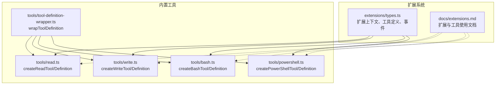
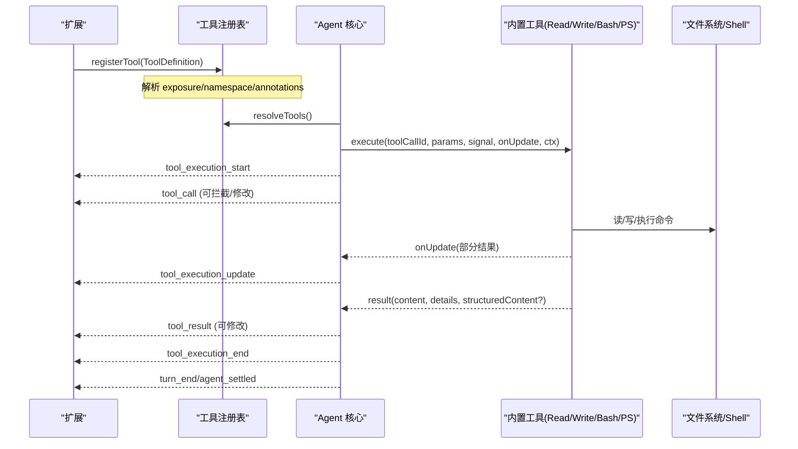
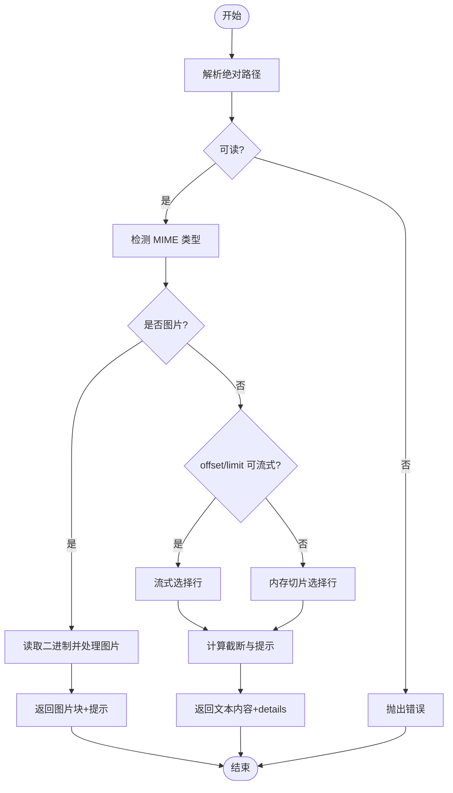
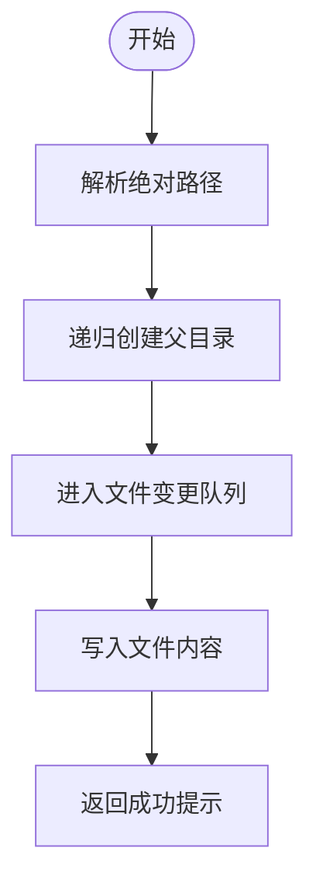
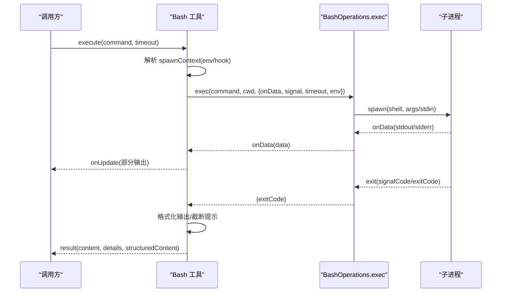
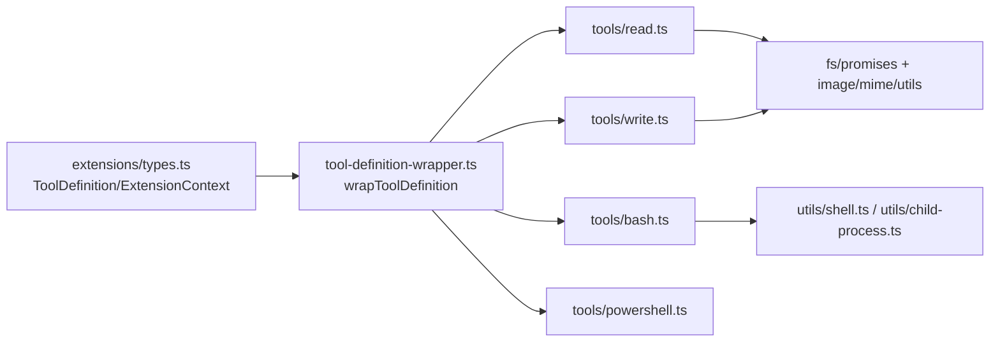

# 工具调用 API

**本文引用的文件**   
- [extensions.md](https://github.com/FDE-GROUP/oh-my-fde/blob/main/packages/coding-agent/docs/extensions.md)
- [read.ts](https://github.com/FDE-GROUP/oh-my-fde/blob/main/packages/coding-agent/src/core/tools/read.ts)
- [write.ts](https://github.com/FDE-GROUP/oh-my-fde/blob/main/packages/coding-agent/src/core/tools/write.ts)
- [bash.ts](https://github.com/FDE-GROUP/oh-my-fde/blob/main/packages/coding-agent/src/core/tools/bash.ts)
- [powershell.ts](https://github.com/FDE-GROUP/oh-my-fde/blob/main/packages/coding-agent/src/core/tools/powershell.ts)
- [tool-definition-wrapper.ts](https://github.com/FDE-GROUP/oh-my-fde/blob/main/packages/coding-agent/src/core/tools/tool-definition-wrapper.ts)
- [types.ts](https://github.com/FDE-GROUP/oh-my-fde/blob/main/packages/coding-agent/src/core/extensions/types.ts)

## 目录
1. [简介](#简介)
2. [项目结构](#项目结构)
3. [核心组件](#核心组件)
4. [架构总览](#架构总览)
5. [详细组件分析](#详细组件分析)
6. [依赖关系分析](#依赖关系分析)
7. [性能与限制](#性能与限制)
8. [故障排查指南](#故障排查指南)
9. [结论](#结论)
10. [附录：内置工具参数与选项速查](#附录内置工具参数与选项速查)

## 简介
本文件面向“工具调用 API”，系统性说明 Pi 编码代理中内置工具的创建函数、定义方式、参数配置、执行选项与结果处理，并给出自定义工具开发指南（注册、权限控制、错误处理）以及最佳实践。重点覆盖以下工厂函数：
- createReadTool / createReadToolDefinition
- createWriteTool / createWriteToolDefinition
- createBashTool / createBashToolDefinition
- createPowerShellTool / createPowerShellToolDefinition

同时解释工具在扩展系统中的注册、暴露模式、执行生命周期、事件钩子、渲染与结构化输出等机制。

## 项目结构
围绕工具调用 API 的核心代码位于 coding-agent 包的 core/tools 与 extensions 类型定义中；文档位于 docs/extensions.md。下图展示与本文相关的文件组织与职责边界。

**图表来源**
- [types.ts:599-688](https://github.com/FDE-GROUP/oh-my-fde/blob/main/packages/coding-agent/src/core/extensions/types.ts#L599-L688)
- [read.ts:228-362](https://github.com/FDE-GROUP/oh-my-fde/blob/main/packages/coding-agent/src/core/tools/read.ts#L228-L362)
- [write.ts:43-96](https://github.com/FDE-GROUP/oh-my-fde/blob/main/packages/coding-agent/src/core/tools/write.ts#L43-L96)
- [bash.ts:271-476](https://github.com/FDE-GROUP/oh-my-fde/blob/main/packages/coding-agent/src/core/tools/bash.ts#L271-L476)
- [powershell.ts:49-67](https://github.com/FDE-GROUP/oh-my-fde/blob/main/packages/coding-agent/src/core/tools/powershell.ts#L49-L67)
- [tool-definition-wrapper.ts:27-49](https://github.com/FDE-GROUP/oh-my-fde/blob/main/packages/coding-agent/src/core/tools/tool-definition-wrapper.ts#L27-L49)
- [extensions.md:1-120](https://github.com/FDE-GROUP/oh-my-fde/blob/main/packages/coding-agent/docs/extensions.md#L1-L120)

**章节来源**
- [extensions.md:1-120](https://github.com/FDE-GROUP/oh-my-fde/blob/main/packages/coding-agent/docs/extensions.md#L1-L120)

## 核心组件
- 工具定义与包装
  - ToolDefinition：描述工具名称、标签、描述、参数 Schema、可选的 promptSnippet/promptGuidelines、constrainedSampling、outputSchema、exposure、namespace、annotations、prepareLoadout、executionMode、execute、renderCall/renderResult 等。
  - wrapToolDefinition：将 ToolDefinition 适配为 AgentTool，注入 execute 签名与上下文。
- 内置工具
  - read：读取文本或图片文件，支持流式分块读取、行偏移/行数限制、自动图片缩放、截断提示。
  - write：写入文本到文件，自动创建父目录，带文件变更队列保护。
  - bash：执行 shell 命令，支持超时、进程树清理、输出累积与截断、PI_* 会话环境变量注入、spawnHook 钩子。
  - powershell：基于 bash 的通用 Shell 工具实现，封装 PowerShell 特定行为。
- 扩展系统与事件
  - 扩展可订阅 tool_execution_start/update/end、tool_call、tool_result 等事件，拦截、修改输入或结果，实现权限门控与审计。
  - ExtensionContext/ExtensionToolContext 提供 UI、模型、会话、工具调用能力。

**章节来源**
- [types.ts:599-688](https://github.com/FDE-GROUP/oh-my-fde/blob/main/packages/coding-agent/src/core/extensions/types.ts#L599-L688)
- [tool-definition-wrapper.ts:27-49](https://github.com/FDE-GROUP/oh-my-fde/blob/main/packages/coding-agent/src/core/tools/tool-definition-wrapper.ts#L27-L49)
- [read.ts:14-18](https://github.com/FDE-GROUP/oh-my-fde/blob/main/packages/coding-agent/src/core/tools/read.ts#L14-L18)
- [write.ts:10-13](https://github.com/FDE-GROUP/oh-my-fde/blob/main/packages/coding-agent/src/core/tools/write.ts#L10-L13)
- [bash.ts:39-47](https://github.com/FDE-GROUP/oh-my-fde/blob/main/packages/coding-agent/src/core/tools/bash.ts#L39-L47)

## 架构总览
下图展示从扩展注册到工具执行的端到端流程，包括参数校验、事件钩子、执行与结果返回。

**图表来源**
- [extensions.md:311-371](https://github.com/FDE-GROUP/oh-my-fde/blob/main/packages/coding-agent/docs/extensions.md#L311-L371)
- [types.ts:395-415](https://github.com/FDE-GROUP/oh-my-fde/blob/main/packages/coding-agent/src/core/extensions/types.ts#L395-L415)
- [read.ts:244-357](https://github.com/FDE-GROUP/oh-my-fde/blob/main/packages/coding-agent/src/core/tools/read.ts#L244-L357)
- [write.ts:57-90](https://github.com/FDE-GROUP/oh-my-fde/blob/main/packages/coding-agent/src/core/tools/write.ts#L57-L90)
- [bash.ts:289-448](https://github.com/FDE-GROUP/oh-my-fde/blob/main/packages/coding-agent/src/core/tools/bash.ts#L289-L448)

## 详细组件分析

### 读取工具 createReadTool / createReadToolDefinition
- 作用
  - 读取文本文件或图片文件，返回文本内容或图片附件；对大文件进行行/字节级截断并提供继续读取提示。
- 参数 Schema
  - path：字符串，相对或绝对路径
  - offset：可选，起始行号（1 基）
  - limit：可选，最大读取行数
- 关键选项
  - autoResizeImages：是否自动缩放图片（默认 true）
  - resizeOptions：当执行上下文无模型元数据时的回退缩放配置
  - operations：可替换的文件读取操作（readFile/access/detectImageMimeType/createReadStream），便于远程 IO 扩展
- 执行流程要点
  - 解析绝对路径并检查可读性
  - 检测是否为图片；若是则解码并可能缩放后作为 image 块返回
  - 若为文本：优先走 createReadStream 流式选择行，否则整文件加载后切片
  - 根据 offset/limit 与内部 truncation 策略生成提示，必要时引导继续使用 offset 翻页
  - 支持 AbortSignal 取消
- 结果
  - content：文本或图片+文本
  - details：包含截断信息（truncation）
  - structuredContent：程序化调用者收到的简化输出（文本或图片对象）

**图表来源**
- [read.ts:244-357](https://github.com/FDE-GROUP/oh-my-fde/blob/main/packages/coding-agent/src/core/tools/read.ts#L244-L357)

**章节来源**
- [read.ts:14-18](https://github.com/FDE-GROUP/oh-my-fde/blob/main/packages/coding-agent/src/core/tools/read.ts#L14-L18)
- [read.ts:86-93](https://github.com/FDE-GROUP/oh-my-fde/blob/main/packages/coding-agent/src/core/tools/read.ts#L86-L93)
- [read.ts:228-362](https://github.com/FDE-GROUP/oh-my-fde/blob/main/packages/coding-agent/src/core/tools/read.ts#L228-L362)

### 写入工具 createWriteTool / createWriteToolDefinition
- 作用
  - 将文本内容写入目标文件，不存在则创建，存在则覆盖；自动创建父目录。
- 参数 Schema
  - path：字符串，相对或绝对路径
  - content：字符串，要写入的内容
- 关键选项
  - operations：可替换的写入操作（writeFile/mkdir），便于远程 IO 扩展
- 执行流程要点
  - 解析绝对路径并创建父目录
  - 通过 withFileMutationQueue 串行化同一文件的并发写入，避免竞态
  - 支持 AbortSignal 取消，并在每个 await 后检查信号
- 结果
  - content：成功写入提示
  - details：未使用

**图表来源**
- [write.ts:57-90](https://github.com/FDE-GROUP/oh-my-fde/blob/main/packages/coding-agent/src/core/tools/write.ts#L57-L90)

**章节来源**
- [write.ts:10-13](https://github.com/FDE-GROUP/oh-my-fde/blob/main/packages/coding-agent/src/core/tools/write.ts#L10-L13)
- [write.ts:38-41](https://github.com/FDE-GROUP/oh-my-fde/blob/main/packages/coding-agent/src/core/tools/write.ts#L38-L41)
- [write.ts:43-96](https://github.com/FDE-GROUP/oh-my-fde/blob/main/packages/coding-agent/src/core/tools/write.ts#L43-L96)

### Bash 工具 createBashTool / createBashToolDefinition
- 作用
  - 在当前工作目录下执行 shell 命令，返回 stdout/stderr 合并输出，支持超时、进程树清理、输出累积与截断、PI_* 会话环境变量注入、spawnHook 钩子。
- 参数 Schema
  - command：字符串，要执行的命令
  - timeout：可选，超时秒数
- 关键选项
  - operations：可替换的命令执行后端（exec），用于远程执行或测试
  - commandPrefix：每条命令前追加的前缀（如初始化脚本）
  - shellPath：显式指定 shell 路径
  - exposeSessionEnvironment：是否注入 PI_SESSION_ID/PI_SESSION_FILE/PI_PROVIDER/PI_MODEL/PI_REASONING_LEVEL（默认 true）
  - spawnHook：在执行前调整 command/cwd/env
- 执行流程要点
  - 校验 timeout 范围
  - 解析 spawnContext（含 env 注入与 spawnHook）
  - 启动子进程，流式收集 stdout/stderr，节流更新
  - 支持 AbortSignal 终止进程树
  - 超时或异常时保留已输出内容并给出明确状态
  - 非零退出码标记 isError 并返回结构化输出（exit_code/wall_time_seconds/truncated/full_output_path）
- 结果
  - content：格式化后的文本输出（含截断提示）
  - details：截断信息与完整输出路径
  - structuredContent：供程序化调用者使用的结构化结果

**图表来源**
- [bash.ts:109-193](https://github.com/FDE-GROUP/oh-my-fde/blob/main/packages/coding-agent/src/core/tools/bash.ts#L109-L193)
- [bash.ts:271-448](https://github.com/FDE-GROUP/oh-my-fde/blob/main/packages/coding-agent/src/core/tools/bash.ts#L271-L448)

**章节来源**
- [bash.ts:39-47](https://github.com/FDE-GROUP/oh-my-fde/blob/main/packages/coding-agent/src/core/tools/bash.ts#L39-L47)
- [bash.ts:242-253](https://github.com/FDE-GROUP/oh-my-fde/blob/main/packages/coding-agent/src/core/tools/bash.ts#L242-L253)
- [bash.ts:271-476](https://github.com/FDE-GROUP/oh-my-fde/blob/main/packages/coding-agent/src/core/tools/bash.ts#L271-L476)

### PowerShell 工具 createPowerShellTool / createPowerShellToolDefinition
- 作用
  - 复用 Bash 的通用 Shell 工具实现，封装 PowerShell 特定的 UTF-8 输出前缀与本地后端。
- 关键选项
  - 继承 BashToolOptions 中的 operations/exposeSessionEnvironment/spawnHook
- 结果
  - 与 Bash 工具一致的结构化输出与截断行为

**章节来源**
- [powershell.ts:16-21](https://github.com/FDE-GROUP/oh-my-fde/blob/main/packages/coding-agent/src/core/tools/powershell.ts#L16-L21)
- [powershell.ts:29-37](https://github.com/FDE-GROUP/oh-my-fde/blob/main/packages/coding-agent/src/core/tools/powershell.ts#L29-L37)
- [powershell.ts:49-67](https://github.com/FDE-GROUP/oh-my-fde/blob/main/packages/coding-agent/src/core/tools/powershell.ts#L49-L67)

### 工具定义包装器 wrapToolDefinition
- 作用
  - 将 ToolDefinition 转换为 AgentTool，统一 execute 签名，注入 ExtensionToolContext。
- 关键点
  - 透传 name/label/description/parameters/outputSchema/constrainedSampling/prepareArguments/executionMode
  - 包装 execute，传入 ctxFactory 生成的上下文（若无则使用默认）

**章节来源**
- [tool-definition-wrapper.ts:27-49](https://github.com/FDE-GROUP/oh-my-fde/blob/main/packages/coding-agent/src/core/tools/tool-definition-wrapper.ts#L27-L49)

## 依赖关系分析
- 扩展类型与工具定义
  - ToolDefinition 定义了工具的全部元数据与执行契约，是扩展与内置工具的统一抽象。
- 内置工具依赖
  - read.ts 依赖 fs/promises、image 处理、MIME 检测、truncate 与 renderers。
  - write.ts 依赖 fs/promises、path、file-mutation-queue 与 renderers。
  - bash.ts 依赖 child_process、shell 工具链、OutputAccumulator、truncate 与 renderers。
  - powershell.ts 复用 bash.ts 的通用 Shell 工具实现。
- 运行时集成
  - 扩展通过 pi.registerTool 注册 ToolDefinition；Agent 核心在 turn 中调度工具执行，并通过事件总线通知扩展。

**图表来源**
- [types.ts:599-688](https://github.com/FDE-GROUP/oh-my-fde/blob/main/packages/coding-agent/src/core/extensions/types.ts#L599-L688)
- [tool-definition-wrapper.ts:27-49](https://github.com/FDE-GROUP/oh-my-fde/blob/main/packages/coding-agent/src/core/tools/tool-definition-wrapper.ts#L27-L49)
- [read.ts:1-12](https://github.com/FDE-GROUP/oh-my-fde/blob/main/packages/coding-agent/src/core/tools/read.ts#L1-L12)
- [write.ts:1-9](https://github.com/FDE-GROUP/oh-my-fde/blob/main/packages/coding-agent/src/core/tools/write.ts#L1-L9)
- [bash.ts:1-19](https://github.com/FDE-GROUP/oh-my-fde/blob/main/packages/coding-agent/src/core/tools/bash.ts#L1-L19)
- [powershell.ts:1-14](https://github.com/FDE-GROUP/oh-my-fde/blob/main/packages/coding-agent/src/core/tools/powershell.ts#L1-L14)

**章节来源**
- [types.ts:599-688](https://github.com/FDE-GROUP/oh-my-fde/blob/main/packages/coding-agent/src/core/extensions/types.ts#L599-L688)
- [tool-definition-wrapper.ts:27-49](https://github.com/FDE-GROUP/oh-my-fde/blob/main/packages/coding-agent/src/core/tools/tool-definition-wrapper.ts#L27-L49)

## 性能与限制
- 读取工具
  - 大文件采用流式读取，仅缓存需要显示的行，避免全量内存占用。
  - 单行超长时会给出提示，建议通过 bash 直接截取。
  - 图片自动缩放可节省传输与模型处理成本。
- 写入工具
  - 通过文件变更队列串行化同一文件的写入，避免并发冲突。
- Bash 工具
  - 输出累积支持截断与临时文件保存，避免超大输出阻塞。
  - 支持超时与进程树清理，防止僵尸进程。
  - 节流更新 onUpdate，降低 UI 刷新开销。
- 通用
  - 所有工具均支持 AbortSignal，可在取消时及时释放资源。

[本节为通用指导，不直接分析具体文件]

## 故障排查指南
- 常见错误与定位
  - 读取失败：路径不可读或超出 offset 范围。检查路径解析与 offset 是否越界。
  - 写入失败：父目录创建失败或写入被中断。确认权限与磁盘空间，检查 AbortSignal 是否触发。
  - Bash 超时：timeout 设置过小或后台进程持续输出。查看 truncated/full_output_path 与 ShellTimeoutError 的 shellExit 信息。
  - Bash 非零退出码：命令本身失败。结合 content 与 structuredContent.exit_code 定位。
- 事件钩子调试
  - 订阅 tool_execution_start/update/end 与 tool_call/tool_result，观察参数、中间输出与最终结果。
  - 在 tool_call 中拦截危险命令（如 rm -rf），通过 UI 确认后再放行。
- 扩展上下文
  - 使用 ExtensionContext.signal 判断当前是否处于流式执行阶段，避免在异步回调中误用 UI。
  - 使用 ExtensionToolContext.executeTool 调用其他工具，注意其不会为失败而拒绝 Promise，而是返回 isError=true 的结果。

**章节来源**
- [extensions.md:311-371](https://github.com/FDE-GROUP/oh-my-fde/blob/main/packages/coding-agent/docs/extensions.md#L311-L371)
- [extensions.md:788-800](https://github.com/FDE-GROUP/oh-my-fde/blob/main/packages/coding-agent/docs/extensions.md#L788-L800)
- [bash.ts:100-107](https://github.com/FDE-GROUP/oh-my-fde/blob/main/packages/coding-agent/src/core/tools/bash.ts#L100-L107)
- [bash.ts:399-448](https://github.com/FDE-GROUP/oh-my-fde/blob/main/packages/coding-agent/src/core/tools/bash.ts#L399-L448)

## 结论
Pi 的工具调用 API 以 ToolDefinition 为核心抽象，通过统一的包装器适配到 Agent 运行时。内置的 read/write/bash/powershell 工具覆盖了常见的文件与命令场景，并提供丰富的可插拔点（operations、spawnHook、renderers、events）。扩展可通过 registerTool 注册自定义工具，借助事件钩子实现权限门控、审计与交互，从而构建安全可控的智能体工作流。

[本节为总结性内容，不直接分析具体文件]

## 附录：内置工具参数与选项速查

- createReadTool / createReadToolDefinition
  - 参数：path, offset?, limit?
  - 选项：autoResizeImages?, resizeOptions?, operations?
  - 结果：content（文本或图片+文本）、details（截断信息）、structuredContent（文本或图片对象）
  - 参考：[read.ts:14-18](https://github.com/FDE-GROUP/oh-my-fde/blob/main/packages/coding-agent/src/core/tools/read.ts#L14-L18), [read.ts:86-93](https://github.com/FDE-GROUP/oh-my-fde/blob/main/packages/coding-agent/src/core/tools/read.ts#L86-L93), [read.ts:228-362](https://github.com/FDE-GROUP/oh-my-fde/blob/main/packages/coding-agent/src/core/tools/read.ts#L228-L362)

- createWriteTool / createWriteToolDefinition
  - 参数：path, content
  - 选项：operations?
  - 结果：content（成功提示）、details（未使用）
  - 参考：[write.ts:10-13](https://github.com/FDE-GROUP/oh-my-fde/blob/main/packages/coding-agent/src/core/tools/write.ts#L10-L13), [write.ts:38-41](https://github.com/FDE-GROUP/oh-my-fde/blob/main/packages/coding-agent/src/core/tools/write.ts#L38-L41), [write.ts:43-96](https://github.com/FDE-GROUP/oh-my-fde/blob/main/packages/coding-agent/src/core/tools/write.ts#L43-L96)

- createBashTool / createBashToolDefinition
  - 参数：command, timeout?
  - 选项：operations?, commandPrefix?, shellPath?, exposeSessionEnvironment?, spawnHook?
  - 结果：content（格式化输出）、details（截断信息/完整输出路径）、structuredContent（output/truncated/full_output_path/exit_code/wall_time_seconds）
  - 参考：[bash.ts:39-47](https://github.com/FDE-GROUP/oh-my-fde/blob/main/packages/coding-agent/src/core/tools/bash.ts#L39-L47), [bash.ts:242-253](https://github.com/FDE-GROUP/oh-my-fde/blob/main/packages/coding-agent/src/core/tools/bash.ts#L242-L253), [bash.ts:271-476](https://github.com/FDE-GROUP/oh-my-fde/blob/main/packages/coding-agent/src/core/tools/bash.ts#L271-L476)

- createPowerShellTool / createPowerShellToolDefinition
  - 参数：同 Bash
  - 选项：operations?, exposeSessionEnvironment?, spawnHook?
  - 结果：同 Bash
  - 参考：[powershell.ts:29-37](https://github.com/FDE-GROUP/oh-my-fde/blob/main/packages/coding-agent/src/core/tools/powershell.ts#L29-L37), [powershell.ts:49-67](https://github.com/FDE-GROUP/oh-my-fde/blob/main/packages/coding-agent/src/core/tools/powershell.ts#L49-L67)

- 扩展注册与事件
  - 注册：pi.registerTool({ ... })
  - 事件：tool_execution_start/update/end、tool_call、tool_result
  - 参考：[extensions.md:1-120](https://github.com/FDE-GROUP/oh-my-fde/blob/main/packages/coding-agent/docs/extensions.md#L1-L120), [extensions.md:311-371](https://github.com/FDE-GROUP/oh-my-fde/blob/main/packages/coding-agent/docs/extensions.md#L311-L371), [extensions.md:788-800](https://github.com/FDE-GROUP/oh-my-fde/blob/main/packages/coding-agent/docs/extensions.md#L788-L800)