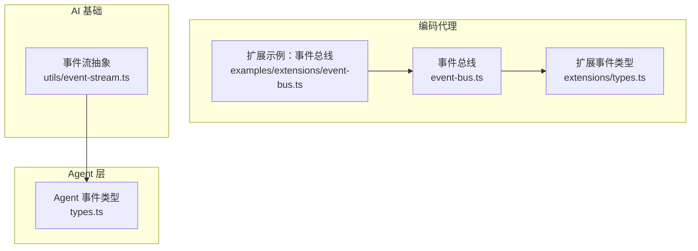
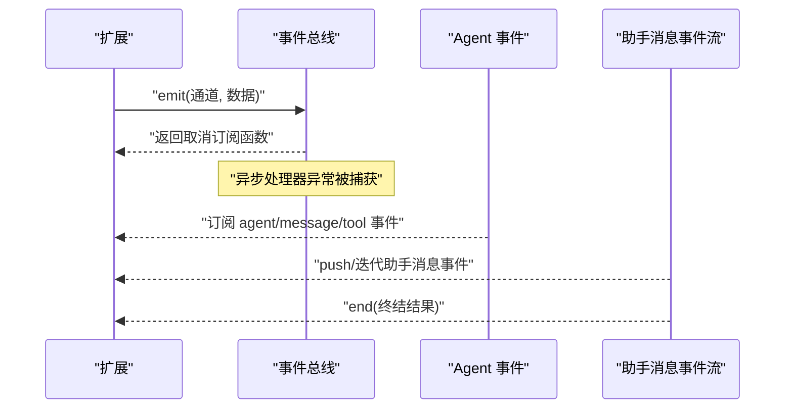
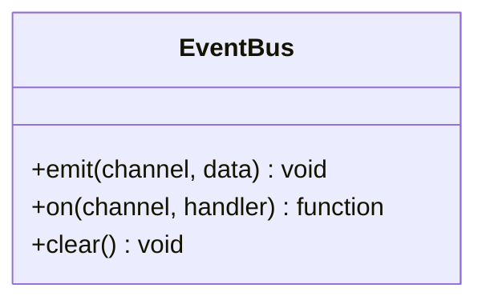
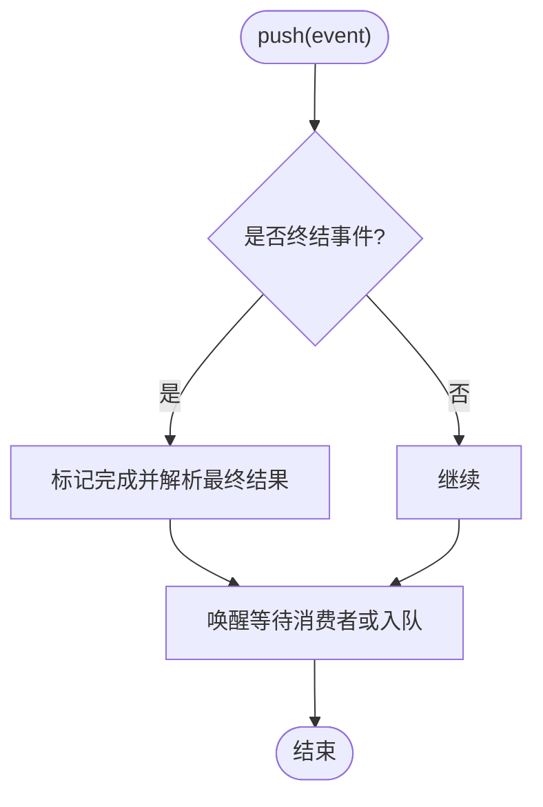
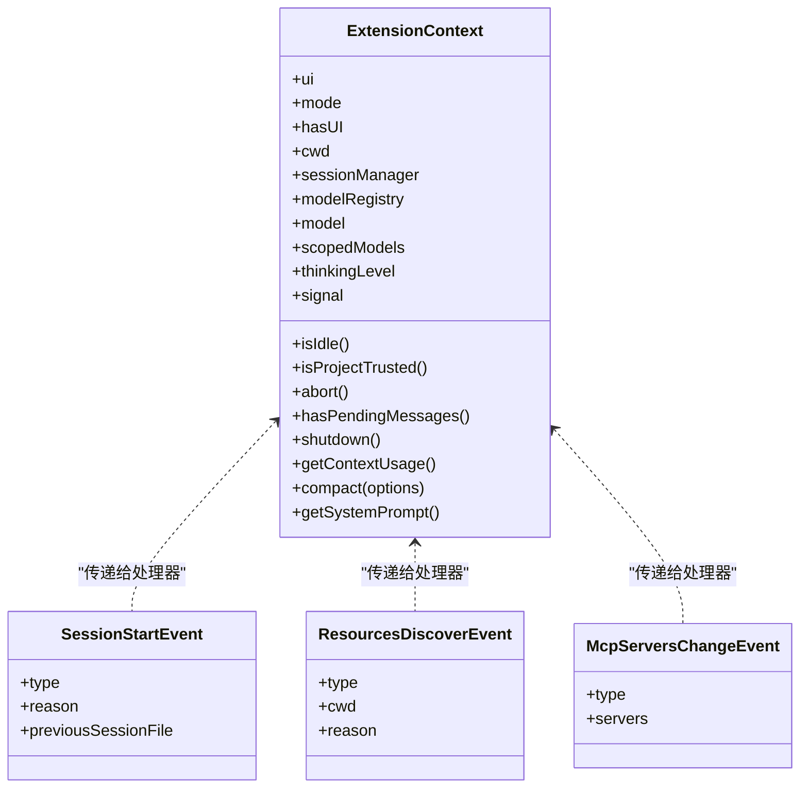
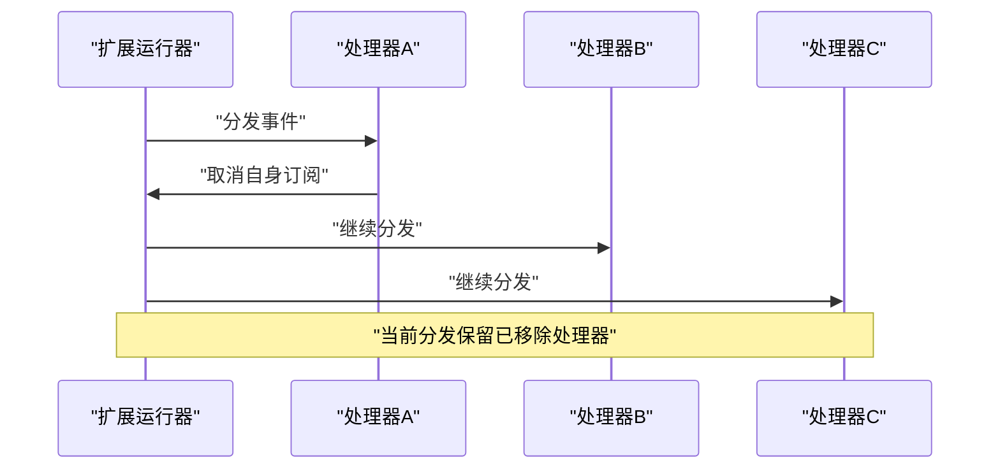
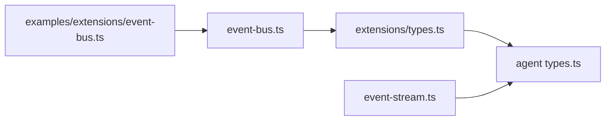

# 事件驱动架构

<cite>
**本文引用的文件**   
- [packages/coding-agent/src/core/event-bus.ts](https://github.com/FDE-GROUP/oh-my-coding-agent/blob/omca/packages/coding-agent/src/core/event-bus.ts)
- [packages/ai/src/utils/event-stream.ts](https://github.com/FDE-GROUP/oh-my-coding-agent/blob/omca/packages/ai/src/utils/event-stream.ts)
- [packages/agent/src/types.ts](https://github.com/FDE-GROUP/oh-my-coding-agent/blob/omca/packages/agent/src/types.ts)
- [packages/coding-agent/src/core/extensions/types.ts](https://github.com/FDE-GROUP/oh-my-coding-agent/blob/omca/packages/coding-agent/src/core/extensions/types.ts)
- [packages/coding-agent/examples/extensions/event-bus.ts](https://github.com/FDE-GROUP/oh-my-coding-agent/blob/omca/packages/coding-agent/examples/extensions/event-bus.ts)
- [packages/coding-agent/test/extensions-runner.test.ts](https://github.com/FDE-GROUP/oh-my-coding-agent/blob/omca/packages/coding-agent/test/extensions-runner.test.ts)
- [packages/ai/test/event-stream.test.ts](https://github.com/FDE-GROUP/oh-my-coding-agent/blob/omca/packages/ai/test/event-stream.test.ts)
</cite>

## 目录
1. [引言](#引言)
2. [项目结构](#项目结构)
3. [核心组件](#核心组件)
4. [架构总览](#架构总览)
5. [详细组件分析](#详细组件分析)
6. [依赖关系分析](#依赖关系分析)
7. [性能与并发特性](#性能与并发特性)
8. [调试与排错指南](#调试与排错指南)
9. [结论](#结论)
10. [附录：事件类型与使用示例](#附录事件类型与使用示例)

## 引言
本文件面向“事件驱动架构”的设计与实现，聚焦以下目标：
- 解释事件系统的设计模式、事件类型定义与事件分发机制。
- 说明事件监听器注册、处理器执行顺序、传播规则与错误处理。
- 覆盖自定义事件创建、事件过滤与事件批处理的实践方式。
- 提供事件使用示例、调试技巧与性能优化策略。
- 阐述事件与状态的关系、异步事件处理以及错误事件的处理路径。

该仓库包含两类关键事件基础设施：
- 轻量级进程内事件总线：用于扩展之间或模块之间的简单发布订阅。
- 流式事件通道：用于模型响应等高频、有序、可终结的流式事件。

## 项目结构
围绕事件系统的代码主要分布在三个包中：
- `packages/coding-agent`：扩展系统与事件总线实现、扩展生命周期事件类型。
- `packages/ai`：通用流式事件抽象与助手消息事件流。
- `packages/agent`：Agent 层对外暴露的事件类型（如 `AgentEvent`），以及事件与运行状态的关联。

**图表来源**
- [packages/coding-agent/src/core/event-bus.ts:1-34](https://github.com/FDE-GROUP/oh-my-coding-agent/blob/omca/packages/coding-agent/src/core/event-bus.ts#L1-L34)
- [packages/coding-agent/src/core/extensions/types.ts:717-800](https://github.com/FDE-GROUP/oh-my-coding-agent/blob/omca/packages/coding-agent/src/core/extensions/types.ts#L717-L800)
- [packages/coding-agent/examples/extensions/event-bus.ts:1-44](https://github.com/FDE-GROUP/oh-my-coding-agent/blob/omca/packages/coding-agent/examples/extensions/event-bus.ts#L1-L44)
- [packages/ai/src/utils/event-stream.ts:25-89](https://github.com/FDE-GROUP/oh-my-coding-agent/blob/omca/packages/ai/src/utils/event-stream.ts#L25-L89)
- [packages/agent/src/types.ts:521-552](https://github.com/FDE-GROUP/oh-my-coding-agent/blob/omca/packages/agent/src/types.ts#L521-L552)

**章节来源**
- [packages/coding-agent/src/core/event-bus.ts:1-34](https://github.com/FDE-GROUP/oh-my-coding-agent/blob/omca/packages/coding-agent/src/core/event-bus.ts#L1-L34)
- [packages/ai/src/utils/event-stream.ts:25-89](https://github.com/FDE-GROUP/oh-my-coding-agent/blob/omca/packages/ai/src/utils/event-stream.ts#L25-L89)
- [packages/agent/src/types.ts:521-552](https://github.com/FDE-GROUP/oh-my-coding-agent/blob/omca/packages/agent/src/types.ts#L521-L552)

## 核心组件
本节梳理三类核心能力：
- 进程内事件总线：基于 Node.js `EventEmitter` 的安全封装，支持异步处理器与统一错误捕获。
- 流式事件通道：基于 FIFO 队列与等待者队列的异步迭代器，支持多消费者、有序投递与终结结果。
- Agent 事件类型：描述 Agent 生命周期、消息流与工具调用的结构化事件。

### 事件总线
- 接口：`emit(channel, data)`、`on(channel, handler)` 返回取消订阅函数、`clear()` 清空所有监听器。
- 安全包装：处理器被包裹为异步函数，异常被捕获并打印，避免单个处理器失败影响其他监听器。
- 适用场景：扩展间通信、命令触发通知、跨模块轻量事件。

**章节来源**
- [packages/coding-agent/src/core/event-bus.ts:1-34](https://github.com/FDE-GROUP/oh-my-coding-agent/blob/omca/packages/coding-agent/src/core/event-bus.ts#L1-L34)

### 流式事件通道
- 类：`EventStream<T, R>` 提供 `push(event)`、`end(result?)`、`result()` 与异步迭代器。
- 内部结构：双端 FIFO 队列分别维护入队与出队缓冲，确保多消费者按注册顺序消费。
- 终结语义：当满足终止条件或显式调用 `end()` 时，解析最终结果并通知所有等待的消费者。
- 专用流：`AssistantMessageEventStream` 在终结事件中注入耗时统计，并区分成功与错误终结。

**章节来源**
- [packages/ai/src/utils/event-stream.ts:25-89](https://github.com/FDE-GROUP/oh-my-coding-agent/blob/omca/packages/ai/src/utils/event-stream.ts#L25-L89)
- [packages/ai/src/utils/event-stream.ts:91-136](https://github.com/FDE-GROUP/oh-my-coding-agent/blob/omca/packages/ai/src/utils/event-stream.ts#L91-L136)

### Agent 事件类型
- 事件集合：包括 `agent_start`、`agent_end`、`turn_start`、`turn_end`、`message_start`、`message_update`、`message_end`、`tool_execution_*` 等。
- 状态关联：`isStreaming` 在 await `agent_end` 监听器完成后才变为空闲；`streamingMessage` 表示当前流式消息。
- 用途：UI 更新、日志记录、指标采集、外部系统集成。

**章节来源**
- [packages/agent/src/types.ts:521-552](https://github.com/FDE-GROUP/oh-my-coding-agent/blob/omca/packages/agent/src/types.ts#L521-L552)

## 架构总览
下图展示事件从产生到消费的典型路径：
- 扩展通过 `pi.events.emit` 发送进程内事件。
- 事件总线将事件分发给已注册的处理器。
- Agent 层通过 `AgentEvent` 暴露高层事件，供 UI 与上层逻辑订阅。
- 模型响应通过 `AssistantMessageEventStream` 以流式事件形式传递。

**图表来源**
- [packages/coding-agent/examples/extensions/event-bus.ts:16-42](https://github.com/FDE-GROUP/oh-my-coding-agent/blob/omca/packages/coding-agent/examples/extensions/event-bus.ts#L16-L42)
- [packages/coding-agent/src/core/event-bus.ts:12-32](https://github.com/FDE-GROUP/oh-my-coding-agent/blob/omca/packages/coding-agent/src/core/event-bus.ts#L12-L32)
- [packages/agent/src/types.ts:521-552](https://github.com/FDE-GROUP/oh-my-coding-agent/blob/omca/packages/agent/src/types.ts#L521-L552)
- [packages/ai/src/utils/event-stream.ts:43-89](https://github.com/FDE-GROUP/oh-my-coding-agent/blob/omca/packages/ai/src/utils/event-stream.ts#L43-L89)

## 详细组件分析

### 事件总线设计与实现
- 设计要点：
  - 最小化 API：仅暴露 `emit`、`on`、`clear`。
  - 异步安全：处理器包装为 async，异常不抛出，避免阻塞后续分发。
  - 资源清理：`clear()` 移除所有监听器，适合测试或会话结束清理。
- 复杂度：
  - 分发时间复杂度 O(n)，n 为同通道监听器数量。
  - 空间复杂度 O(n) 存储监听器。
- 错误处理：
  - 单处理器异常不影响其他处理器。
  - 建议在上层对业务异常进行更细粒度处理。

**图表来源**
- [packages/coding-agent/src/core/event-bus.ts:3-32](https://github.com/FDE-GROUP/oh-my-coding-agent/blob/omca/packages/coding-agent/src/core/event-bus.ts#L3-L32)

**章节来源**
- [packages/coding-agent/src/core/event-bus.ts:1-34](https://github.com/FDE-GROUP/oh-my-coding-agent/blob/omca/packages/coding-agent/src/core/event-bus.ts#L1-L34)

### 流式事件通道与助手消息事件流
- 设计要点：
  - 多消费者：每个消费者通过异步迭代器获取事件。
  - 有序性：按注册顺序依次唤醒等待的消费者。
  - 终结语义：`done` 或 `error` 事件作为终结标志，或显式 `end()` 设置最终结果。
  - 计时增强：助手消息事件流在终结事件中注入 `durationMs`。
- 复杂度：
  - push/end 操作均摊 O(1)。
  - 迭代器 next 在事件到达前挂起，事件到来后 O(1) 唤醒。
- 错误处理：
  - 终结事件中的错误类型由上层处理。
  - 非终结事件不会中断流。

**图表来源**
- [packages/ai/src/utils/event-stream.ts:43-89](https://github.com/FDE-GROUP/oh-my-coding-agent/blob/omca/packages/ai/src/utils/event-stream.ts#L43-L89)

**章节来源**
- [packages/ai/src/utils/event-stream.ts:25-89](https://github.com/FDE-GROUP/oh-my-coding-agent/blob/omca/packages/ai/src/utils/event-stream.ts#L25-L89)
- [packages/ai/src/utils/event-stream.ts:91-136](https://github.com/FDE-GROUP/oh-my-coding-agent/blob/omca/packages/ai/src/utils/event-stream.ts#L91-L136)

### 扩展事件与生命周期
- 扩展事件类型：
  - 启动与资源发现：`project_trust`、`resources_discover`、`mcp_servers_change`。
  - 会话事件：`session_start`、`session_info_changed`、`session_before_switch`、`session_before_fork`。
- 扩展上下文：
  - 提供 UI、会话管理、模型注册、中止信号、压缩、系统提示等能力。
- 事件处理器：
  - 支持同步与异步处理器。
  - 可在处理器中注册新监听器，但会在下一次分发生效。

**图表来源**
- [packages/coding-agent/src/core/extensions/types.ts:345-385](https://github.com/FDE-GROUP/oh-my-coding-agent/blob/omca/packages/coding-agent/src/core/extensions/types.ts#L345-L385)
- [packages/coding-agent/src/core/extensions/types.ts:717-800](https://github.com/FDE-GROUP/oh-my-coding-agent/blob/omca/packages/coding-agent/src/core/extensions/types.ts#L717-L800)

**章节来源**
- [packages/coding-agent/src/core/extensions/types.ts:717-800](https://github.com/FDE-GROUP/oh-my-coding-agent/blob/omca/packages/coding-agent/src/core/extensions/types.ts#L717-L800)

### 事件分发与订阅行为
- 自删除与邻居处理器：
  - 允许处理器在自身回调中取消订阅，且不跳过相邻处理器。
- 重复订阅独立移除：
  - 多次相同处理器注册可独立取消，最后一次取消会清理对应条目。
- 当前分发保留已移除处理器：
  - 在当前分发期间移除的处理器仍会被执行一次。
- 分发期间注册延迟生效：
  - 在分发过程中注册的监听器将在下一次分发生效。
- 嵌套分发使用新的处理器列表：
  - 嵌套事件分发不会共享同一份处理器快照，避免副作用干扰。

**图表来源**
- [packages/coding-agent/test/extensions-runner.test.ts:1290-1400](https://github.com/FDE-GROUP/oh-my-coding-agent/blob/omca/packages/coding-agent/test/extensions-runner.test.ts#L1290-L1400)

**章节来源**
- [packages/coding-agent/test/extensions-runner.test.ts:1290-1400](https://github.com/FDE-GROUP/oh-my-coding-agent/blob/omca/packages/coding-agent/test/extensions-runner.test.ts#L1290-L1400)

### 事件与状态的关系
- Agent 状态：
  - `isStreaming`：在 await `agent_end` 监听器完成后才变为空闲。
  - `streamingMessage`：当前流式消息片段。
  - `pendingToolCalls`：正在执行的工具调用 ID 集合。
  - `errorMessage`：最近一次失败的 assistant turn 的错误信息。
- 事件与状态一致性：
  - `message_update` 携带 `assistantMessageEvent`，反映底层流式事件。
  - `tool_execution_*` 事件与工具执行状态一致。
  - `agent_end` 是最后一个循环事件，但 settle 需要 await 其监听器完成。

**章节来源**
- [packages/agent/src/types.ts:376-421](https://github.com/FDE-GROUP/oh-my-coding-agent/blob/omca/packages/agent/src/types.ts#L376-L421)
- [packages/agent/src/types.ts:521-552](https://github.com/FDE-GROUP/oh-my-coding-agent/blob/omca/packages/agent/src/types.ts#L521-L552)

## 依赖关系分析
- 事件总线依赖 Node.js `EventEmitter`，提供最小化的发布订阅能力。
- 扩展事件类型依赖 Agent 与 AI 的类型定义，形成扩展与运行时之间的契约。
- Agent 事件类型依赖 AI 的助手消息事件流类型，保证流式事件的一致性。
- 示例扩展通过 `pi.events` 与 `pi.on` 接入事件系统。

**图表来源**
- [packages/coding-agent/src/core/event-bus.ts:1-34](https://github.com/FDE-GROUP/oh-my-coding-agent/blob/omca/packages/coding-agent/src/core/event-bus.ts#L1-L34)
- [packages/coding-agent/src/core/extensions/types.ts:717-800](https://github.com/FDE-GROUP/oh-my-coding-agent/blob/omca/packages/coding-agent/src/core/extensions/types.ts#L717-L800)
- [packages/agent/src/types.ts:521-552](https://github.com/FDE-GROUP/oh-my-coding-agent/blob/omca/packages/agent/src/types.ts#L521-L552)
- [packages/ai/src/utils/event-stream.ts:25-89](https://github.com/FDE-GROUP/oh-my-coding-agent/blob/omca/packages/ai/src/utils/event-stream.ts#L25-L89)
- [packages/coding-agent/examples/extensions/event-bus.ts:1-44](https://github.com/FDE-GROUP/oh-my-coding-agent/blob/omca/packages/coding-agent/examples/extensions/event-bus.ts#L1-L44)

**章节来源**
- [packages/coding-agent/src/core/event-bus.ts:1-34](https://github.com/FDE-GROUP/oh-my-coding-agent/blob/omca/packages/coding-agent/src/core/event-bus.ts#L1-L34)
- [packages/coding-agent/src/core/extensions/types.ts:717-800](https://github.com/FDE-GROUP/oh-my-coding-agent/blob/omca/packages/coding-agent/src/core/extensions/types.ts#L717-L800)
- [packages/agent/src/types.ts:521-552](https://github.com/FDE-GROUP/oh-my-coding-agent/blob/omca/packages/agent/src/types.ts#L521-L552)
- [packages/ai/src/utils/event-stream.ts:25-89](https://github.com/FDE-GROUP/oh-my-coding-agent/blob/omca/packages/ai/src/utils/event-stream.ts#L25-L89)
- [packages/coding-agent/examples/extensions/event-bus.ts:1-44](https://github.com/FDE-GROUP/oh-my-coding-agent/blob/omca/packages/coding-agent/examples/extensions/event-bus.ts#L1-L44)

## 性能与并发特性
- 事件总线：
  - 分发为同步遍历监听器，但处理器本身异步执行，避免阻塞分发循环。
  - 建议在处理器中进行 I/O 或计算密集型任务时使用合理的并发控制。
- 流式事件通道：
  - 多消费者按注册顺序依次消费，避免竞争条件。
  - 终结事件或 `end()` 会一次性唤醒所有等待消费者，注意批量处理开销。
- 批处理建议：
  - 对于高频事件（如 `message_update`），可在上层做节流或合并，减少 UI 重绘与日志写入。
  - 工具执行事件可按批次聚合后再上报指标。

[本节为通用指导，不直接分析具体文件]

## 调试与排错指南
- 事件处理器异常：
  - 事件总线会捕获处理器异常并打印错误，便于定位问题。
  - 建议在处理器中增加 try-catch 与结构化日志。
- 订阅与取消：
  - 确认取消订阅函数是否正确调用，避免内存泄漏。
  - 使用测试用例验证自删除、重复订阅与延迟注册行为。
- 流式事件：
  - 检查终结事件是否为 `done` 或 `error`，确保最终结果正确解析。
  - 使用 `result()` 获取最终结果，结合异步迭代器消费事件序列。

**章节来源**
- [packages/coding-agent/src/core/event-bus.ts:12-32](https://github.com/FDE-GROUP/oh-my-coding-agent/blob/omca/packages/coding-agent/src/core/event-bus.ts#L12-L32)
- [packages/coding-agent/test/extensions-runner.test.ts:1290-1400](https://github.com/FDE-GROUP/oh-my-coding-agent/blob/omca/packages/coding-agent/test/extensions-runner.test.ts#L1290-L1400)
- [packages/ai/test/event-stream.test.ts:45-90](https://github.com/FDE-GROUP/oh-my-coding-agent/blob/omca/packages/ai/test/event-stream.test.ts#L45-L90)

## 结论
该事件驱动架构通过两层基础设施支撑不同场景：
- 轻量事件总线适用于扩展间通信与命令触发。
- 流式事件通道适用于高频、有序、可终结的消息流。
- Agent 事件类型将运行状态与事件解耦，便于 UI 与上层逻辑订阅。
- 扩展事件类型定义了扩展生命周期与会话事件的契约。
在实践中，应关注处理器异常、订阅清理、事件节流与批处理，以确保系统稳定与高性能。

[本节为总结，不直接分析具体文件]

## 附录：事件类型与使用示例

### 扩展事件类型概览
- 启动与资源：
  - `project_trust`：项目信任决策。
  - `resources_discover`：资源路径发现。
  - `mcp_servers_change`：MCP 服务器变更。
- 会话事件：
  - `session_start`：会话开始、加载或重载。
  - `session_info_changed`：会话元数据变化。
  - `session_before_switch`：切换会话前（可取消）。
  - `session_before_fork`：分支会话前（可取消）。

**章节来源**
- [packages/coding-agent/src/core/extensions/types.ts:717-800](https://github.com/FDE-GROUP/oh-my-coding-agent/blob/omca/packages/coding-agent/src/core/extensions/types.ts#L717-L800)

### Agent 事件类型概览
- 生命周期：
  - `agent_start`、`agent_end`。
- 回合：
  - `turn_start`、`turn_end`。
- 消息：
  - `message_start`、`message_update`、`message_end`。
- 工具执行：
  - `tool_execution_start`、`tool_execution_update`、`tool_execution_end`。

**章节来源**
- [packages/agent/src/types.ts:521-552](https://github.com/FDE-GROUP/oh-my-coding-agent/blob/omca/packages/agent/src/types.ts#L521-L552)

### 使用示例
- 扩展间事件总线示例：
  - 监听 `session_start` 保存上下文。
  - 监听 `my:notification` 显示通知。
  - 通过命令 `/emit` 发送事件。
- 流式事件消费示例：
  - 使用 `EventStream` 的异步迭代器消费事件。
  - 使用 `result()` 获取终结结果。
  - 使用 `AssistantMessageEventStream` 获取带耗时的助手消息。

**章节来源**
- [packages/coding-agent/examples/extensions/event-bus.ts:1-44](https://github.com/FDE-GROUP/oh-my-coding-agent/blob/omca/packages/coding-agent/examples/extensions/event-bus.ts#L1-L44)
- [packages/ai/src/utils/event-stream.ts:25-89](https://github.com/FDE-GROUP/oh-my-coding-agent/blob/omca/packages/ai/src/utils/event-stream.ts#L25-L89)
- [packages/ai/src/utils/event-stream.ts:91-136](https://github.com/FDE-GROUP/oh-my-coding-agent/blob/omca/packages/ai/src/utils/event-stream.ts#L91-L136)