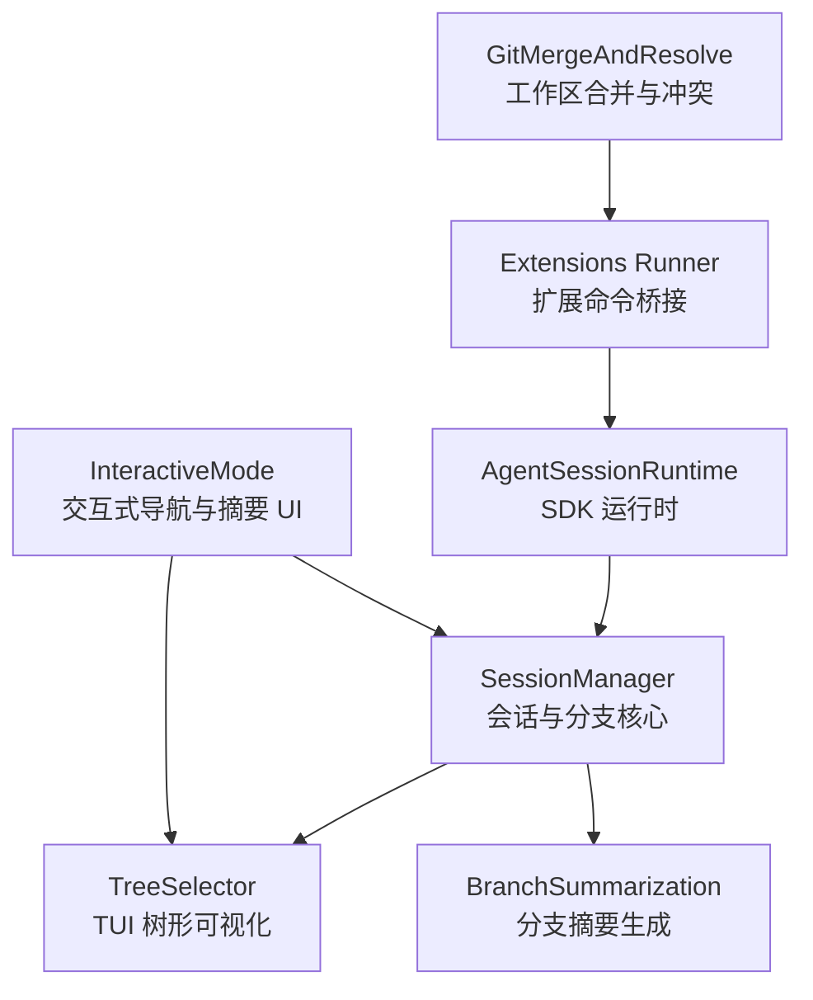
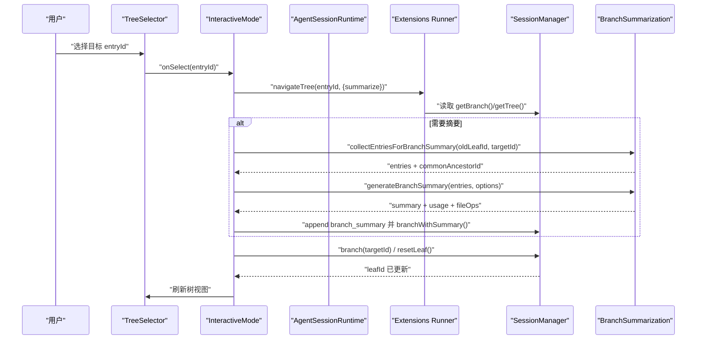
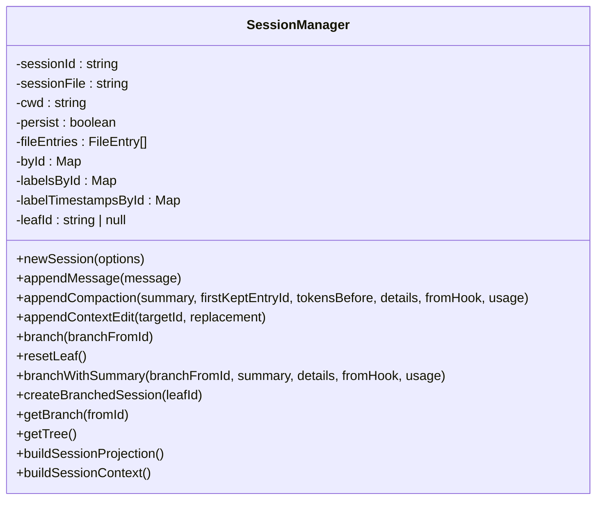
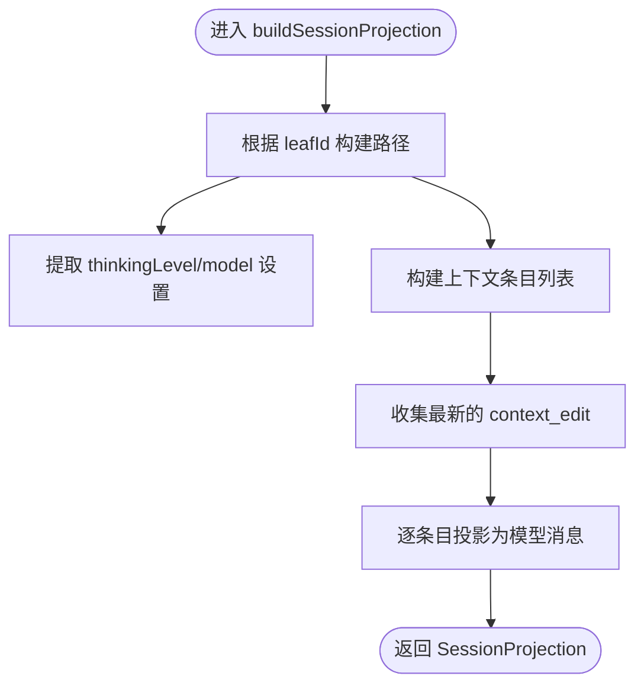
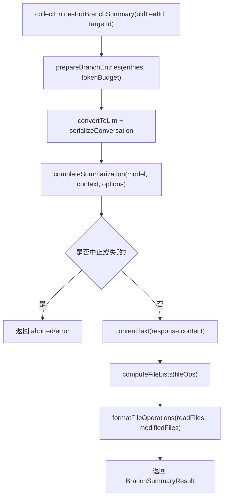
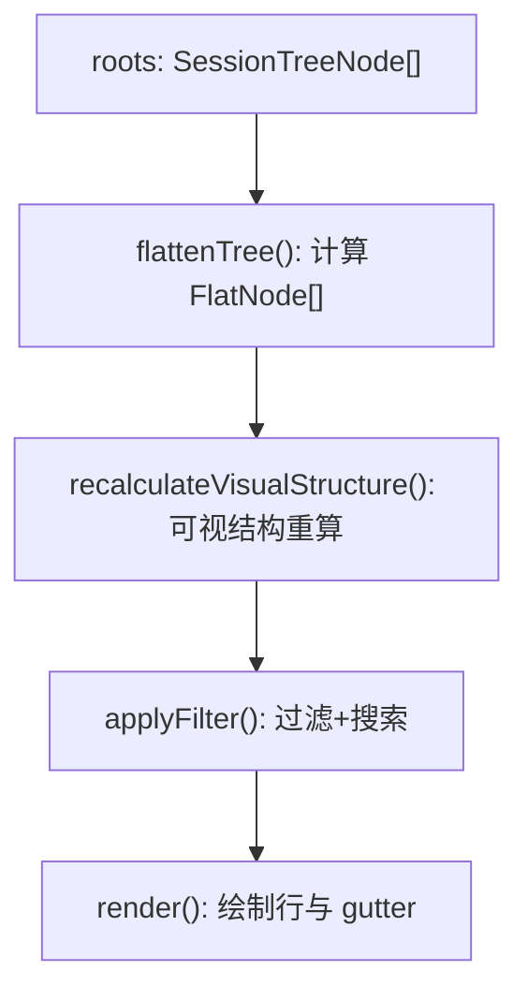
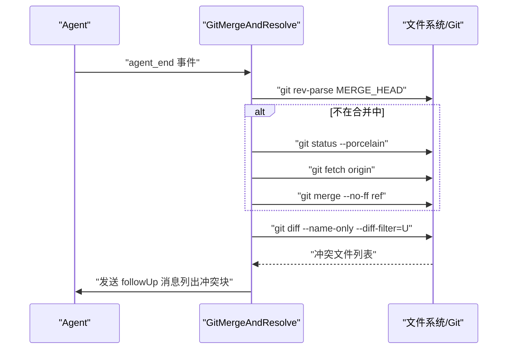
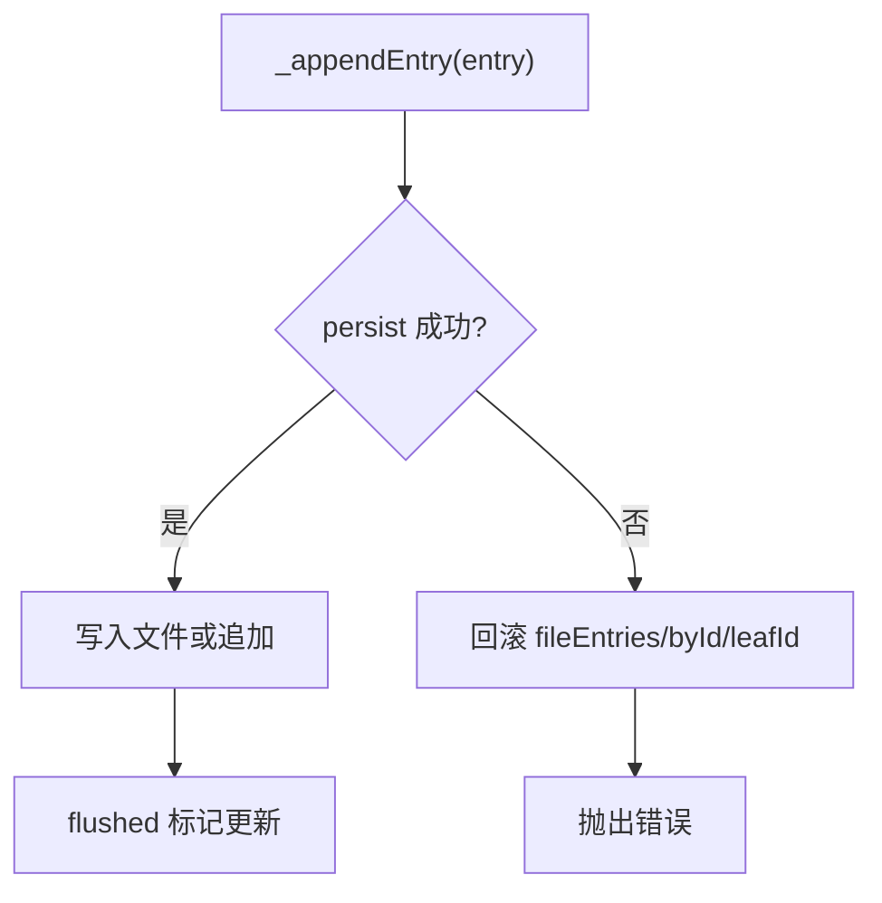
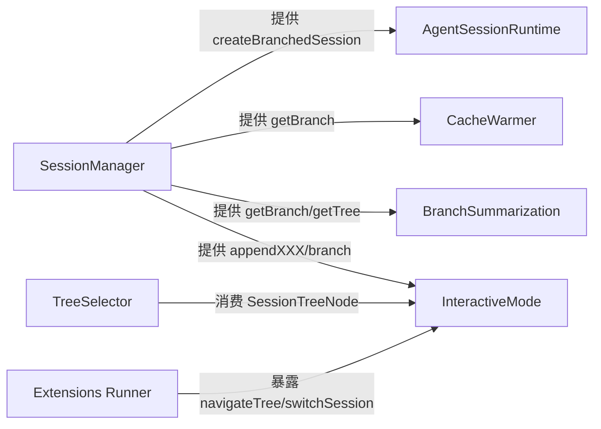

# 分支管理机制

<cite>
**本文引用的文件**   
- [session-manager.ts](https://github.com/FDE-GROUP/oh-my-fde/blob/omca/packages/coding-agent/src/core/session-manager.ts)
- [branch-summarization.ts](https://github.com/FDE-GROUP/oh-my-fde/blob/omca/packages/coding-agent/src/core/compaction/branch-summarization.ts)
- [tree-selector.ts](https://github.com/FDE-GROUP/oh-my-fde/blob/omca/packages/coding-agent/src/modes/interactive/components/tree-selector.ts)
- [interactive-mode.ts](https://github.com/FDE-GROUP/oh-my-fde/blob/omca/packages/coding-agent/src/modes/interactive/interactive-mode.ts)
- [agent-session-runtime.ts](https://github.com/FDE-GROUP/oh-my-fde/blob/omca/packages/coding-agent/src/core/agent-session-runtime.ts)
- [extensions-runner.ts](https://github.com/FDE-GROUP/oh-my-fde/blob/omca/packages/coding-agent/src/core/extensions/runner.ts)
- [extensions-types.ts](https://github.com/FDE-GROUP/oh-my-fde/blob/omca/packages/coding-agent/src/core/extensions/types.ts)
- [git-merge-and-resolve.ts](https://github.com/FDE-GROUP/oh-my-fde/blob/omca/packages/coding-agent/examples/extensions/git-merge-and-resolve.ts)
</cite>

## 目录
1. [引言](#引言)
2. [项目结构](#项目结构)
3. [核心组件](#核心组件)
4. [架构总览](#架构总览)
5. [详细组件分析](#详细组件分析)
6. [依赖关系分析](#依赖关系分析)
7. [性能考虑](#性能考虑)
8. [故障排查指南](#故障排查指南)
9. [结论](#结论)
10. [附录：API 与操作示例](#附录api-与操作示例)

## 引言
本文件系统性说明会话“分支管理”机制，包括：
- 会话树形结构与父子关系维护
- 分支切换、摘要生成与上下文投影
- 分支合并策略与冲突处理（工作区 Git 合并）
- 分支操作 API、状态同步与并发控制
- 分支创建、切换、删除清理示例
- 分支统计信息、可视化表示与性能优化建议

该机制以“追加不可变条目 + 叶子指针”的方式实现会话树；分支切换通过移动叶子指针完成，不修改历史。当用户从一条分支跳转到另一条分支时，系统会生成被放弃分支的摘要，使后续上下文仍保留关键信息。

## 项目结构
与分支管理直接相关的代码主要位于 coding-agent 包中：
- 会话与分支核心：`packages/coding-agent/src/core/session-manager.ts`
- 分支摘要生成：`packages/coding-agent/src/core/compaction/branch-summarization.ts`
- TUI 树形可视化与交互：`packages/coding-agent/src/modes/interactive/components/tree-selector.ts`
- 交互式模式中的导航与摘要 UI：`packages/coding-agent/src/modes/interactive/interactive-mode.ts`
- SDK 运行时与分支/克隆/导入等高层操作：`packages/coding-agent/src/core/agent-session-runtime.ts`
- 扩展点与命令桥接：`packages/coding-agent/src/core/extensions/runner.ts`、`packages/coding-agent/src/core/extensions/types.ts`
- 工作区 Git 合并与冲突解析示例：`packages/coding-agent/examples/extensions/git-merge-and-resolve.ts`

**图表来源**
- [session-manager.ts:988-1595](https://github.com/FDE-GROUP/oh-my-fde/blob/omca/packages/coding-agent/src/core/session-manager.ts#L988-L1595)
- [branch-summarization.ts:103-399](https://github.com/FDE-GROUP/oh-my-fde/blob/omca/packages/coding-agent/src/core/compaction/branch-summarization.ts#L103-L399)
- [tree-selector.ts:109-331](https://github.com/FDE-GROUP/oh-my-fde/blob/omca/packages/coding-agent/src/modes/interactive/components/tree-selector.ts#L109-L331)
- [interactive-mode.ts:5783-5808](https://github.com/FDE-GROUP/oh-my-fde/blob/omca/packages/coding-agent/src/modes/interactive/interactive-mode.ts#L5783-L5808)
- [agent-session-runtime.ts:196-210](https://github.com/FDE-GROUP/oh-my-fde/blob/omca/packages/coding-agent/src/core/agent-session-runtime.ts#L196-L210)
- [extensions-runner.ts:1028-1034](https://github.com/FDE-GROUP/oh-my-fde/blob/omca/packages/coding-agent/src/core/extensions/runner.ts#L1028-L1034)
- [git-merge-and-resolve.ts:73-115](https://github.com/FDE-GROUP/oh-my-fde/blob/omca/packages/coding-agent/examples/extensions/git-merge-and-resolve.ts#L73-L115)

**章节来源**
- [session-manager.ts:988-1595](https://github.com/FDE-GROUP/oh-my-fde/blob/omca/packages/coding-agent/src/core/session-manager.ts#L988-L1595)
- [branch-summarization.ts:103-399](https://github.com/FDE-GROUP/oh-my-fde/blob/omca/packages/coding-agent/src/core/compaction/branch-summarization.ts#L103-L399)
- [tree-selector.ts:109-331](https://github.com/FDE-GROUP/oh-my-fde/blob/omca/packages/coding-agent/src/modes/interactive/components/tree-selector.ts#L109-L331)
- [interactive-mode.ts:5783-5808](https://github.com/FDE-GROUP/oh-my-fde/blob/omca/packages/coding-agent/src/modes/interactive/interactive-mode.ts#L5783-L5808)
- [agent-session-runtime.ts:196-210](https://github.com/FDE-GROUP/oh-my-fde/blob/omca/packages/coding-agent/src/core/agent-session-runtime.ts#L196-L210)
- [extensions-runner.ts:1028-1034](https://github.com/FDE-GROUP/oh-my-fde/blob/omca/packages/coding-agent/src/core/extensions/runner.ts#L1028-L1034)
- [git-merge-and-resolve.ts:73-115](https://github.com/FDE-GROUP/oh-my-fde/blob/omca/packages/coding-agent/examples/extensions/git-merge-and-resolve.ts#L73-L115)

## 核心组件
- SessionManager：会话与分支的核心类，负责会话头、追加不可变条目、索引构建、路径/树遍历、分支切换、分支摘要写入、导出单一路径会话等。
- BranchSummarization：根据旧位置到新位置的差异路径收集条目，按 token 预算准备消息，调用模型生成结构化分支摘要，并附带文件读取/修改追踪。
- TreeSelector：将 SessionTreeNode 扁平化、过滤、排序和渲染为 ASCII 树，支持折叠、搜索、活跃路径高亮、水平滚动等。
- InteractiveMode：在交互式模式中触发 navigateTree，并在需要时显示分支摘要进度与取消。
- AgentSessionRuntime：提供 newSession/fork/switchSession/importFromJsonl 等高层 API，替换当前会话并重建服务。
- Extensions Runner/Types：暴露 navigateTree/switchSession 给扩展使用，并封装取消回调。
- GitMergeAndResolve：在工作区执行 git merge，检测冲突块并以 followUp 消息通知代理解决。

**章节来源**
- [session-manager.ts:988-1595](https://github.com/FDE-GROUP/oh-my-fde/blob/omca/packages/coding-agent/src/core/session-manager.ts#L988-L1595)
- [branch-summarization.ts:103-399](https://github.com/FDE-GROUP/oh-my-fde/blob/omca/packages/coding-agent/src/core/compaction/branch-summarization.ts#L103-L399)
- [tree-selector.ts:109-331](https://github.com/FDE-GROUP/oh-my-fde/blob/omca/packages/coding-agent/src/modes/interactive/components/tree-selector.ts#L109-L331)
- [interactive-mode.ts:5783-5808](https://github.com/FDE-GROUP/oh-my-fde/blob/omca/packages/coding-agent/src/modes/interactive/interactive-mode.ts#L5783-L5808)
- [agent-session-runtime.ts:196-210](https://github.com/FDE-GROUP/oh-my-fde/blob/omca/packages/coding-agent/src/core/agent-session-runtime.ts#L196-L210)
- [extensions-runner.ts:1028-1034](https://github.com/FDE-GROUP/oh-my-fde/blob/omca/packages/coding-agent/src/core/extensions/runner.ts#L1028-L1034)
- [extensions-types.ts:442-460](https://github.com/FDE-GROUP/oh-my-fde/blob/omca/packages/coding-agent/src/core/extensions/types.ts#L442-L460)
- [git-merge-and-resolve.ts:73-115](https://github.com/FDE-GROUP/oh-my-fde/blob/omca/packages/coding-agent/examples/extensions/git-merge-and-resolve.ts#L73-L115)

## 架构总览
下图展示分支管理的端到端流程：用户在 TUI 中选择目标节点，交互式模式调用 session.navigateTree；若需要摘要，则调用分支摘要生成器；最终更新 SessionManager 的叶子指针，并刷新上下文与视图。

**图表来源**
- [tree-selector.ts:109-331](https://github.com/FDE-GROUP/oh-my-fde/blob/omca/packages/coding-agent/src/modes/interactive/components/tree-selector.ts#L109-L331)
- [interactive-mode.ts:5783-5808](https://github.com/FDE-GROUP/oh-my-fde/blob/omca/packages/coding-agent/src/modes/interactive/interactive-mode.ts#L5783-L5808)
- [extensions-runner.ts:1028-1034](https://github.com/FDE-GROUP/oh-my-fde/blob/omca/packages/coding-agent/src/core/extensions/runner.ts#L1028-L1034)
- [session-manager.ts:1480-1636](https://github.com/FDE-GROUP/oh-my-fde/blob/omca/packages/coding-agent/src/core/session-manager.ts#L1480-L1636)
- [branch-summarization.ts:115-399](https://github.com/FDE-GROUP/oh-my-fde/blob/omca/packages/coding-agent/src/core/compaction/branch-summarization.ts#L115-L399)

## 详细组件分析

### 会话树与父子关系
- 每个会话条目包含 id 与 parentId，形成有向无环树。根节点的 parentId 为 null。
- SessionManager 维护 byId 索引与 leafId 指针。追加新条目时，parentId 指向当前 leafId，然后 leafId 移动到新增条目。
- getBranch(fromId?) 从指定节点回溯到根，返回路径数组；getTree() 构建完整树结构并按时间排序子节点。
- 迁移逻辑保证旧版本会话能正确获得 id/parentId 树结构。

**图表来源**
- [session-manager.ts:988-1595](https://github.com/FDE-GROUP/oh-my-fde/blob/omca/packages/coding-agent/src/core/session-manager.ts#L988-L1595)
- [session-manager.ts:1480-1636](https://github.com/FDE-GROUP/oh-my-fde/blob/omca/packages/coding-agent/src/core/session-manager.ts#L1480-L1636)

**章节来源**
- [session-manager.ts:286-347](https://github.com/FDE-GROUP/oh-my-fde/blob/omca/packages/coding-agent/src/core/session-manager.ts#L286-L347)
- [session-manager.ts:1104-1123](https://github.com/FDE-GROUP/oh-my-fde/blob/omca/packages/coding-agent/src/core/session-manager.ts#L1104-L1123)
- [session-manager.ts:1480-1578](https://github.com/FDE-GROUP/oh-my-fde/blob/omca/packages/coding-agent/src/core/session-manager.ts#L1480-L1578)

### 分支切换与上下文投影
- branch(branchFromId) 仅移动 leafId，不修改历史。
- resetLeaf() 将 leafId 置空，使下一次 appendXXX 创建新的根节点。
- buildSessionProjection/buildSessionContext 基于当前 leafId 回溯路径，应用 compaction 与 context_edit，得到模型可见的消息序列。
- buildContextEntries 对包含 compaction 的路径进行“保留首条 kept 条目之后内容”的裁剪，避免重复上下文。

**图表来源**
- [session-manager.ts:544-584](https://github.com/FDE-GROUP/oh-my-fde/blob/omca/packages/coding-agent/src/core/session-manager.ts#L544-L584)
- [session-manager.ts:476-512](https://github.com/FDE-GROUP/oh-my-fde/blob/omca/packages/coding-agent/src/core/session-manager.ts#L476-L512)

**章节来源**
- [session-manager.ts:1584-1604](https://github.com/FDE-GROUP/oh-my-fde/blob/omca/packages/coding-agent/src/core/session-manager.ts#L1584-L1604)
- [session-manager.ts:544-584](https://github.com/FDE-GROUP/oh-my-fde/blob/omca/packages/coding-agent/src/core/session-manager.ts#L544-L584)
- [session-manager.ts:476-512](https://github.com/FDE-GROUP/oh-my-fde/blob/omca/packages/coding-agent/src/core/session-manager.ts#L476-L512)

### 分支摘要生成
- collectEntriesForBranchSummary：计算 oldLeafId 与 targetId 的公共祖先，收集从旧叶子回溯到公共祖先的条目（保持时间顺序）。
- prepareBranchEntries：从最新到最旧累积消息，直到达到 token 预算；同时累计文件操作（read/edited/written），并尊重 context_edit。
- generateBranchSummary：构造 LLM 请求，生成结构化摘要，附加文件操作清单，返回 summary、usage、readFiles、modifiedFiles。

**图表来源**
- [branch-summarization.ts:115-153](https://github.com/FDE-GROUP/oh-my-fde/blob/omca/packages/coding-agent/src/core/compaction/branch-summarization.ts#L115-L153)
- [branch-summarization.ts:203-261](https://github.com/FDE-GROUP/oh-my-fde/blob/omca/packages/coding-agent/src/core/compaction/branch-summarization.ts#L203-L261)
- [branch-summarization.ts:307-399](https://github.com/FDE-GROUP/oh-my-fde/blob/omca/packages/coding-agent/src/core/compaction/branch-summarization.ts#L307-L399)

**章节来源**
- [branch-summarization.ts:115-153](https://github.com/FDE-GROUP/oh-my-fde/blob/omca/packages/coding-agent/src/core/compaction/branch-summarization.ts#L115-L153)
- [branch-summarization.ts:203-261](https://github.com/FDE-GROUP/oh-my-fde/blob/omca/packages/coding-agent/src/core/compaction/branch-summarization.ts#L203-L261)
- [branch-summarization.ts:307-399](https://github.com/FDE-GROUP/oh-my-fde/blob/omca/packages/coding-agent/src/core/compaction/branch-summarization.ts#L307-L399)

### 分支可视化与交互
- TreeSelector 将 SessionTreeNode 扁平化为 FlatNode，计算缩进、连接符、竖线 gutters，并根据 activePathIds 高亮当前分支路径。
- 支持多种过滤模式（默认、no-tools、user-only、labeled-only、all）、搜索、折叠、水平滚动。
- 当存在多个根节点时，视为虚拟根下的多分支，调整显示缩进与连接器。

**图表来源**
- [tree-selector.ts:203-331](https://github.com/FDE-GROUP/oh-my-fde/blob/omca/packages/coding-agent/src/modes/interactive/components/tree-selector.ts#L203-L331)
- [tree-selector.ts:439-562](https://github.com/FDE-GROUP/oh-my-fde/blob/omca/packages/coding-agent/src/modes/interactive/components/tree-selector.ts#L439-L562)
- [tree-selector.ts:672-774](https://github.com/FDE-GROUP/oh-my-fde/blob/omca/packages/coding-agent/src/modes/interactive/components/tree-selector.ts#L672-L774)

**章节来源**
- [tree-selector.ts:109-331](https://github.com/FDE-GROUP/oh-my-fde/blob/omca/packages/coding-agent/src/modes/interactive/components/tree-selector.ts#L109-L331)
- [tree-selector.ts:439-562](https://github.com/FDE-GROUP/oh-my-fde/blob/omca/packages/coding-agent/src/modes/interactive/components/tree-selector.ts#L439-L562)
- [tree-selector.ts:672-774](https://github.com/FDE-GROUP/oh-my-fde/blob/omca/packages/coding-agent/src/modes/interactive/components/tree-selector.ts#L672-L774)

### 分支合并策略与冲突解决
- 会话层本身不提供“合并多条分支”的操作；分支切换通过移动叶子指针完成。
- 工作区 Git 合并由扩展实现：在 agent_end 事件中尝试 fetch/merge，若发生冲突，扫描工作区未合并文件，解析冲突块，并以 followUp 消息通知代理解决。
- 该策略确保工作区与对话历史解耦：会话树记录对话分支，Git 合并反映工作区状态。

**图表来源**
- [git-merge-and-resolve.ts:73-115](https://github.com/FDE-GROUP/oh-my-fde/blob/omca/packages/coding-agent/examples/extensions/git-merge-and-resolve.ts#L73-L115)

**章节来源**
- [git-merge-and-resolve.ts:27-54](https://github.com/FDE-GROUP/oh-my-fde/blob/omca/packages/coding-agent/examples/extensions/git-merge-and-resolve.ts#L27-L54)
- [git-merge-and-resolve.ts:73-115](https://github.com/FDE-GROUP/oh-my-fde/blob/omca/packages/coding-agent/examples/extensions/git-merge-and-resolve.ts#L73-L115)

### 状态同步与并发控制
- SessionManager 内部通过 byId 索引与 leafId 维持一致状态；_appendEntry 在持久化失败时回滚内存状态，保证内存与文件一致。
- 会话列表加载使用 mapWithConcurrency 限制并发度，分批发布进度，避免 IO 风暴。
- 分支摘要生成支持 AbortSignal 与重试策略，允许用户取消或自动重试瞬态错误。

**图表来源**
- [session-manager.ts:1173-1207](https://github.com/FDE-GROUP/oh-my-fde/blob/omca/packages/coding-agent/src/core/session-manager.ts#L1173-L1207)
- [session-manager.ts:902-919](https://github.com/FDE-GROUP/oh-my-fde/blob/omca/packages/coding-agent/src/core/session-manager.ts#L902-L919)
- [branch-summarization.ts:307-399](https://github.com/FDE-GROUP/oh-my-fde/blob/omca/packages/coding-agent/src/core/compaction/branch-summarization.ts#L307-L399)

**章节来源**
- [session-manager.ts:1173-1207](https://github.com/FDE-GROUP/oh-my-fde/blob/omca/packages/coding-agent/src/core/session-manager.ts#L1173-L1207)
- [session-manager.ts:902-919](https://github.com/FDE-GROUP/oh-my-fde/blob/omca/packages/coding-agent/src/core/session-manager.ts#L902-L919)
- [branch-summarization.ts:307-399](https://github.com/FDE-GROUP/oh-my-fde/blob/omca/packages/coding-agent/src/core/compaction/branch-summarization.ts#L307-L399)

## 依赖关系分析
- SessionManager 被 InteractiveMode、AgentSessionRuntime、缓存预热器等模块依赖，用于获取分支路径、上下文与统计。
- BranchSummarization 依赖 SessionManager 的只读接口（ReadonlySessionManager）与消息工具函数。
- TreeSelector 依赖 SessionTreeNode 类型与工具函数，用于渲染与交互。
- Extensions Runner 暴露 navigateTree/switchSession 给扩展，并由 InteractiveMode 驱动。

**图表来源**
- [session-manager.ts:1480-1578](https://github.com/FDE-GROUP/oh-my-fde/blob/omca/packages/coding-agent/src/core/session-manager.ts#L1480-L1578)
- [branch-summarization.ts:115-153](https://github.com/FDE-GROUP/oh-my-fde/blob/omca/packages/coding-agent/src/core/compaction/branch-summarization.ts#L115-L153)
- [tree-selector.ts:109-331](https://github.com/FDE-GROUP/oh-my-fde/blob/omca/packages/coding-agent/src/modes/interactive/components/tree-selector.ts#L109-L331)
- [extensions-runner.ts:1028-1034](https://github.com/FDE-GROUP/oh-my-fde/blob/omca/packages/coding-agent/src/core/extensions/runner.ts#L1028-L1034)

**章节来源**
- [session-manager.ts:1480-1578](https://github.com/FDE-GROUP/oh-my-fde/blob/omca/packages/coding-agent/src/core/session-manager.ts#L1480-L1578)
- [branch-summarization.ts:115-153](https://github.com/FDE-GROUP/oh-my-fde/blob/omca/packages/coding-agent/src/core/compaction/branch-summarization.ts#L115-L153)
- [tree-selector.ts:109-331](https://github.com/FDE-GROUP/oh-my-fde/blob/omca/packages/coding-agent/src/modes/interactive/components/tree-selector.ts#L109-L331)
- [extensions-runner.ts:1028-1034](https://github.com/FDE-GROUP/oh-my-fde/blob/omca/packages/coding-agent/src/core/extensions/runner.ts#L1028-L1034)

## 性能考虑
- 会话文件读取采用流式缓冲解析，避免一次性加载大文件；头部扫描限制最大字节数，防止超大 header 阻塞发现流程。
- 会话列表加载使用并发映射与进度回调，限制最大并发数，提升大规模会话目录的响应速度。
- 分支摘要生成按 token 预算裁剪历史，优先保留最近消息与摘要/压缩条目，减少 LLM 调用成本。
- TreeSelector 使用迭代后序遍历与栈模拟 DFS，避免深层树导致的栈溢出；水平滚动仅在必要时平移内容，降低渲染开销。
- 持久化写入采用追加模式，首次写入时才写出全部条目，避免无对话的临时文件。

[本节为通用性能讨论，不直接分析具体文件]

## 故障排查指南
- “Entry not found”：branch/branchWithSummary/createBranchedSession 等方法在找不到目标 entryId 时会抛错。请确认 entryId 是否存在于当前会话索引中。
- 分支摘要被取消：interactive-mode 会在摘要生成期间显示状态指示器，用户可按下 Escape 取消；结果返回 aborted，界面会恢复树选择器。
- 会话文件无效：open/setSessionFile 对空或非 pi 会话文件会报错；检查文件是否为有效 JSONL 且包含 session 头。
- 上下文编辑失败：appendContextEdit 要求目标 entry 在当前分支上且可编辑；否则抛错。
- Git 合并冲突：扩展会在 agent_end 时尝试合并，若工作区脏或未配置上游分支，会跳过；冲突时通过 followUp 消息列出冲突块，需人工或代理解决。

**章节来源**
- [session-manager.ts:1590-1636](https://github.com/FDE-GROUP/oh-my-fde/blob/omca/packages/coding-agent/src/core/session-manager.ts#L1590-L1636)
- [interactive-mode.ts:5783-5808](https://github.com/FDE-GROUP/oh-my-fde/blob/omca/packages/coding-agent/src/modes/interactive/interactive-mode.ts#L5783-L5808)
- [session-manager.ts:1025-1056](https://github.com/FDE-GROUP/oh-my-fde/blob/omca/packages/coding-agent/src/core/session-manager.ts#L1025-L1056)
- [session-manager.ts:1370-1409](https://github.com/FDE-GROUP/oh-my-fde/blob/omca/packages/coding-agent/src/core/session-manager.ts#L1370-L1409)
- [git-merge-and-resolve.ts:73-115](https://github.com/FDE-GROUP/oh-my-fde/blob/omca/packages/coding-agent/examples/extensions/git-merge-and-resolve.ts#L73-L115)

## 结论
本项目的分支管理机制以“追加不可变条目 + 叶子指针”为核心，结合路径回溯与上下文投影，实现了安全的分支切换与上下文保留。分支摘要在跳转时自动生成，既节省上下文窗口，又保留关键决策与进展。可视化层提供丰富的树形导航能力，扩展层则与工作区 Git 合并解耦，确保会话历史与代码变更状态清晰分离。整体设计兼顾性能、可扩展性与用户体验。

[本节为总结性内容，不直接分析具体文件]

## 附录：API 与操作示例

### 分支操作 API（SessionManager）
- 创建会话：static create(cwd, sessionDir?, options?)
- 打开会话：static open(path, sessionDir?, cwdOverride?)
- 继续最近会话：static continueRecent(cwd, sessionDir?)
- 内存会话：static inMemory(cwd?, options?, entries?)
- 跨目录分叉：static forkFrom(sourcePath, targetCwd, sessionDir?, options?)
- 查找会话：static findById(cwd, id, sessionDir?)
- 列出会话：static list(cwd, sessionDir?, onProgress?, signal?)
- 列出所有会话：static listAll(onProgress?, signal?) 或 listAll(sessionDir?, onProgress?, signal?)

**章节来源**
- [session-manager.ts:1766-2028](https://github.com/FDE-GROUP/oh-my-fde/blob/omca/packages/coding-agent/src/core/session-manager.ts#L1766-L2028)

### 分支创建与切换
- 创建分支点：调用 branch(branchFromId)，随后 appendXXX 将在该点下创建子节点。
- 重置叶子：resetLeaf()，使下一次 appendXXX 创建新的根节点。
- 带摘要的分支切换：branchWithSummary(branchFromId, summary, details?, fromHook?, usage?)，在切换的同时追加 branch_summary 条目。
- 导出单一路径会话：createBranchedSession(leafId)，生成仅包含 root→leaf 的新会话文件。

**章节来源**
- [session-manager.ts:1584-1636](https://github.com/FDE-GROUP/oh-my-fde/blob/omca/packages/coding-agent/src/core/session-manager.ts#L1584-L1636)
- [session-manager.ts:1643-1759](https://github.com/FDE-GROUP/oh-my-fde/blob/omca/packages/coding-agent/src/core/session-manager.ts#L1643-L1759)

### 导航与摘要（交互式模式）
- 在交互式模式中，用户选择目标 entryId 后，模式调用 session.navigateTree(entryId, { summarize })。
- 如果需要摘要，会显示 BranchSummaryStatusIndicator，支持取消；成功后更新会话上下文与树视图。

**章节来源**
- [interactive-mode.ts:5783-5808](https://github.com/FDE-GROUP/oh-my-fde/blob/omca/packages/coding-agent/src/modes/interactive/interactive-mode.ts#L5783-L5808)

### 扩展 API（navigateTree/switchSession）
- ctx.navigateTree(targetId, options?)：在当前会话内导航到目标 entry，可选择是否生成摘要。
- ctx.switchSession(sessionPath, options?)：切换到另一个会话文件，可被扩展取消。

**章节来源**
- [extensions-runner.ts:1028-1034](https://github.com/FDE-GROUP/oh-my-fde/blob/omca/packages/coding-agent/src/core/extensions/runner.ts#L1028-L1034)
- [extensions-types.ts:442-460](https://github.com/FDE-GROUP/oh-my-fde/blob/omca/packages/coding-agent/src/core/extensions/types.ts#L442-L460)

### 删除与清理
- 会话层不支持删除已有条目；分支切换不会删除历史，而是移动叶子指针。
- 如需清理废弃分支，可使用 createBranchedSession(leafId) 导出单一路径为新会话，再删除原会话文件。
- 标签与自定义条目作为独立条目存在，导出路径会话时会重新链接 label 条目以保持结构完整。

**章节来源**
- [session-manager.ts:1526-1533](https://github.com/FDE-GROUP/oh-my-fde/blob/omca/packages/coding-agent/src/core/session-manager.ts#L1526-L1533)
- [session-manager.ts:1643-1759](https://github.com/FDE-GROUP/oh-my-fde/blob/omca/packages/coding-agent/src/core/session-manager.ts#L1643-L1759)

### 分支统计信息
- SessionInfo 提供 messageCount、firstMessage、allMessagesText、created/modified 等统计字段。
- SessionManager.getEntryCount() 返回非 header 条目数量。
- 会话列表加载支持进度回调，便于前端展示加载状态。

**章节来源**
- [session-manager.ts:800-883](https://github.com/FDE-GROUP/oh-my-fde/blob/omca/packages/coding-agent/src/core/session-manager.ts#L800-L883)
- [session-manager.ts:1521-1524](https://github.com/FDE-GROUP/oh-my-fde/blob/omca/packages/coding-agent/src/core/session-manager.ts#L1521-L1524)
- [session-manager.ts:942-975](https://github.com/FDE-GROUP/oh-my-fde/blob/omca/packages/coding-agent/src/core/session-manager.ts#L942-L975)