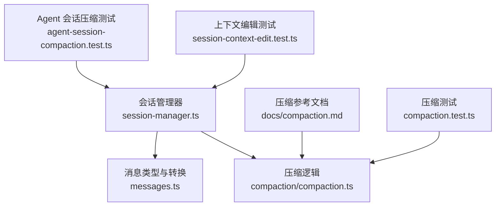
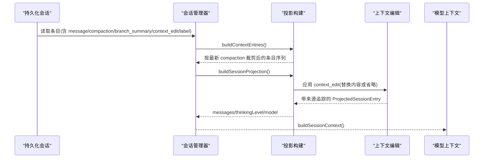
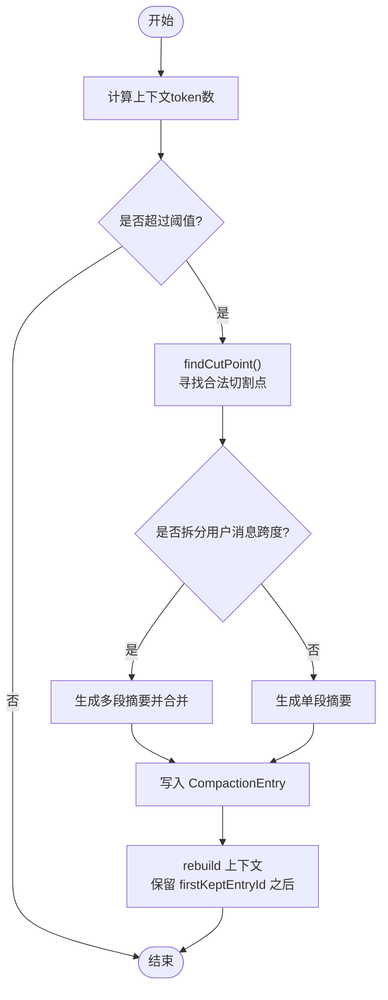
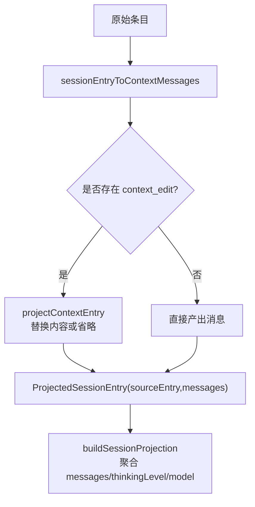
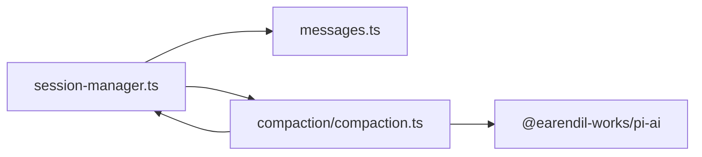

# 消息历史管理

<cite>
**本文引用的文件**   
- [packages/coding-agent/src/core/session-manager.ts](https://github.com/FDE-GROUP/oh-my-coding-agent/blob/omca/packages/coding-agent/src/core/session-manager.ts)
- [packages/coding-agent/src/core/compaction/compaction.ts](https://github.com/FDE-GROUP/oh-my-coding-agent/blob/omca/packages/coding-agent/src/core/compaction/compaction.ts)
- [packages/coding-agent/docs/compaction.md](https://github.com/FDE-GROUP/oh-my-coding-agent/blob/omca/packages/coding-agent/docs/compaction.md)
- [packages/coding-agent/docs/message-types.md](https://github.com/FDE-GROUP/oh-my-coding-agent/blob/omca/packages/coding-agent/docs/message-types.md)
- [packages/coding-agent/src/core/messages.ts](https://github.com/FDE-GROUP/oh-my-coding-agent/blob/omca/packages/coding-agent/src/core/messages.ts)
- [packages/coding-agent/test/session-context-edit.test.ts](https://github.com/FDE-GROUP/oh-my-coding-agent/blob/omca/packages/coding-agent/test/session-context-edit.test.ts)
- [packages/coding-agent/test/agent-session-compaction.test.ts](https://github.com/FDE-GROUP/oh-my-coding-agent/blob/omca/packages/coding-agent/test/agent-session-compaction.test.ts)
- [packages/coding-agent/test/compaction.test.ts](https://github.com/FDE-GROUP/oh-my-coding-agent/blob/omca/packages/coding-agent/test/compaction.test.ts)
</cite>

## 目录
1. [引言](#引言)
2. [项目结构](#项目结构)
3. [核心组件](#核心组件)
4. [架构总览](#架构总览)
5. [详细组件分析](#详细组件分析)
6. [依赖关系分析](#依赖关系分析)
7. [性能与上下文窗口](#性能与上下文窗口)
8. [故障排查指南](#故障排查指南)
9. [结论](#结论)
10. [附录：示例与最佳实践](#附录示例与最佳实践)

## 引言
本文件面向“消息历史管理”的完整技术文档，覆盖以下主题：
- 消息类型系统与序列化
- 消息压缩（Compaction）与分支摘要（Branch Summarization）
- 上下文窗口管理与记忆保留策略
- 标签系统、搜索与统计分析
- 过滤、时间线浏览与历史回溯
- 消息投影机制、编辑历史与版本控制

该能力由会话管理器、压缩子系统、消息转换器以及测试用例共同实现，既保证长对话的稳定性，又提供可追溯的历史与可扩展的扩展点。

## 项目结构
围绕消息历史管理的核心代码位于 coding-agent 包的 core 层，关键文件如下：
- 会话与条目模型、投影与构建：session-manager.ts
- 压缩算法与触发条件：compaction/compaction.ts
- 压缩参考文档：docs/compaction.md
- 消息类型定义与转换：messages.ts、docs/message-types.md
- 行为验证与边界用例：test/session-context-edit.test.ts、test/compaction.test.ts、test/agent-session-compaction.test.ts

图表来源
- [packages/coding-agent/src/core/session-manager.ts:439-574](https://github.com/FDE-GROUP/oh-my-coding-agent/blob/omca/packages/coding-agent/src/core/session-manager.ts#L439-L574)
- [packages/coding-agent/src/core/compaction/compaction.ts:446-501](https://github.com/FDE-GROUP/oh-my-coding-agent/blob/omca/packages/coding-agent/src/core/compaction/compaction.ts#L446-L501)
- [packages/coding-agent/docs/compaction.md:14-23](https://github.com/FDE-GROUP/oh-my-coding-agent/blob/omca/packages/coding-agent/docs/compaction.md#L14-L23)

章节来源
- [packages/coding-agent/src/core/session-manager.ts:439-574](https://github.com/FDE-GROUP/oh-my-coding-agent/blob/omca/packages/coding-agent/src/core/session-manager.ts#L439-L574)
- [packages/coding-agent/src/core/compaction/compaction.ts:446-501](https://github.com/FDE-GROUP/oh-my-coding-agent/blob/omca/packages/coding-agent/src/core/compaction/compaction.ts#L446-L501)
- [packages/coding-agent/docs/compaction.md:14-23](https://github.com/FDE-GROUP/oh-my-coding-agent/blob/omca/packages/coding-agent/docs/compaction.md#L14-L23)

## 核心组件
- 会话与条目模型
  - SessionEntry 联合类型包含 message、thinking_level_change、model_change、usage、compaction、branch_summary、custom、custom_message、context_edit、label、session_info 等条目。
  - CompactionEntry 与 BranchSummaryEntry 分别承载压缩与分支摘要的结构化信息。
  - LabelEntry 用于对任意条目添加用户自定义标签。
  - ContextEditEntry 表示对历史消息内容的追加式编辑或省略。
- 投影与上下文构建
  - buildContextEntries：根据最新 compaction 决定保留范围。
  - buildSessionProjection：生成带来源追踪的投影，应用 context_edit。
  - buildSessionContext：最终供模型使用的消息序列。
- 消息类型与转换
  - AgentMessage 联合类型包含 system/user/assistant/toolResult/bashExecution/custom/branchSummary/compactionSummary。
  - convertToLlm：将编码代理特有消息转换为 LLM 兼容消息。
- 压缩与分支摘要
  - findCutPoint：在保持最近 token 预算的前提下寻找切割点。
  - generateSummary/generateSummaryWithUsage：调用模型生成结构化摘要。
  - shouldCompact：基于 reserveTokens 与 keepRecentTokens 判断是否触发压缩。

章节来源
- [packages/coding-agent/src/core/session-manager.ts:57-194](https://github.com/FDE-GROUP/oh-my-coding-agent/blob/omca/packages/coding-agent/src/core/session-manager.ts#L57-L194)
- [packages/coding-agent/src/core/session-manager.ts:439-574](https://github.com/FDE-GROUP/oh-my-coding-agent/blob/omca/packages/coding-agent/src/core/session-manager.ts#L439-L574)
- [packages/coding-agent/src/core/messages.ts:29-77](https://github.com/FDE-GROUP/oh-my-coding-agent/blob/omca/packages/coding-agent/src/core/messages.ts#L29-L77)
- [packages/coding-agent/src/core/messages.ts:148-196](https://github.com/FDE-GROUP/oh-my-coding-agent/blob/omca/packages/coding-agent/src/core/messages.ts#L148-L196)
- [packages/coding-agent/src/core/compaction/compaction.ts:120-130](https://github.com/FDE-GROUP/oh-my-coding-agent/blob/omca/packages/coding-agent/src/core/compaction/compaction.ts#L120-L130)
- [packages/coding-agent/src/core/compaction/compaction.ts:446-501](https://github.com/FDE-GROUP/oh-my-coding-agent/blob/omca/packages/coding-agent/src/core/compaction/compaction.ts#L446-L501)
- [packages/coding-agent/src/core/compaction/compaction.ts:644-753](https://github.com/FDE-GROUP/oh-my-coding-agent/blob/omca/packages/coding-agent/src/core/compaction/compaction.ts#L644-L753)

## 架构总览
下图展示从原始会话条目到模型可用上下文的处理流程，包括压缩、分支摘要、上下文编辑与投影。

图表来源
- [packages/coding-agent/src/core/session-manager.ts:476-574](https://github.com/FDE-GROUP/oh-my-coding-agent/blob/omca/packages/coding-agent/src/core/session-manager.ts#L476-L574)

章节来源
- [packages/coding-agent/src/core/session-manager.ts:476-574](https://github.com/FDE-GROUP/oh-my-coding-agent/blob/omca/packages/coding-agent/src/core/session-manager.ts#L476-L574)

## 详细组件分析

### 消息类型系统与序列化
- 基础消息类型
  - SystemMessage、UserMessage、AssistantMessage、ToolResultMessage 定义于 AI 包，coding-agent 在其上扩展 BashExecutionMessage、CustomMessage、BranchSummaryMessage、CompactionSummaryMessage。
- 内容块
  - TextContent、ImageContent、ThinkingContent、ToolCall 支持文本、图片、思考过程与工具调用。
- 使用统计
  - Usage 记录输入/输出/缓存读写/推理等用量，并附带成本。
- 序列化
  - convertToLlm 将编码代理特有消息转为 LLM 兼容消息；压缩时通过 serializeConversation 将消息序列化为纯文本提示，避免模型继续对话。

```mermaid
classDiagram
class SystemMessage { +role +content +timestamp }
class UserMessage { +role +content +timestamp }
class AssistantMessage { +role +content +usage +stopReason +timestamp }
class ToolResultMessage { +role +toolCallId +toolName +content +isError +timestamp }
class BashExecutionMessage { +role +command +output +exitCode +cancelled +truncated +excludeFromContext +timestamp }
class CustomMessage { +role +customType +content +display +details +timestamp }
class BranchSummaryMessage { +role +summary +fromId +timestamp }
class CompactionSummaryMessage { +role +summary +tokensBefore +timestamp }
SystemMessage <|-- AssistantMessage
SystemMessage <|-- UserMessage
SystemMessage <|-- ToolResultMessage
SystemMessage <|-- BashExecutionMessage
SystemMessage <|-- CustomMessage
SystemMessage <|-- BranchSummaryMessage
SystemMessage <|-- CompactionSummaryMessage
```

图表来源
- [packages/coding-agent/docs/message-types.md:92-277](https://github.com/FDE-GROUP/oh-my-coding-agent/blob/omca/packages/coding-agent/docs/message-types.md#L92-L277)
- [packages/coding-agent/src/core/messages.ts:29-77](https://github.com/FDE-GROUP/oh-my-coding-agent/blob/omca/packages/coding-agent/src/core/messages.ts#L29-L77)

章节来源
- [packages/coding-agent/docs/message-types.md:13-277](https://github.com/FDE-GROUP/oh-my-coding-agent/blob/omca/packages/coding-agent/docs/message-types.md#L13-L277)
- [packages/coding-agent/src/core/messages.ts:148-196](https://github.com/FDE-GROUP/oh-my-coding-agent/blob/omca/packages/coding-agent/src/core/messages.ts#L148-L196)

### 消息压缩算法与上下文窗口管理
- 触发条件
  - 当 contextTokens > contextWindow - reserveTokens 时触发自动压缩；也可通过 /compact 手动触发。
- 切割点选择
  - findCutPoint 从新到旧累计估计 token，达到 keepRecentTokens 后选择合法切割点（用户/助手/BashExecution/自定义/分支摘要/压缩摘要），禁止在工具结果处切割。
- 拆分用户消息跨度
  - 若单个用户消息跨度超过 keepRecentTokens，会在助手消息处切割，并生成两段摘要合并。
- 摘要生成
  - generateSummaryWithUsage 使用结构化模板（目标、约束、进度、关键决策、下一步、关键上下文）生成摘要，支持增量更新。
- 上下文重建
  - 保存 CompactionEntry(summary, firstKeptEntryId, tokensBefore)，后续 buildContextEntries 仅保留 from firstKeptEntryId 之后的可见消息。

图表来源
- [packages/coding-agent/src/core/compaction/compaction.ts:267-270](https://github.com/FDE-GROUP/oh-my-coding-agent/blob/omca/packages/coding-agent/src/core/compaction/compaction.ts#L267-L270)
- [packages/coding-agent/src/core/compaction/compaction.ts:446-501](https://github.com/FDE-GROUP/oh-my-coding-agent/blob/omca/packages/coding-agent/src/core/compaction/compaction.ts#L446-L501)
- [packages/coding-agent/src/core/compaction/compaction.ts:644-753](https://github.com/FDE-GROUP/oh-my-coding-agent/blob/omca/packages/coding-agent/src/core/compaction/compaction.ts#L644-L753)
- [packages/coding-agent/src/core/session-manager.ts:476-511](https://github.com/FDE-GROUP/oh-my-coding-agent/blob/omca/packages/coding-agent/src/core/session-manager.ts#L476-L511)

章节来源
- [packages/coding-agent/docs/compaction.md:25-83](https://github.com/FDE-GROUP/oh-my-coding-agent/blob/omca/packages/coding-agent/docs/compaction.md#L25-L83)
- [packages/coding-agent/src/core/compaction/compaction.ts:267-270](https://github.com/FDE-GROUP/oh-my-coding-agent/blob/omca/packages/coding-agent/src/core/compaction/compaction.ts#L267-L270)
- [packages/coding-agent/src/core/compaction/compaction.ts:446-501](https://github.com/FDE-GROUP/oh-my-coding-agent/blob/omca/packages/coding-agent/src/core/compaction/compaction.ts#L446-L501)
- [packages/coding-agent/src/core/compaction/compaction.ts:644-753](https://github.com/FDE-GROUP/oh-my-coding-agent/blob/omca/packages/coding-agent/src/core/compaction/compaction.ts#L644-L753)
- [packages/coding-agent/src/core/session-manager.ts:476-511](https://github.com/FDE-GROUP/oh-my-coding-agent/blob/omca/packages/coding-agent/src/core/session-manager.ts#L476-L511)

### 分支摘要与树形导航
- 触发时机
  - 使用 /tree 切换到其他分支时，系统会建议对离开的分支进行摘要，以在新分支中注入上下文。
- 工作原理
  - 找到新旧分支的最近公共祖先，收集被放弃分支上的条目，按 token 预算准备消息，生成 BranchSummaryEntry 并附加到导航位置。
- 文件操作累积
  - 默认压缩与分支摘要均从工具调用中提取文件操作，并在 Pi 生成的摘要间累积传递。

章节来源
- [packages/coding-agent/docs/compaction.md:169-232](https://github.com/FDE-GROUP/oh-my-coding-agent/blob/omca/packages/coding-agent/docs/compaction.md#L169-L232)

### 消息投影机制、编辑历史与版本控制
- 投影机制
  - sessionEntryToContextMessages 将不同 entry 类型映射为 AgentMessage；buildSessionProjection 应用 context_edit，生成带 sourceEntry 溯源信息的投影。
- 编辑历史
  - ContextEditEntry 可对历史消息内容进行追加式替换或省略（replacement=null 表示省略）。
  - projectContextEntry 根据 latest edit 替换 content 或移除贡献。
- 版本迁移
  - v1→v2：增加 id/parentId 树结构，迁移 firstKeptEntryIndex→firstKeptEntryId。
  - v2→v3：将 hookMessage role 重命名为 custom。

图表来源
- [packages/coding-agent/src/core/session-manager.ts:439-574](https://github.com/FDE-GROUP/oh-my-coding-agent/blob/omca/packages/coding-agent/src/core/session-manager.ts#L439-L574)
- [packages/coding-agent/src/core/session-manager.ts:286-347](https://github.com/FDE-GROUP/oh-my-coding-agent/blob/omca/packages/coding-agent/src/core/session-manager.ts#L286-L347)

章节来源
- [packages/coding-agent/src/core/session-manager.ts:439-574](https://github.com/FDE-GROUP/oh-my-coding-agent/blob/omca/packages/coding-agent/src/core/session-manager.ts#L439-L574)
- [packages/coding-agent/src/core/session-manager.ts:286-347](https://github.com/FDE-GROUP/oh-my-coding-agent/blob/omca/packages/coding-agent/src/core/session-manager.ts#L286-L347)

### 标签系统、搜索与统计分析
- 标签系统
  - LabelEntry 允许对任意条目添加 label，便于书签与标记。
- 搜索
  - 可通过 RPC 命令获取所有会话条目（append-only 树，稳定 id 作为游标），结合标签与时间戳进行筛选。
- 统计分析
  - UsageEntry 记录各类 usage 类别；AssistantMessage.usage 与 CompactionEntry.usage 可用于会话级统计与计费。

章节来源
- [packages/coding-agent/src/core/session-manager.ts:80-145](https://github.com/FDE-GROUP/oh-my-coding-agent/blob/omca/packages/coding-agent/src/core/session-manager.ts#L80-L145)
- [packages/coding-agent/docs/compaction.md:140-166](https://github.com/FDE-GROUP/oh-my-coding-agent/blob/omca/packages/coding-agent/docs/compaction.md#L140-L166)

### 过滤、时间线浏览与历史回溯
- 过滤
  - 通过 getEntries 获取全部条目，再按 type/role/timestamp/label 过滤；context_edit 的 omission 不影响原始历史检索。
- 时间线浏览
  - 使用 leafId 遍历路径，结合 buildSessionPath 与 buildContextEntries 查看当前分支的有效上下文。
- 历史回溯
  - 利用 stable id 作为游标，RPC 的 since 参数可实现断点续传与跨重启同步。

章节来源
- [packages/coding-agent/docs/compaction.md:140-166](https://github.com/FDE-GROUP/oh-my-coding-agent/blob/omca/packages/coding-agent/docs/compaction.md#L140-L166)

## 依赖关系分析
- 模块耦合
  - session-manager.ts 依赖 messages.ts 进行角色转换，依赖 compaction/compaction.ts 进行压缩决策与摘要生成。
  - compaction/compaction.ts 依赖 session-manager.ts 提供的投影与条目类型。
- 外部依赖
  - pi-ai 提供 Model、completeSimple、retryAssistantCall、normalizeContext 等能力。
- 循环依赖
  - 无直接循环依赖；压缩逻辑通过函数接口与 session-manager 解耦。

图表来源
- [packages/coding-agent/src/core/session-manager.ts:1-40](https://github.com/FDE-GROUP/oh-my-coding-agent/blob/omca/packages/coding-agent/src/core/session-manager.ts#L1-L40)
- [packages/coding-agent/src/core/compaction/compaction.ts:1-45](https://github.com/FDE-GROUP/oh-my-coding-agent/blob/omca/packages/coding-agent/src/core/compaction/compaction.ts#L1-L45)

章节来源
- [packages/coding-agent/src/core/session-manager.ts:1-40](https://github.com/FDE-GROUP/oh-my-coding-agent/blob/omca/packages/coding-agent/src/core/session-manager.ts#L1-L40)
- [packages/coding-agent/src/core/compaction/compaction.ts:1-45](https://github.com/FDE-GROUP/oh-my-coding-agent/blob/omca/packages/coding-agent/src/core/compaction/compaction.ts#L1-L45)

## 性能与上下文窗口
- Token 估算
  - estimateTokens 采用字符/4 启发式保守估算，区分 system/user/assistant/toolResult/bashExecution/branchSummary/compactionSummary 等不同角色。
- 上下文窗口
  - reserveTokens 控制触发压缩前的安全余量；keepRecentTokens 控制保留最近的 token 数量。
- 溢出恢复
  - 遇到 provider 上下文溢出或 length 停止时，系统进行一次 compact-and-retry 恢复，保留已持久化的响应并修复上下文后重试。

章节来源
- [packages/coding-agent/src/core/compaction/compaction.ts:298-349](https://github.com/FDE-GROUP/oh-my-coding-agent/blob/omca/packages/coding-agent/src/core/compaction/compaction.ts#L298-L349)
- [packages/coding-agent/docs/compaction.md:25-41](https://github.com/FDE-GROUP/oh-my-coding-agent/blob/omca/packages/coding-agent/docs/compaction.md#L25-L41)

## 故障排查指南
- 压缩失败或中断
  - 检查 completeSummarization 返回的 stopReason；length 或 error 会导致摘要不可用。
  - 使用 session_compact_failed 事件获取 reason、errorMessage、aborted、willRetry、fromExtension。
- 上下文未生效
  - 确认 buildSessionProjection 是否正确应用了 context_edit；检查 replacement 是否为 null（省略）或内容是否被正确替换。
- 分支切换丢失上下文
  - 确认 branch_summary 已生成并附加到导航点；检查 commonAncestor 与 entriesToSummarize 是否正确。

章节来源
- [packages/coding-agent/src/core/compaction/compaction.ts:585-593](https://github.com/FDE-GROUP/oh-my-coding-agent/blob/omca/packages/coding-agent/src/core/compaction/compaction.ts#L585-L593)
- [packages/coding-agent/docs/compaction.md:370-415](https://github.com/FDE-GROUP/oh-my-coding-agent/blob/omca/packages/coding-agent/docs/compaction.md#L370-L415)
- [packages/coding-agent/src/core/session-manager.ts:519-541](https://github.com/FDE-GROUP/oh-my-coding-agent/blob/omca/packages/coding-agent/src/core/session-manager.ts#L519-L541)

## 结论
该消息历史管理体系通过“条目+投影+编辑”的分层设计，实现了：
- 稳定的 append-only 历史与可回溯的时间线
- 可控的上下文窗口与记忆保留策略
- 可扩展的消息类型与序列化通道
- 强大的压缩与分支摘要能力
- 灵活的标签、搜索与统计能力

这些能力共同保障了长对话的稳定性与可维护性，同时为上层 UI、RPC 与扩展提供了清晰的契约。

## 附录：示例与最佳实践
- 上下文编辑示例
  - 对某条 user 消息进行编辑后，分支相对隔离，投影显示编辑后的内容。
  - 使用自引用 compaction(firstKeptEntryId=自身) 可实现“丢弃之前所有内容”的效果。
- 压缩事件与手动压缩
  - 手动触发 /compact 会发出 compaction_start/compaction_end 事件；即使在不持久化模式（in-memory）下也能工作。
- 多次压缩
  - 最新的 compaction 决定保留范围；重复压缩会基于上一次 kept boundary 重新计算。

章节来源
- [packages/coding-agent/test/session-context-edit.test.ts:119-193](https://github.com/FDE-GROUP/oh-my-coding-agent/blob/omca/packages/coding-agent/test/session-context-edit.test.ts#L119-L193)
- [packages/coding-agent/test/agent-session-compaction.test.ts:163-209](https://github.com/FDE-GROUP/oh-my-coding-agent/blob/omca/packages/coding-agent/test/agent-session-compaction.test.ts#L163-L209)
- [packages/coding-agent/test/compaction.test.ts:439-469](https://github.com/FDE-GROUP/oh-my-coding-agent/blob/omca/packages/coding-agent/test/compaction.test.ts#L439-L469)