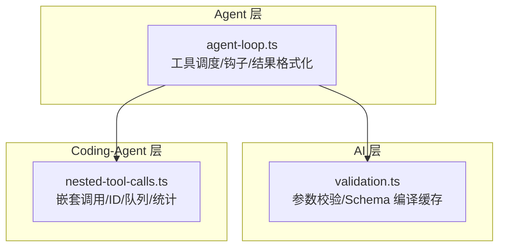
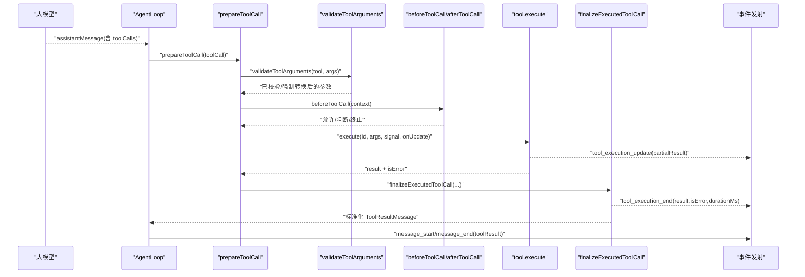
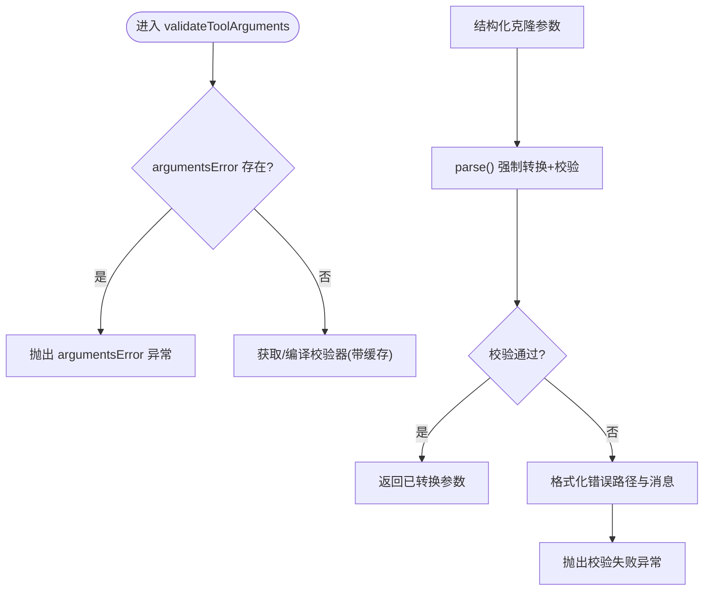
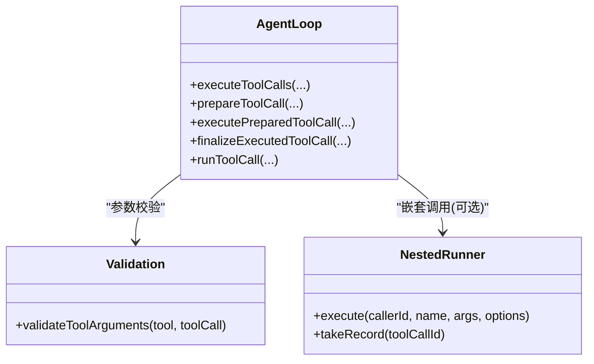
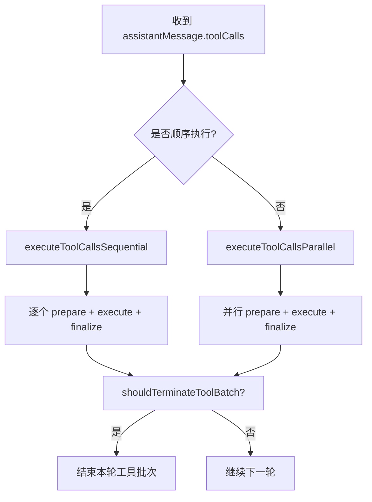
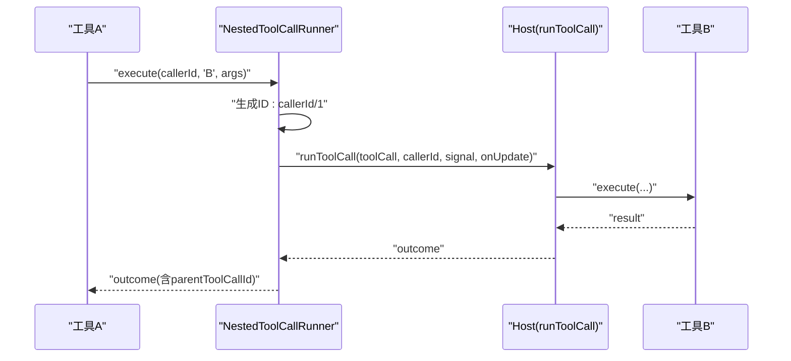
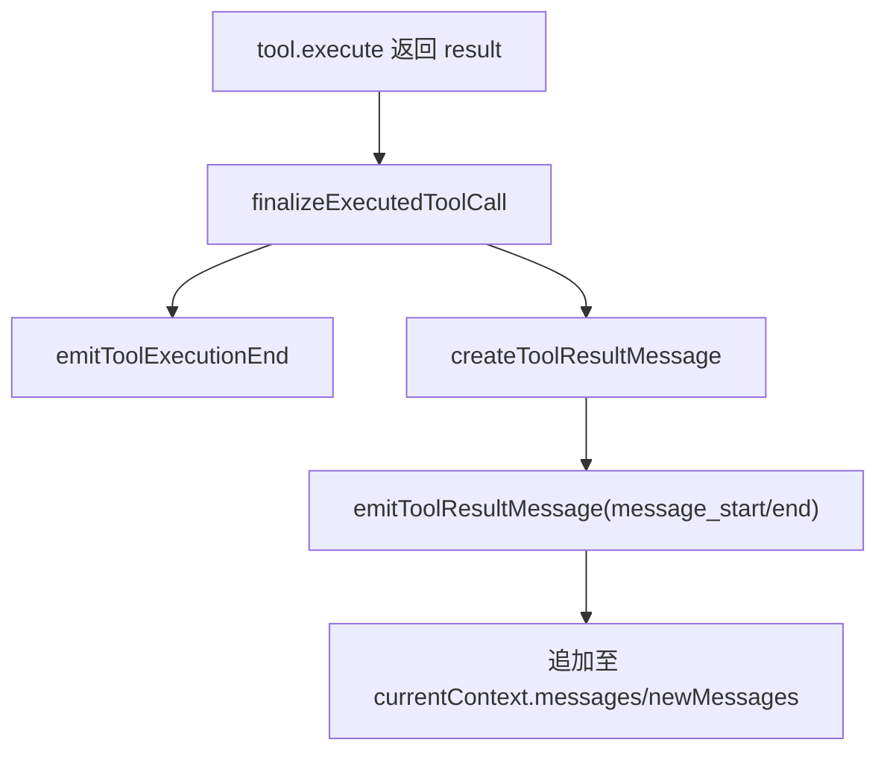
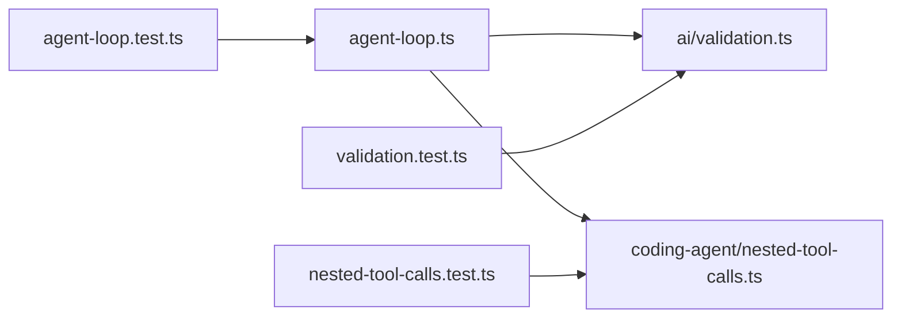

# 工具执行引擎

<cite>
**本文引用的文件**   
- [packages/agent/src/agent-loop.ts](https://github.com/FDE-GROUP/oh-my-coding-agent/blob/omca/packages/agent/src/agent-loop.ts)
- [packages/ai/src/utils/validation.ts](https://github.com/FDE-GROUP/oh-my-coding-agent/blob/omca/packages/ai/src/utils/validation.ts)
- [packages/coding-agent/src/core/nested-tool-calls.ts](https://github.com/FDE-GROUP/oh-my-coding-agent/blob/omca/packages/coding-agent/src/core/nested-tool-calls.ts)
- [packages/agent/test/agent-loop.test.ts](https://github.com/FDE-GROUP/oh-my-coding-agent/blob/omca/packages/agent/test/agent-loop.test.ts)
- [packages/coding-agent/test/nested-tool-calls.test.ts](https://github.com/FDE-GROUP/oh-my-coding-agent/blob/omca/packages/coding-agent/test/nested-tool-calls.test.ts)
- [packages/ai/test/validation.test.ts](https://github.com/FDE-GROUP/oh-my-coding-agent/blob/omca/packages/ai/test/validation.test.ts)
</cite>

## 目录
1. [简介](#简介)
2. [项目结构](#项目结构)
3. [核心组件](#核心组件)
4. [架构总览](#架构总览)
5. [详细组件分析](#详细组件分析)
6. [依赖关系分析](#依赖关系分析)
7. [性能与并发特性](#性能与并发特性)
8. [故障排查指南](#故障排查指南)
9. [结论](#结论)
10. [附录：调用示例与监控调试](#附录调用示例与监控调试)

## 简介
本文件系统性梳理“工具执行引擎”的实现与使用方式，覆盖以下关键主题：
- 工具调用流程：参数准备、JSON Schema 校验、权限钩子、执行与结果格式化。
- 嵌套工具调用：工具内部再次调用其他工具的链路、ID 分配、事件上报与记录。
- 并行与顺序执行模式：按工具声明或全局配置决定执行策略。
- 权限控制：beforeToolCall/afterToolCall 钩子的拦截与结果改写。
- 超时与中断：AbortSignal 贯穿调用链，支持外部取消。
- 错误恢复：统一错误结果封装、截断消息失败处理、终止标志 propagate。
- Agent 交互：AgentLoop 与 LLM 流式响应、工具结果回写上下文。
- 工具结果格式：content/detailes/usage/structuredContent 等字段规范化。
- 工具链式调用：runToolCall 复用同一管线，保证 hooks 一致性与可观测性。

## 项目结构
围绕工具执行引擎的关键代码分布在三个包中：
- packages/agent：Agent 循环、工具调度（并行/顺序）、钩子与结果格式化。
- packages/ai：工具参数 JSON Schema 校验与编译缓存。
- packages/coding-agent：工具内嵌的“嵌套工具调用”能力，含 ID 生成、串行队列、统计与限制。

**图表来源**
- [packages/agent/src/agent-loop.ts:518-533](https://github.com/FDE-GROUP/oh-my-coding-agent/blob/omca/packages/agent/src/agent-loop.ts#L518-L533)
- [packages/ai/src/utils/validation.ts:8-18](https://github.com/FDE-GROUP/oh-my-coding-agent/blob/omca/packages/ai/src/utils/validation.ts#L8-L18)
- [packages/coding-agent/src/core/nested-tool-calls.ts:161-264](https://github.com/FDE-GROUP/oh-my-coding-agent/blob/omca/packages/coding-agent/src/core/nested-tool-calls.ts#L161-L264)

**章节来源**
- [packages/agent/src/agent-loop.ts:1-135](https://github.com/FDE-GROUP/oh-my-coding-agent/blob/omca/packages/agent/src/agent-loop.ts#L1-L135)
- [packages/ai/src/utils/validation.ts:1-70](https://github.com/FDE-GROUP/oh-my-coding-agent/blob/omca/packages/ai/src/utils/validation.ts#L1-L70)
- [packages/coding-agent/src/core/nested-tool-calls.ts:1-101](https://github.com/FDE-GROUP/oh-my-coding-agent/blob/omca/packages/coding-agent/src/core/nested-tool-calls.ts#L1-L101)

## 核心组件
- 工具参数校验器：基于 pi-schema 编译并缓存校验器，支持类型强制转换与路径格式化错误信息。
- 工具调用管线：prepare → validate → beforeHook → execute → afterHook → finalize → emit。
- 嵌套调用运行器：为工具内部调用提供独立 ID、可选串行队列、事件上报与调用记录。
- Agent 循环：LLM 流式响应解析、工具批处理（并行/顺序）、结果回写上下文与事件输出。

**章节来源**
- [packages/ai/src/utils/validation.ts:45-69](https://github.com/FDE-GROUP/oh-my-coding-agent/blob/omca/packages/ai/src/utils/validation.ts#L45-L69)
- [packages/agent/src/agent-loop.ts:718-787](https://github.com/FDE-GROUP/oh-my-coding-agent/blob/omca/packages/agent/src/agent-loop.ts#L718-L787)
- [packages/coding-agent/src/core/nested-tool-calls.ts:161-264](https://github.com/FDE-GROUP/oh-my-coding-agent/blob/omca/packages/coding-agent/src/core/nested-tool-calls.ts#L161-L264)
- [packages/agent/src/agent-loop.ts:518-670](https://github.com/FDE-GROUP/oh-my-coding-agent/blob/omca/packages/agent/src/agent-loop.ts#L518-L670)

## 架构总览
下图展示一次从 LLM 到工具执行的端到端流程，包括参数校验、权限钩子、执行与结果格式化。

**图表来源**
- [packages/agent/src/agent-loop.ts:518-533](https://github.com/FDE-GROUP/oh-my-coding-agent/blob/omca/packages/agent/src/agent-loop.ts#L518-L533)
- [packages/agent/src/agent-loop.ts:718-787](https://github.com/FDE-GROUP/oh-my-coding-agent/blob/omca/packages/agent/src/agent-loop.ts#L718-L787)
- [packages/agent/src/agent-loop.ts:831-920](https://github.com/FDE-GROUP/oh-my-coding-agent/blob/omca/packages/agent/src/agent-loop.ts#L831-L920)
- [packages/agent/src/agent-loop.ts:929-959](https://github.com/FDE-GROUP/oh-my-coding-agent/blob/omca/packages/agent/src/agent-loop.ts#L929-L959)
- [packages/ai/src/utils/validation.ts:45-69](https://github.com/FDE-GROUP/oh-my-coding-agent/blob/omca/packages/ai/src/utils/validation.ts#L45-L69)

## 详细组件分析

### 参数校验与错误信息
- 校验入口：validateToolArguments 对工具定义与 LLM 传入的参数进行 JSON Schema 校验，并进行类型强制转换。
- 校验器缓存：WeakMap 缓存每个 schema 对应的编译器，避免重复编译开销。
- 错误路径格式化：将 JSON Pointer 转换为点号路径，便于人类阅读。
- 安全兜底：当 Function 构造不可用时仍可进行校验（测试覆盖）。

**图表来源**
- [packages/ai/src/utils/validation.ts:8-18](https://github.com/FDE-GROUP/oh-my-coding-agent/blob/omca/packages/ai/src/utils/validation.ts#L8-L18)
- [packages/ai/src/utils/validation.ts:45-69](https://github.com/FDE-GROUP/oh-my-coding-agent/blob/omca/packages/ai/src/utils/validation.ts#L45-L69)

**章节来源**
- [packages/ai/src/utils/validation.ts:1-70](https://github.com/FDE-GROUP/oh-my-coding-agent/blob/omca/packages/ai/src/utils/validation.ts#L1-L70)
- [packages/ai/test/validation.test.ts:35-61](https://github.com/FDE-GROUP/oh-my-coding-agent/blob/omca/packages/ai/test/validation.test.ts#L35-L61)

### 工具调用管线与权限钩子
- prepareToolCall：查找工具、预处理参数、校验、beforeToolCall 权限检查、中止信号检查。
- executePreparedToolCall：执行工具函数，收集 partialResult 更新，计算耗时，捕获异常并转为错误结果。
- finalizeExecutedToolCall：afterToolCall 可改写 content/details/usage/terminate 等字段；异常时转为错误结果。
- runToolCall：对外暴露的统一入口，复用完整管线，供工具内部链式调用。

**图表来源**
- [packages/agent/src/agent-loop.ts:718-787](https://github.com/FDE-GROUP/oh-my-coding-agent/blob/omca/packages/agent/src/agent-loop.ts#L718-L787)
- [packages/agent/src/agent-loop.ts:831-920](https://github.com/FDE-GROUP/oh-my-coding-agent/blob/omca/packages/agent/src/agent-loop.ts#L831-L920)
- [packages/coding-agent/src/core/nested-tool-calls.ts:161-264](https://github.com/FDE-GROUP/oh-my-coding-agent/blob/omca/packages/coding-agent/src/core/nested-tool-calls.ts#L161-L264)

**章节来源**
- [packages/agent/src/agent-loop.ts:718-787](https://github.com/FDE-GROUP/oh-my-coding-agent/blob/omca/packages/agent/src/agent-loop.ts#L718-L787)
- [packages/agent/src/agent-loop.ts:831-920](https://github.com/FDE-GROUP/oh-my-coding-agent/blob/omca/packages/agent/src/agent-loop.ts#L831-L920)
- [packages/agent/src/agent-loop.ts:800-829](https://github.com/FDE-GROUP/oh-my-coding-agent/blob/omca/packages/agent/src/agent-loop.ts#L800-L829)

### 并行与顺序执行模式
- 选择逻辑：若全局 toolExecution=sequential 或任一工具声明 executionMode=sequential，则走顺序执行；否则并行。
- 顺序执行：逐个准备与执行，遇到 AbortSignal 提前退出。
- 并行执行：Promise.all 聚合结果，保持原始顺序；同样支持 AbortSignal。
- 批量终止：当所有工具结果均携带 terminate=true 时，外层循环终止后续轮次。

**图表来源**
- [packages/agent/src/agent-loop.ts:518-533](https://github.com/FDE-GROUP/oh-my-coding-agent/blob/omca/packages/agent/src/agent-loop.ts#L518-L533)
- [packages/agent/src/agent-loop.ts:540-594](https://github.com/FDE-GROUP/oh-my-coding-agent/blob/omca/packages/agent/src/agent-loop.ts#L540-L594)
- [packages/agent/src/agent-loop.ts:596-670](https://github.com/FDE-GROUP/oh-my-coding-agent/blob/omca/packages/agent/src/agent-loop.ts#L596-L670)
- [packages/agent/src/agent-loop.ts:700-702](https://github.com/FDE-GROUP/oh-my-coding-agent/blob/omca/packages/agent/src/agent-loop.ts#L700-L702)

**章节来源**
- [packages/agent/src/agent-loop.ts:518-670](https://github.com/FDE-GROUP/oh-my-coding-agent/blob/omca/packages/agent/src/agent-loop.ts#L518-L670)
- [packages/agent/test/agent-loop.test.ts:990-1033](https://github.com/FDE-GROUP/oh-my-coding-agent/blob/omca/packages/agent/test/agent-loop.test.ts#L990-L1033)

### 嵌套工具调用
- 触发场景：工具在执行过程中再次调用其他工具（例如脚本/扩展）。
- ID 分配：以父调用 ID 为前缀，形如 callerId/n，保证全链路唯一。
- 串行队列：当宿主处于顺序模式或目标工具声明 sequential 时，自动排队串行执行。
- 事件上报：tool_execution_start/update/end 均携带 parentToolCallId，便于追踪。
- 记录与限制：NestedCallRecorder 限制最大调用数、参数字节数、错误字符长度，并汇总 usage。

**图表来源**
- [packages/coding-agent/src/core/nested-tool-calls.ts:161-264](https://github.com/FDE-GROUP/oh-my-coding-agent/blob/omca/packages/coding-agent/src/core/nested-tool-calls.ts#L161-L264)

**章节来源**
- [packages/coding-agent/src/core/nested-tool-calls.ts:1-101](https://github.com/FDE-GROUP/oh-my-coding-agent/blob/omca/packages/coding-agent/src/core/nested-tool-calls.ts#L1-L101)
- [packages/coding-agent/src/core/nested-tool-calls.ts:161-264](https://github.com/FDE-GROUP/oh-my-coding-agent/blob/omca/packages/coding-agent/src/core/nested-tool-calls.ts#L161-L264)
- [packages/coding-agent/test/nested-tool-calls.test.ts:53-98](https://github.com/FDE-GROUP/oh-my-coding-agent/blob/omca/packages/coding-agent/test/nested-tool-calls.test.ts#L53-L98)
- [packages/coding-agent/test/nested-tool-calls.test.ts:164-187](https://github.com/FDE-GROUP/oh-my-coding-agent/blob/omca/packages/coding-agent/test/nested-tool-calls.test.ts#L164-L187)

### 工具结果格式化与消息回写
- 错误结果：createErrorToolResult 统一包装为文本内容块。
- 结果消息：createToolResultMessage 标准化 content/details/usage/timestamp/isError 等字段。
- 事件发射：emitToolExecutionEnd 与 emitToolResultMessage 分别发出执行结束与消息边界事件。
- 上下文回写：AgentLoop 将 toolResult 追加到当前上下文与 newMessages，驱动下一轮推理。

**图表来源**
- [packages/agent/src/agent-loop.ts:869-920](https://github.com/FDE-GROUP/oh-my-coding-agent/blob/omca/packages/agent/src/agent-loop.ts#L869-L920)
- [packages/agent/src/agent-loop.ts:922-959](https://github.com/FDE-GROUP/oh-my-coding-agent/blob/omca/packages/agent/src/agent-loop.ts#L922-L959)
- [packages/agent/src/agent-loop.ts:283-286](https://github.com/FDE-GROUP/oh-my-coding-agent/blob/omca/packages/agent/src/agent-loop.ts#L283-L286)

**章节来源**
- [packages/agent/src/agent-loop.ts:869-959](https://github.com/FDE-GROUP/oh-my-coding-agent/blob/omca/packages/agent/src/agent-loop.ts#L869-L959)

### 截断消息的错误处理
- 当 LLM 因 token 上限被截断时，工具调用可能包含不完整参数。
- 引擎会主动将这些工具调用标记为失败，提示模型重新发起完整调用。

**章节来源**
- [packages/agent/src/agent-loop.ts:481-513](https://github.com/FDE-GROUP/oh-my-coding-agent/blob/omca/packages/agent/src/agent-loop.ts#L481-L513)

## 依赖关系分析
- agent-loop.ts 依赖 ai.validation 做参数校验，依赖 coding-agent.nested-tool-calls 实现工具内嵌调用。
- nested-tool-calls.ts 通过 host.runToolCall 复用 agent-loop 的工具管线，确保权限钩子与结果格式一致。
- 测试用例验证了顺序/并行行为、嵌套调用事件与记录、以及校验在受限环境下的鲁棒性。

**图表来源**
- [packages/agent/src/agent-loop.ts:518-533](https://github.com/FDE-GROUP/oh-my-coding-agent/blob/omca/packages/agent/src/agent-loop.ts#L518-L533)
- [packages/ai/src/utils/validation.ts:45-69](https://github.com/FDE-GROUP/oh-my-coding-agent/blob/omca/packages/ai/src/utils/validation.ts#L45-L69)
- [packages/coding-agent/src/core/nested-tool-calls.ts:161-264](https://github.com/FDE-GROUP/oh-my-coding-agent/blob/omca/packages/coding-agent/src/core/nested-tool-calls.ts#L161-L264)
- [packages/agent/test/agent-loop.test.ts:990-1033](https://github.com/FDE-GROUP/oh-my-coding-agent/blob/omca/packages/agent/test/agent-loop.test.ts#L990-L1033)
- [packages/coding-agent/test/nested-tool-calls.test.ts:164-187](https://github.com/FDE-GROUP/oh-my-coding-agent/blob/omca/packages/coding-agent/test/nested-tool-calls.test.ts#L164-L187)
- [packages/ai/test/validation.test.ts:35-61](https://github.com/FDE-GROUP/oh-my-coding-agent/blob/omca/packages/ai/test/validation.test.ts#L35-L61)

**章节来源**
- [packages/agent/src/agent-loop.ts:518-670](https://github.com/FDE-GROUP/oh-my-coding-agent/blob/omca/packages/agent/src/agent-loop.ts#L518-L670)
- [packages/ai/src/utils/validation.ts:1-70](https://github.com/FDE-GROUP/oh-my-coding-agent/blob/omca/packages/ai/src/utils/validation.ts#L1-L70)
- [packages/coding-agent/src/core/nested-tool-calls.ts:1-101](https://github.com/FDE-GROUP/oh-my-coding-agent/blob/omca/packages/coding-agent/src/core/nested-tool-calls.ts#L1-L101)

## 性能与并发特性
- 校验器缓存：WeakMap 缓存编译后的校验器，减少重复编译成本。
- 并行执行：Promise.all 聚合多个工具调用，提升吞吐；同时保持结果顺序。
- 顺序执行：针对需要互斥的工具或全局顺序模式，避免竞争条件。
- 耗时统计：executePreparedToolCall 记录 durationMs，并在结束时随事件输出。
- 资源回收：finally 中关闭更新接收，避免悬挂回调。

[本节为通用性能说明，不直接分析具体文件]

## 故障排查指南
- 参数校验失败：检查工具 parameters 与传入 arguments 的类型匹配；查看格式化后的错误路径。
- 工具未找到：确认 tools 列表中包含该名称；注意大小写与命名空间。
- 权限阻断：beforeToolCall 返回 block=true 将直接返回错误结果并可设置 terminate。
- 执行异常：工具抛错会被捕获并转为 isError=true 的结果；检查日志中的 message。
- 截断导致失败：当 stopReason=length 时，工具调用会被主动失败；请让模型重试。
- 嵌套调用缺失：检查 NestedToolCallRunner 的事件与 takeRecord 返回值，确认 parentToolCallId 是否正确。

**章节来源**
- [packages/ai/src/utils/validation.ts:45-69](https://github.com/FDE-GROUP/oh-my-coding-agent/blob/omca/packages/ai/src/utils/validation.ts#L45-L69)
- [packages/agent/src/agent-loop.ts:718-787](https://github.com/FDE-GROUP/oh-my-coding-agent/blob/omca/packages/agent/src/agent-loop.ts#L718-L787)
- [packages/agent/src/agent-loop.ts:481-513](https://github.com/FDE-GROUP/oh-my-coding-agent/blob/omca/packages/agent/src/agent-loop.ts#L481-L513)
- [packages/coding-agent/test/nested-tool-calls.test.ts:68-98](https://github.com/FDE-GROUP/oh-my-coding-agent/blob/omca/packages/coding-agent/test/nested-tool-calls.test.ts#L68-L98)

## 结论
工具执行引擎以“参数校验 + 权限钩子 + 执行 + 结果格式化”为主线，结合 AgentLoop 的流式响应与上下文管理，形成稳定可扩展的工具执行体系。通过并行/顺序模式、嵌套调用、AbortSignal 与完善的错误处理，既满足高吞吐需求，又保障可控性与可观测性。

[本节为总结性内容，不直接分析具体文件]

## 附录：调用示例与监控调试
- 基本调用示例
  - 通过 runToolCall 执行单个工具调用，复用完整管线（参数准备、校验、hooks、执行、finalize）。
  - 参考路径：[packages/agent/src/agent-loop.ts:800-829](https://github.com/FDE-GROUP/oh-my-coding-agent/blob/omca/packages/agent/src/agent-loop.ts#L800-L829)
- 嵌套调用示例
  - 在工具内部通过 runner.execute 调用其他工具，观察 tool_execution_* 事件与 takeRecord 结果。
  - 参考路径：[packages/coding-agent/test/nested-tool-calls.test.ts:53-98](https://github.com/FDE-GROUP/oh-my-coding-agent/blob/omca/packages/coding-agent/test/nested-tool-calls.test.ts#L53-L98)
- 顺序/并行行为验证
  - 通过测试用例观察 slow/fast 工具的执行顺序与并发度。
  - 参考路径：[packages/agent/test/agent-loop.test.ts:990-1033](https://github.com/FDE-GROUP/oh-my-coding-agent/blob/omca/packages/agent/test/agent-loop.test.ts#L990-L1033)
- 监控与调试
  - 监听事件：tool_execution_start/update/end、message_start/end。
  - 关注字段：isError、durationMs、details、usage、terminate。
  - 调试建议：打印 parentToolCallId 以定位嵌套层级；检查 shouldTerminateToolBatch 决定是否继续。

[本节为示例与指导，不直接分析具体文件]